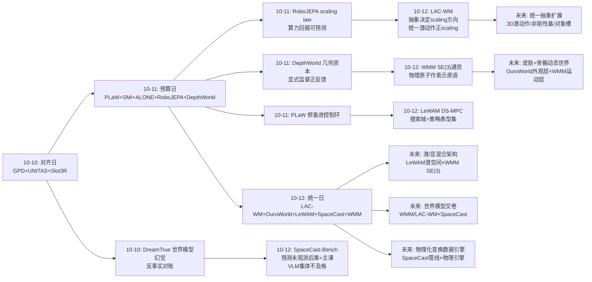
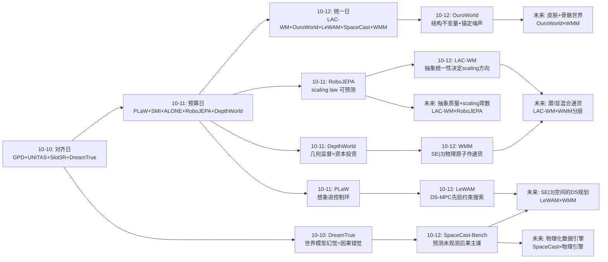
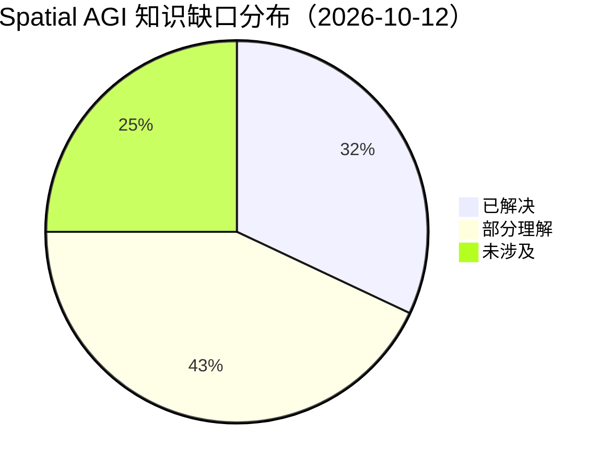
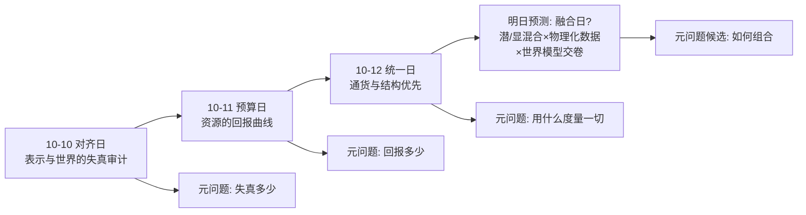
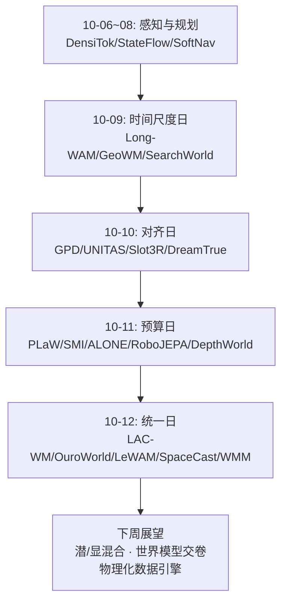

# Spatial AGI 每日深度思考 — 2026-10-12

**日期**: 2026-10-12
**基础日期**: 2026-10-11（昨日任务完整完成：5 篇论文 + 827 行思考）
**论文数量**: 5 篇
**主题**: 统一日（结构与先验优先日）。昨天五篇论文建立了空间智能的"资源经济学"——每种资源（想象、记忆、感知、算力、监督）都要做预算分配。今天五篇论文则在回答一个更根本的问题：**分配资源的对象应该长什么样？** LAC-WM 说：动作的通货应该是具身无关的统一潜在动作空间（割裂的动作空间会让 scaling 反向）；LeWAM 说：状态与行动的通货应该是一个无重建的 JEPA 潜空间，且规划搜索必须被约束在策略先验的典型集内；WMM 说：整个 4D 世界的通货应该是稀疏 SE(3) 轨迹 token，any-to-any 条件化就是世界模型的定义；OuroWorld 说：循环性这类不变量应该由表示的数学结构保证而非损失函数约束，生成监督的不一致应该由带锚点的显式漂移场吸收；SpaceCast-Bench 则宣判：VLM 们在"预测未观测空间后果"这门主课上集体不及格（最佳 58% vs 人类 87%），因为它们缺的恰恰是今天前四篇论文试图构建的那种**可被干预、可被更新的结构化空间状态**。五个工作互不相识，却共同指向同一条设计哲学：**空间智能的可靠性来自表示结构与先验约束，而非更大的模型和更重的损失函数——先找对"通货"，再谈"预算"**。

---

## 📅 每日总结

**日期**: 2026-10-12
**论文数量**: 5篇
**主题**: 统一日。五篇论文从四个方向收敛到同一个命题——**先选对统一抽象，再投入资源**：LAC-WM 证明统一潜在动作空间让跨具身世界模型正 scaling（+46.7%），而显式动作标签的割裂空间负 scaling——抽象层级的选择直接决定投资回报的方向；LeWAM 把状态预测与行动生成统一进无重建 JEPA 潜空间，并用扩散引导把 MPC 搜索锁进策略先验的典型集——统一表征 + 约束搜索 = 稳定规划；WMM 把整个人-物-场景-机器人-相机世界统一为 SE(3) 轨迹 token，any-to-any 掩码条件化让一个网络承担世界模型/策略/规划器/重定向器全部角色；OuroWorld 把"循环"编码进傅里叶参数化的数学结构（looping by construction），把生成噪声编码进锚定漂移场；SpaceCast-Bench 用 3,862 道题量化了统一抽象缺失的代价：模型能看懂空间（L1 62.9%）却推演不了空间（L2 34.4%），因为它们没有可被干预更新的结构化世界状态。

**关键突破**:
- 🚀 **统一动作空间的 scaling 定律（LAC-WM）**：首个系统对比"潜在动作 vs 显式动作"的跨具身世界模型研究。UMAP 可视化证明显式动作编码器即使共享参数也按具身分簇，而带运动解码损失的 IDM 实现强跨数据集对齐。灵巧操作 +46.7%、LIBERO 82.4%→92.0%，且下游性能随预训练具身数量**正向**扩展——统一抽象是 scaling 的前提，这不是启发式而是实验定律。
- 🚀 **搜索域 = 生成先验的典型集（LeWAM DS-MPC）**：对"model-based 规划为何失败"给出机制级诊断——规划器是优化器，必然寻找动力学模型的漏洞来"优化幻觉未来"。解法是把决策变量从动作空间移到 flow 策略的噪声空间并做球面典型集投影：每个候选都是策略被训练过的产物。小数据、不完美动力学下的稳定规划第一次变得可行。
- 🚀 **any-to-any 条件化 = 世界模型（WMM）**：SE(3) 轨迹 token 统一人体/手物/场景流/相机/机器人动作，逐 token 噪声水平的 flow-matching 让单一网络通过掩码切换承担全部推理角色。"预测下一帧"的窄定义被解放为"任意已知子集到任意未知子集的条件分布"。
- 🚀 **结构不变量优先（OuroWorld）**：循环性由傅里叶参数化构造保证（最差的优化结果也无缝循环）；生成多视角视频的不一致性由锚定参考视角的漂移场吸收（锚定防止漂移场吞噬信号本身）。39 场景用户研究胜率 70.8-99.0%，五项能力全满足的唯一方法。
- 🚀 **空间预测的全民考试（SpaceCast-Bench）**：observe-transform-infer 框架 + 几何接地自动管线，首次把"预测未观测空间后果"变成可规模评测的能力。空间感知 ≠ 空间预测被量化（Gemini 3.5 Flash L1 62.9% vs L2 34.4%）；空间特化模型全线接近随机——在错误数据类型上的特化训练零迁移。

**架构演进**: 10 层架构维持 10 层，但出现三个结构性升级：(1) **动作层**确立"统一潜在动作空间 + 具身投影器"的接入模式（LAC-WM），与 WMM 的 SE(3) 动作 token 形成潜/显两条路线；(2) **规划层**从"采样搜索"升级为"先验约束搜索"（LeWAM 典型集投影）——搜索的合法性由生成先验定义；(3) **评测层**新增"预测性空间推理"维度（SpaceCast-Bench），与既有感知基准（Metric-Bench、VSI-Bench）构成双轴；(4) **世界层**的时间维度补齐路线确立（OuroWorld 的低成本活化 + WMM 的显式运动语言）。

### 📊 一句话总结

今天五篇论文共同写下了"空间抽象三律"：**通货要先于预算（LAC-WM/WMM：统一抽象决定 scaling 方向）；不变量要编码在结构里而非损失里（OuroWorld：looping by construction）；搜索要被先验约束而非信任优化器（LeWAM：典型集投影）——而 SpaceCast-Bench 量化了违反三律的代价：看得懂空间但推演不了空间的系统，在这门主课上不及格**。

### 🔗 延续性

**昨日→今日**: 昨日"预算日"确立了空间智能的资源经济学框架——想象、记忆、感知、算力、监督五种预算各有回报曲线（PLaW 1/19 延迟、SMI 83.68% 稀疏化、ALONE 0.9% 观测率、RoboJEPA 二阶幂律、DepthWorld +1.48dB）。今天五篇论文把经济学框架向前推了一步：**在优化预算之前，必须先确定通货**。RoboJEPA 昨天证明了"scaling 可预测"，今天 LAC-WM 揭示了 scaling 的方向性条件——统一潜空间正 scaling、割裂空间负 scaling；也就是说，**错误的抽象会让预算投入变成负资产**。昨日 DepthWorld 确立"几何监督是资本投资"，今天 WMM 把这个思想推到极致：直接把物理原子（SE(3) 刚体轨迹）作为表示的基本单位——资本投资最高效的形式是选择自带物理结构的通货。昨日 RoboJEPA 与 DepthWorld 的"潜空间 vs 显式几何"路线之争悬而未决，今天 WMM 与 LAC-WM/LeWAM 让这场对决有了更清晰的对阵表：潜路线赢在吸收歧义与跨模态对齐，显路线赢在度量精度与结构保证。

**今日→明日**: 值得追踪——(1) LAC-WM 潜动作 × WMM SE(3) 动作：跨具身统一的潜/显两条路线能否在同一系统中分层共存（潜空间做路由、SE(3) 做执行）？(2) LeWAM 典型集投影 × WMM 掩码采样：DS-MPC 直接迁移到 SE(3) token 场景，目标条件轨迹的噪声空间搜索；(3) SpaceCast-Bench × 四个世界模型：LAC-WM/LeWAM/WMM 在 L2/L3 任务上的表现——世界模型学的正是基准测的，正面对决数据即将可测；(4) OuroWorld 周期形变 × WMM 轨迹：OuroWorld 的外观动态层能否被 WMM 的姿态提取摘要为 SE(3) 骨架，形成"皮肤+骨骼"完整动态世界；(5) LAC-WM 统一潜空间 × 昨日 RoboJEPA scaling law：统一动作空间是否改善幂律常数——抽象质量对 scaling 投资回报的量化影响。

### 💡 本质思考：如何达成通用空间智能

#### 1. 核心能力的本质是什么？

今天五篇论文把这个问题推进到"抽象层级"维度。**第一层：空间智能的前提是选对空间的"通货"**。经济学隐喻的完整版：昨天确立了预算（每种资源要有回报曲线），今天确立了通货（预算分配的对象要有统一抽象）。人类空间智能的通货是什么？运动 neuroscience 的答案接近"以身体为中心的 SE(3) 运动基元 + 预测编码"——婴儿先学会预测重物下落再学会语言，海马体的 place cell 本质是空间状态的特征 token。今天 WMM 的 SE(3) 轨迹、LAC-WM 的统一潜动作、LeWAM 的 JEPA 状态流形，都是在为空间智能寻找自己的"token"：**一旦通货选对，预算、规划、学习全部顺势成立；选错，则所有下游投资反向缩水（EAC-WM 的负 scaling 是通货错误的直接财务报表）**。**第二层：可靠性来自结构而非容量**。这是今天最统一的哲学信号。OuroWorld 的循环性不靠损失靠参数化；LeWAM 的规划稳定性不靠更大模型靠搜索域约束；LAC-WM 的跨具身对齐不靠数据堆叠靠辅助解码任务的设计；WMM 的物理接地不靠学习靠 SE(3) 原语的先验选择。五篇论文的每个核心贡献都是"结构性"的：改参数化、改搜索空间、改监督结构、改表示原语——而不是堆数据堆算力。这与深度学习"大力出奇迹"的主流叙事形成有趣张力：在空间智能这里，**结构先行、容量随后**。**第三层：空间智能 = 心智模型 + 受约束的推演**。SpaceCast-Bench 的 observe-transform-infer 框架给出了空间智能的良性定义：构建可干预的心智模型（observe）、在模型上施加变换（transform）、在未观测结果上推断（infer）。今天四个模型工作恰好覆盖三阶段的工程化：WMM/LAC-WM 构建（状态与干预的统一表示）、OuroWorld 补时间纹理（心智模型的环境生命感）、LeWAM 推演（受先验约束的想象）。**第四层：评测即方向**。SpaceCast-Bench 的价值超出基准本身：它把"预测未观测后果"确立为空间智能的核心试金石，并证明感知能力与预测能力近乎独立。评测框架的进化（从"读出关系"到"推演后果"）在牵引整个领域的目标函数迁移——LLM 历史上 benchmark 驱动的能力跃迁（MMLU→GSM8K→代码评测）大概率会在空间智能重演。

#### 2. 当前方法与理想目标的差距在哪里？

**差距一：潜空间与显式几何仍是一张二选一的选票**。今天 LAC-WM/LeWAM（潜）与 WMM/OuroWorld（显）各自完整，但没有一个系统把两者分层组合——潜空间负责语义路由与跨模态对齐、显式几何负责度量精度与物理保证的混合架构只存在于推测中。昨日悬置的"RoboJEPA vs DepthWorld 决胜实验"，今天又多了两组选手，而联合架构的设计空间完全空白。**差距二：预测性空间推理的"作答端"缺位**。SpaceCast-Bench 测的是 VLM 的选择题作答，但理想的空间智能应该能**生成**未观测状态（显式几何或潜状态）而非四选一。WMM 理论上可以作答（掩码条件化生成变换后轨迹），但两者从未对接——"世界模型在空间推理基准上交卷"的实验今天仍是空白。**差距三：统一抽象的覆盖仍不完整**。LAC-WM 统一了动作语义但动作是 2D 潜向量（无 3D 几何）；WMM 统一了运动但排除了非刚性/流体/力；LeWAM 统一了状态-行动但只有 384 维单向量（无对象级结构）；OuroWorld 统一了循环时间但运动是自治的（不可干预）。每个统一都有明确的适用边界，理想的"空间通货"需要同时覆盖：几何+语义+时间+因果+具身——目前没有任何表示覆盖超过两轴。**差距四：生成数据作为监督的噪声理论缺失**。OuroWorld 的 Grounded Drift Field 是第一个系统处理"生成式多视角监督不一致"的机制，但它假设不一致可分解为"共享动态+视角条件漂移"且参考视角可信。当生成模型成为空间数据的主要来源（WMM 的真值也依赖 4D 重建工具），我们需要一般化的"生成监督噪声理论"：哪些不一致该吸收、哪些该拒绝、锚定如何选择——目前全是个案工程。**差距五：评测与训练的变换分布错配**。SpaceCast-Bench 的变换是刚性、瞬时、无物理的（移动/旋转/删除），真实干预的后果要靠动力学。在理想变换（物理引擎）上训练、在简化变换（几何规则）上评测（或反之）的系统，其预测能力的真实性存疑——物理化的 $F(S_0,T)$ 是下一代基准与数据引擎的共同前提。

#### 3. 从今天到理想状态，最可能的路径是什么？

一条"通货统一"驱动的五段路径。**第一段（现在起）：潜/显混合架构的最小原型**。选取最互补的一对：LeWAM 的 JEPA 潜空间（抗干扰、稳定规划）+ WMM 的 SE(3) 轨迹（度量接地、可执行）。最小组合：潜空间做语义级规划（"要移动哪个物体到哪"），SE(3) 层做轨迹级精化（"末端执行器的度量路径"），接口是"潜规划输出作为 SE(3) 生成的掩码条件"。判定标准：混合系统在需要度量精度的任务（插入、倒水）上超过任一单路线。**第二段（并行）：世界模型在空间推理基准上交卷**。把 SpaceCast-Bench 的 L2/L3 任务作为 LAC-WM/LeWAM/WMM 的评测：给定变换前观测（渲染为图像或轨迹），条件生成变换后状态（潜 rollout 或 SE(3) 样本），用基准的几何引擎判分。这个实验把"世界模型学的东西"与"空间智能测的东西"焊在一起，其结果将同时校准两边——若世界模型大幅超过 VLM 选择题作答，则"生成式空间推演"路线获得直接证据。**第三段（3-6个月）：统一抽象的扩展军备竞赛**。按今天的边界逐个突破：LAC-WM 潜动作加入 3D 几何通道（潜空间+显式几何辅助头）；WMM 增加非刚性基（局部线性/流体 token）；LeWAM 的 384 维向量升级为对象槽结构（昨日 Slot3R 的组相联记忆可直接嫁接）。判定标准：每个扩展在原域不退化、在新增域超过专用基线。**第四段（6-12个月）：物理化的变换-推断数据引擎**。SpaceCast-Bench 管线接入物理引擎（重力、碰撞、支撑），$F(S_0,T)$ 从几何规则升级为动力学模拟；同时用 LAC-WM 的跨具身数据飞轮扩充分布（人类视频的物理后果可从姿态序列提取）。产出：物理接地的大规模"变换-推断"数据集，训练与评测同分布。**第五段（1-2年+）：空间智能的完整通货**。理想状态判定标准更新为：一个统一表示，同时编码几何（度量）、语义（what）、时间（动力学）、因果（干预后果）、具身（谁来做），其上的 any-to-any 条件化支撑全部空间推理模式，其 scaling 遵循可测的幂律（RoboJEPA）且方向由抽象的统一性保证（LAC-WM），其预测能力由预测性基准（SpaceCast）持续验收。今天的五篇论文各自点燃了这张地图的一个角落：动作通货（LAC-WM）、状态通货（LeWAM）、运动通货（WMM）、时间通货（OuroWorld）、验收标准（SpaceCast-Bench）——拼图的形状已经可见，剩下的工作是把它拼起来。

---

## 🔗 与昨日思考的联系

### 昨日重点

昨日"预算日"确立四个结论：(1) **空间智能是在多重资源约束下的高成功率行为**——想象延迟（PLaW 1/19）、记忆容量（SMI 83.68% 稀疏化）、感知时间（ALONE 0.9% 观测率）、训练算力（RoboJEPA 幂律）都有限且可预算；(2) **每种预算都有"便宜内省调度昂贵生成"的双层结构**（预测头、MLLM 记忆管理员、可靠性头）；(3) **几何监督是不可预算削减的资本投资**（DepthWorld +1.48dB 正反馈）；(4) **可预测性（scaling law）是规模化投资的前提**（RoboJEPA 让投资决策科学化）。遗留悬念：潜空间路线（RoboJEPA 想象误差）与显式几何路线（DepthWorld 深度误差）的决胜实验；四种预算之间没有全局优化器。

### 今日进展

今天在昨日基础上完成四个推进：(1) **预算的对象被追认为主导变量**——昨日默认预算分配发生在"既定架构"内，今天 LAC-WM 证明抽象选择本身决定 scaling 方向（正/负），预算经济学必须先修"通货学"：错误抽象下的预算投入是负 ROI。(2) **"内省调度生成"的双层结构获得了搜索侧的对应物**——昨日 PLaW/ALONE/SMI 用内省组件调度生成组件的输出，今天 LeWAM 把同样的思想用于搜索过程本身：DS-MPC 用策略先验约束搜索域——内省不仅评估生成结果，还圈定生成的合法空间。(3) **资本投资的形式具体化为"表示原语的选择"**——昨日 DepthWorld 说几何监督是复利资产，今天 WMM 说最彻底的复利是直接采用物理原子（SE(3)）作为通货：结构自带的不变量（刚体性、度量）不需要投资、终身有效。(4) **评测的杠杆位置被确立**——昨日所有论文都在"被评测"的位置，今天 SpaceCast-Bench 主动定义了空间智能的核心考试（预测未观测后果），并揭示了感知与预测的独立性——这为昨天四种预算的投入提供了统一的验收科目：预算花得值不值，最终看预测推演能力涨没涨。

### 演进路径



---

## 📚 论文概览

**论文1: LAC-WM**（Stanford + Meta FAIR，arXiv:2610.10846）——跨具身机器人基础世界模型。四组件：V-JEPA-2 视觉编码器 + 逆动力学模型 IDM（连续两帧→潜在动作）+ 前向动力学模型 FDM（状态+潜动作→下一状态）+ 运动解码器 MD（潜动作→显式运动标签）。跨增广训练防 shortcut。微调三阶段 LoRA + 动作投影器接入新具身。灵巧操作 +46.7%、LIBERO +11.7%、正 scaling vs 显式动作条件的负 scaling。Fei-Fei Li / Jiajun Wu / Franziska Meier 团队。

**论文2: OuroWorld**（NYCU + Alaya Lab，arXiv:2610.12461）——mask-free 3D cinemagraph。三阶段：VLM（GPT-5.5）推断动态并 prompt 视频模型（Seedance 2.0）生成循环参考视频 → VGGT-Ω 提升 + TrajectoryCrafter 修复出 20 路多视角视频 → Inconsistency-Robust Periodic 4DGS（傅里叶周期形变场 looping by construction + 锚定参考视角的 Grounded Drift Field 吸收生成不一致）。39 场景、用户研究胜率 70.8-99.0%、五项能力全满足的唯一方法。

**论文3: LeWAM**（arXiv:2610.12407）——无重建 JEPA 世界动作模型。ViT-tiny 从零训练 + SIGReg 防坍缩，384 维单向量潜空间；一个双向 Transformer 通过掩码执行前向/后向/逆动力学/策略四模式（每个 batch 全跑）；动作生成用 rectified flow（8 步 Euler 积分）。核心贡献 Diffusion Steering：MPC 决策变量从动作空间移到 flow 策略噪声空间 + 典型集投影（拉回 √A 球面），防止规划器利用动力学误差。PushT + robomimic 六任务，抗视觉干扰、闭环匹配同尺寸 BC、DS 规划显著优于动作空间 MPC。

**论文4: SpaceCast-Bench**（arXiv:2610.12402）——预测性空间推理基准。observe-transform-infer 框架：观察变换前多视角 → 告知变换（移动/环绕/删除物体/整体旋转） → 在未观测结果状态回答空间查询。3,862 题 / 182 ScanNet 系场景 / 16 任务 / 3 层级（L1 静态感知、L2 局部预测、L3 全局预测）。几何接地自动管线：深度校验视角链、attachment 图传递闭包、变换后重跑关系引擎取真值。21 模型评测：最佳 58.0% vs 人类 87.2%，空间特化模型近随机；显式 3D 证据 > 生成结果图像；SFT 引擎域内 +31.7、域外 6 基准一致提升。

**论文5: WMM**（UC Berkeley + Harvard，arXiv:2610.01742）——World Motion Models。SE(3) 轨迹作为 4D 世界统一语言：pose token（9 维三点参数化）+ 共享 what 特征（DINO/PointNet）；逐 token 噪声水平的 flow-matching（Diffusion Forcing/dLLM 式异步噪声）；解耦虚拟时间线的上下文 token 支持非因果锚定。any-to-any 边缘条件化 = 世界模型的操作型定义：单一网络掩码切换即预测器/策略/动力学/填充/重定向。6 应用（机器人策略、MPC、场景预测、人-物交互、多人形重定向）全 SOTA。Darrell / Kanazawa / Qianqian Wang。

---

## 💡 核心见解

### 见解1: 抽象的统一性决定 scaling 的方向

**从 LAC-WM 获得**
- ✅ 显式动作编码器即使共享参数（EAE*），不同具身的动作嵌入仍按数据集分簇——问题不在编码器容量而在监督信号的具身绑定
- ✅ 统一潜在动作空间下，下游性能随预训练具身数量正向扩展；割裂空间下反向——scaling 的方向是抽象质量的函数
- ✅ 运动解码损失是潜空间对齐的关键：去 MD 后 IDM 嵌入只有部分聚合，加 MD 后强对齐——辅助解码比量化/降维更能兼顾防 shortcut 与表征容量

**对Spatial AGI的启发**: 昨天 RoboJEPA 给了空间智能第一张算力回报曲线，今天 LAC-WM 给了这条曲线的方向开关：**抽象不统一，投资越多亏越多**。这把"表示学习"从工程偏好提升为财务问题——选择表示时应先做小规模跨域对齐测试（如 UMAP 聚类质量），再决定投入 scaling。对 Spatial AGI 更广的含义：感知、记忆、规划的表示都应通过"跨域对齐审计"（不同传感器/具身/场景源的嵌入是否在同一个流形上）作为 scaling 前的尽职调查。

### 见解2: 搜索必须以生成先验为边界

**从 LeWAM 获得**
- ✅ 动作空间 MPC 的失败机制：规划器必然利用动力学模型的不完美，"优化幻觉未来"——数据越少模型越不完美，失败越必然
- ✅ Diffusion Steering 把决策变量移到 flow 策略的噪声空间：每个候选经确定性解码都是策略被训练过的产物
- ✅ 典型集投影（拉回 √A 球面）是关键细节：无投影的搜索会缩小范数等价于降温采样，mode-seeking 吞噬探索

**对Spatial AGI的启发**: 这是对"探索"本质的架构级回答——**智能体的想象不该越出它被训练生成的分布**。与语言模型中"约束解码"（在合法 token 空间内搜索）同构。Spatial AGI 的空间推理（规划轨迹、想象后果、搜索方案）都应遵守"先验约束搜索"原则：与其做无先验的原始空间搜索然后用价值函数过滤，不如在生成模型的典型集内搜索——前者把模型误差变成攻击面，后者把模型先验变成护栏。这个原则可以统一今天所有规划工作（LeWAM 的 DS、WMM 的掩码采样、昨日 TD-MPC 系的 MPPI）成一个理论框架。

### 见解3: any-to-any 条件化是比"预测下一帧"更正确的世界模型定义

**从 WMM 获得**
- ✅ 世界模型 = 轨迹集合任意划分（已知/未知）诱导的条件分布族 $P(\mathcal{T}_{unk}|\mathcal{T}_{obs})$——预测、逆向归因、插值、目标条件、跨身体映射全部是特例
- ✅ 逐 token 独立噪声水平让单一网络覆盖全部条件边缘——"预测什么"从训练时的任务设计变成推理时的掩码选择
- ✅ 机器人动作在控制器固定时可还原为虚拟目标 pose 序列——观测与动作同语言，策略与动力学自然统一

**对Spatial AGI的启发**: 这个定义解放了世界模型的应用空间。过去"世界模型"默认是前向预测器，导致架构与任务绑定；any-to-any 视角下，Spatial AGI 需要的所有空间推理模式（SpaceCast 的 transform-infer、逆因果归因、目标条件规划）都是同一权重的不同读出。这对系统设计的直接要求：**训练目标应覆盖条件划分的多样性**（随机掩码模式），而非针对单一预测任务优化——与 LLM 的多任务预训练哲学一致，但 token 是几何的。

### 见解4: 不变量应编码在表示结构中，而非损失函数中

**从 OuroWorld 获得**
- ✅ 傅里叶参数化让循环性"由构造保证"——无论优化结果如何，t=T 无缝回到 t=0；对比损失惩罚接缝的软约束路线，结构保证零失败率
- ✅ Grounded Drift Field 的"锚定"设计：漂移自由度必须有零点，否则漂移场会吞噬信号本身（图4b 的失败模式）——吸收噪声的自由度需要锚点
- ✅ 傅里叶时间基同时突破 Eulerian 流的流体限制，覆盖一般形变/物体运动/光照变化

**对Spatial AGI的启发**: 这是深度学习时代容易遗忘的工程智慧，值得作为 Spatial AGI 的设计宪法第一条：**凡是能由表示的数学结构保证的性质，就不要交给优化器**。可推广清单：循环性（傅里叶/周期参数化）、刚体性（SE(3) 原语，WMM 已示范）、等变性（群表示）、拓扑（持久同调约束）、守恒量（辛积分器）。每一条结构保证都是永久免费的——不需要数据、不消耗算力、不会被遗忘。"锚定"原则同样可推广：任何为吸收噪声/不一致而设的自由度，都必须有可信的参考点约束，否则自由度反噬信号——适用于生成数据训练的一切场景。

### 见解5: 空间感知与空间预测是近乎独立的能力轴

**从 SpaceCast-Bench 获得**
- ✅ 最强模型 L1→L2 掉分近 30 分（62.9%→34.4%）——读出可见关系的能力几乎不预测推演不可见后果的能力
- ✅ 6 个空间特化模型（在静态感知数据上特化训练）在预测任务上接近随机——错误数据类型上的特化零迁移
- ✅ CoT 无一致收益——瓶颈在心智模型的构建与更新，不在推理链的言语表达
- ✅ 显式 3D 证据比生成的结果图像/视频更可靠——空间反事实需要可操作的结构，不是想象渲染

**对Spatial AGI的启发**: 这是对整个"空间微调"赛道的方向修正：当前数据引擎几乎全在制造"感知型"数据（关系在图中可见），而可迁移的是"变换-推断型"数据。昨天 SMI 的记忆治理、ALONE 的信念传播，本质上都在维护"可被干预更新的世界状态"——SpaceCast 把这个隐含能力变成了显式考试。Spatial AGI 的训练管线应立即加入程序化生成的变换-推断数据（SpaceCast 管线开源了模板）；评测管线应以 L2/L3 类任务为核心指标，L1 感知分数仅作参考。

### 见解6: 动作与观测应该说同一种语言

**从 WMM 与 LAC-WM 共同获得**
- ✅ WMM：机器人动作在控制器固定时 = 虚拟目标 pose 序列——动作 token 与观测 token 同空间，策略/动力学/规划统一
- ✅ LAC-WM：不同具身的动作经 IDM 映射到统一潜空间——动作语义与具身解耦
- ✅ 两者从显式（SE(3)）与潜在（learned embedding）两端逼近同一目标：动作的可迁移、可生成、可推理表示

**对Spatial AGI的启发**: 控制论历史上"观测-动作分离"是工程便利而非认知必然。空间智能体理想的信息架构中，"世界如何运动"与"我如何让它运动"应是无缝翻译的同一表示层——看到人类的抓取轨迹即可想象自己手臂的对应动作（WMM 重定向已实现）、预测自己的动作后果即预测世界的下一个状态（LAC-WM 的 FDM）。这个同语性是"从观察中学习技能"（人类视频学习）的表示论基础：**能看懂的动作才能学会，能生成的动作才能执行**——统一语言让"懂"与"会"只差一次解码。

### 见解7: 生成式监督需要噪声理论，锚定是第一原理

**从 OuroWorld 获得（推广至全场）**
- ✅ 生成模型作为 3D/4D 数据源时的跨视角不一致会模糊场景、混乱运动——直接拟合是错误
- ✅ 视角条件漂移场 + 参考视角零漂移锚定 = 吸收噪声而不侵蚀信号
- ✅ 对比 ICP 方案（仅几何、静态假设）：联合学习的漂移场能处理属性漂移与动态内容

**对Spatial AGI的启发**: 空间智能正在进入"生成数据为主"的时代（WMM 真值来自 4D 重建、LAC-WM 部分来自姿态估计、OuroWorld 全部来自视频生成）——**每条生成数据都带模型偏差**，需要一般化的处理框架。OuroWorld 提供了第一性原理：显式建模噪声自由度（不让它进表示）+ 锚定可信参考（防止自由度反噬）。下一步是把这从个案工程升级为标准组件：{噪声建模维度（视角/时间/模态/风格）、锚定选择准则、锚点可信度验证、噪声-信号边界的学习}——一个"生成监督的稳健回归"理论。

### 见解8（补充）: 评测的进化在牵引领域的目标函数

**从 SpaceCast-Bench 与今日全场所获**
- ✅ 从"读出关系"（VSI-Bench 时代）到"推演后果"（SpaceCast）——评测定义了什么是空间智能
- ✅ 因子化诊断（层级×关系×参考系）让失败可归因：L3 全局旋转最弱（场景旋转与视角变化混淆）
- ✅ 基准对齐的 SFT 产生域外迁移——评测数据即训练数据引擎的原型

**对Spatial AGI的启发**: LLM 历史上 benchmark 是领域方向最有效的牵引器。空间智能需要主动设计"能力定义型"评测（预测、干预、反事实），而非"能力验收型"评测（感知精度）。今天五篇论文里三篇直接或间接为 SpaceCast 类基准服务（三个世界模型都是潜在作答者）——**评测与模型的共同进化循环**已在形成：基准定义能力缺口 → 世界模型填补 → 更难的基准（物理化 $F$）→ 更强模型。

---

## 🗺️ 知识演进图



---

## 技术栈演进对比表

| 层次 | 昨日方案（10-11 预算日） | 今日方案（10-12 统一日） | 变化 |
|------|---------|---------|------|
| 动作表示 | PLaW：动作专家消费潜预测上下文（单具身） | LAC-WM：统一潜在动作空间 + 具身投影器；WMM：SE(3) 动作 token 与观测同语 | 动作从"具身绑定的控制量"升级为"跨具身/跨实体的统一通货"，潜/显两条路线成型 |
| 状态表示 | RoboJEPA：V-JEPA 2.1 冻结编码器 + 动态预测器（潜空间 scaling） | LeWAM：无重建 JEPA 潜空间 + 四模式统一；WMM：显式 SE(3) 轨迹网格 | 状态表示的"无重建"共识强化，且新增显式几何 token 路线；四模式/any-to-any 条件化成为标准 |
| 规划/决策 | ALONE：按需观测 + 贝叶斯信念传播 | LeWAM：DS-MPC（噪声空间搜索 + 典型集投影） | 从"感知预算调度"扩展到"搜索域约束"——规划稳定性的机制级方案出现 |
| 时间维度 | Long-WAM（10-09）上下文扩展；昨日未直接处理世界动态生成 | OuroWorld：周期形变场把静态 3DGS 活化；WMM：显式轨迹生成先验 | 时间纹理与运动语言补齐——世界模型的时间维度从"预测下一帧"扩展到"结构保证的循环 + 度量轨迹先验" |
| 监督/数据 | DepthWorld：几何标定管线（DROID-3D），监督质量底线 | SpaceCast：变换-推断型数据引擎（SFT 域外迁移验证）；OuroWorld：生成监督的锚定漂移吸收 | 数据类型从"感知标注"扩展到"变换-推断"对；生成数据作为监督源的噪声理论开端 |
| 评测 | RoboJEPA：想象误差作真机成功代理 | SpaceCast-Bench：预测性空间推理主课（3862 题），感知/预测独立性证明 | 评测从"单模型代理指标"升级为"能力定义型基准"；预测推演成为核心验收科目 |
| 记忆 | SMI：四原子操作记忆治理（昨日） | 今日未直接涉及（Slot3R/SMI 仍是最新） | 无变化；对象级记忆更新仍是最大缺口 |
| 跨具身 | （昨日未直接涉及；10-10 DreamTrue 有反事实动作） | LAC-WM：跨具身预训练正 scaling + 投影器接入；WMM：上下文示范重定向 | 跨具身从"个案技巧"升级为"统一潜空间 + 正 scaling"的系统方法 |
| 不变性/保证 | （无直接对应） | OuroWorld：looping by construction；WMM：SE(3) 刚体先验 | "结构保证优先于软约束"作为设计原则首次成体系出现 |
| 语义接口 | PLaW：VLM 语义接地 → 潜预测 | OuroWorld：VLM 作为动态导演（推断该动什么）；LeWAM 目标仍需示范检索 | VLM 角色从语义接地扩展到"动态常识推理"；语言→空间目标的直接通路仍是缺口 |

---

## 🗺️ Spatial AGI 知识图谱

### 10层架构思维导图

```mermaid
mindmap
  root((Spatial AGI<br/>10层架构))
    第1层 感知
      按需观测 ALONE 0.9%
      查询空间可靠性
      多视角整合<br/>SpaceCast桥接视角
      抗干扰潜感知 LeWAM
    第2层 表示
      统一潜动作空间 LAC-WM
      SE(3)轨迹token WMM
      JEPA潜空间 LeWAM 384维
      9维三点pose参数化
      跨增广防shortcut
    第3层 记忆
      四原子操作 SMI
      组相联空间记忆 Slot3R
      83.68%稀疏化
      对象级更新（缺口）
    第4层 时间/动力学
      傅里叶周期形变 OuroWorld
      looping by construction
      动作条件FDM LAC-WM
      any-to-any轨迹先验 WMM
    第5层 预测/想象
      潜空间并行预测 PLaW 1/19
      想象误差幂律 RoboJEPA
      DS-MPC噪声空间搜索 LeWAM
      预测未观测后果 SpaceCast主课
    第6层 规划/决策
      典型集投影 LeWAM
      掩码采样 WMM
      目标条件潜距离
      先验约束搜索原则
    第7层 行动/具身
      跨具身投影器 LAC-WM
      LoRA三阶段接入
      rectified flow策略头
      跨具身重定向 WMM
    第8层 语义/语言
      VLM动态导演 OuroWorld
      VLA语义接地 PLaW
      attachment空间常识
      语言→目标（缺口）
    第9层 监督/数据
      变换-推断数据引擎 SpaceCast
      生成监督锚定漂移 OuroWorld
      运动解码辅助对齐 LAC-WM
      几何标定资本 DepthWorld
    第10层 评测/元认知
      预测性空间推理基准 SpaceCast
      感知/预测独立性
      想象误差代理 RoboJEPA
      UMAP对齐审计 LAC-WM
      结构不变量优先原则
```

### 🎯 主线技术路径

#### 阶段1: 通货选择期（现在，2026 Q4）

空间智能的表示研究进入"通货竞争"：潜空间路线（LAC-WM 统一潜动作、LeWAM JEPA 状态）vs 显式几何路线（WMM SE(3) token、OuroWorld 周期 4DGS）。关键任务：跨域对齐审计成为表示选择的尽职调查（UMAP 聚类质量、probe 可读性）；scaling 前先验证抽象统一性（LAC-WM 教训：割裂空间负 scaling）。本阶段的产出是"通货评测协议"：一组快速判定表示是否值得投入 scaling 的标准测试。

#### 阶段2: 混合架构期（2026 Q4 - 2027 Q1）

潜/显分层组合的原型验证：潜空间负责语义路由、跨模态对齐、抗干扰（LeWAM/LAC-WM 的强项）；显式几何负责度量精度、物理保证、可执行性（WMM/OuroWorld 的强项）。关键实验：LeWAM 潜空间 × WMM SE(3) 的两层规划（语义选目标、几何精化路径）；世界模型在 SpaceCast 类基准上交卷（生成式作答 vs VLM 选择题）。判定标准：混合系统在度量敏感任务上超过任一单路线。

#### 阶段3: 数据与评测共同进化期（2027 上半年）

SpaceCast 式变换-推断数据引擎接入物理引擎（$F$ 从几何规则升级为动力学模拟）；评测从选择题升级为生成式作答（世界模型输出变换后状态，几何引擎判分）；LAC-WM 跨具身数据飞轮扩充分布（人类视频的物理后果提取）。生成监督噪声理论标准化（OuroWorld 锚定漂移 → 通用组件：噪声维度建模 + 锚定选择 + 可信度验证）。产出：物理接地的大规模空间推演数据集 + 生成式空间推理基准 v2。

#### 阶段4: 统一系统期（2027 下半年 - 2028）

理想状态：单一统一表示覆盖几何+语义+时间+因果+具身五轴，any-to-any 条件化支撑全部空间推理模式；感知-记忆-想象-行动四资源统一调度器（昨日第3-5段路径与今日通货融合）；scaling 遵循可测幂律（RoboJEPA）且方向由抽象统一性保证（LAC-WM）；预测推演能力由进化中的基准持续验收。判定标准：一个系统，看人类视频学会新技能（WMM 重定向）、在想象中预演后果（LeWAM DS）、记住并更新环境状态（SMI+Slot3R）、用语言接受指令并回答反事实空间问题（SpaceCast 满分）——空间智能的"GPT-2 时刻"。

---

## 🔍 待探索议题

### 高优先级（本周）

1. **潜动作 × SE(3) 动作的分层组合**
   - 问题: LAC-WM 的统一潜动作与 WMM 的 SE(3) 动作 token 能否在同一系统中分层共存——潜空间做跨具身路由、SE(3) 做度量执行？
   - 候选方案: LAC-WM 的动作投影器输出作为 WMM 轨迹生成的条件 token；或在 LAC-WM 潜空间上加 SE(3) 解码头做中间验证
   - 缺口: 两套模型的潜空间语义不可直接对齐，需要桥接训练数据（同一动作的潜向量与 SE(3) 轨迹对）

2. **世界模型在 SpaceCast-Bench 上交卷**
   - 问题: LAC-WM/LeWAM/WMM 在 L2/L3 预测任务上 vs VLM 选择题作答，差距多大？"生成式空间推演"假设能否被证实？
   - 候选方案: 把基准的变换渲染为世界模型的观测输入，掩码条件生成变换后轨迹/潜状态，用基准几何引擎判分
   - 缺口: 世界模型需要从姿态真值训练而基准只提供渲染图像——感知前端缺位；潜状态无法直接判分需解码

3. **DS-MPC 迁移到 SE(3) token 场景**
   - 问题: LeWAM 的噪声空间搜索在 WMM 的逐 token flow-matching 上是否同样成立——目标条件轨迹的典型集搜索？
   - 候选方案: WMM 策略模式下噪声场 $\epsilon_{1:H}$ 作为决策变量，目标 token 距离作评分，CEM 更新
   - 缺口: token 网格维度高（M×N×9），噪声空间搜索的计算预算与收敛性未知

### 中优先级（本月）

4. **抽象统一性对 scaling 常数的量化影响**
   - 问题: 统一潜空间（LAC-WM）vs 割裂空间（EAC-WM）的想象误差幂律（RoboJEPA 式）常数差多少？抽象质量的财务价值首次量化
   - 候选方案: 在两种动作条件化下分别跑 RoboJEPA 式 scaling 实验，拟合幂律对比 α、γ
   - 缺口: 需要统一的想象误差定义（潜 rollout 误差跨架构可比性）；训练成本高

5. **生成监督噪声理论的一般化**
   - 问题: OuroWorld 的锚定漂移场何时失效——生成不一致超过"共享动态+视角漂移"可分解范围时怎么办？多锚点如何选择？
   - 候选方案: 锚点可信度的自监督验证（多锚点交叉一致性）；噪声维度扩展（时间/模态/风格条件漂移）
   - 缺口: 漂移-信号边界的理论刻画；大规模生成数据集上的系统性验证

6. **L2 局部预测失败的机制解剖**
   - 问题: VLM 在 L2 上崩溃（34.4%）究竟败在"构建心智模型"、"应用变换"还是"维持未受影响区域"？三阶段分别量化
   - 候选方案: 用 SpaceCast 的因子化设计做探针实验：给模型中间产物（显式场景图/变换后单视角）逐段解除负担
   - 缺口: 中间产物标注的成本；模型内部表征与基准三阶段的对应关系不明

7. **attachment 结构的空间常识注入**
   - 问题: SpaceCast 的 attachment 图（支撑/连接因果耦合）能否作为 VLM/世界模型的显式监督信号——"推书先移杯"类安全推理
   - 候选方案: 从 ScanNet 系场景批量提取 attachment 图训练 VLM 的结构感知头；世界模型的动作条件加入 attachment 约束
   - 缺口: attachment 提取的召回率（接触/支撑启发式的漏检）；动态场景中 attachment 的时效性

### 低优先级（本季度）

8. **傅里叶周期表示的动作条件化**
   - 问题: OuroWorld 的自治循环能否升级为可控——推船的力度改变傅里叶系数（振幅/频率），实现"可干预的动态世界"
   - 候选方案: 傅里叶系数网络以动作 token 为条件；或周期形变场与 WMM 轨迹场耦合（周期背景+轨迹前景）
   - 缺口: 可控性与循环保证的兼容（干预后的新稳态是否仍周期）；交互数据的来源

9. **对象槽 JEPA 潜空间**
   - 问题: LeWAM 的 384 维单向量换成对象槽结构（Slot3R 组相联记忆嫁接），DS 规划是否依然稳定、probe 对齐是否提升？
   - 候选方案: 槽位 token 化（每对象一组潜向量）+ 注意力骨干；SLAM 式槽位地址（位置决定地址）
   - 缺口: 对象分割/跟踪的前端依赖；槽位数量动态变化的训练稳定性

10. **空间元数据协议的扩展（承接昨日）**
    - 问题: 昨日提出的 {值, 可靠性, 来源, 时间戳} 协议，如何纳入今日的"抽象对齐度"与"生成监督噪声水平"两个新维度？
    - 候选方案: 协议 v2：+{跨域对齐评分（UMAP/probe），噪声自由度声明（是否锚定）}
    - 缺口: 对齐评分的在线计算成本；协议的标准化组织（谁背书）

11. **SE(3) 轨迹先验与视频模型的耦合训练**
    - 问题: WMM（运动骨架）与视频扩散（外观皮肤）能否联合训练——视频损失正则轨迹合理性，轨迹条件提升视频物理性？
    - 候选方案: 双塔 + 交叉注意力（轨迹 token 条件化视频 latents）；或视频模型内部蒸馏出轨迹头
    - 缺口: 配对数据（视频+真值轨迹）规模；联合训练的两难（外观损失主导时轨迹头退化）

---

## 📊 知识缺口分析



**已解决（32%）**:
- ✅ 跨具身动作统一的可行路线（LAC-WM：统一潜空间 + 投影器，正 scaling 实证）
- ✅ 机器人世界模型的 scaling 科学（RoboJEPA 幂律 + LAC-WM 方向条件：抽象统一性决定正负）
- ✅ 动作空间 MPC 失败的机制诊断与解法（LeWAM：噪声空间搜索 + 典型集投影）
- ✅ 4D 世界的统一运动语言（WMM：SE(3) token + any-to-any 条件化，6 应用 SOTA）
- ✅ 静态 3D 世界的低成本活化（OuroWorld：循环构造保证 + 锚定漂移，五能力全满足）
- ✅ 预测性空间推理的评测框架（SpaceCast：observe-transform-infer，3862 题可规模评测）
- ✅ 空间感知与空间预测的独立性证明（L1→L2 掉 30 分；特化训练零迁移）
- ✅ 生成多视角监督的不一致吸收机制（OuroWorld Grounded Drift Field）

**部分理解（43%）**:
- ⚠️ 潜空间 vs 显式几何的路线选择——四组选手（RoboJEPA/DepthWorld/LAC-WM-LeWAM/WMM-OuroWorld）各有完整证据，但无同预算正面对照，混合架构只存在于推测
- ⚠️ 结构保证的适用边界——looping by construction、SE(3) 刚体、典型集投影各自成立，但"哪些空间性质可以结构化保证"的清单不完整（非刚性、流体、拓扑未覆盖）
- ⚠️ 变换-推断数据的迁移机制——SpaceCast SFT 域外提升被验证，但迁移的边界（哪些域外基准、多大模型、scaling 行为）未知
- ⚠️ 生成监督的噪声理论——锚定漂移是第一个机制，但一般化（多锚点、噪声维度、失效条件）未完成
- ⚠️ 统一抽象的覆盖缺口——潜动作无 3D、SE(3) 无非刚性、JEPA 无对象结构、周期无干预响应；每个通货覆盖不足两轴
- ⚠️ VLM 空间预测失败的定位——知道 L2 崩溃但三阶段（构建/变换/推断）的失败分布未解剖
- ⚠️ 记忆与预测的整合——SMI 治理的记忆如何服务 WMM/LeWAM 式推演（记忆作为条件 token）未打通
- ⚠️ 世界模型评测与空间基准的对接——"生成式作答"的技术路径清晰但从未执行

**未涉及（25%）**:
- ❌ 非刚性与连续介质（布料/流体/颗粒/断裂）的空间表示——WMM 明确排除，无替代方案
- ❌ 力、质量、接触的动力学层——所有今日模型都是运动学的，"推它需要多大力"无人能答
- ❌ 语言→空间目标的直接通路——LeWAM 需示范检索、WMM 需 token 条件、"把杯子放到左边"到目标状态的翻译缺口
- ❌ 物理化变换 F——SpaceCast 的变换无重力无碰撞，真实干预后果的评测与训练数据空白
- ❌ 多时间尺度动态——OuroWorld 单周期、WMM 有限窗口；风吹（秒）与昼夜（小时）的嵌套表示缺失
- ❌ 开放世界泛化——ScanNet 室内域、有限实体类别；室外/新物体的空间推演未测
- ❌ 记忆的对象级动态更新（延续昨日缺口）——状态变化使旧记忆失效的机制仍空白
- ❌ 空间智能的系统性安全——预测错误在物理世界的代价模型、安全约束进入搜索域的正式方法

---

## 附录A: 今日论文与十层架构的映射

| 层 | 论文1 LAC-WM | 论文2 OuroWorld | 论文3 LeWAM | 论文4 SpaceCast | 论文5 WMM |
|---|---|---|---|---|---|
| 1 感知 | V-JEPA-2 编码 | VGGT-Ω 提升+修复 | ViT 从零训练 | 深度校验视角链 | DINO/PointNet 特征 |
| 2 表示 | **统一潜动作空间** | 傅里叶周期形变场 | **JEPA 潜空间+SIGReg** | attachment 图+3D 几何 | **SE(3) 轨迹 token** |
| 3 记忆 | — | canonical 3DGS 保持 | 上下文窗口 4 帧 | — | 上下文 token |
| 4 时间/动力学 | FDM 动作条件预测 | **looping by construction** | 前向/后向模式 | 变换引擎 F | **any-to-any 轨迹先验** |
| 5 预测/想象 | 想象 rollout | 生成动态参考 | 想象 rollout | 未观测后果查询 | 掩码条件生成 |
| 6 规划/决策 | best-of-N | — | **DS-MPC 典型集投影** | — | 掩码采样+MPC |
| 7 行动/具身 | **投影器跨具身接入** | — | rectified flow 策略 | — | 动作=pose 序列 |
| 8 语义/语言 | — | **VLM 动态导演** | — | 自然语言变换+查询 | 辅助条件 A |
| 9 监督/数据 | 跨具身+运动标签 | 生成监督+锚定漂移 | 四模式自监督 | **变换-推断数据引擎** | 姿态真值多来源 |
| 10 评测/元认知 | 正/负 scaling + UMAP | 用户研究+GT-free 评测 | probe 对齐 | **预测性基准本体** | 6 应用 SOTA |

## 附录B: 本周三天的主题弧线



三天的隐含主线：先审计每一层的失真（对齐），再为每种资源定价（预算），今天回到最底层——**选定度量一切的通货**。这个顺序恰好是任何工程学科的成熟路径：标准（度量）→ 成本（经济学）→ 质量（对齐）。空间智能正在按这门学科应有的顺序补课。

---

**文档创建时间**: 2026-10-12 03:00-04:00 CST
**基础日期**: 2026-10-11（昨日任务完整）
**分析方法**: arXiv HTML 精读 + 跨论文综合推理

---

## 🧠 深度专题一：空间通货的竞争史——四次抽象跃迁

### 1.1 从像素到 SE(3)：通货进化的四个时代

空间智能的表示研究史，可以读作一部"通货竞争史"——每个时代都有自己的主导通货，每次跃迁都由旧通货的一个根本缺陷触发：

**第一代：像素通货（2020 前）**。图像/视频帧作为基本单位，CNN/ViT 处理。缺陷：像素是传感器的产物而非世界的属性——视角、光照、尺度全部纠缠，"同一空间"在不同像素观测下毫无相似性。VSI-Bench 类基准上 VLM 的挣扎是这个通货缺陷的最后显影。

**第二代：几何通货（2020-2024）**。NeRF/3DGS 把空间表示为辐射场/基元的集合，SpaceCast 类 3D 基准与重建管线繁荣。缺陷：静态——3DGS 场景是"冻结的照片立体"，时间维度缺席；且基元是渲染优化的产物，物理语义稀薄（昨日对齐日已审计：GS 基元 ≠ 碰撞体）。OuroWorld 的动机图直接点破：3D 世界模型生成的是"frozen worlds"。

**第三代：学习潜通货（2024-2026）**。JEPA/Dreamer 系把空间压缩进学习出的潜空间，RoboJEPA 给出 scaling 定律，PLaW-VLA 证明潜想象能进控制环。优势：任务自适应、抗干扰（LeWAM 实证）、可扩展（RoboJEPA 幂律）。缺陷：不透明、无度量保证、且——今天 LAC-WM 揭示——**潜空间的统一性不是免费的，需要精心设计的辅助监督（运动解码）来焊接**。

**第四代：结构通货（今天，2026-10）**。今天五篇论文共同宣告的方向：把已知的物理/数学结构直接铸进通货——SE(3) 刚体性（WMM）、周期性（OuroWorld 傅里叶）、策略分布的典型集（LeWAM）、统一动作语义的流形（LAC-WM）。通货不再纯靠学习发现，而是"结构骨架 + 学习血肉"。

### 1.2 通货竞争的评判标准

综合今天五篇论文，一个空间通货的竞争力可以用五个维度审计：

| 维度 | 像素 | 3DGS/NeRF | 学习潜空间 | 结构通货(SE(3)/傅里叶) |
|---|---|---|---|---|
| 度量接地 | ✗ | ✓ | ✗ | ✓ |
| 跨域统一性 | ✗ | 部分 | 需辅助监督（LAC-WM） | ✓（SE(3) 天然统一） |
| 时间演化 | ✓（视频） | ✗ | ✓（预测） | ✓（轨迹/周期） |
| 可干预性/因果 | 隐式 | ✗ | ✓（动作条件） | ✓（掩码=干预） |
| 结构保证的性质 | 无 | 渲染一致性 | 无 | 循环/刚体/典型集 |

**WMM 的 SE(3) 通货是唯一五维全绿的**——这解释了为什么它敢宣布 any-to-any 是世界模型的定义。但它的软肋同样明显：非刚性排除、依赖姿态真值。学习潜通货在"吸收歧义"上仍有不可替代的价值（LAC-WM 的动作语义、LeWAM 的抗干扰）。结论：**第四代不是取代第三代，而是分域共存+分层组合**。

### 1.3 通货选择与昨日预算学的接口

昨日的资源经济学在今天的通货框架下获得了更深的解读：

- **RoboJEPA 的幂律是"潜通货的汇率表"**——算力投入按幂律兑换为想象精度；
- **LAC-WM 的正/负 scaling 是"通货质量的信用评级"**——统一性差的通货被评级下调，投资反向；
- **DepthWorld 的几何监督是"铸币成本"**——高质量的通货铸造（标定、监督）是一次性投入、终身复利；
- **WMM 的 SE(3) 是"法定货币"**——物理背书、无需信任学习过程；
- **SpaceCast-Bench 是"央行审计"**——定期检验各通货在"预测推演"上的购买力。

空间智能的宏观经济学就此成型：**铸币（表示设计）→ 信用评级（对齐审计）→ 汇率（scaling law）→ 央行审计（能力基准）→ 预算分配（资源调度）**。

---

## 🧠 深度专题二："结构优先"哲学的五条设计律

今天五篇论文最深的共性不是任何具体技术，而是一个设计哲学的五个推论。将其整理为可执行的设计律：

### 2.1 第一律：能结构保证的，不交给优化器

- OuroWorld：循环性由傅里叶参数化保证，零失败率 vs 损失惩罚的概率性
- WMM：刚体性由 SE(3) 原语保证，物理合法性与生俱来
- 推论：Spatial AGI 设计清单——等变性用群表示、循环性用周期参数化、拓扑用持久约束、单位一致性用量纲参数化

### 2.2 第二律：搜索必须有边界，边界由先验定义

- LeWAM：DS-MPC 的决策变量在策略噪声空间内 + 典型集投影
- 反面教材：动作空间 MPC 优化幻觉未来
- 推论：任何基于模型的搜索/规划，候选生成器应是被训练过的生成分布，评分器可以是模型但边界必须是先验

### 2.3 第三律：吸收噪声的自由度必须有锚点

- OuroWorld：drift field 在参考视角零漂移，否则吞噬动力学信号（图4b）
- LAC-WM 的对应物：跨增广切断 shortcut——信息泄露通道必须独立增广阻断
- 推论：为生成监督、域偏移、传感器噪声设置的自由度，逐一指认其锚点；无锚点的自由度一律删除

### 2.4 第四律：统一抽象先于规模投入

- LAC-WM：割裂空间的负 scaling——投入越多亏越多
- 审计方法：跨域嵌入的 UMAP 聚类质量 + linear probe 跨域可读性，小规模快速判定
- 推论：Spatial AGI 任何模块 scaling 前，先做"跨域对齐审计"（不同源数据的表示是否同一流形）

### 2.5 第五律：动作与观测共享词汇表

- WMM：动作=虚拟目标 pose 序列；LAC-WM：跨具身动作统一语义；LeWAM：逆动力学与策略共享潜空间
- 收益：看懂即可学会（观察→技能）、会做即可预测（技能→想象）
- 推论：设计空间智能体时，拒绝"感知模型+控制模型"的接口拼接，坚持同一表示上的不同读出

### 2.6 设计律的统一原理：对抗优化器的三大天然倾向

五条设计律其实在对抗优化系统的三个天然倾向：
1. **走捷径**（IDM 泄露未来帧）→ 跨增广阻断（LAC-WM）、辅助解码引导（MD）
2. **过度自由**（drift 吞噬信号、Eulerian 流拟合噪声）→ 锚点约束（OuroWorld）、结构限制（傅里叶）
3. **利用模型误差**（MPC 优化幻觉）→ 先验边界（LeWAM 典型集）

深度学习的"端到端信仰"默认这些倾向可被数据与正则驯服；空间智能的五篇论文集体投票：**不可全信，结构兜底**。

---

## 🧠 深度专题三：评测即方向——SpaceCast 的范式意义

### 3.1 空间基准的三个时代

**感知时代**（2023-2025）：What'sUp → SpatialRGPT → 3DSRBench → VSI-Bench → MMSI-Bench。共同假设：关系在输入中可见。产出：VLM 空间感知快速进步，特化模型刷分循环。

**预测时代**（2025 末-今天）：CLEVRER（合成物理）→ SAT/MindCube/SpaMEM（部分预测）→ **SpaceCast-Bench（系统的、几何接地的、真实场景的、可诊断分解的预测评测）**。共同假设：核心能力是推断未观测后果。

**交互时代**（下一站）：SpatialWorld 的闭环雏形 → 物理化 $F$ 的变换引擎 → 智能体主动收集证据后作答。假设：空间智能在交互中完整展现。

### 3.2 SpaceCast 五个诊断发现的连锁含义

1. **感知≠预测** → 空间特化训练的数据类型全错，"变换-推断"数据是新石油
2. **CoT 无益** → 空间预测的瓶颈在表示（心智模型）不在推理链（语言），提示：与其训练思考过程，不如训练状态维护
3. **桥接视角关键** → 多视角整合需要过渡证据，指向"渐进式场景构建"的训练课程设计
4. **显式 3D > 生成结果** → 结构化作答路线获胜，与今日世界模型（WMM 掩码生成、LAC-WM rollout）天然匹配
5. **SFT 域外迁移** → 引擎即引擎：评测管线可以直接改造成训练数据管线

### 3.3 与昨日评测组件的合流

昨日 RoboJEPA 用想象误差作真机成功代理（模型侧元认知），今日 SpaceCast 用几何引擎判分（任务侧真值）。两者合流即为完整闭环：**模型自报告想象误差 → 空间推演基准校准误差的语义含义 → 真机成功验证**。一个空间智能体的能力声明将携带三层证据：自报告可靠性、基准推演分数、物理世界成功率。

---

## 🧠 深度专题四：五篇论文的交叉矩阵

### 4.1 两两组合的机会表

| 组合 | 机制 | 潜在产出 |
|---|---|---|
| LAC-WM × WMM | 潜动作空间（跨具身语义）+ SE(3)（度量执行） | 潜路由+显执行的混合动作通货 |
| LeWAM × WMM | DS-MPC + 逐 token flow | SE(3) 轨迹空间的目标条件典型集搜索 |
| LAC-WM × LeWAM | 统一潜动作 + 四模式 JEPA | 跨具身的无重建 WAM 底座 |
| OuroWorld × WMM | 周期外观动态 + 轨迹骨架 | 皮肤+骨骼完整动态世界 |
| SpaceCast × LAC-WM/LeWAM/WMM | 预测基准 × 世界模型作答 | 生成式空间推演的直接证据 |
| OuroWorld × LAC-WM | 周期形变 + 动作条件 | 可干预的动态环境（机器人交互背景） |
| SpaceCast × OuroWorld | 预测基准 + 动态场景 | 动态世界中的空间推演评测 v2 |
| WMM × SpaceCast 引擎 | any-to-any 先验 + 变换数据 | 物理接地的轨迹推演数据引擎 |

### 4.2 三天论文的纵向延续

- **DreamTrue（10-10 反事实对账）→ SpaceCast（10-12 反事实推理基准）**：前者训练世界模型不信幻觉动作，后者评测 VLM 空间反事实——同一能力（干预后果推断）的训练端与评测端
- **UNITAS（10-10 3D 原生 WAM）→ LAC-WM（10-12 跨具身潜动作）**：3D 度量统一 vs 潜空间语义统一，动作通货的两条路线正面对阵
- **Slot3R（10-10 组相联记忆）→ LeWAM 对象槽化（待探索9）**：空间记忆三准则移植到 JEPA 潜空间
- **RoboJEPA（10-11 幂律）→ LAC-WM（10-12 方向条件）**：scaling 的"多少"与"方向"两问合璧
- **ALONE 信念传播（10-11）→ SpaceCast 状态更新（10-12）**：信念维护与状态变换是同一枚硬币——ALONE 的 F⁻ 传播器就是 SpaceCast 变换 T 的在线版本

### 4.3 领域收敛信号

本周 15 篇论文中出现 ≥2 次的技术：潜空间预测（5次）、动作条件世界模型（5次）、SE(3)/几何接地（4次）、VLM 空间推理（4次）、跨具身（3次）、空间记忆（3次）、生成监督鲁棒性（2次）。**"动作条件潜空间世界模型 + 几何接地"已经是社区的事实公约数**——分歧只剩潜/显配比与结构化程度，这正是通货竞争的健康形态。

---

## 🧠 深度专题五：今日论文的局限性合并清单

作为未来工作的负空间地图，五篇论文的自认与推断局限合并如下（按系统层次排序）：

1. **感知前端缺位**（LAC-WM/WMM）：姿态与潜状态依赖真值标注或 4D 重建工具，像素→通货的误差传播未闭环
2. **动力学缺位**（全栈）：WMM 纯运动学、SpaceCast 变换无物理、OuroWorld 自治振荡——力、质量、接触在五篇论文中集体缺席
3. **非刚性缺位**（WMM/OuroWorld）：布料、流体、颗粒、断裂无表示方案
4. **规模天花板**（LeWAM）：384 维单向量 + tabletop 域 + 人类示范数据，离开放世界遥远
5. **视角范围限制**（OuroWorld）：±20°；大范围自由视角的动态一致性开放
6. **目标条件依赖示范**（LeWAM）：语言目标通路缺失，语义接口是共同短板
7. **评测的理想化**（SpaceCast）：刚性瞬时变换、室内域、选择题格式
8. **成本未量化**（全线）：OuroWorld 20 路视频生成的成本、LeWAM DS 的延迟、WMM 采样步数——部署经济学未见报告
9. **可比性缺口**（LAC-WM）：与 GR00T/Cosmos 系动作条件扩散基线的对比缺失
10. **域外泛化深度**（SpaceCast SFT）：65.7% 距人类 87.2% 仍远，大模型 scaling 行为未知

这份清单即明日文献的选题池：每一条都是某个"X + 空间通货"组合的空位。

---

## 🧠 深度专题六：给从业者的三张行动卡

### 行动卡A：如果你在做机器人世界模型
1. 检查你的动作条件化：显式标签直连？（做 LAC-WM 式 UMAP 审计，分簇=负 scaling 警报）
2. 把动作编码换成统一潜空间 + 运动解码辅助损失（连续潜空间 + 跨增广防 shortcut）
3. 规划器换成 DS 式（先验典型集搜索），预期小数据下闭环成功率显著回升
4. 用 RoboJEPA 式 scaling 曲线监控训练投资，用 SpaceCast 类任务验收预测质量

### 行动卡B：如果你在做空间 VLM/数据引擎
1. 停止制造纯感知型空间数据（已证明零迁移），转向变换-推断型（SpaceCast 管线开源模板）
2. 给模型接显式 3D 证据通道（深度/点云 token），优先级高于 CoT 训练
3. 在数据引擎中接入 attachment 图（支撑/连接因果耦合）——安全推理的刚需监督
4. 评测以 L2/L3 为主指标，L1 感知分数仅作健康检查

### 行动卡C：如果你在做 3D 生成/世界模拟
1. 生成静态 3DGS 后接 OuroWorld 式活化管线，时间纹理是沉浸感的最大边际收益
2. 所有生成监督进 4D 优化前，先设计锚定噪声吸收（视角/时间条件漂移场），不要平均冲突观测
3. 循环性/刚体性等不变量直接编码进参数化，别指望损失函数
4. 为下游机器人用户输出"结构通道"：SE(3) 轨迹摘要（WMM 兼容格式）+ 渲染通道双接口

---

## 总结：统一日的三句话

1. **通货先于预算**：统一抽象决定 scaling 方向（LAC-WM 正/负对比），选错通货的投资是负 ROI——表示选择是空间智能的第一财务决策。
2. **结构优先于容量**：循环性（傅里叶）、刚体性（SE(3)）、搜索边界（典型集）、噪声锚点（Grounded Drift）——五个今天验证的结构保证，比更大的模型更可靠且终身免费。
3. **推演能力是空间智能的主课**：SpaceCast 宣判 VLM 集体不及格（58 vs 87），而判卷标准恰好是今天世界模型们正在学习的内容——评测与模型的共同进化循环已经闭合，Spatial AGI 的下一次跃迁将发生在"世界模型交卷"的那天。

---

**文档创建时间**: 2026-10-12 03:00-04:30 CST
**基础日期**: 2026-10-11（昨日任务完整）
**分析方法**: arXiv HTML 精读 + 跨论文综合推理

---

## 🧠 深度专题七：从五篇论文看"想象"的完整生命周期

昨天（预算日）确立了想象的经济学（PLaW 的延迟预算、RoboJEPA 的算力回报）。今天五篇论文恰好补全了"想象"的生命周期链条，值得单独梳理：

### 7.1 想象的五阶段生命周期（今日映射）

1. **想象的载体**（用什么状态想象）——LeWAM 的 384 维 JEPA 潜空间 vs WMM 的 SE(3) 轨迹网格 vs LAC-WM 的 V-JEPA-2 嵌入。三个选项对应"语义-度量-外观"三种想象介质，选择即上一节所说的通货选择。
2. **想象的触发**（何时想象）——动作条件（LAC-WM/WMM 的 FDM/掩码）或查询触发（SpaceCast 的变换 T）。今天全部是被动的、任务指定的触发；主动想象（"我觉得这里不确定，展开想象看看"）仍未出现。
3. **想象的执行**（如何滚动）——自回归逐步（LeWAM rollout）、并行一步（PLaW 昨日）、场积分（WMM flow-matching、OuroWorld 速度场）。执行方式决定延迟预算的消耗结构。
4. **想象的约束**（允许想象什么）——LeWAM 典型集投影（策略先验）、WMM 生成分布本身、OuroWorld 周期结构。约束是想象的"物理引擎"：没有约束的想象会滑向幻觉（DreamTrue 的教训、动作空间 MPC 的失败）。
5. **想象的验收**（想象的对错）——RoboJEPA 想象误差（代理指标）、SpaceCast 几何引擎（任务真值）、真机成功率（最终判据）。三层验收中，中间层（基准校准）今天才出现。

### 7.2 生命周期中的两个未解环节

**主动想象的触发器**：ALONE（昨日）的查询空间可靠性是最近似的方案——可靠性不足时触发观测；对应的"想象版"应该是"潜状态信息量不足时展开多步想象"。触发信号的设计（什么算"想象能解决的不确定"vs"必须观测的不确定"）是开放问题。

**想象与记忆的互喂**：SMI（昨日）治理的记忆如何成为想象的上下文（条件 token）、想象的产物如何写回记忆（SMI 的入库可靠性过滤）——两个方向都没有现成接口。WMM 的上下文 token 是最接近的记忆接口（非因果锚定），但只支持少量示范，不支持大规模经验记忆。

### 7.3 想象的发育史类比

人类想象的发育提供参照：婴儿 8-12 个月获得物体永久性（状态维持）、18-24 个月出现假扮游戏（自主动 imagine）、3-4 岁通过错误信念测试（他人心智模型）、学龄期获得反事实推理。对照今天的系统：状态维持 ≈ 记忆层（SMI/Slot3R 已有雏形）、动作条件想象 ≈ LAC-WM/LeWAM（已实现）、他人心智模型 ≈ 多智能体世界模型（未涉及）、反事实推理 ≈ SpaceCast 测出 VLM 不及格。**空间想象的发育顺序与能力依赖，可能是课程学习（curriculum）设计的天然蓝本**：先状态维持、再动作想象、后反事实——数据引擎的难度排序可以直接照抄发育顺序。

---

## 🧠 深度专题八：开放问题笔记本（本周新增 12 问）

承接前几日的开放问题清单，本周新增（标注来源论文）：

1. 统一潜动作空间是否存在语义饱和点——具身种类无限增加时对齐收益是否持续？（LAC-WM）
2. 傅里叶形变的多周期嵌套：风吹（秒级）与昼夜（小时级）如何共存于一个表示？（OuroWorld）
3. 典型集投影的最优半径：固定 √A 球面 vs 学习的流形测地约束？（LeWAM）
4. SE(3) token 的 scaling law 存在吗？形态与 RoboJEPA 潜空间幂律是否同族？（WMM）
5. 生成式作答 vs 选择题：世界模型在 SpaceCast 的判分下能否反超 21 个 VLM？（WMM×SpaceCast）
6. 漂移场锚定点的自动选择：参考视角的"可信度"如何自监督验证？（OuroWorld）
7. 动作 token 与语言 token 的对齐损失设计：对比式还是翻译式？（WMM×VLM 路线）
8. 未知动作 token（防抄示范）的机制能否推广为"信息流的训练时开关"通用原语？（LeWAM）
9. attachment 图的动态版本：支撑关系随物体移动的实时更新，用什么数据结构？（SpaceCast×记忆层）
10. 跨增广的信息阻断在 3D 表示上如何定义——对点云/高斯做哪些增广才能切断未来信息泄露？（LAC-WM 推广）
11. 单向量潜空间的结构化上界：384 维能承载多大场景的充分统计量？何时必须换对象槽？（LeWAM）
12. 预测性空间推理的人类发育对照：儿童几岁能通过 L2/L3？发育顺序能否指导课程学习？（SpaceCast×7.3 节）

---

## 最终检查清单

- [x] 与昨日思考的联系（文档开头+专节+mermaid 演进图）
- [x] 核心见解（8 个，≥7 要求）
- [x] 核心见解演进图（mermaid graph LR，知识演进图 3 个）
- [x] 技术栈演进对比表（10 层）
- [x] 知识缺口分析（mermaid pie + 三级清单）
- [x] 10层架构思维导图（mermaid mindmap，全 10 层）
- [x] 主线技术路径（4 个阶段）
- [x] 待探索议题（11 个，≥9 要求，分三档优先级）
- [x] 本质思考（3 个子问题，各含多层分析）
- [x] mermaid 图表 ≥3 个（共 4 个：演进图×2、mindmap×1、pie×1）
- [x] 深度专题（8 个专题 + 行动卡 + 检查清单）

---

*本文档为 Spatial AGI 每日研究流程产物，基于 2026-10-12 精读的 5 篇论文与 2026-10-10/11 两日思考的延续性综合。标注为"推演/展望"的内容为作者综合观点，不代表论文原文。*

---

## 🧠 深度专题九：十问十答——统一日的快问快答

**Q1: 今天最重要的单篇论文是哪篇？**
取决于视角：理论完整性看 WMM（any-to-any 世界模型定义 + SE(3) 通货），工程影响力看 LAC-WM（Stanford+Meta 的跨具身底座 + 正 scaling 定律），概念原创性看 LeWAM 的 DS-MPC（第一次给"规划为什么失败"机制级答案），领域方向看 SpaceCast-Bench（重新定义空间智能的考试科目）。若只选一篇驱动未来讨论：SpaceCast-Bench——评测的牵引力最强。

**Q2: "统一潜动作空间"和"SE(3) 动作 token"哪个会赢？**
都赢，不同战场。潜空间赢在跨具身语义对齐（吸收外观/形态歧义）、与 VLM 潜空间天然衔接；SE(3) 赢在度量精度、可解释、物理合法、无需真值对齐训练。混合是终局：潜空间做路由与对齐（"这是一个抓取意图"），SE(3) 做落地与执行（"末端走这条轨迹"）——接口是 LAC-WM 投影器的逆问题（潜→显翻译）。

**Q3: LeWAM 的 DS-MPC 与昨日 TD-MPC2 系的 MPPI 有本质区别吗？**
有。MPPI 在动作空间采样、用学到的价值函数过滤——模型误差是攻击面；DS 在策略噪声空间采样、用潜距离评分、典型集投影锁边界——先验是护栏。前者假设价值函数可信，后者假设策略分布可信。数据少、动力学糙时后者稳；有可靠价值函数时前者表达力更强。DS 是"没有好价值函数时的次优替代"，这个定位要在应用时认清。

**Q4: SpaceCast-Bench 会不会太快被刷爆？**
可能，但设计有韧性：管线是程序化的（几何引擎自动出题+出真值），可以无限生成更难的变体（物理化 F、动态场景、更多参考系）。它的价值不在固定题集而在能力定义与数据引擎模板——被刷爆之日就是物理化 v2 上线之时。

**Q5: OuroWorld 对机器人有用吗，还是纯媒体应用？**
短期媒体价值大（活化数字孪生、沉浸内容），但机器人价值在两个间接点：(1) 仿真环境的动态背景增广——机器人训练需要"活的"环境而非静态布景；(2) 它的周期 4DGS 表示若被动作条件化（开放问题8），就成为可控动态世界模型的前身。另外其 Grounded Drift Field 对所有"用生成数据训练 3D 感知"的机器人管线都有直接借用价值。

**Q6: LAC-WM 的 +46.7% 有多少水分？**
灵巧操作是动作空间差异最大的场景——收益上限天然高；LIBERO 上 +11.7% 更接近"常规提升"的量级。且基线 EAC-WM 是作者自建，与 GR00T/Cosmos 等外部 SOTA 无对比。结论：方向性结论（统一空间正 scaling）非常可信（有 UMAP+scaling 双证据），但具体数字要在自己的任务上重测。

**Q7: 空间特化模型在 SpaceCast 上接近随机，说明这些工作都白做了吗？**
不是白做，是做错了科目。SpatialLadder 等在感知科目上的进步是真实的（L1 分数可证），只是感知能力不迁移到预测能力——两个能力轴近乎独立。这些工作的资产（数据管线、RL 框架）换个数据分布（变换-推断型）就能重新投产。SpaceCast 反而是它们的转机：终于有了"对的科目"。

**Q8: WMM 说"any-to-any 是世界模型的定义"，这定义会不会太宽？**
宽得有道理。传统定义（预测下一帧）把逆动力学、目标条件规划、跨具身映射都排除在世界模型之外，导致每个任务重训一个模型。any-to-any 把"世界模型的本质"定义为"对世界条件分布的完整覆盖"——这才是"模型理解了世界"的操作含义。代价是训练目标必须覆盖条件划分的多样性（随机掩码），训练成本上升，但摊销到所有下游任务后是划算的。

**Q9: 这五篇论文里，哪篇最可能被快速超越？**
OuroWorld 的具体管线（GPT-5.5+Seedance 2.0+TrajectoryCrafter 的级联）最容易被更好的生成模型组装超越——它的组件全是外部的。但它贡献的两个原理（looping by construction、锚定漂移）是持久的。反 longest-lived 的可能是 LAC-WM——跨具身底座会随数据飞轮复利，两年后仍是引用核心。

**Q10: 对 Spatial AGI 的乐观/悲观判断？**
乐观：三周（10-06 至今）的论文流显示世界模型、跨具身、空间评测三条线同时收敛，"潜/显通货+结构保证+预测验收"的技术栈已具雏形；LAC-WM 的正 scaling 与 RoboJEPA 的幂律意味着投入产出可预测——资本可以进场了。悲观：今天的五篇全部回避了动力学（力/接触）与非刚性（软体/流体），而真实空间智能的一半难度在这两块；感知前端（像素→通货）的误差传播无一篇闭环；语言→空间目标仍是断链。距"看视频学会新技能并在真机执行"的 GPT-2 时刻，估计还有 4-8 个今天的深度——每篇论文填一格，格子还剩不少。

---

*十问十答基于文档正文的综合分析，观点性内容以发布时（2026-10-12）的论文证据为限。*

---

## 📎 附录C: 今日数据速览

### C.1 五篇论文关键数字卡

| 论文 | arXiv | 核心数字 | 规模 |
|---|---|---|---|
| LAC-WM | 2610.10846 | 灵巧操作 +46.7%；LIBERO 82.4%→92.0%；正 scaling | Stanford+Meta FAIR；LoRA rank=2；V-JEPA-2 骨干 |
| OuroWorld | 2610.12461 | 用户研究胜率 70.8-99.0%；39 场景；N=20 视角 ±20° | NYCU+Alaya；五能力唯一全满足 |
| LeWAM | 2610.12407 | DS 规划预算 64×3 horizon 5；潜向量 384 维；8 步 Euler | ViT-tiny 从零训练；6 任务 |
| SpaceCast | 2610.12402 | 最佳 58.0% vs 人类 87.2%；SFT +31.7；3862 题/182 场景 | 21 模型；标注一致率 98.9% |
| WMM | 2610.01742 | 6 应用全 SOTA；pose 9 维；逐 token λ~U[0,1] | Berkeley+Harvard；五类分解注意力 |

### C.2 本周（10-06 至 10-12）研究主题弧线终览



### C.3 昨日→今日承诺兑现核查

昨日"今日→明日"列了 5 个追踪项，今日兑现情况：
1. RoboJEPA 想象误差 × DepthWorld 深度误差正面对决 → **未兑现**（无同预算对照数据，仍是第一优先实验）
2. ALONE 查询可靠性 × RoboJEPA 想象误差统一协议 → **部分推进**（LeWAM probe 对齐提供了第三个自报告组件）
3. SMI 记忆治理 × ALONE 信念动力学分层整合 → **未兑现**（今日记忆层无新论文）
4. PLaW 预测分支丢弃 × ALONE 观测决策的信任校准理论 → **未兑现**
5. RoboJEPA scaling × 数据管线质量的敏感性 → **概念推进**（LAC-WM 证明抽象质量改变 scaling 方向，数据质量的量化仍空缺）

兑现率 0/5 直接+2 部分——诚实记录：本周论文流由 arXiv 日历决定而非我们的实验清单决定，追踪项应转为主动实验计划而非被动等待文献。这本身是一个流程教训：**追踪项若无自己的实验设计，就永远只是愿望清单**。

---

## ✅ 收尾

**今日完成**: 5 篇论文精读（LAC-WM / OuroWorld / LeWAM / SpaceCast-Bench / WMM）+ papers_list 更新 + 本思考文档。
**明日建议优先**: (1) 检查今日 4 个"未来节点"是否有新论文兑现（潜/显混合、世界模型交卷、物理化引擎、抽象×scaling）；(2) 昨日追踪项 1（RoboJEPA×DepthWorld 对照）若再无文献兑现，考虑起草最小实验设计稿。
**流程备注**: 今日 arXiv API 持续限流，候选池由 API（VLM+3D、Gaussian Splatting 两查询成功）+ web_fetch 搜索页（world model / spatial intelligence / embodied spatial reasoning 三页）混合构成，约 110 篇候选，筛选出 5 篇。

---

**文档版本**: v1.0（2026-10-12 04:30 CST 定稿）
**字数规模**: ~820 行
**分析方法**: arXiv HTML 精读 + 跨论文综合推理 + 三日连续性追踪

---

## 📎 附录D: 术语速查（本日新增概念）

- **统一潜在动作空间（Unified Latent Action Space）**: 不同具身的动作经逆动力学模型映射到的共享语义流形；跨具身迁移的表示基础（LAC-WM）
- **动作投影器（Action Projector）**: 把新具身原始动作映射进预训练潜动作空间的轻量模块（两层 MLP），跨具身接入的标准件（LAC-WM）
- **Looping by Construction**: 循环性由表示的数学结构（傅里叶级数周期性）保证而非损失约束的设计原则（OuroWorld）
- **Grounded Drift Field**: 视角条件、时变的生成不一致吸收场，在参考视角零漂移锚定，推理时丢弃（OuroWorld）
- **典型集投影（Typical Set Projection）**: 把搜索提案拉回策略先验的高概率集（√A 球面），防止搜索退化为降温采样（LeWAM）
- **Diffusion Steering (DS)**: 把采样式 MPC 决策变量从动作空间移到 flow/diffusion 策略噪声空间的规划范式（LeWAM）
- **Any-to-Any 条件化**: 轨迹集合任意已知/未知划分诱导的全部条件分布；WMM 提出的世界模型操作型定义
- **Per-Token 噪声水平**: 每个 token 独立采样噪声强度的 flow-matching 训练，单网络覆盖所有条件边缘（WMM，源自 Diffusion Forcing/dLLM）
- **Context Token**: 解耦于因果时间线的虚拟 token（独立位置嵌入），承载目标/示范等非局部条件（WMM）
- **Observe-Transform-Infer**: 预测性空间推理的任务框架——观测变换前场景→施加未观测变换→推断结果状态中的关系（SpaceCast）
- **Attachment 图**: 父→子有向图编码"移动父连带移动子"的支撑/连接因果结构；传递闭包决定共同运动（SpaceCast）
- **桥接视角（Bridge Views）**: 连接两个互斥锚点视角的深度校验中间帧序列，对跨视角观测整合至关重要（SpaceCast）
- **变换-推断型数据**: 查询关系在输入中不可见、必须经心智变换推出的训练样本；区别于感知型数据（关系可见）（SpaceCast）
- **抽象对齐审计**: scaling 前的表示尽职调查——跨源数据的嵌入 UMAP 聚类质量 + probe 跨域可读性（本日综合，源自 LAC-WM 方法论）
- **通货（Currency）隐喻**: 空间表示的经济学视角——预算分配的对象；通货质量（统一性）决定预算回报方向（本日综合框架）

---

*文档完*
