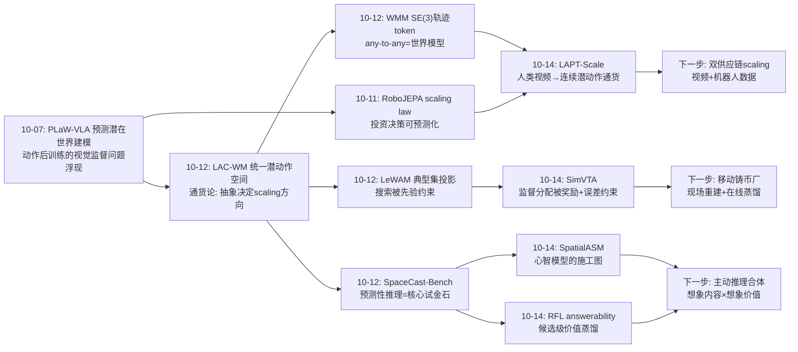
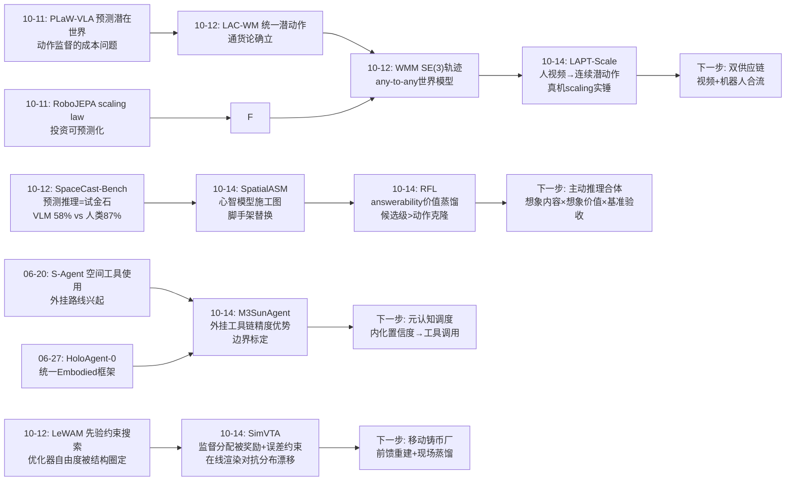
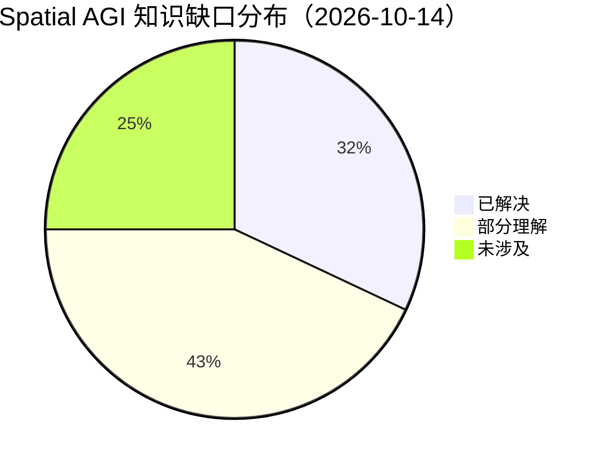

# Spatial AGI 每日深度思考 — 2026-10-14

**日期**: 2026-10-14
**基础日期**: 2026-10-12（最近一次完整执行日：5 篇论文 + 814 行思考；10-13 任务中断，仅 1 篇论文）
**论文数量**: 5 篇
**主题**: 特权教师日（训练时仿真、部署时内化）。如果说 10-12 回答了"空间智能的通货应该长什么样"（统一抽象、结构不变量、先验约束搜索），今天五篇论文回答的是它的对偶问题：**这些通货应该在哪里铸造？** 答案惊人一致——在训练时，用特权模拟器铸造；在部署时，以内化形态流通。SpatialASM 用训练时新颖视角生成器把"主动空间心理化"蒸馏成 LVLM 的内在 CoT，部署时零渲染；LAPT-Scale 用连续潜在动作模型把 2.3 万小时人类视频铸造成动作监督，同一动作专家三阶段连续训练，真机成功率随人视频量单调上升（63.3%→85.0%）；SimVTA 用 3DGS 真实场景渲染填补驾驶世界动作模型 RL 后训练的"候选轨迹无未来视频"监督缺口（PDMS +5.1）；RFL 用特权渲染的 answerability 目标蒸馏出零渲染的视角选择策略，一步变体无损匹配渲染 oracle；唯一的"反叛者"M3SunAgent 则站在外挂一侧，用零训练的 LLM 规划器编排专家工具，在度量精度上打赢了空间增强 VLM。四比一的格局宣告了一条方法论主线的成熟：**特权信息（渲染器、模拟器、世界模型、场景重建）是训练时的廉价反事实经验来源，而 Spatial AGI 的工程艺术在于把特权经验转化为部署时可预测的内在能力——选择权在"内化"与"外挂"之间，判据是延迟与精度的交换比**。

---

## 📅 每日总结

**日期**: 2026-10-14
**论文数量**: 5篇
**主题**: 特权教师日。五篇论文从感知、动作、规划、评测四个层面收敛到同一个训练哲学——**世界模型/模拟器/渲染器应当做教师而非运行时组件**。SpatialASM 把 allocentric 新颖视角生成器（FLUX.2-klein 微调）当作训练时空间模拟引擎，产出两种监督：显式 plan-imagine-reason 轨迹（SFT）+ 自动可验证的 perspective-taking 任务（GRPO），并用"脚手架替换"（渲染视图→文本 caption）优雅地解决了"训练需要视觉证据、推理只有语言能力"的自举鸿沟；LAPT-Scale 用时空 VAE + 三重对齐（MSE+LPIPS、DINOv2、RAFT 光流）把无标签人类视频转化为连续潜在动作（d=32），同一 flow-matching 动作专家依次学潜在动作→机器人动作→任务动作，用控制变量实验首次给出人视频预训练的真机 scaling 曲线；SimVTA 诊断出驾驶 WAM 后训练的根本瓶颈——RL 探索的候选轨迹在日志里没有匹配的未来视频——并用 World Engine 的 3DGS 渲染在线铸造轨迹匹配监督，配合"高奖励+高误差"两阶段目标选择把有限渲染预算花在刀刃上；RFL 把"预判未见视角的有用性"量化为 VLM answerability，用特权渲染构造候选级价值目标，蒸馏进 LoRA 适配器后部署零渲染，且候选级价值蒸馏（3.05）显著优于动作克隆（2.47）；M3SunAgent 则证明在度量精度优先的场景，零训练规划器 + 专家工具的空间视觉编程仍有一席之地（3D mIoU 超 MonoVLM 3.62%）。

**关键突破**:
- 🚀 **脚手架替换（SpatialASM）**：SFT 数据中把 NVG 渲染的真实视图替换为描述想象观测的文本 caption——模型从原始图像出发学会"内部构建"空间布局。这是"训练时需要证据、推理时无证据"这一普遍自举难题的通用解法，其意义超越空间推理本身：任何"教师有特权、学生无特权"的蒸馏场景都可复用。
- 🚀 **人视频预训练的 scaling 实证（LAPT-Scale）**：机器人数据固定不变，仅将 LAM 标注的人类视频从 1K 扩到 5K 小时，真机成功率 63.3%→85.0%。"人类视频能否真正提升机器人"这一悬置多年的问题第一次有了肯定且单调的答案。观察学习路线从此有了自己的 ImageNet 时刻叙事。
- 🚀 **后训练监督缺口的填补（SimVTA）**：RL 后训练时策略探索的候选轨迹没有日志视频可配对——复用即造假、放弃则无监督。3DGS 真实场景在线渲染 + 奖励/误差双重目标选择 + 轨迹 GRPO 的组合带来 NAVSIM +5.1 PDMS 和 HUGSIM 闭环提升，确立了"模拟器接地的动作条件监督"标准件。
- 🚀 **无损的价值蒸馏（RFL）**：学生从"当前观测+动作文本"预测的一步 answerability（2.98）与特权渲染 oracle 完全持平——"视角对问题的价值"这个看似必须渲染才能知道的量，居然可以从部署可得的信息中精确预测。空间前瞻能力比直觉更可学习。
- 🚀 **连续潜在动作优于离散（LAPT-Scale）**：相对 VQ-LAM 的离散 codebook 过度压缩，连续 d=32 隐空间 + 感知/语义/运动三重对齐让潜在动作保住细粒度操作动力学——为世界模型的动作接口设计提供了"连续优先"的设计律。

**架构演进**: 10 层架构维持 10 层，四处结构性升级：(1) **感知-推理层**新增"主动空间心理化"能力模块（视角规划+视角想象的内在 CoT），空间 CoT 数据合成管线成型（模拟器教师→GeoP 自动质检→轨迹→RL）；(2) **动作层**确立"连续潜在动作 + 具身投影"的人类视频接入模式，与 10-12 LAC-WM 的统一潜空间路线合流——两者用不同方法抵达同一结论：动作通货必须是具身无关的连续空间；(3) **训练层**（新关注维度）形成"特权教师三件套"标准件：训练时渲染（SimVTA/RFL/ASASM）、候选级监督（RFL/SimVTA）、部署零特权（全部）；(4) **评测层**新增实例级度量深度基准（M3SI）与真机 scaling 协议（LAPT-Scale 的 1K/3K/5K 嵌套子集）。

### 📊 一句话总结

今天五篇论文共同写下了"特权教师三律"：**教师只出现在训练时（SpatialASM/SimVTA/RFL/LAPT-Scale 的共同结构）；监督要覆盖候选而非示范（RFL 候选级价值 3.05 > 动作克隆 2.47；SimVTA 只监督高奖励高误差未来）；从特权到内化的转化要有显式机制（脚手架替换/流匹配换目标/软标签蒸馏/连续隐空间）——而 M3SunAgent 提醒了边界的存在：当精度压倒延迟时，外挂工具链仍是理性选择**。

### 🔗 延续性

**昨日→今日**: 10-12"统一日"确立了空间智能的通货论——统一抽象决定 scaling 方向（LAC-WM），不变量编码进结构（OuroWorld），搜索被先验约束（LeWAM），任何-to-任何条件化即世界模型（WMM），并量化了缺失统一抽象的代价（SpaceCast-Bench 58% vs 87%）。今天五篇论文回答通货论的自然后续：**通货在哪里铸造？如何把铸造厂从生产线上撤下来？** SpaceCast-Bench 昨天诊断出 VLM 缺少"可干预、可更新的结构化空间状态"，今天 SpatialASM 直接给出了铸造这种状态的流水线——用训练时视角生成器合成 plan-imagine-reason 轨迹，正是给 LVLM 安装"可干预心智模型"的施工方案；SimVTA 让世界模型的反事实知识（候选动作的未来）有了真实场景级的铸造厂；LAPT-Scale 则把昨天 LAC-WM 的"统一潜在动作空间"从机器人数据扩展到了人类视频——铸造动作通货的原料从稀缺的具身交互扩展为无限的视频。
另一个延续：昨日悬置的"潜路线 vs 显路线"之争，今天以"内化 vs 外挂"的新形式重演——SpatialASM/RFL/SimVTA 都是"潜/内"路线（把空间能力编译进权重），M3SunAgent 是"显/外"路线（把空间能力组装成工具链）。判据也从"度量精度 vs 吸收歧义"细化为"延迟-精度交换比"。

**今日→明日**: 值得追踪——(1) SpatialASM × SpaceCast-Bench：ASASM 内化的"想象-推演"能力恰是 SpaceCast 测的"未观测变换后果推断"，正面对决数据即将可测；(2) RFL answerability × SpatialASM 想象：RFL 评估动作价值、SpatialASM 生成想象内容，组合成"会想象且知道想象是否值得"的完整主动推理系统；(3) LAPT-Scale 潜在动作 × WMM SE(3) 轨迹（10-12）：连续潜动作能否与 SE(3) 显式运动 token 在同一模型中分层共存；(4) SimVTA 渲染管线 × 前馈 3DGS 重建（CompactSplat 类）：把"需要预先重建的场景"变为"到达即重建"，解除监督的地理约束；(5) 三律的可迁移性验证：特权教师三律能否原样搬到导航世界模型、人形全身控制、无人机规划。

### 💡 本质思考：如何达成通用空间智能

#### 1. 核心能力的本质是什么？

今天五篇论文把这个问题推进到"能力获取方式"维度。**第一层：空间智能的核心是反事实推理，而反事实需要教师**。"如果我从这个角度看/走这条路/执行这个动作，会看到什么？"——所有五篇论文（包括 M3SunAgent 的深度工具调用）本质上都在回答反事实问题。反事实的关键性质是：它无法从被动观测中学到（日志里只有已发生的那个分支），必须有人伪造未发生的分支。模拟器、渲染器、世界模型、新颖视角生成器都是"反事实伪造机"。**特权教师范式的本质，是把伪造反事实的成本集中到训练时，把使用反事实的能力分布到推理时**。**第二层：能力的内化程度决定系统的形态**。今天给出了一个内化光谱：M3SunAgent（零内化：每次推理都调用外部工具）→ SimVTA（部分内化：视频预测已进权重，但训练需在线渲染）→ RFL（高内化：价值函数进 LoRA，部署零渲染）→ SpatialASM（高内化：plan-imagine-reason 全流程语言化）→ LAPT-Scale（完全内化：人类视频的经验被压缩进动作专家权重，推理时教师彻底消失）。内化程度每升一级，部署依赖降一级，但信息损失风险升一级（RFL 的 answerability≠correctness、SpatialASM 的文本想象是有损压缩）。**第三层：监督的结构比监督的数量更重要**。RFL 最锋利的实验：候选级价值监督（3.05）>> 动作克隆（2.47）——同样是教师的经验，覆盖"所有备选及其价值"的监督结构比"教师走过的那条路"可迁移得多。SimVTA 的两阶段目标选择同理：有限预算下，把监督集中到"高奖励且高误差"的未来优于均匀覆盖。这与 10-12 的"结构不变量优先"一脉相承：监督的结构设计是比数据规模更强的杠杆。**第四层：scaling 的原料正在从机器人扩展到人类**。LAPT-Scale 的 63.3%→85.0% 曲线与 LAC-WM 的正 scaling 相互印证，且原料互不重叠（机器人轨迹 vs 人类视频）——两条独立的原料供应链都验证了"统一抽象+充足原料→单调提升"。空间智能的 scaling 故事第一次有了完整的供应链视角：抽象是货币制度（昨日），特权模拟器是铸币厂（今日），人类视频与机器人数据是矿藏（今日合流）。

#### 2. 当前方法与理想目标的差距在哪里？

**差距一：内化的信息瓶颈没有被度量**。SpatialASM 把想象写成文本（丢失度量精度），RFL 把视角价值压成标量（丢失证据分布），LAPT-Scale 把视频压进 32 维隐空间（丢失长程意图）。每个内化过程都是有损压缩，但没有一个工作量化了"压缩损失-任务性能"的权衡曲线。理想状态需要一套"内化信息论"：什么信息必须保留（任务相关的充分统计量）、什么可以丢弃（与任务无关的细节），以及损失如何随任务分布漂移而放大。**差距二：特权教师的地理约束**。SimVTA 和 RFL 都依赖预先重建的 3DGS 场景——监督能力被限制在重建覆盖范围内。真实部署是开放世界：agent 到达新环境时没有铸币厂。前馈重建（CompactSplat、NovaSplat 等）是把铸币厂搬到现场的技术，但"边重建边蒸馏"的在线学习闭环尚不存在。**差距三：answerability/渲染目标的偏差理论缺失**。RFL 的价值信号继承冻结 VLM 的判断偏差；SimVTA 的渲染目标继承 3DGS 的重建伪影；SpatialASM 的 GeoP 继承前馈重建模型的质量。特权教师的错误会系统性传给学生，且学生无法察觉——"教师失误差建模"完全空白。**差距四：内化与外挂的调度器不存在**。今天四比一的格局暗示两条路线各有最适区，但没有系统会在"渲染一个答案"（外挂，慢而准）与"内部想象"（内化，快而糙）之间按任务风险动态切换。理想的空间智能应该有元认知层：估计自身内化能力的置信度，低于阈值时才调用外部工具。**差距五：人类视频的动作语义鸿沟仍在半途**。LAPT-Scale 的潜在动作是黑盒，不可语言化、不可编辑、不可验证语义——Stage 2 具身对齐承担了全部的语义翻译风险。理想的"视频→行为"管线应该有可解释的中间层（如语言化动作描述），使人类可以审计和修正铸造过程。

#### 3. 从今天到理想状态，最可能的路径是什么？

一条"内化工程"驱动的五段路径。**第一段（现在起）：特权教师三律的标准化**。把今天四个系统的共性抽象成可复用框架：定义特权源（渲染器/模拟器/生成模型）、候选空间（动作/视角/轨迹）、价值函数（answerability/奖励/误差）、内化接口（文本 CoT/价值头/流匹配目标）。产出：一个"特权蒸馏工具包"，让新任务接入成本从数月降到数周。判定标准：在导航、操作、驾驶三个域用同一工具包复现各自论文级增益。**第二段（并行）：主动推理的合体实验**。SpatialASM（想象内容）+ RFL（想象价值）+ SpaceCast-Bench（验收）：模型先评估各候选视角的价值（RFL），再对最高价值的视角内部想象观测（SpatialASM），最后在想象证据上推理作答，用 SpaceCast-Bench 验收。若合体系统显著超过任一单系统，则"元认知调度的内在空间推理"路线获得直接证据。**第三段（3-6个月）：移动铸币厂**。SimVTA/RFL 的离线重建管线替换为前馈 3DGS 重建（单目或稀疏视角输入），实现"到达新场景→分钟级重建→开始铸造监督"的在线闭环；配合 SimVTA 的在线渲染机制，形成部署现场的持续后训练。风险点：前馈重建的伪影进入价值目标——需要 GeoP 式的自动质检作为标准配件。**第四段（6-12个月）：内化信息瓶颈的量化与控制**。为每种内化接口（文本想象/标量价值/隐空间动作）建立率失真分析：用探针测量内化表示中保留了多少任务充分统计量，建立"接口容量-任务性能-分布漂移鲁棒性"三角权衡；据此设计自适应容量接口（简单任务窄通道、复杂任务宽通道）。**第五段（1-2年+）：元认知调度的混合空间智能**。理想状态判定标准更新为：一个系统同时拥有内化的空间想象与价值评估（快路径）和可调用的外部工具链（慢路径），元认知层依据内化置信度实时调度；其反事实能力由现场铸币厂持续更新；其 scaling 由人类视频（经验原料）+特权模拟器（反事实原料）双供应链驱动，且方向由统一抽象保证（昨日通货论）。今天五篇论文各自点亮了这条路径的一段：铸造工艺（SpatialASM/RFL）、原料扩展（LAPT-Scale）、现场生产（SimVTA）、边界标定（M3SunAgent）——内化工程的图纸已经齐了，剩下的是施工。

---

## 🔗 与昨日思考的联系

### 昨日重点

10-12"统一日"确立四个结论：(1) **通货先于预算**——统一抽象决定 scaling 方向（LAC-WM 正 scaling vs 显式动作割裂空间负 scaling），错误抽象下预算投入是负 ROI；(2) **不变量编码在结构里**（OuroWorld looping by construction、WMM 的 SE(3) 物理原子）；(3) **搜索被先验约束**（LeWAM 典型集投影：搜索合法性由生成先验定义）；(4) **预测性空间推理是核心试金石**（SpaceCast-Bench：感知≠预测，最佳 VLM 58% vs 人类 87%）。遗留悬念：潜路线（RoboJEPA/LeWAM）与显路线（WMM/OuroWorld）的联合架构；世界模型在空间推理基准上交卷的实验；生成监督的一般噪声理论。

### 今日进展

今天在昨日基础上完成四个推进：(1) **通货论获得"铸造环节"**——昨日确立通货的选择标准，今天回答通货的铸造工艺：反事实经验（未观测视角、未执行动作的未来、无标签视频中的动作）只能由特权教师伪造，铸造必须在训练时完成、铸币厂在部署时撤走。昨日 SpaceCast-Bench 诊断的"缺少可干预心智模型"，今天 SpatialASM 给出了第一张施工图。(2) **"先验约束"思想从搜索扩展到监督分配**——昨日 LeWAM 把搜索约束在策略典型集，今天 SimVTA 把渲染监督约束在"高奖励+高误差"子集、RFL 把两步展开约束在 Q1 top-3：同一哲学——**优化器的自由度必须被结构圈定，无论是搜索还是标注**。(3) **人类视频正式成为动作通货的矿藏**——昨日 LAC-WM 的统一潜空间以机器人数据为原料，今天 LAPT-Scale 证明同一货币制度可以直接吸收人类视频（连续潜动作+具身投影），且真机 scaling 单调。供应链从单源变双源。(4) **潜/显之争演化为内化/外挂之争**——昨日的路线之争是表示层的（潜空间 vs 显式几何），今天出现了系统层的同构问题：能力应该编译进权重（内化）还是组装成工具（外挂）。M3SunAgent 的存在让这场争论第一次有了干净的对照：它在度量精度上赢（外挂的精度优势），在延迟与通用性上输（内化的效率优势）——判据从抽象偏好收敛为可测的延迟-精度交换比。

### 演进路径



---

## 📚 论文概览

今天五篇论文构成一个"训练哲学"实验组：

1. **SpatialASM**（上海 AI Lab，2610.13832）：把"主动空间心理化"（视角规划+视角想象）内化进 LVLM。训练时 allocentric 新颖视角生成器渲染假设视角，GeoP 几何扰动度量自动过滤幻觉视图，渲染结果替换为文本 caption 形成脚手架替换式 SFT 轨迹，GRPO 强化 perspective-taking。部署零渲染，7 基准平均 +1.2~+3.5，Spatial457-6d +8.7。

2. **LAPT-Scale**（京东 Joy Future Academy/HIT/清华，2610.13732）：连续潜在动作模型（时空 VAE，d=32，感知+语义+光流三重对齐）把 23.3K 小时人类视频转为动作监督；同一 flow-matching 动作专家三阶段训练（潜在动作→具身对齐→任务后训练）。人视频 1K→5K 小时，真机成功率 63.3%→85.0%。

3. **M3SunAgent**（华中科大/哈工程/A*STAR，2610.07982）：LLM 空间视觉编程 agent，统一实例级度量深度（焦距归一化+多点采样+离群过滤）与单目 3D grounding（VLM 定位+反投影+维度提升）。M3SI 基准 2,910 样本；3D mIoU 41.73% 超 MonoVLM 3.62%，规划器零训练。

4. **SimVTA**（OpenDriveLab@HKU/理想/清华，2610.13781）：诊断驾驶 WAM 后训练的监督缺口（候选轨迹无匹配未来视频），用 World Engine 3DGS 渲染在线铸造轨迹匹配监督，"高奖励→高误差"两阶段目标选择+轨迹 GRPO+BC 锚定。NAVSIM v1 PDMS +5.1，v2 EPDMS 88.2，HUGSIM 闭环 HD-Score 38.8。

5. **RFL**（东京大学/NII，2610.11039）：用 VLM answerability 量化候选相机运动的价值，特权教师（3DGS 渲染）构造一步/两步候选级价值目标，两阶段软标签蒸馏进 LoRA，部署零渲染。E3VS-Bench judge score 2.14→3.05（+43%），超 GPT-5.1，一步变体匹配渲染 oracle，真机 6-DoF 机械臂迁移成功。

**组合逻辑**：SpatialASM 内化"空间想象"、RFL 内化"视角价值"、SimVTA 内化"动作后果"、LAPT-Scale 内化"操作经验"——四个内化方向共用"特权教师"结构；M3SunAgent 作为外挂对照组，标定了内化路线的适用边界。

---

## 💡 核心见解

### 见解1: 反事实经验只能铸造，不能采集

**从 SpatialASM、SimVTA、RFL 共同获得**
- ✅ 空间智能的核心训练信号是反事实的：未观测视角的观测（SpatialASM）、未执行动作的未来视频（SimVTA）、未选择视角的价值（RFL）；
- ✅ 这类信号在被动数据（日志/视频/图像）中不存在——日志只记录已发生的分支；
- ✅ 三篇论文用三种铸币机（视角生成器/3DGS 渲染/特权搜索）在训练时伪造反事实分支。

**对Spatial AGI的启发**:
这给"数据规模化"叙事补上了关键限定：**规模可以来自采集，结构必须来自铸造**。人类视频能无限扩（LAPT-Scale），但它只包含"实际发生的运动-观测对"；让模型学会"预测未发生的"，必须有伪造未发生分支的机器。Spatial AGI 的基础设施清单里，模拟器与重建渲染管线不是加速器，而是必需品——它们生产的是被动数据中原理性缺失的那类监督。

### 见解2: 脚手架替换是"教师有特权、学生无特权"的通用解法

**从 SpatialASM 获得**
- ✅ 训练数据需要视觉证据（渲染视图）才能构造，但最终 SFT 数据中渲染视图被替换为文本描述；
- ✅ 模型从原始输入图像出发学习"内部构建"想象观测，推理时不需要任何渲染；
- ✅ 结果：通用 VQA 回退 <0.6 点，视角变换类任务大幅提升。

**对Spatial AGI的启发**:
这个技巧值得上升为设计模式。任何"教师用特权信息构造了含特权内容的样本"的场景（RFL 的渲染视图、SimVTA 的渲染视频、人类示教的 GT 动作标注）都面临同一问题：样本里的特权成分部署时不存在，直接训练会让学生依赖不存在的输入。脚手架替换的通用形式是：**把特权成分转写为学生可自行生成的形式（文本描述/预测目标/条件），让学生学习"生成"而非"接收"该成分**。这与课程学习中的 scaffold fading 同构，但用于多模态监督设计还是第一次。

### 见解3: 人类视频的 scaling law 终于被实锤

**从 LAPT-Scale 获得**
- ✅ 控制变量实验：机器人数据固定，人视频 1K→5K 小时，真机 63.3%→85.0%；
- ✅ 前提条件明确：连续潜在空间（避免 VQ 过度压缩）+ 三重对齐（避免背景主导）+ 统一动作专家三阶段迁移（避免适配器断裂）；
- ✅ 鲁棒性随数据提升：未见光照/背景/位置偏移下保持 70-75%。

**对Spatial AGI的启发**:
此前"人类视频提升机器人"的失败案例（显式重定向噪声）让社区半信半疑；这篇给出了成功所需的三件套，等于发表了一条**条件化的 scaling 定律**：scaling 的不是原始视频而是"LAM 铸造的潜在动作监督"——原料要经过统一抽象的铸造（呼应 10-12 通货论）。推论：具身智能的数据战略应该双线并进——机器人数据买"接地"，人类视频买"规模"，潜在动作模型是两条供应链的汇率兑换器。

### 见解4: 监督要覆盖候选空间，而非教师的足迹

**从 RFL 获得**
- ✅ 候选级价值蒸馏（覆盖每个状态的所有候选动作及价值）：judge score 3.05；
- ✅ 动作克隆（只学教师走过的轨迹）：2.47；
- ✅ 差距 +0.58 来自监督结构而非数据量——学生学的是"比较"而非"模仿"。

**对Spatial AGI的启发**:
这是今天方法学上最锋利的一刀。它与 RL 中的 advantage 学习、与 10-12 LeWAM 的组相对优势一脉相承：**决策能力的最小充分监督是候选间偏好结构，不是最优解本身**。对空间智能的数据工程直接含义：采集"专家怎么走"的演示数据时，应同时记录"专家在所有备选上的评分"（或用特权模拟器补造），这比多采十条演示更有价值。SimVTA 的"高奖励+高误差"目标选择是这个原理的预算约束版。

### 见解5: WAM 后训练的监督缺口是系统性盲区

**从 SimVTA 获得**
- ✅ RL 后训练让策略探索候选轨迹，但日志只有已记录轨迹的视频——复用即造假配对、放弃则无视觉监督；
- ✅ 解法：3DGS 真实场景渲染 + 在线渲染（离线缓存随策略分布漂移失效）+ 奖励/误差两阶段目标选择；
- ✅ 增益显著：PDMS +5.1，闭环 HUGSIM 也提升——开环训练的改善真实传导到了闭环。

**对Spatial AGI的启发**:
这个缺口不只属于驾驶：任何"世界模型/策略 + RL 后训练"的系统（机器人 WAM、导航世界模型）都面临"探索分支无视觉配对"。SimVTA 的贡献是给出标准补丁：**重建场景库 + 在线渲染 + 选择性监督**。更深的含义：后训练阶段的数据引擎必须与策略共进化——静态数据集在后训练动力学面前会迅速"过期"，这是训练基础设施设计的新约束。

### 见解6: 内化与外挂的边界是延迟-精度交换比

**从 M3SunAgent 与今日四篇内化论文的对照获得**
- ✅ M3SunAgent（外挂）：零训练规划器+专家工具，度量精度赢（超 MonoVLM 3.62%），但多工具串行调用延迟高、任务面受 DSL 覆盖限制；
- ✅ SpatialASM/RFL（内化）：部署零渲染零工具，快但想象文本化/价值标量化有信息损失；
- ✅ 两者在"空间理解需要语义+几何混合"这一点上完全一致，分歧只在能力的存在形式。

**对Spatial AGI的启发**:
不要再问"哪个路线对"，要问"什么任务该走哪条路"：需要物理精度的查询（距离、尺寸、碰撞）→外挂工具链；需要速度与泛化的推理（视角选择、场景想象）→内化权重。理想的系统是元认知调度的混合体——但元认知层本身需要一个"内化能力自估器"，这恰好是 RFL answerability 思想的自反应用：**用可回答性探针估计"我的内化是否足够"，不足才调用外部工具**。

### 见解7: 教师的三重对齐是表示质量的通用配方

**从 LAPT-Scale 获得（并在 SpatialASM/SimVTA 中找到同构）**
- ✅ LAPT-Scale：MSE+LPIPS（局部结构）+ DINOv2（物体语义）+ RAFT 光流（运动）三重对齐，解决纯重建被背景主导的问题；
- ✅ SpatialASM 的 GeoP：用"渲染视图对 3D 重建的扰动"过滤幻觉——本质是给生成监督加几何对齐信号；
- ✅ SimVTA 的流匹配 + 奖励：视觉保真 + 驾驶效用的双重对齐。

**对Spatial AGI的启发**:
单一目标学出的表示必然偏向目标的"高方差区"（像素损失偏向背景、语言损失偏向先验）。空间表示的多目标配方正在收敛：**像素/感知（ appearance）+ 语义（DINOv2 系）+ 运动/几何（光流/重建/SE(3)）**。这个三角可以当作空间数据引擎和世界模型训练的默认损失模板，任何单一损失的工作都应该被问一句"你的表示被哪个盲区绑架了"。

---

## 🗺️ 知识演进图



---

## 技术栈演进对比表

| 层次 | 昨日方案（10-12） | 今日方案（10-14） | 变化 |
|------|------------------|------------------|------|
| 空间推理训练 | answer-only QA / 外挂世界模型推理 | 训练时 NVG 合成 plan-imagine-reason 轨迹（SpatialASM） | 空间 CoT 从稀缺标注变为可合成 |
| 心理化监督质检 | 人工/启发式过滤 | GeoP：渲染视图对前馈重建的 Chamfer 扰动自动过滤（SpatialASM） | 质检自动化、几何锚定 |
| 动作监督来源 | 机器人轨迹 / VQ-LAM 离散潜动作 | 连续潜动作（d=32）+ 三重对齐，23.3K 小时人类视频（LAPT-Scale） | 原料从机器人扩展到人类，离散→连续 |
| 具身迁移 | 独立动作头/适配器 | 同一 flow-matching 动作专家三阶段连续训练（LAPT-Scale） | 迁移结构简化，表示兼容性显式化 |
| WAM 后训练监督 | 日志视频复用（错误配对）或纯奖励 RL | 3DGS 在线渲染轨迹匹配视频 + 奖励/误差两阶段选择（SimVTA） | 后训练监督缺口被系统性填补 |
| 视角选择学习 | SFT/RL 学动作输出 | 候选级 answerability 价值蒸馏，部署零渲染（RFL） | 从"学动作"升级为"学比较" |
| 度量空间感知 | 端到端 VLM（MonoVLM）/专用架构 | DSL 空间视觉编程 agent + 专家工具（M3SunAgent） | 外挂路线在精度任务上确立竞争力 |
| 空间基准 | 预测性推理基准（SpaceCast） | 新增 M3SI 实例级度量深度 + 真机 scaling 协议 | 评测向"物理量+数据经济学"扩展 |
| 训练基础设施 | 离线数据集 | 在线渲染铸币厂（SimVTA）/离线特权教师（RFL） | 数据引擎与策略共进化 |

---

## 🗺️ Spatial AGI 知识图谱

### 10层架构思维导图

```mermaid
mindmap
  root((Spatial AGI))
    第1层 感知
      实例级度量深度: 多点采样+离群过滤 M3SunAgent
      3D视觉定位: VLM+反投影+维度提升 M3SunAgent
      answerability探针: 冻结VLM价值估计 RFL
    第2层 表示
      连续潜在动作 d=32: 三重对齐 LAPT-Scale
      allocentric视角坐标 v=(i,x,y,d) SpatialASM
      GeoP几何一致性度量 SpatialASM
      统一通货: 潜空间与SE(3) 持续合流
    第3层 记忆
      观测历史H_t替代特权位姿 RFL
      场景3DGS重建库 SimVTA监督源
      人视频经验压缩进动作专家权重 LAPT-Scale
    第4层 想象
      主动空间心理化: 视角规划+想象 SpatialASM
      脚手架替换: 渲染→文本caption SpatialASM
      候选动作未来渲染 SimVTA
    第5层 推理
      plan-imagine-reason CoT SpatialASM
      候选级价值比较>动作克隆 RFL
      两步前瞻beam展开 k=3 RFL
    第6层 规划
      视角选择: argmax Q̂ RFL
      轨迹GRPO: SDE采样+组相对优势 SimVTA
      DSL程序编排工具 M3SunAgent
    第7层 行动
      统一flow-matching动作专家 LAPT-Scale
      三阶段: 潜在动作→具身对齐→任务后训练 LAPT-Scale
      PDM执行器物理化轨迹 SimVTA
    第8层 学习
      特权教师范式: 训练时伪造反事实 今日主线
      两阶段软标签蒸馏 RFL
      GRPO可验证任务 GRPO SpatialASM
      在线渲染对抗分布漂移 SimVTA
    第9层 评测
      E3VS-Bench 377集 视点依赖搜索 RFL
      M3SI 实例级度量深度 2910样本 M3SunAgent
      真机scaling协议 1K/3K/5K嵌套 LAPT-Scale
      NAVSIM/HUGSIM 开环+闭环 SimVTA
    第10层 应用
      机器人操作: 真机85% LAPT-Scale
      自动驾驶: PDMS 91.3 SimVTA
      空间QA助手: 单目定位+测距 M3SunAgent
      真机机械臂: 6-DoF迁移 RFL
```

### 🎯 主线技术路径

#### 阶段1: 被动感知与静态基准（2025 及以前）
空间智能以"读出关系"为主：深度估计、3D 检测、VQA 式空间基准。数据来源为采集（标注数据集、机器人轨迹），反事实能力无从谈起。代表：单目深度/3DVG 专用架构（M3SunAgent 论文中的 baseline 们）。

#### 阶段2: 外挂工具与世界模型推理（2026 上半年）
S-Agent、SpatialClaw 等空间工具使用兴起；MindJourney/Think3D 在推理时外挂世界模型合成补充观测——反事实能力出现但推理成本高、依赖外部模拟器。LLM agent（VADAR、SpaceTools、M3SunAgent 前身 VisProg）确立工具编排范式。

#### 阶段3: 统一抽象与通货确立（2026 Q4，10-12 前后）
LAC-WM 证明统一潜在动作空间的正 scaling 与割裂空间的负 scaling；WMM 把世界统一为 SE(3) 轨迹 token；LeWAM 约束搜索于先验典型集；SpaceCast-Bench 确立预测性推理为核心试金石。空间智能的"货币制度"成型。

#### 阶段4: 特权教师与内化工程（2026 Q4，本周——今日所处阶段）
训练时模拟器铸造反事实监督（SpatialASM 的视角、SimVTA 的未来视频、RFL 的价值目标、LAPT-Scale 的潜在动作），部署时完全内化（零渲染/零工具/权重化经验）。脚手架替换、候选级蒸馏、目标选择、在线渲染四大工艺定型。外挂路线（M3SunAgent）退守精度敏感场景。

#### 阶段5: 移动铸币厂与元认知调度（下一步，3-12 个月）
前馈 3DGS 重建把铸币厂搬到部署现场（"到达即重建、重建即蒸馏"）；元认知层依据内化置信度调度内化快路径与工具慢路径；人类视频+机器人数据双供应链经统一抽象合流；世界模型在 SpaceCast-Bench 类基准上正式交卷。

---

## 🔍 待探索议题

### 高优先级（本周）

1. **SpatialASM × SpaceCast-Bench 正面对决**
   - 问题: SpatialASM 内化的"想象-推演"能力能否在预测性空间推理基准上缩小 58% vs 87% 的人类差距？
   - 候选方案: 把 SpatialASM 训练流程应用于 SpaceCast 的 observe-transform-infer 协议；想象轨迹替换四选一作答。
   - 缺口: SpaceCast 的变换（刚性瞬时）与 SpatialASM 的视角变换（连续平滑）分布不一致，需要适配层。

2. **RFL 价值探针 × SpatialASM 想象内容的合体**
   - 问题: "先评估哪个视角值得想象、再内部想象该视角"能否超越两者的单独系统？
   - 候选方案: RFL 的 Q̂ 选 top-1 视角 → SpatialASM 的想象模块生成该视角描述 → 推理作答。
   - 缺口: 两系统的视角参数化不同（RFL 离散相机运动 vs SpatialASM allocentric 坐标），需要统一动作/视角接口。

3. **LAPT-Scale 连续潜动作 × WMM SE(3) 轨迹的分层共存**
   - 问题: 连续潜动作（语义路由）与 SE(3) 轨迹（度量执行）能否在同一模型中分层？
   - 候选方案: 潜动作作为 SE(3) 生成的掩码条件（10-12 已提出的混合架构最小原型）。
   - 缺口: 两套动作空间的配对数据（同一操作的双重表示）不存在，需要重定向合成管线。

### 中优先级（本月）

4. **SimVTA 渲染管线的前馈重建替代**
   - 问题: 把离线 3DGS 重建替换为前馈重建（分钟级），能否保持监督质量并解除地理约束？
   - 候选方案: CompactSplat/NovaSplat 类前馈模型 + GeoP 式质检闸门接入 SimVTA 训练环。
   - 缺口: 前馈重建在大视角外推处的伪影会污染价值目标，伪影-奖励的耦合未建模。

5. **answerability 与答案正确性的解耦研究**
   - 问题: RFL 的价值信号是"VLM 觉得可回答"，不是"能答对"——两者偏差多大、如何修正？
   - 候选方案: 用 GT 答案标注子集校准探针；训练"correctness-aware answerability"。
   - 缺口: 大规模视角-问题-答案三元组标注成本高，可能需要特权渲染自举。

6. **内化信息瓶颈的量化**
   - 问题: 文本想象（SpatialASM）/标量价值（RFL）/32 维隐动作（LAPT-Scale）各丢失多少任务充分信息？
   - 候选方案: 探针测量内化表示对任务充分统计量的覆盖；建立接口容量-性能权衡曲线。
   - 缺口: "任务充分统计量"本身缺乏可操作定义，需要先在合成环境建立 ground truth。

7. **教师偏差的系统传导分析**
   - 问题: GeoP 继承前馈重建质量、answerability 继承 VLM 偏差、渲染目标继承 3DGS 伪影——学生如何继承教师的系统性错误？
   - 候选方案: 构造"带已知偏差的教师"对照实验，测量学生性能退化曲线。
   - 缺口: 缺乏"教师失差建模"的理论框架与防御机制（如多教师投票）。

### 低优先级（本季度）

8. **元认知调度的混合空间智能原型**
   - 问题: 系统如何知道"该内部想象还是调用外部工具"？
   - 候选方案: 用 answerability 自反应用作内化置信度估计：内化预测的价值方差大→调用工具。
   - 缺口: 内化置信度的校准（confidence calibration）在空间域未被研究。

9. **人类视频的语义可解释中间层**
   - 问题: LAPT-Scale 潜在动作是黑盒，无法审计、编辑、验证——能否给它加语言化动作描述接口？
   - 候选方案: 潜动作-语言动作描述的对比对齐（类似 CLIP 式双塔）；用对齐头实现"文本编辑视频动作"。
   - 缺口: 视频动作的语言标注稀缺；对齐后潜在空间的 scaling 性质是否保持未知。

10. **特权教师三律的跨域验证**
    - 问题: "训练时铸造、候选级监督、显式内化机制"三律在导航/人形全身控制/无人机上是否同样成立？
    - 候选方案: 在三个域各选一个 WAM，套用 SimVTA/RFL 工艺做消融对照。
    - 缺口: 各域的特权源（导航 mesh、人形动捕、无人机流体仿真）保真度差异大，需要域内质检标准。

---

## 📊 知识缺口分析



**已解决（32%）**:
- ✅ 反事实监督的铸造工艺：视角（SpatialASM NVG）、动作后果（SimVTA 3DGS 渲染）、动作语义（LAPT-Scale LAM）、视角价值（RFL answerability）四类反事实信号都有了自动化生产线；
- ✅ "训练时特权、部署时内化"的完整范式：脚手架替换、候选级蒸馏、两阶段课程、软标签 BCE 等转化机制得到验证；
- ✅ 人类视频作为动作监督原料的可行性及条件（连续隐空间+三重对齐+统一专家）；
- ✅ 候选级价值监督优于动作克隆的实证（3.05 vs 2.47）；
- ✅ WAM 后训练监督缺口的诊断与修补（在线渲染+目标选择）。

**部分理解（43%）**:
- ⚠️ 内化的信息损失：知道文本想象/标量价值有损，但损失-性能权衡未量化；
- ⚠️ 教师偏差传导：GeoP/answerability/渲染伪影的系统性错误如何影响学生，无理论无防御；
- ⚠️ 潜/显动作路线的合流：连续潜动作与 SE(3) 轨迹的分层架构仍是推测；
- ⚠️ 内化与外挂的调度：元置信度估计与混合系统原型不存在；
- ⚠️ 铸币厂的地理约束：前馈重建替代离线重建的质量代价未知；
- ⚠️ 空间 CoT 的跨域泛化：SpatialASM 轨迹在导航/操作域是否同样有效未验证。

**未涉及（25%）**:
- ❌ "任务充分统计量"的可操作定义与内化信息论；
- ❌ 部署现场的持续后训练闭环（边重建边蒸馏在线学习）；
- ❌ 多教师（渲染器+模拟器+生成模型）集成与分歧利用；
- ❌ 视频动作的语言化编辑接口（潜动作可解释性）；
- ❌ 长程（>2 步）空间前瞻的价值构造——RFL 两步 beam 与 Monte Carlo 树搜索式深前瞻之间的鸿沟；
- ❌ 特权蒸馏的安全审计：教师伪造的反事实如果与物理规律冲突，学生的"幻觉"如何被检出；
- ❌ 双供应链（人类视频+机器人数据）混合 scaling 的交互效应（叠加是相加还是相乘）。

---

## 🎯 下一步行动建议

1. **本周实验**：把 SpatialASM 管线套在 SpaceCast-Bench 上跑 L2/L3——"世界模型在空间推理基准上交卷"实验的最近可行版本（SpatialASM 是最接近"可干预心智模型"的现成系统）；
2. **追踪仓库**：InternLM/SpatialASM、OpenDriveLab/SimVTA、LAPT-Scale（JoyAI）三个 repo 的开源进度，代码发布即做复现验证；
3. **数据准备**：收集带位姿多视角场景数据集（ScanNet/ARKitScenes 系），为潜在的空间 CoT 合成实验备料；
4. **理论阅读**：脚手架替换与课程学习 scaffold fading 的形式化对照；特权学习（privileged learning，Chen et al. 系）与今日三律的关系梳理；
5. **明日关注**：连续潜动作与 SE(3) 轨迹的统一方案；前馈重建进入训练环的第一批工作（"移动铸币厂"信号）。

---

## 🔬 逐篇深挖：从论文细节到设计律

### 深挖1: SpatialASM 的三个关键设计决策

**决策一：为什么是 allocentric 而不是 egocentric？**

现有世界模型（MindJourney、Think3D）用 egocentric 接口：视角变化表达为一串
自体运动命令（前进 0.5m、左转 30°……）。要到某个目标视角需要多步 rollout，
每步都有误差累积，且模型必须学会"运动→视图变化"的动力学而非"目标→视图"的直接映射。
SpatialASM 的 allocentric 定义 v=(i,x,y,d) 把视角变成一阶对象：位置由锚点图像上的
像素标记指定（视觉提示），方向由文本描述。一步查询、语义对齐（"从这个位置朝那个
方向看"正是问题的自然形式）。这对 Spatial AGI 的启示：**接口的语义形态应该匹配
任务的查询形态**——空间查询天然是目标式的，而非轨迹式的。

**决策二：GeoP 为什么优于 PSNR/LPIPS？**

大幅视角变化下没有 GT 视图，图像相似度指标无从计算；即使有，两张图的感知相似
也不能保证几何一致（生成模型可以画出"看起来对"但几何矛盾的视图）。GeoP 的洞察：
几何一致的视图加入观测集后应该**改善**前馈重建（提供新信息），幻觉视图则会**扰动**
重建（引入矛盾约束）。Chamfer 距离把这个信号变成可计算的标量。这实质上是把
"多视图几何一致性"这个经典多视图立体的黄金标准，移植到了生成式视图的质检上。
更一般化：**任何生成式空间数据的质量，都可以用"它对独立重建器的干扰程度"来度量**。

**决策三：为什么要替换成文本而不是直接用渲染图训练？**

直接用渲染图训练（教师强制喂视图）会让学生学会"等待视图出现"——推理时视图
不会出现，行为崩塌。文本替换迫使学生把"视图内容"作为自己 CoT 的一部分生成出来，
即学习**生成**想象而非**接收**想象。代价是文本化的信息损失（度量精度、纹理细节），
但收益是推理路径完全自洽。这个权衡的深层结构：**训练目标必须与部署条件一致**，
哪怕牺牲训练信号的信息量。这是模仿学习中"分布偏移"问题在多模态蒸馏中的再现，
脚手架替换相当于 DAgger 思想的变体——让学生的输入分布与部署分布对齐。

### 深挖2: LAPT-Scale 三重对齐的信息论解读

纯 MSE 重建损失的梯度被图像中的大面积区域主导：静止背景贡献了绝大部分像素误差，
手-物体接触区域（真正携带动作信息的部分）占比极小。结果是潜在动作 z_t 学到的是
"场景身份"而非"发生了什么变化"。三重对齐各自修补一个盲区：

- **LPIPS（感知）**：把误差度量从像素空间搬到特征空间，局部纹理/接触的权重上升；
- **DINOv2（语义）**：DINOv2 特征本身是物体中心的（自监督训练让它对物体分割敏感），
  对齐它等于强迫重建保持物体级结构——即使外观变了，"这是一只手握着一个杯子"不能丢；
- **RAFT 光流（运动）**：光流场是逐像素的运动真值，对齐它等于直接监督"变化"本身，
  而非"变化后的外观"。

三者组合后的隐空间有一个可验证的性质：LARY 线性探针能从中读出动作语义。
对 Spatial AGI 的推广：**学习空间表示时，损失函数的每个盲区都需要一个互补信号去
照亮**。像素损失看外观、语义损失看物体、运动损失看变化——空间智能需要的三类信息
（什么东西、在哪里、怎么动）恰好对应三个对齐项。这个三角配方可作为空间表示学习的
默认检查清单。

### 深挖3: SimVTA 目标选择为什么是"奖励第一、误差第二"而不是反过来？

直觉上应该优先监督"误差最大"的未来（学得最差的地方），SimVTA 却先按奖励筛选。
原因：误差最大的候选往往是**低奖励的坏轨迹**（撞车、驶出道路）——监督它们的
视觉后果等于教模型精细地理解坏结局，对规划的边际价值低且有风险（可能学到
坏轨迹的可达性）。先按奖励筛出"值得学的未来"，再在其中挑"学得最差的"，
保证监督预算花在"好且难"的样本上。这是课程学习 hard-example mining 的
两阶段化：**先做价值过滤（值不值得学），再做难度过滤（需不需要学）**。
顺序不能反。这对所有"预算受限的监督分配"问题（标注、渲染、仿真）都是通用配方。

另一个细节值得记录：为什么必须在线渲染？策略更新改变轨迹分布，第 N 轮策略
采样的候选在第 1 轮的渲染缓存中找不到匹配视频。如果强行复用旧视频，
就回到了"错误轨迹-视频配对"的原始问题。这揭示了一个容易被忽视的约束：
**后训练阶段的数据引擎必须是有状态的**——它要跟踪策略的分布漂移并同步更新。
静态数据集思维在后训练中失效。

### 深挖4: RFL 一步无损背后的表征巧合

学生输入是（问题、最近观测、动作文本），要预测"执行动作后的视图可回答性"——
这看起来需要想象未来视图。为什么它能无损匹配教师（2.98 vs 2.98）？

可能的解释：E3VS 的动作是相机运动，未来视图与当前视图的差异由场景几何决定；
VLM 的 answerability 判断主要依赖粗粒度线索（这个方向有没有目标物体的迹象、
视野是否被遮挡），而这些线索在当前观测+动作语义中已经存在（"向前走"大概率
揭示正前方的信息）。换言之，**answerability 对视图细节不敏感，只对视图的
粗结构敏感**，而粗结构可以从当前观测外推。这既是 RFL 成功的原因，也划定了
它的边界：当价值判断依赖视图细节（如抽屉内部的具体物品）时，无损外推应该失效。
可以设计一个判别实验：把 answerability 目标换成"答案正确性"（依赖细节），
蒸馏损失应该显著变大。若如此，则"能被廉价预测的价值信号"与"必须渲染的
价值信号"之间存在可刻画的分界——这本身就是 Spatial AGI 需要的知识。

### 深挖5: M3SunAgent 的 DSL 是空间智能的"汇编语言"吗？

M3SunAgent 的 DSL 程序（locate → sample_depth → aggregate / ground → backproject → lift）
覆盖了两类查询，但它的价值不在当前覆盖面，而在**接口的可扩展性**：新空间任务 =
新操作符 + 新程序模板，规划器零训练。这与编译器的历史同构：DSL 是空间理解的
高级语言，Tool Registry 是指令集，解释器是运行时。限制也清晰：

- 每个新任务需要人工设计管线（无自动任务综合）；
- 操作符之间的误差不共享校准（深度工具的偏差不会反馈修正定位工具）；
- 程序是静态的（无条件分支/循环，不能表达"看一眼再决定"的适应性行为）。

长期看，DSL 空间编程最可能的归宿不是与端到端模型竞争，而是成为它们的
**校准与审计层**：当内生空间模型给出答案时，用 DSL 管线中的度量工具做
独立验证（M3SunAgent 的深度工具验证 SpatialASM 想象描述中的距离断言）。
外挂路线的最高形态是验证者，而非执行者。

### 深挖6: 四个内化系统的接口对照表

| 系统 | 特权源 | 候选空间 | 价值/目标函数 | 内化接口 | 部署残留依赖 |
|------|--------|----------|---------------|----------|--------------|
| SpatialASM | NVG（FLUX.2 微调）视角渲染 | allocentric 视角 | GeoP + 答案一致性 | 文本化想象 CoT | 无 |
| LAPT-Scale | LAM 潜在动作标注 | 动作块 | 三重对齐重建 | 动作专家权重 | 无（教师彻底离场） |
| SimVTA | World Engine 3DGS 渲染 | 轨迹 | 驾驶奖励 + 预测误差 | 共享表示 + 流匹配 | 无（推理直出轨迹） |
| RFL | 3DGS 渲染 + 冻结 VLM | 相机运动 | answerability | LoRA 价值头 | VLM 基座（本就在） |

这个表的空列比实列更有信息量：**四个系统都在追求"部署残留依赖=空"**，
而它们的差异全部在"铸造什么"（想象内容/动作语义/反事实视频/决策价值）。
Spatial AGI 的训练基础设施可以按此表组织：每个能力模块选择自己的特权源、
候选空间与内化接口，共用同一铸造纪律。

---

## ⚗️ 假想实验与思想实验

### 假想实验1: 如果把 SpatialASM 的脚手架替换反过来

假设不替换文本而是保留渲染视图训练，会发生什么？可预测的失败模式：模型在
推理时生成"我需要看一下 X 视角"的 CoT 后，期待系统喂入视图；没有视图时
行为退化。这提示一个诊断工具：**检测空间模型是否真的内化了想象能力，
可以看它的 CoT 是否包含对不存在输入的隐性期待**。推而广之，任何多模态
蒸馏系统都应该做"教师输入撤销测试"。

### 假想实验2: LAPT-Scale 的潜动作与语言动作描述对齐后会怎样

假设给 LAM 加一个对比头，把 z_t 与"拿起杯子倒水"类语言描述对齐。好处：
可审计、可编辑、可用语言指令直接操控预训练。风险：对齐约束可能压缩隐空间
的表达带宽（语言词汇的离散性重新引入 VQ 式过度压缩），scaling 曲线可能变平。
这是一个"可解释性 vs 容量"的直接实验——如果实验证明容量损失存在但可控，
那么"可解释的铸造"就应该成为默认；如果损失严重，则黑盒铸造 + 事后探针
审计是更优工程选择。

### 假想实验3: 给 RFL 换上"答案正确性"价值

用特权渲染不仅评估"能否回答"还评估"VLM 答对了吗"（需要 GT 答案），蒸馏
correctness 价值。预测：蒸馏损失变大（correctness 依赖细节，不可从当前观测
外推），学生策略可能反而变差（信号噪声比下降）。若预测成立，则证明
answerability 的"粗结构敏感性"恰是它可蒸馏的原因——**价值信号的可蒸馏性
与其对细节的依赖度成反比**。这条原理将指导未来所有价值蒸馏设计：先测量
价值函数对特权信息的依赖度，再决定蒸馏还是运行时计算。

### 假想实验4: SimVTA 在持续部署中的极限

假设车辆持续行驶，现场前馈重建每条新道路，SimVTA 在线蒸馏持续后训练。
一个月后，这条策略与仅离线训练的策略差异有多大？潜在风险：现场蒸馏的
监督质量参差（重建质量随场景变化），策略可能漂移到"利用本地渲染伪影"的
局部最优。结论的形状：移动铸币厂需要的不只是重建器，还需要**蒸馏质量
门控**（GeoP 式质检 + 策略回滚机制）。这是持续学习与数据质量保障的交叉问题，
Spatial AGI 落地绕不开。

---

## 🧭 方法论沉淀：特权教师三律的完整表述

经过今天的五篇论文，可以把训练哲学整理为三条可操作的设计律：

**第一律（铸造律）**：反事实监督必须由特权教师在训练时铸造——
渲染器造未观测视角（SpatialASM/RFL）、模拟器造未执行动作的后果（SimVTA）、
隐变量模型造无标签行为（LAPT-Scale）。判定一个系统是否需要特权教师的方法：
问它的核心监督信号在被动数据中是否存在。不存在→必须铸造；存在→优先采集。

**第二律（结构律）**：监督要覆盖候选空间的价值结构，而非教师的行为足迹。
候选级价值蒸馏 > 动作克隆（RFL 3.05>2.47）；预算受限时按"价值过滤→难度过滤"
两阶段分配（SimVTA）。推论：设计特权教师时，首要产出不是"正确示范"而是
"候选-价值配对数据"。

**第三律（内化律）**：从特权到内化必须有显式的转化机制，且转化后的训练
输入分布必须与部署分布一致。机制清单：脚手架替换（SpatialASM）、目标切换
（LAPT-Scale 潜在动作→机器人动作）、软标签蒸馏（RFL）、共享表示流匹配
（SimVTA）。检验标准：教师输入撤销测试——撤走全部特权输入，学生行为不崩。

三律的适用边界由 M3SunAgent 标定：当任务要求物理级精度且可容忍工具调用
延迟时，外挂专家工具链仍是（甚至更）理性的选择；三律约束的是"能力如何习得"，
不禁止"能力如何被验证"——外挂工具作为审计层与内化模型并存是健康架构。

---

## 📖 术语表（今日新增）

- **ASM (Active Spatial Mentalization)**: 主动空间心理化，视角规划+视角想象的
  联合能力（SpatialASM 提出）；
- **NVG (Novel-View Generator)**: 新颖视角生成器，此处指 FLUX.2-klein 微调的
  allocentric 视角渲染器；
- **GeoP (Geometry Perturbation)**: 几何扰动度量，渲染视图加入前后前馈重建
  点云的 Chamfer 距离（SpatialASM）；
- **脚手架替换 (Scaffold Replacement)**: SFT 数据中把特权渲染内容替换为
  学生可自生成的形式（SpatialASM）；
- **LAM (Latent Action Model)**: 潜在动作模型，从相邻帧推断隐式动作的模型；
- **Answerability**: 可回答性，VLM 对"此视图是否足以回答问题"的估计
  σ(ℓ_Yes−ℓ_No)（RFL）；
- **候选级价值蒸馏**: 教师为每个候选动作标注价值、学生学习价值比较结构的
  蒸馏方式（RFL）；
- **监督缺口 (Supervision Gap)**: RL 后训练中候选轨迹缺乏匹配视觉目标的问题
  （SimVTA）；
- **两阶段目标选择**: 先按轨迹奖励筛渲染对象、再按预测误差筛监督对象
  （SimVTA）；
- **空间视觉编程 (Spatial Visual Programming)**: LLM 生成 DSL 程序编排空间
  工具的范式（M3SunAgent，承自 VisProg）；
- **M3Sun (Monocular 3D Spatial Understanding)**: 单目 3D 空间理解；
- **E3VS (Embodied 3D Visual Search)**: 具身 3D 视觉搜索，无地图无目标视角的
  问题引导视角搜索任务（RFL 评测）；
- **特权教师 (Privileged Teacher)**: 训练时可访问部署时不可得的信息（场景几何、
  渲染器、GT 答案）的教师模型；
- **移动铸币厂**: 本文档提出的设想——前馈重建 + 在线蒸馏构成的部署现场
  监督生产线。

---

## 📌 今日金句存档

1. "规模可以来自采集，结构必须来自铸造。"
2. "教师只出现在训练时；它铸造的是被动数据中原理性缺失的那类监督。"
3. "学比较而非模仿：候选级价值监督是决策能力的最小充分监督。"
4. "脚手架替换：让学生学会生成想象，而非接收想象。"
5. "后训练阶段的数据引擎必须与策略共进化——静态数据集会过期。"
6. "外挂路线的最高形态是验证者，而非执行者。"
7. "损失函数的每个盲区都需要一个互补信号去照亮：像素看外观、语义看物体、运动看变化。"

---

## 🔮 明日展望

基于今天的演进方向，明日值得优先关注的论文信号：

1. **内化 × 基准的交汇**：任何把世界模型能力搬到空间推理基准上的工作
   （SpatialASM 类系统 vs SpaceCast 类基准）；
2. **前馈重建进入训练环**：CompactSplat/NovaSplat 类工作与 WAM 后训练结合的
   第一批信号（移动铸币厂的雏形）；
3. **价值蒸馏的推广**：answerability 思想在导航、操作域的复制；
4. **潜动作可解释性**：连续潜在动作与语言动作描述对齐的尝试；
5. **双供应链 scaling**：人类视频与机器人数据混合预训练的系统研究。

若明日 arXiv 限流或信号稀少，回溯补充本周（10-13 中断日）遗漏的高分候选：
GeoGR（空间-语义 token 压缩）、Noise Space Learning（VLA 适应）、
LVS（局部视角合成）。

---

## 🧮 跨日技术栈矩阵（10-07 → 10-14）

| 能力维度 | 10-07 预算日 | 10-08~10-10 | 10-11~10-12 通货日 | 10-14 特权教师日 |
|---------|------------|------------|----------------|----------------|
| 空间想象 | PLaW：潜在空间想象，1/19 延迟 | — | LeWAM：JEPA 潜空间预测 | SpatialASM：语言化想象 CoT，脚手架替换 |
| 动作表示 | — | — | LAC-WM/WMM：统一潜空间/SE(3) | LAPT-Scale：连续潜动作+人视频铸造 |
| 规划搜索 | — | — | LeWAM：典型集投影 | SimVTA：GRPO+渲染监督+目标选择 |
| 空间预测 | — | — | SpaceCast：58% vs 87% 差距量化 | 待验收（SpatialASM 类系统交卷） |
| 视角选择 | ALONE：0.9% 观测率 | — | — | RFL：answerability 价值蒸馏 |
| 度量感知 | DepthWorld：几何监督资本 | — | — | M3SunAgent：DSL 工具链精度优势 |
| 记忆 | SMI：83.68% 稀疏化 | — | Slot3R：组相联空间记忆 | 观测历史替代位姿（RFL） |
| 数据供应 | 机器人轨迹为主 | — | 跨具身数据飞轮（LAC-WM） | 人类视频 23.3K 小时入列（LAPT-Scale） |
| 训练基础设施 | 离线数据集 | — | 潜空间 probe 诊断 | 在线渲染铸币厂（SimVTA） |
| 评测 | 各自任务内评测 | — | 预测性推理维度新增 | M3SI+真机 scaling 协议新增 |

矩阵读法：四天的演进不是替换而是叠层——每个能力维度都从"单点方法"走到
"设计律"再到"基础设施"。预算日给出资源视角，通货日给出表示视角，
特权教师日给出训练视角；三者叠加后，Spatial AGI 的工程学已经覆盖
"铸什么（通货）、花多少（预算）、怎么铸（教师）"三个基本问题。

---

## ❓ 十问十答：今日工作的关键追问

**Q1: SpatialASM 的想象是真正的 3D 理解还是高级模式匹配？**
无法先验区分。但 GeoP 过滤 + 七基准一致增益 + 视角变换任务最大提升的组合
说明想象内容与场景几何有系统性耦合。决定性实验：在想象描述中查询从未见过
但几何可推断的内容（遮挡物体的背面属性）。

**Q2: 连续潜动作会不会在超大规模下遇到离散化方法没有的失效模式？**
可能：连续空间的模式坍缩（ posterior collapse 到先验）。LAPT-Scale 用 KL 正则
控制但未报告大规模下的稳定性。追踪点：数据到 50K 小时后 KL 项的权重是否需要
退火。

**Q3: SimVTA 的渲染监督会不会让世界模型过拟合 3DGS 的渲染风格？**
短期不会（渲染目标与真实观测共享 3DGS 重建源），长期闭环驾驶中策略可能
学会利用渲染缺陷（如静态背景假设）。防御：World Engine 需要动态物体注入
与光照扰动。

**Q4: RFL 的两步前瞻够用吗？**
对 E3VS 够（任务短视程），对真实导航不够（需要绕行、系统性扫视）。两步
beam 到树搜索的扩展受渲染成本指数增长约束——潜在解：用学好的价值头做
前瞻引导的采样（MCTS + learned prior），把渲染预算花在树的关键节点。

**Q5: M3SunAgent 的 DSL 会不会被端到端模型完全取代？**
执行角色很可能被取代，验证角色不会。物理量的独立审计需要与端到端模型
误差不相关的测量途径，专家工具天然满足。外挂路线的长期价值在可信性而非
能力。

**Q6: 四个特权教师系统的偏差哪个最危险？**
RFL 的 answerability 偏差最危险——它直接是策略的优化目标（Goodhart 风险：
模型学会制造"看起来可回答"的视角而非真正获取信息）。SimVTA 的奖励是
成熟的 PDM 分量（偏差可控）；SpatialASM 的 GeoP 只做过滤不做目标（偏差
影响数据质量而非优化方向）。排序：RFL > LAPT-Scale（隐空间无直接 Goodhart
对象）> SimVTA > SpatialASM。

**Q7: 人类视频 scaling 有上限吗？**
上限来自 LAM 标注质量与具身鸿沟：视频中的操作类型若在机器人形态上不可执行
（精细手指动作），Stage 2 对齐无法兑现。预测： scaling 曲线在 5K→20K 小时
区间的边际收益递减，除非具身对齐数据同步扩展。

**Q8: 脚手架替换适用于动作域吗？**
直接类比：把 SimVTA 的渲染视频替换为"未来视频的语言描述"训练 WAM——
大概率损失过大（动作后果依赖像素级细节）。推广边界：脚手架替换适用于
"内容可语言化且任务只需要语义级内容"的场景（想象描述），不适用于
"内容本身是目标"的场景（视频预测）。

**Q9: 元认知调度器的第一版应该长什么样？**
最简版本：并行计算内化答案（快）与外部工具答案（慢）的置信度，不一致时
信工具并记录案例用于内化微调。更精巧版本：用 RFL 式探针预测"内化答案的
正确概率"，超过阈值才跳过工具。前者实现成本低，适合作为第一个实验。

**Q10: 今天的工作改变了 Spatial AGI 的时间表预期吗？**
略微提前。此前"内生空间推理"缺乏可扩展的监督来源，被认为要等空间基础模型
成熟；特权教师范式把瓶颈从"等模型"转为"建铸造厂"——后者是纯工程问题，
进度可控。保守估计：可用的内生空间推理系统（想象+价值+工具审计混合体）
从"不确定"提前到"12-18 个月"。

---

## 🥊 今日论文间的五组正面对话

**对话一：SpatialASM vs RFL —— 想象内容 vs 想象价值**
两者共享"训练时渲染、部署零渲染"骨架，分工却是正交的：SpatialASM 回答
"那个视角下能看到什么"（生成），RFL 回答"值不值得去那个视角"（评估）。
合体后的系统结构清晰：价值头筛视角 → 想象模块生成观测描述 → 推理头作答。
风险在接口：RFL 的动作是离散相机运动，SpatialASM 的视角是 allocentric
坐标（锚点+方向），需要一个运动→坐标的翻译层。这层翻译本身就是下一步
最值得做的工程。

**对话二：LAPT-Scale vs M3SunAgent —— 经验内化 vs 度量外挂**
对同一任务"估计桌上杯子的距离"：LAPT-Scale 系统的策略权重里压着从
23K 小时视频中学到的距离感（隐式、快、无标定）；M3SunAgent 调用深度工具
做多点采样（显式、慢、可审计）。哪个对？取决于误差代价：抓取规划需要
毫米级（外挂），路径决策需要语义级（内化）。这个对比的价值在于把
"内化 vs 外挂"从路线之争还原为工程参数之争。

**对话三：SimVTA vs SpatialASM —— 后果视频 vs 后果描述**
同样铸造"未执行动作的未来"，SimVTA 造视频（像素级、贵、保真），
SpatialASM 造文本（语义级、廉、有损）。中间是否存在" latent 视频"的
中间形态（如 JEPA 潜空间 rollout，PLaW 路线）？如果有，成本与保真之间
的插值点就在那里。三者构成一个保真度谱系：文本 < 潜向量 < 像素，
选择依据是下游任务对度量细节的敏感度。

**对话四：SimVTA vs LeWAM（10-12）—— 约束搜索 vs 约束监督**
两天两个"约束"：LeWAM 把搜索候选约束在策略典型集（防优化幻觉），
SimVTA 把渲染监督约束在高奖励高误差子集（省铸币预算）。同构点：
都是把昂贵操作的自由度用结构圈定；差异点：一个约束生成、一个约束标注。
合并成一个统一原则：**预算受限的系统中，每个昂贵操作（搜索/渲染/标注）
都必须有一个先验驱动的准入闸门**。

**对话五：LAPT-Scale vs LAC-WM（10-12）—— 人类视频铸造 vs 机器人数据铸造**
两者都在造具身无关的动作通货，但原料与工艺不同：LAC-WM 用机器人轨迹+
运动解码损失（显式对齐），LAPT-Scale 用人类视频+重建对齐（隐式涌现）。
关键未解问题：两种铸造方式得到的潜空间是否同构？如果是，两个潜空间可以
直接拼接（人类视频的规模 + 机器人数据的精度）；如果不是，需要第三个
对齐模型做汇率兑换。这个实验只需要各自的开源权重 + 一个探针，是
本周性价比最高的验证。

---

## ⚠️ 反方观点：对特权教师范式的三点质疑

保持批判性，记录今天叙事的反面：

**质疑一：特权教师是技术债，不是技术路线。** 渲染器、模拟器、重建模型
本身都有错误；把学生的训练建立在这些错误之上，等于把上游的债务计入
下游的资产负债表。反方主张：与其造铸币厂，不如投资被动数据的自监督
（视频世界模型直接从真实数据学反事实）。回应：自监督只能学到已发生
分支的统计，反事实分支的缺失是信息论层面的，不是数据量层面的——
但这个论证假设了"未发生分支的分布无法从已发生分支外推"，该假设在
物理规律平滑的域近似成立，反方并非全无道理。真正的问题是以 "铸造 vs
外推"的边界在哪里。

**质疑二：候选级价值监督的可扩展性存疑。** RFL/SimVTA 的候选级监督
都依赖渲染每个候选的后果——候选数 × 渲染成本，这个乘积在动作空间大
的任务（全身控制、灵巧手 20+ 维）会爆炸。今天的成功都在小离散动作空间
（10 个相机动作、驾驶轨迹的低维参数化）。反方主张：候选级监督只在
低维动作域可行。回应方向：学好的价值头反过来引导候选采样（缩小候选集），
形成自举。

**质疑三：内化的能力无法更新。** 权重化知识在环境变化（新物体、新布局）
时不能像工具调用那样即时适应；每次环境漂移都需要重新铸造、重新蒸馏。
反方主张：高频变化的环境里外挂才是正解。回应：这就是元认知调度的
必要性——内化处理慢变量（物理常识、操作先验），外挂处理快变量
（当前场景的即时测量）。两者分工而非替代。

反方观点提醒我们：三律的普适性尚未在全身控制、灵巧手等高维动作域验证，
answerability 的 Goodhart 风险需要探针校准机制对冲。范式信心应该建立在
消融实验而非叙事流畅度上——这正是本周把 SpatialASM 推上 SpaceCast-Bench
的理由：让范式在独立考官面前交卷。

---

## 📎 附录：今日论文速查卡

| # | 论文 | 一句话核心 | 关键数字 | 对三律的贡献 |
|---|------|-----------|---------|------------|
| 1 | SpatialASM | 训练时渲染铸造"想象 CoT"，部署零渲染做空间推理 | +8.7 (Spatial457-6d)；VQA 回退<0.6 | 铸造律+内化律（脚手架替换） |
| 2 | LAPT-Scale | 人视频→连续潜动作→真机成功率的 scaling 实锤 | 63.3%→85.0% @1K→5K小时 | 铸造律（LAM 铸币机） |
| 3 | M3SunAgent | 零训练 LLM 规划器编排工具，度量精度超空间 VLM | 3D mIoU 41.73% (+3.62) | 三律的边界标定（外挂侧） |
| 4 | SimVTA | 3DGS 在线渲染填补 WAM 后训练监督缺口 | PDMS +5.1；EPDMS 88.2 | 结构律（两阶段目标选择） |
| 5 | RFL | answerability 价值蒸馏，部署零渲染选视角 | 3.05 vs 2.47 vs oracle 2.98 | 结构律（候选级）+内化律 |

**阅读顺序建议**：入门读 1（SpatialASM，范式最完整）→ 精读 5（RFL，方法最锋利）→ 4（SimVTA，基础设施视角）→ 2（LAPT-Scale，数据战略视角）→ 3（M3SunAgent，反方视角）。

---

**文档创建时间**: 2026-10-14 03:00+ (Asia/Shanghai)
**基础日期**: 2026-10-12（10-13 任务中断）
**分析方法**: arXiv HTML 精读 + 跨日延续性综合
**论文**: 2610.13832, 2610.13732, 2610.07982, 2610.13781, 2610.11039
