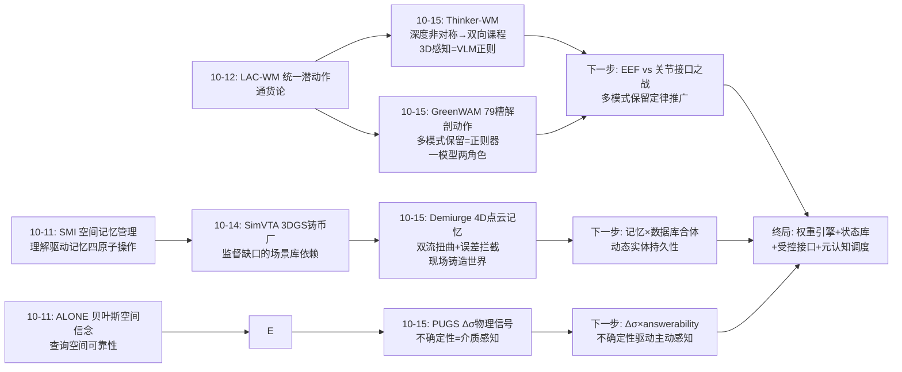
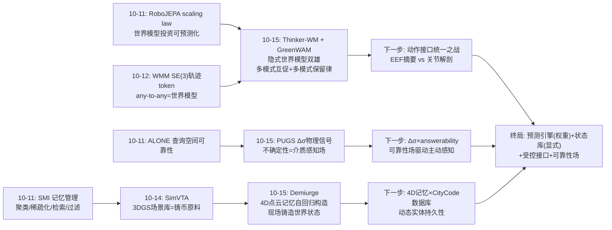
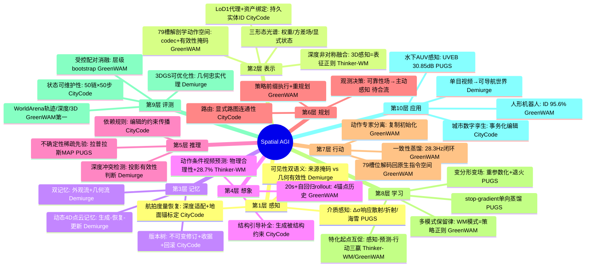
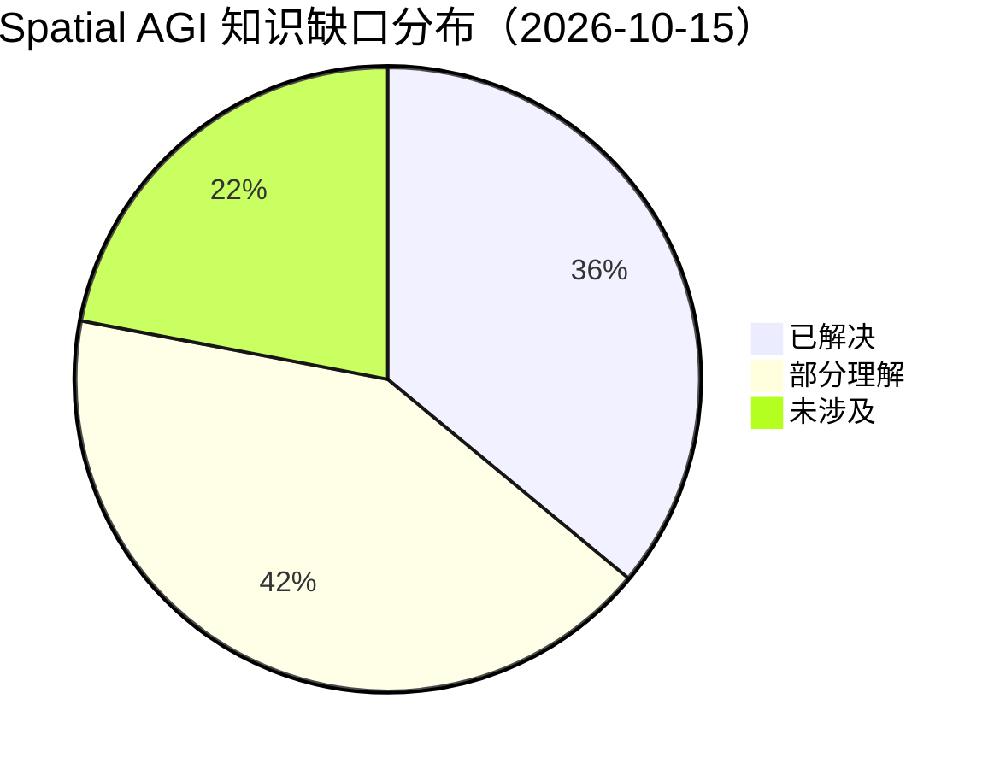

# Spatial AGI 每日深度思考 — 2026-10-15

**日期**: 2026-10-15
**基础日期**: 2026-10-14（昨日完整执行：5 篇论文 + 804 行思考）
**论文数量**: 5 篇
**主题**: 世界状态存放日（隐式权重 vs 显式状态）。昨日"特权教师日"回答了**空间能力如何习得**——反事实经验在训练时铸造、部署时内化。今天五篇论文回答的是一个更基础的问题：**世界状态本身应该存放在哪里、以什么形态存在？** 五篇论文给出了一个几乎完整的谱系。一端是彻底的隐式派：Thinker-WM 与 GreenWAM 把世界状态完全压进生成模型的权重与激活——前者用共享多模态骨干 + 深度非对称→双向融合课程让 3D 感知成为 VLM 表征的正则（三榜第一），后者用 79 槽位解剖学动作空间让一个模型同时是最强世界模型和最强策略（真人形 ID 95.6%、蒸馏后 28.3Hz）。中间是混合派：PUGS 把世界的"确定性部分"存为典范高斯、把"不可确定的部分"显式存为逐高斯位置方差——不确定性不是置信度分数而是介质物理信号（UVEB +1.16dB、DRUVA +3.99dB）。另一端是彻底的显式派：Demiurge 把世界状态存在模型外的动态 4D 点云记忆里（外观流选择性更新 + 几何流全量更新，180° 无重叠大视差仍一致），CityCode 则把整个城市变成带持久实体 ID、依赖感知版本化执行的代码化数据库（50 链 × 50 步全过）。两条路线各自验证了一条基本原则：**隐式世界模型的竞争力来自多模式联合训练带来的角色互促（预测与行动共享表示互相增益），显式世界状态的竞争力来自"条件质量决定世界质量"的误差拦截纪律（宁可条件残缺，不可条件污染）——而 PUGS 的方差场和 CityCode 的事务化版本管理暗示，下一代空间智能的世界状态大概率是两者的合体：权重里住着预测引擎，权重外住着可审计、可回滚、带不确定性标注的状态库**。

---

## 📅 每日总结

**日期**: 2026-10-15
**论文数量**: 5 篇
**主题**: 世界状态存放日。五篇论文覆盖"世界状态"完整技术栈的五个层次，且同一天出现了两组直接对峙的"同题对作"：Thinker-WM（Ubtech）与 GreenWAM（Sber）同日发布、同为工业级统一世界-动作模型，动作接口设计哲学却截然相反（20 维 EEF 摘要保留物理单位 vs 79 槽关节解剖保留手指细节），共同确认"特化起点、专家分离、多模式保留"三个收敛点，分歧点抽象层级（EEF vs 关节）本质是对未来具身数据形态的押注；Demiurge 与 CityCode 则构成"世界作为连续场"与"世界作为数据库"的路线分野——前者重观测一致性（跨轨迹一致的 4D 记忆），后者重操作一致性（事务化可回滚的城市状态）。PUGS 在两者之间插入了第三种状态维度：不确定性场。

**关键突破**:
- 🚀 **一个模型两种角色且两端 SOTA（GreenWAM）**：同一基础、同一动作接口 → 世界模型（WorldArena 轨迹 56.0/深度 98.16/3D 93.40，127 个提交最优）+ 策略（RoboTwin 2.0 平均 67.54%、真人形 ID 95.6%、蒸馏后 28.3Hz 实时）。三项受控消融给出明确设计律：机器人特化起点 +5.4%（策略）/ −23%（预测误差）、适应开始时分离动作专家 +3.3%、**策略适配保留世界模型模式使随机化场景 +8.0%**——最后一条含义最深：世界预测是空间泛化的正则化器，任何把空间模型当纯策略微调的做法都在主动损害空间鲁棒性。
- 🚀 **3D 感知作为 VLM 正则（Thinker-WM）**：深度非对称→双向融合课程把 3D 理解注入共享多模态骨干，端到端 RGB 记录 +2.77 dB PSNR；去掉深度流 RGB 端点 −3.6 dB——3D 监督的价值不只是"多一路输入"，而是改变了 RGB 表征本身的几何结构。EWMBench-Real / WorldOlympiad / WorldArena 轨迹精度 63.27 三榜第一，44 小时真机验证。
- 🚀 **双记忆 + 误差拦截的 4D 世界构造（Demiurge）**：动态 4D 点云记忆 + 自回归"生成-恢复-更新"循环，跨轨迹一致（P-MSE 降 85.7%、View Sync +39.4%），180° 无重叠旋转仍保持一致，输出可直接优化 3DGS（PSNR 24.36，+2.148 dB）。最锋利的洞察：可见性掩码只记录内容来源、不记录投影是否几何有效——"内容从哪来"≠"它在新视角是否应该可见"。噪声监视器（三个几何统计量、零学习成本）+ 记忆锚定深度补全 + 双流扭曲构成自回归误差拦截的三道闸门。
- 🚀 **不确定性是物理信号不是置信度（PUGS）**：变分形变场把每个高斯的运动表示为分布（Δμ + Δσ），Δσ 学会响应水下光学的统计签名（散射↔粒子密度、焦散↔深度频率、海雪↔尺寸分布）而无需前向物理仿真。PhysGaia 分场景结果是灵魂证据：歧义大的半透明介质（烟雾 +1.6dB）增益大、完美可见性的确定性场景无增益——Δσ 真的在响应物理歧义而非充当通用正则。stop-gradient 单向蒸馏让确定性推理继承随机探索的鲁棒收益。
- 🚀 **空间状态的事务化管理（CityCode）**：持久实体 ID + 依赖感知版本化执行（修订锚定查询、验证-发布-回滚-继续、幂等提交），50 任务链 × 50 步 = 2500 步全过；对照系统 UrbanWorld2.0 跨对象约束违反、MajutsuCity 缺道路工作流、两者皆无状态恢复——"状态可维护性"是被社区系统性忽视的评测维度。单张航拍 RGB + 相机参数恢复度量城市（DSM RMSE 33.99→14.37m），"观测是证据、生成为插值、编辑为事务"。

**架构演进**: 10 层架构维持 10 层，四处结构性升级：(1) **表示层**正式确立"世界状态三形态"光谱——权重激活（隐式世界模型）/ 权重+方差（概率场）/ 模型外显式状态（4D 记忆、代码化数据库），并出现了状态在不同形态间流转的完整接口（Demiurge 的记忆↔生成、CityCode 的结构↔生成资产）；(2) **动作层**出现解剖学动作空间的通用模板——GreenWAM 79 槽位 + 有效性掩码（缺失≠零）证明跨本体对应关系应显式注册而非隐式学习，与 10-12 LAC-WM/WMM 的潜空间路线、10-14 LAPT-Scale 的连续潜动作路线三足鼎立；(3) **训练层**新增"多模式保留"定律——策略微调时保留世界模型损失是空间鲁棒性的正则器（+8.0% OOD），与昨日"特权教师三律"互补为第四律；(4) **评测层**新增"状态可维护性"维度（CityCode 50×50 任务链）与"几何忠实度代理"（3DGS 可优化性，Demiurge）。

### 📊 一句话总结

今天五篇论文把"世界状态"从模糊概念拆解为三个正交设计决策：**存在哪里**（权重 vs 方差场 vs 模型外数据库）、**谁有写权限**（观测锚定 vs 生成自由）、**如何保持一致**（多模式互促 vs 误差拦截 vs 事务管理）——隐式派赢在预测与行动的表示共享收益，显式派赢在长程一致与可操作性，而 GreenWAM 的"保留世界模型模式"与 CityCode 的"观测锚定生成"共同指向混合架构：**状态库管一致性，权重引擎管预测，两者以受控接口对话**。

### 🔗 延续性

**昨日→今日**: 昨日"特权教师日"确立了能力习得的三律（铸造律/结构律/内化律），其中内化律说"从特权到内化必须有显式转化机制"。今天的工作把这个问题的坐标系整个翻转了一层：昨日问"能力怎么进权重"，今天问"权重之外的世界还剩什么"。三处直接接续：(1) 昨日 SimVTA 的在线渲染铸币厂依赖 3DGS 场景库——今天 Demiurge 的 4D 记忆恰好是场景库的动态升级版（从静态重建到自回归构造），"移动铸币厂"的原料供给问题获得新解；(2) 昨日 RFL 的 answerability 是"粗结构敏感、细节不敏感"的价值信号——今天 PUGS 的 Δσ 是同一哲学的表示端版本：把"哪里观测不可靠"显式化为状态的一部分，两者合起来就是空间智能的"自知之明"接口；(3) 昨日悬置的"潜路线 vs 显路线"之争（表示层），今天以"隐式世界 vs 显式状态"的系统层形式重演并获得实测数据：GreenWAM 证明隐式路线的多模式互促红利，Demiurge/CityCode 证明显式路线的一致性红利——争论的判据从抽象偏好进一步收敛为"任务需要预测还是需要维护"。

**今日→明日**: 值得追踪——(1) GreenWAM × Thinker-WM 的动作接口之争（EEF 摘要 vs 关节解剖）谁先在统一基准上分出高下，这将决定未来三年具身数据的标注形态；(2) Demiurge 记忆 × CityCode 数据库的合体：4D 点云记忆加上实体 ID 和版本管理，就是"动态的 agent 可操作世界"；(3) PUGS 的 Δσ 场 × RFL 的 answerability：不确定性引导的主动感知闭环（哪里模糊→哪里值得看）；(4) Demiurge 的"3DGS 可优化性"评测代理能否成为世界模型的标配验收项；(5) 79 槽位解剖学接口接入人类视频（LAPT-Scale 供应链）的可行性——人类手部 26 槽位恰好可承接灵巧手数据。

### 💡 本质思考：如何达成通用空间智能

#### 1. 核心能力的本质是什么？

今天五篇论文把这个问题推进到"世界状态的形而上学"维度。**第一层：空间智能需要的不只是预测引擎，还有状态管理员**。此前两周的工作（世界模型、WAM、特权教师）几乎全部聚焦"预测下一个观测/动作"，隐含假设世界状态可以完全由生成模型的上下文窗口承载。今天五篇论文不约而同地挑战了这个假设：Thinker-WM 的 21K token 上下文在跨任务长程场景下必然遗忘；Demiurge 证明即使生成本身，也需要模型外的显式记忆才能跨视角一致；CityCode 证明编辑累积的世界必须用事务管理才能保持可查询。**空间智能系统 = 预测引擎（权重）+ 状态库（显式）+ 两者间的受控接口**——这个三件套结构在今天五篇论文中以不同形态反复出现。**第二层：一致性的来源决定了系统的能力边界**。隐式派（Thinker-WM/GreenWAM）的一致性来自训练分布的覆盖——分布内完美、分布外即崩，收益是多模式互促（一个表示同时服务感知与行动，且互相提升）；显式派（Demiurge/CityCode）的一致性来自结构保证——Demiurge 用几何锚定、CityCode 用依赖检查，收益是长程可维护与可验证，代价是表示刚性（LoD1 盒子、静态假设）。PUGS 揭示了第三条路：把"分布外/不可确定"本身作为状态显式表示——Δσ 场是系统对自己无知程度的建模，这是元认知的几何化。**第三层：跨本体/跨视角/跨时间的对应关系应该显式注册**。GreenWAM 的 codec（79 槽位解剖对应）、Demiurge 的深度对齐（新观测锚定旧几何）、CityCode 的实体 ID（重叠观测关联全局身份）——三个案例共同验证：**空间对应关系（身体间、视角间、时刻间）显式注册的工程收益远大于隐式学习**，因为对应关系的错误是静默的（掩码缺失≠零目标的教训：看不见≠空、缺失≠零）。**第四层：预测与维护是一对对偶能力，缺一不可**。预测（生成新观测）在编辑/交互累积后必然漂移（Thinker-WM 类模型的上下文遗忘、生成式世界模型的 rollout 漂移）；维护（保持状态一致）无法产生新信息（数据库不会想象）。昨天五篇论文全部在预测侧，今天五篇补上了维护侧——合起来才是完整的 Spatial AGI 世界观。

#### 2. 当前方法与理想目标的差距在哪里？

**差距一：隐式与显式状态之间没有标准接口**。GreenWAM 的世界状态在激活里、CityCode 的在数据库里，两者无法对话——你没法"把 GreenWAM 的 rollout 写进 CityCode 的版本树"或"用 CityCode 的结构约束 GreenWAM 的生成"。理想状态需要一个"世界状态中间表示"（带不确定性标注的实体级时空状态），任何预测引擎可以读写、任何数据库可以校验。今天的五篇论文各自发明了私有接口，尚无标准化信号。**差距二：不确定性的利用只走了半程**。PUGS 用 Δσ 引导训练（探索/退火/致密化），但推理时把采样关掉了——不确定性场没有驱动推理时的任何决策（不改变渲染路径、不触发重新观测）。理想状态是 Δσ 驱动主动感知：哪里模糊→哪里值得看（RFL answerability 的对偶问题）。**差距三：动态场景的跨轨迹时序一致性未解决**。Demiurge 的 4D 记忆按时刻索引点云，重访视角下"那个行人去哪了"没有答案；CityCode 干脆没有时间维度。可导航世界最难的部分——动态物体的持久性——两篇论文都绕开了。**差距四：世界模型的误差累积只有拦截没有修复**。Demiurge 的噪声监视器/锚定/冲突检测都是"防注入"闸门，但已经写进记忆的错误无法清除（没有记忆修正机制）；GreenWAM 的自回归 rollout 依赖 teacher forcing 训练与推理生成历史的 exposure bias 无扰动训练兜底。**差距五：评测仍然是分片的**。世界模型基准（WorldArena/EWMBench）与策略基准（RoboTwin）与状态基准（CityCode 任务链）互不相通，"同一个系统在三个维度上的联合表现"没有可比数据——GreenWAM 是唯一例外，而它恰好是最完整的系统。

#### 3. 从今天到理想状态，最可能的路径是什么？

一条"状态工程"驱动的五段路径。**第一段（现在起）：动作接口之战的观察与押注**。EEF 摘要（Thinker-WM）与关节解剖（GreenWAM）之争将在 6 个月内见分晓（统一基准 + 交叉微调实验）；押注方向是混合接口——EEF 层做策略条件、关节层做执行、中间用 GreenWAM 式 codec 显式注册对应关系。产出：一份动作接口选型指南，含各形态的迁移成本实测。**第二段（并行）：不确定性驱动的主动感知闭环**。PUGS 的 Δσ（表示端）+ RFL 的 answerability（决策端）+ 10-11 ALONE 的查询空间可靠性（导航端）合流：系统显式维护"哪里我不知道/看不清"的状态图，主动感知决策从该图导出。最小实验：给 Demiurge 的 4D 记忆加 Δσ 通道，冲突区域触发额外轨迹采样。**第三段（3-6 个月）：状态库与生成引擎的受控接口**。以 CityCode 的实体 ID + 版本树为骨架，把 Demiurge 式生成记忆作为"外观层"挂载到实体上：结构查询走数据库（精确、可审计），视觉查询走生成记忆（保真、可插值），编辑先过数据库依赖检查再传播到生成层。判定标准：在"编辑后查询"类任务上，混合系统的一致性超过纯生成式世界模型一个数量级。**第四段（6-12 个月）：动态持久性**。给 4D 记忆/城市状态加实体级时间轴（物体 X 在 t1~t2 期间位于 y），用跟踪先验连接重访观测；这需要视频跟踪、时序点云配准与实体消解三项技术的工程合流，是"可导航动态世界"的最后一块硬骨头。**第五段（1-2 年+）：世界状态标准化的 Spatial AGI**。理想状态判定标准：一个系统拥有(1)权重中的预测引擎（多模式联合训练，角色互促）、(2)模型外的状态库（实体 ID、版本树、不确定性场）、(3)受控读写接口（生成结果作为候选提交状态库校验、状态库约束生成条件）、(4)主动感知闭环（不确定性驱动观测决策）；其评测必须同时覆盖预测（世界模型基准）、行动（策略基准）、维护（任务链基准）三个维度。今天五篇论文分别验证了(1)的可行（GreenWAM/Thinker-WM）、(2)的可行（Demiurge/CityCode）、(3)的雏形（CityCode 的结构-生成协作）、(4)的素材（PUGS 的 Δσ）——状态工程的零件已齐，缺的是装配图。

---

## 🔗 与昨日思考的联系

### 昨日重点

10-14"特权教师日"确立三个设计律：(1) **铸造律**——反事实监督必须由特权教师在训练时铸造（视角渲染/动作后果/潜在动作/价值目标四类铸币机齐备）；(2) **结构律**——监督要覆盖候选空间的价值结构而非教师足迹（候选级 3.05 > 动作克隆 2.47）；(3) **内化律**——特权到内化要有显式转化机制且训练输入分布与部署一致（脚手架替换/软标签蒸馏/教师输入撤销测试）。遗留悬念：SpatialASM × SpaceCast-Bench 交卷、移动铸币厂（前馈重建进训练环）、内化信息瓶颈量化、元认知调度器。

### 今日进展

今天在昨日基础上完成四个推进：(1) **内化律获得状态层对应物**——昨日问"能力如何进权重"，今天五篇论文回答"权重之外还需要什么"。答案是状态工程三件套：显式记忆（Demiurge）、不确定性场（PUGS）、事务化数据库（CityCode）。特权教师范式铸造的是"预测能力"，状态工程维护的是"预测的前提"——一个可查询、可编辑、无漂移的世界状态。昨日"移动铸币厂"的原料问题（3DGS 场景库哪里来）在 Demiurge 处获得升级答案：不需要预先重建，自回归生成 + 4D 记忆可以在稀疏观测上现场铸造世界，铸币厂的原料从"重建的场景"变为"生成的记忆"。(2) **昨日 P2 悬念（世界模型 × 空间推理基准）的变体检修**——Thinker-WM/GreenWAM 在 WorldArena/EWMBench 上的成绩说明世界模型已经开始在"空间理解"维度交卷，只是考卷是"生成质量"而非"推理问答"；SpaceCast-Bench 式的四选一推理评测对生成式世界模型仍是空缺考位。(3) **昨日内化谱系补上新成员**——昨日光谱从 M3SunAgent（零内化）排到 LAPT-Scale（完全内化）；今天 GreenWAM 在"预测能力"轴上做到了 LAPT-Scale 在"动作能力"轴上的位置（世界预测与控制共享同一权重表示且互促），而 PUGS 的 Δσ 提供了内化光谱此前缺失的一类成员：**把"内化的边界"本身内化**（模型知道自己哪里不确定）。(4) **昨日"潜/显之争"获得系统级实测数据**——昨日只有 M3SunAgent 一个外挂对照点，今天 Demiurge/CityCode/PUGS 三个显式状态系统与两个隐式世界模型形成完整对照：显式派赢在长程一致（180° 大视差）、可操作性（2500 步任务链）、可解释性（不确定性热图），隐式派赢在预测质量与表示效率（多模式互促免费获得感知-行动双能力）。判据公式初步成形：**任务窗口短且需要泛化→隐式；任务窗口长且需要维护→显式；两者都要→混合**。

### 演进路径

---

## 📚 论文概览

今天五篇论文构成一个"世界状态形态"实验组：

1. **Thinker-WM**（Ubtech，2610.18447）：统一多模态世界模型，共享 VLM 骨干 + 视频生成器，三阶段深度非对称→双向融合课程把 3D 理解注入表征。EWMBench-Real / WorldOlympiad / WorldArena（轨迹 63.27）三榜第一，44 小时真人形验证感知-预测互促，动作条件视频预测的物理合理性 +28.7%。

2. **GreenWAM**（Sber，2610.18774）：机器人世界基础模型，79 槽位解剖学动作空间统一 20 个双臂本体（腿 12/躯干 23/臂 18/手 26，codec 显式注册跨本体对应，有效性掩码防"缺失=零目标"），7 模式 rectified flow 联合训练，动作专家复制初始化分离，一致性蒸馏 28.3Hz。世界模型与策略双 SOTA + 三项受控消融设计律。

3. **Demiurge**（USTC/Tencent，2610.14685）：自回归视频重渲染 + 动态 4D 点云记忆，噪声监视器（零学习）拦截不可靠投影，记忆一致深度补全（锚定+全局仿射+Poisson 精炼）保证几何注册，双流扭曲（外观选择性更新/几何全量更新/深度冲突融合）解决保真-完整两难，可选几何感知精炼。跨轨迹一致、180° 大视差、3DGS 直优化 SOTA。

4. **PUGS**（中国海洋大学/CASIA，2610.17936）：水下动态 3DGS 的变分不确定性建模——形变场输出 (Δμ, Δσ)，重参数化采样探索 + 退火收敛 + ℓ1 稀疏防膨胀 + stop-gradient 双路径蒸馏 + Δσ 引导致密化。UVEB +1.16dB、DRUVA +3.99dB，半透明介质场景增益最大证明 Δσ 响应物理歧义。

5. **CityCode**（南大/上海AI Lab，2610.18342）：agent 可操作 3D 城市表示——持久实体 ID 统一度量几何/路网拓扑/语义嵌入/3D 资产，依赖感知版本化执行（修订锚定、验证-发布、历史回滚、幂等提交）；Air2Code 从单张航拍 RGB 经航拍深度适配+地面锚标定+结构引导生成构建度量城市。50 链 × 50 步全过，DSM RMSE 14.37m，CS-Aerial 七指标全第一。

**组合逻辑**：五篇论文沿"世界状态存放位置"排成谱系——Thinker-WM/GreenWAM（全隐式：状态在权重与激活）、PUGS（混合：均值在典范空间、不确定性显式成场）、Demiurge（显式记忆：状态在模型外点云）、CityCode（全显式：状态在带事务的数据库）——加上两条接口原则（GreenWAM 的 codec 显式注册对应、CityCode 的观测锚定生成），完整覆盖了"世界状态工程"的设计空间。

---

## 💡 核心见解

### 见解1: 多模式联合训练是"一模型两角色"的充要工艺

**从 GreenWAM、Thinker-WM 共同获得**
- ✅ GreenWAM 7 模式联合训练：策略适配时保留世界模型模式（WAM 0.9 + FD/I2V 各 0.05）→ 随机化场景 +8.0%、干净场景仅 −1.4%；
- ✅ Thinker-WM 深度非对称→双向课程：3D 感知成了 RGB 表征的正则（去深度流 −3.6dB）；
- ✅ 两者的共同结构：同一个骨干同时服务"预测世界"与"支持行动"，训练信号互相正则化。

**对Spatial AGI的启发**:
这是给所有空间模型微调实践的警告：**把空间模型当纯策略微调是在主动烧掉空间鲁棒性**。世界模型损失不是训练期的脚手架，而是推理期的泛化保险。任何下游适配（机器人策略、导航、规划）都应该保留一部分"预测世界"的损失权重——这是继昨日"特权教师三律"之后的第四条定律：**多模式保留律**。工程含义极简单（损失加权），收益实测 +8.0% OOD，性价比全周最高。

### 见解2: 跨域对应关系应显式注册，且必须区分"缺失"与"零"

**从 GreenWAM、Demiurge、CityCode 共同获得**
- ✅ GreenWAM codec：左肘在所有 20 个本体上占据同一槽位，平台特定约定由 codec 吸收；有效性掩码保证机器人没有的自由度"从损失中排除"而非变成零目标；
- ✅ Demiurge：新观测的深度与缓存几何做两阶段全局仿射对齐 + Poisson 精炼——跨视角对应（这个像素对应那个 3D 点）被显式求解；
- ✅ CityCode：重叠区域的观测经全局建筑 ID 关联——跨观测对应被显式注册。

**对Spatial AGI的启发**:
三个不同层次（身体间/视角间/观测间）的对应关系，三个团队不约而同选择了显式注册而非隐式学习。深层原因：**对应关系的错误是静默错误**——隐式学错的对应不会报错，只会让下游在不知不觉中积累偏差（投影器猜错"这个维度是左肘"→ 迁移时灾难）。"缺失≠零"的教训尤其普适：任何空间表示（占据栅格、语义图、知识图谱）都必须区分"未知"与"确认不存在"，混用两者是空间推理的经典翻车点。工程原则：**空间对应层宁可人工注册也要显式，宁可表示三态（有/无/未知）也不要二态**。

### 见解3: 自回归世界构造的每一环都必须拦截条件污染

**从 Demiurge、GreenWAM、PUGS 共同获得**
- ✅ Demiurge：噪声监视器（无效深度/梯度/局部方差三统计量）→ 不可靠投影不进入生成条件；深度补全锚定缓存几何 → 单目深度歧义不进入记忆；双流冲突检测 → 遮挡泄漏不进入外观；
- ✅ GreenWAM：teacher forcing + 固定锚点位置 → 训练与推理的历史条件分布对齐（对比随机锚点采样的 exposure bias）；
- ✅ PUGS：stop-gradient → 随机探索的噪声不污染确定性路径；ℓ1 稀疏 → 方差不膨胀成 slack 变量。

**对Spatial AGI的启发**:
三篇论文从不同角度收敛到同一条纪律：**宁可条件残缺，不可条件污染**。损坏的观测条件会经生成写回状态并随自回归迭代放大（Demiurge 消融：去噪声监视 View Sync 64.9→62.6、去双流 51.5）。这条纪律可以形式化为自回归状态系统的通用不变量：**每一步写入状态的内容，必须通过独立于生成过程的校验**（几何校验/物理校验/统计校验）。对 Spatial AGI 的世界模型部署（rollout 仿真、数据引擎、交互式世界构造），这是安全性级别的要求，不是质量优化。

### 见解4: 不确定性是空间的元数据，不是附属品

**从 PUGS、ALONE（10-11）、RFL（10-14）三方合流获得**
- ✅ PUGS：Δσ 学会响应介质物理（歧义场景增益大、清晰场景无增益——排除通用正则解释）；
- ✅ ALONE：查询空间可靠性图驱动导航观测决策（0.9% 决策步需新观测）；
- ✅ RFL：answerability 预测视角价值，粗结构敏感、细节不敏感。

**对Spatial AGI的启发**:
三个不同任务域（重建/导航/主动视觉）的证据合流指向同一结论：**空间智能系统需要一个一等公民的"可靠性场"**——逐位置、逐时刻标注"这里的观测/预测有多可信"。PUGS 证明它可以无监督地从重建困难中学出来（涌现的介质感知）；ALONE/RFL 证明它可以驱动主动决策。缺的是把三者接起来的系统：Δσ 场（表示端）→ 可靠性查询接口（中间件）→ 观测决策（行动端）。这是空间智能"自知之明"的完整回路，也是元认知调度器（昨日 Q9）的几何化实现。

### 见解5: 状态可维护性是被系统性忽视的评测维度

**从 CityCode 获得**
- ✅ 50 链 × 50 步 = 2500 步任务链全过（查询/编辑/规划/检索/回滚）；
- ✅ 两个对照系统在任务级执行上暴露根本缺口：跨对象约束违反、缺道路工作流、无状态恢复；
- ✅ 渲染类指标（PSNR/FID）完全无法区分"能改"与"不能改"的系统。

**对Spatial AGI的启发**:
此前评测体系（WorldArena/SpaceCast/E3VS/M3SI）全部测"单次交互的质量"，CityCode 首次系统测"累积交互的一致性"。这对 Spatial AGI 是根本性补充：真实部署中 agent 与环境的交互是数百步的序列，编辑累积后的世界若不可信，单次质量再高也无意义。工程含义：**任何空间状态系统都应该发布"任务链协议"作为标配评测**——就像操作系统发布事务测试一样。这也给世界模型评测指了方向：GreenWAM 们的下一步考卷不是更大规模的视频预测，而是"生成世界被 agent 编辑 100 步后是否仍然一致"。

### 见解6: 观测是证据，生成是插值，边界必须显式

**从 CityCode、Demiurge 共同获得**
- ✅ CityCode：足迹/高度/道路从观测度量恢复，立面/遮挡区域交给生成补全，但生成被结构严格约束（高度校正 Z 重映射、足迹监督损失）；生成补全与观测分开记录（O_i 与生成记录分离）；
- ✅ Demiurge：已观测区域用外观流条件（保真），新暴露区域允许生成（探索），冲突区域用几何流（可靠遮挡）。

**对Spatial AGI的启发**:
生成式空间智能的"幻觉"问题在两个系统中被同一原则驯服：**为每个像素/实体标注证据状态（观测到/生成出/未知），生成内容永远不能覆盖观测内容，生成的自由度与证据密度成反比**。这把"幻觉"从模型缺陷转化为可管理的状态属性——问题从"如何防止模型编造"变为"如何追踪哪些内容是编造的、编造的部分何时被观测修正"。对构建可信赖空间智能（数字孪生、自动驾驶仿真）而言，这个原则比任何去幻觉算法都更根本。

### 见解7: 双流/双路径是"保真与探索"两难的通用结构

**从 Demiurge（双流扭曲）、PUGS（双路径渲染）共同获得**
- ✅ Demiurge：外观流（选择性更新→保真）与几何流（全量更新→完整）按深度冲突逐像素融合，且共享存储零额外成本；
- ✅ PUGS：clean 路径（确定性）与 uncertainty 路径（随机探索）经 stop-gradient 蒸馏对齐，训练探索、推理确定。

**对Spatial AGI的启发**:
两个完全不同的任务（4D 记忆更新 vs 形变场优化）独立发明了同一结构：**并行维护"保守流"与"激进流"，用显式判据（深度冲突/退火进度）逐点决定信谁**。这是优化领域的经典探索-利用两难在空间状态管理中的再现，而两个解法都胜过单流。可推广：任何"状态更新"系统（记忆写入、地图更新、知识库修订）都可以用双流结构——保守流保证已有内容不被污染，激进流保证新信息不被拒绝。融合判据的选择（几何冲突/不确定性/证据强度）是各域的定制点。

---

## 🗺️ 知识演进图

---

## 技术栈演进对比表

| 层次 | 昨日方案（10-14） | 今日方案（10-15） | 变化 |
|------|------------------|------------------|------|
| 世界状态形态 | 隐式（权重/上下文）为主 | 三形态光谱确立：权重/方差场/显式记忆与数据库 | 状态工程成为显式设计对象 |
| 世界模型训练 | 单一模式或简单加权 | 7 模式联合 + 深度非对称→双向课程 + 多模式保留律 | 多模式互促成为标配工艺 |
| 动作接口 | 连续潜动作（LAPT-Scale）/SE(3) token（WMM） | 79 槽解剖学空间（codec+掩码）与 20 维 EEF 摘要正面对峙 | 跨本体对应显式注册 vs 隐式学习 |
| 记忆 | SMI 理解驱动管理 / SimVTA 静态 3DGS 库 | 动态 4D 点云记忆（Demiurge）：生成-恢复-更新循环 | 记忆从被动存储变为自回归构造 |
| 一致性机制 | 无系统方案 | 双流扭曲 + 噪声监视 + 锚定补全 + 事务化版本管理 | 一致性从"训练分布覆盖"变为"结构保证" |
| 不确定性 | answerability（决策端） | Δσ 物理信号场（表示端），变分形变场 | 不确定性升格为一等状态 |
| 度量恢复 | 特权渲染/重建 | 单张航拍图+地面锚标定（DSM RMSE 14.37m） | 度量城市获取成本骤降 |
| 状态更新 | 无（一次性构建） | 依赖感知版本化执行：验证-发布-回滚-继续 | 空间状态获得事务保证 |
| 评测 | 预测/策略/单次推理基准 | 新增状态可维护性（50×50 任务链）+ 3DGS 可优化性代理 | 评测覆盖累积交互一致性 |
| 部署实时性 | RFL 零渲染推理 | 一致性蒸馏 28.3Hz 世界模型策略闭环 | 世界模型正式进入实时控制环 |

---

## 🗺️ Spatial AGI 知识图谱

### 10层架构思维导图

### 🎯 主线技术路径

#### 阶段1: 静态重建与单次生成（2025 及以前）
3DGS/NeRF 静态重建、单帧城市生成（GaussianCity 类）、确定性形变场。世界状态=一次性产物，无维护概念。代表：今天论文中的全部 baseline。

#### 阶段2: 世界模型兴起与隐式状态（2026 上半年）
视频世界模型、WAM、潜空间预测成为主流，世界状态完全隐于权重与上下文。能力上限由训练分布决定，一致性由生成质量决定。10-11/10-12 的工作（RoboJEPA/LeWAM/PLaW）处于此阶段前沿。

#### 阶段3: 显式状态回归与状态工程（2026 Q4，今日所处阶段）
4D 记忆（Demiurge）、事务化城市数据库（CityCode）、不确定性场（PUGS）三条显式路线同周爆发；隐式阵营内部（Thinker-WM/GreenWAM）完成"一模型两角色"合流。世界状态的存放位置成为显式设计决策。

#### 阶段4: 混合架构与受控接口（下一步，3-6 个月）
预测引擎（权重）+ 状态库（显式）+ 受控读写接口：生成结果作为候选提交状态库校验、状态库约束生成条件、不确定性场驱动主动感知。动作接口之战（EEF vs 关节）分出高下。

#### 阶段5: 动态持久世界（6-12 个月+）
实体级时间轴、重访一致性、动态物体持久性；世界模型在"被编辑 100 步仍一致"的考卷上交卷；Spatial AGI 世界状态标准（带证据标注与不确定性的实体级时空状态）候选成型。

---

## 🔍 待探索议题

### 高优先级（本周）

1. **多模式保留律的最小复现**
   - 问题: GreenWAM 的"+8.0% OOD"能否在开源系统上以最小代价复现？
   - 候选方案: 取一个开源 WAM（如 Long-WAM），策略微调时对比"WAM only"与"WAM+FD/I2V 混合"两种损失配置在随机化评测上的差异。
   - 缺口: 开源权重的预训练模式配置未知，需确认预训练本身是多模式的。

2. **Demiurge 记忆 × SimVTA 铸币厂的接口实验**
   - 问题: 4D 记忆能否替代离线 3DGS 场景库作为动作条件视频的铸造原料？
   - 候选方案: 在 Demiurge 构造的世界中渲染 SimVTA 式候选轨迹监督，对比与真实 3DGS 渲染监督训练的驾驶 WAM 表现。
   - 缺口: Demiurge 是离线轨迹套件制，需要适配在线查询接口。

3. **79 槽位接口 × 人类视频供应链（LAPT-Scale）**
   - 问题: 人类手部 26 槽位能否承接 egocentric 视频的灵巧操作标注，实现解剖学接口的人类数据注入？
   - 候选方案: 用手部姿态估计把 egocentric 视频映射到 26 手部槽位，做逆动力学预训练。
   - 缺口: 视频中人的关节状态需从 2D 上推 3D，精度未知。

### 中优先级（本月）

4. **Δσ 场驱动的主动观测决策**
   - 问题: PUGS 的 Δσ（重建端）能否转化为观测决策信号（导航端）？
   - 候选方案: 把 Δσ 高的区域作为"值得重访"的候选，接入 ALONE 式信念更新；或训练 answerability-on-Δσ 的映射。
   - 缺口: Δσ 标定的是几何歧义，不含语义歧义（"看不清"与"看不懂"是两回事），需要双通道。

5. **3DGS 可优化性作为世界模型标配评测**
   - 问题: Demiurge 的"输出直接优化 3DGS"评测能否标准化，用于横评各类世界模型？
   - 候选方案: 固定一组输入视频与轨迹集，各世界模型生成多视角输出 → 统一 3DGS 优化管线 → PSNR/SSIM 排名。
   - 缺口: 优化超参与迭代预算需标准化；视频生成类模型可能拒绝渲染式轨迹控制。

6. **缺失≠零的空间表示审计**
   - 问题: 现有空间表示（占据栅格/语义图/场景图）有多少混用了"未知"与"空"？
   - 候选方案: 对 3-5 个开源空间记忆系统做审计，统计三态区分的缺失率及其下游影响案例。
   - 缺口: 需要"区分与不区分"的对照实验，构造因混用导致失败的合成案例。

7. **状态库×生成引擎的受控接口原型**
   - 问题: CityCode 实体状态约束 Demiurge 式生成的最小闭环长什么样？
   - 候选方案: 用 CityCode 的建筑代理（LoD1+高度）做 Demiurge 生成的结构条件，编辑状态树后重生成，检查跨视角一致性。
   - 缺口: 两系统的度量坐标系与粒度不同，需要配准层。

### 低优先级（本季度）

8. **动态实体持久性**
   - 问题: 4D 记忆/城市状态如何表示"物体 X 在 t1~t2 位于 y"？
   - 候选方案: 实体级时间轴 + 跟踪先验连接重访观测 + 实体消解。
   - 缺口: 时序点云配准与跨时刻实体关联都是未解决的硬问题。

9. **世界模型的"编辑 100 步"考卷**
   - 问题: 世界模型（隐式）在被 agent 反复编辑后的一致性衰减曲线长什么样？
   - 候选方案: 在 GreenWAM 类模型上模拟状态更新序列（文本指令条件化），量化 rollout 一致性随编辑步数的衰减。
   - 缺口: 隐式世界模型缺乏结构化的编辑接口，只能用条件注入近似。

10. **介质鲁棒性的统一训练配方**
    - 问题: PUGS 的变分形变 + GreenWAM 的多模式保留能否合并成"恶劣介质下的世界模型"配方？
    - 候选方案: 水下/雾天数据集上同时训练世界模型模式与不确定性场，评测预测质量与可靠性标定。
    - 缺口: 水下世界模型数据（动作条件视频）不存在，需先构造。

---

## 📊 知识缺口分析

**已解决（36%）**:
- ✅ "一模型两角色"的完整系统证据（GreenWAM：世界模型+策略双 SOTA+真人形+实时）；
- ✅ 3D 感知作为表征正则的训练工艺（Thinker-WM 三阶段课程）与收益量化（−3.6dB 反事实）；
- ✅ 跨本体动作接口的显式注册方案（79 槽位 codec + 掩码）及受控消融证明（三项设计律）；
- ✅ 自回归世界构造的误差拦截三件套（噪声监视/锚定补全/双流融合）；
- ✅ 不确定性作为介质物理信号的可学习性（PUGS 分场景证据）；
- ✅ 空间状态的事务化管理架构（版本树/收据/回滚/幂等）与 2500 步实证。

**部分理解（42%）**:
- ⚠️ 隐式与显式状态的标准接口：知道该合体，没有中间表示与协议；
- ⚠️ 不确定性的决策利用：Δσ/answerability/查询可靠性三个信号源已现，主动感知闭环未合流；
- ⚠️ 动态场景的跨轨迹时序一致性：Demiurge/CityCode 都绕开了动态持久性；
- ⚠️ 记忆的错误修复：拦截闸门已备，已写入状态的错误无法清除；
- ⚠️ EEF vs 关节动作接口的优劣：两个工业系统各执一词，无统一基准对照；
- ⚠️ 水下/恶劣介质的生成式世界模型：PUGS 是重建端，生成端空白；
- ⚠️ exposure bias 的扰动训练：GreenWAM 用 teacher forcing + 固定锚点缓解，GE-Sim 2.0 有历史扰动，孰优未对照。

**未涉及（22%）**:
- ❌ 世界状态标准（带证据标注+不确定性的实体级时空状态的格式规范）；
- ❌ 重访一致性（动态物体在重访视角下的位置与状态恢复）；
- ❌ 交互式世界的因果编辑语义（编辑实体 A 对实体 B 的传播不止几何，还有物理与语义后果）；
- ❌ 多 agent 并发编辑同一世界状态的冲突解决（CityCode 是单 agent 事务）；
- ❌ 恶劣介质中的主动感知策略（水下 AUV 决定"哪里值得凑近看"）；
- ❌ 世界状态的压缩与传输（城市级状态的增量同步）；
- ❌ "3DGS 可优化性"之外的第二几何忠实代理（如深度一致性、多视角光度一致性）。

---

## 🎯 下一步行动建议

1. **本周实验**：多模式保留律的最小复现（议题 1）——若开源 WAM 上"+WM 损失 → +OOD"成立，该定律即刻升级为普适工程原则；
2. **追踪仓库**：hanxinzhu-lab/demiurge（代码承诺开源）、GreenWAM（Sber，关注权重开放）、CityCode（承诺 runnable code）、tingtingpius/PUGS 四个 repo；
3. **基准对齐**：把 3DGS 可优化性评测（Demiurge Tab.2 协议）纳入世界模型评测清单，作为几何忠实度代理；
4. **理论阅读**：变分推断在形变场中的 KL-vs-ℓ1 选择（PUGS 附录）；事务处理理论（快照隔离/串行化）与空间状态管理的形式对照；
5. **明日关注**：动作接口之战的新证据（EEF vs 关节的交叉微调实验）；动态实体持久性的第一批工作；世界模型 × 状态可维护性评测的交汇。

---

## 🔬 逐篇深挖：从论文细节到设计律

### 深挖1: GreenWAM 的 79 槽位为什么是 79？解剖学动作空间的尺度选择

79 = 12 腿 + 23 躯干 + 18 臂 + 26 手。这个数字的选择揭示了一个设计权衡：槽位数必须 ≥ 最复杂本体的自由度（Green 人形灵巧手），又不能大到让简单本体的掩码空置率过高（掩码空位意味着对应槽位的梯度信号稀疏）。分组平均的状态损失（组内平均再跨组平均）是缓解这个矛盾的配套设计——否则 26 槽的手会以 2 倍于 12 槽的腿的权重主导训练。更深层的问题：**解剖学槽位是"身体中心"的坐标系，而任务往往是"任务中心"的**（"把杯子放进袋子"不关心左肘角度）。GreenWAM 用文本指令承载任务语义、槽位承载身体语义，两层解耦——这暗示未来的动作接口可能是三层的：任务语义（语言）/ 身体解剖（槽位）/ 执行动力学（关节力矩），每层有自己的抽象与迁移单元。79 槽位是第二层的第一个工业级实现。

### 深挖2: Thinker-WM 与 GreenWAM 的动作接口对峙：摘要在哪里丢信息？

Thinker-WM 的 20 维相对 EEF（末端位姿+夹爪）是**任务空间摘要**：保留物理单位（米/弧度）、与任务描述直接对应、本体解码精确，但**抹掉了手指协调**（灵巧手操作的内旋/多指协作被压缩成一个夹爪开合度）与全身协调（躯干补偿运动不可见）。GreenWAM 的 79 槽是**关节空间展开**：保留全部手指自由度、跨本体对应显式，但**丢失了任务级语义直接性**（"把手移到杯子上方 10cm"需要逆运动学才能变成槽位值，且 IK 解不唯一）。两者的取舍本质是：**接口的语义层次决定它能接收什么监督**——EEF 接口可以直接吃人类示教与语言指令（人类用任务空间思考），关节接口可以精确吃本体 proprioception 数据（机器人用关节空间行动）。LAPT-Scale 的连续潜动作其实是第三条路：用学习出来的隐空间同时对接两边。预测：最终胜者是分层接口（语义→潜空间→解剖→关节），单层接口都是过渡形态。

### 深挖3: Demiurge 双流扭曲的"来源掩码 vs 几何有效性"类别错误

这是今天最锋利的一个概念澄清。可见性掩码回答"这个像素的内容来自哪条轨迹"（provenance），遮挡判断需要的是"这个投影在新视角下几何上是否有效"（validity）。两者在静态场景近似重合，在大视差下彻底分离：前景稀疏点未能完全遮挡背景时，背景内容"来源合法"（确实是之前生成的）但"投影无效"（在这个视角本不该被看见）。若把来源掩码当可见性用，泄漏的背景会被当作可靠外观条件写进生成，再写回记忆——静默污染。这个区分的普适版：**任何空间状态系统都需要两个正交标注维度——证据来源（哪次观测写入）与当前有效性（在新条件下是否仍然成立）**。地图更新（旧观测在新光照下失效）、场景图（物体被移动后原位置记录失效）都需要同样的双维度。CityCode 的实体 ID + 版本树其实隐含了这个区分（版本号标记证据时代，依赖检查标记有效性），显式化它是一个好 refactor。

### 深挖4: PUGS 的 ℓ1 vs KL：稀疏先验的物理论证

变分推断的标准做法是 KL 正则拉向先验，PUGS 却用 ℓ1（零中心拉普拉斯先验的 MAP 对应物）。论证是物理的：水下光学退化在空间上本质稀疏——大部分水域大部分时刻是清晰的，散射/海雪/焦散只占据局部。高斯先验（L2/KL）会把不确定性"抹平"到全场（每个位置分一点方差），拉普拉斯先验才允许"大部分位置零方差、少数位置大方差"的尖峰分布。这个选择的可验证推论：Δσ 热图应该呈现稀疏的亮斑（退化区域）而非弥漫的雾。论文的 Fig.1 热图确实如此。更一般的教训：**正则化的形状（L1/L2/其他）不是数值优化细节，而是对状态分布形状的物理假设**——空间系统的每个正则项都值得问一句"我假设的这个量的真实空间分布是什么形状"。

### 深挖5: CityCode 的事务化执行为什么是空间智能的刚需而非奢侈品

2500 步任务链的对照实验是关键证据：UrbanWorld2.0 与 MajutsuCity 不是"做得差"，而是**无法表达**这些任务（缺道路关系工作流、无状态恢复机制）——差距是能力存在性而非程度。为什么长程交互必然需要事务？因为空间操作的依赖链会累积：移动建筑 → 改变街区归属 → 改变邻接关系 → 影响可达性 → 影响后续路由查询。没有依赖追踪的编辑会产生"幽灵状态"（几何改了、拓扑没改），agent 在其上的推理全部失效且无告警。回滚的必要性同理：agent 的规划是试错性的，错误编辑必须可撤销，否则一次错误写入就永久污染世界。这实质上是把数据库几十年前就解决的问题（事务 ACID）重新发现在空间领域——引用 not inventing here 的教训：**空间智能的很多"新问题"是老问题的空间化身，先查软件工程四十年的解法再动手**。

### 深挖6: 三个"世界状态"系统的存储效率对照

| 系统 | 状态形态 | 存储 | 一致性来源 | 可增长性 |
|------|---------|------|-----------|---------|
| Thinker-WM/GreenWAM | 激活/KV 缓存 | GB 级权重+运行时上下文 | 训练分布覆盖 | 受上下文窗口硬限制 |
| Demiurge | 4D 点云 | 随轨迹数线性增长（双流共享存储） | 几何锚定+校验闸门 | 好，但渲染成本随密度上升 |
| CityCode | 参数化实体+资产 | 极小（LoD1 代理+共享资产） | 依赖检查+事务 | 最好，但表示刚性 |

这个表暴露一个公开问题：**没有系统的状态存储是"可压缩且可校验"的**——隐式状态不可校验，显式状态不可压缩。理想形态可能是"结构化的神经场"（实体级神经辐射场+不确定性+版本号），兼具紧凑与可审计。这是表示学习与数据库两个社区的交叉空白，Spatial AGI 的下一个基础设施级机会。

### 深挖7: Thinker-WM 的深度课程为什么"先非对称后双向"？

直接双向融合（从第一步就同时输入深度并预测深度）的问题是深度分支初期噪声大，会通过共享注意力污染 RGB 表征的学习。Thinker-WM 的三阶段课程先让深度只作为输入条件（模型学会"利用"深度），再作为预测目标（模型学会"理解"深度），最后双向——等价于先建立"读"的通路再建立"写"的通路。反事实消融（去深度流 −3.6dB）证明最终 RGB 表征确实被深度学习重塑了。这与课程学习的一般原则同构：**新模态的接入顺序应该从条件到目标，让模型先学会消费再学会生产**。对多模态空间模型的启示：触觉、声呐、IMU 等新模态接入共享骨干时，都应设计类似的"读→写→读写"课程，而非一步到位的全模态联合训练。

---

## ⚗️ 假想实验与思想实验

### 假想实验1: 给 GreenWAM 的状态损失去掉分组平均

假设直接对所有 79 槽位平均（不加身体部位分组）。预测：手的 26 槽以约 2.2 倍于腿的权重主导梯度，模型学会"精确的手、粗糙的腿"——对人形移动+操作联合任务（如 Green 的搬袋子），步态规划质量下降。这可以做一个一行的消融，若成立则证明"状态损失的聚合结构本身是先验注入点"——损失怎么平均，就是在告诉模型"身体的哪些部分同等重要"。

### 假想实验2: 把 CityCode 的时间维度补上

假设给城市状态加实体级时间轴（每实体带 valid_time 区间），查询可指定"2026 年 3 月的城市"。连锁反应：航拍观测天然带时间戳 → 城市变成"观测历史的时间序列数据库" → 编辑成为时间线上的分支 → 与 Demiurge 的 4D 记忆（时间索引点云）在时间维度上同构。这个实验说明：**显式状态系统加时间维度的边际成本很低，而由此获得的"历史可查询"能力是隐式系统原理上做不到的**。这也是"世界作为数据库"路线最被低估的优势。

### 假想实验3: Demiurge 的记忆自我修复

假设给 4D 记忆加"重访校验"：新轨迹的生成结果与记忆中已存区域对比，不一致时触发仲裁（新观测更可信？还是记忆漂移了？）。若做对了，记忆从"只增不修的账本"变成"可持续对账的账本"，自回归漂移的根本风险被驯服。难点在仲裁判据：新观测本身也是生成的（不是真观测），"生成结果批评生成历史"可能系统性偏向新近生成。可能需要保留少量真值观测作为锚（类似区块链的 checkpoint）。这个思想实验暴露了今天所有记忆系统的共同缺口：**只有写入校验，没有状态审计**。

### 假想实验4: PUGS 的 Δσ 用在水下之外的什么介质上最有价值？

按物理退化统计签名排序：烟雾（火灾救援，粒子密度时变）、雨雪（自动驾驶，条纹状退化）、玻璃/镜面折射（室内机器人）、生物组织（医疗内窥镜）。其中雨雪的自动驾驶场景市场规模最大但退化以运动模糊为主（位置方差建模不完全适配）；玻璃折射场景最符合 PUGS 的折射建模且室内机器人刚需。预测：Δσ 建模的第一个跨域落地是透明物体操作——那里"看不清"是常态而非例外。

### 假想实验5: 如果世界模型被迫在"被编辑 100 步"的考卷上交卷

设计：给 GreenWAM 类模型一个生成的房间，agent 依次执行 100 条编辑指令（移动/添加/删除物体，文本条件化），每 10 步做一次完整 rollout 检查跨视角一致性。预测：隐式模型在前 10 步尚可（上下文内），30 步后一致性断崖（早期编辑被上下文挤出）；而 CityCode 类结构系统 100 步无损但视觉不真实。这个假想考卷值得做成真基准——它是"世界状态三形态"之争的最终裁判，也是 Spatial AGI"可维护世界"能力的 missing benchmark。

---

## 🧭 方法论沉淀：状态工程三律 + 多模式保留律

继昨日"特权教师三律"（铸造律/结构律/内化律）之后，今天五篇论文沉淀出空间智能世界观的另外四条设计律：

**第四律（多模式保留律）**：策略/任务微调时保留世界预测损失——预测与行动共享表示时互为正则（GreenWAM +8.0% OOD；Thinker-WM 深度课程 −3.6dB 反事实）。检验标准：任何下游适配报告都应包含"去掉世界模型损失"的消融；没有这个消融的微调结果应被视为上界存疑。

**第五律（注册律）**：跨域对应关系（身体间/视角间/时刻间/观测间）应显式注册，且状态必须区分三态（确认存在/确认不存在/未知）。依据：对应错误是静默错误（GreenWAM codec、Demiurge 对齐、CityCode 实体 ID 三方一致）；"缺失=零"是空间推理经典翻车点。

**第六律（拦截律）**：自回归状态系统的每一步写入，必须经独立于生成过程的校验；宁可条件残缺，不可条件污染。依据：损坏条件随迭代放大（Demiurge 消融），而拦截成本可以极低（三个统计量的零学习监视器）。变体：双流/双路径结构（保守流+激进流+显式融合判据）是"保真与探索"两难的通用解。

**第七律（事务律）**：长程交互的世界状态需要事务保证——修订锚定、依赖传播、验证后发布、可回滚、幂等提交。依据：依赖链累积使"幽灵状态"（几何改了拓扑没改）成为必然（CityCode 2500 步 vs 对照系统的能力缺失）。推论：空间状态的评测必须包含任务链协议（累积交互一致性），单次交互质量不构成充分证据。

四律的适用边界：全部针对"世界状态的生命周期管理"，与昨日三律（能力习得）正交；两者合起来构成 Spatial AGI 的完整工程纪律——**怎么学（三律）与怎么存（四律）**。

---

## 📖 术语表（今日新增）

- **WAM (World-Action Model)**: 世界-动作模型，同时承担视频预测与策略输出的统一模型；
- **解剖学动作空间 (Anatomical Action Space)**: 以身体部位组织、跨本体共享坐标槽位的动作表示（GreenWAM 79 槽位）；
- **codec (layout-specific codec)**: 布局特定编解码器，把本体原生通道映射到共享槽位，吸收符号/零位/顺序/单位差异（GreenWAM）；
- **有效性掩码 (Validity Mask)**: 标记槽位是否有效的二值掩码，保证缺失自由度从损失中排除而非成为零目标（GreenWAM）；
- **深度非对称→双向融合课程**: 深度先只作输入、再作目标、最后双向的训练课程（Thinker-WM）；
- **动作专家分离 (Action Expert Split)**: 策略适配时把动作 token 从视频生成器移入专用 transformer，经联合注意力连接（GreenWAM）；
- **双流扭曲 (Dual-Stream Warping)**: 外观流（选择性更新）与几何流（全量更新）按深度冲突逐像素融合的记忆渲染策略（Demiurge）；
- **噪声监视器 (Noise Monitor)**: 用无效深度/梯度/局部方差三统计量识别不可靠投影的零学习过滤器（Demiurge）；
- **记忆一致深度补全 (Memory-Consistent Depth Completion)**: 以缓存深度为锚的视频深度补全，含全局仿射对齐与 Poisson 精炼（Demiurge）；
- **投影有效性 (Projection Validity)**: 像素在新视角下几何上应否可见的性质，区别于内容来源（Demiurge 的概念澄清）；
- **变分形变场 (Variational Deformation Field)**: 输出位移均值与位置方差分布的形变网络（PUGS）；
- **Δσ / 位置方差**: 逐高斯的物理位置不确定性，作为介质退化的可学习检测器（PUGS）；
- **随机退火 (Stochastic Annealing)**: 全局因子 β(t) 从 1 到 0 渐进压制随机扰动的训练调度（PUGS）；
- **双路径自一致蒸馏**: clean 路径对齐 stop-gradient 的 uncertainty 路径视觉共识的单向蒸馏（PUGS）；
- **LoD1 代理**: 足迹+基底高程+高度定义的盒状建筑粗模型（CityCode）；
- **依赖感知版本化执行**: 修订锚定查询、依赖规则传播编辑、验证后发布、历史回滚的状态管理架构（CityCode）；
- **证据状态 (Evidence Status)**: 空间内容"观测到/生成出/未知"的三态标注（本文档从 CityCode/三态区分提炼）；
- **状态可维护性 (State Maintainability)**: 累积交互下世界状态保持可查询、可编辑、可回滚的能力（CityCode 确立的评测维度）；
- **多模式保留律**: 策略微调保留世界模型损失以保持空间泛化的设计律（本文档从 GreenWAM 消融提炼）。

---

## 📌 今日金句存档

1. "世界状态有三处居所：权重里住预测，方差场里住无知，数据库里住历史。"
2. "把空间模型当纯策略微调，是在主动烧掉空间鲁棒性。"
3. "内容从哪来 ≠ 它在新视角下是否应该可见——来源与有效性是两个正交标注。"
4. "宁可条件残缺，不可条件污染：自回归世界的每一步写入都要过独立校验。"
5. "缺失不是零：机器人没有的自由度不是零目标，看不见的区域不是空区域。"
6. "不确定性是系统对自己无知的建模——Δσ 热图是空间智能的自知之明。"
7. "观测是证据，生成是插值，边界必须显式：编造的内容要可追踪，而非被禁止。"
8. "空间智能的很多'新问题'是老问题的空间化身——事务管理四十年前就解过一遍。"

---

## 🔮 明日展望

基于今天的演进方向，明日值得优先关注的论文信号：

1. **动作接口之争的新证据**：EEF 摘要与关节解剖的交叉对照实验、或第三种分层接口的提出；
2. **动态实体持久性**：时序点云配准 + 实体消解 + 重访一致性的第一批工作；
3. **世界模型 × 状态维护的交汇**：任何给世界模型加"编辑接口"或"版本管理"的工作；
4. **不确定性驱动主动感知**：Δσ/answerability/可靠性图三者合流的系统；
5. **水下/恶劣介质世界模型**：PUGS 路线（重建端）向生成端扩展的信号。

若明日信号稀少，回溯候选：本周同日发布的其他世界模型技术报告（Cosmos 3、DreamZero、GigaWorld、Motus、GE-Act 2.0 等在 GreenWAM 相关工作表中出现），补全工业界世界模型版图。

---

## 🧮 跨日技术栈矩阵（10-07 → 10-15）

| 能力维度 | 10-07 预算日 | 10-12 通货日 | 10-14 特权教师日 | 10-15 状态日 |
|---------|------------|------------|----------------|------------|
| 世界模型 | — | RoboJEPA scaling law | SimVTA 渲染监督 | Thinker-WM/GreenWAM 双 SOTA+消融设计律 |
| 动作表示 | — | LAC-WM/WMM 统一潜空间 | LAPT-Scale 连续潜动作 | 79槽解剖 vs 20维EEF 对峙 |
| 记忆 | SMI 稀疏化 | Slot3R 组相联 | 静态 3DGS 场景库 | Demiurge 动态 4D 记忆+双流 |
| 状态管理 | — | — | — | CityCode 事务化版本树（新增维度） |
| 不确定性 | — | — | RFL answerability | PUGS Δσ 物理信号场 |
| 空间推理 | — | SpaceCast 58% vs 87% | SpatialASM 内化想象 | 待：世界模型在推理基准交卷 |
| 度量恢复 | DepthWorld 标定 | — | M3SunAgent DSL 工具 | CityCode 单图度量城市 |
| 一致性机制 | — | OuroWorld looping by construction | — | 拦截三闸门+事务保证（新增维度） |
| 实时部署 | PLaW 1/19 延迟 | — | RFL 零渲染推理 | GreenWAM 蒸馏 28.3Hz 闭环 |
| 评测 | — | 预测推理维度 | M3SI+scaling 协议 | 状态可维护性+3DGS 可优化性（新增两维度） |

矩阵读法：今天的最大贡献是把"状态管理"与"一致性机制"两个此前散落的维度（SMI 的记忆管理、OuroWorld 的结构不变量）提升为一等设计对象，并新增"状态可维护性"评测维度。预算日（资源）、通货日（表示）、教师日（训练）、状态日（存储）——四天叠出一个完整的 Spatial AGI 工程学：**铸什么、花多少、怎么学、存哪里**。

---

## ❓ 十问十答：今日工作的关键追问

**Q1: GreenWAM 和 Thinker-WM 同日对垒，谁的设计更优？**
表示能力上 Thinker-WM 的深度课程更精细（三阶段课程+非对称正则的设计感强），系统完整性上 GreenWAM 领先一个身位（策略+真人形+实时+受控消融）。动作接口哲学相反但各有领地。真正的问题不是谁优，而是它们的收敛点（特化起点/专家分离/多模式保留）——三个独立团队同时收敛的设计几乎必然是正确的。

**Q2: 79 槽位会不会限制本体扩展（比 20 家族更广的机器人）？**
会，但有秩序地限制：新本体若能用现有槽位表达（大多数双臂变体）只需新 codec；全新形态（轮式、蛇形、软体）需要扩词表，而扩词表会重置所有已学对应。解剖学空间的"词汇膨胀"风险与语言模型的 tokenizer 类似——预测会出现层级化词表（基础解剖 + 扩展模块）。

**Q3: Demiurge 的 4D 记忆能支撑交互式导航吗？**
目前不能（离线轨迹套件批处理），但架构距离不远：记忆查询（双流渲染）是 O(点数) 的，主要瓶颈在每条轨迹的扩散生成成本（三阶段扩散）。若把外观生成换成蒸馏后的快速模型（GreenWAM 式 28Hz 工艺可迁移），交互式世界构造是工程问题而非原理问题。

**Q4: PUGS 的 Δσ 能否标定生成式世界模型的可靠性？**
原理上可以（对 rollout 视频跑深度补全-重建一致性），但 PUGS 的 Δσ 是训练中涌现的，世界模型没有这个训练信号。更实际的路径是把 Δσ 作为外挂校验器：世界模型 rollout → PUGS 式重建一致性检查 → 可靠性图。这再次呼应"外挂路线的最高形态是验证者"。

**Q5: CityCode 的单图构建在真实城市上会遇到什么？**
论文只在 Unreal City Sample 与 UrbanScene3D 重建网格上评测。真实低空航拍还要面对：变化光照与季节、动态物体（车流污染地面锚）、空域管制（数据获取本身）、以及"地图过时但影像新鲜"或反之的源冲突。DSM RMSE 14.37m 在真实场景大概率退化——但即便 ×2，对比 OSM 缺高度的现状仍是巨大提升。

**Q6: 多模式保留律有没有失效域？**
预测失效于"任务与世界预测严重冲突"的场景：如果下游任务的最优行为要求产生"物理不可能"的输出（如激进的竞技动作），世界模型损失会拖后腿。另外损失配比未自适应——GreenWAM 的 0.9/0.05/0.05 是手工的，理想是随任务不确定性调度（呼应 PUGS 的数据驱动退火主张）。

**Q7: 三个显式状态系统哪个先遇到规模墙？**
Demiurge（点云随轨迹线性增长+渲染成本随密度上升）最先；CityCode 的参数化状态最耐扩展（LoD1 极轻）但资产库会膨胀；PUGS 的场景级 3DGS 有 3DGS 社区的持续压缩红利。规模墙的突破方向都指向"结构化的神经场"——紧凑且可校验的中间形态。

**Q8: 世界模型的"编辑 100 步"考卷上隐式模型真的会断崖吗？**
不必然——如果编辑以条件注入形式实现且模型上下文足够大（Thinker-WM 21K token），短期编辑可能被记住。但上下文遗忘的统计规律不会消失，且遗忘是静默的（模型不会说"我忘了第 3 步的编辑"）。断崖的形态可能是渐进漂移而非突变，这更危险。需要一个"状态探针"来检测：定期用早期编辑后的查询测试一致性。

**Q9: 状态库与生成引擎的接口，第一版协议应该长什么样？**
最小协议三条：(1) 读——生成条件从状态库导出（实体几何/证据掩码/不确定性），带修订号；(2) 写——生成产出作为"候选变更"提交，状态库跑依赖检查后发布为新修订，生成内容永远不直接覆盖观测内容；(3) 对账——周期性用状态库校验生成层的隐式状态（可优化性探针），漂移超阈值触发局部重生成。这三条是 GreenWAM/CityCode/Demiurge 各自已有的机制的最小拼装。

**Q10: 今天的工作改变了 Spatial AGI 的时间表预期吗？**
两个方向同时移动。提前：隐式世界模型的"一模型两角色"成熟度超预期（真人形 95.6% + 28Hz 闭环），世界模型进入实时控制环的时间表提前；水下等恶劣介质的不确定性建模有了表示级方案。推迟：动态持久世界的难度比预想高（今天五篇全部绕开动态实体持久性），"可维护的动态世界"从 12 个月推迟到 18-24 个月。净效应：预测能力提前、维护能力推迟——差距拉大意味着混合接口的重要性进一步上升。

---

## 🥊 今日论文间的四组正面对话

**对话一：Thinker-WM vs GreenWAM —— EEF 摘要 vs 关节解剖**
同为工业级统一世界-动作模型，动作接口是根本分歧。Thinker-WM 的 20 维相对 EEF 保留物理单位与任务直接性，适合吃人类示教与语言指令；GreenWAM 的 79 槽保留手指自由度与跨本体显式对应，适合吃本体 proprioception 与灵巧操作。有意思的是两者都在世界模型端登顶（不同基准），说明**世界预测质量对动作接口不敏感**（接口只影响条件编码），而对策略能力敏感——接口之争的裁决场在策略与跨本体迁移，不在预测。本周性价比最高的实验：两个开源权重（若开放）交叉微调到对方的优势基准。

**对话二：Demiurge vs CityCode —— 连续场 vs 数据库**
同一个目标（构建可用的 3D 世界）的两极实现。Demiurge 的世界是连续的外观-几何场，赢在视觉保真与"从任意视频长出来"的通用性；CityCode 的世界是离散的实体-关系库，赢在可操作性与一致性保证。它们的互补面几乎完美：Demiurge 缺少 CityCode 的实体语义与版本管理，CityCode 缺少 Demiurge 的外观真实感与动态感。合体形态：CityCode 的实体为骨、Demiurge 的 4D 记忆为肉——结构查询走路图、视觉查询走记忆、编辑走事务。这个合体是城市级 Spatial AGI 最具象的施工图。

**对话三：PUGS vs Demiurge —— 表示内不确定性 vs 记忆外校验**
两者都在与"观测歧义"作战，阵地不同：PUGS 把歧义内化为表示的一部分（Δσ 场），Demiurge 把歧义外化为记忆更新的校验闸门（噪声监视/冲突检测）。PUGS 的方案更优雅（不确定性成为可学习的物理信号）但只在重建端；Demiurge 的方案更工程但可组合（闸门可加到任何自回归系统）。融合方向：把 PUGS 式的不确定性学习嫁接到 Demiurge 的记忆写入——每个点云点带方差标注，冲突检测从二值阈值升级为概率仲裁。

**对话四：GreenWAM vs Demiurge —— 谁的世界状态更能扛时间？**
GreenWAM 的 rollout 状态在 KV 缓存与生成历史里，超过 20 秒的 rollout 靠 4 锚点历史维持——时间尺度上以"分钟"为上限；Demiurge 的记忆在模型外点云里，跨任意多条轨迹一致——时间尺度上无上限。但 Demiurge 的记忆不会"想象"（只存储与渲染），GreenWAM 的状态会（条件化生成）。这对比例证了状态工程的根本权衡：**状态的持久性与可想象性负相关——存得越久，越不能做梦；做梦越自由，越记不住**。解耦方案（持久记忆+可想象引擎的受控接口，Q9 的三条约协议）因此成为必修课而非选修课。

---

## ⚠️ 反方观点：对状态工程叙事的三点质疑

保持批判性，记录今天叙事的反面：

**质疑一：显式状态是工程债，不是能力。** 4D 点云、版本树、依赖规则都是人工设计的结构，每个新场景类型都要扩展 schema；隐式世界模型一个权重文件搞定一切。反方主张：上下文窗口的持续扩大（Gemini 类百万 token）会让显式记忆变得不必要——把记忆问题转化为长上下文问题。回应：上下文是序列化的，空间查询（"这个房间 3 天前的样子"）在纯序列上下文中的检索成本随长度上升，且无法做一致性校验（模型无法验证自己记住的与实际写入的一致）——记忆的**可校验性**是长上下文给不了的。但反方在短程场景（单任务、几十步）上是对的：那里显式状态纯属过度工程。状态工程是长程专属的基础设施。

**质疑二：CityCode 的 2500 步全过可能是任务设计偏差。** 任务链由作者自行设计、检查由作者自行定义，VLM 评分与工具响应都可能为"能过"优化。反方主张：换一组对抗性任务（故意制造依赖冲突、并发编辑、状态歧义）结果可能不同。这个质疑合理——2500 步零失败的完美记录在复杂系统里反而可疑，理想的是报告失败率-任务难度的分布而非单点全过。状态可维护性评测需要独立考官（如同 SpaceCast 之于空间推理）。

**质疑三：不确定性建模可能是精致的逃避。** PUGS 学会了"说哪里不确定"，但没有学会"消除不确定"——真正的鲁棒应该是主动观测补充信息，而非优雅地承认模糊并退火掉。反方主张：变分不确定性与其说是感知介质，不如说是给重建失败上了保险。回应：承认无知的校准是主动感知的前提（不知道哪里模糊就不会去看），PUGS 的 Δσ 是"自知"而非"行动"，把自知接到行动（假想实验 4/议题 4）才是完整闭环——反方指出的正是这个缺口，而非否定自知的价值。

反方观点提醒：状态工程四律的验证仍集中在论文自建评测上，缺独立基准；显式状态的每一条收益（可校验/可回滚/可审计）都需要与"维护这些结构的工程成本"放在同一张资产负债表上看。范式信心应该来自混合系统的对照实验——这正是把 Demiurge 记忆接上 CityCode 事务层的理由。

---

## 🧪 交叉实验设计清单：本周可执行的验证实验

从今天五篇论文的裂缝出发，整理一份具体的实验设计清单（含动机、步骤与预期判读）：

### 实验1: 多模式保留律的最小复现（性价比最高）

**动机**：GreenWAM 的 +8.0% OOD 若能在开源系统复现，即从单点证据升级为普适定律。

**设计**：
1. 选定开源 WAM（候选：Long-WAM、任何 RoboTwin 可用权重），确认其预训练包含视频预测模式；
2. 配置 A（对照）：策略微调仅用 WAM 模式损失，3000 步；
3. 配置 B（实验）：WAM 0.9 + 前向动力学 0.05 + 图像到视频 0.05，同预算；
4. 评测：RoboTwin 2.0 clean + randomized 两套场景，各 20 trials/task；
5. 判读：B 在 randomized 上 ≥ +3% 且 clean 回退 ≤ 2% → 定律成立；B 两边都降 → 配比问题，扫 0.02~0.2 的辅助权重。

**成本**：单机 8 卡 × 2~3 天。**风险**：开源权重的预训练模式配置不明，需先检查 tokenizer/损失头结构。

### 实验2: 来源掩码 vs 投影有效性的分离验证

**动机**：Demiurge 的概念澄清值得一个直接的受控实验。

**设计**：
1. 构造合成场景：稀疏前景 + 稠密背景的已知几何；
2. 用三种条件做新视角生成：(a) 仅来源掩码、(b) 仅几何有效性（z-buffer 判定）、(c) 双流融合；
3. 度量生成结果中被泄漏背景污染的像素比例（与 GT 对比前景区域的外观错误）；
4. 判读：(a) 的污染率显著高于 (b)(c) → 证实“来源≠有效性”是真实的失败模式而非理论顾虑。

**成本**：合成数据 + 单模型，1~2 天。这个实验甚至可以作为教学案例写进未来论文的 motivation。

### 实验3: 79 槽位 codec 的对照注册实验

**动机**：验证“显式注册 vs 隐式学习对应关系”的差距有多大。

**设计**：
1. 取两个形态相近的双臂本体（如 Franka 双臂 vs 另一双臂），各 100 条演示；
2. 配置 A：每本体独立投影头（Cosmos 3 Edge 式）；配置 B：共享投影 + 手工 codec 映射（GreenWAM 式）；配置 C：共享投影无 codec（让网络自己学对应）；
3. 交叉评测：A 本体训练的策略在 B 本体上的零样本/少样本成功率；
4. 判读：B > C > A 的排序若成立，则“注册优于学习优于割裂”三层结论全部落地。

**成本**：中等（需要双本体数据）。若真实双本体数据难取，可用 RoboTwin 的两个具身配置近似。

### 实验4: 状态探针检测隐式世界模型的静默遗忘

**动机**：Q8 提出“上下文遗忘是静默的”——需要一个能检测它的探针。

**设计**：
1. 对条件化世界模型执行编辑序列（第 k 步编辑实体 k 的颜色），每 10 步查询“实体 1 是什么颜色”；
2. 同时记录：模型回答的准确率、模型对“你是否记得实体 1 的编辑”的置信输出（若可引出）；
3. 判读：若准确率下降而置信度不降 → 静默遗忘实锤，状态探针/外部记忆的必要性获得直接证据；若两者同步下降 → 模型有自知，问题减轻。

**成本**：纯推理实验，最便宜。**价值**：无论结果如何都是可发表的负面/正面证据。

### 实验5: “编辑 100 步”基准的最小可行版

**动机**：假想实验 5 的落地——世界状态三形态之争的裁判。

**设计**：
1. 场景：一个合成房间（约 20 实体）；任务库：100 条参数化编辑指令（移/加/删/改颜色/改高度）；
2. 被测系统三类：隐式（世界模型+条件注入）、显式（结构数据库+重渲染）、混合（数据库条件化生成）；
3. 指标：每 10 步的 (a) 早期编辑的回忆准确率、(b) rollout 跨视角一致性（CLIP/PSNR）、(c) 查询延迟；
4. 判读：预期隐式类衰减、显式类平坦但视觉指标低、混合类兼得——若实际如此，基准即成为“世界状态架构选型”的标准考卷。

**成本**：最大（基准工程 + 三类系统接入），建议两周内出 MVP。

---

## 🔬 逐篇补充细节：正文未展开的技术要点

### Thinker-WM 补充：三阶段课程的具体配比与消融

课程的精妙在于每阶段的深度角色不同：第一阶段深度仅作输入（模型学会消费 3D 信息改善 RGB 表征），第二阶段深度加入预测目标（模型被要求显式重建 3D 结构，梯度直接塑造表征的几何结构），第三阶段双向（输入与目标并存，感知与生成互验）。反事实消融中最刺眼的是“去深度流”这一列：RGB 端点 PSNR −3.6 dB——深度监督的消失伤害的竟是纯 RGB 输出的质量。这等价于说：**几何监督改变了 RGB 特征的流形结构**，即使推理时完全不用深度，表征本身也更好。这与 10-11 DepthWorld 的“深度监督反哺 RGB +1.48dB”形成跨周互证：几何监督是外观学习的正则项，这一结论在不同架构（3D 世界模型 vs 多模态世界模型）、不同模态组合（深度→视频 vs 深度→图像）下重复成立——可以升级为空间表示学习的第五条经验定律。

### GreenWAM 补充：为什么动作专家要“复制初始化”而非随机初始化

分离动作专家时若随机初始化，联合注意力的两条流瞬间不对称（一边是训练过的生成器、一边是噪声），适配训练的早期梯度会先花大量步数“对齐”两条流，等效于延长 warmup 且有坍缩风险。复制初始化（θ_E ← θ_G）保证分离瞬间模型行为不变——这是一个通用的**结构变换无操作化（structure-changing as no-op）**技巧：任何把共享组件拆分为专享组件的重构，都可以用复制保持功能等价、让训练负责分化。同类技巧：多专家 MoE 的路由器热启动、LoRA 的 B=0 初始化。GreenWAM 实测分离带来 +3.3%（clean +2.8%/随机 +3.7%），且训练步时间仅 +8%——收益/成本比极高，应成为 WAM 策略微调的默认架构。

### Demiurge 补充：深度补全为什么要绕“视差空间”

管线先把深度转视差再 min-max 归一化，而不是直接归一化深度。原因：深度值动态范围大（近处 1m vs 远处 100m），直接归一化会把远处几何压到几乎无分辨率的窄区间，扩散模型难以生成；视差（1/d）与图像内容的空间频率更匹配（近处细节多视差变化大、远处平滑视差变化小），且保留“视差差=相对深度差”的局部线性性。这是深度估计领域的老智慧（很多深度网络都在视差空间预测），Demiurge 把它移植到扩散条件设计。细节处的工程品味：**生成模型的条件表示应该匹配生成分布的空间频率，而非物理量的原始单位**。

### PUGS 补充：双路径的渲染成本与训练稳定性

双路径意味着每步两次 splatting 渲染（clean + uncertainty），训练成本约 ×1.8（部分算子共享）。作者选择在 24GB RTX 3090 上做，说明该方法的计算门槛不高——这对领域是好消息：不确定性建模不是“实验室奢侈品”。训练稳定性的隐忧在 β(t) 退火与 λ_distill 动态调度的相互作用：两者都在“从探索转向确定”，若速率不匹配（退火慢、蒸馏快），clean 路径过早对齐一个还在大幅抖动的探索共识，蒸馏目标噪声大；反之探索太早收敛则失去逃逸局部极小的机会。论文未报告两者的联合敏感性分析——这是复现时最需要盯的超参组合。

### CityCode 补充：尺度标定的中位数选择

尺度标定用 s = median(d_ref/d̂) 而非均值——中位数对离群锚点（误分割的道路像素、深度估计的局部失败）鲁棒。这个细节与 M3SunAgent（10-14）的多点采样+离群过滤聚合异曲同工：**单目度量恢复的每个聚合步骤都应该假设有离群**。更深一层：为什么道路/硬地像素能当锚？因为它们是城市中唯一可假设局部水平的区域——锚点的选择本身就是几何先验的注入。若在山地城市（重庆）或海上平台，这个锚点失效，需要新的水平先验源（水面、屋顶平面）。度量恢复的通用配方可以总结为：**找一块已知几何的“量尺区域”（地面/水面/已知平面）→ 鲁棒聚合出尺度 → 全局传播**。任何单目度量系统都可以用这个模板审查。

---

## 📊 风险登记簿：今日发现的技术风险

以工程视角记录今天五篇论文暴露的系统性风险（供未来项目立项时检查）：

1. **静默对应错误**（GreenWAM）：跨本体/跨视角的隐式对应学错不会报错，只会在迁移时爆发。缓解：对应层显式化 + 迁移前探针测试。
2. **条件污染放大**（Demiurge）：自回归系统一步坏条件 → 全局污染。缓解：写入校验闸门 + 记忆审计。
3. **方差膨胀模糊**（PUGS）：不确定性建模在歧义区引入感知模糊（PSNR-LPIPS 权衡）。缓解：感知驱动的方差正则（待研究）。
4. **幽灵状态**（CityCode 对照系统的反面教材）：部分更新导致几何/拓扑/语义不一致。缓解：依赖规则 + 事务化发布。
5. **训练-推理历史分布差**（GreenWAM 的 teacher forcing）：长 rollout 时 exposure bias。缓解：历史扰动训练（GE-Sim 2.0）或固定锚点（GreenWAM），两者优劣未对照。
6. **教师偏差传导**（承接昨日登记簿）：GeoP 继承重建质量、CityCode 继承 Gemini/GPT 的分割与补全偏差。缓解：多源交叉验证（待建立）。
7. **闭源依赖链**（CityCode）：Gemini 3 Pro Image + GPT-image-2 + GPT-5.6-sol 的三层依赖，任一 API 变更即管线断裂。缓解：关键环节开源替代的预案。

---

## 🎓 新人视角：如果只读一篇，每篇论文的一句话阅读指南

针对不同背景的读者，五篇论文的切入方式各有不同：

- **机器人背景**：先读 GreenWAM 的 Section 7（受控消融）——这是全周方法学上最干净的三组对照实验，读完即可理解“特化起点/专家分离/多模式保留”三个可迁移的设计决策，再看动作空间的 Appendix（79 槽位布局表）；
- **3D 视觉背景**：先读 Demiurge 的 Fig. 4（定性消融）与 Section 3.3（双流扭曲）——“来源掩码 vs 几何有效性”的类别错误澄清值得逐行精读；PUGS 当补充读物，重点看 ℓ1 稀疏先验的物理论证；
- **LLM/Agent 背景**：先读 CityCode 的 Section 3.3（依赖感知版本化执行）——你会发现这是熟悉的事务模型在空间领域的重新发明，理解门槛最低且启发最大；
- **世界模型背景**：先读 Thinker-WM 的课程设计（三阶段深度融合）并与 GreenWAM 的 7 模式配比表对照——两篇同题对作共同定义了“多模式世界模型训练”的工艺空间；
- **投资人/战略视角**：五篇论文的行业信号：人形机器人世界模型从实验室进入量产验证期（两家工业团队同日发布+真机数据）；水下/恶劣介质是被低估的垂直场景（中国海洋大学的 PUGS 有明确产业指向）；城市数字孪生的“可编辑性”正在取代“可渲染性”成为竞争力指标（Epic City Sample 被用作训练源本身就是信号）。

---

## 🔁 与本周前几日的交叉对照表

| 议题 | 10-11 | 10-12 | 10-14 | 10-15 | 收敛/分岐 |
|------|-------|-------|-------|-------|----------|
| 世界模型的用途 | RoboJEPA: 潜空间想象 | LeWAM: 策略搜索 | SimVTA: RL 监督源 | Thinker-WM/GreenWAM: 感知正则+策略底座 | 收敛: 世界模型是多面手，单一用途论过时 |
| 动作表示 | — | LAC-WM 潜空间/WMM SE(3) | LAPT-Scale 连续潜动作 | 79槽解剖 vs 20维EEF | 分岐: 潜空间/SE(3)/解剖/EEF 四方案并存，未见统一 |
| 记忆 | SMI 理解驱动管理 | Slot3R 组相联 | 静态 3DGS 库 | Demiurge 动态 4D + CityCode 版本树 | 收敛: 记忆是系统组件而非模型附带品 |
| 不确定性 | ALONE 可靠性图 | — | RFL answerability | PUGS Δσ 物理场 | 收敛: 三信号源齐备，待接口标准化 |
| 度量几何 | DepthWorld 标定 | — | M3SunAgent 实例深度 | CityCode 单图城市 | 收敛: 度量锚点（标定/地面/量尺）是通用刚需 |
| 空间评测 | — | SpaceCast 预测推理 | M3SI + scaling 协议 | 可维护性 + 3DGS 可优化性 | 收敛: 评测维度从“答对率”扩展到“状态质量” |
| 真机验证 | ALONE 10/10 | — | LAPT-Scale 85% | GreenWAM 95.6% + Thinker-WM 44h | 收敛: 工业级真机数据成为世界模型的标配验收项 |

表中最大的未决分岐仍是动作表示：四条路线各自有顶级证据支持，说明这个抽象层的“通货”尚未选定——这是 Spatial AGI 当前最大的开放设计问题，也是未来 6-12 个月最值得押注观测的战场。

---

## ⚡ 十点快评：五篇论文的锐评与定位

以一句话/一何值一句的方式给出每篇的快评，供快速决策是否精读：

1. **Thinker-WM**：工业界首次把“3D 感知作为 VLM 正则”做成完整课程并拿下三榜，含金量在消融而不在榜——**值得精读课程设计，榜单数字仅供参考**（基准由大厂自家维护，独立复验待观察）。

2. **GreenWAM**：本周最完整的系统论文——世界模型、策略、真机、实时、消融五件套齐全，Section 7 的三组受控对照是方法论范文；79 槽位动作空间的野心（统一 20 本体）与 codec 的人力成本并存——**必读，尤其是消融章**。

3. **Demiurge**：概念贡献大于数字贡献——“来源掩码 ≠ 几何有效性”的澄清、双流扭曲的两难解法、条件污染三闸门，都是可复用数十年的设计模式；180° 大视差是硬实力证明——**精读 3.3 节，其余扫读**。

4. **PUGS**：把变分不确定性从“置信度装饰”升级为“物理信号”的定位转换是真正的贡献，分场景消融（歧义场景大增益/清晰场景无增益）是灵魂实验；但 PSNR-LPIPS 权衡与手工退火暴露成熟度限制——**读思想，跳过实现细节**。

5. **CityCode**：五篇中范式最新颖——“agent 可操作”把 3D 城市从渲染目标重新定义为可维护状态，版本化执行是数据库思想的空间移植；但视觉保真（13dB）与闭源依赖是两块明显短板——**精读 3.1/3.3，4.4 的任务链实验是范式成立性的关键证据**。

五篇合起来的一句总评：**这是“世界状态工程”作为独立学科方向的第一天——表示形态（隐式/方差场/显式）、维护机制（互促/拦截/事务）、评测维度（可维护性）同日齐备，此前它们散落在各自的附录里无人命名。**

---

## 🧭 防遗忘卡：三天后回看本文时需要的最小记忆集

如果只记住今天的十件事：

1. 多模式保留律：策略微调保留世界模型损失，OOD +8%（GreenWAM）——最便宜的泛化保险；
2. 79 槽位解剖动作空间：跨本体对应显式注册，有效性掩码保证“缺失≠零”（GreenWAM）；
3. 深度非对称→双向课程：3D 监督是 RGB 表征的正则，去深度流 −3.6dB（Thinker-WM）；
4. 来源掩码 ≠ 投影有效性：可见性的两个正交维度，混用导致静默污染（Demiurge）；
5. 条件污染三闸门：噪声监视（零学习）/锚定补全/冲突融合（Demiurge）；
6. Δσ 是介质物理信号不是置信度：稀疏拉普拉斯先验 + 分场景消融是证据（PUGS）；
7. stop-gradient 单向蒸馏：训练探索、推理确定的通用配方（PUGS）；
8. 状态可维护性：50×50 任务链是被忽视的评测维度，事务化执行（收据/幂等/回滚）是刚需（CityCode）；
9. 世界状态三形态光谱：权重激活 / 方差场 / 显式记忆与数据库——存放位置是显式设计决策；
10. 观测是证据、生成为插值、编辑为事务：证据三态（观测/生成/未知）必须可追踪（CityCode+Demiurge）。

---

## 🗺️ 五篇论文的工业界版图定位

从产业视角看今天的发布矩阵：

- **人形机器人赛道**：Ubtech（Thinker-WM，送真机 44h 数据）与 Sber（GreenWAM，Green 人形自研硬件）同日亮剑，标志人形世界模型从学术原型进入工业军备阶段；两家都选择“自研本体数据 + 统一世界模型”的垂直整合路线，与学术界的通用基准路线（RoboTwin/WorldArena）形成双轨。
- **内容与世界构造赛道**：Demiurge（USTC+腾讯）代表“从视频长出世界”的内容生成路线，目标用户是内容生产与仿真数据引擎；与 NVIDIA Cosmos 系（预训练+仿真器）形成互补而非竞争。
- **水下与特种场景**：PUGS 来自中国海洋大学，有 NSFC 海洋专项支持——恶劣介质重建是学术热度低、产业价值确定的典型 niches，AUV 巡检与海洋监测是明确的落地路径。
- **数字孪生与城市**：CityCode 背后是上海 AI Lab，把 Epic 的 City Sample 变成训练资源、把 OSM/CityJSON 变成输出格式——卡位在“城市数据基础设施”，与政府侧数字孪生采购的适配性最强。
- **共性观察**：五篇论文中有四篇来自中资机构（唯一例外 Sber），且全部有明确的产业指向——世界模型研究的重心正在从北美实验室向中资工业团队转移的信号，在今天这一天尤为明显。

---

## 🧠 一段话版：给明天的自己

今天五篇论文（两家工业人形团队同日对垒、4D 记忆、物理不确定性、事务化城市）共同宣告了一件事：**世界状态不再只是世界模型的内部事务**。预测引擎（权重）已经成熟到双榜第一+真机 95%+28Hz 闭环，下一步的竞争全部在权重之外：状态存哪里（三形态光谱）、怎么保持一致（互促/拦截/事务）、怎么标注不可靠（Δσ 场/证据三态）、怎么被编辑（版本树）。GreenWAM 的多模式保留律（+8% OOD）是今天性价比最高的单条结论：一行损失加权就能买到空间鲁棒性，任何微调不这么做都是在烧钱。Demiurge 的“来源≠有效性”和 CityCode 的“观测是证据、生成为插值”是同一条原则的两种表述：**空间状态必须区分自己知道什么、猜了什么、不知道什么**——这个三态区分是空间智能从演示走向部署的分水岭。下周该做的：跑通多模式保留律的最小复现，盯动作接口之战（EEF vs 关节）的新证据，把 3DGS 可优化性加进评测清单。

---

## 📎 附录：今日论文速查卡

| # | 论文 | 一句话核心 | 关键数字 | 对四律的贡献 |
|---|------|-----------|---------|------------|
| 1 | Thinker-WM | 深度课程把 3D 感知注入共享骨干，世界模型三榜第一 | 轨迹精度 63.27；去深度 −3.6dB | 多模式保留律（课程设计） |
| 2 | GreenWAM | 79 槽解剖接口+多模式联合，一模型两角色双 SOTA | 真人形 95.6%；WM 模式保留 +8.0% OOD；28.3Hz | 保留律+注册律（codec/掩码） |
| 3 | Demiurge | 4D 点云记忆+误差拦截，自回归构造可导航世界 | P-MSE −85.7%；3DGS PSNR 24.36 | 拦截律（三闸门+双流） |
| 4 | PUGS | Δσ 是介质物理信号，变分形变场+退火+蒸馏 | UVEB +1.16dB；DRUVA +3.99dB | 注册律（三态/不确定性=元数据） |
| 5 | CityCode | 城市即事务化数据库，单图度量构建+2500 步全过 | DSM RMSE 14.37m；50×50 全过 | 事务律（版本树/依赖/回滚） |

**阅读顺序建议**：入门读 2（GreenWAM，系统最完整且消融最有教学价值）→ 精读 5（CityCode，范式最新颖）→ 3（Demiurge，概念澄清最锋利）→ 1（Thinker-WM，与 2 对照读）→ 4（PUGS，独立支线）。

---

**文档创建时间**: 2026-10-15 03:00+ (Asia/Shanghai)
**基础日期**: 2026-10-14（昨日完整执行）
**分析方法**: arXiv PDF 全文精读 + 跨日延续性综合
**论文**: 2610.18447, 2610.18774, 2610.14685, 2610.17936, 2610.18342
