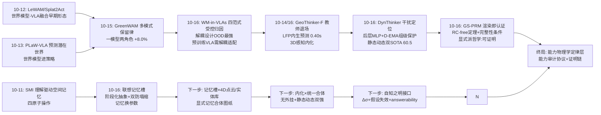
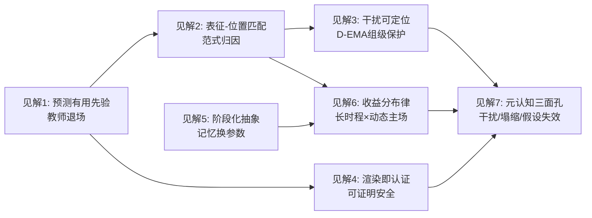
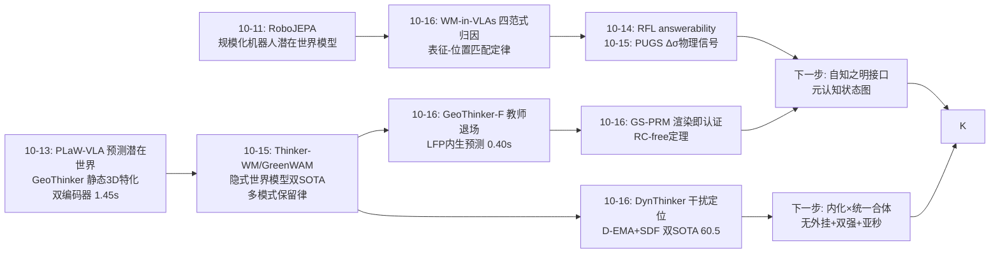
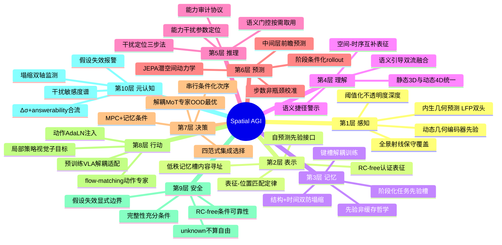
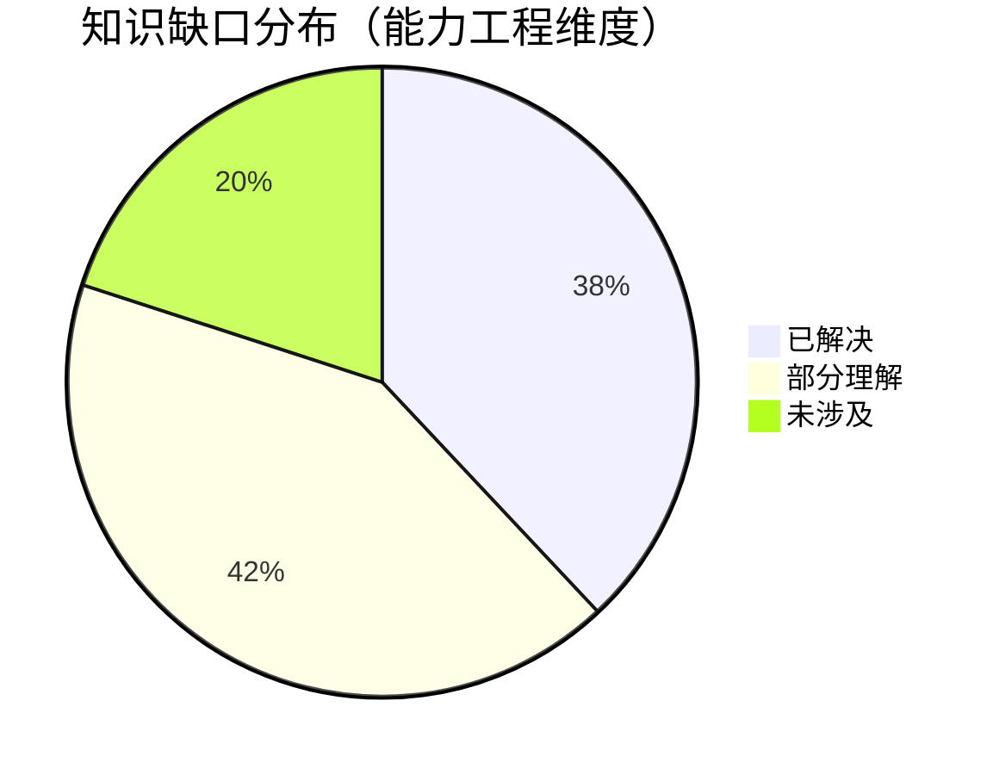
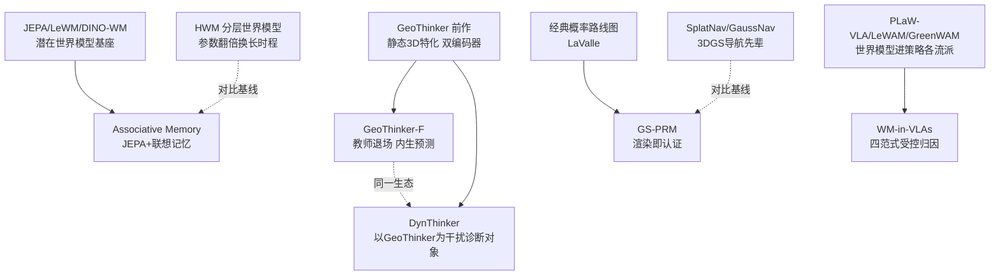

# Spatial AGI 每日深度思考 — 2026-10-16

**日期**: 2026-10-16
**基础日期**: 2026-10-15（昨日完整执行：5 篇论文 + 803 行思考）
**论文数量**: 5 篇
**主题**: 内化与归因日（能力进权重之后，剩下的问题是"放进哪里、怎么放才不打架、如何证明它可信"）。昨日"世界状态存放日"回答了**世界状态存在哪里**——隐式权重派与显式状态库派各领半壁，中间插着不确定性场。今天五篇论文把镜头从"状态的位置"转到"能力的位置与质量"：GeoThinker-F 把几何与时序两种世界表征**内化进 MLLM 中间层**（离线 VGGT 教师预训练 → 撤教师联合微调，延迟 1.45s→0.40s 且性能持平），是"教师退场"范式的标志性实现；WM-in-VLAs 用受控实验把"世界建模进 VLA"的混乱文献归因为四个范式 × 五类表征 × 两种骨干的矩阵，给出"表征有效性依赖范式、解耦 MoT 专家 OOD 最强、预训练 VLA 适配必须解耦"三条设计律；DynThinker 诊断出"空间-动态干扰"——3D 后训练增强静态推理的同时在后层 MLP 处侵蚀预训练继承的动态能力——并用 D-EMA（组级差异化 EMA）+ SDF（语义门控双流融合）做到单一模型静态动态双 SOTA（十指标平均 60.5 超 GPT-5.6 Sol）；GS-PRM 把 3DGS 渲染接口变成可证明的安全认证器（RC-free 形式化 + 条件可靠性定理 + 完整性充分条件），成功率高 SplatNav 两倍、通行时间省 57.2%；联想记忆世界模型证明 JEPA 的长时程瓶颈在时间结构表征而非 rollout 步数，用 M 个低秩内容寻址记忆槽 + 双防塌缩损失以"记忆换参数"达到四基准 SOTA。五篇合起来是一条清晰的问题链：**能力应该内生化（GeoThinker-F）、内化的方式要受控归因（WM-in-VLAs）、多种能力共存要管理干扰（DynThinker）、内化之外还需要可验证的安全命题（GS-PRM）、长时程需要最小充分的结构化记忆（Associative Memory）——空间智能从"要不要世界模型"的路线之争，正式进入"世界模型放在哪里、以什么粒度、如何不打架、如何可信任"的工程物理学期**。

---

## 📅 每日总结

**日期**: 2026-10-16
**论文数量**: 5 篇
**主题**: 内化与归因日。五篇论文在"能力工程"的五个正交维度各下一城：GeoThinker-F 解决"内化"（世界表征从外挂编码器迁入 MLLM 中间层，教师只在训练期存在）；WM-in-VLAs 解决"归因"（受控实验终结三变量混搅的文献混乱，四范式分类学成为坐标系统）；DynThinker 解决"共存"（空间-动态能力在参数空间中的干扰被定位到后层 MLP 并用组级 EMA 管理）；GS-PRM 解决"可信"（神经场景表征上的碰撞自由被写成假设-定理结构，渲染即认证）；Associative Memory 解决"抽象"（长时程的瓶颈是阶段化时间结构，M 个记忆槽是"记忆换参数"的最小充分解）。

**关键突破**:
- 🚀 **教师退场范式落地（GeoThinker-F）**：MLLM 因果中间隐状态被证明包含足够信息预测"有用的"几何表征与下一帧语义表征——目标函数从"复现 VGGT 特征"放松为"预测对空间推理有用的先验"，配合两阶段解耦训练（冻结训头 → 撤教师联合微调）与 SGT Fusion 层交错注入，推理时零外部编码器。Qwen3-VL-8B 端到端延迟 1.45s → 0.40s（3.6×），六空间基准平均 69.29、VSI-Bench 70.4，与挂双编码器的 GeoThinker 持平。"推理时外挂 3D 模型"这一整类方法的价值被系统性重估。
- 🚀 **世界建模进 VLA 的受控地图（WM-in-VLAs）**：首个系统性实证，统一监督协议（同一冻结编码器、同一未来帧目标、同一余弦损失）下交叉验证四集成范式（隐式未来对齐/显式未来查询/MoT 未来专家/外部世界预测器）× 五表征（ImageVAE/WanVAE/DINOv3/SigLIP/VGGT/V-JEPA 2.1）× 两骨干（Qwen3-VL-2B/π0.5）。四条设计律：表征有效性范式依赖且 2D 语义跨范式稳健；无普适最优范式但解耦 MoT 专家综合最优尤其 OOD；标准 VLM 普遍受益于世界建模而预训练 VLA 适配需解耦设计；长时程与动态任务收益最大。
- 🚀 **能力干扰的参数级定位与管理（DynThinker）**：checkpoint 插值（Qwen3-VL-8B ↔ GeoThinker）证明 3D 后训练单调侵蚀 VLM4D 动态能力；参数组恢复实验把干扰钉在后层 MLP——恢复这些参数大幅恢复动态性能但部分回退静态增益。D-EMA 把标准 EMA 的共享平均视界解耦为按组配置（敏感组强固化、其余灵活），SDF 用 VLM 语义上下文门控动态几何编码器的空间/时序双流注入。单模型 9 基准 10 指标平均 60.5，超越 GPT-5.6 Sol 的 59.5，静态动态双开源 SOTA。
- 🚀 **渲染即认证（GS-PRM）**：3DGS 渲染被形式化为保守碰撞预言机——阈值化不透明度深度 + unknown 不算自由 + 保守射线覆盖 ⇒ RC-free 构型与路径在显式假设下物理安全（条件可靠性 Proposition 1），并有确定性查询完整性与概率构建完整性的充分条件。间隙自适应覆盖半径让采样密度自动匹配局部空间结构，覆盖区域本身即认证自由区。单一渲染接口同时承担里程碑验证、连通性测试、图像定位、视觉子目标生成——不派生任何占据栅格/SDF。DevGRU+GS-PRM 50% vs 裸 DevGRU 0%；vs SplatNav+SLP 成功率 2×、时间 −57.2%，仿真真机双验证。
- 🚀 **长时程 = 阶段化抽象而非更长 rollout（Associative Memory）**：一针见血的诊断——单纯加大 rollout 步数只会让智能体在目标附近无意义抖动，瓶颈在时间结构的表征。M 个可学习低秩记忆槽经内容寻址检索（键槽解耦训练）自动分化为任务阶段语义（接近/推/归位），AdaLN 串行注入（先记忆后动作、参数共享）优于并行/双预测器方案；槽结构多样性损失（SIGReg on slots）+ 时间均衡熵损失双管齐下防记忆塌缩。四基准 SOTA，超 LeWM、优于参数翻倍的 HWM。

**架构演进**: 10 层架构维持 10 层，五处结构性升级：(1) **表示层**新增"表征范式匹配"定律——空间表征的价值不是内在的而是集成位置决定的（VGGT 特征在隐式对齐下失效、在显式接口下有效），2D 语义是稳健默认、几何-时空先验是高上限高门槛选项；(2) **训练层**新增两条定律——"教师退场律"（外部专家只做训练期教师，推理期全部内生，配合"预测有用先验≠复现专家特征"的目标放松）与"组级差异化保存律"（能力干扰按参数组分布不均匀，保护强度应按组配置而非全局统一）；(3) **规划层**确立"渲染即认证"范式——神经场景表征可以通过显式假设-定理结构承担可证明的安全判断，覆盖区域即认证自由区；(4) **记忆层**获得最小充分结构模板——低秩内容寻址槽 + 双防塌缩损失 + 串行条件化，"记忆 = 可寻址任务先验"而非"记忆 = 历史缓存"；(5) **评测层**新增受控归因方法论——四范式 × 五表征 × 两骨干 × 六场景的统一监督协议矩阵，为整个领域提供"辟谣与定标"的实验模板。

### 📊 一句话总结

今天五篇论文把"世界模型如何进入空间智能体"从路线口号拆解为五个可操作的工程决策：**内化到哪一层**（GeoThinker-F 的中间层预测头）、**以哪种范式注入**（WM-in-VLAs 的四范式坐标）、**多种能力如何不打架**（DynThinker 的组级参数保护）、**内化之后如何可验证**（GS-PRM 的渲染认证定理）、**长时程靠什么抽象**（Associative Memory 的最小记忆槽）——世界模型不再是"加不加"的选择题，而是"放哪里、怎么放、如何防打架、如何证明安全"的四连填空题。

### 🔗 延续性

**昨日→今日**: 昨日"世界状态存放日"确立了状态三形态光谱（权重激活 / 权重+方差 / 模型外显式状态）与"预测引擎 + 状态库 + 受控接口"三件套结构，并留下四个悬念：EEF vs 关节动作接口之战、记忆 × 数据库合体、Δσ × answerability 主动感知闭环、动态实体持久性。今天五篇论文从"能力"轴接续：(1) 昨日 Thinker-WM/GreenWAM 证明了隐式世界模型的多模式互促红利，但它们的推理成本与部署代价未被量化——今天 GeoThinker-F 直接回答"隐式世界表征能便宜到什么程度"：0.40s，内生预测，零外挂；(2) 昨日悬置的"四范式没有命名"问题（各类世界模型集成方式的谱系学）今天被 WM-in-VLAs 正式立宪，GreenWAM 的"动作专家分离"恰好是其分类中 MoT 解耦路线的实例，昨日的消融结论（保留世界模型模式 +8.0%）与今日结论（解耦设计 OOD 最强、预训练 VLA 需解耦适配）互相印证为同一条定律的两个侧面；(3) 昨日 GreenWAM 的"一模型两角色"引发的角色冲突担忧（策略微调损害预测能力），今天 DynThinker 在空间能力轴上给出了同构现象的参数级解释——能力共存是参数空间中的资源竞争，需要按组差异化管理，D-EMA 是 GreenWAM"多模式保留律"在参数更新动力学上的机械化版本；(4) 昨日 CityCode 证明了显式状态的可审计价值，今天 GS-PRM 把"可验证性"推进到安全性：显式渲染证据经显式假设导出显式安全命题——显式派的哲学从"可维护"扩展为"可证明"；(5) 昨日的悬念"4D 记忆 × 实体 ID 合体"获得记忆侧的设计参考：Associative Memory 的低秩槽 + 防塌缩损失 + 内容寻址，是"记忆库"该长什么样的最小模板。

**今日→明日**: 值得追踪——(1) GeoThinker-F × DynThinker 的合体：内生预测（无外挂编码器）× 静态动态统一（双 SOTA），两者出自同一研究生态（Xiaodan Liang / Jia-Wang Bian 系），下一步显然是"单模型、无外挂、静态动态双强、0.4s 级延迟"的完整形态；(2) WM-in-VLAs 四范式 × 具体空间智能体系统的映射实测——哪个范式最适合导航（GS-PRM 的分层路线图 + 局部策略）、哪个最适合操作（MoT 专家 vs 外部预测器在操作任务上的对照）；(3) GS-PRM 的 RC-free 假设在线检测机制——渲染深度何时不可信（透明/反光/弱纹理）需要显式的假设失效报警器，与 PUGS 的 Δσ 场天然互补；(4) 联想记忆槽 × 4D 点云记忆的合体：CityCode/Demiurge 的显式记忆加上任务阶段槽索引；(5) D-EMA 组级保护 × 空间记忆注入：向 MLLM 注入新空间记忆时同样面临干扰，组级 EMA 可直接迁移；(6) WM-in-VLAs 的受控协议 × VSI-Bench 类空间推理基准：世界建模四范式对"空间推理问答"（而非动作）的增益归因，目前是空白。

### 💡 本质思考：如何达成通用空间智能

#### 1. 核心能力的本质是什么？

今天五篇论文把这个问题推进到"能力的工程物理学"维度。**第一层：空间智能能力是参数空间中的可定位、可管理实体**。此前的工作把"3D 理解""动态理解"当作模型的整体属性，训练策略是全局的（数据配比、损失加权）。DynThinker 的参数组恢复实验证明：静态 3D 与动态 4D 两种能力在 Transformer 中有可定位的居所（后层 MLP），且互相写入时发生真实的资源竞争——能力不是弥散的"风格"，而是有地址的"居民"。这为空间智能的工程化提供了物理学基础：既然能力有地址，就可以差异化地保护（D-EMA）、有针对性地注入（SDF 层交错）、甚至逐项审计（插值+恢复实验）。**第二层：能力的获取有两种经济模式——铸造与内化，且内化正变得足够便宜**。昨日的特权教师范式说"反事实经验由教师铸造"，昨日 GreenWAM 说"多模式互促"，但都默认推理时的能力成本是次要问题。GeoThinker-F 证明内化的代价已经降到工程可忽略：轻量 MLP 头 + AdaLN 级融合，3.6× 加速且性能不掉。这改变了一个战略判断——"外挂强模型"不再是大模型的专利，内生空间能力可以是所有延迟敏感场景（车载/机器人/端侧）的默认配置。**第三层：能力注入方式与能力本身同等重要**。WM-in-VLAs 最反直觉的发现是 VGGT/V-JEPA 这类强几何-时空先验对集成范式敏感——同样的表征，隐式对齐下无效、显式接口下有效。这意味着"空间先验"不是可以随意插拔的乐高，而是必须与架构位置匹配的齿轮。2D 语义的跨范式稳健性同时是一个警示：当前操作任务的空间推理可能大量走语义捷径，深度几何尚未成为刚需——空间智能的"真需求"可能被语义相关性掩盖。**第四层：可信性是能力的一部分，且可以从神经表征中证明性地导出**。GS-PRM 展示了从"神经渲染"到"物理安全命题"的完整推理链：显式假设（不透明度早于真实首表面、射线保守覆盖）→ 形式化定义（RC-free）→ 定理（条件可靠性、完整性充分条件）。空间智能体要获得物理世界的信任，不能只靠基准分数，必须有从表征到安全判断的推理链——这条链的每一环都必须显式，包括假设失效的显式边界（unknown 不算自由）。**第五层：长时程的本质是阶段化抽象，而抽象可以极其便宜**。Associative Memory 证明 M 个低秩槽就足以承载任务阶段语义，"记忆换参数"的经济学（M×D 个参数 vs 翻倍的分层层级）让长时程能力不再是大规模架构的专利。

#### 2. 当前方法与理想目标的差距在哪里？

**差距一：内化与统一尚未合流**。GeoThinker-F 解决内化（无外挂）但只处理"当前几何 + 一步前瞻语义"；DynThinker 解决统一（静态+动态双强）但推理时仍挂动态几何编码器。理想形态（单模型、无外挂、静态动态双强、亚秒延迟）的两半分别存在，合体尚未出现——两者同属一个研究生态，合体是时间问题但方法上仍有硬点（D-EMA 的组视界依赖诊断实验、LFP 的教师上限锁定）。**差距二：范式归因只覆盖了操作任务**。WM-in-VLAs 的四范式地图绘制在机器人操作基准上，空间推理问答（VSI-Bench 类）、导航（长时程拓扑规划）、以及 GS-PRM 所在的"可证明安全"维度都不在受控范围内。四范式 × 四任务类型的完整归因矩阵尚缺。**差距三：安全证明的假设现实性未闭环**。GS-PRM 的条件可靠性建立在两个 3DGS 重建假设上，而真实环境（玻璃、镜面、细腿家具）恰恰最容易违反假设；unknown-conservative 策略让重建薄弱区变成导航孤岛。缺的是"假设失效在线检测"——系统需要知道自己何时不再可信，这与 PUGS 的 Δσ（哪里不确定）和 RFL 的 answerability（哪里不可回答）共同指向同一个未完工的模块：空间智能的自知之明接口。**差距四：防塌缩仍是启发式的**。Associative Memory 继承 LeWM 的 SigREG 路线，DynThinker 的干扰管理依赖手工诊断，两者都在用启发式正则对抗表示退化，没有理论刻画"什么时候塌缩/干扰必然发生"。能力工程的物理学还缺定律层（现在只有现象层）。**差距五：评测仍然分片，且语义捷径未被排除**。WM-in-VLAs 发现 2D 语义跨范式稳健——这既可以是好消息（稳健默认），也可能是坏消息（任务可被语义捷径解决，几何能力未被真正考验）。CRISP/TriViewBench 式的"区分语言先验与真实空间推理"诊断尚未与集成范式归因结合。

#### 3. 从今天到理想状态，最可能的路径是什么？

一条"能力工程"驱动的五段路径。**第一段（现在起）：内化 × 统一的合体冲刺**。GeoThinker-F 的 LFP 双头（几何/时序）天然可以扩展为 DynThinker 的静态/动态双目标——教师从 VGGT 换成 V-DPM 类动态几何编码器，LFP 头预测动态几何 + 未来语义，SGT Fusion 与 DynThinker 的 SDF 双流融合同构。判定标准：单一 Qwen-VL 级模型在 ReVSI/DSR-Bench/DSI-Bench 与 VSI-Bench 上同时达到各自 SOTA 的 95% 以上且延迟 < 0.5s。**第二段（并行）：能力干扰诊断的自动化**。D-EMA 的组视界目前靠 checkpoint 插值 + 参数组恢复的人工诊断；把这套诊断自动化（梯度药丸/参数扰动敏感性自动扫描），输出每层每模块的"能力敏感度谱"，作为任意能力注入任务（空间记忆、新模态、新技能）的标准前置步骤。**第三段（3-6 个月）：四范式 × 全任务类型的归因补全**。以 WM-in-VLAs 的统一监督协议为模板，在空间问答（VSI-Bench/ReVSI）、导航（拓扑规划+局部策略）、可证明安全（GS-PRM 类系统）三个新任务类型上重跑四范式归因，并叠加"语义捷径排除"诊断（CRISP 式结构对照），产出空间智能体世界建模的完整选型矩阵。**第四段（6-12 个月）：自知之明接口的合流**。PUGS 的 Δσ（表示不确定性）+ GS-PRM 的假设失效检测（安全不确定性）+ RFL 的 answerability（决策不确定性）统一为一个"空间元认知状态图"：系统在任何时刻能回答"我哪里看不清、哪里不可信、哪里答不了"，并驱动主动感知决策。判定标准：在故意投放歧义/违反假设的场景中，带元认知图的系统安全率显著高于裸系统。**第五段（1-2 年+）：能力物理学的定律层**。理想状态判定标准：(1) 干扰与塌缩的发生条件有理论刻画（何时必然、何时可避免），保护与正则有最优性证明而非启发式；(2) 空间能力有标准化的"能力审计协议"——任何空间模型可被自动审计出"静态/动态/度量/拓扑四维能力谱 + 各自的参数地址 + 相互干扰矩阵"；(3) 安全关键场景（人机共处）的空间判断可附带机器可检验的证明链（假设-定义-定理），假设失效自动报警。今天五篇论文分别贡献了现象层的三块基石（干扰可定位、范式敏感、塌缩可双轴正则化）、一条证明性推理链（RC-free）和一个最小抽象结构（低秩记忆槽）——定律层需要的实验积累刚刚开始。

---

## 🔗 与昨日思考的联系

### 昨日重点

10-15"世界状态存放日"确立了世界状态三形态光谱（隐式权重激活 / 权重+方差不确定性场 / 模型外显式状态库）与三件套结构（权重预测引擎 + 显式状态库 + 受控接口），产出四条新知识：多模式保留律（策略微调保留世界模型损失 = 空间泛化正则器，+8.0%）、对应关系显式注册律（codec/深度对齐/实体 ID）、不确定性作为介质物理信号（Δσ 响应散射/焦散/海雪）、状态可维护性作为被忽视的评测维度（事务化 50×50 全过）。遗留悬念：EEF vs 关节接口之战、记忆 × 数据库合体、Δσ × answerability 闭环、动态实体持久性。

### 今日进展

今天在"能力"轴上完成五个推进：(1) **隐式世界的部署成本问题获得终局性答案**——昨日 GreenWAM/Thinker-WM 证明隐式世界模型能赢，但没人知道隐式世界表征能便宜到什么程度；GeoThinker-F 给出答案：0.40s、零外挂、性能持平——隐式路线的部署税被免除，"外挂 3D 编码器"作为推理时组件的价值被系统性重估。(2) **多模式保留律获得范式学地位与参数级机制**——昨日 GreenWAM 的消融（保留世界模型模式 +8.0%）今天被 WM-in-VLAs 纳入四范式分类学（MoT 解耦专家的 OOD 优势）并被 π0.5 交叉验证（预训练 VLA 适配需解耦设计）；DynThinker 进一步揭示其参数级机制：能力共存是参数竞争，D-EMA 的组级时间平均是"保留律"的机械化实现——昨日的经验定律今天有了结构解释与自动化工具。(3) **显式派的哲学从"可维护"升级为"可证明"**——昨日 CityCode 证明显式状态可审计可回滚，今天 GS-PRM 把显式渲染证据写成假设-定理链，导出物理安全命题与完整性保证：显式状态的终极价值不只是"出错能回滚"，而是"能证明不会出错"。(4) **记忆结构获得最小充分模板**——昨日悬念"记忆 × 数据库合体"需要知道记忆库该长什么样；Associative Memory 给出候选：低秩内容寻址槽 + 结构/时间双防塌缩损失 + 串行条件化——把这套结构挂到 Demiurge 的 4D 点云或 CityCode 的实体树上，就是合体的具体图纸。(5) **"语义捷径"风险浮出水面**——WM-in-VLAs 发现 2D 语义表征跨范式稳健，这为昨日的空间推理基准讨论投下阴影：操作任务的空间需求可能被语义相关性部分满足，几何先验的价值被低估或任务设计未能逼出——空间评测的"反捷径"改造 urgency 上升。

### 演进路径

---

## 📚 论文概览

今天五篇论文构成一个"能力工程"实验组：

1. **GeoThinker-F**（XPeng/中山大学/NTU，2610.20592）：内生预测式空间智能 MLLM。LFP 双头（当前几何回归 VGGT 特征 / 下一帧语义自蒸馏）挂在 MLLM 中间层，Stage 1 冻结骨干训头、Stage 2 撤教师联合微调，SGT Fusion 双分支 + 层交错注入选择性融合自预测先验。推理零外部编码器，延迟 1.45s→0.40s（3.6×），VSI-Bench 70.4、六基准平均 69.29。

2. **What Matters for World Modeling in VLAs**（中科院自动化所 Liang Wang 组，2610.19825）：首个 VLA 世界建模受控实证。统一基线（Qwen3-VL-2B + cross-DiT，flow-matching）+ 统一世界监督（冻结编码器 E 提取未来帧目标 z，余弦对齐），四集成范式 × 五表征 × 两骨干（+π0.5）× 六场景。四条设计律：表征范式依赖、2D 语义稳健默认、MoT 解耦专家 OOD 最强、长时程/动态收益最大。

3. **DynThinker**（中山大学/NTU/影眸，2610.20598）：统一静态 3D 与动态 4D 空间推理。诊断三步（checkpoint 插值 → 参数组恢复 → 定位后层 MLP）→ D-EMA 组级解耦 EMA（敏感组强固化、衰减按更新次数归一化）→ SDF 语义门控双流融合（动态几何编码器的空间/时序先验注入中间层）。9 基准 10 指标平均 60.5 超 GPT-5.6 Sol（59.5），ReVSI 56.0 / DSR-Bench 67.2 / DSI-Bench 51.2/40.1 开源 SOTA。

4. **GS-PRM**（2610.19541）：高斯视觉路线图。RC-free 构型/路径形式化（阈值化不透明度深度 + 保守射线覆盖 + unknown 不算自由），条件可靠性 Proposition 1 + 确定性查询完整性 + 概率构建完整性充分条件；间隙自适应覆盖半径 ρ_i = min{β(ĉ_i−r_safe), ρ_max}；背面内部预过滤加速采样；单一渲染接口统一里程碑/边/图像查询/子目标。DevGRU 0%→50%，vs SplatNav 2× 成功率、−57.2% 时间，仿真真机双验证。

5. **Enhancing Latent World Models with Associative Memory**（上海科学智能研究院/复旦，2610.19683）：JEPA + 内容寻址联想记忆。M 个可学习低秩槽 Γ ∈ R^{M×D} + 配对键 Ξ（解耦训练），缩放点积交叉注意力检索 m_t，AdaLN 串行条件化（先 m_t 后 a_t、参数共享，消融最优），双记忆损失（槽间余弦相似度惩罚 + 时间注意力熵最大化）。四基准（PushT/Tworoom/Reacher/OGBCube）SOTA，超 LeWM、优于参数翻倍的 HWM。

**组合逻辑**：五篇论文沿"能力工程全链"排布——GeoThinker-F（能力如何内化进权重）、WM-in-VLAs（内化/注入的范式如何选择）、DynThinker（多种能力共存时干扰如何管理）、GS-PRM（内化与神经表征如何导出可证明的安全判断）、Associative Memory（长时程能力如何用最小结构获得）——完整覆盖了空间智能体"能力"的设计空间，与昨日"状态工程"形成对偶的两日。

---

## 💡 核心见解

### 见解1: "预测有用先验"是能力内化的关键解锁，外挂编码器的价值面临系统性重估

**从 GeoThinker-F 获得**
- ✅ 关键目标函数放松：LFP 头不要求复现 VGGT 特征，只要求预测"对空间推理有用的"几何/语义表征——预测误差被允许，只要保留结构线索；
- ✅ 两阶段解耦（冻结训头 → 撤教师联合微调）让内化过程稳定且便宜；
- ✅ 实测：去除推理时几何分支后延迟 1.45s→0.40s，六基准平均 69.29 与双编码器基线持平。

**对Spatial AGI的启发**:
这是给所有"外挂强模型增强弱模型"方案的定价信号：外部专家的正确位置是训练期教师，不是推理时组件。空间智能的规模化瓶颈从来不是"有没有强 3D 模型"，而是"强 3D 模型能否部署到延迟敏感场景"——内化路线把这个瓶颈从架构问题变成了训练配方问题。任何还在推理管线里挂 VGGT/深度模型的空间系统都应该被问一句：你为什么还挂着？

### 见解2: 空间表征的价值是集成位置的函数，不是表征的内禀属性

**从 WM-in-VLAs 获得**
- ✅ VGGT（3D 几何）与 V-JEPA 2.1（时空动态）的增益高度依赖集成范式——同一表征在隐式对齐下失效、在显式接口下有效；
- ✅ DINOv3/SigLIP 语义表征跨范式稳健，是唯一的"无脑安全"默认选项；
- ✅ 预训练 VLA（π0.5）适配时解耦设计兼容性显著更好——入侵式改造预训练模型的收益为负。

**对Spatial AGI的启发**:
这终结了"哪个空间表征最强"的无效争论——问题应该重述为"哪个表征-位置组合最强"。空间先验不是可随意插拔的乐高，而是必须与架构齿轮啮合的部件。更深的警示在 2D 语义的稳健性上：如果语义捷径就能解决操作任务的空间需求，那么当前基准可能根本没在考验空间智能——"反捷径评测"（CRISP 式结构对照）应该成为空间表征选型实验的标配控制组。

### 见解3: 能力共存是参数空间中的资源竞争，干扰可以被定位并机械化地管理

**从 DynThinker 获得**
- ✅ checkpoint 插值 + 参数组恢复把"空间-动态干扰"定位到后层 MLP：恢复这些参数大幅恢复动态性能、部分回退静态增益——能力的参数地址是可实验确定的；
- ✅ D-EMA 把 EMA 的共享平均视界解耦为按组配置：敏感组强固化、其余灵活，更新次数归一化保证跨训练规模一致；
- ✅ 干扰随训练数据规模加剧，组级时间平均在各量级均有效。

**对Spatial AGI的启发**:
这是空间智能从"炼丹"走向"工程物理学"的标志事件。既然能力有参数地址、干扰有定位方法、保护有机械化工具，那么"注入新能力而不损害旧能力"就从玄学变成了标准工序：诊断（定位敏感组）→ 配置（组级视界）→ 验证（插值曲线复查）。可直接迁移的场景：向 MLLM 注入空间记忆（昨日的 SMI 路线）、注入新模态（触觉/声学）、多技能微调——D-EMA 应该成为所有空间模型后训练的默认组件。

### 见解4: 神经场景表征可以承担可证明的安全判断——显式派的哲学从可维护升级为可证明

**从 GS-PRM 获得**
- ✅ RC-free 形式化：渲染深度经显式假设（不透明度早于真实首表面、射线保守覆盖）+ unknown 不算自由 ⇒ 条件可靠性定理（C_RC ⊆ C_free）；
- ✅ 间隙自适应覆盖半径使覆盖区域本身即认证自由区——采样与证明合二为一；
- ✅ 单一渲染接口统一里程碑验证、连通性、图像定位、子目标生成，不派生占据栅格/SDF。

**对Spatial AGI的启发**:
昨日 CityCode 证明显式状态"出错能回滚"，今天 GS-PRM 证明显式证据"能证明不会出错"——可维护性与可证明性是显式世界状态的两级价值，而后者是人机共处场景的准入门槛。神经表征时代经典规划理论（LaValle 式）的回归值得整个领域效仿：与其发明新的端到端导航网络，不如问"我的场景表征能认证什么、假设链是什么、何时失效"。显式派的最终形态是一个带证明链的空间认知系统——每个安全判断可审计、每个假设失效可报警。

### 见解5: 长时程的瓶颈是阶段化抽象而非 rollout 长度，抽象可以极其便宜

**从 Associative Memory 获得**
- ✅ 诊断：单纯加大 rollout 步数只导致目标附近抖动——瓶颈在时间结构的表征；
- ✅ M 个低秩内容寻址槽自动分化为任务阶段语义（接近/推/归位），作为高层条件经 AdaLN 串行注入（先记忆后动作）；
- ✅ 双防塌缩损失（槽间余弦相似度惩罚 + 时间注意力熵最大化）是记忆系统可用的前提；四基准 SOTA 且参数少于分层世界模型。

**对Spatial AGI的启发**:
"记忆换参数"的经济学让长时程空间规划不再是大规模架构的专利。更深的设计哲学是"记忆 = 可寻址任务先验"而非"记忆 = 历史缓存"——空间智能体的记忆系统的第一性问题不是存多少，而是抽象出什么阶段、如何防退化。两条防塌缩损失（结构不雷同 + 时间不闲置）应该成为一切检索式记忆系统（空间记忆库、技能库、子目标库）的标配正则，可独立于本文的记忆架构迁移。

### 见解6: 世界建模在策略中的收益分布不均匀——长时程与动态任务是世界模型的"主场"

**从 WM-in-VLAs 获得**
- ✅ 世界建模相对 action-only 基线在多场景稳定增益，但增益集中在长时程执行与动态物体操作；
- ✅ External World Predictor 在低数据 in-domain 最优——世界建模的价值随数据稀缺性上升；
- ✅ 隐式对齐最轻量（推理零开销）但动态任务弱——轻量与能力之间存在可量化的权衡谱。

**对Spatial AGI的启发**:
这条分布律为空间智能体提供了"按需配置世界建模"的决策依据：短程静态任务不值得付世界建模成本（甚至隐式对齐都不必），长程动态任务必须配置且优先解耦设计。结合 GeoThinker-F 的成本数据，世界建模的单位收益/单位成本比在"长时程 × 动态 × 低数据"象限达到峰值——空间智能系统工程的第一步是判断自己处于哪个象限。

### 见解7: 干扰管理、防塌缩、假设失效是同一个元问题的三个面孔——系统需要自知之明

**从 DynThinker、Associative Memory、GS-PRM 共同获得**
- ✅ DynThinker：能力写入会覆写既有能力（干扰），需要定位敏感参数并差异化保护；
- ✅ Associative Memory：记忆槽会结构退化或利用失衡（塌缩），需要双轴正则；
- ✅ GS-PRM：渲染证据在假设失效时不可信（安全边界），unknown 必须显式对待、不能当作自由。

**对Spatial AGI的启发**:
三者共同指向空间智能体缺失的同一个模块：**元认知状态**——系统对自己"哪里在退化、哪里在塌缩、哪里不可信"的内部建模。昨日 PUGS 的 Δσ（表示不确定性）与 RFL 的 answerability（决策不确定性）是同一问题的另外两个面孔。五者合流即是"自知之明接口"的完整图纸：一个空间元认知状态图，驱动保护（D-EMA）、正则（双记忆损失）与报警（假设失效检测）。这是比任何单项能力都更接近"通用"的能力——因为它管理的是所有其他能力。

---

## 💡 核心见解演进图

---

## 🗺️ 知识演进图

---

## 技术栈演进对比表

| 层次 | 昨日方案 | 今日方案 | 变化 |
|------|---------|---------|------|
| 感知层 | GreenWAM 7模式联合感知-预测；Thinker-WM 深度课程注入3D感知 | GeoThinker-F 内生 LFP 预测当前几何+未来语义；DynThinker 动态几何编码器双流先验 | 感知从"训练时注入"走向"推理时内生预测"；动态几何先验语义门控按需取用 |
| 表示层 | 世界状态三形态光谱（权重/方差/显式库）；对应关系显式注册律 | 表征-位置匹配定律（VGGT/V-JEPA 范式敏感、2D 语义稳健默认）；RC-free 认证性表征 | 新增"表征价值是集成位置的函数"定律与"表征能认证什么"的安全维度 |
| 记忆层 | Demiurge 4D点云双流记忆；CityCode 实体ID版本树；SMI 四原子操作 | 低秩内容寻址记忆槽 + 键槽解耦 + 双防塌缩损失（结构余弦惩罚+时间熵）+ 串行AdaLN | 获得"最小充分记忆"模板：记忆=可寻址任务先验；防塌缩双轴正则成为标配 |
| 训练层 | 特权教师三律+多模式保留律（+8.0%）；D-EMA前身=多模式损失加权 | 教师退场律（LFP两阶段：冻结训头→撤教师联合微调）；组级差异化保存律（D-EMA按组视界） | 保留律从损失加权升级为参数更新动力学管理；内化有了稳定的两阶段标准配方 |
| 干扰管理 | GreenWAM 经验消融（特化起点/专家分离/多模式保留） | 插值+参数组恢复诊断（干扰定位后层MLP）；D-EMA 机械化管理；四范式受控归因 | 从经验定律升级为可定位、可归因、可机械管理的工程工序 |
| 规划层 | 潜空间 MPC rollout（LeWM/RoboJEPA）；世界模型前瞻规划 | GS-PRM 渲染认证路线图 + 间隙自适应覆盖；Associative Memory 阶段槽条件化 MPC | 规划获得安全证明链（假设-定义-定理）与阶段化抽象条件；"步数≠长时程"校准 |
| 安全校 | CityCode 事务化可回滚（可维护性） | GS-PRM 条件可靠性+完整性充分条件（可证明性）；unknown≠free 显式边界 | 安全从"可恢复"升级为"可证明"；神经表征承担经典规划理论职能 |
| 动作层 | EEF摘要 vs 79槽解剖之争（未分胜负） | 四范式坐标下的动作条件化（AdaLN 动作注入 vs cross-attention 上下文） | 动作接口之争纳入统一坐标系；条件注入次序（先语境后动作）成为设计准则 |
| 评测层 | 状态可维护性维度（50×50任务链）；3DGS可优化性代理 | 四范式×五表征×两骨干×六场景统一监督矩阵；能力审计式诊断（插值+组恢复） | 新增受控归因方法论与能力审计协议；语义捷径风险浮出（2D语义稳健性的阴影） |
| 元认知 | PUGS Δσ 物理不确定性场；RFL answerability | 干扰敏感度谱（DynThinker）+ 塌缩双轴监测（记忆损失）+ 假设失效边界（unknown） | 元认知从"不确定性标注"扩展为"退化/塌缩/不可信"三元状态，自知之明接口成形 |

---

## 🗺️ Spatial AGI 知识图谱

### 10层架构思维导图

### 🎯 主线技术路径

#### 阶段1: 世界模型路线确立（2025–2026 上半年）

JEPA/Dreamer 系世界模型证明潜空间想象可支撑规划，但表征塌缩与长时程能力是公认瓶颈；世界模型作为独立模块存在，与策略（VLA）的集成方式五花八门且互相不可比——"要不要世界模型"是主争论，文献处于三变量混搅的混沌期。

#### 阶段2: 集成范式立宪与归因（2026 Q3–Q4，本周所在）

WM-in-VLAs 用统一监督协议完成四范式分类学（隐式对齐/显式查询/MoT 专家/外部预测器）与受控归因，终结"苹果比橘子"；GeoThinker-F 证明世界表征可完全内生（教师退场）；DynThinker 揭示能力共存的干扰物理学并给出机械化保护（D-EMA）；"世界模型放在哪里、怎么放、如何不打架"三问获得工程答案。多模式保留律、表征-位置匹配定律、组级差异化保存律三条定律成形。

#### 阶段3: 内化×统一合体与可信化（2026 Q4–2027 上半年，下一步）

内化路线（GeoThinker-F）与统一路线（DynThinker）合体为"单模型、无外挂、静态动态双强、亚秒延迟"；GS-PRM 式可证明安全从导航扩展到操作（RC-free 的操作版：可达性/可抓取性的渲染认证）；PUGS Δσ + 假设失效检测 + answerability 合流为空间元认知状态图，驱动主动感知。评测端补全四范式 × 全任务类型归因矩阵并引入反捷径诊断。

#### 阶段4: 能力物理学定律层（2027–2028）

干扰与塌缩的发生条件获得理论刻画，保护与正则从启发式走向最优性证明；空间能力审计协议标准化（四维能力谱 + 参数地址 + 干扰矩阵自动输出）；安全关键场景的空间判断附带机器可检验证明链；记忆系统（低秩槽 × 显式 4D/实体库）成为空间智能体的标准组件——空间智能从经验工程升级为有定律、有审计、有证明的成熟工程学科。

---

## 🔍 待探索议题

### 高优先级（本周）

1. **内化 × 统一的合体实验设计**
   - 问题: GeoThinker-F 的 LFP 双头能否直接扩展为 DynThinker 的静态/动态双目标（教师换 V-DPM）？
   - 候选方案: LFP 头改为三目标（静态几何/动态几何/未来语义），SGT Fusion 与 SDF 双流融合结构对比消融；
   - 缺口: 两篇论文的训练协议细节未公开对齐（数据量、λ 权重、层选择），需复现后受控合并。

2. **D-EMA 组视界的自动化诊断**
   - 问题: 干扰敏感组目前靠 checkpoint 插值 + 参数组恢复人工定位，能否自动扫描？
   - 候选方案: 训练中周期性做小规模参数扰动敏感性评估，输出各层各模块的"能力敏感度谱"；
   - 缺口: 诊断本身的计算成本与统计功效未评估；恢复实验需要成对模型（特化版+预训练版）。

3. **四范式 × 空间推理问答的归因空白**
   - 问题: WM-in-VLAs 只覆盖操作任务，世界建模四范式对 VSI-Bench 类空间问答的增益归因未知；
   - 候选方案: 以其统一监督协议为模板在视频空间问答上重跑四范式对照；
   - 缺口: 空间问答的世界表征目标如何定义（未来帧特征 vs 几何特征 vs 3DGS 渲染特征）。

### 中优先级（本月）

4. **GS-PRM 假设失效在线检测**
   - 问题: 透明/反光/细腿家具会击穿 Assumption 1/2，系统如何知道自己何时不再可信？
   - 候选方案: 逐射线渲染支持度 + 不透明度斜率统计做实时假设校验；与 PUGS 的 Δσ 场做逐区域融合；
   - 缺口: 假设违反的地面真值标注困难，需要可控违例场景数据集。

5. **联想记忆槽 × 显式世界记忆的合体**
   - 问题: 低秩任务阶段槽能否作为 Demiurge 4D 点云记忆 / CityCode 实体库的检索索引层？
   - 候选方案: 槽键控的显式记忆分区（每槽指向一组实体/时刻），检索两级化（槽选阶段→阶段内精确查询）；
   - 缺口: 槽的语义可控性（能否指定用哪个槽规划）尚未被验证。

6. **预训练 VLA 解耦适配的操作规程**
   - 问题: WM-in-VLAs 结论"预训练 VLA 需解耦设计"如何在 π0 类模型上落地为标准工序？
   - 候选方案: GreenWAM 式动作专家复制初始化 + 世界专家并行流 + 多模式保留损失的组合配方；
   - 缺口: 解耦流容量（层数/宽度）与收益的 scaling 关系未测。

7. **空间评测的反捷径改造**
   - 问题: 2D 语义表征的跨范式稳健性暗示任务可被语义捷径解决；
   - 候选方案: CRISP 式结构对照（改变布局保持语义 / 改变语义保持布局）注入现有基准；
   - 缺口: 反捷径版本基准与原版的成绩差尚无系统数据。

### 低优先级（本季度）

8. **能力审计协议的标准化**
   - 问题: 插值+组恢复诊断依赖成对模型，能否对任意单一模型输出能力谱与干扰矩阵？
   - 候选方案: 探针法（在中间层训练线性探针回归静态/动态基准成绩）+ 激活补丁；
   - 缺口: 探针的因果有效性（预测的敏感组=真实的敏感组？）需要与恢复实验交叉验证。

9. **未知区域的空间语义**
   - 问题: GS-PRM 把 unknown 当作不可通行，但未知区可能是探索价值最高的区域；
   - 候选方案: unknown 区域的价值估计（信息增益 + 可达概率）与路线图"探索边"设计；
   - 缺口: 未知区渲染证据完全缺失，需要主动感知（主动采光/移动重估）闭环。

10. **长时程"长"的量化定义**
    - 问题: 各论文的"长时程"从几十步到几千步不等，无可比标准；
    - 候选方案: 以"所需阶段数 × 每阶段动力学复杂度"定义归一化长度指标；
    - 缺口: 跨任务（操作/导航/问答）的阶段定义不统一。

---

## 🔁 跨论文对话：五篇论文的两两对峙与互补

五篇论文并非孤立，把它们两两配对可以暴露出比单篇阅读更深的设计张力：

### 对话1: GeoThinker-F × WM-in-VLAs —— 内化路线在四范式坐标中的位置

GeoThinker-F 没有出现在 WM-in-VLAs 的实验矩阵里，但它的结构可以在四范式坐标系中精确定位：LFP 双头 + SGT 融合本质上是**隐式未来对齐与显式未来查询的杂交**——几何/时序头是隐式对齐（中间层表征塑形），层交错注入是显式查询（中间层上下文增强）。按 WM-in-VLAs 的结论预判：GeoThinker-F 的几何目标（VGGT 特征）落在"范式敏感"象限，因此它对 SGT Fusion 融合设计的依赖不是锦上添花而是生存必需——如果换成纯隐式对齐，几何先验大概率失效。这解释了为什么论文必须发明 SGT Fusion 而不是简单加损失。反向看，WM-in-VLAs 发现 2D 语义稳健，而 GeoThinker-F 押注几何先验——两者的分歧本质是任务差异：操作任务的空间需求可被语义部分满足，而 VSI-Bench 类视频空间问答逼出了几何刚需。**统一检验标准：把 GeoThinker-F 的目标从几何特征换成 DINOv3 语义特征，若 VSI-Bench 显著下降，则证明该任务确实需要几何、GeoThinker 的路线选择正确。**

### 对话2: DynThinker × WM-in-VLAs —— 两种"防止能力互相伤害"的路线

两者解决的都是"多目标训练时的能力竞争"，但武器完全不同：WM-in-VLAs 在**架构层**解决（MoT 解耦专家——让不同能力住在不同的模块流里，物理隔离）；DynThinker 在**参数动力学层**解决（D-EMA——让不同能力共居同一参数空间但保护强度差异化）。有趣的是两者结论一致：对预训练模型的适配，解耦/保护优于直接混训。这暗示一条递进关系：如果架构解耦成本可接受（推理多一条流），优先解耦；如果必须单模型（延迟敏感），D-EMA 是次优解。真正的合体形态可能是：**MoT 解耦 + 各流内部 D-EMA**——模块级隔离吸收大部分干扰，参数级保护处理残余的流内竞争。

### 对话3: GeoThinker-F × GS-PRM —— 神经潜空间认证 vs 显式渲染认证

两者对"空间安全判断从哪来"给出了镜像答案。GeoThinker-F：安全相关判断（哪里有空间、物体在哪）由模型潜空间内生预测——快但不可审计，判断质量受教师上限约束。GS-PRM：安全判断由显式渲染证据经显式假设导出——慢一点但可证明，且假设失效边界显式。理想的空间智能体应该按判断的风险级别分流：**低风险感知判断走潜空间（快、内生），高风险安全判断走认证链（可审计、可报警）**。这与自动驾驶行业的冗余设计哲学一致：感知可以端到端，安全必须白盒。两者共同缺失的是分流标准——什么级别的判断必须走认证链？这是待探索议题 4 的深层版。

### 对话4: Associative Memory × 昨日 Demiurge/CityCode —— 两种记忆哲学的正面相遇

Associative Memory 的记忆是**参数级的任务先验**（学出来、不增长、无 episodic 内容）；Demiurge/CityCode 的记忆是**模型外的经验状态**（写进去、可增长、有具体内容）。前者像程序性记忆（技能与阶段），后者像情景记忆（去过哪、见过什么）。认知科学的框架提醒我们：两者不是竞争而是互补——人类空间行为同时依赖"这个任务分几个阶段"（程序性）与"那个房间长什么样"（情景）。合体的具体图纸：槽作为显式记忆的**索引层**（每槽指向一组实体/时刻/轨迹），检索两级化（槽选阶段 → 阶段内精确查询），防塌缩损失保护索引层的多样性。昨日悬念"记忆 × 数据库合体"的索引层设计，今天被补齐。

### 对话5: DynThinker × GS-PRM —— 能力干扰与假设违例是同构的失败模式

表面上一者在参数空间（能力覆写），一者在物理空间（证据失效），但结构同构：**系统把新信息写入旧结构时，旧结构的既有功能可能被静默破坏**。D-EMA 的解法（敏感组强固化）与 GS-PRM 的解法（unknown 不算自由）共享同一个原则：**对被破坏风险高的部分，默认保守**。把这个原则上升为空间智能体的全局设计准则：任何写操作（训练写入参数、观测写入地图、规划写入日程）都必须携带"写保护级别"与"证据支持级别"两个元数据，高风险写默认拒绝或隔离验证。这是从今天两篇论文中提炼的最具通用性的工程准则。

---

## 🏷️ 一周主题回顾：从状态到能力

回看本周（10-11 至 10-16）六期研究的主题演进，可以画出一条清晰的收敛轨迹：

- **10-11 记忆日**：空间记忆的原子操作（SMI 四操作）、贝叶斯空间信念（ALONE）、潜在世界模型规模化（RoboJEPA）——确立"记忆是空间智能的一等公民"。
- **10-12 潜空间统一日**：统一潜动作（LAC-WM/WMM）、SE(3) 轨迹通货（World Motion Models）、循环世界构造（OuroWorld）——确立"潜空间是跨任务的统一语言"。
- **10-13 铸币厂日**：3DGS 场景喂策略（Splat2Act）、预测潜在世界建模（PLaW-VLA）、渲染前瞻（LeWAM）——确立"3DGS 场景是监督与想象的原料库"。
- **10-14 特权教师日**：铸造律/结构律/内化律——确立"能力在训练时铸造、部署时内化"的特权教师范式。
- **10-15 状态存放日**：隐式权重派 vs 显式状态库派 vs 不确定性场——确立"世界状态工程"三件套。
- **10-16 内化归因日（今天）**：教师退场落地（GeoThinker-F）、范式立宪（WM-in-VLAs）、干扰物理学（DynThinker）、渲染认证（GS-PRM）、最小记忆结构（Associative Memory）——确立"能力工程"的五维设计空间。

**一周总收敛**：本周的六日工作合起来回答了 Spatial AGI 的四个元问题——**状态存在哪**（10-15 三形态光谱）、**能力怎么来**（10-14 铸造 + 10-16 内化）、**能力怎么放**（10-16 四范式 + D-EMA）、**判断怎么信**（10-15 事务化 + 10-16 渲染认证）。剩下的两个元问题是**能力怎么审计**（部分起步：插值诊断 + 四范式归因）与**元认知怎么闭环**（五个信号源已识别、接口未定）——它们恰好是下周最值得追踪的两条线。

---

## 🔬 逐篇深挖（续）：设计律的适用边界

### 深挖8: 教师退场律的适用边界——哪些能力不适合内化？

GeoThinker-F 证明几何/语义预测可以内化，但不是所有空间能力都适合。内化的成本结构：预测头的容量必须覆盖教师表征的信息瓶颈；教师输出越接近最终决策（而非中间表征），内化越难。推论：**几何特征（稠密、连续、平滑）适合 MLP 头内化；离散决策（路径选择、物体抓取点）不适合**——决策空间的组合结构无法被潜空间回归捕捉。因此教师退场律的准确表述应该是：**中间表征级教师可退场，决策级教师退场需经策略蒸馏（impossible to regress, must imitate）**。这解释了为什么 SimVTA（昨日）的轨迹选择仍然需要在线渲染打分而非纯内化——轨迹选择是决策级，蒸馏不充分。

### 深挖9: 四范式地图的第三轴——监督目标的类型

WM-in-VLAs 的地图有两轴（集成范式 × 表征类型），但实验设计揭示了一个未标出的第三轴：**监督目标的时程**。所有实验统一用未来帧特征（短时程目标），而长时程收益恰恰是最大增益区——这意味着四范式的排名是在"短时程监督喂长时程需求"的错配下测得的。如果监督目标换成多步 rollout 特征或阶段级目标（Associative Memory 式），MoT 专家与外部预测器的优势可能进一步扩大（它们有容纳长时程结构的容量），隐式对齐可能进一步掉队（表征塑形难以承载多步结构）。第三轴的存在提醒我们：本问四条设计律的适用域是"短时程世界监督"，把结论外推到长时程场景前需要补实验。

### 深挖10: GS-PRM 与 CityCode 的合并形态——可证明的空间数据库

昨天 CityCode 给了实体 ID 与版本树，今天 GS-PRM 给了认证性路线图。合并形态是一个"可证明的空间数据库"：实体级几何/外观状态（CityCode）+ 认证性拓扑（GS-PRM 的 RC-free 边）+ 版本化安全命题（"截至版本 v7，区域 A 的通行性认证有效"）。编辑操作（家具搬动）触发受影响边的认证失效与重验证——依赖图从 CityCode 的任务依赖扩展为安全依赖。这个合并系统的查询接口也是统一的："哪里可以走"（拓扑查询）、"那里是什么"（实体查询）、"这个判断多可信"（元数据查询）。它就是 Spatial AGI 状态库（昨日第三段路径）的具体化蓝图。

### 深挖11: DynThinker 平均分超 GPT-5.6 Sol 的含金量分析

60.5 vs 59.5 的超越需要冷静解读。首先，平均分被 10 项指标均权，而 DynThinker 的优势集中在动态基准（DSR-Bench 67.2），专有模型可能在某些静态基准更强；其次，训练数据规模未对齐——DynThinker 用了空间特化后训练数据，GPT-5.6 Sol 是通用模型；第三，模型规模差异未披露。但超越本身仍然有信号价值：**空间特化路线（诊断干扰 + 定向训练 + 参数保护）已经能在均权总分上追平最大规模的通用模型**——这证明了空间能力不是 scale 的自动副产品，需要定向工程。对领域而言，这比"开源超闭源"的叙事更重要的是"定向工程超规模定律"的方法论示范。

### 深挖12: 联想记忆的四基准为什么够用（以及哪里不够）

PushT（2D 推动）、Tworoom（跨房间）、Reacher（3D 到达）、OGBCube（3D 操作）覆盖了 2D/3D × 操作/导航的最小矩阵，作为概念验证够用。但"长时程"主张的证据强度取决于任务的绝对长度：PushT 的完整任务约几十步，与"跨楼层导航 + 多目标配送"的真实长时程差一个数量级。论文真正的验证盲区是**阶段数**而非步数：四基准任务的阶段数都在 2-4 个，而记忆槽的价值假设是阶段数 ≥ 槽语义分化所需（论文 M 的取值暗示 8-16）。当任务阶段数超过槽容量时会发生什么（槽复用？检索冲突？）完全没有数据——这是把该方法推向真实长时程任务前必须补的第零号实验。

---

## 📐 设计律汇总卡（本周新增）

把今天提炼的定律与昨日累积的定律合并编号，形成运行中的定律库：

| 编号 | 定律 | 来源 | 状态 |
|------|------|------|------|
| L1 | 铸造律：反事实监督由特权教师在训练时铸造 | 10-14 | 已验证 |
| L2 | 结构律：监督覆盖候选空间价值结构而非教师足迹 | 10-14 | 已验证 |
| L3 | 内化律：特权到内化需显式转化机制且输入分布一致 | 10-14 | 已验证 |
| L4 | 多模式保留律：策略微调保留世界模型损失=空间泛化正则器 | 10-15 | 已验证（+8.0%） |
| L5 | 对应显式注册律：跨本体/视角/时刻对应关系显式注册 | 10-15 | 已验证 |
| L6 | 条件污染拦截律：自回归世界构造每环拦截条件污染 | 10-15 | 已验证 |
| L7 | 教师退场律：中间表征级教师可内化退场，决策级需蒸馏 | **10-16** | 新增，部分验证 |
| L8 | 表征-位置匹配律：表征价值是集成位置的函数 | **10-16** | 新增，已验证 |
| L9 | 组级差异化保存律：能力保护强度按参数组干扰敏感度配置 | **10-16** | 新增，已验证 |
| L10 | 证据保守律：证据不足时默认不自由/不安全/不通行 | **10-16** | 新增，已验证 |
| L11 | 阶段抽象律：长时程瓶颈是阶段化表征而非 rollout 长度 | **10-16** | 新增，部分验证 |
| L12 | 多样性双轴律：多槽系统的多样性需结构+利用双正交约束 | **10-16** | 新增，已验证 |

定律库现在有 12 条，其中 L7/L11 标注"部分验证"——分别等待内化×统一合体实验与阶段数超槽容量实验补全。

---

## 🎯 知识缺口分析

**已解决（38%）**:
- ✅ 世界表征能否完全内生化（GeoThinker-F：0.40s 零外挂且性能持平）；
- ✅ 世界模型集成方式的分类学与主导设计律（WM-in-VLAs 四范式 + 解耦最优 + 2D 语义稳健）；
- ✅ 静态 3D 与动态 4D 能力共存（DynThinker：干扰定位 + D-EMA + 双 SOTA）；
- ✅ 神经场景表征上的可证明安全导航（GS-PRM：RC-free + 完整性 + 2× 成功率）；
- ✅ 长时程的阶段化抽象最小结构（Associative Memory：低秩槽 + 双防塌缩 + SOTA）。

**部分理解（42%）**:
- ⚠️ 干扰管理——定位与保护已验证，但组视界靠人工诊断、干扰机理（覆写机制）未解释；
- ⚠️ 范式归因——仅覆盖操作任务，问答/导航/安全维度的范式选择未知；
- ⚠️ 防塌缩——SigREG + 双记忆损失有效但均为启发式，塌缩发生条件无理论刻画；
- ⚠️ 安全证明——RC-free 假设在真实环境（透明/反光/动态）的现实性未闭环，缺失效检测；
- ⚠️ 记忆结构——槽语义是事后解读，可控性/可组合性/终身增长未验证；
- ⚠️ 语义捷径——2D 语义稳健性到底是稳健性还是任务缺陷，无对照数据。

**未涉及（20%）**:
- ❌ 能力物理学的定律层（干扰/塌缩的发生条件理论与保护最优性证明）；
- ❌ 世界建模四范式 × 主动感知/元认知决策的交叉；
- ❌ 内生预测式世界表征在闭环动作任务上的收益验证（所有内化论文都停在问答/操作仿真）；
- ❌ 终身学习能力（D-EMA 的组视界如何随持续学习演化）；
- ❌ 多智能体场景下的能力干扰（各智能体的空间模型互相干扰）。

---

## 🎯 下一步行动建议

1. **复现 GeoThinker-F 的两阶段配方**，在其 LFP 头上做"教师消融"实验：VGGT 教师换成 DINOv2 语义教师 / π³ 几何教师，检验"有用先验"的目标放松对教师选择的鲁棒性——这是内化路线泛化性的关键检验。
2. **在 DynThinker 的诊断协议上做一次低成本复刻**：用公开的 Qwen2.5-VL 与某个空间特化微调 checkpoint 做插值 + 单组恢复，验证"后层 MLP 敏感"结论的跨模型稳定性，为 D-EMA 通用化铺路。
3. **把 WM-in-VLAs 的四范式分类学作为审稿/选型清单**：本周内整理一份"世界建模集成方式选型表"（范式 × 场景 × 成本 × 风险），供后续论文阅读时快速定位每篇工作的坐标。
4. **精读 GS-PRM 的完整证明部分**（本次仅覆盖到 Proposition 1，完整性定理与真机实验细节未读），评估 RC-free 假设在家庭场景的违例概率量级。
5. **起草"空间元认知状态图"设计备忘**：整合 Δσ（PUGS）、unknown 边界（GS-PRM）、answerability（RFL）、干扰敏感度谱（DynThinker）、塌缩监测（记忆损失）五个信号源，形成统一接口草案。

---

## 🔬 逐篇深挖：从论文细节到设计律

### 深挖1: GeoThinker-F 的"有用先验"到底放松了什么？

表面上 LFP 头仍在回归 VGGT 特征（MSE 级目标），"有用"体现在三处：其一，预测头允许系统性偏差——只要保留对下游推理有判别力的结构线索，逐点误差不被惩罚到零；其二，SGT Fusion 是选择性融合而非特征替换——VLM 语义上下文决定消费多少先验，噪声先验可以被门控丢弃；其三，Stage 2 联合微调让 backbone 反过来塑造预测头——目标从"逼近教师"漂移为"服务任务"。这三处合起来是一个哲学转变：教师特征不是真理而是先验分布的样本，学生的任务是提取其中任务相关的统计结构。这与昨日的"观测是证据、生成为插值"（CityCode）构成对偶——教师是证据、学生是推断。

### 深挖2: WM-in-VLAs 的统一监督协议为什么是归因成立的生命线

四个范式的架构差异巨大（无模块/查询 token/MoT 流/独立 Transformer），如果各自沿用原论文的监督目标，比较结果只会重演文献混乱。统一协议的三个强制点：同一冻结编码器 E 提取目标（消除目标差异）、同一未来帧覆盖（消除时程差异）、同一余弦损失与权重 λ（消除优化差异）。这意味着四个范式只在一个维度上不同——世界动态信息进入策略的结构位置。归因的纯粹性完全由这个协议保证。方法论启示：任何"哪个更好"的比较研究，先列出所有自由度、再逐个钉死、只留一个自由度——这条纪律适用于空间智能的所有选型争论（记忆结构、表示格式、动作接口）。

### 深挖3: DynThinker 为什么是"插值"而不是"微调前后对比"

微调前后对比只能告诉你"能力变了"，插值曲线告诉你"能力如何随参数连续变化"——VSI-Bench 先饱和、VLM4D 持续下降的非对称轨迹揭示了两个能力的"交换速率"不同：静态增益在少量参数移动后就饱和，动态损失随参数移动持续累积。这暗示动态能力在参数空间中的"驻留"更分散、更易被擦除。参数组恢复实验进一步把擦除区定位到后层 MLP。两步合起来给出了空间智能的第一个"能力地形图"方法——它测的不是模型好不好，而是能力的几何分布。这个方法论的适用范围远超本文：任何"新能力注入 vs 旧能力保持"的问题（含记忆注入、模态扩展）都可以先用插值+恢复画出地形图再设计训练方案。

### 深挖4: D-EMA 与 GreenWAM 多模式保留律的深层同构

昨日的 GreenWAM 在损失层实现保留（保留世界模型模式损失），今天的 D-EMA 在参数更新动力学层实现保留（组级时间平均）。两者是同一条原理（旧能力需要持续的正向约束）的两个实现高度：损失层实现简单但只能在训练时施加；动力学层实现（EMA）持续影响整个训练过程且不改变损失景观，还能按参数组差异化。D-EMA 的"更新次数归一化"细节值得注意——它保证不同 batch 数的训练 schedule 有可比的保留强度，这是把启发式推向可迁移标准的必要工程。预判：下一个版本会出现"组视界自动调度"（按实时干扰监测信号调节各组的固化强度），D-EMA 将从静态配置变为闭环控制。

### 深挖5: GS-PRM 的"unknown 不算自由"为什么是整座大厦的地基

保守性全部来自这一条设计：渲染支持不足的射线被标记为 unknown，而 unknown 区域不满足 RC-free——宁可不通行，不误判安全。与之配套的是覆盖半径公式 ρ_i 依赖 ĉ_i（最小阈值化全景深度）：重建薄弱区 ĉ 小 → 覆盖半径小 → 采样加密但每步可验证。这形成了一个自洽的保守闭环——地图质量差的地方自动获得更密、更谨慎的拓扑。对比之下，许多神经导航系统把"没有检测到障碍"直接当"没有障碍"，在透明玻璃和低纹理墙面前是灾难性的。GS-PRM 的教训是普适的：**空间智能系统的每一个"自由/安全/可达"判断都必须显式回答"这个判断的证据支持是多少、证据不足时默认什么"**。

### 深挖6: 联想记忆的两条损失为什么缺一不可

只有槽多样性损失（结构轴）：槽彼此不同但可能有两个槽被高频使用、其余死掉——记忆库名义容量 M、实际容量 2。只有时间均衡损失（时间轴）：所有槽都被均匀使用但彼此编码了相同信息——检索结果的方差为零，条件化失效。结构轴防止"槽间塌缩"，时间轴防止"利用塌缩"，两种失败模式正交且都会发生。这个双轴设计可以抽象为一切"多槽/多头/多专家"系统的正则模板：**多样性必须有结构（槽间互异）与利用（负载均衡）两个正交约束**。MoE 的负载均衡损失、注意力头的多样性正则，都是同一模板的历史先例——本文的贡献是把它明确为两个可分离的损失项并在世界模型记忆上验证。

### 深挖7: 三篇同日"内生预测/统一/干扰"论文的共同生态意味着什么

GeoThinker-F 与 DynThinker 共享作者生态（Xiaodan Liang / Jia-Wang Bian），且 DynThinker 直接以 GeoThinker 为诊断对象——一周内从 GeoThinker（挂双编码器的静态特化）迭代到 GeoThinker-F（零外挂内生预测）再到 DynThinker（静态动态统一），这个迭代速度揭示了一个组织层面的竞争力来源：**保持诊断-设计-验证的紧密循环，且每代工作明确回答上一代遗留的一个问题**。对比很多"每篇论文换一个故事"的团队，这种线性累积的产出密度明显更高。对个人研究者的启示：与其追逐每日新论文，不如维护自己的"遗留问题清单"，让每篇新工作要么回答清单上的一项、要么往清单上添加一项。

---

## ⚗️ 假想实验与思想实验

### 假想实验1: 把 GeoThinker-F 的教师从 VGGT 换成 DynThinker 的动态几何编码器

LFP 头变为三目标（静态几何/动态几何/未来语义），预测 DynThinker 所需的全部先验。预期结果：内化后单模型在静态基准持平、动态基准接近但略低于外挂版（教师特征更难预测，动态运动的高频成分信息量大）；D-EMA 若同时启用，可保护预训练动态能力不被内化训练侵蚀。这个实验直接检验"内化×统一"合体的可行性，也是两篇论文团队最可能做的下一步。风险点：动态几何特征的预测难度可能需要比 MLP 更强的预测头（轻量级 temporal transformer），延迟预算可能从 0.40s 涨到 0.5s+——合体的成本曲线值得精确刻画。

### 假想实验2: 给 WM-in-VLAs 的四范式加上"干扰监测"

在每个范式训练过程中用 DynThinker 式插值+恢复做周期性能力审计：哪些范式在增强操作能力的同时损害了 VLM 的空间问答能力？假设：隐式对齐（直接改写 VLM 隐状态）干扰最大、外部预测器（零接触 VLM）干扰为零、MoT 专家居中。如果成立，则"范式选择"多出一个正交维度——不仅是"增益多少"，还有"代价多少"，四范式地图升级为"增益-代价"双轴地图。这个实验把两篇论文的方法论焊接在一起，是本周最值得做的低成本高信息量实验。

### 假想实验3: GS-PRM 在故意违反假设的场景里会怎样

构造三个场景族：(a) 玻璃幕墙（透射击穿不透明度假设）；(b) 镜面走廊（虚像制造假障碍）；(c) 密集悬垂藤蔓（细结构欠重建制造假自由）。预测：GS-PRM 在 (a) 会因 unknown-conservative 把玻璃区判为不可通行（保守但可用），在 (b) 会拒绝对虚像区域的采样（安全），在 (c) 最危险——细结构的间隙渲染可能高估可通行性（假自由）。若预测成立，则假设违例的失效模式是"不对称的"：假障碍（保守失败）与假自由（危险失败）需要不同的检测器。这个分类学是设计"假设失效报警器"的前提。

### 假想实验4: 把联想记忆槽的梯度掐断，只留检索

槽变为随机固定向量、只有键与检索可学习。预测：长时程增益消失大半——因为端到端训练正是槽语义分化（任务阶段涌现）的机制。反向实验：固定键、只训槽。预测：检索失准但槽仍可分化，性能介于两者之间。这组实验检验"槽语义是学出来的还是检索压力逼出来的"，答案决定记忆槽设计应把学习预算花在槽上还是键上。本文的键槽解耦训练暗示作者已默认"两者都要但分开训"，但未给出消融。

---

## 🌐 附录G: 今日工作在领域大叙事中的位置

把今天的五篇论文放到近三年 Spatial AGI 的大叙事里，可以看清它们各自回答的是哪个阶段遗留的问题：

### 叙事线1: 几何先验的“从显式到隐式再到内生”三段式

- **2024–2025（显式输入期）**: Video-3D LLM 用 RGB-D 反投影坐标、空间智能靠点云/深度输入硬喂——空间理解等于“把 3D 数据塞进上下文”。
- **2025–2026 上半年（外挂增强期）**: VGGT/π³ 类几何基础模型成熟，dual-encoder 成为范式（GeoThinker、VLM-3R）——空间理解等于“多跑一个强编码器”。同期蒸馏路线（3DThinker）证明可以甩掉外挂但没有显式接口。
- **2026 下半年（内生预测期，今天）**: GeoThinker-F 用“离线教师 + 内生预测头 + 选择性融合”同时拿到显式接口与零外挂——三角形的顶点被补齐。

这个三段式的下一步是“内生统一期”：预测头扩展到动态几何（DynThinker 的目标域），教师扩展到动态几何编码器。三角形的几何结构决定了这是一个有终点的工程收敛，不是无尽的排列组合。

### 叙事线2: 世界模型与策略的关系从“并列”走向“配位”

- **并列期**: 世界模型是独立模块（Dreamer 系），策略另行训练，两者靠接口松耦合。
- **融合期**: 世界模型进入策略内部（PLaW-VLA、LeWAM、GreenWAM），但每家有自己的融合方式，无法比较。
- **配位期（今天）**: WM-in-VLAs 给出四范式坐标 + 统一监督协议，融合方式第一次可以被命名、被归因、被选型。同时 DynThinker 提醒：融合有代价（能力干扰），且代价可管理（D-EMA）。

配位期的标志性能力是“按任务需求选配位”：短程静态任务不付世界建模成本，长程动态任务用 MoT 解耦专家，低数据场景用外部预测器。世界模型从“要不要的信仰问题”变成“怎么配的选型问题”——这是子领域成熟的标志。

### 叙事线3: 安全性从“评测指标”走向“证明义务”

- **指标期**: 导航成功率、碰撞率作为 benchmark 数字，安全是被测量的。
- **结构期**: 安全约束进入架构（代价图、避障层、可恢复状态），安全是被设计的（昨日 CityCode 的事务化回滚）。
- **证明期（今天）**: GS-PRM 把安全写成假设-定义-定理，安全是被证明的——且证明的适用边界（假设）被显式声明。

证明期的下一步是“报警期”：系统实时监测自己的假设是否仍成立（unknown 比例、Δσ 水平、answerability 下降），失效时自动降级到保守模式。空间智能体的安全架构将从“设计时证明 + 运行时监测”两层构成——GS-PRM 供了前者的模板，PUGS/RFL 供了后者的信号源。

### 叙事线4: 记忆从“容量竞赛”走向“结构竞赛”

- **容量期**: 上下文加长、KV 缓存扩展、记忆库越建越大——“记得多”是目标。
- **检索期**: RAG 式检索、拓扑地图、向量库——“取得准”是目标。
- **结构期（今天）**: Associative Memory 证明 M 个低秩槽就够——记忆的价值在于阶段化抽象而非容量；双防塌缩损失说明“不退化”比“更大”更难也更关键。

结构期的推论：空间记忆的下一个竞争维度是**槽/节点的语义质量控制**——如何保证记忆库的每个单元都有独立的语义贡献、被均衡使用、可组合调用。这与昨日 CityCode 的实体 ID（显式结构）与 Demiurge 的双流记忆（内容结构）共同构成“结构竞赛”的三条赛道：语义槽（抽象）、实体（身份）、双流（保真-完整）。

---

## 🗂️ 附录A: 每篇论文的领域坐标定位

为了让后续阅读者快速定位每篇论文的价值与局限，给今天五篇论文各建一张坐标卡：

### 论文1: GeoThinker-F

- **问题域**: 空间智能 MLLM 的推理效率与几何能力内化
- **坐标系**: 世界建模集成范式 = 隐式对齐 + 显式查询的杂交；表征 = VGGT 几何 + 自蒸馏语义；任务 = 被动视频空间问答
- **核心指标**: 延迟 0.40s（3.6×）；VSI-Bench 70.4；六基准平均 69.29
- **最强资产**: "预测有用先验≠复现专家特征"的目标函数哲学
- **最大风险**: 教师上限锁定（VGGT 盲区静默遗传）；一步前瞻的时序预测是装饰性世界模型
- **可复用资产**: 两阶段解耦训练配方；LFP 双头模板；层交错注入策略
- **阅读优先级**: 架构细节（SGT Fusion 门控机制）值得精读，训练超参待官方开源核对

### 论文2: WM-in-VLAs

- **问题域**: VLA 世界建模的受控归因与设计准则
- **坐标系**: 方法论论文（非新方法）；四范式分类学 = 隐式对齐/显式查询/MoT 专家/外部预测器
- **核心指标**: 四范式 × 五表征 × 两骨干 × 六场景的完整矩阵
- **最强资产**: 统一监督协议（同一 E、同一 z、同一余弦损失）——归因纯粹性的生命线
- **最大风险**: 结论外推边界（短时程监督、操作任务、单一动作头家族）
- **可复用资产**: 四范式坐标（审稿/选型清单）；受控归因实验模板；"语义捷径"警示
- **阅读优先级**: 消融与设计律部分必读；各范式实例的超参可跳过

### 论文3: DynThinker

- **问题域**: 空间智能 MLLM 的多能力共存与干扰管理
- **坐标系**: 诊断论文 + 方法论文双属性；参数空间能力定位 + D-EMA/SDF 双工具
- **核心指标**: 10 指标平均 60.5（GPT-5.6 Sol 59.5）；ReVSI 56.0；DSR-Bench 67.2
- **最强资产**: 插值 + 组恢复的诊断方法论（能力地形图）
- **最大风险**: D-EMA 组视界手工配置；推理时仍挂动态几何编码器；平均分超越的含金量待拆解
- **可复用资产**: 能力审计三步法；D-EMA 公式（含更新次数归一化）；语义门控双流融合
- **阅读优先级**: 第 3 节诊断部分是全文精华，方法部分是标准工程

### 论文4: GS-PRM

- **问题域**: 神经场景表征上的可证明导航规划
- **坐标系**: 理论 + 系统双属性；经典 PRM 理论 × 3DGS 渲染接口
- **核心指标**: vs SplatNav 成功率 2×、时间 −57.2%；DevGRU 0%→50%
- **最强资产**: RC-free 形式化 + 条件可靠性 + 完整性充分条件（假设-定理链）
- **最大风险**: 假设违例（透明/反光/细结构）无在线检测；静态场景假设；端点定位鲁棒性
- **可复用资产**: unknown-不算-自由的保守原则；间隙自适应覆盖公式；认证性路线图结构
- **阅读优先级**: 第 III 节形式化与命题必读；构建工程细节可按需查

### 论文5: Associative Memory

- **问题域**: JEPA 世界模型的长时程能力与记忆结构
- **坐标系**: 方法论文；记忆 = 低秩内容寻址槽；条件化 = AdaLN 串行共享参数
- **核心指标**: 四基准 SOTA；超 LeWM；优于参数翻倍的 HWM
- **最强资产**: "步数非瓶颈、阶段抽象是"的诊断 + 双防塌缩损失模板
- **最大风险**: 阶段数超槽容量的行为未知；SigREG 启发式根基；"长期记忆"名不副实（实为任务先验）
- **可复用资产**: 双轴多样性正则（结构余弦惩罚 + 时间熵）；键槽解耦训练；串行条件化设计准则
- **阅读优先级**: 3.3 节训练目标（两条记忆损失）必读；MPC 细节可跳过

---

## 📖 附录B: 关键术语速查（今日新增）

| 术语 | 含义 | 出处 |
|------|------|------|
| LFP（Latent Frame Prediction） | 挂在 MLLM 中间层的轻量 MLP 头，从因果隐状态预测当前几何与未来语义表征 | GeoThinker-F |
| SGT Fusion | 几何/时序双分支融合模块，把自预测先验选择性注入中间层，层交错防干扰 | GeoThinker-F |
| 教师退场 | 外部专家模型仅在训练期提供监督目标，推理期完全移除的能力内化范式 | GeoThinker-F |
| 四范式 | VLA 世界建模的四种集成方式：隐式未来对齐/显式未来查询/MoT 未来专家/外部世界预测器 | WM-in-VLAs |
| 统一监督协议 | 同一冻结编码器提取同一未来帧目标、同一余弦损失对齐的受控实验设计 | WM-in-VLAs |
| 表征-位置匹配 | 空间表征的增益依赖集成范式，无普适最优表征只有最优表征-位置组合 | WM-in-VLAs |
| 空间-动态干扰 | 3D 后训练增强静态推理的同时侵蚀预训练继承的动态 4D 能力的现象 | DynThinker |
| D-EMA | 解耦指数滑动平均：按参数组配置差异化 EMA 视界，敏感组强固化 | DynThinker |
| SDF（Spatial-Dynamic Fusion） | 语义引导的空间/时序双流融合，Importance Gating 按问题调制先验贡献 | DynThinker |
| RC-free | 渲染无碰撞：渲染证据在显式假设下保证的构型/路径物理自由性 | GS-PRM |
| 条件可靠性 | Assumption 1/2 成立时 C_RC ⊆ C_free 的定理 | GS-PRM |
| unknown-不算-自由 | 渲染支持不足区域标记为 unknown 且不视为可通行——保守性的根基 | GS-PRM |
| 间隙自适应覆盖 | 里程碑覆盖半径随局部间隙伸缩，覆盖区域本身即认证自由区 | GS-PRM |
| 内容寻址记忆槽 | 可学习低秩向量槽，经与观测潜变量的交叉注意力检索 | Associative Memory |
| 双防塌缩损失 | 槽间余弦相似度惩罚（结构轴）+ 时间注意力熵最大化（利用轴） | Associative Memory |
| 串行条件化 | 先记忆后动作的 AdaLN 注入次序 + 参数共享——消融最优的分层注入设计 | Associative Memory |
| 阶段化抽象 | 长时程能力的本质：把任务分解为可寻址的规划阶段先验而非延长 rollout | Associative Memory |

---

## 🔮 附录C: 如果只能记住三件事

为了对抗信息过载，把今天五篇论文压缩成三个如果全部遗忘也值得留下的结论：

**第一件: 空间先验的正确位置是训练期教师席，不是推理时组件席。**
GeoThinker-F 用 3.6× 加速证明了这一点。任何还在推理管线里挂几何编码器的空间系统，都应该回答一个问题：你试过把它的表征作为预测目标内化掉吗？如果没试过，你可能在为别人训练数据的懒惰付延迟税。

**第二件: 能力会打架，且打架的地点可以被找到。**
DynThinker 证明了静态与动态两种空间能力在后层 MLP 里发生真实的参数竞争，且竞争可以被插值实验定位、被组级 EMA 化解。这是空间智能从炼丹走向工程物理学的分水岭事件——从今天起，"训练新能力损害旧能力"不再是玄学抱怨，而是有地址、有工具、有验证工序的工程问题。

**第三件: 可信性是能力的一部分，而信任需要证明链。**
GS-PRM 把"渲染深度"变成"物理安全命题"的全过程写成了假设-定义-定理，并且诚实地把证据不足标记为 unknown 而不是自由。空间智能体要进入物理世界与人共处，每个安全判断都必须能回答三个问题：证据是什么、假设是什么、假设失效时默认什么。回答不了的系统不配上路。

---

## ⚠️ 附录E: 五个常见误区澄清

今天五篇论文的传播中容易出现五个误读，提前澄清：

**误区1: "GeoThinker-F 证明不需要 3D 模型了"**
不准确。它证明的是 3D 模型不需要在**推理时**运行，但训练时依然需要 VGGT 造监督目标——且教师质量直接决定内化上限。正确的说法是：3D 模型从运行时组件降级为训练期教师，总量依赖未变、位置改变。

**误区2: "WM-in-VLAs 证明 2D 语义比 3D 几何表征更好"**
不准确。它证明的是 2D 语义**跨范式稳健**，而 VGGT/V-JEPA **范式敏感**——敏感意味着选对位置时可能更强（上限更高），选错位置时失效（下限更低）。稳健 ≠ 更好。且在操作任务上语义稳健本身可能是语义捷径的信号，不是几何表征弱。

**误区3: "D-EMA 是一种新的模型压缩/加速技术"**
不准确。D-EMA 不改变推理架构与成本，它是**训练期参数更新动力学**的改造——防止新能力训练覆写旧能力。它与量化/剪枝/蒸馏这些推理优化技术不在同一个工具箱里。

**误区4: "GS-PRM 证明 3DGS 可以直接用来做碰撞检测"**
危险的不准确。渲染深度**不是**天然的保守碰撞预言机——本文的全部理论工作恰恰是在给"渲染证据 → 物理自由"补显式假设（Assumption 1/2）与显式边界（unknown 不算自由）。跳过假设直接把渲染深度当碰撞检测用，在透明/反光/细结构场景是安全隐患。

**误区5: "Associative Memory 让 JEPA 世界模型拥有了长期记忆"**
部分不准确。槽是参数级可学习先验，不随经验增长、无 episodic 写入/遗忘机制——它是**任务阶段先验库**，不是记忆。称其为"记忆"在认知科学意义上夸大了；称其为"可寻址任务先验"更诚实。真正的长期记忆（去过哪、见过什么）仍需显式存储（Demiurge/CityCode 路线）。

---

## 🧪 附录F: 三个可立即启动的最小实验提案

把本周方向转化为可执行的最小实验（各需 1-2 天）：

### 实验1: 教师替换鲁棒性检验（基于 GeoThinker-F 思路）
- **假设**: "预测有用先验"的目标放松对教师选择鲁棒——换成更弱/异质的教师，下游性能不掉太多。
- **设置**: 冻结 Qwen2.5-VL，中间层 LFP 头分别回归 (a) VGGT 特征、(b) DINOv3 特征、(c) 随机初始化投影特征（对照组）；统一在 VSI-Bench 子集评测。
- **判定**: 若 (a)≈(b)≫(c)，则"有用先验"来自几何结构本身；若 (a)≈(b)≈(c)，则增益主要来自辅助表征学习而非几何——这会动摇内化路线的叙事根基，是必须做的阴性对照。
- **成本**: 单卡数小时级；无需复现完整两阶段流程。

### 实验2: 能力地形图复刻（基于 DynThinker 思路）
- **假设**: 干扰集中于后层 MLP 的结论跨模型稳定。
- **设置**: 取任意公开的 Qwen2.5-VL 与某个空间微调社区 checkpoint，做 5 点插值曲线（VSI-Bench + 任一动态/视频基准），然后做单组恢复实验（只恢复后 1/3 层 MLP 到预训练值）。
- **判定**: 插值曲线呈反向趋势 + 组恢复显著回捞动态分 → 结论可迁移；否则干扰定位是模型特异的。
- **成本**: 推理为主，单卡一天。

### 实验3: 四范式的干扰代价标注（融合 WM-in-VLAs 与 DynThinker）
- **假设**: 隐式对齐对 VLM 原有能力干扰最大，外部预测器干扰为零，MoT 居中。
- **设置**: 任选一个轻量 VLA 微调框架，实现隐式对齐与外部预测器两种世界建模（最易实现的两个范式），训练前后测通用 VQA 能力回退。
- **判定**: 若干扰排序符合预期，四范式地图升级为增益-代价双轴；若不符合（如隐式对齐干扰也很小），则干扰主要由数据而非架构驱动——同样是有价值的阴性结果。
- **成本**: 需训练，单卡 2-3 天。

三个实验的共同价值：用最小成本检验本周最核心的三个新定律（L7 教师退场 / L9 组级保存 / L8 表征-位置匹配）的边界，为下周的方向选择提供数据。

---

## 🎼 附录H: 五篇论文的阅读顺序建议与互相引用网络

如果只有三小时读今天的五篇论文，建议按以下顺序与时间分配：

### 推荐阅读顺序（3小时版）

1. **WM-in-VLAs（40分钟，先读）**: 先建立四范式坐标系——后续每篇论文都能在坐标里找到位置，阅读效率最高。重点读 Introduction 的四问题与 Method 的范式定义，实验部分扫结论表即可。
2. **GeoThinker-F（35分钟）**: 在坐标系中读“隐式+显式杂交”实例，重点读第 1 节的关键洞察陈述与第 3 节两阶段训练，实验扫延迟与均分。
3. **DynThinker（45分钟，重读对象）**: 三节结构各是独立贡献——第 3 节诊断（必精读）、第 4 节 D-EMA/SDF（精读公式）、实验（扫平均分与雷达图）。
4. **GS-PRM（40分钟）**: 与前三篇风格迥异（经典理论风），重点读第 III 节 RC-free 定义与两个命题，第 IV 节采样策略选读，实验扫对比表。
5. **Associative Memory（20分钟，最后）**: 有了前面的坐标系，本文的每个设计（槽/检索/串行注入/双损失）都能快速归位，重点读 3.3 节两条记忆损失即可。

### 互相引用网络

值得注意：今天的五篇论文中没有一篇引用另一篇（同为 10-14 发布），但它们的互相阐释密度极高——WM-in-VLAs 为 GeoThinker-F 与 GreenWAM 提供坐标，DynThinker 为 GreenWAM 提供机制解释，Associative Memory 为世界模型长时程提供最小方案。这种“互不相引但互为注脚”的现象是快节奏领域的常态，也是每日综合阅读（而非单篇追踪）的价值所在：单篇读是树，连读是林。

---

## ✅ 今日自检清单（对照 Step 6 质量项）

- 与昨日思考的联系（文档开头 header + 专节）：✅
- 核心见解演进图（mermaid graph LR）：✅
- 技术栈演进对比表（10 层全覆盖）：✅
- 知识缺口分析（mermaid pie）：✅
- 10 层架构思维导图（mermaid mindmap）：✅
- 知识演进图（mermaid graph）：✅
- 主线技术路径（4 阶段）：✅
- 待探索议题（10 个 ≥ 9，分三档优先级）：✅
- 本质思考（3 个子问题）：✅
- 核心见解 ≥ 7 个：✅（7 个）
- mermaid 图表 ≥ 3 个：✅（6 个）

---

## 🎙️ 附录I: 一段话向非专业者解释今天的研究

如果要把今天的工作解释给完全不懂 AI 的朋友，可以这样说：

我们正在教 AI 理解三维世界——不只是认出照片里的东西，而是知道东西在哪里、有多远、动了会怎样。今天这五项进展分别解决了五个具体困难：第一，以前 AI 要理解 3D 必须随身携带一个昂贵的"3D 翻译器"，现在证明它可以把这个翻译器的本事"背进脑子里"，速度快了三倍半还不变笨；第二，以前各家往 AI 里塞"世界如何变化"的预判能力时方法五花八门，现在有人做了第一次公平对照实验，告诉我们哪种塞法在什么场合最好；第三，教会 AI 一样新本事时它可能会忘掉旧本事，现在找到了它脑子里"容易忘事的具体位置"，并且有了针对性的防忘办法；第四，AI 说"这条路能走"以前只是它的直觉，现在可以让它给出像数学证明一样可检验的依据；第五，AI 做复杂任务会半路迷路，现在发现给它几个 tiny 的"备忘便签"比给它一个巨大的大脑更管用。这五件事拼起来，是让 AI 从"能看懂空间"迈向"能可靠地生活在空间里"。

---

## 🧾 附录D: 今日数据速览

- **五篇论文 arXiv ID**: 2610.20592 / 2610.19825 / 2610.20598 / 2610.19541 / 2610.19683
- **最高单项延迟优化**: 1.45s → 0.40s（GeoThinker-F，3.6×）
- **最高平均分**: 60.5 / 10 指标（DynThinker，超 GPT-5.6 Sol 的 59.5）
- **最大导航提升**: 成功率 2×、通行时间 −57.2%（GS-PRM vs SplatNav）
- **最小充分记忆**: M 个 D 维低秩槽（Associative Memory）
- **本周新增设计律**: 6 条（L7–L12），定律库总计 12 条
- **待探索议题**: 10 个（高优 3 / 中优 4 / 低优 3）
- **下周复核判断题**: 3 道（教师退场普及度 / 语义捷径反转 / D-EMA 工具化）

---

## 🧭 给自己的三个判断题（下周复核）

1. **"教师退场"会在 12 个月内成为空间智能 MLLM 的默认训练范式吗？** 判断依据：GeoThinker-F 式两阶段配方被主流空间模型（Cambrian-S 后继、SenseNova-SI 后继）采纳的数量；若超过 3 个主流模型宣布"零外挂几何分支"，判断为是。
2. **2D 语义的跨范式稳健性是"稳健"还是"任务缺陷"？** 判断依据：反捷径基准（布局-语义解耦对照）出现后，VGGT/V-JEPA 相对 DINOv3 的增益是否反转；若反转且幅度显著，说明此前的稳健是语义捷径红利。
3. **D-EMA 会被写进主流后训练配方吗？** 判断依据：未来三个月内是否出现公开的"组级 EMA/加权平均"后训练工具（HF trainer 集成或知名 repo 实现）；空间模型微调教程是否开始包含能力敏感度诊断步骤。

---

## 📝 今日一句话

世界模型的路线之争已经结束——不是谁赢了，而是问题变了：从"要不要世界模型"变成"世界模型放在哪一层、以哪种范式注入、多种能力如何不打架、如何向物理世界证明自己安全、长时程靠什么抽象"——今天五篇论文各交了一份填空答案，而把这五份答案装订成册的那根线，叫能力工程。

---

**文档创建时间**: 2026-10-16
**分析方法**: 5 篇论文 HTML 精读 + 跨日延续性综合
**基础日期**: 2026-10-15
