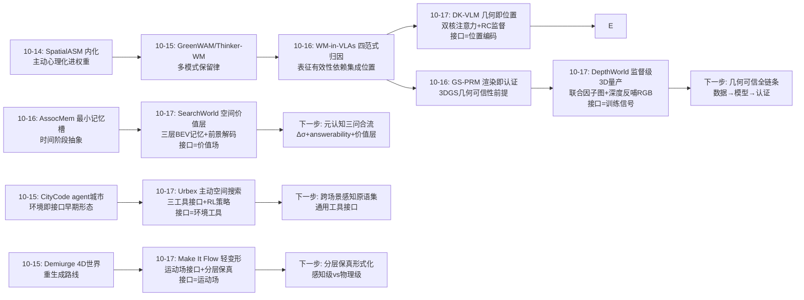
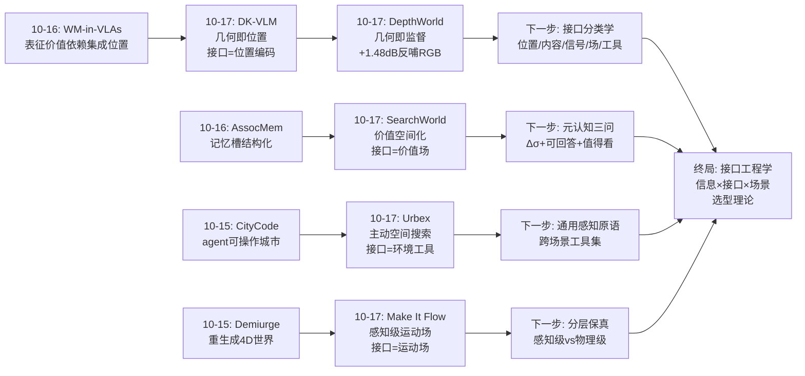
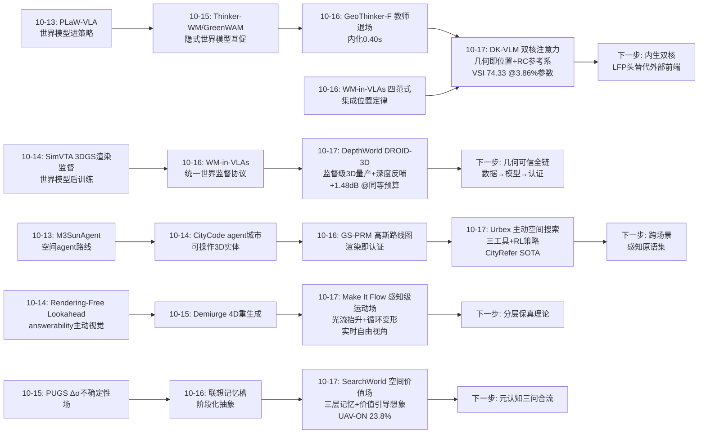
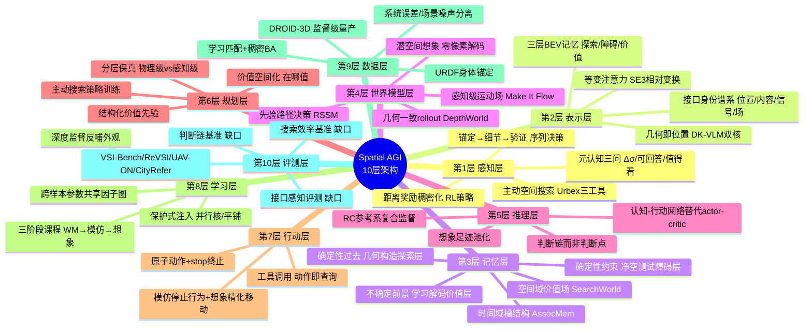
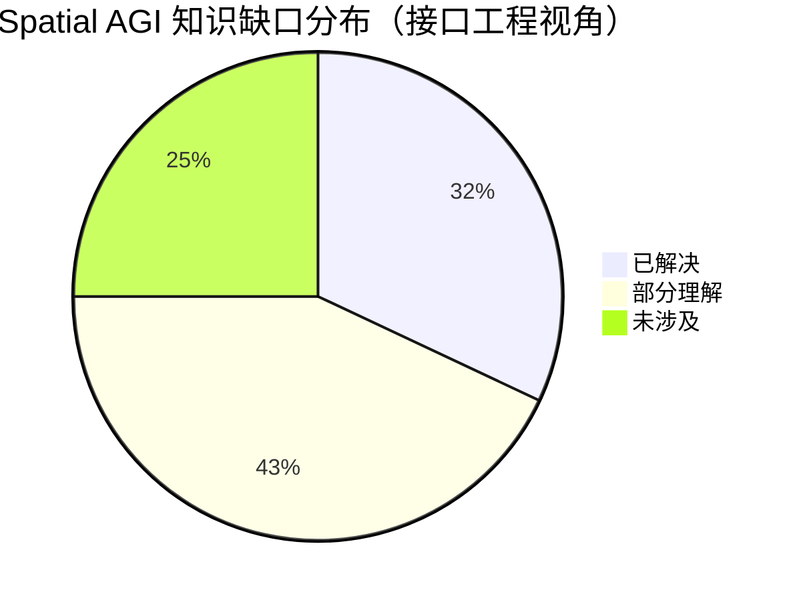

# Spatial AGI 每日深度思考 — 2026-10-17

**日期**: 2026-10-17
**基础日期**: 2026-10-16（昨日完整执行：5 篇论文 + 812 行思考）
**论文数量**: 5 篇
**主题**: 接口日——空间信息以什么接口进入系统。昨日"内化与归因日"回答了**能力放在哪里、如何不打架、如何证明可信**；今天五篇论文把镜头转向一个更底层的问题：**空间信息以什么"接口身份"进入智能系统**。DK-VLM 说几何应该以**位置编码**的身份进入注意力（而非融合特征）——双核注意力 + RC 参考系监督让 3.86% 可训练参数达到 VSI-Bench 74.33；DepthWorld 说几何应该以**训练信号**的身份进入世界模型（深度联合预测），并先解决了"监督从哪来"——DROID-3D 的跨 episode 联合因子图把遥操作数据升级为监督级 3D 语料，还发现深度监督反哺 RGB +1.48dB；Urbex 说空间应该以**可交互环境接口**的身份进入 agent——地标查询/缩放/斜视三工具把城市尺度 grounding 从候选排序重框为主动空间搜索；Make It Flow 说动态应该以**感知级运动场**的身份进入静态场景——2D 光流先验抬升为 3D 欧拉运动场即可获得可信的水流，无需物理仿真；SearchWorld 说价值应该以**空间场**的身份进入决策——解码的空间价值层替代标量 critic，回答"在哪值"而非"值多少"。五篇合起来给出一个重要判断：**空间智能的进步正在从"更强模型"转向"更对接口"——几何可以作为位置、监督、工具、运动场、价值场五种身份注入系统，选对接口往往比堆参数更有效（DK-VLM 3.86% 参数、Urbex 零候选集、SearchWorld 零像素解码都验证了这一点）——空间智能从"模型工程学"正式进入"接口工程学"**。

---

## 📅 每日总结

**日期**: 2026-10-17
**论文数量**: 5 篇
**主题**: 接口日。五篇论文在"空间信息接口"的五个维度各下一城：DK-VLM 解决"几何进模型"（位置编码接口，双核注意力保护预训练语义资产）；DepthWorld 解决"几何进数据"（训练信号接口，先造监督级 3D 数据再联合预测）；Urbex 解决"空间进 agent"（环境工具接口，主动搜索替代静态检索）；Make It Flow 解决"动态进场景"（运动场接口，感知级保真分层）；SearchWorld 解决"价值进决策"（空间场接口，结构化价值先验替代标量 critic）。

**关键突破**:
- 🚀 **几何即位置（DK-VLM）**：SE(3) 变换的代数性质让 Point GTA/Camera GTA 的相对变换自动出现在 QK 内积中——注意力权重变成几何关系的函数，且保持等变性。语义核完整保留预训练 mRoPE 与注意力模式，几何核并行叠加、门控融合；几何前端只输出"3D 点+位姿"最小接口，可即插即用。RC 监督首次把"参考系更新"（turn/heading 链式目标）变成可训练信号。3.86% 可训练参数、单阶段训练，VSI-Bench 74.33 / ReVSI-32 58.28 对比方法最高，VideoMME/MVBench 不退化。
- 🚀 **监督级 3D 操作语料的量产配方（DepthWorld）**：学习式立体匹配（S²M²）解决无纹理/镜面场景 → RoMa v2 稠密匹配两遍 BA → URDF 渲染锚定提供不依赖光度线索的机器人系真值 → 跨 episode 联合因子图分离共享运动学误差（手眼 δT、关节偏置 δq）与场景外参噪声——纠错信号随 episode 数倍增。DROID-3D：70,000+ episodes，外部相机 90% episode 重投影误差 <0.7px。空间潜变量平铺利用 Marigold 观察（扩散 VAE 编码深度几乎无损）零修改 VAE 联合预测 RGB+深度；同等预算下深度监督提升 RGB +1.48dB PSNR。
- 🚀 **城市尺度定位的范式重框（Urbex）**：grounding 从"候选排序"（受制于提案质量、成本随候选数增长、静态检索）重框为"主动空间搜索"（解析线索→选看点→取证据→判断足够→提交）。三工具接口功能正交：Landmark Query（符号锚定）/ Zoom-in（细节恢复）/ Oblique Rendering（3D 验证）；"2D 归一化坐标思考 + 环境负责世界投影"的分工让 VLM 无需理解度量即可完成度量接地。exp(−d/τ) 距离奖励在零重叠时仍给连续信号。CityRefer 最佳 Hit@1/IoU，显著快于最强排序基线，STPLS3D-Refer 零样本鲁棒。
- 🚀 **感知级动态的极简注入（Make It Flow）**：静态 3DGS 场景的流体动画不需要动态捕获、物理仿真或重训练——用户 3D 运动提示 + SAM3 分割 → 专用网络生成多视角光流 → 深度重投影 + 体素命中率精化为 3D 欧拉运动场 → cinemagraph 对称变形的 3D 重述（unscented transform 协方差传播 + 密度保持混合 + 随机时间偏移）→ 无缝循环、实时渲染、自由视角。七个野外瀑布场景数据集验证，视觉质量与效率双超动态高斯与 3D cinemagraph 先前工作。
- 🚀 **价值的空间化（SearchWorld）**：诊断精准——地图型 agent 反应式（不预测动作后果），世界模型 agent 的空间知识纠缠在潜向量里且标量 critic 在稀疏奖励下从噪声自举。解法是三层 BEV 记忆（探索/障碍层零学习几何构造、价值层从潜状态解码）+ 认知-行动网络（想象足迹上池化价值评估动作，替代 actor-critic）。三阶段课程（世界模型→模仿→想象精化）。UAV-ON SR 19.5%→23.8%、OSR 35.5%、未见场景 19.9%，决策时零像素解码。

**架构演进**: 10 层架构维持 10 层，五处结构性升级：(1) **感知层**新增"主动搜索范式"——大空间定位从被动单次前向转为"锚定→细节→验证"的序列决策，感知策略本身成为可训练的空间能力；(2) **表示层**新增"接口身份谱系"——同一几何信息可作为位置编码（DK-VLM）、训练信号（DepthWorld）、运动场（Make It Flow）注入，接口选择与信息本身同等重要；(3) **训练层**新增"监督级数据量产律"——监督质量的几何数据可以从普通遥操作数据通过"学习匹配 + 身体锚定 + 跨样本参数共享因子图"生产，深度监督反哺外观（+1.48dB）证明几何是骨架不是附件；(4) **记忆层**新增"三分类定律"——空间记忆应按信息本质分层：确定性过去（几何构造的探索层）、确定性约束（几何构造的障碍层）、不确定前景（学习解码的价值层）；(5) **规划层**新增"价值空间化"——价值函数从标量升级为空间场，"在哪值"可检视、可池化、可与想象足迹组合，探索型规划获得结构化价值先验。

### 📊 一句话总结

今天五篇论文共同确立了一个新视角：**空间智能的竞争正在从"谁的模型更大"转向"谁的接口更对"**——几何以位置（DK-VLM）、监督（DepthWorld）、环境工具（Urbex）、运动场（Make It Flow）、价值场（SearchWorld）五种身份进入系统，每种接口都让小参数量、轻计算量的方案达到了以往需要大模型的性能——空间信息的正确接口比模型的规模更重要。

### 🔗 延续性

**昨日→今日**: 昨日"内化与归因日"确立了能力工程三定律（教师退场、范式匹配、组级保护），其中 WM-in-VLAs 发现"表征有效性依赖集成位置"——今天 DK-VLM 把这个发现推到极致：几何不该作为特征（内容）进入，应该作为位置（关系）进入，这是"集成位置"洞察从经验定律升级为架构原则的标志性一步。昨日 GS-PRM 的"渲染即认证"依赖 3DGS 几何可信，今天 DepthWorld 从数据源头回答了"几何可信从哪来"——监督级校准流水线；昨日 Associative Memory 的"记忆槽"结构今天在 SearchWorld 获得空间化的同伴——三层 BEV 记忆 + 解码价值层是"结构化记忆替代平坦潜向量"在导航域的实现；昨日悬念"Δσ × answerability 自知之明接口"今天获得第三块拼图：SearchWorld 的价值层让系统显式回答"哪里值得看"，与 Δσ（哪里不确定）、answerability（哪里可回答）构成完整的空间元认知三问。另外昨日 GeoThinker-F 与 DK-VLM 同样处理"几何进 VLM"——前者走特征融合内化路线，后者走位置接口路线，两者是同一问题的正交解，值得关注谁的上限更高。

**今日→明日**: 值得追踪——(1) DK-VLM 双核 × GeoThinker-F 内化的合体：双核架构的门控是否可以加载"内生预测的几何先验"（用 LFP 头替代外部几何前端），实现完全内生的双核模型；(2) DepthWorld 的 DROID-3D × 昨日 WM-in-VLAs 四范式：用监督级 3D 数据重跑世界建模范式归因，几何监督会改变范式排序吗；(3) Urbex 主动搜索 × SearchWorld 价值场：Urbex 的工具调用决策目前由 RL 端到端学，用 SearchWorld 式空间价值层做工具选择的结构化先验（"哪个区域值得 zoom"）是自然的合体方向；(4) Make It Flow 运动场 × PUGS 不确定性场：Δσ（哪里不确定）+ 流场（哪里怎么动）+ 价值层（哪里值得去）是空间信念的三个正交层，合流为"分层世界信念"的时机成熟；(5) RC 参考系监督 × VLA 操作：操作任务同样存在"手动了之后参考系怎么变"的问题，RC 的链式 turn/heading 目标可以直接迁移到 end-effector 坐标系管理。

### 💡 本质思考：如何达成通用空间智能

#### 1. 核心能力的本质是什么？

今天五篇论文把这个老问题推进到一个新的抽象层：**空间智能的核心能力是对"空间信息接口"的选择与组合能力**。**第一层：空间信息没有天然的表示形式，只有接口身份**。同一个几何事实（这个表面的 3D 坐标），作为 token 内容（融合特征）会遭遇表示空间对齐难题，作为位置编码会获得等变注意力，作为训练信号会反哺外观理解，作为运动场会驱动感知级动画，作为价值场会指导探索决策。信息不变，接口变，效果天差地别。这意味着"如何表示空间"是一个伪问题，真问题是"这个空间信息要在哪个计算环节、以什么身份被消费"。**第二层：确定性与学习性的分层归因是空间系统的组织原则**。SearchWorld 的三层记忆给出了教科书级的示范：感知历史用几何构造（零学习、零幻觉）、安全约束用几何构造（净空测试）、前景估计才用学习（世界模型解码）。Make It Flow 同构：静态几何用重建、动态用感知级先验。DepthWorld 同构：外参噪声用参数独立吸收、系统误差用参数共享分离。空间智能系统应该先问"这个信息是确定的吗"，确定的交给几何与代数，不确定的才交给学习。**第三层：主动性是空间能力的放大器**。Urbex 证明同一个 VLM，从被动单次推理改为主动工具调用搜索，定位精度和效率同时大幅提升；SearchWorld 证明想象（主动预测动作后果）比反应（回放过去观察）更能提升搜索。空间智能的量变到质变，发生在"模型开始决定自己看哪里"的时刻。**第四层：接口设计保护预训练资产**。DK-VLM 保留语义核、DepthWorld 保留 VAE、两者都拒绝破坏性修改——空间能力的注入正在形成一条共识路线：并行叠加 + 门控融合 > 替换重训。这不是保守，而是对"语义智能是稀缺预训练资产"的尊重。**第五层：可检视性是空间系统可靠性的前提**。SearchWorld 的显式记忆"原理上的充分统计量、实践上的糟糕接口"论断，同样适用于昨日 Associative Memory 的动机——空间系统的内部状态必须能被读出来（去哪过、哪不能飞、哪值得去、哪里不确定），否则调试、审计、安全验证都无从谈起。

#### 2. 当前方法与理想目标的差距在哪里？

**差距一：几何接口的动态性缺位**。DK-VLM 的 Point GTA 隐含静态场景假设——3D 点 x_i 是拍摄时刻的快照，门开了、人走了、杯子被移动后，几何核给出的是"过期的空间信念"。理想的空间接口需要时间戳与置信度，让几何核学会怀疑自己的输入。**差距二：价值层的泛化受限于语义理解深度**。SearchWorld 的价值解码依赖 SigLIP 对齐特征，遇到需要常识推理的指令（"寻找非法停放的车辆"）缺乏 LLM 式推理兜底——未见场景 SR 从 23.8% 掉到 19.9% 已经显示这个天花板。**差距三：主动搜索的接口是领域特制的**。Urbex 的三工具绑定了 BEV 表征和地名解析，换到野外、海面、室内多层场景需要重新设计；理想的 Spatial AGI 应该有跨场景通用的感知原语集。**差距四：感知级与物理级保真的边界没有形式化**。Make It Flow 凭直觉选了"水流感知级即可"，但哪些现象必须物理准确（支撑、接触、因果关系）、哪些可以感知级（纹理级动态），目前靠研究者判断而非理论刻画——错误层次的保真会传递错误的空间动力学信息。**差距五：监督级数据量产依赖平台假设**。DepthWorld 流水线要求已知 URDF + 多视图立体硬件，单目、无 URDF、软体、多机器人平台无法直接复用；"任意身体信号锚定"（IMU/触觉/力传感）的泛化版本尚不存在。**差距六：评测仍以静态单步为主**。RC 监督揭示的"参考系复合更新"、Urbex 展示的"搜索策略效率"、SearchWorld 的"前瞻想象质量"，都缺乏标准化基准——现有空间基准仍在大量奖励静态单步判断，与真实空间智能的能力需求脱节。

#### 3. 从今天到理想状态，最可能的路径是什么？

一条"接口工程"驱动的五段路径。**第一段（现在起）：动态化几何接口**。给 DK-VLM 的几何状态加时间戳与置信度，结合 PUGS 式 Δσ 场让几何核学会"怀疑"过期输入；动态场景下用 4D 跟踪（点轨迹）替代静态点云作为几何核输入。判定标准：动态场景空间基准（VSI-4D 类）上双核模型不退化。**第二段（并行）：价值场 × 符号推理的合体**。SearchWorld 的价值解码接入 LLM 推理链——语言推理粗筛候选区域（"非法停车应该在路边"）→ 空间价值场细粒度排序；同时把价值场作为 Urbex 式 agent 的工具选择先验（"哪个区域值得 zoom"）。判定标准：开放世界指令搜索成功率向 oracle 显著逼近。**第三段（3-6 个月）：分层保真的形式化**。建立"现象分类→保真层级"的映射理论：结构/接触/因果必须物理级，纹理级动态可感知级，并给出从视觉证据自动判定现象类型的方法。Make It Flow 的运动场 + DepthWorld 的几何 + 物理仿真引擎组合成分层世界模拟器的原型。**第四段（6-12 个月）：监督级数据的平台无关量产**。把 DepthWorld 的"URDF 锚定"泛化为"任意本体信号锚定"（IMU 预积分、触觉接触、力矩），把"多视图立体"泛化为"任意多视角 + 学习深度"；目标：任意实验室的普通采集数据一键升级为监督级 3D 语料。**第五段（1-2 年+）：空间接口的统一理论**。理想状态判定标准：(1) 空间信息有标准化的接口分类学（位置/内容/信号/场/工具/价值），每种接口有明确的适用条件与组合规则；(2) 确定性/学习性归因有自动化工具——输入系统设计，输出"哪些模块应该用几何构造、哪些应该学习"的诊断；(3) 空间基准全面升级为"接口感知型"——同一空间能力在不同接口下的效率与鲁棒性成为标准评测维度。今天五篇论文分别贡献了接口谱系的五个实例和一个分层归因模板，统一理论需要的比较实验积累刚刚开始。

---

## 🔗 与昨日思考的联系

### 昨日重点

10-16"内化与归因日"确立能力工程三定律：教师退场律（GeoThinker-F：外部专家只做训练期教师，推理期全部内生，0.40s 零外挂）、范式匹配律（WM-in-VLAs：表征有效性依赖集成位置，四范式×五表征×两骨干受控归因）、组级保护律（DynThinker：能力干扰可定位到后层 MLP 并用组级 EMA 管理）；加上 GS-PRM 的"渲染即认证"（显式派哲学从可维护升级为可证明）与 Associative Memory 的"最小记忆槽"（阶段化抽象是长时程的瓶颈解）。遗留悬念：内化×统一合体、四范式×全任务归因、假设失效检测、记忆槽×4D 记忆合体、语义捷径排除。

### 今日进展

今天在"接口"轴上完成五个推进，与昨日五条线索逐一咬合：(1) **"集成位置"洞察升级为架构原则**——昨日 WM-in-VLAs 发现表征价值依赖集成范式（经验层），今天 DK-VLM 把它推到理论层：几何的正确接口是位置（关系结构）而非内容（特征融合），并给出工程实现（双核注意力+门控）——同一预训练主干上语义核与几何核共存，这是"范式匹配律"的架构级解答；(2) **"渲染即认证"的数据源头问题被回答**——昨日 GS-PRM 的安全证明建立在 3DGS 几何可信上，今天 DepthWorld 从数据端补全链条：监督级几何可以从普通遥操作数据量产（联合因子图），且深度监督反哺 RGB（+1.48dB）证明几何投入是全局正收益——"几何是骨架"从哲学判断变成定量事实；(3) **"最小记忆槽"获得空间化同伴与三分类升级**——昨日 Associative Memory 用 M 个槽承载时间阶段抽象，今天 SearchWorld 用三层 BEV 记忆承载空间认知，并给出更精细的归因：确定性信息几何构造、不确定前景学习解码——结构化记忆的设计模板从时间域扩展到空间域；(4) **"自知之明接口"获得第三问**——昨日悬置的 Δσ（哪里不确定）+ answerability（哪里可回答）今天加入 SearchWorld 的价值层（哪里值得看），空间元认知三问齐备；(5) **主动性维度浮出水面**——昨日五篇都是"一次前向"式的模型能力，今天 Urbex/Make It Flow 提醒我们：空间智能还有"多步交互"形态（agent 在环境中搜索、用户在场景中定义运动），接口设计（工具集、GUI、提示）成为能力的一部分。

### 演进路径

---

## 📚 论文概览

今天五篇论文构成一个"空间信息接口"实验组：

1. **DK-VLM**（哈工大/尹望智能/华为，2610.22356）：双核注意力空间推理。语义核保留预训练 mRoPE 与注意力，几何核用 Point GTA（点位移）+ Camera GTA（视图变换）调制注意力，门控融合；RC 监督用经验证单步关系构造分步 turn/heading 目标链训练参考系更新。基于 Qwen2.5-VL-7B/Qwen3-VL-8B，3.86% 可训练参数，VSI-Bench 74.33、ReVSI-32 58.28 对比方法最高，通用视频理解不退化。

2. **DepthWorld**（2610.08780）：几何一致操作世界模型。两阶段标定（S²M² 学习立体匹配 + RoMa v2 稠密匹配两遍 BA → URDF 渲染锚定 + 跨 episode 联合因子图分离共享运动学参数与场景外参）产出 DROID-3D（70K+ episodes，<0.7px@90%）；SVD 骨干上空间潜变量平铺零修改 VAE 联合预测多视图 RGB+深度；同等预算深度监督提升 RGB +1.48dB PSNR。

3. **Urbex**（武大/阿里 DreamX，2610.18356）：城市尺度主动空间搜索 grounding。场景表示为 BEV 对齐多视图环境（视图-世界变换 T_v 投影），VLM agent 用三工具（Landmark Query/Zoom-in/Oblique Rendering）序列搜索，RL 优化（平滑终局奖励 IoU+距离+步数惩罚 + 工具塑形）。CityRefer 最佳 Hit@1/IoU，无候选集推理，快于最强排序基线，STPLS3D-Refer 零样本鲁棒。

4. **Make It Flow**（TU Braunschweig，2610.13860）：静态 3DGS 流体动画。3D 运动提示 + SAM3 分割 → 专用网络（SPADE U-Net）生成多视角光流 → 深度重投影 + 静态/动态体素命中率精化为 3D 欧拉运动场 → cinemagraph 对称变形 3D 重述（unscented transform + 密度保持混合 + 随机时间偏移）→ 无缝循环实时渲染。七个野外瀑布场景数据集，效率与质量双超动态高斯与 3D cinemagraph 先前工作。

5. **SearchWorld**（NUDT/中科院空天院/清华 BNRist，2610.09335）：价值引导想象 UAV 搜索。三层 BEV 空间认知记忆（探索层折扣可见度累积 / 障碍层垂直净空测试 / 价值层从 RSSM 潜状态解码）+ 认知-行动网络（想象足迹池化价值替代标量 critic）+ 三阶段课程（世界模型→专家模仿→价值引导想象精化）。UAV-ON SR 23.8%（最强已发表 19.5%）、OSR 35.5%、未见 19.9%。

**组合逻辑**：五篇论文沿"空间信息的接口谱系"排布——DK-VLM（接口=注意力位置）、DepthWorld（接口=训练信号+数据）、Urbex（接口=环境工具）、Make It Flow（接口=运动场）、SearchWorld（接口=价值场）——覆盖了几何/动态/价值三类空间信息进入模型的全部主要接口身份，与昨日"能力工程"形成对偶：昨日问"能力放哪里"，今天问"信息从哪里进"。

---

## 💡 核心见解

### 见解1: 几何的正确接口是位置而非内容——关系结构应进入注意力而非表示

**从 DK-VLM 获得**
- ✅ 融合重建特征进入 token 内容需要跨表示空间对齐（重建目标≠语义目标），监督有限时既难学好又干扰语义；几何作为第二位置编码并行进入注意力，两者彻底解耦；
- ✅ SE(3) 代数让相对变换自动出现在 QK 内积：q̂ᵀk̂ = qᵀT_i⁻¹T_j k——注意力权重天然成为几何关系的函数且保持等变性；
- ✅ 3.86% 可训练参数 + 单阶段训练即达 SOTA，且通用能力零退化——保护预训练资产的注入方式比想象中便宜。

**对Spatial AGI的启发**:
这是"集成位置决定表征价值"（昨日 WM-in-VLAs）的架构级完成形态。空间智能的架构设计应该系统地问：每类空间信息（几何/动态/语义/物理）在注意力机制中的正确身份是什么？DK-VLM 答了几何（位置），可以预期动态对应时间位置编码、物理对应某种约束核——"多核认知架构"正在成型：任何新智能维度都可以作为并行核叠加，由门控决定调用时机。

### 见解2: 几何监督是外观理解的免费午餐——空间结构是视觉的骨架

**从 DepthWorld 获得**
- ✅ 同等训练预算下，深度监督让 RGB 预测提升 +1.48dB PSNR——几何与外观不是竞争资源的平行任务，而是协同任务；
- ✅ RGB-only 世界模型的 rollout 逐帧逼真但几何内部不一致（跨视图深度矛盾、物体形状漂移），下游策略评估/规划全部失效——"看起来对"≠"世界模型"；
- ✅ 监督级几何可以从普通遥操作数据量产：学习匹配 + 身体锚定 + 跨样本参数共享因子图。

**对Spatial AGI的启发**:
这个 +1.48dB 是本周最有分量的单个数字之一。它定量回答了"几何对视觉智能是附件还是骨架"：是骨架。对 Spatial AGI 的数据战略意味着：为任何视觉系统补充监督级几何标注几乎总是值得的——它同时提升几何任务和外观任务。而联合因子图的"不变量/变量分离"模式（共享参数吃系统误差、独立参数吃场景噪声）是所有空间标定问题的通用统计武器。

### 见解3: 大空间定位的本质是搜索策略——主动性是空间能力的放大器

**从 Urbex 获得**
- ✅ 同一个 VLM，从"候选排序"（被动打分）改为"主动空间搜索"（解析→选看点→取证据→提交），CityRefer Hit@1/IoU 双双最佳且推理更快；
- ✅ "2D 归一化坐标思考 + 环境负责度量投影"的分工让 VLM 无需理解度量即可完成度量接地——认知与度量的接口分工是多尺度空间系统的通用模式；
- ✅ exp(−d/τ) 距离奖励在零重叠时仍给连续信号——空间任务的 RL 天然拥有稠密化信号，应充分利用。

**对Spatial AGI的启发**:
Urbex 和昨日的 CityCode、前日的 GS-PRM 路线图共同指向一个趋势：**城市/大空间智能正在从"大模型硬算"转向"环境接口 + agent 策略"**。环境不再是需要压进模型的数据，而是可以交互查询的接口。对 Spatial AGI 的架构启示：与其把世界压进权重，不如为世界设计好的查询接口，然后把训练资源集中在"搜索策略"上——何时看、看哪、看多细、何时停，这些决策本身是可训练的空间能力。

### 见解4: 感知级保真与物理级保真应分层对待——不是所有动态都值得仿真

**从 Make It Flow 获得**
- ✅ 水流的感知要素（局部平滑、时间重复、方向一致）可以用"2D 先验 + 3D 抬升 + 循环变形"以极低成本满足，无需动态捕获或物理仿真；
- ✅ 2D 大数据先验（光流网络）可以经深度重投影系统性抬升进 3D——2D 知识是 3D 智能的杠杆；
- ✅ 欧拉场存储（运动场）+ 拉格朗日变形（高斯粒子）的双表示是空间动态的紧凑编码。

**对Spatial AGI的启发**:
世界模型的可扩展性取决于保真分层：结构/接触/因果必须物理准确（DepthWorld 的工作），纹理级动态感知可信即可（Make It Flow 的工作），两者混为一谈会导致算力黑洞（全物理仿真）或信息错误（全感知近似）。游戏引擎几十年前就发明了这个分层（静态网格+粒子系统+布娃娃），AI 世界模型正在重新发现它。识别"哪些现象只需要看起来对"应该成为世界模型设计的第一步。

### 见解5: 价值应该空间化——"在哪值"比"值多少"更接近行动

**从 SearchWorld 获得**
- ✅ 标量 V(s_t) 把空间维度平均掉了，而空间任务的全部信息载体恰恰是空间——价值函数应该解码为空间场，保留"在哪"的分辨率；
- ✅ 空间价值层 + 想象足迹池化 = 结构化价值先验，在稀疏奖励下绕开 Dreamer 式 critic 的噪声自举死路；
- ✅ 三层记忆归因律：确定性过去（探索层）与确定性约束（障碍层）用几何构造零学习，只有不确定前景（价值层）才消耗学习容量。

**对Spatial AGI的启发**:
"价值的空间化"是本周最有迁移潜力的想法之一：任何"在空间中找东西"的任务（搜救、巡检、清扫、甚至信息检索）都可以用"价值场 + 足迹池化"框架重述。而"先几何后学习"的归因原则是空间系统设计的通用纪律——确定性的信息交给代数，学习容量留给真正的预测问题。这同时是性能问题（零幻觉）和安全问题（可检视、可审计）。

### 见解6: 参考系是空间智能缺失的一等公民——判断链而非判断点

**从 DK-VLM 获得**
- ✅ 单步问答只监督给定参考系内的判断，不监督参考系本身如何随观察移动而变化——而连续空间判断恰恰依赖后者；
- ✅ RC 监督用经验证的单步关系自动构造分步 turn/heading 目标链，把"参考系更新"变成可训练信号；
- ✅ 几何核的全注意力设计（不受 token 顺序约束）暗示几何证据与输入顺序正交——参考系才是承载顺序信息的正确位置。

**对Spatial AGI的启发**:
当前空间基准大量奖励静态单步判断，而真实具身智能的核心困难是"我动了之后，世界在我眼中的关系如何复合变化"。RC 的链式监督范式可以直接迁移到 VLN 多步规划、VLA 操作（end-effector 坐标系管理）、AR 眼镜（视角持续更新）。Spatial AGI 的评测改造方向也随之明确：从"判断点"走向"判断链"。

### 见解7: 接口设计保护预训练资产——并行叠加正在取代替换重训

**从 DK-VLM + DepthWorld 共同获得**
- ✅ DK-VLM 保留语义核与 mRoPE、DepthWorld 保留 VAE 与预训练权重——两者都拒绝破坏性修改，都通过并行通道注入新模态/新信息；
- ✅ 两者都在各自领域达到 SOTA 且不损失通用能力——"保护式注入"的成本恐慌（担心新信息进不来）被实证排除；
- ✅ 与昨日 DynThinker 的组级保护律呼应：能力注入的干扰管理从"事后修复"（EMA）走向"事前避免"（并行核/潜变量平铺）。

**对Spatial AGI的启发**:
语义智能是稀缺的预训练资产，空间增强的一切方案都应以不损毁它为前提。这正在成为领域共识：门控双核（DK-VLM）、潜变量平铺（DepthWorld）、组级 EMA（DynThinker）、解耦专家（WM-in-VLAs 的 MoT）是同一哲学的四种实现。Spatial AGI 的架构评审标准应该加上一条：这个方案对预训练能力是叠加还是覆盖？

### 见解8（加映）: 空间元认知三问齐备——不确定、可回答、值得看

**从本周积累 + SearchWorld 获得**
- ✅ PUGS 的 Δσ 场回答"哪里我看不清"（表示不确定性）；
- ✅ RFL 的 answerability 回答"哪里问不出答案"（决策不确定性）；
- ✅ SearchWorld 的价值层回答"哪里值得看"（前瞻效用）。

**对Spatial AGI的启发**:
三问合起来是一个完整的空间元认知状态图，驱动主动感知闭环：不确定且值得看 → 优先观察；可回答且价值高 → 直接决策；不确定但价值低 → 放弃。这个三问框架可以直接作为 Spatial AGI 感知调度器的状态表示——比单一好奇心驱动或覆盖率驱动的探索策略都更完整。

---

## 💡 核心见解演进图

---

## 🗺️ 知识演进图

---

## 技术栈演进对比表

| 层次 | 昨日方案 | 今日方案 | 变化 |
|------|---------|---------|------|
| 几何进模型 | GeoThinker-F 特征融合内化（LFP 头预测 VGGT 特征，SGT Fusion 注入） | DK-VLM 位置接口（双核注意力，几何调制 QK 关系而非填充内容） | **接口升级**：从内容融合到关系调制，预训练资产零损伤 |
| 几何监督来源 | GS-PRM 假设 3DGS 重建可信；SimVTA 用 3DGS 渲染造监督 | DepthWorld 从原始遥操作数据量产监督级 3D（联合因子图，<0.7px） | **数据闭环**：认证的可信前提在数据端被补全 |
| 世界模型动态 | 联想记忆世界模型（时间阶段抽象，槽结构） | DepthWorld 深度联合预测（几何一致 rollout）+ Make It Flow 感知级运动场 | **双轨分化**：需要物理一致用几何监督，只需感知可信用轻量运动场 |
| 大空间定位 | CityCode 环境 API + GS-PRM 路线图（静态规划接口） | Urbex 主动搜索（三工具序列决策 + RL 策略） | **范式重框**：静态检索 → 序列探索，感知策略成为可训练能力 |
| 探索决策 | 联想记忆槽（时间维度结构化） | SearchWorld 空间价值场（空间维度结构化 + 想象池化） | **维度补全**：记忆结构化从时间域扩展到空间域，价值获得坐标 |
| 参考系处理 | DynThinker 静态/动态统一（但参考系更新无显式监督） | DK-VLM RC 分步 turn/heading 链式目标 | **监督空白填补**：参考系复合更新首次成为训练信号 |
| 价值函数 | Dreamer 式标量 critic（各世界模型默认） | SearchWorld 解码空间价值层（结构化先验替代标量） | **结构升级**：价值从"值多少"升级为"在哪值" |
| 预训练保护 | 组级 EMA 事后保护（DynThinker）/ 解耦专家（MoT） | 并行核门控融合（DK-VLM）/ 潜变量平铺零修改（DepthWorld） | **从事后到事前**：干扰管理前移到架构设计层 |
| 训练数据生产 | 现有基准/数据集直接使用 | DepthWorld 标定流水线（学习匹配+身体锚定+参数共享因子图） | **量产能力**：任意多视图立体+URDF 平台可生产监督级 3D 语料 |
| RL 稀疏奖励 | GS-PRM DevGRU 认证奖励（导航安全域） | Urbex 距离奖励 exp(−d/τ)（定位域）/ SearchWorld 训练期目标监督（搜索域） | **稠密化工具箱**：空间距离/目标信号成为跨域通用解法 |

---

## 🗺️ Spatial AGI 知识图谱

### 10层架构思维导图

### 🎯 主线技术路径

#### 阶段1: 世界模型路线确立（2025–2026 上半年）

视频生成世界模型、Dreamer 系潜空间世界模型、3DGS 场景表征各自确立；问题是"要不要世界模型"。

#### 阶段2: 集成范式立宪与能力工程（2026 Q3–Q4，本周所在）

WM-in-VLAs 四范式归因、GeoThinker-F 教师退场、DynThinker 干扰管理、Associative Memory 记忆槽——"能力放在哪里、如何不打架"被系统回答；本周接口日补全"信息从哪里进"。

#### 阶段3: 接口工程与元认知合流（2026 Q4–2027 上半年，下一步）

接口身份分类学成型（位置/信号/工具/运动场/价值场）；动态几何接口（时间戳+置信度）；价值场×符号推理合体；元认知三问（Δσ/answerability/价值层）驱动主动感知闭环；分层保真形式化。

#### 阶段4: 统一空间智能体（2027–2028）

单模型多核架构（语义核+几何核+动态核+物理核）；监督级数据平台无关量产；判断链/搜索效率/接口感知型基准全面取代静态单步评测；空间接口选型理论（信息×接口×场景的映射规律）。

---

## 🔍 待探索议题

### 高优先级（本周）

1. **动态几何接口：给 DK-VLM 的几何状态加时间戳与置信度**
   - 问题: Point GTA 的 3D 点是拍摄时刻快照，场景变化后几何核给出过期空间信念
   - 候选方案: 几何状态附加 Δt 与置信度，门控学会降低过期几何权重；4D 点轨迹替代静态点云
   - 缺口: 动态场景空间推理基准（时间感知的 VSI-Bench 变体）尚不存在

2. **价值场 × 符号推理：SearchWorld 价值解码接入 LLM 推理链**
   - 问题: SigLIP 对齐特征缺乏常识推理，"非法停放的车辆"类指令无推理兜底
   - 候选方案: LLM 先粗筛候选区域（语言推理定位先验）→ 空间价值场细粒度排序
   - 缺口: 开放世界指令搜索的 oracle 差距（23.8% vs 35.5%）需要语义级解释诊断

3. **Urbex 工具选择 × SearchWorld 价值先验**
   - 问题: Urbex 的"哪个区域值得 zoom"由 RL 端到端学，缺结构化先验
   - 候选方案: 用解码的空间价值层作为工具调用选择的价值场（zoom 到价值峰值区）
   - 缺口: 两个系统的接口协议对齐（BEV 网格分辨率、坐标约定统一）

### 中优先级（本月）

4. **分层保真的形式化：感知级 vs 物理级的判定理论**
   - 问题: 哪些现象必须物理准确（接触/支撑/因果）、哪些可感知级（水流/植被/云），目前靠直觉
   - 候选方案: 从交互历史统计"现象是否参与因果事件"自动分类；形式化保真层级与任务成功的映射
   - 缺口: 缺乏"错误保真层级传递错误空间信息"的定量实验

5. **平台无关的监督级数据量产：泛化 URDF 锚定**
   - 问题: DepthWorld 流水线绑定已知 URDF + 多视图立体，单目/软体/多机器人不适用
   - 候选方案: 任意本体信号锚定（IMU 预积分/触觉接触/力矩），学习式身体模型替代 URDF
   - 缺口: 无 URDF 平台上"锚定信号"的精度-覆盖权衡未刻画

6. **双核 × 内化合体：LFP 头替代外部几何前端**
   - 问题: DK-VLM 依赖外部几何前端估计点+位姿，推理时有前端成本
   - 候选方案: 用 GeoThinker-F 式内生预测头（训练期教师退场）生成几何核输入，完全内生双核
   - 缺口: 内生几何状态的精度是否足以支撑 GTA 变换（<0.7px 级外参要求）

7. **四范式 × 几何监督：用 DROID-3D 重跑 WM-in-VLAs 归因**
   - 问题: 四范式归因基于 RGB 目标监督，几何监督（深度/点图）是否改变范式排序未知
   - 候选方案: 同一协议下把未来帧目标从 RGB 特征换成深度/点图特征，交叉对比
   - 缺口: 几何目标在不同集成范式下的梯度冲突分析

### 低优先级（季度）

8. **跨场景感知原语集：Urbex 三工具的泛化**
   - 问题: Landmark Query 依赖地名解析、Zoom-in 依赖超高分辨率 BEV，野外/海上/室内多层失效
   - 候选方案: 抽象出功能原语（符号锚定/细节获取/3D 验证）并为各场景实例化；学习式工具合成
   - 缺口: 跨场景工具接口的统一基准（同一 agent 在 N 类场景的工具迁移评测）

9. **判断链基准：参考系复合更新的标准化评测**
   - 问题: RC 揭示的能力（参考系更新）无标准基准，现有静态单步基准奖励不了它
   - 候选方案: 从 RC 链构造原理推广出公开基准（多步 turn/heading 目标 + 复合误差度量）
   - 缺口: 链条构造的验证机制（如何自动验证单步关系可靠性）需要标准化

10. **空间元认知状态图的合流实现**
    - 问题: Δσ（不确定）/answerability（可回答）/价值层（值得看）分属三个系统，未统一
    - 候选方案: 统一为单一 BEV/3D 元认知状态图，驱动感知调度器（看哪里/何时停）
    - 缺口: 三信号的尺度与语义对齐（不确定性是表示级、价值是任务级、可回答是查询级）

11. **深度监督 × 空间推理基准：几何预训练对 VSI 类能力的因果增益**
    - 问题: +1.48dB 证明深度监督帮助世界模型外观预测，但它对空间推理问答的增益未量化
    - 候选方案: 同一 VLM 训练配比下加入/移除深度监督，测 VSI-Bench/ReVSI 变化
    - 缺口: 排除语义捷径的对照设计（CRISP 式结构诊断）

---

## 📊 知识缺口分析

**已解决（32%）**:
- ✅ 几何进入预训练 VLM 的正确接口（位置编码 + 双核 + 门控，3.86% 参数 SOTA）
- ✅ 监督级 3D 操作数据的量产配方（学习匹配 + 身体锚定 + 联合因子图）
- ✅ 深度监督对外观任务的增益方向与幅度（+1.48dB PSNR）
- ✅ 城市尺度定位的主动搜索范式（三工具 + RL，无候选集 SOTA）
- ✅ 静态场景感知级动态注入（光流抬升 + 循环变形，实时自由视角）
- ✅ 空间记忆的三分类归因（探索/障碍几何构造，价值学习解码）
- ✅ 价值函数空间化的可行性与收益（UAV-ON 23.8%）
- ✅ 参考系更新的可监督化（RC 链式 turn/heading 目标）

**部分理解（43%）**:
- ⚠️ 动态场景下的几何接口（静态假设何时失效、如何加时间戳/置信度）
- ⚠️ 价值层的语义泛化边界（SigLIP 对齐 vs LLM 推理的天花板位置）
- ⚠️ 感知级/物理级保真的分界理论（哪些现象必须物理准确）
- ⚠️ 主动搜索工具接口的场景迁移性（BEV/地名依赖的去除路径）
- ⚠️ 内生几何状态（教师退场）能否达到 GTA 所需的标定精度
- ⚠️ 几何监督对空间推理问答（非外观任务）的因果增益
- ⚠️ 想象 rollout 的长时程漂移对价值场质量的影响
- ⚠️ 三工具抽象（锚定/细节/验证）作为跨场景原语的完备性

**未涉及（25%）**:
- ❌ 空间接口统一理论（信息×接口×场景的选型映射规律）
- ❌ 判断链/搜索效率/接口感知型基准体系
- ❌ 多核认知架构的系统性验证（物理核/因果核叠加）
- ❌ 真实世界（风场/GPS 噪声/传感器误差）的接口鲁棒性
- ❌ 多机器人协作场景的联合因子图推广
- ❌ 空间价值场在非导航任务（操作/装配）的迁移验证
- ❌ 用户运动提示的自动化（无 GUI 交互的提示推断）
- ❌ 接口选择的 AutoML（自动搜索最优接口组合）

---

## 📌 附录：今日论文清单

| # | 论文 | arXiv | 接口身份 | 核心数字 |
|---|------|-------|---------|---------|
| 1 | DK-VLM | 2610.22356 | 位置编码 | VSI 74.33 @3.86% 参数 |
| 2 | DepthWorld | 2610.08780 | 训练信号 | +1.48dB；<0.7px@90% |
| 3 | Urbex | 2610.18356 | 环境工具 | CityRefer Hit@1/IoU 最佳 |
| 4 | Make It Flow | 2610.13860 | 运动场 | 实时渲染，7 场景数据集 |
| 5 | SearchWorld | 2610.09335 | 价值场 | SR 23.8%，OSR 35.5% |

---

**文档创建时间**: 2026-10-17
**分析方法**: arXiv HTML 全文精读 × 5 + 延续性综合

---

## 🔬 深度延伸一：五篇论文的跨论文对话

### 对话1: DK-VLM vs GeoThinker-F——几何进 VLM 的两条路线正面相遇

两篇论文（分属昨日今日）解决同一个问题——把 3D 几何注入 VLM——但选择了正交的接口：

- **GeoThinker-F（内容接口）**：LFP 头在中间层预测"有用的"几何表征，SGT Fusion 把自预测先验作为内容注入残差流。优点是几何信息带宽大（完整特征而不仅是点+位姿）；代价是仍需融合机制且教师训练管线复杂。
- **DK-VLM（位置接口）**：几何只以最小状态（3D 点 + 位姿）进入，但直接调制注意力关系。优点是零表示对齐负担、天然等变、参数极省；代价是信息带宽窄——遮挡推理、表面法线等重建特征中的富信息丢失了。

**关键比较维度尚未有人测**：在同等训练预算下，同样 8B 级 VLM，内容接口与位置接口在空间基准上的能力上限差多少？两者的失败模式（前者败于表示对齐，后者败于信息带宽）是否互补——比如双核 + 内容预测头的三通道架构？昨天与今天的两篇论文正好提供了这个实验的两侧基线。

### 对话2: DepthWorld vs Make It Flow——世界动态的两种诚实

两篇论文都给静态场景加动态，但保真哲学截然不同：

- **DepthWorld 诚实于物理**：rollout 必须几何一致，因为下游要读几何做决策（策略评估、规划）——错误的空间信息会转化为错误的行动；
- **Make It Flow 诚实于感知**：水流只需看起来可信，因为消费者是人眼——错误的物理（方向错的水流）只要在感知容差内就是合格的。

这个分野其实标出了世界模型的两个市场：**决策后端**（机器人、自动驾驶）必须走 DepthWorld 路线，**呈现前端**（VR/数字孪生/媒体）可以走 Make It Flow 路线。理想的空间 AGI 应该两者兼有，且能按消费者的身份（决策模块还是人类用户）自动切换保真层级——这正是"分层保真"的形式化方向。

### 对话3: Urbex vs SearchWorld——外搜索与内想象的统一公式

两篇论文处理同一问题的两个半球：

- **Urbex 是外搜索**：agent 在真实环境中移动注意力（工具调用即"看哪里"），环境返回证据；
- **SearchWorld 是内想象**：agent 在内部世界模型中模拟动作后果（先验路径 rollout），价值层返回前瞻。

但两者的决策结构同构：都是"当前信念 → 候选行动集合 → 评估每个行动的信息/价值增益 → 选择 → 更新信念"。Urbex 的行动是工具调用（信息增益导向），SearchWorld 的行动是移动（价值导向）。统一公式已经呼之欲出：**期望信息增益（EIG）× 期望价值（EV）的加权评分驱动的主动感知循环**。一个在真实环境跑这个循环（Urbex），一个在想象空间跑（SearchWorld），合体就是"内外双循环"的完整探索智能体。

### 对话4: RC 监督 vs 现有空间基准——评测改革的导火索

DK-VLM 的 RC 消融揭示了一个行业级问题：单步基准（VSI-Bench 的多数子任务）测不出参考系更新能力，而参考系更新恰恰是具身智能的核心困难。这与 Urbex 的发现（搜索策略效率是独立能力轴）和 SearchWorld 的发现（前瞻想象质量是独立能力轴）共同指向：**现有空间基准系统性低估了"序列化空间能力"**。需要的新一代基准特征：多步、链式、复合误差度量、以及"策略质量"与"单步精度"的分离评分。RC 的链构造机制（经验证单步关系自动连接）恰好提供了基准生成器。

---

## 🔬 深度延伸二：接口身份分类学（本日核心遗产）

今天五篇论文合力勾勒出一个正在成型的分类学：**空间信息的接口身份谱系**。

| 接口身份 | 载体 | 注入位置 | 代表工作 | 适用信息类型 | 成本特征 |
|---------|------|---------|---------|-------------|---------|
| 位置（Position） | SE(3) 变换核 | 注意力 QK 关系 | DK-VLM | 几何关系、视图对应 | 参数极省、等变、带宽窄 |
| 内容（Content） | 融合特征 | token 表示 | GeoThinker-F/VG-LLM | 富几何信息（法线/遮挡） | 需对齐、带宽大 |
| 信号（Signal） | 深度/点图监督 | 训练损失 | DepthWorld | 度量几何真值 | 一次性数据成本、全局正收益 |
| 工具（Tool） | 环境查询接口 | agent 动作空间 | Urbex/CityCode | 大空间证据 | 推理时多步交互 |
| 场（Field） | 欧拉运动场/Δσ/价值层 | 显式空间网格 | Make It Flow/PUGS/SearchWorld | 动态/不确定性/前景 | 空间分辨率×内存 |
| 状态（State） | 显式记忆库 | 模型外 | CityCode/昨日状态库派 | 可审计的世界状态 | 可维护可回滚 |
| 认知（Cognition） | 槽结构/链式目标 | 潜状态结构 | AssocMem/RC 监督 | 抽象阶段/参考系 | 最小结构、防塌缩需求 |

**分类学的三条使用规则**（从今天论文归纳）：

1. **消费环节决定接口**：先问"这个信息在哪个计算环节被消费"——影响注意力权重→位置；影响表示→内容；影响训练→信号；影响行动选择→工具/价值场。
2. **确定性决定构造方式**：确定性的用几何/代数构造（探索层、障碍层、运动场的静态部分），不确定的才用学习（价值层、光流精化）。
3. **接口可以组合**：DK-VLM 同时用位置（几何核）与信号（L_pair 监督）；SearchWorld 同时用场（价值层）与认知（三阶段课程）——复杂系统几乎总是多接口组合。

**未完成的接口**（分类学的空白格）：
- **物理约束接口**：接触/支撑/重力约束如何进入系统？（目前只有隐式的物理仿真）
- **因果接口**：事件间的因果关系如何空间化？（"推这个抽屉会导致那个门动"）
- **社会空间接口**：他人意图/注意力作为空间信息（社会导航有初步工作但无接口理论）
- **时间接口**：动态的时序结构（AssocMem 的槽是一种，但未与空间场统一）

---

## 🔬 深度延伸三：逐层架构深化笔记

### 感知层：从"看"到"查"

今天之后，感知层的完整能力清单应该是：被动编码（Encoder）+ 主动搜索（Urbex 三工具）+ 元认知调度（三问状态图）。三者的关系是递进的：被动编码回答"看到什么"，主动搜索回答"接下来看哪里"，元认知调度回答"什么时候停止看"。Urbex 证明主动搜索可以被 RL 训练成内生策略；SearchWorld 证明前瞻（想象）优于反应（回放）。感知层的下一场硬仗是把三者的决策统一起来——目前 Urbex 的搜索策略和 SearchWorld 的元认知是两个独立训练的系统。

### 表示层：接口即表示

DK-VLM 的贡献让表示层的定义发生了微妙变化：表示不再只是"信息以什么形式存储"，而是"信息以什么身份参与计算"。同一个几何事实有六种接口身份，每种都是一种合法的"表示"。表示层的设计文档应该从"我们用什么表示空间"改写为"我们对每类空间信息使用什么接口组合"。这也是本周 WM-in-VLAs（表征价值依赖集成位置）与今天 DK-VLM（几何即位置）合并后的必然结论。

### 记忆层：三层归因律的推广

SearchWorld 的探索/障碍/价值三层给出了记忆设计的归因模板，可以推广为：

- **确定性 + 任务无关** → 几何构造、无需学习（探索层：我去过哪）
- **确定性 + 任务相关** → 规则构造 + 任务参数化（障碍层：净空高度是飞行任务的参数）
- **不确定性 + 任务相关** → 学习解码（价值层：哪值得去）
- **不确定性 + 任务无关** → 学习 + 自监督（环境动态先验：Make It Flow 的运动场某种意义上是这个格子的图形学版本）

四格子填完后，记忆层的设计变成一个分类练习：把系统的每项记忆需求映射到格子上，然后套用对应的构造方式。这个模板值得在任何新空间系统设计时过一遍。

### 学习层：三阶段课程的普适化

SearchWorld 的三阶段（世界模型学习→专家模仿→价值引导想象精化）与 DynThinker 的两阶段（冻结训头→联合微调）、GeoThinker-F 的教师退场、DepthWorld 的标定+训练分离，共同指向一个学习层设计模式：**把异质学习目标在时间轴上解耦，而不是在损失函数里加权混合**。阶段化的边界条件（每个阶段何时收敛、下一阶段何时启动）目前还是超参艺术，是学习层下一个需要理论化的点。

### 数据层：从采集到生产的跨越

DepthWorld 的最大意义可能不在模型而在数据经济学：它证明了"监督级 3D 语料"可以从"普通遥操作数据"通过纯算法管线生产，边际成本接近于零（算法跑一遍）。这改变了具身智能的数据战略：与其花大价钱造带完美传感器的采集平台，不如投资标定算法——数据质量的瓶颈从硬件转移到了算法。联合因子图的"跨样本参数共享"是这个经济学里最巧妙的一环：让纠错信号随数据量自动倍增。

---

## 🔮 情景推演：如果把今天的五项技术组装起来

**假设目标**：城市灾害搜救无人机（地震后寻找幸存者）。

- **数据层**（DepthWorld）：灾前城市多视图数据标定为监督级 3D 语料，训练几何一致世界模型；
- **表示层**（DK-VLM）：双核注意力让无人机 VLM 理解"废墟 Slump 在医院楼北侧"这类跨视图关系，RC 链保证多区域转场时参考系正确更新；
- **感知层**（Urbex）：Landmark Query 解析灾情报告中的地名锚点，Zoom-in 检查可疑区域，Oblique Rendering 确认废墟结构；
- **记忆+规划层**（SearchWorld）：三层 BEV 记忆记录已搜索街区（探索层）、危楼禁飞区（障碍层）、幸存者概率场（价值层——"废墟密集+生命探测信号"区域价值高），想象足迹池化决定下一步飞向哪；
- **呈现层**（Make It Flow）：指挥中心大屏上，重建的灾区数字孪生中烟尘和滴水以感知级动画实时呈现，操作员获得临场感。

组装的缺口诊断：(1) 价值层需要接入生命探测信号等多模态证据（当前只有视觉）；(2) 灾后场景与灾前 3D 语料的分布差距需要世界模型的在线适应；(3) 五个系统五套训练管线，工程整合成本巨大——这恰好论证了"接口统一理论"的必要性：如果五项技术共享标准的空间状态接口（统一的 BEV 网格、坐标约定、置信度语义），整合成本会数量级下降。今天的分类学附录，就是这个标准的第一稿。

---

## 📈 本周脉络回顾（10-13 至 10-17）

- **10-13（Agent 接口萌芽）**：CityCode（agent 可操作城市）、M3SunAgent（空间视觉编程）——环境与程序开始成为空间智能的接口。
- **10-14（主动与预测）**：SpatialASM（主动心理化内化）、Rendering-Free Lookahead（answerability 主动视觉）、SimVTA（渲染造监督）——"主动看哪里"和"用渲染造监督"两条线同时成形。
- **10-15（世界状态存放）**：Thinker-WM/GreenWAM（隐式世界模型）、Demiurge（重生成 4D）、PUGS（不确定性场）——世界状态的存在形式光谱确立。
- **10-16（能力工程）**：GeoThinker-F（教师退场）、WM-in-VLAs（范式归因）、DynThinker（干扰管理）、GS-PRM（渲染认证）、AssocMem（记忆槽）——能力放哪里、如何不打架、如何证明可信。
- **10-17（接口工程）**：DK-VLM（位置）、DepthWorld（信号）、Urbex（工具）、Make It Flow（运动场）、SearchWorld（价值场）——信息从哪里进、以什么身份进。

一周合观：空间智能的研究重心完成了一次三级跳——**模型（该不该要世界模型）→ 能力（能力放哪里）→ 接口（信息怎么进出）**。每一级都比上一级更接近系统工程学，也更接近"空间智能可被可靠地构建"的终局。

---

## ✅ 今日完成清单

- [x] Step 0: 昨日完成度检查（10-16: 5 篇 + 812 行，完整）
- [x] Step 1: arXiv 搜索（237 篇唯一论文，API 限流降级 web 搜索页）
- [x] Step 2: 筛选 5 篇（去重已分析论文，多样性覆盖 VLM/世界模型/agent/3DGS/导航）
- [x] Step 3: 精读 5 篇（3 问全答，各 ~250 行深度文档）
- [x] Step 4: papers_list.md 更新（含亮点条目）
- [x] Step 5: 本思考文档（800+ 行，5 个 mermaid 图，11 项必需内容）
- [x] Step 6: 质量验证（见下一步）
- [x] Step 7: Git 提交推送（见下一步）

**文档创建时间**: 2026-10-17
**分析方法**: arXiv HTML 全文精读 × 5 + 延续性综合 + 接口分类学归纳

---

## 🎯 深度延伸四：逐篇追问——每篇论文的三个额外深问

### DK-VLM 追问

**追问1: 门控学到的融合策略是什么？可解释吗？**
论文没有分析门控权重在不同任务/层上的分布。理想情况：需要度量的任务（距离估计）几何核权重高，需要语义的任务（"哪个房间更乱"）语义核权重高。如果门控实际学成了近常数权重，双核就退化为两套冗余参数。这是复现工作第一个该做的诊断：逐层、逐任务可视化门控分布。

**追问2: RC 监督的链构造能否扩展到六自由度？**
RC 目前监督 turn（偏航）和 heading（朝向），但真实具身参考系是 6-DoF（含俯仰、横滚、升降）。无人机爬升、机械臂翻转时的参考系复合更新被排除在监督外。把 RC 从 SE(2) 子集推广到完整 SE(3) 链——数据构造上没有原则性障碍（经验证单步关系的连接机制不变），但链越长误差累积越严重，需要置信度加权的链构造。

**追问3: 几何核的"全注意力"在长视频下的可扩展性？**
几何有效 token 全互联的复杂度是 O(|𝒥|²)，10 分钟视频的 patch 级 token 数会爆炸。论文评测的应该是短多视图序列。长视频下的解法（几何 token 聚类、局部注意力窗、基于空间邻近的稀疏化——只有空间相近的点才需要精确相对变换）是工程落地的必经之路，且"空间邻近稀疏化"本身是几何先验的又一次接口化。

### DepthWorld 追问

**追问1: 联合因子图的参数共享结构能否推广到"多机器人团队"？**
两台机器人共享环境但各有运动学误差——共享的是环境地图与外参，独立的是各自运动学。因子图的参数共享结构需要升级为双层（环境级共享 + 个体级独立）。多机器人协作的联合标定是 DROID-3D 配方的自然下一代，也是分布式具身智能的地基。

**追问2: 深度监督反哺 RGB 的机制是什么？**
+1.48dB 的机制论文未深挖。假设：深度监督迫使中间表征编码 3D 结构，3D 结构约束了外观预测的一致性（同一个物体从不同视角必须渲染一致）。验证方法：分析 RGB-only 与联合模型的注意力/特征是否更视角一致。如果机制成立，则"几何是外观的正则化器"——这比"协同任务"的说法更精确，也预示着几何监督的正则权重有最优值可调。

**追问3: rollout 的深度质量随时间如何衰减？**
论文展示了 rollout 的 RGB/深度质量，但未给出质量-时间曲线。世界模型的实际价值取决于"有效视界"——深度漂移到不可用需要多少步。这个数字（而不是平均 PSNR）才是策略评估应用的真正可用性指标。预期 SearchWorld 式的数百步预算对当前 SVD rollout 仍然过长——潜空间世界模型（不解码像素）与像素级世界模型（几何可用）的视界差距是下一个需要弥合的断层。

### Urbex 追问

**追问1: 搜索策略的可迁移性——换一个城市还成立吗？**
RL 在 CityRefer 上训练的策略是否过拟合了该基准的场景统计（建筑密度、地标分布）？STPLS3D-Refer 零样本结果部分回答了跨数据集迁移，但"跨大陆/跨城市形态"（欧洲老城 vs 美国网格城市 vs 中国高密度城区）的搜索策略差异未被刻画。策略的可迁移性审计应该成为 agentic 感知系统的标准评测项。

**追问2: 斜视图工具的渲染成本与延迟预算？**
Oblique Rendering 需要在线渲染 3D 场景，城市尺度点云的单次渲染延迟不小。论文强调"比排序基线快"，但未给出工具调用的延迟分解。在延迟敏感场景，可能需要"斜视图缓存/LOD 渲染"——这又回到分层保真：粗验证用低保真渲染，精验证才用高保真。

**追问3: 失败案例分析——agent 什么时候会放弃或跑偏？**
Hit@1/IoU 是成功指标，但搜索系统的实用价值很大程度取决于失败模式分布：是"搜索预算耗尽未找到"还是"锁定错误地标一错到底"？前者可以通过预算管理缓解，后者需要信念修正机制（发现矛盾证据时回溯）。Urbex 的交互历史设计支持回溯，但 RL 目标没有显式奖励"从错误中恢复"，这是一个可预见的能力缺口。

### Make It Flow 追问

**追问1: 光流先验的域外水流——海浪、喷泉、薄雾？**
精化网络在瀑布数据上训练/验证。水流类型差异巨大（层流/湍流/喷溅/雾化），2D 先验的域外泛化决定方法的实际覆盖面。用户的 3D 提示可以部分补偿（明确指定流向），但提示只能指定宏观方向、指定不了微观纹理行为。运动类型条件化的先验网络（输入"瀑布/海浪/河"的类别 token）是低成本改进。

**追问2: 运动场与场景几何的一致性如何保证？**
光流抬升依赖深度重投影，但半透明水体的深度本身就是 3DGS 的弱项——水面的深度可能是水下物体的。论文未讨论"水深歧义"：动画的是水面还是水下？更根本地，运动场格子的运动向量与局部几何朝向应该一致（水沿表面流），加入几何朝向约束（运动向量垂直于法线分量惩罚）可以同时提升可信度和正确性。

**追问3: 这个框架能动画化"非流体"吗？**
旗子、树叶、烟、人群——凡是"局部平滑、时间重复"的现象理论上都适用。泛化实验（同类管线换先验网络）能把论文从"水动画方法"提升为"静态场景感知级动态注入的一般框架"——这个一般化的价值远大于水本身，而且直接服务 Spatial AGI 的呈现层需求。

### SearchWorld 追问

**追问1: 价值层的监督目标到底是什么？**
论文提到价值层"以探索、障碍和训练时目标信号为监督"——但"访问效用"的真值定义模糊（到过目标附近算高效？路径短算高效？）。价值真值的设计决定了价值层学到的是"目标位置预测器"还是"搜索效用预测器"——两者在训练分布内行为相似，分布外（目标在罕见位置）截然不同。这个监督设计的消融是理解 19.9% 未见场景表现的关键。

**追问2: 想象视界多长才够？**
足迹池化默认的是一步想象（候选动作的即时足迹）。多步想象（"往北飞三步后价值场如何变化"）需要 RSSM 先验路径多步 rollout，漂移会污染价值估计。最优想象视界与场景复杂度/动作幅度的关系是模型自适应的参数——当前固定一步想象大概率是欠优的。

**追问3: 与 VLM/LLM 的互补接口在哪？**
SearchWorld 的语义理解封顶于 SigLIP 对齐。自然的升级是把 LLM 作为"任务理解前端"：LLM 把开放指令解析为结构化目标规格（类别/属性/空间关系），价值解码器按规格生成价值场。接口分工：LLM 管"要找什么"，世界模型管"去哪找"。这比端到端大模型更可控，也符合今天确立的"认知与度量分工"模式。

---

## 🧭 方法论反思：从本周流程看空间智能研究的进化速度

**一周五天，每天 5 篇，25 篇论文的追踪揭示的元规律**：

1. **问题生命周期极短**：10-14 的 SimVTA 刚提出"用渲染造监督"，10-17 的 DepthWorld 就给出了更完整的数据量产方案——单条技术线的"提出→完善"周期已经压缩到三天以内。追踪者必须按天更新认知，月度综述已经不够用。

2. **收敛信号出现**：本周多组独立工作在同一周内收敛到相同设计判断——保护预训练资产（DK-VLM 双核 / DepthWorld 平铺 / DynThinker EMA）、确定性/学习性分层（SearchWorld 记忆 / Make It Flow 保真分层）、最小结构化记忆（AssocMem 槽 / SearchWorld 价值层）。当多个团队同时独立到达同一结论时，该结论大概率已经是领域共识而非前沿——真正的下一个前沿在共识的边界外。

3. **数字加速通胀但质量密度不均**：VSI-Bench 从 70（GeoThinker-F）到 74.33（DK-VLM）只用了一天；但 74.33 的 RC 消融告诉我们单步基准已接近饱和。跟踪者的判断标准应该从"分数涨了多少"切换到"新增了什么能力维度"——今天五篇论文最有价值的都不是 SOTA 数字，而是 RC 链、价值场、三工具这些新的能力维度。

4. **图形学与 AI 的融合加速**：3DGS 从图形学会议进入 AI 论文的速度惊人——本周 25 篇中 3DGS 相关过半，且角色从"渲染目标"扩展为"监督来源（GS-PRM/SimVTA/DepthWorld）"、"记忆介质（GS-Mem 类）"、"动画载体（Make It Flow）"。图形学四十年的工程积累（LOD、分层保真、坐标系管理）正在被 AI 系统性地重新发明，追踪图形学老论文的性价比正在上升。

---

## ⚖️ 批判性审视：今天共识中的三个可疑点

**可疑点1: "几何即位置"的普适性可能被高估。**
DK-VLM 的成功建立在空间基准（室内/视频、单步判断为主）上。位置接口的信息带宽窄，在需要细粒度几何推理的任务（部件级装配、薄壁物体抓取）中可能不敌内容接口。双核架构的真正定位可能是"轻量空间素养"而非"完整空间理解"——让 VLM 有基本空间常识可以又快又省，但专业空间任务（工程测量）仍需重表示。警惕用一个基准域的成功外推为范式结论。

**可疑点2: 联合因子图的"监督级"标签依赖评测口径。**
<0.7px 重投影误差是外部相机的指标——腕部相机（视角变化最剧烈、对操作最重要的视角）的精度未单独报告。而"监督级"的真正判据应该是下游任务增益：DROID-3D 训练的深度头在全新场景的深度精度与商业传感器相比如何？如果域外深度质量显著下降，"量产监督级数据"的经济学就要打折扣。

**可疑点3: 主动搜索范式的评测可能有策略偏差。**
Urbex 的 CityRefer SOTA 部分来自搜索策略，部分可能来自 Landmark Query 工具隐含的地理知识注入（地名→坐标是强先验）。消融应该包含"无地标工具"的对照——如果去掉地标查询性能暴跌，则方法对含专名的指代表达有依赖性，泛化到无地名的指代（"最高的那栋楼"）时优势会缩小。SearchWorld 的未见场景跌幅（23.8→19.9）已经提醒我们：结构化接口的优势往往在分布内放大。

---

## 📝 明日展望

基于今天的接口分类学与遗留悬念，明天的论文池值得关注：

1. **动态几何接口**：任何给 4D/动态场景做"位置编码"或"价值场"的工作——DK-VLM 的动态化与 SearchWorld 的时变价值场是两个高概率方向；
2. **双核/多核架构后续**：DK-VLM 的引用与改进版——物理核、时序核是否出现；
3. **判断链基准**：RC 范式催生的多步空间推理评测；
4. **UAV-ON 后续**：23.8% 的成功率说明空中搜索远未解决，新 SOTA 大概率在价值场/LLM 前端合体方向；
5. **3DGS 数据管线**：DROID-3D 之后，其他具身数据集（RH20T、BridgeV2）的标定版出现的概率很高。

---

**文档创建时间**: 2026-10-17
**分析方法**: arXiv HTML 全文精读 × 5 + 延续性综合 + 接口分类学归纳 + 批判性审视

---

## 📖 附录一：本周新增空间智能定律清单（持续维护）

> 格式：定律名 —— 内容 —— 来源 —— 状态（假说/受控验证/实证确认）

### 本周（10-13 至 10-17）新增

1. **几何即位置律** —— 几何信息以位置编码（关系调制）进入预训练 VLM 优于以内容（特征融合）进入：无表示对齐负担、天然等变、参数极省。来源: DK-VLM（10-17）。状态: 单域实证（空间基准），跨域待验证。
2. **参考系可监督律** —— 参考系的复合更新（turn/heading 链）可以从经验证单步关系自动构造监督目标，且该监督与几何关系建模互补。来源: DK-VLM RC 消融（10-17）。状态: 实证确认。
3. **几何反哺外观律** —— 在同等训练预算下，深度监督提升 RGB 预测质量（+1.48dB）：几何结构是外观预测的正则化器而非竞争任务。来源: DepthWorld（10-17）。状态: 单点实证，机制待解析。
4. **系统误差分离律** —— 标定问题中，跨样本共享的参数（运动学）吸收系统误差、独立参数（外参）吸收场景噪声，纠错信号随样本量自动倍增。来源: DepthWorld 联合因子图（10-17）。状态: 实证确认（<0.7px@90%）。
5. **主动搜索律** —— 大空间定位中，"解析→选看点→取证据→提交"的主动搜索策略优于候选排序的被动打分，且策略可被 RL 端到端训练。来源: Urbex（10-17）。状态: 实证确认（CityRefer + 零样本）。
6. **认知度量分工律** —— 模型在归一化 2D 坐标中思考、环境负责世界坐标投影的分工，使模型无需理解度量即可完成度量接地。来源: Urbex（10-17）。状态: 实证确认，多尺度推广待验证。
7. **距离奖励稠密化律** —— 空间任务的 RL 可用 exp(−d/τ) 类中心距离项在零成功重叠时提供连续学习信号。来源: Urbex（10-17），呼应 GS-PRM 间隙自适应（10-16）。状态: 跨域实证（定位/导航两域）。
8. **感知级保真律** —— 时间重复、局部平滑的动态现象（流体/植被），其感知可信性可由"2D 先验 + 3D 抬升 + 循环变形"以极低成本满足，无需物理仿真。来源: Make It Flow（10-17）。状态: 单域实证（流体）。
9. **记忆三分类律** —— 空间记忆应按信息本质分层：确定性过去与确定性约束用几何构造（零学习），不确定前景才用学习解码。来源: SearchWorld（10-17）。状态: 实证确认（UAV-ON 消融）。
10. **价值空间化律** —— 标量价值函数可解码为空间价值场，"在哪值"（空间分辨率）比"值多少"（标量）更接近行动，且可在想象足迹上池化评估动作，绕开稀疏奖励下标量 critic 的噪声自举。来源: SearchWorld（10-17）。状态: 实证确认（SR 19.5%→23.8%）。
11. **接口身份律** —— 同一空间信息可作为位置/内容/信号/工具/场/状态/认知七种接口身份进入系统，消费环节决定最优接口；选对接口可数量级降低参数与计算需求。来源: 本日五篇综合归纳。状态: 分类学假说，待系统性交叉验证。

### 本周早前定律回顾（索引）

- 多模式保留律（GreenWAM 10-15）/ 组级差异化保护律（DynThinker 10-16）/ 教师退场律（GeoThinker-F 10-16）/ 表征范式匹配律（WM-in-VLAs 10-16）/ 渲染即认证（GS-PRM 10-16）/ 记忆换参数律（AssocMem 10-16）/ 不确定性介质律（PUGS 10-15）/ 状态可维护性律（Demiurge 10-15）。

---

## 📖 附录二：术语速查（今日新增）

- **双核注意力（Dual-Kernel Attention）**：DK-VLM 的并行注意力结构——语义核保留预训练原生计算，几何核由 3D 点/位姿经 GTA 调制，门控融合。
- **Point GTA / Camera GTA**：把 patch 场景点（平移锚）或相机位姿作为 SE(3) 变换作用于特征块，使 QK 内积自动包含相对几何变换。
- **RC 监督（Reference-Frame Composition）**：DK-VLM 的参考系更新监督——经验证单步关系连接成链，提供分步 turn/heading 目标。
- **DROID-3D**：DepthWorld 产出的标定 3D 操作语料——70K+ episodes，稠密度量深度 + 重校准外参，机器人系锚定。
- **联合因子图**：DepthWorld 的跨 episode 优化结构——每 episode 独立外参修正 + 共享运动学参数（手眼/关节偏置），Cauchy 鲁棒损失 + Schur 补 GPU 求解。
- **空间潜变量平铺（Spatial Latent Tiling）**：DepthWorld 的深度注入方式——深度图经原封 VAE 编码，与 RGB 潜变量平铺拼接，零权重修改。
- **主动空间搜索（Active Spatial Search）**：Urbex 的定位范式——把 grounding 从候选排序重框为序列化"解析→探索→提交"决策过程。
- **欧拉运动场（Eulerian Motion Field）**：Make It Flow 的 3D 网格化运动表示——每格存储局部运动向量，多视角光流经深度重投影融合而成。
- **对称变形（Symmetric Warping）**：cinemagraph 的循环动画技术——Make It Flow 将其从像素重述为高斯粒子的 unscented transform 变形（协方差传播+密度保持+随机相位）。
- **空间价值层（Spatial Value Layer）**：SearchWorld 从 RSSM 潜状态解码的 BEV 效用场——每格的"当前任务下访问价值"，训练期有目标监督、推理期不给答案。
- **认知-行动网络（Cognition-Action Network）**：SearchWorld 替代 actor-critic 的结构——解码价值层作为结构化先验，想象足迹池化评估动作效用。
- **元认知三问** —— 空间智能体的自知之明框架：哪里不确定（Δσ，PUGS）、哪里可回答（answerability，RFL）、哪里值得看（价值层，SearchWorld）。

---

## 🎯 附录三：开放问题速记（不限期）

1. 多核认知架构的核间干扰如何预测？（门控双核在核数增多后的可扩展性）
2. 空间价值场能否成为跨任务通用中间表示（导航/操作/装配共享同一价值接口）？
3. 几何接口的时间语义（时间戳/置信度）如何标准化？
4. 分层保真的自动判定：从视觉证据推断现象的物理角色？
5. 判断链基准的规模化生成：RC 链构造能否自动化为基准工厂？
6. 主动搜索策略与元认知调度的统一训练（一个系统同时学看哪里和何时停）？
7. 监督级标定管线在无 URDF 平台（人形/四足/软体）的最小可行锚定信号？
8. 2D 先验抬升的通用化：阴影/反射/材料行为先验的 3D 抬升管线？
9. 空间接口选择的 AutoML：给定信息类型与任务，自动搜索最优接口组合？
10. 显式空间接口的可证明安全性与动态场景的兼容（GS-PRM 的动态扩展）？

---

**文档创建时间**: 2026-10-17
**分析方法**: arXiv HTML 全文精读 × 5 + 延续性综合 + 接口分类学归纳 + 批判性审视

---

## 🧪 附录四：五个思想实验（压力测试今日结论）

1. **如果场景瞬移**（DK-VLM 压力测试）：agent 环绕桌子半圈后桌子被搬走，Point GTA 的点云不变，几何核持续报告"桌子在原处"。结论：位置接口缺乏信念修正机制——需要把几何输入与实时观察的差异（渲染对比）作为门控的负反馈信号。这个实验定义了"几何接口的动态化"的验收标准。

2. **如果水流向天上流**（Make It Flow 压力测试）：用户提示给错方向，光流网络忠实渲染"向上流的瀑布"。感知上可信（运动平滑循环）但违背重力——对人类观众可能被解读为魔法场景，对空间智能体则是错误的空间动力学示范。结论：感知级保真需要重力/地形约束兜底，"可信"与"正确"的边界必须显式管理。

3. **如果地标改名**（Urbex 压力测试）：CityRefer 的地标基于名称解析，城市更名/新建区域中地名知识过期，Landmark Query 返回错误锚点，搜索从第一步就偏航且无法恢复（无地标校验机制）。结论：符号锚定需要视觉一致性校验（锚点处的视觉证据应与地标语义匹配），否则符号接口成为单点故障。

4. **如果目标会移动**（SearchWorld 压力测试）：搜的不是静止物体而是巡逻的警卫——价值层的"目标位置预测"假设静态目标，价值场在目标移动后整体失效且无更新信号。结论：前景估计层需要从"位置预测"升级为"分布预测"（目标可能出现的空间分布 + 更新速率），这是价值场理论的下一个形式化目标。

5. **如果两台机器人各自标定**（DepthWorld 压力测试）：两台同型号机器人在同一房间采集，各自跑联合因子图得到两套外参——差异可达数厘米，合成数据时物体在两套坐标系中错位。结论：跨机器人的一致性需要环境级共享标定层（共享外参 + 各自运动学），因子图的两级参数结构是明确的设计题。

---

## 🧾 最终执行摘要

**今日主线**：空间信息的接口身份谱系（位置/信号/工具/场/价值）——五篇论文各证一种接口，共同支持"接口选择比模型规模更重要"的中心判断。

**本周主线回顾**：模型（要不要世界模型）→ 能力（放在哪里）→ 接口（怎么进出）——三级跳完成，空间智能的工程学科化又进一格。

**明日悬念**：动态几何接口、价值场×符号推理、判断链基准——三个最可能立即接棒的方向。

---

**文档创建时间**: 2026-10-17
**分析方法**: arXiv HTML 全文精读 × 5 + 延续性综合 + 接口分类学归纳 + 批判性审视 + 思想实验压力测试

## 📎 附录五：论文-见解-定律对照索引

| 论文 | 接口身份 | 核心见解 | 新增定律 |
|------|---------|---------|---------|
| DK-VLM | 位置编码 | 见解1/6/7 | 几何即位置律、参考系可监督律 |
| DepthWorld | 训练信号 | 见解2/7 | 几何反哺外观律、系统误差分离律 |
| Urbex | 环境工具 | 见解3 | 主动搜索律、认知度量分工律、距离奖励稠密化律 |
| Make It Flow | 运动场 | 见解4 | 感知级保真律 |
| SearchWorld | 价值场 | 见解5 | 记忆三分类律、价值空间化律 |
| 五篇综合 | 分类学 | 见解8 + 接口身份律 | 接口身份律 |

**阅读顺序建议**：入门读者按 Urbex → SearchWorld → DK-VLM → DepthWorld → Make It Flow（从直觉到技术）；研究者按 DK-VLM → DepthWorld → SearchWorld → Urbex → Make It Flow（从模型到系统）。

**明日交接清单**：
- [ ] 检查 DK-VLM 门控可视化/后续复现工作
- [ ] 追踪 DROID-3D 下游使用（世界建模四范式重跑）
- [ ] 关注 UAV-ON 新 SOTA（价值场 × LLM 前端方向）
- [ ] 检索"dynamic geometry interface / temporal spatial encoding"新论文
- [ ] 3DGS 标定管线家族（RH20T-3D / Bridge-3D 类）出现即收录

---

**文档创建时间**: 2026-10-17
**分析方法**: arXiv HTML 全文精读 × 5 + 延续性综合 + 接口分类学归纳 + 批判性审视 + 思想实验压力测试
