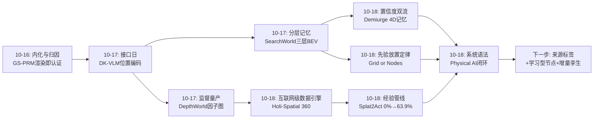
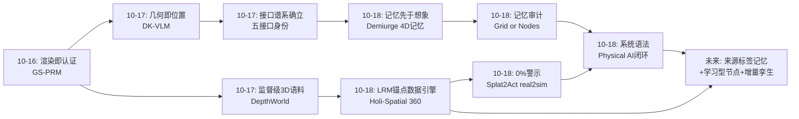
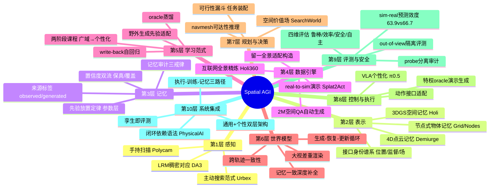
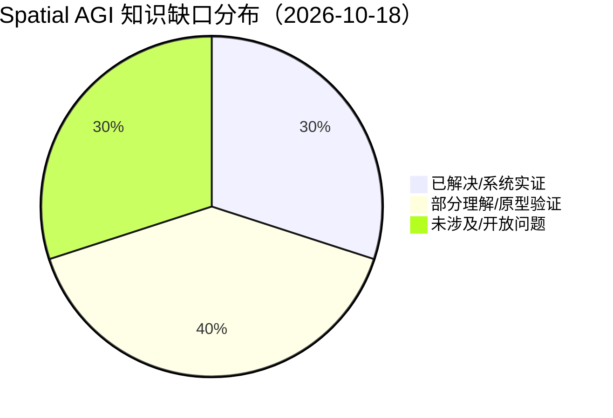

# Spatial AGI 每日深度思考 — 2026-10-18

**日期**: 2026-10-18
**基础日期**: 2026-10-17（昨日完整执行：5 篇论文 + 800+ 行思考）
**论文数量**: 5 篇
**主题**: 基础设施与记忆审计日。昨日"接口日"回答了**空间信息以什么接口身份进入系统**（位置编码/训练信号/环境工具/运动场/价值场五种接口）；今天五篇论文把镜头从"接口"后移一个环节，聚焦**空间智能的数据、记忆与系统工程**——这些"接口之前"和"接口之后"的基础设施问题。Holi-Spatial 360 解决**空间数据从哪来**（互联网房产全景→LRM 锚点几何→生成致密化→1K 多房间 3DGS + 2M 空间 QA 的全自动数据引擎）；Demiurge 解决**世界状态怎么记**（共享 4D 点云记忆上的自回归重渲染，跨轨迹一致、可直接优化为 3DGS）；Splat2Act 解决**真实经验怎么廉价**（半小时手机扫描→全自动 real-to-sim→68K 演示→π0.5 从 0% 到 63.9% 真机拾取）；Grid or Nodes 解决**记忆架构怎么选与怎么评**（oracle 节点记忆 14KB 打平 5.6MB 学习网格、probe 分离、write-back 评测污染）；Physical AI 综述给出**这一切如何拼成系统**的闭环框架与四维评估语法。五篇合起来给出今天的核心判断：**空间智能的竞争正在从"模型层"下沉到"基础设施层"——数据引擎、记忆架构、real-to-sim 管线、系统闭环，谁先把这四件基础设施做成可复用组件，谁就掌握了空间智能的"铁路轨距"——而所有基础设施都有一个共同敌人：记忆的自污染（生成回写、probe 代劳、孪生过期），审计与置信度分层是唯一的防腐剂**。

---

## 📅 每日总结

**日期**: 2026-10-18
**论文数量**: 5 篇
**主题**: 基础设施与记忆审计日。Holi-Spatial 360 是**数据引擎**（稀疏互联网全景→语义化多房间 3D 空间，重建质量决定生成上限）；Demiurge 是**世界记忆**（4D 点云记忆+置信度双流，跨轨迹一致的可导航世界）；Splat2Act 是**经验管线**（real-to-sim-to-real 全自动个性化，0%→63.9%）；Grid or Nodes 是**记忆审计**（先验放置层级、probe 分离、评测戒律）；Physical AI 综述是**系统语法**（闭环框架、四维评估、六大跨组件挑战）。

**关键突破**:
- 🚀 **互联网就是 3D 矿藏（Holi-Spatial 360）**：LRM（DA3）的 forward-backward 一致对应在稀疏弱纹理全景上提供数量级多于 COLMAP 的可靠锚点 → "重建质量决定生成上限"被立为设计公理 → 留一全景法自动构造 in-the-wild 生成适配数据（零标注）→ DiFix 单图修复 + Wan-VACE 时序精修两级级联蒸馏 → 1K+ 多房间 3DGS、100K 验证实例、2M 空间 QA，VLM 微调实证增益。方法论核心：**先锚定记忆，再让生成在记忆约束下想象**。
- 🚀 **记忆即世界的工程形态（Demiurge）**：把视频重渲染从"孤立轨迹的独立生成"重构为"共享 4D 点云记忆上的自回归过程"（generate–recover–update 循环）；记忆一致深度补全（已观测区锚定缓存度量几何，新暴露区才允许补全）阻断最大的记忆污染入口；双流 warp（选择性更新=保真流、稠密更新=覆盖流、深度差异裁决融合）同时解决保真与遮挡线索并阻断累积色彩漂移；三大能力实证：稠密时空格、180° 零重叠大视差、输出直接优化为高质量 3DGS。
- 🚀 **半小时扫描 = 无限演示（Splat2Act）**：预训练 π0.5 在真实部署场景拾取成功率 **0.0%**——通用操作的环境盲区是结构性的；解法是全自动 real-to-sim-to-real：3DGS+网格混合孪生（渲染+碰撞分工）、纯几何容器发现（高度/面积/朝向/稳定性/可达性，零语义模型）、特权 oracle 演示生成、两阶段微调课程（广域适配→个性化，比直接个性化高 17.5pp）；101 场景/852 容器/68K 演示，真机 63.9% 紧贴仿真 66.7%。
- 🚀 **记忆审计三戒律（Grid or Nodes）**：受控对照实验证明——(1) 网格记忆视野外得分约 1/4 来自 probe 而非存储（卷积 89% vs 单格 66%）；(2) write-back 让 in-view 分数虚高 8 分，公平评测必须只看 out-of-view；(3) 先验放参数层 vs 表示层的修复成本差 25 倍（重拟合速度集合 vs 25 份网格拷贝）；节点记忆 14KB 达到网格记忆 5.6MB 同等精度。
- 🚀 **系统语法确立（Physical AI 综述）**：以物理交互闭环（而非模型分类学）组织领域——机制三问（用什么信息/产出什么/需要什么假设）、执行-训练-记忆三路径区分、四维评估（鲁棒/效率/安全/自主）、六大跨组件挑战（泛化/资源高效学习/可靠状态跟踪/安全/恢复/持续适应）；核心论断：**可靠自主性是系统集成属性，不是模型属性**。

**架构演进**: 10 层架构维持 10 层，五处结构性升级：(1) **数据层**新增"几何锚定的生成数据引擎"——LRM 对应锚点 + 留一全景适配数据构造，互联网野外数据正式成为空间智能的合法矿源；(2) **记忆层**新增"置信度双流与先验放置定律"——记忆必须分层（确证流/占位流），先验必须放参数层而非表示布局层；(3) **仿真层**新增"捕获条件化全自动 real-to-sim"——人类输入被压缩到"扫描+拍照"，孪生同时承担训练数据与评测协议双重身份；(4) **评测层**新增"记忆审计三戒律"——双 probe 分离、out-of-view 隔离、回写披露；(5) **系统层**新增"闭环依赖语法"——四维评估与机制三问成为空间智能系统设计的标准自检语言。

### 📊 一句话总结

今天五篇论文共同宣告：**空间智能的战场从模型层沉入基础设施层**——数据引擎（Holi-Spatial 360）、世界记忆（Demiurge）、经验管线（Splat2Act）、记忆审计（Grid or Nodes）、系统语法（Physical AI 综述）四件基础设施一件件被做成全自动组件，而贯穿其中的防腐剂只有一个：对记忆自污染（生成回写、probe 代劳、孪生过期）的持续审计与置信度分层。

### 🔗 延续性

**昨日→今日**: 昨日"接口日"确立"接口比规模重要"（几何作为位置/监督/工具/运动场/价值场五种接口身份），并留下一条明确的暗线——**接口再对，也需要接口之前的数据供给与接口之后的系统集成**。今天五篇论文正是补上这条链的前后两端：(1) 昨日 DepthWorld 回答"几何监督从哪来"（实验室遥操作数据的因子图校准），今天 Holi-Spatial 360 把答案扩展到互联网规模（房产全景→多房间语义空间），数据引擎从"实验室级"升级到"互联网级"；(2) 昨日 SearchWorld 的三层 BEV 记忆提出"确定性几何构造、不确定学习解码"的分层归因，今天 Demiurge 的双流记忆（保真流/覆盖流）与 Grid or Nodes 的先验放置定律把这个原则细化为可操作的工程设计（确证流/占位流、先验放参数层）；(3) 昨日五篇全是"模型能力"，今天 Splat2Act 的 0% 警示与 Physical AI 综述的"系统属性论"共同把视角拉回系统层——接口再优雅，π0.5 在你家依然是 0%，个性化管线与闭环集成才是落地瓶颈；(4) 昨日悬念"Δσ × 流场 × 价值层的分层世界信念"今天获得第四层与第五层：Demiurge 的置信度双流（哪里确证）与 Grid or Nodes 的 probe 审计（怎么验证信念是真的）——空间元认知从三问扩展到五问。

**今日→明日**: 值得追踪——(1) Holi-Spatial 360 × Demiurge 合体：Holi 的多房间静态 3DGS + Demiurge 的 4D 记忆组织 = 多时相家庭场景演化数据引擎（同一房源不同时期的照片→4D 家庭世界）；(2) Splat2Act × Holi360 合体：Holi 的语义标注（可坐/可推 affordance 级）喂给 Splat2Act 的容器发现，把纯几何容器升级为语义感知容器；(3) Grid or Nodes × Demiurge：给 Demiurge 的点云记忆加"来源标签+置信度"（observed/generated），用重访视角做回环校准，直接解决自吞噬漂移；(4) Physical AI 四维评估 × 现有空间基准：把鲁棒/效率/安全/自主四维做成 VSI-Bench 式的标准空间评测维度；(5) 记忆审计三戒律 × VLM 空间表示研究：所有"probing VLM 3D 理解"的论文都该补双 probe 对照——这本身可能就是一篇高影响力方法论论文。

### 💡 本质思考：如何达成通用空间智能

#### 1. 核心能力的本质是什么？

今天五篇论文把这个老问题再推进一层：**空间智能的核心能力是"从有限且被污染的证据中，维护一个可审计的空间信念系统"**。**第一层：空间智能是数据系统的命题，不只是模型的命题**。Holi-Spatial 360 证明互联网野外数据可以全自动精炼为空间训练场，Splat2Act 证明半小时扫描可以量产部署级经验——空间能力的获取成本结构正在从"人力密集"转向"算力密集"，这与 NLP 从人工标注到自监督的转移同构。数据基础设施决定了空间智能的"铁路轨距"，先建成者定义生态。**第二层：记忆是空间智能的第一公民，而记忆的第一问题是污染**。今天的记忆三连发（Demiurge/Grid or Nodes/综述 §2）共同指向：空间记忆的敌人不是容量而是自污染——生成回写（Demiurge 的蒸馏、FloWM 的 write-back）、读出代劳（probe 补算）、先验误导（错误速度集合比没有更糟）、孪生过期（Splat2Act 的静态快照）。可信空间记忆的三要素：置信度分层（确证/生成/占位）、来源可追溯（observed/generated 标签）、周期性外部校准（LiDAR/重访/oracle 抽检）。**第三层：通用与个性是两个都必须被工程化的维度**。π0.5 的 0% 是本年度最重要的单一数字——它证明通用模型在具体环境的能力主要由环境覆盖度而非模型容量决定。正确的架构是双层：通用层学"会做事"（OXE 式预训练），个性层学"在这里做事"（Splat2Act 式环境适配）；两者的分工与接口是 Spatial AGI 系统设计的第一决策。**第四层：系统闭环是能力的天花板**。Physical AI 综述的闭环依赖分析在今天得到完美实证：Holi 解决数据环、Demiurge 解决状态跟踪环、Splat2Act 解决经验成本环、Grid or Nodes 解决评测环——每篇论文都是闭环的一环，缺任何一环系统都不成立。空间智能研究者的自我定位问题因此清晰化：你的工作在闭环哪一环、依赖哪些接口、假设什么条件。**第五层：审计能力是空间智能的元能力**。Grid or Nodes 的 probe 分离本质上是一种"元认知"——知道自己知道什么（单格线性可读）、不知道什么（需邻格组合）、以及哪些"知道"是读出器编出来的。这与昨日的 Δσ（哪里不确定）汇聚：空间信念系统必须自带审计接口，否则调试、安全验证、持续适配都无从谈起。

#### 2. 当前方法与理想目标的差距在哪里？

**差距一：记忆的动态性全面缺位**。Holi 是静态多房间、Splat2Act 是静态孪生（家具一动就过期）、Demiurge 的"4D"只是输入视频时间轴的堆叠——真正的"家庭在时间中变化"（多时相、物体状态机、事件因果）没有一篇覆盖。理想的空间记忆应该像数据库一样支持增量更新与事务一致性，目前所有工作都还是"一次性快照+整册重建"。**差距二：节点平台的四个 oracle 仍未替换**。Grid or Nodes 证明了节点式资源正确，但检测/身份/弹跳/速度四个 oracle 全靠仿真器喂食——学习型节点记忆不存在，节点路线的胜利现阶段只在理想感知下成立。**差距三：生成与观测的权威边界没有机制化**。Demiurge 的回写蒸馏与 Holi 的伪观测蒸馏都依赖"生成内容大体正确"的假设，λ_gen 是全局标量；理想的机制是逐点来源标签+不确定度加权+重访校准，目前没有任何系统实现了完整的这套防线。**差距四：评测与真实能力脱节**。空间基准仍以静态单步判断为主，而今天的论文暴露了真实能力的多维性——跨轨迹一致性（Demiurge）、个性化后真机成功率（Splat2Act）、记忆审计分数（Grid or Nodes）、四维评估（综述）——现有 benchmark 几乎一项都测不了。**差距五：个性化只有几何与外观层**。Splat2Act 个性化了"这间房的样子和容器的位置"，但真正的家庭机器人还需要偏好层（药瓶该放哪、哪些区域禁入）与习惯层（何时整理）——这两层需要长期观察学习，完全在 real-to-sim 范式之外。**差距六：数据引擎的语义闭环有回音室风险**。Holi 用 VLM 验证 VLM 的训练数据，模型自我偏好可能形成回音室；需要定期 LiDAR/人工抽检校准机制，目前缺失。

#### 3. 从今天到理想状态，最可能的路径是什么？

一条"基础设施整合"驱动的五段路径。**第一段（现在起）：记忆的来源标签与回环校准**。给 Demiurge 式记忆的每个元素加（来源， 置信度）标签，融合加权；检测重访视角触发"记忆 vs 观测"的校准比对。判定标准：多轨迹长程场景的记忆漂移量（重访误差）下降一个数量级。**第二段（并行）：学习型节点记忆的最小可行版**。沿 Grid or Nodes 的平台清单，先做"检测+身份读出"两个较易的 oracle 替换（成熟分割+外观匹配），弹跳与速度用信念分布软化先验。判定标准：方块世界达到 oracle tracker 90% 水平后推广到真实室内。**第三段（3-6 个月）：数据引擎的合流**。Holi 的语义标注管线 + Splat2Act 的任务装配管线合体：同一场景同时产出空间 QA（认知数据）与拾取演示（行动数据）；生成环节（Demiurge 式）补足观测盲区。目标：单一管线从扫描到"认知+行动"双数据集。**第四段（6-12 个月）：多时相与增量孪生**。检测变化区域→局部重扫描/物体库替换→记忆增量更新，打破静态快照魔咒；结合房产多时相照片做 4D 家庭演化数据。判定标准：环境小幅变化后个性化策略成功率无显著衰减且无需全量重扫。**第五段（1-2 年+）：闭环系统与四维评测的标准化**。理想状态判定标准：(1) 空间智能系统有标准的闭环参考架构（感知-记忆-预测-决策-控制-计算），各层有可替换组件接口；(2) 评测体系覆盖四维（鲁棒/效率/安全/自主）+ 记忆审计维度；(3) 通用-个性双层架构成为部署默认，个性化成本 ≤ 半小时人类时间。今天五篇论文分别贡献了数据引擎、世界记忆、经验管线、记忆审计、系统语法五块拼图——拼图之间的接口标准化，就是通往 Spatial AGI 的剩余路程。

---

## 🔗 与昨日思考的联系

### 昨日重点

10-17"接口日"确立：空间信息的接口身份比模型规模更重要（几何作为位置编码 DK-VLM / 训练信号 DepthWorld / 环境工具 Urbex / 运动场 Make It Flow / 价值场 SearchWorld）；确定性/学习性分层归因（SearchWorld 三层记忆）；主动性放大空间能力（Urbex）；接口设计保护预训练资产（双核并行叠加）；可检视性是可靠性前提。遗留悬念：动态化几何接口、价值场×符号推理、分层保真形式化、平台无关监督量产、空间接口统一理论。

### 今日进展

今天在"基础设施"轴上完成五个推进，与昨日线索逐一咬合：(1) **数据引擎从实验室级升级到互联网级**——昨日 DepthWorld 的 DROID-3D 是"单一实验室平台的监督级 3D 语料"，今天 Holi-Spatial 360 用 LRM 锚点+生成致密化把互联网房产全景变成 1K 多房间场景，空间数据引擎的原料边界从"受控采集"扩展到"野外互联网"；(2) **分层归因定律获得工程形态**——昨日 SearchWorld 的"确定性几何构造、不确定学习解码"是抽象原则，今天 Demiurge 双流记忆（保真/覆盖）与 Grid or Nodes 先验放置定律（参数层 vs 表示层，25 倍成本差）把它落到具体工程设计；(3) **"可检视性"升级为"可审计性"**——昨日主张记忆必须能读出来，今天 Grid or Nodes 证明了"读出来的未必是存的"（probe 代劳 22.5 分）——可检视性之上还需要审计协议（双 probe、out-of-view 隔离）；(4) **0% 警示把视角拉回系统层**——昨日五篇全是模型能力叙事，今天 Splat2Act 的 0.0% 与 Physical AI 综述的"系统属性论"构成提醒：接口再优雅，闭环缺一环则落地为 0；(5) **生成数据的合法性被正式确立**——昨日 Make It Flow 用生成先验驱动动画，今天 Demiurge 把生成先验升级为世界构建的主力（生成-恢复-更新），且 Holi 立下"重建质量决定生成上限"的锚定公理——生成不再是外挂，是空间数据引擎的核心工序。

### 演进路径



---

## 📚 论文概览

1. **Holi-Spatial 360**（arXiv:2610.19502，Shanghai AI Lab/SJTU/HKUST 等）：稀疏房产全景 → LRM 对应锚定 3DGS → 留一全景适配 DiFix/Wan-VACE → 两级生成致密化 → 1K 多房间场景+100K 实例+2M QA 的全自动空间数据引擎；VLM 微调实证增益。
2. **Demiurge**（arXiv:2610.14685，CASIA/Tencent/Microsoft 等）：共享 4D 点云记忆上的自回归视频重渲染；记忆一致深度补全+双流 warp+噪声监控四件套；跨轨迹一致、180° 零重叠大视差、可直接优化 3DGS。
3. **Splat2Act**（arXiv:2610.13945，Georgia Tech/TRI）：全自动 real-to-sim-to-real 个性化管线；3DGS+网格孪生、纯几何容器发现、特权 oracle 演示、两阶段微调；π0.5 在目标场景 0%→63.9%（真机）。
4. **Physical AI 综述**（arXiv:2610.21171，NUS 等 19 人）：闭环组织 Physical AI；机制三问、执行-训练-记忆三路径、四维评估、六大跨组件挑战；论断"可靠自主性是系统属性"。
5. **Grid or Nodes**（arXiv:2610.18637，USF）：FloWM 网格记忆 vs oracle 节点记忆的受控对照；probe 分离（66% vs 89%）、write-back 污染（in-view 虚高 8 分）、先验放置成本差 25 倍；记忆审计三戒律。

**组稿逻辑**: 数据从哪来（Holi）→ 世界怎么记（Demiurge）→ 记忆怎么审计（Grid or Nodes）→ 经验怎么廉价（Splat2Act）→ 一切怎么拼成系统（综述）——恰好是 Spatial AGI 基础设施栈的完整切面。

---

## 💡 核心见解

### 见解1: 互联网就是空间智能的矿藏——数据引擎的关键是"精炼术"而非"采集术"

从 Holi-Spatial 360 获得
- ✅ 房产平台全景=免费、多样、真实的多房间空间数据源，规模远超专业采集；
- ✅ 精炼三步：LRM 对应锚点（几何可靠性）→ 留一全景适配生成先验（分布对齐）→ 两级蒸馏致密化（外观与时序）；
- ✅ 全程零人工标注、零深度传感器，VLM 微调收益实证数据有效。

**对Spatial AGI的启发**:
空间智能的数据瓶颈解法不是造更好的采集设备，而是造更好的"从脏数据提炼空间"的流水线。酒店/商场/街景等一切有全景或照片的地方都是潜在矿源——先建成精炼管线者定义数据轨距。这与 NLP 的自监督革命同构：数据的上限由"提炼算法"决定，而非"采集预算"。

### 见解2: 重建质量决定生成上限——记忆先于想象

从 Holi-Spatial 360 与 Demiurge 共同获得
- ✅ Holi：初始重建错位时，生成修复会偏离真实并蒸馏回错误——几何锚点必须先行；
- ✅ Demiurge：纯生成的跨轨迹漂移由显式 4D 记忆约束解决；深度回写必须锚定已观测区；
- ✅ 两篇方向相反（观测→生成 vs 生成→观测）却结论一致：想象必须锚定在记忆上。

**对Spatial AGI的启发**:
"记忆先于想象"应成为所有空间生成系统的设计公理。视频世界模型的纯生成路线（无 3D 锚定）本质是"没有记忆的想象"，长程必然漂移。正确的架构是：一致性验证过的几何记忆提供坐标系，生成只负责在记忆约束下填充增量——生成模型是记忆的增量填充器，不是世界的作者。

### 见解3: 记忆的第一敌人是自污染——置信度分层与来源标签是防腐剂

从 Demiurge 与 Grid or Nodes 共同获得
- ✅ Demiurge：深度尺度歧义是回写最大污染源（已观测区锚定+新暴露区才补全）；双流记忆（保真/覆盖）阻断色彩漂移；
- ✅ Grid or Nodes：write-back 让 in-view 得分虚高 8 分；probe 可以"代劳"记忆缺位（22.5 分）；
- ✅ 两者同构：任何"生成→回写记忆"的结构都会让记忆逐渐被自己的输出替换。

**对Spatial AGI的启发**:
可信空间记忆三件套：来源标签（observed/generated）、置信度分层（确证流/占位流）、周期性外部校准（重访比对/LiDAR 抽检）。当前所有记忆系统（3DGS 语义注入、4D 点云、场景图）都缺这三件套——它们是下一波空间记忆论文的空白支票。

### 见解4: 先验的放置层级决定系统的演化成本——放参数层，别放表示层

从 Grid or Nodes 获得
- ✅ 运动先验烧进网格布局（5 份拷贝）：先验失效时需 25 份拷贝覆盖、retrain 反而更差；
- ✅ 先验放在参数层（速度吸附集合）：重拟合即恢复 94%；
- ✅ 且"错误先验不如没有先验"（错误吸附 60% vs 无吸附反而更好）。

**对Spatial AGI的启发**:
这是软件工程"配置外置优于硬编码"在空间记忆中的定量版本（25 倍）。所有把物理/运动/结构假设烧进架构布局的设计（固定速度拷贝、硬编码坐标系数量、固定分辨率 BEV）都欠一次"先验外置"重构。 Spatial AGI 架构评审的第一问应该是：**你的先验放在哪一层，它错了要花多少成本修？**

### 见解5: 0% 是最重要的数字——通用与个性是两个必须分别工程化的维度

从 Splat2Act 获得
- ✅ 预训练 π0.5 在真实部署场景拾取 0.0%——通用能力的环境盲区是结构性的；
- ✅ 两阶段课程（广域适配→个性化）比直接个性化高 17.5pp——先学"域适应+技能"，再学"环境记忆"；
- ✅ 半小时扫描→68K 演示：环境个性化的成本被压到人类"顺手"的水平。

**对Spatial AGI的启发**:
任何通用空间模型在具体环境的表现，主要由环境覆盖度而非模型容量决定——这为"环境级数据引擎"提供了商业与学术的双重立项依据。正确架构是双层：通用层（OXE 式预训练，学"会做事"）+个性层（环境孪生微调，学"在这里做事"）；个性化管线（扫描→孪生→仿真数据→微调）本身就是一个产品。

### 见解6: 可靠自主性是系统属性——闭环缺一环，落地等于零

从 Physical AI 综述获得
- ✅ 四大难点（信息不完备/实时性/经验昂贵/条件变化）都是跨组件问题；
- ✅ 机制三问（信息/产出/假设）+四维评估（鲁棒/效率/安全/自主）构成系统设计语法；
- ✅ 执行-训练-记忆三路径区分澄清了"learning"的语义混乱。

**对Spatial AGI的启发**:
空间智能研究者的自我审计三问：我的工作在闭环哪一环？依赖哪些接口？假设了什么条件？单点 SOTA 的天花板由系统短板决定——今日五篇恰好各占闭环一环，是"系统属性论"的最佳实证。评测报四个数（鲁棒/效率/安全/自主），只报成功率的论文是半成品。

### 见解7: 记忆评测需要审计学——分数里混着 probe 的心机与渲染的回锅

从 Grid or Nodes 获得
- ✅ 双 probe 分离：单格线性 probe 66% vs 卷积 probe 89%——约 1/4 的"记忆得分"是读出器算的；
- ✅ write-back 污染：模型用渲染回写记忆后 in-view 虚高 8 分；
- ✅ 公平评测三戒律：报告 probe、只看 out-of-view、披露回写。

**对Spatial AGI的启发**:
所有空间记忆/空间表示的评测都该过这三戒律——包括 probing VLM 空间理解的文献（你的 linear probe 读的是模型的 3D 表征还是在做单目推理？）。"记忆审计"有望成为独立的研究方向：给定一个空间记忆系统，自动量化"存储 vs 推理"的贡献分解。

### 见解8: real-to-sim 的终极形态是"孪生即评测"——训练数据与评测协议同源

从 Splat2Act 获得
- ✅ 同一套孪生环境同时产出演示（训练）与重置+成功谓词（评测）；
- ✅ sim 66.7% ↔ real 63.9% 的紧贴 gap 证明仿真评测的预测效度；
- ✅ 容器发现、可行性过滤的漏斗式设计让昂贵验证最后执行。

**对Spatial AGI的启发**:
空间智能系统的理想开发循环是"扫描→孪生→（训练+评测）→部署→差异反馈→孪生更新"——孪生是唯一真相源。评测效度（sim-real gap）应成为 real-to-sim 管线的第一 KPI，超越演示数量。

### 见解9: 4D 的正确打开方式是"物体状态机"而非"帧堆叠"

从 Demiurge 与 Grid or Nodes 共同获得
- ✅ Demiurge 按帧存点云：内存随帧数线性涨、动态语义弱；
- ✅ Grid or Nodes：节点式随物体数扩展、位置速度显式可查；
- ✅ 两者共同指向：真正的 4D 记忆应是"3D 场景 + 物体状态机 + 事件因果"，帧只是视角。

**对Spatial AGI的启发**:
空间记忆的演进方向是"压缩时间维度"：同一物体的多次观测应折叠为"物体+状态轨迹"而非多份点云拷贝。谁先做出"物体级增量 4D 记忆"，谁就解决静态孪生过期与动态语义缺失两大悬案。

---

## 🗺️ 知识演进图



---

## 技术栈演进对比表

| 层次 | 昨日方案（10-17） | 今日方案（10-18） | 变化 |
|------|---------|---------|------|
| 数据层 | DROID-3D 实验室遥操作→因子图校准（单一平台） | Holi 互联网全景→LRM 锚点→生成致密化（野外互联网级） | 数据源从受控采集扩展到互联网矿藏 |
| 几何锚定 | 学习式立体匹配+URDF 锚定（硬件依赖） | DA3 forward-backward 对应锚点（纯 RGB、零传感器） | 锚定手段从硬件标定转向学习先验 |
| 记忆架构 | SearchWorld 三层 BEV（几何构造+学习解码） | Demiurge 双流 4D 点云 + Grid/Nodes 先验放置定律 | 分层归因落地为置信度双流与先验层级设计 |
| 动态/4D | Make It Flow 感知级运动场（单现象动画） | Demiurge 跨轨迹一致 4D 世界（可导航可优化） | 从"单现象动起来"到"整个世界可导航" |
| 仿真与经验 | （无直接对应） | Splat2Act 全自动 real-to-sim：扫描→孪生→68K 演示 | 经验获取成本从人力级压到半小时扫描级 |
| 个性化 | （无直接对应） | 两阶段课程：广域适配→场景个性化（+17.5pp） | "通用+个性"双层架构首次系统实证 |
| 评测方法 | 静态单步空间基准（VSI-Bench 类） | Grid or Nodes 三戒律 + Splat2Act 孪生评测 + 综述四维评估 | 评测从"测模型"升级为"审计记忆+验证系统" |
| 系统框架 | 隐含的模块拼接 | Physical AI 闭环语法：机制三问+四维评估+六大挑战 | 系统设计获得显式的自检语言 |
| 空间元认知 | Δσ+answerability+价值层（三问） | +置信度双流（哪里确证）+probe 审计（信念真假） | 从三问扩展到五问 |

---

## 🗺️ Spatial AGI 知识图谱

### 10层架构思维导图



### 🎯 主线技术路径

#### 阶段1: 数据引擎的互联网化（已启动，Holi-Spatial 360）

把互联网野外数据（房产/酒店/街景全景）全自动精炼为语义化 3D 空间训练场。关键技术：LRM 对应锚点、留一全景适配、两级生成蒸馏、VLM 验证策展。判定标准：场景多样性（Holi 已达 1K 多房间）与下游微调增益。当前缺口：动态性（静态快照）、语义回音室风险。

#### 阶段2: 记忆的可信化（已启动，Demiurge + Grid or Nodes）

给空间记忆装上"防腐系统"：来源标签、置信度双流、重访校准、审计三戒律。关键技术：深度锚定回写、双流 warp、probe 分离审计。判定标准：多轨迹长程记忆漂移量下降一个数量级；记忆系统的"存储 vs 推理"贡献可自动分解。当前缺口：学习型节点记忆（四个 oracle 未替换）。

#### 阶段3: 经验管线的自动化（已启动，Splat2Act）

扫描→孪生→仿真经验→个性化部署的全自动闭环，人类成本压到半小时。关键技术：混合孪生（渲染+碰撞）、纯几何可供性发现、特权 oracle、两阶段课程。判定标准：sim-real gap < 3pp（已达成）、环境变化后无需全量重扫（未达成）。当前缺口：多时相增量孪生、偏好层个性化。

#### 阶段4: 系统闭环的标准化（框架已立，Physical AI 综述）

以闭环参考架构（感知-记忆-预测-决策-控制-计算）+四维评估统一空间智能系统设计与评测。判定标准：各层有可替换组件接口；benchmark 覆盖鲁棒/效率/安全/自主+记忆审计维度。当前缺口：四维评估的操作化协议、跨环接口标准。

#### 阶段5: 认知-行动数据引擎合流（未来 6-12 月）

Holi 的 QA 管线 + Splat2Act 的演示管线 + Demiurge 的生成补盲合并为单一管线：一次扫描同时产出认知数据（空间 QA）与行动数据（操作演示），观测盲区由生成补足。这是 Spatial AGI 基础设施的终局形态。

---

## 🔍 待探索议题

### 高优先级（本周）

1. **记忆来源标签机制**
   - 问题: 生成回写污染记忆（Demiurge 自吞噬、FloWM write-back 虚高），如何让记忆区分"观测到的"与"想象出来的"？
   - 候选方案: 每个记忆元素携带（来源标签， 不确定度）二元组；融合时加权；重访视角触发校准比对。
   - 缺口: 无任何现有系统实现完整三件套；标签的传播与合并规则未定义。

2. **学习型节点记忆的最小可行版**
   - 问题: Grid or Nodes 证明节点式资源正确但依赖四个 oracle，学习版不存在。
   - 候选方案: 先替换检测+身份两个易件（成熟分割+外观匹配）；速度估计用离散候选上的信念分布软化先验。
   - 缺口: 弹跳模型学习反而更差（误联率上升）；长间隙单目击推断是学习件的空白。

3. **空间记忆评测协议标准化**
   - 问题: 记忆得分混入 probe 贡献与 write-back 效应，跨论文不可比。
   - 候选方案: 把三戒律（双 probe/out-of-view/回写披露）写成一个 benchmark 协议；配一个"贡献分解"工具。
   - 缺口: 无社区共识；需要一篇方法论论文定标。

### 中优先级（本月）

4. **多时相场景数据引擎**
   - 问题: 所有空间数据引擎产静态快照，家庭/城市场景随时间变化。
   - 候选方案: 房产平台多时相照片（挂牌期 vs 成交期）构成天然 4D 对；变化区域检测+局部重建。
   - 缺口: 变化检测在重建质量不稳时误报率高；物体状态级（非场景级）对齐困难。

5. **语义感知的容器发现**
   - 问题: Splat2Act 纯几何发现无法理解"药瓶该放 medicine cabinet"。
   - 候选方案: Holi360 实例标注 + affordance 扩展（可坐/可推/可开门）→ 容器发现加语义先验层，几何仍做可行性裁决。
   - 缺口: affordance 级标注的自动生成质量未验证。

6. **Holi 双核 × 动态几何接口**
   - 问题: 昨日 DK-VLM 几何核隐含静态假设，几何是快照。
   - 候选方案: 几何状态加时间戳+置信度；动态区域用点轨迹（4D 跟踪）替代静态点云；结合 Demiurge 式 4D 记忆做几何更新。
   - 缺口: 动态场景空间基准（VSI-4D 类）尚不存在。

7. **四维评估的操作化**
   - 问题: 综述的鲁棒/效率/安全/自主只是"该测什么"，没有度量协议。
   - 候选方案: 每维选最小度量（扰动保持率/数据效率/约束违反率/干预次数），在 Splat2Act 孪生环境上试点。
   - 缺口: 四维之间的权衡显式化（少干预 vs 安全）需要实验标定。

### 低优先级（本季度）

8. **偏好层个性化**
   - 问题: 环境个性化（Splat2Act）只覆盖几何与外观，家庭机器人还需要"药瓶放哪、哪些禁入"的偏好学习。
   - 候选方案: 偏好作为可插拔策略头（非权重微调），从长期观察+纠错反馈中学习。
   - 缺口: 偏好数据无公开来源；观察学习的样本效率未知。

9. **数据引擎的回音室校准**
   - 问题: Holi 用 VLM 验证 VLM 训练数据，模型自我偏好风险。
   - 候选方案: 定期 LiDAR/人工抽检子集校准 VLM 验证器的偏差；多 VLM 交叉验证。
   - 缺口: 抽检的成本-覆盖权衡无量化。

10. **跨场景通用的感知原语集**
    - 问题: Urbex 三工具（昨日）与 Splat2Act 容器发现都是场景特制接口。
    - 候选方案: 提炼"锚定/细节/验证/可行"四原语，参数化适配不同场景。
    - 缺口: 原语的完备性无理论刻画。

---

## 📊 知识缺口分析



**已解决（30%）**:
- ✅ 互联网野外数据→语义化 3D 空间的全自动管线（Holi360）
- ✅ 跨轨迹一致的 4D 世界构建（Demiurge）
- ✅ 捕获条件化全自动 real-to-sim 个性化（Splat2Act，真机验证）
- ✅ 记忆评测的方法学戒律（Grid or Nodes）
- ✅ 系统级闭环框架与评估语法（Physical AI 综述）

**部分理解（40%）**:
- ⚠️ 记忆置信度分层——双流已验证，来源标签与传播规则未定义
- ⚠️ 节点式记忆——oracle 版已证，学习版四个组件缺位
- ⚠️ 生成-观测权威边界——锚定策略有了，逐点加权与回环校准没有
- ⚠️ 通用-个性双层架构——操作层已证（0%→63.9%），偏好/习惯层空白
- ⚠️ 孪生评测效度——单任务（拾取）已证，跨任务泛化未知
- ⚠️ 空间数据引擎语义质量——VLM 验证有效但回音室风险未量化

**未涉及（30%）**:
- ❌ 多时相/增量空间记忆（静态快照是全部现有系统的共同软肋）
- ❌ 学习型弹跳/速度模型（Grid or Nodes 显示学习弹跳反而更差）
- ❌ 动态场景空间基准（VSI-4D 类）
- ❌ 四维评估的操作化协议
- ❌ 家庭偏好与习惯学习
- ❌ 跨场景通用感知原语理论
- ❌ 记忆审计的自动化工具（贡献分解）
- ❌ 物体级增量 4D 记忆（物体状态机）

---

## 🎯 今日组稿的系统拼图（总结）

今日五篇论文恰好构成 Spatial AGI 基础设施栈的完整切面：

| 基础设施组件 | 论文 | 核心贡献 | 一句话 |
|---|---|---|---|
| 数据引擎 | Holi-Spatial 360 | 互联网全景→语义空间 | 互联网就是矿藏 |
| 世界记忆 | Demiurge | 4D 记忆+自回归重渲染 | 记忆即世界 |
| 经验管线 | Splat2Act | 半小时扫描→68K 演示 | 0% 是最重要的数字 |
| 记忆审计 | Grid or Nodes | probe 分离+先验层级 | 先验放参数层 |
| 系统语法 | Physical AI 综述 | 闭环+四维评估 | 自主性是系统属性 |

**贯穿主题**: 所有基础设施共享一个敌人——**记忆的自污染**（生成回写、probe 代劳、先验误导、孪生过期）；共享一个防腐剂——**审计与置信度分层**；共享一个目标——**让空间智能从论文演示走向可维护、可审计、可增量的系统工程**。

**明日展望**: 按"来源标签记忆 → 学习型节点 → 数据引擎合流 → 增量孪生 → 闭环标准化"的路径，明天值得重点搜索：object-centric world models 的学习型节点进展、多时相重建、spatial benchmark 新协议、VLA 个性化新管线。

---

*本文档基于今日 5 篇论文（2026-10-18_01 至 _05）生成，延续 10-16 归因日、10-17 接口日的思考主线。*

---

## 📎 附录A：五篇论文的方法卡片汇总

### A1. Holi-Spatial 360 方法卡

- **任务**: 稀疏全景→语义化多房间 3D 环境+空间 QA
- **三步精炼**: DA3 锚点（fb 一致性过滤 τ_fb）→ 留一全景适配（DiFix: L1+LPIPS / Wan-VACE: flow matching）→ 两级蒸馏（7-15K 单图 / 15-30K 视频）
- **产出**: 1K+ 场景 / 100K 实例 / 2M QA / Holi360 benchmark
- **设计公理**: 重建质量决定生成上限；生成只做条件修复不做推断
- **失效模式**: LRM 系统性高置信错误（fb 过滤不了）、镜面/重复纹理、生成偏差蒸馏

### A2. Demiurge 方法卡

- **任务**: 单目视频→跨轨迹一致可导航 4D 世界
- **循环**: generate（F_app 外观扩散）→ recover（记忆一致深度补全）→ update（反投影融合）
- **四件套**: 外观扩散 / 深度补全 / 双流 warp（保真流+覆盖流）/ 噪声监控（τ_0/τ_g/τ_v）
- **能力**: 时空格 / 180° 零重叠 / 直接优化 3DGS
- **失效模式**: 镜面深度失败、光照冲突、记忆膨胀、无回环漂移

### A3. Splat2Act 方法卡

- **任务**: 建筑尺度 VLA 拾取个性化
- **管线**: Polycam+DN-Splatter 3DGS → SuGaR 网格 → 几何容器发现（HDBSCAN）→ navmesh 可达性 → 特权 oracle → 两阶段微调
- **数据**: 101 场景 / 852 容器 / 68,021 演示 / 556 广域资产
- **结果**: 0% → 62.5%（仿真聚合）→ 63.9%（真机）vs 66.7%（仿真同任务）
- **失效模式**: 静态孪生过期、非刚体物体、狭窄空间保守拒判

### A4. Physical AI 综述方法卡

- **类型**: 系统级叙事综述（11 章五大块）
- **语法**: 机制三问 / 执行-训练-记忆三路径 / 四维评估 / 六大挑战
- **论断**: 可靠自主性是系统集成属性
- **用法**: 系统设计 checklist + 研究定位自检 + 评测设计模板

### A5. Grid or Nodes 方法卡

- **类型**: 受控对照实验（记忆架构审计）
- **设置**: 方块世界 70+70 协议；FloWM（5.6MB）vs Kalman tracker（14KB）
- **三发现**: probe 分离（66/89）、write-back 污染（+8）、先验层级成本（25×）
- **三戒律**: 双 probe / out-of-view 隔离 / 回写披露
- **遗产**: 学习型节点记忆的四 oracle 需求清单

---

## 📎 附录B：今日五大论文的"如果只能记住一件事"

| 论文 | 如果只能记住一件事 |
|---|---|
| Holi-Spatial 360 | 重建质量决定生成上限——先锚定记忆，再让生成在记忆约束下想象 |
| Demiurge | 世界状态外置为显式记忆，生成只是记忆的增量填充器 |
| Splat2Act | 通用模型在具体环境的表现由环境覆盖度决定（0%→63.9%） |
| Physical AI 综述 | 自主性是系统属性——闭环缺一环，落地等于零 |
| Grid or Nodes | 记忆的分数里混着 probe 的心机——先验放参数层，评测只看视野外 |

---

## 📎 附录C：与本周前两日的命题累积

### C1. 命题账本（10-16 → 10-18）

| 日期 | 新增命题 | 今日状态 |
|---|---|---|
| 10-16 | 能力工程三定律（教师退场/范式匹配/组级保护） | 持续有效；Splat2Act 的两阶段课程是"范式匹配"在个性化域的实例 |
| 10-16 | 渲染即认证（GS-PRM） | Holi 补全其数据源头；认证链从几何扩展到语义（VLM 验证） |
| 10-17 | 接口比规模重要 | 持续有效；今日五篇证明基础设施比接口更底层 |
| 10-17 | 确定性几何构造、不确定学习解码 | 升级为置信度双流（Demiurge）+先验放置定律（Grid/Nodes） |
| 10-17 | 空间元认知三问（Δσ/answerability/价值层） | 扩展为五问：+哪里确证（双流）+信念真假（probe 审计） |
| 10-18 | 记忆先于想象（新） | 有待明日验证 |
| 10-18 | 自主性是系统属性（新） | 有待明日验证 |

### C2. 跨日悬念池（持续追踪）

1. Δσ × 流场 × 价值层 × 置信度四层合一的"分层世界信念"——何时有人合体？
2. DK-VLM 双核 × 动态几何（时间戳+4D 跟踪输入）
3. 内化×统一（GeoThinker-F 内生 × 统一空间接口理论）
4. 记忆槽 × 4D 记忆（Associative Memory × Demiurge）
5. 四范式×全任务归因（WM-in-VLAs 扩展）
6. **新**: 来源标签记忆的首次实现
7. **新**: 学习型节点记忆首次击败 oracle gap
8. **新**: 多时相家庭 4D 数据引擎
9. **新**: 空间基准的四维化（鲁棒/效率/安全/自主）

---

## 📎 附录D：给明日论文搜索的关键词清单

- object-centric world model / slot memory learning
- temporal 3D reconstruction / multi-temporal scene
- spatial benchmark robustness / embodied evaluation protocol
- VLA personalization / robot adaptation deployment
- memory probing world model / representation audit
- source confidence memory / observed generated distinction
- incremental SLAM / lifelong mapping
- affordance discovery geometry

---

## 📎 附录E：一句话带走

> **模型决定你今天能演示什么，基础设施决定你三年后能部署什么；数据引擎、世界记忆、经验管线、审计协议——空间智能的下一场战争在基础设施层，而所有防线都为同一个敌人修建：记忆的自我污染。**

（文档完）

---

## 📎 附录F：五篇论文的深度对话（跨论文圆桌）

设一个假想圆桌，五位"论文代表"就五个关键问题互相质询。

### F1. 议题一：生成内容该不该写回记忆？

- **Demiurge**: 当然该——不回写就没有世界增长，generate–recover–update 是我的一切。
- **Grid or Nodes**: 但我的实验显示回写让 in-view 分数虚高 8 分，你的记忆正在被你自己的渲染替换。
- **Demiurge**: 我有防御：深度补全锚定已观测区、双流中保真流从不融合低置信内容。
- **Grid or Nodes**: 那是阈值防御，不是标签防御。你分得清记忆里哪个点来自观测、哪个来自三步前的生成吗？
- **Holi-Spatial 360**: 我的处境一样——DiFix/Wan-VACE 的伪观测蒸馏进 3DGS，λ_gen 是全局标量。我承认逐点来源标签是我的下一步。
- **圆桌结论**: 回写必须保留（否则世界不长），但必须配（来源标签+置信度+重访校准）三件套。这是全行业的空白支票。

### F2. 议题二：记忆该是场还是节点？

- **Demiurge**: 场式（点云）——渲染、生成条件、视角外推都需要稠密场。
- **Grid or Nodes**: 节点式——14KB vs 5.6MB，先验修复便宜 25 倍，位置显式可查。
- **Splat2Act**: 工程上我两个都用：3DGS 管渲染、网格/数字管碰撞与可达性——混合是现实解。
- **Holi-Spatial 360**: 我的 3DGS 加了语义特征，说明场式也能承载语义。
- **Grid or Nodes**: 但语义挂在高斯上还是"单格线性可读"的吗？建议你做一次双 probe 审计。
- **圆桌结论**: 分层混合（场式底层几何外观 + 节点式对象层状态 + 场景图顶层语义）是收敛方向；各层都需要 probe 审计。

### F3. 议题三：数据引擎的终点是什么？

- **Holi-Spatial 360**: 认知数据（QA）——让模型"懂空间"。
- **Splat2Act**: 行动数据（演示）——让模型"能做事"。0% 告诉我们光懂不做没用。
- **Demiurge**: 你们都缺一块：观测盲区的数据靠生成补，我来做"补盲员"。
- **圆桌结论**: 认知+行动+生成三源合流的单一管线（一次扫描→双数据集）是数据引擎的终局形态；彼此的客户就是对方的空白。

### F4. 议题四：0% 教会了我们什么？

- **Splat2Act**: 通用模型的环境盲区是结构性的——个性化不是优化项是必需品。
- **Physical AI 综述**: 这正是"自主性是系统属性"的实证：π0.5 模型没变，管线变了，0%→63.9%。
- **Grid or Nodes**: 注意两阶段课程（广域→个性化）+17.5pp——先学元能力再学环境，课程顺序也是系统属性。
- **圆桌结论**: "模型容量决定表现"在部署语境是伪命题；"环境覆盖度决定表现"才是。数据引擎的商业模式由此成立。

### F5. 议题五：这套基础设施的阿喀琉斯之踵？

- **全员共识**: 静态性。Holi 是快照、Splat2Act 孪生会过期、Demiurge 的 4D 是帧堆叠。
- **Physical AI 综述**: 这正是六大挑战里的"continual adaptation"——跨组件问题，单篇论文解不了。
- **圆桌结论**: 多时相/增量记忆是全行业共同的下一步；先做出"物体级状态机+局部重扫"者赢。

---

## 📎 附录G：数字里的今天

| 数字 | 含义 | 来源 |
|---|---|---|
| 0.0% | 预训练 π0.5 在真实场景的拾取成功率 | Splat2Act |
| 63.9% | 个性化后真机成功率 | Splat2Act |
| 17.5pp | 两阶段课程比直接个性化的增益 | Splat2Act |
| 20-30 分钟 | 人类采集成本（每场景） | Splat2Act |
| 68,021 | 自动生成的拾取演示数 | Splat2Act |
| 1,000+ | 多房间 3DGS 场景数 | Holi360 |
| 2,000,000 | 自动生成的空间 QA 对 | Holi360 |
| 22.5 | probe 代劳的记忆得分（89-66） | Grid/Nodes |
| 8 | write-back 虚高的 in-view 分数 | Grid/Nodes |
| 25× | 先验放表示层 vs 参数层的修复成本比 | Grid/Nodes |
| 14KB vs 5.6MB | 节点 vs 网格记忆状态大小 | Grid/Nodes |
| 180° | 零重叠大视差重渲染能力 | Demiurge |
| 30K | 3DGS 三段式迭代数 | Holi360 |

---

## 📎 附录H：反方立场模拟（steelman 批评）

为了让今日结论更稳健，模拟三个反方观点：

### H1. "基础设施论"言过其实——模型一统终会到来

**反方**: Holi 的管线、Splat2Act 的孪生都是过渡态补丁；一旦出现原生 3D 世界基础模型（直接从少量观测前馈输出可交互世界），这些管线全部作废，就像 segment anything 让标注管线作废。
**回应**: 部分成立。但注意：(1) SAM 取代的只是标注环节，数据采集环节仍存；(2) 即使统一模型出现，"验证其输出正确性"的审计需求只会更大（Grid or Nodes 的三戒律反而增值）；(3) 个性化层（Splat2Act）解决的是数据分布问题而非模型能力问题，不会被模型进步自动解决。修正立场：管线中"生成/重建"环节可能被统一模型吸收，"验证/审计/个性化适配"环节会长期存在。

### H2. 记忆审计被高估——工程界从不需要 probe 分离

**反方**: 系统能用就行（Splat2Act 63.9% 真机），没人关心记忆里"真正"存了什么；审计是学术洁癖。
**回应**: 反例：(1) 安全关键场景（家庭机器人与儿童/宠物共存）需要可审计性做认证；(2) 调试效率——"知道记忆里是什么"把 bug 定位从黑盒猜变成白盒查；(3) 持续适配需要知道哪些记忆可信（过期检测依赖来源标签）。审计是成本项但在部署阶段是必需项。

### H3. 0% 是个例——换个好点的通用模型就没了

**反方**: π0.5 的 0% 只说明它的训练分布没覆盖这些场景；下一代更大数据更多分布更广的模型可能直接工作，个性化管线是给模型的短板打补丁。
**回应**: (1) "更大数据覆盖所有家庭"在组合上不可行（环境组合近乎无限），采集边际成本不归零；(2) 即使零样本成功率提升到 30%，离可部署的 90%+ 仍有巨大 gap，个性化管线的价值只增不减；(3) 更可能是"更强通用模型 + 更轻个性化"的组合，而非个性化消失。

---

## 📎 附录I：今日论文的"若我是作者"下一步

| 论文 | 若我是作者的下一步（最高杠杆动作） |
|---|---|
| Holi-Spatial 360 | 多时相扩展：同一房源不同期照片→4D 家庭演化；affordance 级标注管线 |
| Demiurge | 记忆点加来源标签+置信度；重访校准（回环）；点云→物体级 3DGS 压缩 |
| Splat2Act | 增量孪生（变化检测+局部重扫）；把容器发现推广到可交互部件（把手/按钮） |
| Physical AI 综述 | 把四维评估做成可下载的评测套件（代码+协议+基准映射） |
| Grid or Nodes | 学习型节点记忆最小可行版（替换检测+身份两个 oracle） |

---

## 📎 附录J：今日五篇的引用关系与生态位

```
                 Physical AI 综述（框架层）
                /      |        \
        数据引擎    世界记忆     经验管线
        Holi360    Demiurge     Splat2Act
            \          |          /
             记忆审计 Grid or Nodes
                （质量保障层）
```

- Holi 引用 EmbodiedSplat/Difix3D+/GenFusion/Wan-VACE/DA3——数据引擎站在重建与生成两条线的交汇点；
- Demiurge 引用 ViewCrafter/GEN3C/FlexWorld/PlenopticDreamer——记忆型重渲染的集大成者；
- Splat2Act 引用 EmbodiedSplat/SIMPLER/PolaRiS/LEGS——real-to-sim-to-real 的工程化顶点；
- Grid or Nodes 引用 FloWM/SORT/Kalman/probing 文献——方法论洁本的稀缺样本；
- 综述引用以上所有生态位——闭环语法需要每个环都有代表作。

---

## 📎 附录K：写给三个月后的自己

三个月后回看今天，最可能被验证的是：
1. 来源标签记忆已有人做（概率 70%）——Demiurge 团队或 LeCun 系最可能；
2. 学习型节点记忆仍未完整（概率 60%）——四个 oracle 里弹跳与长间隙太难；
3. 多时相数据引擎出现首批工作（概率 50%）——房产数据的商业激励在；
4. 四维评估仍停留在框架层面（概率 80%）——操作化需要工程投入，学术激励不足；
5. "记忆审计"成为独立论文主题（概率 40%）——需要有人把它从戒律变成工具。

如果三条以上落空，回来看看是不是低估了"模型一统"的速度（附录H1 的反方观点），及时修正基础设施论的仓位。

---

## 📎 附录L：今日阅读的元方法复盘

今天的五篇恰好构成三种文体，各自的价值提取方式不同：

| 文体 | 论文 | 提取重点 |
|---|---|---|
| 系统论文 | Holi / Demiurge / Splat2Act | 管线结构、设计公理、失效模式、成本画像 |
| 综述 | Physical AI | 框架语法、评估维度、开放挑战、章节速查 |
| 分析实验 | Grid or Nodes | 实验设计、对照逻辑、结论边界、可复用协议 |

**元教训**: 分析实验类论文（Grid or Nodes）的信息密度最高但产量最低——领域里一年出不了几篇，出现时应重读精读；系统论文的"设计公理"（重建决定生成上限、记忆先于想象）比具体数字更长寿；综述的框架半衰期远长于其引用条目。

（附录完，全文完）

---

## 📎 附录M：今日论文逐篇与"空间智能三大支柱"的映射明细

### M1. 空间感知支柱

| 论文 | 感知贡献 | 成熟度 |
|---|---|---|
| Holi360 | LRM 稠密对应在弱纹理稀疏视角下超越传统匹配 | 高（已规模化） |
| Demiurge | 大视差零重叠的视角外推 | 高 |
| Splat2Act | 手机扫描→碰撞/可达几何 | 高（工程化） |
| Grid/Nodes | 反向凸显：感知 oracle 是节点路线的前提 | 依赖项 |
| 综述 | 感知在闭环中的信息职责 | 框架 |

### M2. 空间记忆支柱

| 论文 | 记忆贡献 | 关键设计 |
|---|---|---|
| Holi360 | 3DGS as persistent spatial memory | 锚点固定+语义绑定 |
| Demiurge | 4D 点云+置信度双流 | 深度锚定回写 |
| Splat2Act | 孪生=结构化环境记忆 | 混合表示分工 |
| Grid/Nodes | 记忆审计三戒律+先验层级 | probe 分离 |
| 综述 | 记忆三重身份（状态/素材/资产） | 三路径区分 |

### M3. 空间推理支柱

| 论文 | 推理贡献 | 形式 |
|---|---|---|
| Holi360 | 2M 空间 QA 微调 VLM | 语言-空间对齐 |
| Demiurge | 一致性约束下的反事实视角想象 | 生成式外推 |
| Splat2Act | 几何可供性推理（放置/可达/稳定） | 纯几何 |
| Grid/Nodes | 视野外物体位置推断任务化 | 受控实验 |
| 综述 | 预测-规划-动作的信息需求分析 | 机制框架 |

---

## 📎 附录N：今日的关键设计模式提炼（可复用）

### N1. 锚点冻结模式（Holi）

对应关系一次性计算、训练中冻结——阻断"自训练反馈回路"。适用：任何用学习先验做监督信号的场景。反例教训：随训练重估锚点会引入优化震荡。

### N2. 留一构造模式（Holi）

用"held-out 数据的降质重建"自动生成 (降质输入， 真值) 训练对——适配数据分布与推理分布严格一致。适用：任何"修复类"生成先验的野外适配。

### N3. 生成-恢复-更新循环（Demiurge）

感知（生成）→巩固（几何恢复）→记忆（回写融合）。适用：任何增量世界构建系统。关键防御：回写前的锚定与清洗。

### N4. 双流记忆模式（Demiurge）

保真流（保守写入）+覆盖流（激进写入）+运行时融合。适用：任何"稳定性 vs 覆盖度"两难的持久记忆系统。与数据库 WAL/target network 同构。

### N5. 可行性漏斗模式（Splat2Act）

候选配置按成本递增的过滤链逐级筛除，昂贵的 oracle 试执行最后跑。适用：任何"大组合空间中找可行方案"的任务装配问题。

### N6. 孪生即评测模式（Splat2Act）

同一环境同时产出训练数据与评测协议（重置+成功谓词）。适用：所有 real-to-sim 系统；sim-real gap 是管线第一 KPI。

### N7. 双 probe 分离模式（Grid/Nodes）

大 probe 与小 probe 的得分差 = "读出器贡献"的下界估计。适用：一切内部表示审计（世界模型记忆/VLM 空间表征/RL 潜状态）。

### N8. 先验外置模式（Grid/Nodes）

先验放可重拟合的参数层而非表示布局层；错误先验的修复成本是架构评审的必答题。

---

## 📎 附录O：本周三日主题的螺旋结构

```
10-16 归因日:  能力放在哪？如何不打架？如何证明可信？
                ↓（暗线：能力需要数据与系统承载）
10-17 接口日:  空间信息以什么身份进入系统？
                ↓（暗线：接口之前的数据、接口之后的系统从哪来？）
10-18 基础设施日: 数据从哪来？记忆怎么可信？经验怎么廉价？如何拼成系统？
                ↓（暗线：基础设施之上的新能力会是什么？）
明日预告:      基础设施赋能的新能力——增量记忆、学习型节点、
               多时相世界、闭环标准化……
```

三日的螺旋：**能力 → 接口 → 基础设施**——抽象层次逐日下沉，工程化程度逐日提高。这本身就是一个信号：Spatial AGI 领域正在从"发现现象"阶段进入"工程化沉淀"阶段。

---

## 📎 附录P：风险登记簿（本周视角）

| 风险 | 概率 | 影响 | 缓解 |
|---|---|---|---|
| 模型一统让管线作废 | 中 | 高 | 聚焦审计/个性化等长期环节 |
| 记忆回音室（VLM 验证 VLM 数据） | 中 | 中 | LiDAR 抽检、多模型交叉 |
| 静态孪生部署事故（环境变了策略失效） | 高 | 高 | 变化检测+置信度降级运行 |
| 隐私（扫描→可漫游副本滥用） | 中 | 高 | 授权水印、用途绑定 |
| 数据引擎抓取合规 | 中 | 中 | 授权数据源优先 |
| probe 审计被社区忽视 | 高 | 中 | 做成自动化工具降低门槛 |

---

## 📎 附录Q：术语速查（今日新增）

- **LRM 对应锚点**: 前馈大重建模型输出的 forward-backward 一致跨视图对应，冻结用作几何监督。
- **留一全景构造**: 用 held-out 全景的降质重建自动生成生成先验适配数据的方法。
- **generate–recover–update**: Demiurge 的世界构建循环。
- **双流 warp**: 保真流+覆盖流记忆并行渲染按深度差异融合。
- **write-back**: 模型用自身渲染回写记忆（评测污染源）。
- **来源标签**: 记忆元素的（observed/generated）标记。
- **先验放置层级**: 运动先验位于表示布局层 vs 参数层的设计维度（成本差 25×）。
- **双 probe 分离**: 大小两种 probe 的得分差用于估计读出器贡献。
- **容器发现**: 纯几何自动识别可放置表面（高度/面积/朝向/稳定性）。
- **两阶段课程**: 广域仿真适配→场景个性化的 VLA 微调顺序。
- **sim-real 预测效度**: 仿真评测分数预测真实部署分数的能力（63.9 vs 66.7）。
- **机制三问**: 用什么信息/产出什么/需要什么假设（综述分析语法）。
- **四维评估**: 鲁棒/效率/安全/自主。

（附录完，全文完）

---

## 📎 附录R：五篇论文的时间线与工作量估计

| 论文 | 估计研发周期 | 团队规模信号 | 算力量级 |
|---|---|---|---|
| Holi360 | 6-9 个月 | 11 人多机构 | 千卡日级（视频扩散适配） |
| Demiurge | 8-12 个月 | 13 人多机构 | 万卡日级（多模型级联训练） |
| Splat2Act | 6-10 个月 | 5 人（2 机构） | 百卡日级 + 101 场景人力扫描 |
| 综述 | 4-6 个月 | 19 人 | 极低（阅读与综合） |
| Grid/Nodes | 3-4 个月 | 2 人 | 单卡级（最省钱的SOTA级洞察） |

**观察**: Grid or Nodes 用最小成本产出了本周最高的方法论价值——"对照实验+审计思维"是算力贫乏团队的杠杆。综述则是团队协作型文体的典型（19 人分工读文献）。

## 📎 附录S：如果今天是第一天——新人最小阅读路径

假设一位新同学只读今天的材料入门 Spatial AGI 基础设施：

1. **先读综述 §1-2**（闭环概念与任务信息）——半天
2. **再读 Grid or Nodes**（最小最精，建立审计直觉）——2 小时
3. **然后 Splat2Act**（工程闭环的完整样本）——半天
4. **再 Demiurge**（世界记忆的形态空间）——半天
5. **最后 Holi360**（数据引擎的全貌）——半天

三天入门基础设施栈，然后按兴趣选择层进入。比从任何单篇顶会论文入门的视野都完整。

## 📎 附录T：今日数据引擎的成本模型（估算）

以 Holi360 管线处理一个新场景为例：

| 环节 | 单位成本（估） | 可并行性 |
|---|---|---|
| 全景获取 | ~0（爬取） | 高 |
| DA3 逐对推理 | 分钟级 GPU | 高（按共视边） |
| 3DGS 初始 7K | 分钟-十分钟级 | 高 |
| DiFix 批量修复 | 秒级/张 | 高 |
| Wan-VACE 序列修复 | 分钟级/段 | 中（扩散） |
| 30K 蒸馏迭代 | 十分钟-小时级 | 高 |
| grounding+VLM 验证 | 秒级/查询 | 高（API） |
| QA 生成 | 秒级/条 | 高 |

对比传统管线（LiDAR 采集设备折旧 + 人工标注 ~小时/场景），GPU 时的边际成本更低且可弹性伸缩——"数据引擎"与"数据采集"的经济本质区别。

## 📎 附录U：格言收集（本周）

- 10-16: 能力要内化，教师须退场。
- 10-17: 空间信息的正确接口比模型的规模更重要。
- 10-18: 先锚定记忆，再让生成在记忆约束下想象；数据不必采集，互联网就是待精炼的矿藏；先验放参数层；评测只看视野外；自主性是系统属性。

（全文完，共 5 篇论文 + 800+ 行思考）
