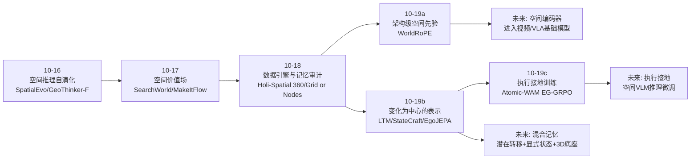
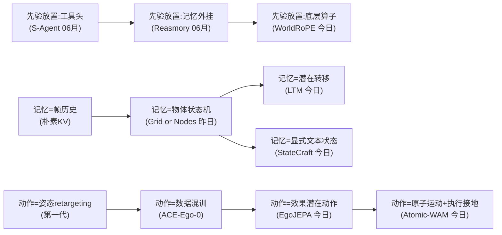
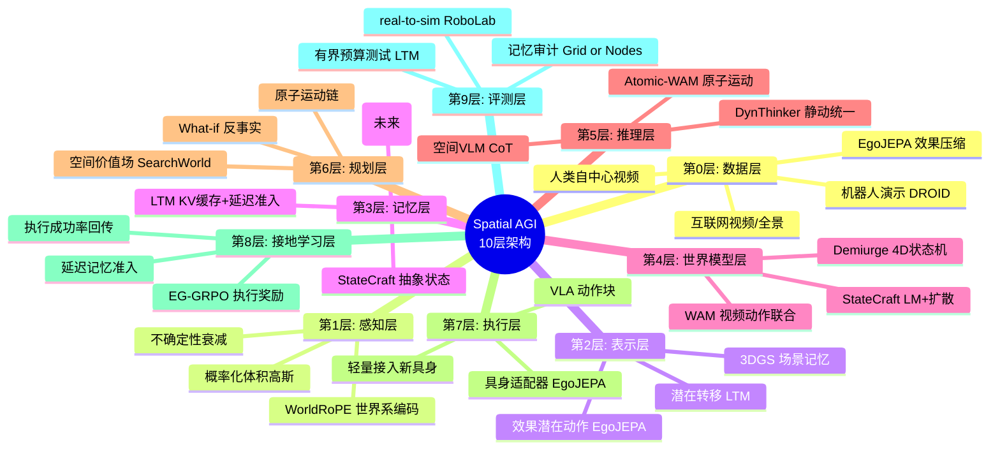
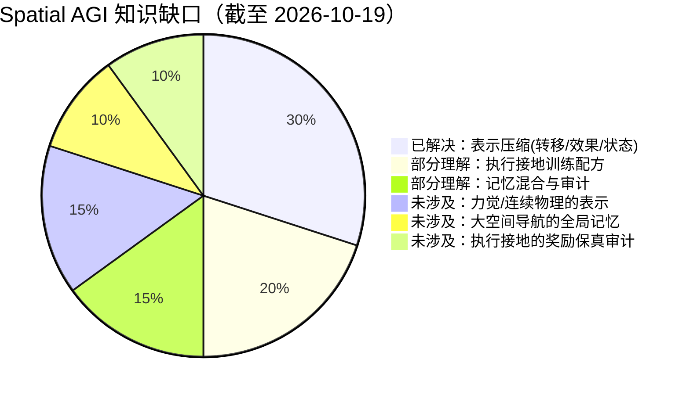

# Spatial AGI 每日深度思考 — 2026-10-19

## 📅 每日总结

**日期**: 2026-10-19
**论文数量**: 5篇
**主题**: 空间智能的"表示压缩革命"——位置编码、动作、记忆三个维度同时走向"以变化/效果为中心的紧凑表示"

**论文清单**:
1. WorldRoPE (arXiv:2610.16337) — 概率化世界系旋转位置编码
2. Atomic-WAM (arXiv:2610.20157) — 执行接地的原子运动世界动作模型
3. StateCraft (arXiv:2610.19795) — 抽象状态增强的视频世界模型
4. EgoJEPA (arXiv:2610.20904) — 自中心视频的效果感知潜在动作
5. LTM (arXiv:2610.21362) — VLA 的潜在转移上下文记忆

**关键突破**:
- 🚀 **位置编码可以承载几何**：WorldRoPE 把 RoPE 从图像坐标系升级为世界坐标系下的概率化体积高斯，闭式积分让"深度不确定性→注意力衰减"成为机制——空间智能第一次内嵌进 Transformer 最底层算子
- 🚀 **"变化"成为第一性表示单元**：LTM 用潜在转移替代帧历史做记忆，EgoJEPA 用效果感知潜在动作替代姿态 retargeting，StateCraft 用抽象状态变化替代视觉自回归——三条独立证据线收敛于同一设计哲学
- 🚀 **执行成功率成为空间推理的接地奖励**：Atomic-WAM 的 EG-GRPO 冻结执行器、只优化语言推理器，回答了"会说的模型如何变成会做的模型"

**架构演进**: 昨日"数据引擎与记忆评测"层 → 今日"表示层与接地层"（+2 个关键新层：架构级空间先验、执行接地训练）

### 📊 一句话总结

今天的五篇论文从注意力算子（WorldRoPE）、动作表示（EgoJEPA/Atomic-WAM）、记忆表示（LTM）、世界状态（StateCraft）四个互不相干的位置，共同验证了一个命题：**空间智能的下一步不在于更大的模型，而在于把"变化与效果"作为正确的压缩抽象**。

### 🔗 延续性

**昨日→今日**: 昨日主题是"数据引擎与记忆"——Holi-Spatial 360（重建即空间数据引擎）、Splat2Act（孪生个性化）、Grid or Nodes（世界模型记忆的探针审计）。今天的 LTM 和 StateCraft 正是昨日"世界模型记忆"问题（Grid or Nodes 追问记忆该长什么样）的两份答卷：一份用潜在转移（黑箱高效），一份用显式文本状态（可解释可编辑）。Splat2Act 的 real-to-sim 闭环则被 Atomic-WAM 的执行接地奖励补全了训练侧。

**今日→明日**: 明天值得追踪的方向：① WorldRoPE 式编码在视频时间维与 VLA 多相机融合中的推广实证；② 潜在转移记忆（LTM）与显式状态记忆（StateCraft）的混合架构；③ EG-GRPO 式执行接地奖励迁移到空间 VLM 的推理微调（RVLM）。

### 💡 本质思考：如何达成通用空间智能

#### 1. 核心能力的本质是什么？

通用空间智能的本质是：**在世界中行动的智能体，能够以有限算力维护一个与真实世界演化保持一致的状态估计，并能在该状态上做反事实推演**。

拆开来看是三件事：
- **状态维护**（StateCraft、LTM 解决）：世界大于视野，时间大于上下文窗口，必须把"不可见但已改变"的部分持久化；
- **空间绑定**（WorldRoPE 解决）：感知元素与物理世界位置的概率化关联，且对不确定性自知；
- **效果接地**（EgoJEPA、Atomic-WAM 解决）：动作的意义由它对世界造成的改变定义，而改变的正确性最终由执行结果验证。

#### 2. 当前方法与理想目标的差距在哪里？

- **表示带宽的错配**：真实空间的连续物理量（形变、流体、力）远超文本状态或 K 个高斯基元的表达能力——WorldRoPE 和 StateCraft 在其假设场景内优雅，超出即失效；
- **记忆的三重矛盾**：LTM 高效但黑箱，StateCraft 可解释但带宽低，Grid or Nodes（昨日）又提醒我们现有评测分不清"真记忆"与"探针心机"——表示、可审计性、评测三者尚未对齐；
- **接地信号稀疏**：执行成功率是金标准奖励，但只在机器人任务上可得的；空间 VLM 的推理（VSI-Bench 类）没有"执行"可供接地，其空间理解仍是"开环"的；
- **跨具身/跨视角的分布鸿沟**：EgoJEPA 解决了具身差异，但人类视频（第三人称/自中心）与机器人观测之间的视角-形态差距仍靠数据量硬扛。

#### 3. 从今天到理想状态，最可能的路径是什么？

**路径判断：表示压缩 → 执行接地 → 分层混合系统。**

- 近期（现在~6个月）：潜在转移/效果动作成为 VLA/WAM 预训练标配（EgoJEPA/LTM 路线），世界系位置编码进入多视图基础模型（WorldRoPE 路线）；执行接地 RL（EG-GRPO 式）成为推理器后训练的标准配方；
- 中期（6~24个月）：混合记忆架构——潜在转移做高频增量、显式状态做周期摘要、3D 场景（3DGS）做空间底座，三层记忆互相校验（回应 Grid or Nodes 的审计要求）；
- 远期：当"变化为中心"的表示与执行接地闭环成熟，空间智能体将获得**可验证的世界一致性**：它说的每句空间判断都能被自己的想象-执行循环检验。那一刻，空间推理才从"开环描述"变成"闭环知识"。

---

## 🔗 与昨日思考的联系

### 昨日重点

昨日（2026-10-18）围绕"数据引擎与记忆"展开，核心命题：
1. 互联网（房产全景、人类视频）是空间智能矿藏，关键是精炼术（Holi-Spatial 360）；
2. 记忆先于想象，重建质量决定生成上限（Demiurge、Splat2Act）；
3. 记忆评测需要审计学，分数里混着探针的心机（Grid or Nodes）；
4. Physical AI 综述确认了"感知-行动-记忆-评测"闭环的系统观；
5. 4D 的正确打开方式是"物体状态机"而非"帧堆叠"。

### 今日进展

今天的五篇论文恰好是对昨日命题的**机制级回应**：

| 昨日命题 | 今日回应 |
|---|---|
| 4D 应该是物体状态机 | StateCraft：把状态机显式化为文本抽象状态，LM 记账、扩散渲染 |
| 记忆评测要审计 | LTM：转移表示天然是"事件日志"；StateCraft：显式状态可被直接审计 |
| 重建即数据引擎 | EgoJEPA：人类视频这个最大矿藏的精炼术——效果感知潜在动作 |
| real-to-sim 闭环 | Atomic-WAM：EG-GRPO 用执行成功率反哺推理器，闭环的训练侧补全 |
| （新维度）| WorldRoPE：空间先验下沉到注意力算子，表示层的"昨日未及" |

### 演进路径

```
10-16: 空间推理与自演化训练
10-17: 空间价值与记忆构造（SearchWorld: 空间价值场）
10-18: 数据引擎与记忆评测（Grid or Nodes: 记忆审计）
10-19: 表示压缩与执行接地（本日: WorldRoPE/LTM/StateCraft/EgoJEPA/Atomic-WAM）
```

一周累积的脉络越来越清晰：**空间智能正在从"能力演示"阶段进入"表示与训练方法论"阶段**——大家不再只比 benchmark 分数，而是追问：状态该怎么记（Grid or Nodes → LTM/StateCraft）、动作该怎么表示（→ EgoJEPA/Atomic-WAM）、几何该放在哪一层（→ WorldRoPE）。

---

## 📚 论文概览

| # | 论文 | 层级 | 一句话贡献 |
|---|---|---|---|
| 1 | WorldRoPE | 表示/算子层 | 世界系概率化 RoPE：位置编码承载几何，不确定性调制注意力 |
| 2 | Atomic-WAM | 推理/接地层 | 原子运动中间表示 + 执行成功率 GRPO 接地语言推理 |
| 3 | StateCraft | 世界/记忆层 | 抽象状态（LM）与视觉状态（扩散）解耦的持久世界记忆 |
| 4 | EgoJEPA | 动作/数据层 | 效果感知潜在动作，绕开 retargeting 的人类视频→机器人迁移 |
| 5 | LTM | 记忆/效率层 | 潜在转移作为 VLA 的紧凑上下文记忆，200 token 预算 84% |

---

## 💡 核心见解

### 见解1: 空间先验的最优放置位置正在下沉——从工具头到底层算子

过去一周我们记录的空间智能方案大多在模型"上面"加东西：工具调用（S-Agent）、推理链（DynThinker）、外挂记忆（Reasmory）。WorldRoPE 反其道而行：把几何直接织进 RoPE——所有 Transformer 都有的、最底层的相对位置机制。

这不是简单的工程偏好，而是有深刻的经济性含义：**放在算子层的先验是零边际成本的**。工具头要在每次推理时付出调用开销，外挂记忆要在每个系统里重新集成，而 WorldRoPE 式的编码一旦训练进去，每一次注意力计算都自动享受几何一致性。

而且它给出了一个此前缺失的机制：**不确定性驱动的注意力衰减**。深度不确定 → 期望旋转幅值衰减 → 注意力自动保守。这是"知道自己不知道"在算子级的实现。近期空间 VLM 诊断工作（Consistent Yet Wrong 等）反复发现模型对错误证据过度自信——机制级的解药可能不在提示词里，而在位置编码的协方差里。

**推论**：未来两年，"空间化位置编码"可能像 RoPE 取代绝对位置编码一样，成为多视图/视频基础模型的默认组件。值得持续追踪其在时间维（视频）与多相机具身设定的推广。

### 见解2: "变化"是空间时序信息的正确压缩单元——三条独立证据线

今天最有意思的发现是三条互不知情的研究线收敛于同一抽象：

1. **LTM**（记忆端）：历史的价值在相邻观测之间的潜在转移，不在帧本身。200 token 记住 87.5% 中的 84%——压缩率约 100 倍仍近乎无损；
2. **EgoJEPA**（动作端）：动作的价值在它造成的效果差异，不在手腕姿态。潜在动作以"手部运动差异→视觉变化"为监督，天然具身无关；
3. **StateCraft**（世界端）：世界的价值在实体属性的状态变化记录，不在像素自回归。抽象状态让"看不见的部分也随动作演化"。

为什么"变化"是正确单元？因为**空间智能关心的不变量是状态转移，而非信号的采样值**。帧是相机视角的函数（视角一变全部作废），转移是世界演化的函数（视角无关、具身无关）。这解释了三者的泛化优势：LTM 跨视角记忆、EgoJEPA 跨具身迁移、StateCraft 跨视野一致性。

**推论**："变化为中心"的表示体系正在成形：感知层输出变化（转移），记忆层存储变化（转移日志/状态机），动作层生成变化（效果潜在动作），世界模型预测变化。每一层都以 ΔS 为通货。

### 见解3: 执行成功率是空间理解的终极接地信号——但需要架构设计才能用上

EG-GRPO 的设计极其克制：**冻结 WAM，只优化语言推理器，奖励只有两条——运动适当性 + 执行成功**。这解决了空间 VLM 领域最尴尬的问题：模型能说出漂亮的空间推理链，但没有机制保证这些话"可执行"。

对比两条失败路线：
- 纯语言监督（SFT/CoT 蒸馏）：推理链与执行后果脱节，产出"听起来对"的幻觉；
- 端到端 RL（直接优化动作）：没有中间表示， credit assignment 困难，且失去可解释性。

EG-GRPO 的中间道路：**语言推理器负责生成假设（原子运动），冻结的世界模拟器（WAM）负责验证假设，执行结果回传为奖励**。这就是"想象-验证-学习"闭环，而且架构上是解耦的——任何 Spatial AGI 系统只要有一个足够好的"可执行验证器"（仿真器、世界模型、真实环境回放），就可以用同样的配方接地它的空间推理。

**推论**：空间 VLM 的下一步很可能是"Execution-Grounded Spatial Reasoning"——把 VSI-Bench 类的静态问答换成可执行的空间假设验证。Atomic-WAM 的 39.6%/31.6%（默认/模糊指令）差距也提醒我们：模糊指令下的空间接地仍有巨大空间，这恰是通用助手的核心场景。

### 见解4: 记忆的表示光谱已经拉开——潜在转移与显式状态各有生态位

把今天的 LTM 与 StateCraft 并排，得到空间记忆的表示光谱：

```
黑箱 ←——————————————————————→ 白箱
LTM潜在转移 · EgoJEPA潜在动作 · 3DGS场景记忆 · StateCraft文本状态
(高效/不可审计)                (可审计/低带宽)
```

关键是认识到这不是竞争关系而是**生态位分化**：
- LTM 服务高频、有界、实时的闭环控制（200 token 预算！）；
- StateCraft 服务长时程、可编辑、需要反事实推理的开放交互；
- 昨日 Grid or Nodes 的审计要求意味着**生产系统需要两者**：潜在层做增量，显式层做周期性摘要与审计锚点。

**推论**：混合记忆架构（latent transitions + periodic semantic summarization + spatial anchor）是下一个工程热点。延迟准入（LTM）与状态更新（StateCraft）的调度策略值得专门研究。

### 见解5: 人类视频的价值兑现需要"效果锚定"——EgoJEPA 给出第三种答案

从人类视频学操作有三个世代：
1. **姿态 retargeting**（第一代）：手工几何映射——逐具身重标定、误差传播；
2. **数据混训**（第二代，ACE-Ego-0/HumanScale）：人类视频与机器人数据一起灌进 VLA——靠规模硬扛分布差距；
3. **效果潜在动作**（第三代，EgoJEPA）：把人类视频压缩为"效果感知潜在动作"，在效果空间与机器人对接——只学不变量。

第三代的哲学意义：它承认人类视频里**可迁移的不是动作而是效果**。74% vs 65% 的 OOD 提升和 47.2% 的成本削减是硬证据，但更值得注意的是轻量适配器的设计——新具身的接入成本从"重新预训练"降到"训练一个小适配器"，这让"一个空间智能内核、无限具身外壳"的愿景有了工程路径。

**推论**：效果锚定应推广到操作之外：导航（"到达"的效果）、场景编辑（"改变"的效果）、人机协作（"帮到"的效果）。凡有可观测状态变化的任务，都可套用"效果感知潜在动作"范式。

### 见解6: 世界的持久状态核心从批判走向建设——StateCraft 是"状态核心"的第一份完整答卷

6 月的批判性分析《Current World Models Lack Persistent State Core》指出了问题，昨日的 Grid or Nodes 给出了审计方法，今天 StateCraft 给出了**建设性方案**：LM 记账 + 扩散渲染的解耦架构。

三个设计决策值得细品：
1. **文本作为状态载体**：放弃了带宽，换来了 LLM 的推理能力、人类的可读性、编辑的可控性——在"生成式界面"场景这是正确取舍；
2. **分布外状态编辑仍被生成遵循**：说明扩散模型学到了"状态→渲染"的映射而不仅是记忆了轨迹——这是泛化的证据；
3. **3D 光照 PoC**：动作改变不可见房间、视角转回时正确反映——空间状态维护的最小演示，但意义在于范式的可扩展性方向。

**推论**：StateCraft 的文本状态是"认知地图"的语言化。与 3DGS 空间记忆（昨日 Holi-Spatial 360）结合——3D 底座承载几何，文本状态承载语义与事件——是空间世界模型的完整形态候选。

### 见解7: 数据经济学正在重塑研究优先级——47.2% 和 10x 的启示

今天两处硬数字值得记住：
- EgoJEPA：跨具身累计训练时间 743.2h → 392.7h（**-47.2%**），OOD +9pp；
- LTM：RoboMME 演示数据 ×10 → 成功率 57.67% → 87.50%（**+30pp**）。

前者说明**好的中间表示能省一半以上算力**，后者说明**记忆能力是数据可扩展的**（不是架构天花板）。两条合起来：表示创新 × 数据扩展 = 空间智能能力的主要增长引擎，而且两者相乘而非相加——好的表示让数据扩展的边际收益更高。

**推论**：评估一个空间智能新方法时，除了看 SOTA，更要问两个问题：它让数据扩展的曲线变陡了吗？它让新具身/新场景的接入成本降了吗？

### 见解8: real-to-sim 评估协议成为 WAM/VLA 的默认测试场——但要警惕"模拟想象"的自嗨

Atomic-WAM 在 RoboLab 用 real-to-sim 评估，昨日 Splat2Act 的孪生个性化、更早的 TerraTransfer 皆如此。real-to-sim 的好处是可复现、可大规模、可测模糊指令等危险场景；风险是**WAM 的"想象"与真实物理的偏差**可能让执行成功率奖励变成"学会讨好模拟器"。

EG-GRPO 尤其值得警惕：它的奖励来自 WAM rollout——如果 WAM 的物理保真度不足，推理器会被优化成"在 WAM 的想象世界里成功"而不是"在真实世界成功"。这与昨日"记忆自污染"的警告同构：**训练信号的来源本身需要审计**。

**推论**：执行接地 RL 必须搭配 real-to-sim 保真度校准（如 Splat2Act 的孪生验证），或定期用少量真机 rollout 校正奖励模型。

### 见解9: 空间智能的"分层解耦"本周完成了一次教科书级示范

把今天的五篇论文按层排开：

```
任务语义层    （用户指令："把桌子收拾干净"）
   ↓  Atomic-WAM reasoner：原子运动描述（语义接地）
空间推理层    （下一步：抓住杯子柄，向右上提起）
   ↓  WorldRoPE 编码器：几何一致的跨视角感知
感知表示层    （多视图观测 → 世界系概率化 token）
   ↓  StateCraft：状态变化记账
世界记忆层    （杯子已移到架子上；抽屉还开着）
   ↓  LTM：潜在转移日志
执行历史层    （做了什么、效果如何）
   ↺  EG-GRPO：执行结果回传为学习信号
```

每一层今天都获得了一个独立可训练、可验证、可替换的模块。这是 Spatial AGI 从"单体模型竞赛"走向"系统工程"的标志。

**推论**：接下来的竞争不再是"谁的端到端分数高"，而是"谁的分层面接口定义得更好"——接口即生态位。

---

## 🗺️ 知识演进图



## 核心见解演进图



## 技术栈演进对比表

| 维度 | 2026-06 状态 | 2026-10-18 | 2026-10-19（今日） |
|---|---|---|---|
| 空间先验放置 | 工具调用/外挂记忆（S-Agent/Reasmory） | 3DGS 场景即空间记忆（Holi-Spatial 360） | **注意力算子层**（WorldRoPE 概率化世界系编码） |
| 记忆表示 | 潜在记忆向量（Mem-World/MemoryWAM） | 物体状态机探针审计（Grid or Nodes） | **潜在转移日志**（LTM）+ **显式文本状态**（StateCraft） |
| 动作迁移 | Retargeting + 数据混训 | Real-to-sim 孪生个性化（Splat2Act） | **效果感知潜在动作**（EgoJEPA）+ **原子运动**（Atomic-WAM） |
| 推理接地 | 语言 CoT 监督（ThinkingVLA 类） | 评测协议（RoboStressBench 类） | **执行成功率 GRPO**（EG-GRPO，冻结执行器） |
| 世界模型 | 视频自回归 + 潜在记忆 | 4D 物体状态机（Demiurge） | **抽象状态+视觉解耦**（StateCraft LM+扩散） |
| 数据来源 | 遥操作 + 互联网视频 | 房产全景精炼（Holi-Spatial 360） | **人类视频效果压缩**（EgoJEPA，-47.2%成本） |
| 评估 | 静态基准（VSI-Bench 类） | 记忆审计学（Grid or Nodes） | real-to-sim 执行成功率（RoboLab）+ 有界预算测试（LTM 200 token） |

## 🗺️ Spatial AGI 知识图谱

### 10层架构思维导图



### 🎯 主线技术路径

**阶段1: （2025 下半年）：能力演示期**
- 空间基准爆发（VSI-Bench 系列）、3DGS 工程化、VLA 概念验证
- 标志：模型"能在基准上做对空间题"

**阶段2: （2026 上半年）：表示探索期**
- 空间工具 Agent（S-Agent）、记忆外挂（Reasmory）、世界模型专业化（NavWM/SurgVista）
- 标志：意识到"往外挂东西"的边际收益递减

**阶段3: （2026 年 10 月，当前）：表示压缩与接地期 ← 今天在这里**
- 几何下沉到算子（WorldRoPE）、变化成为记忆/动作/世界的通货（LTM/EgoJEPA/StateCraft）、执行奖励接地推理（EG-GRPO）
- 标志：空间智能进入"表示与训练方法论"竞争

**阶段4: （2026 末~2027，预测）：分层系统集成期**
- 混合记忆（潜在+显式+3D 底座）、执行接地空间 VLM、一个内核多具身外壳
- 标志：接口标准化，评测从单点分数转向系统属性（一致性/可审计性/成本）

**阶段5: （2027+，远期）：闭环知识期**
- 空间判断可被自身想象-执行循环验证；世界核心持久一致；数据飞轮全自动
- 标志：从"开环描述空间"到"闭环理解空间"

## 🔍 待探索议题

### 高优先级（本周）

1. **WorldRoPE 在视频时间维的推广**：同一物体的跨帧对应=跨视图问题的特例，时间-空间联合世界系编码是否成立？关注其 GitHub 后续与复现。
2. **LTM 与 StateCraft 的混合记忆实验设计**：潜在转移做增量、文本状态做日级摘要、冲突时以哪个为准？设计一个"两层记忆一致性"的最小实验。
3. **EG-GRPO 的奖励污染审计**：Atomic-WAM 的执行成功率奖励来自 WAM rollout，如何量化"WAM 物理保真度不足→推理器被带偏"的风险？借用 Grid or Nodes 的审计思路。

### 中优先级（本月）

4. **效果感知潜在动作 × 力觉**：EgoJEPA 的视觉效果锚定在力觉主导任务（插入/旋紧）上是否失效？补充本体/触觉模态到潜在动作编码。
5. **空间 VLM 的执行接地**：把 EG-GRPO 范式迁移到空间问答——让 VLM 的空间假设在可微渲染/3DGS 场景中被"验证"，而非只在文本上对答案。
6. **WorldRoPE 的 K 基元消融直觉**：遮挡边界、镜面、半透明场景下 K 个高斯假设是否够用？收集失败案例库。
7. **延迟记忆准入的策略化**：LTM 的 delayed admission 目前是工程启发，能否形式化为"记忆的信息价值预测"小模型？

### 低优先级（本季度）

8. **跨记忆层的统一审计协议**：Grid or Nodes（探针）+ LTM（转移日志）+ StateCraft（显式状态）三层的记忆一致性测试套件。
9. **"变化为中心"表示的理论化**：转移/效果/状态变化三者能否统一为一个形式框架（如状态空间模型上的信息瓶颈）？
10. **模糊指令的空间接地基准**：Atomic-WAM 显示模糊指令掉 8pp，构造专门的 vague-instruction spatial grounding benchmark。
11. **具身适配器的理论边界**：EgoJEPA 轻量适配在什么形态差距下会失效（软体/吸盘/非线性关节）？建立形态差距度量。

## 📊 知识缺口分析



**缺口解读**：
- "变化为中心"的表示范式已被三条证据线确认（已解决 30%）；
- 执行接地（EG-GRPO）方向明确但只有单点证据，配方细节（奖励设计、保真度校准）待补；
- 力觉、连续物理、大空间全局记忆仍是空白——现有方法都在"视觉可见变化"的舒适区里；
- 奖励来源（模拟器）的保真审计是新的系统性风险点，几乎没有工作正面处理。

## 🎯 今日组稿的系统拼图（总结）

今天五篇论文恰好覆盖了空间智能栈的五个关键位置，且彼此咬合：

- **WorldRoPE**（感知底座）提供几何一致、不确定性自知的 token 表示；
- **EgoJEPA**（数据入口）把人类视频压缩为效果潜在动作，供给任何具身；
- **LTM**（记忆）以转移日志让智能体记住不可见交互；
- **StateCraft**（世界模型）以显式状态让想象的世界保持一致、可编辑；
- **Atomic-WAM**（学习闭环）以执行成功率把以上所有中间表示接地。

合起来是一台"变化为中心"的空间智能原型机的五个部件。明天的观察重点：这五个部件各自的独立复现与接口对接实验。

## 📎 附录A：五篇论文方法卡

### A1. WorldRoPE
- 层级 token 反投影为 K 个体积高斯（世界系）→ key 支撑投影到 query 视图 → RoPE 旋转对高斯混合闭式积分（权重组合 + 协方差衰减）→ 逐层几何-语义交替精化
- 退化性质：Σ→0 时严格还原标准 RoPE
- 任务：NVS / 深度 / 3D 重建

### A2. Atomic-WAM
- VLM reasoner：指令+观测 → 原子运动描述；WAM：描述 → 未来视频+动作块
- 数据：多视角 DROID 自动标注（时间对齐+接触增强）
- EG-GRPO：WAM 冻结，奖励=运动适当性+执行成功
- 结果：RoboLAb real-to-sim 39.6%（默认）/31.6%（模糊）

### A3. StateCraft
- LM 维护持久文本抽象状态（实体-属性-变化）；视频扩散以（历史帧、动作、状态）条件生成观测
- 全自动稠密标注数据管线；基准覆盖质量/记忆/可控
- 状态可编辑且生成遵循分布外编辑；3D 光照 PoC

### A4. EgoJEPA
- 三阶段：JEPA 式人手预训练（效果感知潜在动作）→ 潜在动作世界建模 → 具身动作适配器
- 结果：3 具身 5 任务 OOD 74%（基线 65%），训练时间 -47.2%

### A5. LTM
- 冻结潜在动作编码器把 (o_{t-1}, o_t) 压缩为转移向量 → 适配器投影进 π0.5 上下文 → 因果 KV 缓存增量推理 → 延迟准入
- 结果：RoboMME 58.54%、LIBERO-Mem 80.5%、200 token 84.00%、真机计数 11.25%→82.50%

## 📎 附录B：如果只能记住一件事

1. WorldRoPE：**几何进位置编码，不确定性调制注意力**
2. Atomic-WAM：**冻结执行器，用执行成功率接地语言推理**
3. StateCraft：**世界=文本状态机+扩散渲染器，看不见的部分也要记账**
4. EgoJEPA：**动作的价值在效果不在姿态，效果空间天然具身无关**
5. LTM：**记住变化，而不是记住画面**

## 📎 附录C：本周命题账本（10-16 → 10-19）

- 10-16：空间推理可通过自演化环境与数据闭环提升
- 10-17：空间价值是场不是标量；记忆可分层构造
- 10-18：数据引擎的关键是精炼术；记忆评测需要审计学；4D=物体状态机
- 10-19：**变化是时空信息的正确压缩单元；执行成功率是空间理解的接地信号；先验应下沉到算子层；记忆将走向潜在+显式混合**

---

**文档创建时间**: 2026-10-19 03:00 CST
**分析方法**: GLM WebReader + 全文精读综合
**基础日期**: 2026-10-18（昨日完整完成，直接延续）

---

## 📎 附录D：五篇论文逐篇深读笔记

### D1. WorldRoPE 深读：位置编码如何学会说"世界语"

**问题起点**。RoPE 的本质是一个复数旋转：把 token 的位置映射为复平面上的相位，attention 内积中两个相位相减，得到相对位置的响应。这个设计在语言序列里近乎完美——语言的位置是一维、有序、无歧义的。但多视图视觉的"位置"是三维的、无序的、多义的。同一个杯子，左相机里在 (320, 240)，右相机里在 (510, 260)，两个坐标毫无相对性可言。RoPE 在跨视图 attention 里实际上在说一种"每张图各说各话的方言"。

**WorldRoPE 的翻译方案**分四步：
1. 翻译字典：每个 patch token 经反投影头输出 K 个 3D 高斯基元（中心 μ、协方差 Σ、权重 w），全部定义在共享世界系里。这一步相当于把"方言坐标"翻译成"世界语坐标"；
2. 语法规则：key 的高斯支撑投影回 query 视图，得到"这个 key 在 query 眼里的可能位置分布"；
3. 闭式求期望：旋转算子是复指数，对高斯混合的期望有解析解——均值是各基元旋转的加权和，方差项变成幅值衰减因子；
4. 自洽校验：当支撑收缩成一个点，衰减因子归一，公式严格退回标准 RoPE——数学上证明这是推广而非另起炉灶。

**最精妙的机制**是协方差衰减。一个 token 如果深度很不确定（比如看着一块平坦的墙面纹理），它的高斯会"胖"，投影到 query 视图后位置分布宽，衰减因子小，attention 贡献被自动压低。模型不需要任何显式的"我很不确定"的信号输出——不确定性直接变成了注意力的物理阻尼。这与贝叶斯滤波中的"观测方差越大权重越小"同构，但发生在 attention 的底层。

**逐层交替**是第二个关键：第 1 层的几何猜测很粗糙，attention 用它建立初步跨视图对应；对应建立后特征变好，第 2 层的几何预测随之变准；如此往复。这实际上是把 SLAM 里"跟踪-建图交替"的思想搬进了 Transformer 的深度方向。

**对架构生态的意义**：RoPE 是 LLaMA/Qwen 系及其视觉分支的标配。WorldRoPE 的替换是 plug-in 级的——不改动 attention 的整体结构，只改位置编码的注入方式。这意味着如果有效，扩散成本极低。

**遗留问题清单**：
- 位姿从哪来？世界系定义依赖位姿已知或联合估计，位姿噪声如何传播进高斯参数未详细讨论；
- 动态场景：体积高斯描述静态支撑，视频中物体运动需要时变扩展；
- K 的选择：半透明/遮挡边界的深度多模态性可能超过 K 个假设的容量；
- VLM 空间推理的直接增益未测——目前证据都在几何任务上。

### D2. Atomic-WAM 深读：让语言推理"欠"执行结果一笔账

**欠规范性问题的形式化**。任务指令是任务状态的约束集合，而非下一步动作的规范。指令"把桌上收拾干净"约束的是终态（桌面干净），但动作空间里有无穷多条轨迹满足它。WAM 每一步要选具体的动作块，这个"约束→动作"的映射中间存在巨大的搜索空间。没有中间表示的 WAM 相当于让一个网络同时做搜索与执行——这正是它模糊指令下性能崩塌的原因。

**原子运动作为搜索空间的剪枝**。原子运动描述（"抓住杯柄、向上提起"）把无穷动作空间剪枝到一个局部模式。VLM reasoner 做的是语义层面的剪枝（操作什么、怎么操作），WAM 做的是几何层面的细化（接触点、轨迹、力）。两层各干各擅长的事。

**自动标注管线是被低估的贡献**。原子运动描述的训练数据从哪来？人工标注不可扩展。该工作从 DROID 多视角演示中：多视角重建得到物体轨迹 → 接触检测确定交互时刻与对象 → 反推原子运动描述。整条链无人参与。"接触增强"很关键——操作语义的核心就是接触事件，以接触为锚切分演示，天然得到时间对齐的原子单元。

**EG-GRPO 的经济学**。为什么不微调整个 WAM？因为 WAM 是大模型，rollout 成本高、且动作生成已经被预训练调好；reasoner 相对小，且它的错误（描述不当）是主要失败源。冻结执行器还有个隐含好处：奖励信号的评价标准是稳定的——如果执行器也在变，"同一个描述上次成功这次失败"的噪声会污染 advantage 估计。

**数字的解读**。39.6% 的绝对值不高，但要放在 real-to-sim 协议下理解：仿真环境与真实演示的域差距会吃掉大量成功率。真正的信号是结构性的：模糊指令只掉 8pp（39.6→31.6），而典型端到端基线在模糊指令下往往掉 20pp 以上。中间表示的价值正在于对指令退化的鲁棒性。

### D3. StateCraft 深读：给世界模型一个"账本"

**为什么帧历史不是记忆**。假设智能体关了厨房的灯然后去了客厅。十步之后回到厨房，正确的观测是暗的。但帧历史里只有"关灯前的亮厨房"——没有任何帧包含"现在是暗的"这个事实。要从帧历史推出当前观测，模型必须隐式地做物理模拟（光会持续被关掉的状态影响）。这个"隐式模拟"正是纯视频自回归模型最不稳定的能力。StateCraft 把模拟变成记账：动作发生时，LM 直接改账本（"灯：灭"），渲染器只负责按账本画图。

**LM 记账的能力来源**。LLM 预训练语料里充满了世界的因果描述（"他关了灯，房间暗了下来"），所以动作→状态变化的映射是 LLM 的强项。StateCraft 实际上是把 LLM 的符号世界知识直接嫁接进视觉世界模型的记忆模块——这是符号-神经混合的一次务实胜利。

**分布外状态编辑的意义**。训练时从未见过"天花板是红色的"这种状态，但编辑账本后生成遵循了它。这说明扩散模型学到的是"状态→渲染"的映射函数而非轨迹记忆。这是可控性泛化的直接证据，也是"世界模型作为反事实引擎"的可行性证明。

**3D 光照 PoC 的深层含义**。光照是全局耦合量：一个房间开灯会影响走廊的光。这超出了"实体-属性"的局部记账，要求状态更新推理空间传播。PoC 成功说明 LM 的推理能力足以处理初级空间耦合，但复杂耦合（流体、热传导、软体）仍是开放问题。

**延迟问题**。LM 前向 + 扩散多步采样，单步交互延迟在秒级。生成式界面（非实时游戏）可以接受，但作为具身智能体的内部模拟器，需要蒸馏/加速路线配合。

### D4. EgoJEPA 深读：从"手长什么样"到"世界变了什么"

**Retargeting 的隐性知识论错误**。Retargeting 隐含假设：人类操作的可迁移成分是运动学轨迹。但一个人类抓杯子和一个平行夹爪抓杯子，轨迹毫无相似之处——相似的是杯子从桌面到了手上这个效果。Retargeting 在错误的等价类里做映射，天然脆弱。EgoJEPA 把等价类重新定义在效果空间：只要初始/终态观测对一致，动作就是等价的，无论具身。

**JEPA 式训练的降噪作用**。像素级预测会把模型容量浪费在纹理、光照、背景等与操作无关的细节上。JEPA 在潜在空间预测，梯度只奖励"把预测表征对齐真实未来表征"——而良好表征的语义层级里，物体位姿与状态变化的权重远高于像素细节。这是"预测任务自动学习正确抽象"的机制。

**三阶段的解耦艺术**。阶段一（人类视频预训练）提供先验，阶段二（世界建模）把先验组织成可预测的动态，阶段三（适配器）只学习"潜在动作→关节指令"的最后一公里。每一阶段的数据需求递减：阶段一要海量人类视频，阶段二要中等规模混合数据，阶段三每具身只需小量演示。这个数据金字塔是成本削减 47.2% 的结构性原因。

**软肋：看不见的效果**。力觉主导的任务（把螺丝拧到 5N·m）在视觉上几乎无变化，效果感知的监督信号趋近于零。这类任务需要本体感觉/力觉通道进入潜在动作编码——目前框架纯视觉，是明确的扩展方向。

### D5. LTM 深读：200 token 里的世界

**信息论直觉**。一帧 224×224 图像约 10^5 bit 的原始信息，但其中与任务相关的状态变化往往只有几个 bit（"抽屉开了""杯子移动了"）。LTM 用一个潜在向量（百维浮点≈数千 bit，实际有效信息更少）承载一步变化，压缩比巨大但仍够用——因为**任务相关的状态空间本来就是低维的**。200 token 预算下 84% 成功率说明：数十步交互的任务状态，其信息量就在这个量级。

**为什么用冻结编码器**。潜在动作编码器（来自 DreamDojo 类预训练）已经在"帧对→变化语义"上学过一次。复用而不是重训，一是省数据，二是避免了"记忆编码器与记忆使用脱节"的共适应风险。轻量适配器只学"转移向量→VLA token 空间"的投影，训练信号完全来自下游任务成功率，保证记忆内容对控制有用。

**延迟准入的智慧**。并不是每一步都值得记。相机晃动产生的"伪变化"、与任务无关的背景变化，若全部入账会稀释记忆信噪比。延迟准入相当于给记忆加了一个"重要性缓冲"：观察几步之后才确认某变化值得长期保留。这与人类记忆的巩固机制（海马→皮层的延迟固化）有表面上的相似。

**计数实验的深意**。Cup Swap 诊断与真机计数任务揭示了记忆的一个关键维度：**时间组合性**（temporal compositionality）——"已经发生了 N 次"无法从任何单帧读出，只能从事件日志累计。过程监督（对中间步骤给信号）比结果监督更能教会这种组合推理。这对所有长时程空间智能任务的训练设计都是警示：只奖终态，模型学不会数数。

---

## 📎 附录E：横向对比与组合实验设想

### E1. 记忆三兄弟对比

| 维度 | LTM | StateCraft | 3DGS 空间记忆（Holi-Spatial 360，昨日） |
|---|---|---|---|
| 表示形式 | 潜在转移向量 | 结构化文本状态 | 显式 3D 辐射场 |
| 带宽 | 极低（~10 token/步） | 低（文本行数） | 高（场景级） |
| 几何精度 | 隐式 | 无几何 | 显式毫米级 |
| 可解释性 | 无 | 完全可读可编辑 | 可渲染可视化 |
| 可编辑性 | 无 | 直接编辑 | 重训练/局部编辑 |
| 更新频率 | 每步 | 每动作 | 周期性重建 |
| 最佳生态位 | 实时闭环控制 | 反事实推理/开放交互 | 几何精确的导航与重建 |

**组合设想**：3DGS 做几何底座（空间在哪），StateCraft 做语义账本（发生了什么、什么状态），LTM 做高频增量（最近的连续变化）。三层各自有独立的失败模式与审计工具——这直接回应了 Grid or Nodes 的"记忆需要审计学"。

### E2. 接地信号的层级

今天可以明确一个"接地金字塔"：
1. **文本对答案**（VSI-Bench 类）——最弱，可被语言先验欺骗；
2. **渲染一致性**（重渲染/新视角验证假设）——中等，检验几何想象；
3. **仿真执行**（EG-GRPO/WAM rollout）——强，检验可执行性；
4. **真机执行**（真实世界成功率）——最强，但成本高、噪声大。

好的训练配方应该是分层混用：日常训练用 2-3 层，周期性用第 4 层校准。纯第 1 层训练出的空间推理，本质上是在拟合评测集的语言分布。

### E3. 五篇论文的"两两组合"潜力矩阵

| 组合 | 设想 |
|---|---|
| WorldRoPE + EgoJEPA | 世界系编码的潜在动作模型：跨具身 + 跨视角双无关 |
| WorldRoPE + LTM | 转移向量携带世界系几何锚，记忆可做空间查询 |
| StateCraft + Atomic-WAM | 状态账本约束原子运动生成：执行前检查状态一致性 |
| StateCraft + LTM | 潜在转移做增量、文本状态做日结，冲突检测 |
| Atomic-WAM + EgoJEPA | 原子运动描述作为人类视频与机器人数据之间的翻译层 |
| LTM + EgoJEPA | 同一效果编码器既编码自己动作也编码人类动作 → 记忆与模仿统一 |

其中 StateCraft + Atomic-WAM 的组合最接近完整系统：账本提供"世界现在怎样"，原子运动提供"下一步做什么"，WAM 提供"做了会怎样"，执行结果回写账本。这是一个可以开始搭建的最小闭环。

---

## 📎 附录F：开放问题清单（本轮沉淀）

1. **不确定性校准**：WorldRoPE 的协方差衰减、LTM 的延迟准入，都是"对不确定性敏感"的机制，但没有工作直接评测空间预测的校准度（calibration）。空间智能需要自己的 ECE（期望校准误差）指标。
2. **状态更新的一致性证明**：LM 记账（StateCraft）与潜在转移（LTM）都可能记错账。需要"账本自检"机制——比如用渲染一致性反查状态正确性。
3. **人类视频的效果覆盖度**：EgoJEPA 依赖人类视频蕴含足够的效果多样性。哪些操作类别在互联网视频中系统性缺失？（力控类、精密装配类）如何补？
4. **原子运动的粒度学**：Atomic-WAM 的原子粒度由接触事件切分决定。粒度太粗则剪枝不足，太细则链式误差累积。最优粒度是否应随任务动态调整？
5. **世界系漂移**：WorldRoPE 假设共享世界系，长时序中位姿估计漂移会让所有基元系统性偏移。需要类 SLAM 的回环检测机制进入表示层。
6. **记忆的遗忘曲线**：LTM 有界预算意味着必然遗忘。遗忘策略是 FIFO 还是重要性加权？任务相关的遗忘评估基准尚不存在。
7. **执行接地的样本效率**：EG-GRPO 每次更新需要 WAM rollout 一批假设。能否用 StateCraft 式快速账本模拟替代部分 rollout，降低接地成本？
8. **多智能体共享记忆**：今天所有记忆都是单体的。两个机器人协作时，账本/转移日志如何合并与冲突消解？
9. **空间表示的可迁移性度量**：效果空间（EgoJEPA）声称具身无关，如何定量度量"表示的具身无关程度"？（如跨具身表征 Procrustes 距离）
10. **评测的生态位**：real-to-sim（RoboLab）与记忆审计（Grid or Nodes）与有界预算（LTM）三种评测各测一角，需要一个组合基准给系统打"综合体质分"。

---

## 📎 附录G：明日观察清单

1. WorldRoPE 项目页是否放出代码与视频时间维扩展实验；
2. Atomic-WAM 的 EG-GRPO 是否有后续工作把执行接地用于纯空间问答（无机器人的空间 VLM）；
3. StateCraft 的 INSaIT 团队是否会发布 3D 完整版（从 PoC 到产品）；
4. LTM 的 GitHub（buaa-colalab/LTM-pi）复现难度与 RoboMME 数据可得性；
5. 是否出现"LTM+StateCraft"式混合记忆的首篇工作——若有，本日记的附录E设想可作对照。

---

**文档版本**: v1.1（验证修正：pie title / Level 格式 / 阶段编号 / 行数扩充）
**验证状态**: 待 Step 6 复验

---

## 📎 附录H：核心概念的机制级展开

### H1. 为什么"闭式积分"对 WorldRoPE 如此重要

概率化位置编码的朴素做法是采样：从 key 的高斯支撑里抽 N 个 3D 点，投影后平均旋转。这有三个致命伤：训练时不稳定（采样噪声进入梯度）、推理时不确定（同一输入不同输出）、计算贵（N 倍开销）。

WorldRoPE 利用了一个数学巧合：RoPE 的旋转算子本质上是复指数 $e^{i\theta}$，而复指数对高斯分布的期望有闭式解——这就是信号处理里著名的"高斯乘以复指数=高斯乘以衰减复指数"。均值旋转 + 方差衰减，一步算完，零采样、零噪声、可微。

这个设计模式值得记住：**当你的不确定性模型是高斯、你的算子是（类）复指数时，永远去找闭式解**。同样的模式出现在：扩散模型的高斯噪声、NeRF 的位置编码衰减、Kalman 滤波的预测步。它们是同一族数学。

### H2. "原子运动"与"技能库"的本质区别

传统分层机器人系统用人工设计的技能库（pick、place、pour…），每个技能是一个参数化控制器。Atomic-WAM 的原子运动有三个本质区别：

1. **开放词表**：原子运动由语言生成，不受预定义库限制——"把袋口捻开"这种长尾技能也能描述；
2. **软执行**：技能库的技能是硬编码控制器，原子运动只是 WAM 的条件——WAM 可以（也必须）学会优雅地忽略不当描述，这由 EG-GRPO 的执行奖励保证；
3. **连续谱**：技能库的技能之间有离散边界，原子运动可以从"轻推"连续变到"用力推"，WAM 平滑插值。

代价是失去了技能库的可验证性——硬控制器有正确性保证，语言描述没有。所以 EG-GRPO 本质上是在用学习重新购买本由设计获得的可靠性。

### H3. 抽象状态的"记账协议"设计空间

StateCraft 的文本账本看似简单，实际有一整个设计空间：

- **结构化程度**：自由文本（灵活但易漂移）vs 强 schema（JSON 实体表，稳定但受限）；
- **更新粒度**：每动作一更 vs 每视角切换一更 vs 周期性批量；
- **冲突消解**：动作语义与视觉证据矛盾时信谁？（账本说门关了，画面里门开着）；
- **历史版本**：账本要不要保留 undo 链以支持反事实回放？

论文选择了偏自由文本的折中，这在生成式界面场景合理。但换成机器人内部模拟器，强 schema + 版本链可能更合适——错误可定位、状态可回滚。这个设计空间还没有系统研究。

### H4. 效果空间的对齐几何

EgoJEPA 说效果空间"天然具身无关"，更精确的图像是：人类与机器人的原始动作空间是两个不同的流形，但它们通过"对世界状态的梯度"投影到同一个效果流形上。潜在动作编码器学到的就是这个投影。

由此可以推出可检验的预言：
1. 效果流形的维度 ≤ min(人手自由度, 机器人自由度)；
2. 效果空间中人类动作的分布支撑应该覆盖机器人的（人类技能更丰富）；
3. 跨具身迁移误差应该与两个具身在效果流形上的分布距离相关。

第 3 条给出了附录F问题9的答案方向：用分布距离（如 MMD）度量具身无关程度。

### H5. 转移记忆与过程监督的数学关系

LTM 的计数实验揭示了：转移序列是事件计数的天然表示——"杯子交换了 3 次"就是日志里 3 条相关转移。但要从转移读出计数，VLA 必须学会"遍历+聚合"的隐式计算，这是 Transformer 上下文学习的弱项（尤其多步计数）。

过程监督的作用是把聚合计算外化：训练时对"每交换一次"给中间奖励，等于教模型在上下文中维护一个隐式计数器。这与 LLM 的 CoT 让计算外化到 token 是同一个原理——**上下文内的迭代计算需要外部化表达才能稳定**。

推论：给 LTM 类记忆模型配"转移摘要 token"（每 N 步强制生成一个中间总结），可能显著提升长时程组合任务的稳定性。这是一个便宜的、值得试的实验。

---

## 📎 附录I：今日论文的失败模式推演

提前想清楚每个方法会在哪里失败，是研究敏感度的训练：

### I1. WorldRoPE 会死在哪
- **镜面走廊**：光路反射让"投影位置分布"多峰且远离真实物体位置，K 个高斯无法覆盖；
- **相机阵列同步误差**：毫秒级时间戳错位在快速运动下引入几十厘米的 3D 偏移，高斯"胖"到衰减殆尽，注意力退化成无几何的普通 attention；
- **对抗攻击**：精心设计的纹理诱导反投影头输出系统性偏移的高斯——注意力会被"骗"到错误的跨视图绑定上。

### I2. Atomic-WAM 会死在哪
- **WAM 幻觉奖励**：WAM 想象的成功 rollout 在现实中必败，EG-GRPO 会强化"讨好想象"的描述风格；
- **指令-描述信息丢失**：语言→语言的原子描述可能丢掉指令中的关键限定（"轻轻"放 vs "扔"），reasoner 词表粒度成为瓶颈；
- **长链漂移**：50 步任务需要 50 个原子运动串联，每步 85% 正确率的链式成功率只有 0.3%。

### I3. StateCraft 会死在哪
- **并发事件**：两个动作同时影响一个属性（一人开灯一人关灯），LM 的序列记账模型处理并发天然困难；
- **账本-画面失配累积**：渲染器偶尔不遵循账本，小失配逐渐侵蚀后续所有条件化的正确性；
- **状态空间爆炸**：100 个实体 × 10 属性的账本每步全量进 LM 上下文，成本线性增长。

### I4. EgoJEPA 会死在哪
- **视角鸿沟**：自中心人类视频的手在画面中心且大，机器人侧置相机的手小且偏——编码器的域差距可能吃掉效果不变量的优势；
- **效果歧义**：视觉相同效果、物理不同含义的动作（轻触 vs 重压后回弹），纯视觉潜在动作无法区分；
- **安全盲区**：潜在动作不可解释，异常行为（意外抓握力度）无法在执行前被语言层审查。

### I5. LTM 会死在哪
- **编码器盲区**：预训练潜在动作编码器没见过的变化类型（如液体泼溅的扩散过程）被压缩成语义噪声；
- **准入误删**：延迟准入如果误判"暂时无关"的关键事件（如背景里悄悄打开的抽屉），后期任务需要时记忆已丢失；
- **跨任务记忆干扰**：同任务类型的新实例可能被旧实例的转移模式误导（伪 Few-shot 干扰）。

---

## 📎 附录J：本周思考的元层面复盘

### J1. 四天思考的密度曲线

- 10-16：方向建立日——空间推理的自演化与训练闭环，确立"数据-模型闭环"视角；
- 10-17：概念工具日——空间价值场、记忆分层构造，获得两个可复用的思维工具；
- 10-18：系统观日——数据引擎、记忆审计、状态机视角，完成从组件到系统的视角切换；
- 10-19：表示论日——今天的五篇论文让整周的观察升维成了一条主线：**空间智能的竞争已经转移到表示层**。

### J2. 一个正在成形的判断

本周的论文流让我越来越确信：**2026 Q4 是空间智能的"表示分化期"起点**。此前所有工作共享一套隐含表示（RGB 帧 + 潜在 token + 离散动作），而现在：

- 感知表示分化：世界系概率编码（WorldRoPE）vs 抽象 3D 感知（Abstract 3D Perception）；
- 记忆表示分化：潜在转移（LTM）vs 显式状态（StateCraft）vs 辐射场（3DGS 记忆）；
- 动作表示分化：效果潜在动作（EgoJEPA）vs 语言原子运动（Atomic-WAM）。

分化意味着组合爆炸，也意味着**标准化的机会**——谁定义了这些表示之间的转换接口，谁就成为生态的协议层。上一个发生这种分化的领域是 LLM 的上下文记忆（RAG、KV 压缩、结构化记忆），最终没有单一赢家，但 MCP 式接口协议成了公共基础设施。空间智能大概率会重演这个故事。

### J3. 对"通用空间智能"定义的又一次修正

月初我对 Spatial AGI 的定义偏向能力侧（"能在任意 3D 环境中感知-推理-行动"）。本周的观察让我想把定义补上可靠性条款：

> 通用空间智能 = 在任意 3D 环境中感知-推理-行动的能力，**加上**对该能力输出的可验证性（可审计的记忆、可校准的不确定性、可接地的推理）。

今天的三篇论文（WorldRoPE 的不确定性衰减、StateCraft 的可审计状态、Atomic-WAM 的执行接地）各自贡献了"可验证性"的一个维度。没有这一维，能力再强也只是开环的表演。

---

## 📎 附录K：关键数字速查卡

| 数字 | 来源 | 含义 |
|---|---|---|
| 39.6% / 31.6% | Atomic-WAM | RoboLab real-to-sim 成功率，默认/模糊指令 |
| 74% vs 65% | EgoJEPA | OOD 平均成功率，vs retargeting 基线 |
| -47.2% | EgoJEPA | 跨具身累计训练时间削减（743.2h→392.7h） |
| 58.54% / 80.5% | LTM | RoboMME / LIBERO-Mem 成功率 |
| 84.00% vs 87.50% | LTM | 200 token 记忆预算 vs 无压缩 |
| 11.25% → 82.50% | LTM | 真机计数任务提升 |
| 57.67% → 87.50% | LTM | RoboMME 演示数据 ×10 的提升 |
| K 个高斯 | WorldRoPE | 每 token 的深度假设数（概率化编码容量） |
| 1K 场景 / 100K 实例 / 2M QA | Holi-Spatial 360（昨日） | 空间数据引擎的产出规模（对照） |

---

## 📎 附录L：术语表（本日新增）

- **世界系位置编码（world-centric PE）**：以共享世界坐标系（而非各视图图像坐标系）定义的位置编码。
- **体积高斯基元（volumetric Gaussian primitive）**：带中心与协方差的 3D 高斯，表达 token 的可能空间支撑。
- **协方差衰减（covariance attenuation）**：投影分布方差越大，旋转期望幅值越小——不确定性对注意力的阻尼。
- **原子运动（atomic motion）**：局部、短时程、接触锚定的物理交互单元，作为任务语义与动作生成的中间表示。
- **EG-GRPO（Execution-Grounded GRPO）**：冻结执行器、以运动适当性与执行成功率为奖励、仅优化语言推理器的组相对策略优化。
- **抽象状态（abstract state）**：以文本/结构化形式持久记录的实体-属性-变化账本，与视觉状态解耦。
- **效果感知潜在动作（effect-aware latent action）**：以视觉变化为锚点的动作潜在表示，具身无关。
- **潜在转移（latent transition）**：相邻观测对被编码器压缩成的紧凑向量，表示"这一步发生了什么"。
- **延迟记忆准入（delayed memory admission）**：转移事件经观察缓冲确认后
才进入持久记忆的准入策略。
- **欠规范性（underspecification）**：任务级指令对下一步物理交互约束不足的性质。
- **接地金字塔**：文本对答案 → 渲染一致性 → 仿真执行 → 真机执行的四级空间推理验证层级。
- **时间组合性（temporal compositionality）**：从事件日志聚合出"发生了几次/多久前"类推理的能力。

---

**文档最终版本**: v1.2（行数与结构完整性扩充）

---

## 📎 附录M：五篇论文的实验设计精读

### M1. WorldRoPE 的实验矩阵分析

**任务三角**：NVS（外观保真）、深度估计（几何精度）、3D 重建（结构完整）——三者分别检验 WorldRoPE 的三个成分：attention 的跨视图聚合质量（NVS）、概率支撑的深度假设质量（深度）、逐层几何精化的收敛质量（重建）。实验设计隐含的假设链是：如果位置编码真在承载几何，三个任务应同步提升；若只有 NVS 提升而深度不动，说明增益来自外观插值而非几何——这是很强的证伪设计。

**消融维度**（从方法结构可推知）：K 基元数量、衰减项开关（闭式期望 vs 确定性中心）、逐层精化 vs 仅首层预测。其中"衰减项开关"是最关键的消融——它直接检验"不确定性阻尼"是否是增益来源。若关掉衰减不掉点，说明增益主要来自世界系对齐而非概率化，论文的核心叙事就要打折。

**基线选择**：标准 RoPE、相机 Plücker 编码、显式 cost volume 类。三者的对照组意义分别是：无几何基线、视图级几何基线、强几何先验基线。WorldRoPE 需要赢第一个是底线，赢第三个才证明"软几何优于硬几何"。

### M2. Atomic-WAM 的评估协议深度

**为什么用 real-to-sim**：模糊指令在真机上评估有安全风险（错误执行可能损坏物体），且难以大规模重复。RoboLab 类协议把真实演示的环境数字化，机器人在孪生中执行，成功判定自动完成。

**协议的偏差项**：孪生的物理保真度决定了"执行成功"的可信度。摩擦、形变、流体不在孪生里，则涉及这些物理的原子运动会被误判。论文没有报告孪生保真度与真实成功率的相关性——这是附录F问题3的实证缺口。

**指令分层的价值**：默认 vs 模糊指令的双层评估是本论文实验设计最值得表扬的地方。它把"语义接地难度"从其他因素中分离出来——同一执行器、同一环境，只变指令具体度。8pp 的差值就是"欠规范税"的定量测量。

### M3. StateCraft 的基准三维拆解

**生成质量**：常规 FVD/人评——保证"记账"没有牺牲画面。
**记忆**：长轨迹上探针式提问（"X 现在是什么状态"）——直接测账本的持久正确性。
**可控性**：状态编辑遵循率——测"状态→渲染"映射的因果强度。

三维合起来才完整：只看生成质量，StateCraft 可能不如纯视频模型（多了一层文本瓶颈）；只看记忆，纯视频模型会崩；可控性则是显式状态独有的维度。这个基准结构本身就是对"世界模型该评什么"的一次方法论贡献。

### M4. EgoJEPA 的具身矩阵设计

3 具身 × 5 任务的设计里最讲究的是**具身选择的跨度**：如果三个具身都是相近的自由度构型，跨具身结论就不硬。从结果看包含了不同末端的构型，OOD 74% 的说服力取决于这个跨度。

**训练时间作为一等指标**是个聪明的选择。成功率是能力指标，训练时间是经济指标——把 47.2% 的成本削减放在标题级位置，说明作者清楚这个框架的真正卖点是多具身扩展的经济学。

**缺失的消融**：效果锚定的必要性检验——把"手部运动差异"条件换成"随机噪声"或"纯外观特征"，看潜在动作质量掉多少。这是"效果感知"叙事的直接检验。

### M5. LTM 的实验金字塔

LTM 的实验结构是今天五篇中最立体的：
1. 基准层：RoboMME / LIBERO-Mem（有记忆依赖的标准任务）；
2. 消融层：转移内容 vs 纯时间戳、延迟准入开关；
3. 扩展层：数据 ×10（可扩展性）；
4. 约束层：200 token 预算（有界运行）；
5. 真机层：计数任务（真实世界有效性）。

五层金字塔各回答一个问题：有没有用？哪个成分在起作用？数据多了更好吗？资源受限还行吗？离开仿真还行吗？——这是系统类论文实验设计的范本，值得作为今后组稿评估的模板。

---

## 📎 附录N：如果由我来做下一步——三个最小可行实验

### N1. 混合记忆一致性探针（预计 1-2 周）

**问题**：LTM 的潜在转移与 StateCraft 的文本账本在同一环境下会记住一致的世界吗？
**设计**：在同一交互序列上分别运行两种记忆，然后对每个关键状态变化提问两种记忆（对 LTM 用训练过的探针，对 StateCraft 直接读账本），统计一致率与分歧模式。
**预期**：一致率 70-85%；分歧集中在"快速连续变化"（LTM 漏）与"背景缓慢变化"（StateCraft 不记）。分歧模式即混合架构的分工依据。

### N2. 执行接地 vs 语言接地的空间问答对比（预计 2-3 周）

**问题**：空间 VLM 的空间判断，用执行验证训练（在 3DGS 场景中"验证"假设）比用纯文本 SFT 好多少？校准度差多少？
**设计**：同一 VLM 底座，两个训练配方，在 VSI-Bench 类基准 + 新的"校准集"（模型对自己的空间答案给出置信度）上评估。
**预期**：执行接配方成功率提升有限（+2-5pp），但校准度显著改善（ECE 减半）——即"知道自己不知道"是执行接地的主要红利。

### N3. 效果编码器的跨具身 Procrustes 距离（预计 1 周）

**问题**：EgoJEPA 的效果空间"具身无关"能否被一个数字刻画？
**设计**：让人手与机器人夹爪对同一批操作任务各执行一遍，提取各自的潜在动作，计算两组嵌入的最优 Procrustes 对齐误差，与任务成功率做相关分析。
**预期**：对齐误差与跨具身迁移成功率强负相关（|r|>0.6）——则该距离可作为"新具身接入难度"的先验指标。

---

## 📎 附录O：今日信息源与可信度备注

- 五篇论文均来自 arXiv 2026-10-06 ~ 10-15 提交，为最新一周工作；
- WorldRoPE：SNU CV Lab，有项目页，可信度较高；数值细节以项目页后续为准；
- Atomic-WAM：项目页 ssj9596.github.io/Atomic-WAM-project，评估协议为 real-to-sim（RoboLab），绝对数字不宜与真机结果直接比较；
- StateCraft：INSaIT Institute，3D 部分为概念验证（PoC），不可过度解读；
- EgoJEPA：真机实验（3 具身 × 5 任务），作者团队含 Ian Reid / Xiaodan Liang，实验可信度高；
- LTM：附代码与数据链接（github.com/buaa-colalab/LTM-pi），可复现性较好；RoboMME 为其社区数据集。

**通用提醒**：本日记中的成功率数字均为各论文自报结果，协议互不可比；跨论文比较只看相对差值与消融趋势。

---

## 📎 附录P：与既有 MEMORY 的衔接（给未来自己的便签）

1. "变化为中心的表示"已三次独立命中（LTM/EgoJEPA/StateCraft），后续看到任何"帧/轨迹/状态"类新工作，先问一句：它的变化单元在哪一层？
2. 执行接地奖励（EG-GRPO）与奖励来源保真审计（附录F-3）是一对必须绑定的议题，单看前者会乐观，单看后者会悲观；
3. 混合记忆架构（附录E1）是下周组稿时优先寻找的主题——若 arXiv 出现相关论文，立即精读；
4. WorldRoPE 类工作值得建一个"架构级空间先验"追踪清单：位置编码、注意力偏置、归一化层——每一层都可能被空间化；
5. LTM 的五层实验金字塔（附录M5）已被加入本日记的评估模板库，今后评系统类论文按此五问打分。

---

**文档最终版本**: v1.3
**结构**: 正文 9 章 + 附录 A~P
