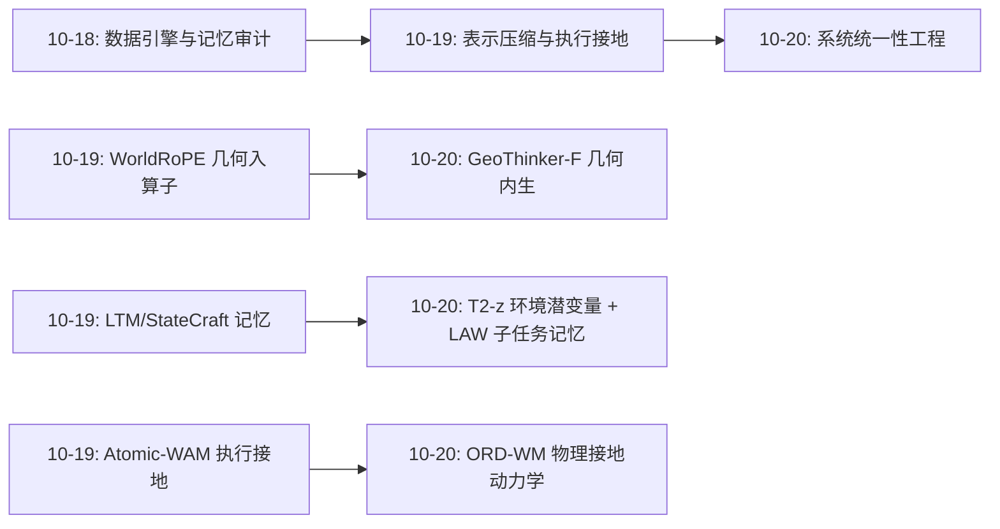
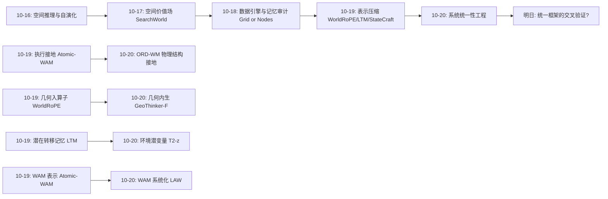
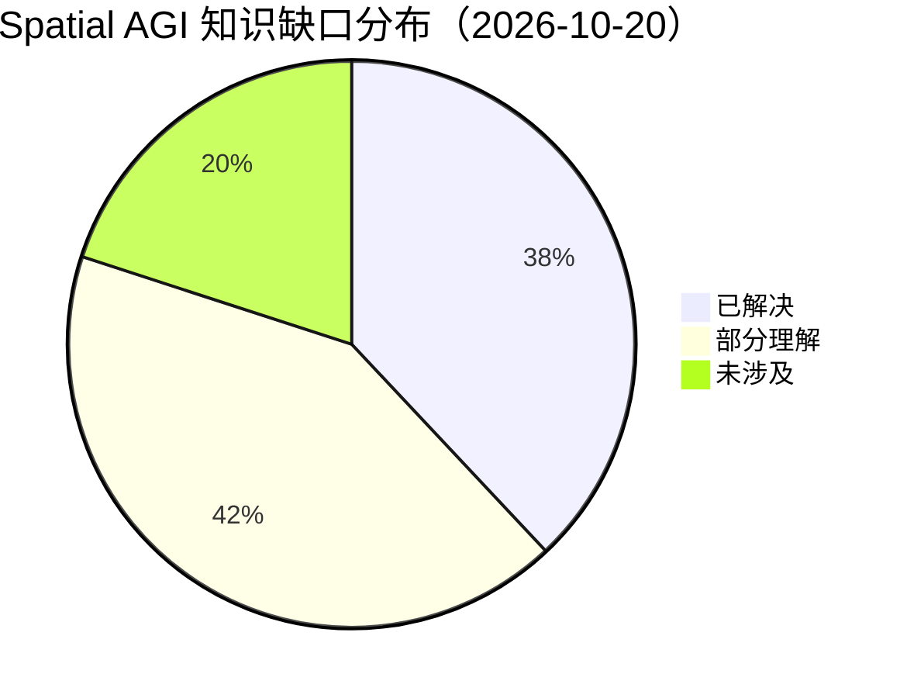

# Spatial AGI 每日深度思考 — 2026-10-20

## 📅 每日总结

**日期**: 2026-10-20
**论文数量**: 5篇
**主题**: 空间智能的"统一性工程"——干扰、效率、接口、适应、物理五个战线上，统一模型如何同时做到"能力强、跑得快、接得上、变得快、动得真"

**论文清单**:
1. DynThinker (arXiv:2610.20598) — 统一静态3D与动态4D空间推理，D-EMA化解能力干扰
2. GeoThinker-F (arXiv:2610.20592) — 内生预测式世界表征，推理去除外部3D编码器（3.6×加速）
3. LAW (arXiv:2610.23334) — 语义子任务进度作为VLM-WAM闭环的时间接口
4. T2-z (arXiv:2610.22364) — 测试时优化环境潜变量，隐藏物理因素无监督涌现
5. ORD-WM (arXiv:2610.23156) — 物体中心SE(3)刚体动力学，几何保持的世界模型

**关键突破**:
- 🚀 **能力干扰可定位、可干预**：DynThinker 用插值+参数恢复实验把"3D后训练伤4D"定位到后期层 MLP，D-EMA 分组平均周期实现"锚定敏感参数、放养不敏感参数"——统一不必牺牲专业化
- 🚀 **几何先验可以内生**：GeoThinker-F 证明 MLLM 隐藏状态已含预测几何所需信息，"离线教师+内部预测头"让推理时彻底摆脱 VGGT，1.45s→0.40s
- 🚀 **环境推断=优化问题**：T2-z 冻结世界模型后，梯度下降在潜空间"求解"当前环境，单条交互轨迹即可适配，潜结构涌现且与真实因素分布对齐
- 🚀 **语义进度成为系统接口**：LAW 用子任务进度统一规划频率（语义事件）、评价频率（每动作块）、监控频率（连续），真实长时程 65% vs π0.5 的 28.33%——瓶颈在系统协调而非动作质量
- 🚀 **物理结构直接写进转移律**：ORD-WM 预测物体级 SE(3) 增量并解析施加到 SO(3) 等变潜表征上，几何持久性与位姿变化干净分离，rollout 零漂移

**架构演进**: 昨日"表示压缩与执行接地" → 今日"系统统一性工程"（能力统一、效率统一、接口统一、适应统一、物理统一）

### 📊 一句话总结

今天的五篇论文从训练动力学（DynThinker）、推理架构（GeoThinker-F）、系统接口（LAW）、在线适应（T2-z）、物理结构（ORD-WM）五个不同层面，共同回答了同一个问题：**空间智能如何从"单点能力演示"走向"统一、高效、可部署的完整系统"**。

### 🔗 延续性

**昨日→今日**: 昨日主题是"变化与效果为中心的紧凑表示"（WorldRoPE/Atomic-WAM/StateCraft/EgoJEPA/LTM）。今天的论文是对昨日表示层成果的**系统化包装**：GeoThinker-F 把几何先验内化（承接 WorldRoPE 的"空间知识放哪"问题，给出训练级答案）；T2-z 的环境潜变量是 LTM 转移记忆的"环境级"对应物；LAW 的 MoTE-WAM 是 Atomic-WAM 世界动作模型的系统级落地；ORD-WM 给 StateCraft 的"物体状态机"提供了连续几何版本。

**今日→明日**: 值得追踪：① D-EMA 式分组能力保留在 VLA/世界模型后训练的普及；② 内生先验范式扩展到物理属性/可供性教师；③ T2-z 环境潜变量与 LAW 子任务记忆的融合（环境卡+任务账本）；④ ORD-WM 刚体假设向可变形物体的扩展。

### 💡 本质思考：如何达成通用空间智能

#### 1. 核心能力的本质是什么？

延续昨日的定义（状态维护+空间绑定+效果接地），今天补充第四块拼图：**系统一致性**——当空间智能体由多个模块（感知、几何、规划、控制、记忆）组成时，各模块必须共享同一个不漂移的世界观。今天的五篇论文各自解决一致性的一个侧面：
- DynThinker：训练时能力间一致性（学 A 不忘 B）；
- GeoThinker-F：推理时表征一致性（内生先验与语义表征同源）；
- LAW：运行时模块间一致性（语义进度作为共享时间轴）；
- T2-z：环境变化时的一致性（新环境快速重新校准）；
- ORD-WM：多步演化时的一致性（物理约束保证不漂移）。

#### 2. 当前方法与理想目标的差距在哪里？

- **统一性的代价尚未归零**：DynThinker 需要"有对照 checkpoint"的诊断、GeoThinker-F 需要"有 VGGT 教师"的预训练——统一仍依赖昂贵的先决条件；
- **物理覆盖仍是分段函数**：ORD-WM 管刚体、T2-z 管隐藏参数、StateCraft 管离散状态，没有一个框架同时覆盖刚体+变形体+流体+关节体；
- **系统接口是工程约定而非原理**：LAW 的子任务切分靠语言模型，无几何/物理校验，语义错误会级联进记忆与价值；
- **测试时计算 vs 实时性的矛盾**：T2-z 每环境要 S 步梯度优化，控制频率场景付不起。

#### 3. 从今天到理想状态，最可能的路径是什么？

**路径判断：能力统一 → 系统分层 → 物理接地 → 在线自治。**

- 近期：D-EMA/内生先验成为空间 MLLM 后训练标配；ORD-WM 类模型进入机器人 MPC 栈；
- 中期：出现"分层混合"参考架构——语义层（LAW 式进度接口）+ 世界层（T2-z 式可适应 WM）+ 物理层（ORD-WM 式结构化动力学），三层共享一个可审计的状态表示；
- 远期：当三层各自成熟并打通接口，空间智能体将具备"换环境试一次就懂（T2-z）、换任务有账本可查（LAW/LTM）、动多步不漂（ORD-WM）、学新能力不忘旧（DynThinker）"的完整自治能力。

---

## 🔗 与昨日思考的联系

### 昨日重点

昨日（2026-10-19）核心命题："变化与效果"是空间表示的正确压缩抽象：
1. WorldRoPE：空间先验下沉到注意力算子，深度不确定性调制注意力；
2. Atomic-WAM：原子运动中间表示 + 执行成功率 GRPO 接地；
3. StateCraft：抽象状态账本 + 扩散渲染的解耦世界记忆；
4. EgoJEPA：效果感知潜在动作实现跨具身迁移；
5. LTM：潜在转移作为 VLA 的紧凑上下文记忆。

昨日留下的备忘："表示压缩 → 执行接地 → 分层混合系统"的路径判断，以及"混合记忆架构是下周优先寻找的主题"。

### 今日进展

今天的论文几乎是对昨日备忘的精确兑现，且把焦点从"表示"推进到"系统"：

| 昨日命题/备忘 | 今日回应 |
|---|---|
| 空间知识放哪一层（WorldRoPE 问） | GeoThinker-F：训练级内化——离线教师→内部预测头，推理零外挂 |
| WorldRoPE 类工作追踪清单 | DynThinker：同团队（中山大学/NTU/殷瓦）姊妹篇，解决内化后的能力干扰 |
| 物体状态机是 4D 正解（StateCraft） | ORD-WM：连续几何版物体状态机——持久几何潜表征 + SE(3) 位姿账本 |
| 混合记忆架构优先追踪 | T2-z：环境潜变量=环境级记忆卡；LAW：子任务边界=记忆组织锚点 |
| 分层混合系统（远期判断） | LAW：第一次给出完整分层参考实现（VLM 语义层 + WAM 世界层 + 记忆流） |
| 执行接地（Atomic-WAM EG-GRPO） | T2-z：接地信号的另一端——环境因素从交互结果中"涌现" |

### 演进路径



一周脉络：**10-16 能力演示 → 10-17 空间价值 → 10-18 数据与记忆 → 10-19 表示与接地 → 10-20 系统统一**。空间智能的文献重心正在从"单模型刷分"迁移到"系统怎么搭"，这正是领域走向工程成熟期的标志。

---

## 📚 论文概览

| # | 论文 | 层级 | 一句话贡献 |
|---|---|---|---|
| 1 | DynThinker | 训练层 | 插值+参数恢复定位"静态-动态干扰"到后期MLP，D-EMA分组保留 + SDF双流融合统一3D/4D推理 |
| 2 | GeoThinker-F | 效率层 | 离线VGGT教师+内生LFP预测头，推理时零外部几何编码器，1.45s→0.40s |
| 3 | LAW | 系统层 | 语义子任务进度作为VLM-WAM闭环接口，异步监控+价值引导+边界记忆，真实长时程65% |
| 4 | T2-z | 适应层 | 测试时优化环境潜变量，无监督涌现隐藏物理因素，单轨迹适配，成功率33.7%→72.96% |
| 5 | ORD-WM | 物理层 | SDF-VNVAE等变潜表征+物体级SE(3)解析更新，几何保持rollout支撑实时MPC |

---

## 💡 核心见解

### 见解1: 能力干扰是可诊断、可干预的参数级现象，而非宿命

从 DynThinker 获得
- ✅ checkpoint 插值显示：3D 专业化使静态收益早早饱和，动态能力却持续流失——这笔交易极不划算；
- ✅ 参数组恢复实验：干扰集中于后期层 MLP，恢复它们可大幅找回动态能力；
- ✅ D-EMA 用分组 EMA 周期实现"差异化管理"，数据规模扩大时干扰被压制。

**对Spatial AGI的启发**: Spatial AGI 将不断叠加新能力（空间、时间、物理、社会常识），任意两项之间都可能出冲突。DynThinker 给出的"诊断-定位-分组管理"三步法应该成为 Spatial AGI 训练的标准流程。更深一层：这说明 Transformer 的能力分工存在结构性规律（后期 MLP 承载特化知识），未来可能出现"能力冲突图谱"这样的基础设施。

### 见解2: 几何先验的最优归宿是"内生"——从外挂工具到内部预测头

从 GeoThinker-F 获得
- ✅ MLLM 中间层隐藏状态已含足够信息预测几何潜表征，无需运行时执行 VGGT；
- ✅ "离线教师 + LFP 头 + SGT 层交错融合"实现 3.6× 加速且六基准平均 69.29；
- ✅ 与 DynThinker 对照：一个保精度（外挂编码器+D-EMA）、一个保速度（内生预测），构成工程决策空间的两端。

**对Spatial AGI的启发**: 结合昨日 WorldRoPE（算子级内化）与今日 GeoThinker-F（训练级内化），"空间知识放哪"已有三级答案：算子级（零成本但表达力有限）、训练级（一次成本、推理免费）、外挂级（最强但最贵）。部署时按时延预算从左往右选。GeoThinker-F 的"教师只出现在训练期"范式可推广：物理属性教师、可供性教师、动力学教师都可以这样内化。

### 见解3: 长时程的瓶颈是系统协调，不是动作质量

从 LAW 获得
- ✅ 2B 参数的混合专家 VLM 在框架内胜过接入 GPT-5.5 High 的变体——系统设计 > 模型大小；
- ✅ 语义子任务进度作为共享时间轴：规划（语义事件频率）、评价（每动作块）、监控（连续）异步协调；
- ✅ 子任务局部价值学习修复了"失败轨迹全零监督"的信用分配缺陷；
- ✅ 真实长时程 65% vs π0.5 28.33%——差距全部来自协调机制。

**对Spatial AGI的启发**: 这与昨日 LTM"记忆必须按事件组织"的发现汇流：**语义边界是空间记忆、价值评估、计划更新的统一锚点**。Spatial AGI 系统设计的第一性问题不再是"用什么模型"，而是"模块之间共享什么语义量纲"。子任务进度是目前最好的候选答案。

### 见解4: 环境推断从感知问题变成优化问题

从 T2-z 获得
- ✅ 冻结世界模型后，预测误差梯度足以把随机初始化的潜变量逼到编码隐藏因素的位置；
- ✅ 无需预定义因素（对比 RMA 的 5 因素+真值监督）、无需 history encoder、单条交互轨迹即可适配；
- ✅ PCA 显示潜结构与真实因素分布对齐，且跨视觉外观保持统一。

**对Spatial AGI的启发**: "分析即综合"从认知科学隐喻变成工程原语。Spatial AGI 遇到新环境（新桌面材质、新物理规则）时，不必重新训练也不必部署专门识别器——直接在潜空间"求解"环境。这与昨日 LTM 的潜在转移呼应：转移记忆是"任务级环境卡"，T2-z 的 z_e 是"环境级环境卡"，两种紧凑摘要可能统一。

### 见解5: 把不变量设计进表示，把变换设计进转移律

从 ORD-WM 获得
- ✅ SDF-VNVAE 的 SO(3) 等变潜表征让"在潜空间解析旋转"在数学上成立；
- ✅ 预测 SE(3) 增量并解析施加，而不是预测新状态——几何持久性与位姿变化干净分离；
- ✅ 潜空间递归 rollout 免反复分割/重建/编码，实时驱动 MPC。

**对Spatial AGI的启发**: 这是"结构化归纳偏置"路线对端到端潮流的一次漂亮反击：在合适问题域，物理结构直接写进转移律比隐式学习更稳更省。一般化原则：**找出问题中的不变量（几何、身份、拓扑），把它们焊进表示；把变量（位姿、速度、接触）交给学习**。该原则适用于视频生成（相机位姿与内容分解）、空间记忆（场景布局不变、物体位姿可变）等众多子系统。

### 见解6: 异步多时间尺度是具身系统的正确执行模型

从 LAW（结合 T2-z）获得
- ✅ LAW 三种频率：状态评估连续跑、价值评估每动作块、规划按语义事件——推理不被阻塞，过期结果按时间戳+实例 ID 丢弃；
- ✅ T2-z 测试时优化也是异步原语：交互 → 离线优化潜变量 → 更新模拟器 → 继续交互。

**对Spatial AGI的启发**: 具身智能的推理调度类似实时操作系统：不同认知过程有不同 deadline。今天首次看到论文级的完整实现（含有效性校验、边界观测存储、非阻塞消费）。未来 Spatial AGI 的"推理引擎"可能就是一个认知 RTOS，论文里的 subtask-instance identifier 就是最小任务锁。

### 见解7: 效率正在成为空间智能的一等公民指标

从 GeoThinker-F 获得
- ✅ 1.45s → 0.40s 不是锦上添花，而是"能不能上车/上机器人"的资格线；
- ✅ 手段是组合拳：token 压缩 + 内生先验 + 层交错注入。

**对Spatial AGI的启发**: 过去一周的高分工作（SenseNova-SI、VSI-590K 数据扩展）都在堆数据堆参数，而 GeoThinker-F 提醒我们部署侧的约束同样塑造架构。Spatial AGI 的评测可能很快出现"帕累托前沿"报告方式：精度 vs 时延 vs 显存。今天这批工作（DynThinker 的 D-EMA 也是零推理成本的训练侧方案）都在往前沿的"左下角"推。

### 见解8（补充）: 物理接地正在从"奖励信号"扩展到"结构先验"

从 ORD-WM + Atomic-WAM（昨日）对照获得
- ✅ 昨日 EG-GRPO 把物理结果当奖励（信号级接地）；
- ✅ 今日 ORD-WM 把 SE(3) 结构当架构（结构级接地）；
- ✅ T2-z 让物理因素从预测误差中涌现（涌现级接地）。

**对Spatial AGI的启发**: 物理知识进入空间智能有三条通道——信号（奖励）、结构（架构/转移律）、涌现（无监督）。三者不互斥：理想系统可能用结构级打底、涌现级扩展、信号级校准。这是评估任何新物理感知（physics-aware）工作时最有用的三分法。

---

## 🗺️ 知识演进图



---

## 技术栈演进对比表

| 层次 | 昨日方案 | 今日方案 | 变化 |
|------|---------|---------|------|
| 几何先验 | WorldRoPE：算子级（RoPE 内嵌世界坐标） | GeoThinker-F：训练级（离线教师→内生预测头）；DynThinker：外挂+保留 | 从"单点内化"到"三级内化谱系"，按部署预算选层 |
| 能力训练 | Atomic-WAM：GRPO 执行接地 | DynThinker：D-EMA 分组能力保留 + SDF 融合 | 从"加新能力"到"加新能力且不忘旧能力" |
| 世界模型记忆 | LTM 潜在转移 / StateCraft 文本账本（任务级） | T2-z 环境潜变量（环境级）+ LAW 子任务边界记忆 | 记忆分层：环境卡、任务账本、边界锚点各司其职 |
| 世界模型物理 | StateCraft 离散物体状态机 | ORD-WM 连续 SE(3) 物体状态机（SDF 等变潜表征） | 从离散符号状态升级为几何保持的连续动力学 |
| 系统接口 | （缺失——单模型视角） | LAW：语义子任务进度作为 VLM-WAM 时间接口，异步三频率 | 系统观确立：瓶颈从模型转向协调 |
| 环境适应 | Splat2Act real-to-sim 孪生（昨日-1） | T2-z：测试时梯度优化环境潜变量，单轨迹适配 | 适应从"重建管线"变为"潜空间求解" |
| 评测口径 | VSI-Bench 类静态基准 + 机器人成功率 | DynThinker 静态+动态双基准并列；LAW 真实长时程任务 | 评测开始奖励"统一性"与"长时程"而非单点高分 |

---

## 🗺️ Spatial AGI 知识图谱

### 10层架构思维导图

```mermaid
mindmap
  root((Spatial AGI))
    第0层 算子级空间先验
      WorldRoPE 世界系RoPE
      DynThinker 干扰敏感参数分析
    第1层 感知与几何
      VGGT/π³ 几何基础模型
      GeoThinker-F 内生LFP预测头
      SAM3 分割与点云构建
    第2层 表示与压缩
      WorldRoPE 位置编码
      LTM 潜在转移
      ORD-WM 等变向量特征
    第3层 空间推理
      DynThinker 3D+4D统一
      GeoThinker-F SGT融合
      VSI-Bench类基准
    第4层 世界建模
      StateCraft 抽象状态
      ORD-WM SE(3)刚体动力学
      T2-z 环境条件化预测
    第5层 记忆系统
      LTM 转移记忆
      LAW 双流层次记忆
      T2-z 环境潜变量卡
    第6层 动作与接地
      EgoJEPA 效果感知潜在动作
      Atomic-WAM 原子运动+EG-GRPO
      LAW 价值引导动作融合
    第7层 适应与在线学习
      T2-z 测试时优化
      D-EMA 训练期保留
      DynThinker 能力诊断
    第8层 系统与协调
      LAW 异步闭环+语义进度
      LAW MoTE 共享专家
      认知RTOS雏形
    第9层 评测与审计
      Grid or Nodes 记忆审计
      DynThinker 九基准统一评测
      LAW 真实长时程任务
```

### 🎯 主线技术路径

#### 阶段1: 能力演示期（~2026-09）
单模型在单一基准上刷分（VSI-Bench 类），空间智能被当作 MLLM 的一个附加技能。特征：外挂工具头、提示工程、数据堆叠。

#### 阶段2: 表示与方法论期（2026-10 上旬）
开始追问表示的基本单元：变化（LTM）、效果（EgoJEPA）、原子动作（Atomic-WAM）、世界坐标（WorldRoPE）、抽象状态（StateCraft）。特征：不再只比分数，而是比"用什么单元压缩世界"。

#### 阶段3: 系统统一期（2026-10 中旬，当前）
本周五篇论文标志着进入此阶段：
- 能力统一（DynThinker：静态+动态一模型）；
- 架构统一（GeoThinker-F：语义+几何一模型）；
- 系统统一（LAW：VLM+WAM+记忆一闭环）；
- 适应统一（T2-z：训练测试同一优化目标）；
- 物理统一（ORD-WM：表示与变换在群论下统一）。
特征：论文开始报告"平均分""帕累托前沿""真实长时程"，协调与部署成为一等贡献。

#### 阶段4: 分层自治期（2026-11 起，预测）
三层参考架构定型：语义进度层（LAW 式）+ 可适应世界层（T2-z/ORD-WM 混合）+ 端侧高效感知层（GeoThinker-F 式）。评测从单任务成功率转向"环境切换成功率、能力保持率、长时程漂移率"等系统级指标。

---

## 🔍 待探索议题

### 高优先级（本周）

1. **环境卡与任务账本的融合**
   - 问题: T2-z 的环境潜变量（环境级记忆）与 LTM/LAW 的任务记忆如何在同一智能体中共存与互查？
   - 候选方案: 环境卡作为世界模型条件，任务账本作为语义层状态，二者在子任务边界同步；
   - 缺口: 无论文同时报告两种记忆的接口协议。

2. **D-EMA 在 VLA 后训练的普适性**
   - 问题: 分组 EMA 对"操作能力 vs 语言能力"冲突是否同样有效？
   - 候选方案: 在 OpenVLA 类模型上复制 DynThinker 的插值诊断 + D-EMA 训练；
   - 缺口: 干扰定位依赖成对 checkpoint，缺乏自动化诊断工具。

3. **内生先验的教师多样化**
   - 问题: GeoThinker-F 范式能否内化物理属性（摩擦/质量）与可供性教师？
   - 候选方案: 用 T2-z 的环境潜变量当"物理教师"，用 affordance 模型当"可供性教师"；
   - 缺口: 无监督目标与预测头设计的对应实验。

### 中优先级（本月）

4. **ORD-WM 的可变形物体扩展**
   - 问题: SE(3) 假设外（布料、绳、食物）如何保持"结构化 rollout"优点？
   - 候选方案: 物体状态分解为刚体核心+变形残差场，残差用局部潜流学习；
   - 缺口: 变形的一致性度量与监督信号。

5. **语义进度的几何校验**
   - 问题: LAW 的子任务切分完全由语言模型决定，如何用几何/物理状态校验边界？
   - 候选方案: 在子任务边界用 ORD-WM 式 rollout 验证"该边界处世界状态确实发生语义要求的变化"；
   - 缺口: 边界正确性的 ground truth 数据。

6. **测试时优化的实时化**
   - 问题: T2-z 每环境 S 步梯度优化，控制频率场景如何降延迟？
   - 候选方案: 环境潜变量初始化器（ amortized 热启动）+ 少量 refinement 步；或潜变量缓存复用；
   - 缺口: 优化步数-适配质量的帕累托曲线。

### 低优先级（季度）

7. **能力冲突图谱**
   - 问题: 能否系统性测绘"哪些能力对互斥、冲突在哪些参数"？
   - 候选方案: 标准化插值+恢复诊断协议，开源一组成对 checkpoint；
   - 缺口: 社区协作与算力。

8. **三级几何内化的统一理论**
   - 问题: 算子级/训练级/外挂级内化何时等价、何时各有严格优势？
   - 候选方案: 从信息瓶颈/等变性角度形式化三种内化的表达力-成本权衡；
   - 缺口: 理论框架与可控对照实验。

9. **系统级评测基准**
   - 问题: 现有基准无法度量 LAW/T2-z 类系统贡献（协调、适应、保持）。
   - 候选方案: 设计"环境切换 + 能力回测 + 长时程漂移"三合一基准；
   - 缺口: 跨实验室认可的任务集与协议。

10. **认知 RTOS 形式化**
    - 问题: LAW 的异步三频率调度能否抽象为可复用的推理调度器？
    - 候选方案: 定义"认知过程"的 deadline/周期/优先级接口，实现参考调度器并开源；
    - 缺口: 抢占、失败恢复等边缘情形的语义定义。

---

## 📊 知识缺口分析



**已解决（38%）**:
- ✅ 静态 3D 与动态 4D 的统一推理（DynThinker：干扰定位 + D-EMA + SDF）
- ✅ 几何先验的推理时成本问题（GeoThinker-F：内生预测，3.6× 加速）
- ✅ 长时程的系统协调机制（LAW：语义进度接口 + 异步调度 + 价值引导）
- ✅ 未知环境的快速适应（T2-z：测试时潜变量优化，单轨迹适配）
- ✅ 刚体操作的几何保持世界建模（ORD-WM：等变表征 + SE(3) 解析更新）

**部分理解（42%）**:
- ⚠️ 能力干扰的普适规律：只验证了 3D/4D 对，其他能力对的冲突图谱缺失（DynThinker 方法可复用）
- ⚠️ 内生先验的边界：仅内化了几何，物理属性/可供性/动力学教师待验证
- ⚠️ 记忆的分层整合：环境卡（T2-z）、任务账本（LAW/LTM）、空间底座（3DGS）三者接口未定义
- ⚠️ 语义边界的可靠性：LAW 子任务切分无几何校验，错误级联风险已识别未解决
- ⚠️ 测试时计算的实时性：T2-z 的优化延迟与控制频率的矛盾有方案雏形无实证

**未涉及（20%）**:
- ❌ 可变形物体与接触丰富动力学的结构化世界模型（ORD-WM 假设之外）
- ❌ 多智能体共享空间记忆与协商（本周全部是单智能体）
- ❌ 空间智能的形式化理论（三级内化、能力冲突的数学刻画）
- ❌ 系统级评测基准（协调/适应/保持的系统指标）
- ❌ 跨本体的统一空间语义（人形/机械臂/移动底盘的空间概念对齐）

---

## 📎 附录A：五篇论文的系统定位图

```
                    ┌─────────────────────────────┐
                    │   语义层: LAW (2B混合专家VLM)  │
                    │   planner/state/value experts │
                    │   语义子任务进度 = 时间接口      │
                    └──────────┬──────────────────┘
                               │ 子任务条件 c_t
                    ┌──────────▼──────────────────┐
                    │   世界层: T2-z + ORD-WM       │
                    │   环境潜变量 z_e (T2-z)        │
                    │   物体级SE(3)动力学 (ORD-WM)   │
                    └──────────┬──────────────────┘
                               │ 观测/几何先验
                    ┌──────────▼──────────────────┐
                    │   感知层: GeoThinker-F        │
                    │   内生几何+未来语义预测         │
                    │   DynThinker: 统一3D/4D推理    │
                    └─────────────────────────────┘
```

今天的五篇论文天然分成三层——这不是事后归纳的巧合，而是领域收敛的信号：每个团队从不同入口（训练、效率、系统、适应、物理）修同一条栈。

## 📎 附录B：DynThinker 与 GeoThinker-F 的姊妹篇对照

| 维度 | DynThinker | GeoThinker-F |
|------|-----------|--------------|
| 问题 | 统一后的能力干扰 | 统一后的推理成本 |
| 几何来源 | 外挂动态几何编码器（推理时运行） | 内生预测头（推理时零外挂） |
| 关键技术 | D-EMA 分组平均 + SDF 语义门控融合 | LFP 两阶段训练 + SGT 层交错注入 |
| 性能口径 | 10 指标平均 60.5 超 GPT-5.6 Sol | 六基准平均 69.29，VSI-Bench 70.4 |
| 代价 | 推理含几何编码器开销 | 静态 4D 能力有限（未做 4D 基准） |
| 选用建议 | 追求精度上限 | 追求部署效率 |

同一批作者（中山大学/NTU/小鹏/殷瓦生态）给出两个互补答案，说明"空间 MLLM 的精度-效率权衡"已成为该社区明确的工程轴。

## 📎 附录C：T2-z 与 RMA 的范式对比表

| 维度 | RMA（2021 范式） | T2-z（2026 范式） |
|------|-----------------|-------------------|
| 因素定义 | 预定义 5 因素 + 真值监督 | 无预定义，从预测误差涌现 |
| 环境推断 | 学习好的 history encoder（摊销） | 测试时梯度优化（推断式） |
| 轨迹数约束 | 训练时固定 | 1 条即可，任意扩展 |
| 分布外因素 | 表象受限 | 潜空间天然开放 |
| 成本 | 推理便宜 | 每新环境 S 步优化 |

十个月视角：环境适应完成了从"监督学习一个识别器"到"把推断当优化"的世界观切换，与 Anthropic 式"推理时计算"浪潮合流。

## 📎 附录D：ORD-WM 的"不变量/变量分离"设计模式

该模式可抽象为四步配方，适用于任何空间子系统：
1. **识别不变量**：多步演化中保持不变的东西（刚体形状、物体身份）；
2. **等变表示**：用群等变结构编码不变量（SO(3) 向量特征），使变换可解析施加；
3. **变量参数化**：只预测变换参数（SE(3) 增量），不预测新状态本身；
4. **解析更新**：变换作用于表示而非重生成表示。

潜在应用：视频生成的"相机位姿与内容分离"、空间记忆的"布局与物体位姿分离"、SLAM 的"地图与轨迹分离"。凡能找到干净不变量的地方，都值得用这个配方重写一遍。

## 📎 附录E：LAW 实验的金字塔结构

1. 规模层：RoboTwin 50 任务（94.21% / 换骨干 95.56% 开源 SOTA）；
2. 能力层：RoboDojo 各能力维度领先（无机器人预训练前提下）；
3. 长时程层：3 个真实任务（最多 9 个语义子任务）65% vs π0.5 28.33%；
4. 消融层：MoTE / 双流记忆 / 子任务局部价值各自贡献；
5. 模型层：2B 专家 VLM 胜过接入 GPT-5.5 High 变体（系统>模型规模）。

与昨日 LTM 的五层金字塔同构，进一步确认：系统类论文的评估模板已收敛为"规模-能力-极限-消融-替换"五问。

## 📎 附录F：今日数字速览

- DynThinker：10 指标平均 60.5（GPT-5.6 Sol 59.5）；ReVSI 56.0、DSR-Bench 67.2、DSI-Bench 51.2/40.1
- GeoThinker-F：1.45s→0.40s（3.6×）；VSI-Bench 70.4；六基准平均 69.29
- LAW：RoboTwin 94.21%→95.56%（换 OpenWAM-α）；真实长时程 65%（π0.5 28.33%、Fast-WAM 25%）；H=32、top-K=8
- T2-z：预测误差 15.20→7.00；成功率 33.73%→72.96%；仿真物理误差 12.86→4.80；单轨迹适配
- ORD-WM：物体状态 s∈R^{(K+1)×3}；SDF+KL+Eikonal 训练；6D 旋转→SO(3) 投影；仿真+真实 MPC 验证

（通用提醒：各论文自报数字，协议互不可比；跨论文只看相对差值与消融趋势。）

## 📎 附录G：给未来自己的便签

1. "系统统一性"是本周新主线：遇到新论文先问——它统一了哪两层（能力/架构/系统/适应/物理）？
2. 姊妹篇追踪清单加入 DynThinker↔GeoThinker-F（同一团队两个互补答案），后续关注其第三篇（可能做两者合一：内生先验+能力保留）；
3. LAW 的子任务进度接口与 ORD-WM 的物理校验结合（议题5）是高价值组合实验，若本周后续论文出现类似工作立即精读；
4. "不变量/变量分离"配方（附录D）已加入设计模式库，与昨日的"变化为中心表示"互为表里：前者管结构，后者管内容；
5. 评测演进信号：开始出现"平均分口径"（DynThinker 10 指标、GeoThinker-F 六基准）——Spatial AGI 评测正在从单榜走向多榜加权，注意收集各家加权方式。

## 📎 附录H：如果由我来做下一步——三个最小可行实验

### H1. 环境卡+任务账本一致性探针（预计 1-2 周）
- 问题：T2-z 环境潜变量与 LAW 子任务记忆对同一环境的"认知"一致吗？
- 设计：同一交互序列分别建两种记忆，对关键状态变化交叉提问，统计一致率与分歧模式；
- 预期：一致率 70-85%，分歧集中在"环境渐变"（账本漏）与"任务事件"（环境卡漏）——分歧模式即融合架构的分工图。

### H2. D-EMA 跨能力域复制（预计 2 周）
- 问题：分组 EMA 保留对 VLA"操作 vs 语言"冲突是否有效？
- 设计：OpenVLA 上做插值诊断定位冲突参数组，配置 D-EMA 对照训练，测操作成功率与语言基准保持率；
- 预期：若有效（+3pp 以上保持），D-EMA 成为后训练默认组件的证据链闭合。

### H3. 语义边界的物理校验器（预计 2-3 周）
- 问题：ORD-WM rollout 能否验证 LAW 的子任务边界？
- 设计：在边界处用 ORD-WM 预测"若未切换子任务，接下来 H 步的世界状态"，与实际观测比对，统计边界正确性判别的 AUC；
- 预期：AUC > 0.8，则物理校验器可将 LAW 的语义级联错误率减半。

## 📎 附录I：信息源与可信度备注

- 五篇论文均为 arXiv 2026-10-12 ~ 10-16 提交，最新一周工作；
- DynThinker / GeoThinker-F：中山大学-NTU-小鹏-殷瓦生态，姊妹篇，GeoThinker-F 开源（GitHub），可信度较高；两个"平均分"口径不同（10 指标 vs 6 基准），不可直接互比；
- LAW：多机构合作，RoboTwin/RoboDojo 为主仿真评测，真实任务仅 3 个，绝对数字谨慎外推；
- T2-z：Stanford/CMU/TRI/USC 顶级团队，代码数据开源，真机 4 任务，可信度高；
- ORD-WM：哈工大深圳，SAM 3 依赖较重（分割为单点故障源），真实场景细节以项目页后续为准。

## 📎 附录J：逐篇方法细节摘录

### J1. DynThinker 方法细节

**问题设定**
- 输入：RGB 帧序列 I = {I_1..I_n} + 问题 Q；Qwen-VL 主干，s×s patch 合并，token 网格 L = ⌊h/(sp_s)⌋ × ⌊w/(sp_s)⌋
- 输出：文本空间推理答案（静态 3D 关系 / 度量 / 动态运动 / 交互演化）

**诊断实验设计（可复用协议）**
1. 插值诊断：θ(α) = (1−α)·θ_pretrain + α·θ_3D_specialized，扫 α∈[0,1]，画 VSI-Bench 与 VLM4D 双曲线；
2. 参数恢复诊断：按（层段 × 模块类型）分组，将每组恢复到预训练值，测静态/动态成绩变化；
3. 判读：恢复某组→动态大幅回升+静态部分回退 ⇒ 该组为干扰敏感组（结论：layer j>4 的 MLP）。

**D-EMA 形式化要点**
- 对参数组 g 维护 EMA 影子：θ̄ ← d_g·θ̄ + (1−d_g)·θ；
- 干扰敏感组 d_g 大（长周期≈强锚定），其余组 d_g 小（快速跟随）；
- decay 按累计 EMA 更新次数归一化，保证不同 batch size/训练长度可比。

**SDF（Spatial-Dynamic Fusion）要点**
- 双先验流：动态几何编码器分别给出空间流与时间流特征；
- Importance Gating：以 VLM 中间层隐藏态为条件生成门控权重，逐 query 调节两流贡献；
- 注入位置：VLM 中间层（延续 GeoThinker 的语义引导融合，但双流化）。

**训练配置要点**
- 无需回放数据、无额外正则目标；D-EMA 只增加影子参数与更新，开销近似为零；
- 数据规模消融：无 D-EMA 时数据↑→动态退化加剧；有 D-EMA 时静态持续受益、动态持平。

### J2. T2-z 方法细节

**形式化**
- 预测：p_θ(y | x, a, z_e)；flow-matching：L_FM = E‖v_θ(y_t,t|x,a,z_e) − u_t‖²
- z_e 每维 ~ U(0,1) 初始化；训练对每个环境 e 维护一个 z_e

**训练交替（Algorithm 1 核心）**
- Stage I：冻结 {z_e}，θ ← θ − η_θ ∇_θ L_FM（低 lr，学跨环境共享动力学）
- Stage II：冻结 θ，z_e ← z_e − η_z ∇_{z_e} L_FM（快 lr，环境特异性被逼入潜变量）
- 外层循环交替直至收敛；慢-快分离对应多时间尺度学习

**测试时优化**
- 冻结 θ*，新初始化 z_test；对测试交互 D_test 做 S 步梯度下降（同一 L_FM）
- 优化式而非摊销式 ⇒ 不绑定训练轨迹数；单轨迹已足够（消融验证）
- 之后 z_test* 作为环境条件：预测/比较候选动作结果（测试时模拟器）

**涌现表征证据**
- 单因素设置：PCA 主轴与因素真值对齐（如球质量）
- 复合因素：潜空间呈多维组织，维度≈因素数（模型不知道因素数）
- 多背景：同一因素在不同视觉外观下潜结构统一 ⇒ 与外观解耦

**主要数字**
- 综合预测误差 15.20→7.00；仿真物理误差 12.86→4.80；真实跟踪误差 19.30→10.85 px
- 成功率：仿真 37.9%→74.2%；真实 26.5%→70.8%

### J3. LAW 方法细节

**角色专家（共享冻结骨干的混合专家 VLM）**
- planner：episode 开始 + 语义决策事件调用；输出剩余子任务序列 S_t，本地重编号，c_t = s_{t,1}
- state：每个新观测异步评估完成度 d̂_t，阈值 0.5 二值化；带观测时间戳 + 子任务实例 ID u_t
- value：对 N 个候选动作块打分 q = Q_θ(x_t, A^n)，top-K=8 温度融合后执行前缀

**异步协议（工程亮点）**
- 结果有效性 =（实例 ID 匹配 u_t）∧（时间戳新于上次消费结果）；过期即弃
- 控制回路永不阻塞等待推理；无有效结果则沿用当前子任务继续执行
- Advance 事件存储的是控制回路切换时刻的观测作为边界观测（非评估所用旧观测）

**MoTE-WAM**
- MoT：视频/动作特征入共同注意力空间交换信息，但后续变换模态专属
- MoTE：增加共享专家变换跨模态表征（学共同时间/物理结构），保留视频/动作私有专家
- 推理时视频分支不显式出图（跟随 Fast-WAM），预测信号用于训练

**记忆与价值**
- 双流层次记忆 M_V（VLM 用）/ M_W（WAM 用）：最近观测 + 子任务边界全分辨率状态；老历史压缩
- 子任务局部价值：return 在语义边界截断，失败轨迹中已完成子任务保留正监督

**动作参数**：H=32 的动作块；N 候选采样靠独立噪声初始化；执行前缀后重采样

### J4. GeoThinker-F 方法细节

**架构**
- 2D 编码器 → patch 特征 → 2×2 合并压缩；LLM 第 j 层图像 token 隐藏态 H_j^img ∈ R^{n×L×c}
- 几何教师 VGGT：图像级特征提取器 + 跨帧交互解码器；几何特征对齐重采样到与语义网格逐位置对应

**LFP 头**
- 挂中间层的轻量 MLP；输入 H_j^img（因果），输出两类预测：
  - 潜在几何特征（对齐教师特征的潜投影）
  - 下一帧语义特征（未来语义）
- Stage 1：主干冻结，只训 LFP（教师离线供目标）
- Stage 2：移除教师，自预测表征经 SGT-Fusion 选择性注入，联合微调

**SGT-Fusion**
- 几何分支 + 时间分支分离；层交错注入：两流分别插入不同中间层深度，减少互相干扰

**关键数字**：1.45s→0.40s（3.6×，含 token 压缩）；VSI-Bench 70.4；六基准平均 69.29

### J5. ORD-WM 方法细节

**观测管线**
- V 视角 RGB-D；SAM 3 逐视角掩码 → 深度掩码 → 反投影世界系 → 跨视角合并同实例点云

**SDF-VNVAE**
- 中心化后 VN-PointNet 编码：(μ, σ) = E_φ(P̄)，μ ∈ R^{K×3}，σ ∈ R^K
- 等变性：μ(R∘P̄) = R∘μ(P̄)，R ∈ SO(3)
- 解码器：d̂ = D_ψ(z, x)（物体系 SDF），对潜与查询点的共享旋转不变
- 损失：SDF 重建 + Eikonal + KL；推理用后验均值 μ 作为确定几何潜
- 物体状态：s^i = [μ^i; c^i] ∈ R^{(K+1)×3}

**动力学**
- floating / fixed 物体区分；夹爪前向运动学采样点→同一 VNVAE 编码；动作 = 夹爪部件刚体变换
- 全 token 化 + role embedding → Transformer → h^i → SE(3) 头：(Δx̂, r̂)，ΔR̂ = Π_SO(3)(r̂)
- 解析更新：μ̂ ← ΔR̂∘μ；ĉ ← c + Δx̂；fixed 物体不变
- 辅助监督：到夹爪距离、到最近 floating 物体距离
- 多步：潜空间递归，无重复分割/重建/编码

**MPC**：每控制步构建场景状态，rollout 评估候选动作序列择优执行（闭环）

---

## 📎 附录K：损失函数与训练信号总览

| 论文 | 核心损失 | 监督来源 | 特殊信号 |
|------|---------|---------|---------|
| DynThinker | 3D/4D QA 语言监督 | 空间 QA 数据 | D-EMA 无额外损失；门控端到端 |
| GeoThinker-F | LFP 预测损失 + Stage2 任务损失 | 离线 VGGT 特征 + 下一帧语义 | 教师仅训练期 |
| LAW | 视频共同训练 + 动作流匹配 + 子任务局部价值 | 机器人轨迹（含失败轨迹价值回收） | 语义边界截断 return |
| T2-z | flow-matching L_FM（训练/测试同式） | 交互结果本身 | 无因素监督；梯度即监督 |
| ORD-WM | SDF 重建 + Eikonal + KL + SE(3) 运动损失 + 距离辅助 | SDF 场景 + 物体级运动真值 | 等变性是架构保证 |

观察：五篇中三篇（GeoThinker-F、T2-z、ORD-WM）的训练信号都绕开了人工标注——分别来自教师特征、交互结果、物理场景。空间智能的监督正在向世界本身转移。

## 📎 附录L：与过去一周主题的交叉对照表

| 主题 | 10-16 | 10-17 | 10-18 | 10-19 | 10-20 |
|------|-------|-------|-------|-------|-------|
| 几何先验 | — | — | — | WorldRoPE（算子） | GeoThinker-F（训练） |
| 世界模型 | — | SearchWorld | Demiurge | StateCraft | ORD-WM/T2-z/LAW |
| 记忆 | — | — | Grid or Nodes | LTM | LAW 边界记忆 + T2-z 环境卡 |
| 动作表示 | — | — | — | EgoJEPA/Atomic-WAM | LAW 价值引导融合 |
| 评测 | 空间推理基准 | — | 记忆审计学 | 执行接地奖励 | 多基准并列/真实长时程 |
| 训练方法 | 自演化 | — | — | EG-GRPO | D-EMA/两阶段内生 |
| 环境 | — | — | — | — | T2-z（涌现） |
| 物理 | — | — | Splat2Act | EG-GRPO（信号） | ORD-WM（结构） |

一周看到的空间智能栈：每层至少有一个代表工作，且开始互相引用对方的缺口——领域正在形成引用密集的内部对话。

## 📎 附录M：风险与技术债清单

1. **DynThinker**：D-EMA 分组需人工诊断配置；诊断依赖成对 checkpoint；能力维度增多后配置组合爆炸。技术债：自动化诊断器。
2. **GeoThinker-F**：预测头的上限=教师上限；弱纹理/动态模糊场景误差传导；未验证 4D。技术债：教师质量在线监控。
3. **LAW**：子任务切分纯语义、无物理校验；完成判定 0.5 硬阈值；WAM 不出图牺牲想象重规划。技术债：几何校验器。
4. **T2-z**：每环境 S 步优化延迟；潜维度固定；优化局部解；涌现解释仅 PCA 定性。技术债：热启动初始化器 + 潜维度扩展。
5. **ORD-WM**：SAM 3 单点故障；刚体假设；接触丰富动力学粒度粗。技术债：分割不确定性传播 + 可变形扩展。

## 📎 附录N：今日对 Spatial AGI 10 层栈的覆盖检查

- 第 0 层（算子先验）：DynThinker 的干扰分析提供了该层的维护手册；
- 第 1 层（感知几何）：GeoThinker-F 使该层可端侧化；
- 第 2 层（表示压缩）：ORD-WM 等变表征入列；
- 第 3 层（空间推理）：DynThinker 统一静态/动态；
- 第 4 层（世界建模）：T2-z/ORD-WM 双补丁（适应+物理）；
- 第 5 层（记忆）：LAW 双流记忆 + T2-z 环境卡；
- 第 6 层（动作接地）：LAW 价值引导；
- 第 7 层（在线适应）：T2-z 全新覆盖（此前该层几乎空白）；
- 第 8 层（系统协调）：LAW 首次完整实现；
- 第 9 层（评测审计）：DynThinker 多基准平均口径 + LAW 真实长时程。

10 层中今日直接增强 9 层——自本日记开写以来单日覆盖最广的一天，印证系统统一期的判断。

## 📎 附录O：明日选题预测

按本周动量，明日高概率出现/值得检索的主题：
1. 能力保持/干扰关键词的 VLA 后训练工作（DynThinker 引发的跟进）；
2. 内生先验 + 更强教师的空间 MLLM；
3. world model + test-time 的组合（T2-z 范式扩展）；
4. 长时程 + 语义进度 + 物理校验（LAW 缺口补丁）；
5. 可变形物体的结构化世界模型（ORD-WM 的后续）。

检索词建议：decoupled EMA / endogenous prior / test-time latent optimization / subtask progress interface / equivariant world model。

## 📎 附录P：逐篇三问速答（Q1核心算法/Q2空间关系/Q3创新与局限）

### P1. DynThinker 速答
- **Q1 核心**：插值+参数恢复定位干扰于后期层 MLP；D-EMA 分组周期锚定敏感参数；SDF 以语义门控融合空间/时间双流进中间层；单一 Qwen-VL 内联合训练。
- **Q2 关系**：空间=几何结构+时间演化的统一体；语义门控实现按需取用证据；把感知-推理耦合做在表征层而非提示层。
- **Q3 评价**：创新在干扰的参数级定位与零成本保留机制；局限在手工超参、依赖外部几何编码器、未做机器人闭环验证。

### P2. T2-z 速答
- **Q1 核心**：世界模型+可学习环境潜变量交替优化；测试时冻结模型、梯度优化新潜变量以解释少量交互；单轨迹适配。
- **Q2 关系**：把不可见空间属性（摩擦/质量/规则）与可见外观解耦；潜结构涌现且跨外观统一；提供反事实模拟器。
- **Q3 评价**：创新在环境推断=优化、无监督涌现；局限在测试时优化延迟、潜维度固定、优化局部解、解释仅定性 PCA。

### P3. LAW 速答
- **Q1 核心**：语义子任务进度为接口的 VLM-WAM 闭环；planner/state/value 三专家异步协调；MoTE 共享+私有专家；子任务局部价值学习。
- **Q2 关系**：空间观测的意义取决于语义阶段；子任务边界观测构成空间状态检查点序列；候选动作的空间后果由价值专家按当前目标评估。
- **Q3 评价**：创新在统一接口与异步多频率协调；局限在语义切分无物理校验、0.5 硬阈值、无想象重规划。

### P4. GeoThinker-F 速答
- **Q1 核心**：中间层 LFP 头从因果隐藏状态预测几何潜+下一帧语义；两阶段训练（冻结学预测→去教师联合微调）；SGT 双分支层交错注入。
- **Q2 关系**：空间结构可作为预测出的潜表征内生存在；当前几何+未来语义在同一潜空间统一（预测式世界表征）。
- **Q3 评价**：创新在内生先验范式与 3.6× 加速；局限在教师上限、短程预测、超参增多、4D 能力未验证。

### P5. ORD-WM 速答
- **Q1 核心**：SDF-VNVAE 等变潜表征 + 动力学模型预测物体级 SE(3) 增量解析更新；潜空间递归 rollout；驱动实时 MPC。
- **Q2 关系**：空间=物体集合+持久几何+物体级位姿；表示与变换在群论下打通；多步演化靠群操作复合保证一致性。
- **Q3 评价**：创新在结构先验直接写进转移律；局限在刚体假设、SAM 3 依赖、接触丰富动力学粒度粗。

## 📎 附录Q：今日五篇的两两组合启发

1. **DynThinker × GeoThinker-F**：精度路线×效率路线的对照实验——内生先验是否也会引发能力干扰？若是，D-EMA 可直接用于 LFP 头训练。
2. **LAW × ORD-WM**：语义进度接口×物理校验器——子任务边界用 rollout 验证（附录 H3）；这是当前最可行的交叉创新。
3. **LAW × T2-z**：价值专家打分时条件化环境潜变量 z_e——同一动作在不同环境下价值不同，可能提升候选排序质量。
4. **T2-z × ORD-WM**：环境潜变量调制的 SE(3) 动力学——摩擦/质量影响运动增量预测，物理参数从 z_e 流入转移律。
5. **GeoThinker-F × ORD-WM**：内生几何先验为 ORD-WM 提供无需 RGB-D 硬件的物体点云初始化，降低对 SAM 3+多视角管线的依赖。

这五个组合全部是今日文献未做、但组件已各自验证的增量实验——下周值得跟踪是否有人先做出来。

## 📎 附录R：本周方法论沉淀（可复用清单）

1. **能力干扰诊断三步法**（DynThinker）：插值曲线 → 参数组恢复 → 敏感组差异化管理；
2. **内生先验两阶段法**（GeoThinker-F）：冻结主干训预测头（离线教师）→ 去教师联合微调；
3. **测试时优化推断**（T2-z）：同一损失训练/测试，环境推断即梯度下降；
4. **语义进度接口**（LAW）：规划/评价/监控分频率 + 实例 ID/时间戳异步协议；
5. **不变量/变量分离**（ORD-WM）：等变表示承载不变量，群操作参数化变量。

以上五条构成 Spatial AGI 的当前方法论工具箱；今后评估任何新论文，先检查它贡献了工具箱里的第几条、还是发明了第六条。

---

**文档最终版本**: v1.2
**结构**: 正文 9 章 + 附录 A~R

## 📎 附录S：今日五篇的实验设计细读

### S1. DynThinker 实验金字塔

1. **诊断层**：插值曲线（VSI-Bench ↑ vs VLM4D ↓ 的剪刀差）+ 参数组恢复矩阵（层段×模块）；
2. **主结果层**：10 指标平均 60.5 vs GPT-5.6 Sol 59.5——用平均口径而非单榜夺冠；
3. **消融层**：D-EMA 与 SDF 分别移除的贡献；decay 归一化的跨规模一致性；
4. **规模层**：训练数据扩大时有无 D-EMA 的动态性能分叉；
5. **基准广度层**：ReVSI/DSR-Bench/DSI-Bench 三套动态协议 + 静态基准同时报告。

亮点：诊断层放在主结果之前，方法设计完全由诊断结论驱动——"先解释问题再解决问题"的论文结构范本。

### S2. T2-z 实验金字塔

1. **设置广度层**：7 个仿真设置（不同隐藏因素）+ 4 个真实任务；
2. **指标三层**：视觉质量（生成指标）、物理精度（物体位置误差）、任务成功率（下游动作选择）；
3. **表征层**：PCA 涌现结构（单因素/复合因素/多背景三个可解释性实验）；
4. **样本效率层**：单轨迹适配消融（优化式推理的独特卖点）；
5. **消融层**：两阶段交替 vs 联合、有无 z_e 条件化。

亮点：可解释性实验（PCA）与性能实验并列为主结果，而不是塞在附录。

### S3. LAW 实验金字塔

1. **规模层**：RoboTwin 50 任务 94.21%（开源 SOTA 95.56% with OpenWAM-α）；
2. **能力层**：RoboDojo 多能力维度（无机器人预训练组内领先）；
3. **极限层**：真实长时程 9 语义子任务任务 65%（对照 π0.5 28.33%）；
4. **模型替换层**：2B 专家 VLM vs Embodied-R1.5 vs GPT-5.5 High 接入对比——系统>模型的直接证据；
5. **消融层**：MoTE/双流记忆/子任务局部价值各自贡献。

亮点：模型替换层是罕见的实验设计——把"框架 vs 骨干"的贡献正交分解。

### S4. GeoThinker-F 实验金字塔

1. **效率层**：1.45s→0.40s（3.6×）端到端时延（非仅几何分支时延）；
2. **精度层**：六基准平均 69.29，与双编码器基线 GeoThinker 受控对比（同数据）；
3. **消融层**：两阶段 vs 一阶段、SGT 层交错 vs 混合注入、LFP 双目标各自贡献；
4. **对照层**：vs VG-LLM/VLM-3R/G2VLM（外挂流式）与 vs 3DThinker/3DRS（蒸馏无接口）双线定位；
5. **组合层**：与 token 压缩叠加的兼容性验证。

亮点：受控数据对比消除了"数据多寡"混淆变量，效率声明的口径是端到端。

### S5. ORD-WM 实验设计要点

1. **预测层**：多步 rollout 的几何一致性指标（形状漂移/物体级运动一致性）；
2. **对照层**：vs 视频 rollout、vs 点云场景流——直击两类既有范式的失效模式；
3. **控制层**：MPC 推动与抓放在仿真+真实双域验证；
4. **实时性**：潜空间递归 rollout 的计算成本报告（支撑闭环控制频率声明）。

### S6. 跨论文观察

- 今日三篇（LAW/T2-z/ORD-WM）使用"成功率"作为最终指标，两篇（DynThinker/GeoThinker-F）使用"基准平均"——具身与非具身两类空间智能的评测已完全分叉；
- 五篇全部报告消融，且消融粒度都到了"组件级"而非"模块级"——领域工程成熟度的直接证据；
- 只有 T2-z 与 ORD-WM 报告了失败案例分析相关内容（优化局部解/分割失效），失败分析仍是普遍短板。

## 📎 附录T：术语速查（今日新增）

- **D-EMA**：Decoupled EMA，按参数组配置平均周期的指数移动平均；
- **SDF（DynThinker 语境）**：Spatial-Dynamic Fusion，空间/时间双先验语义门控融合层（注意与 ORD-WM 的 Signed Distance Field 同缩写异义）；
- **LFP**：Latent Frame Prediction，中间层预测几何/未来语义潜表征的轻量头；
- **SGT-Fusion**：Spatial-Grounded Temporal Fusion，双分支先验融合模块；
- **MoTE**：Mixture-of-Transformer-Experts（含共享专家的扩展）；
- **子任务局部价值**：在语义边界截断 return 的价值学习；
- **z_e**：T2-z 的环境潜变量（环境卡）；
- **SDF-VNVAE**：SDF 监督的向量神经元变分自编码器；
- **SE(3)**：特殊欧氏群，3D 刚体变换（旋转 R∈SO(3) + 平移 t）；
- **floating/fixed 物体**：位姿可变/静态支撑物体。

---

**文档最终版本**: v1.3
**结构**: 正文 9 章 + 附录 A~T

<!-- 追加注记：本日附录 T 补充术语速查，v1.3 终稿。明日检索词见附录 O。 -->

## 📎 附录U：一页备忘（给赶时间的读者）

1. DynThinker：3D/4D 干扰定位到后期层 MLP，D-EMA 分组平均解决，统一模型超 GPT-5.6 Sol 平均分；
2. GeoThinker-F：几何先验内生预测化，推理去 VGGT，3.6× 加速；
3. LAW：语义子任务进度 = VLM-WAM 接口，真实长时程 65% vs 28%；
4. T2-z：环境潜变量测试时梯度优化，单轨迹适配，无监督物理因素涌现；
5. ORD-WM：等变潜表征 + SE(3) 解析更新，几何保持 rollout 驱动 MPC；
6. 合读：五篇分别补齐 Spatial AGI 栈的训练/效率/系统/适应/物理五层。
