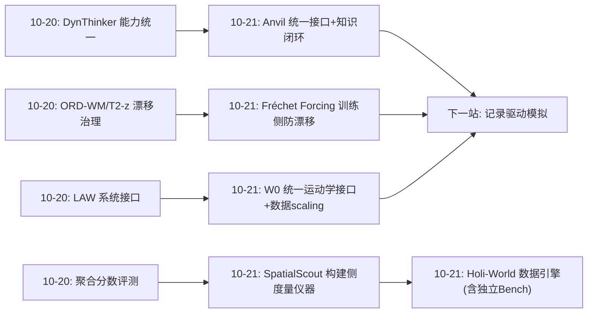
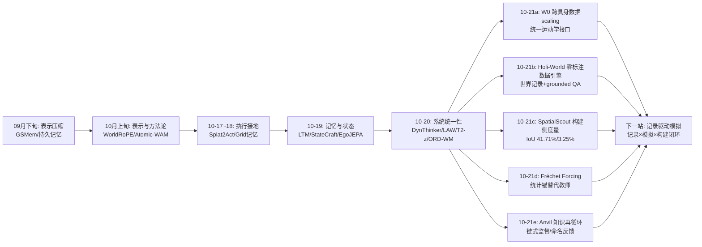
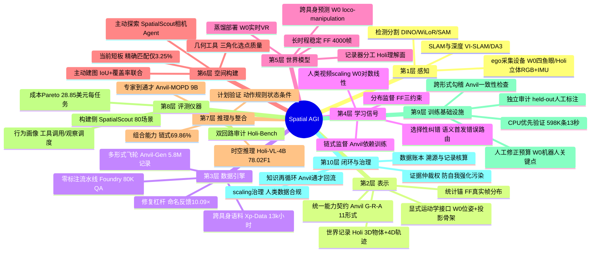
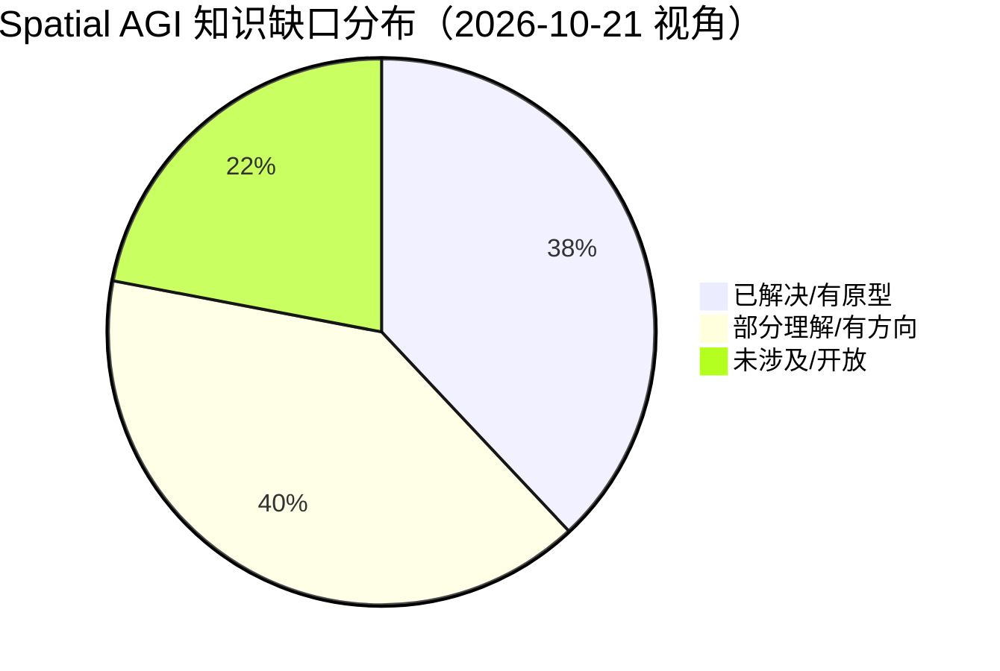

# Spatial AGI 每日深度思考 — 2026-10-21

## 📅 每日总结

**日期**: 2026-10-21
**论文数量**: 5篇
**主题**: 空间智能的"基础设施化"——数据引擎、评测仪器、训练信号、稳定性配方、知识闭环五个方面，空间智能正在从"模型论文"时代转入"系统工程"时代

**论文清单**:
1. Ropedia W0 (arXiv:2610.26855) — 跨具身 loco-manipulation 世界基础模型，人类视频 scaling 定律
2. Holi-World (arXiv:2610.26549) — 零标注 ego 经验 → 世界记录 → grounded QA 的自动数据引擎
3. SpatialScout (arXiv:2610.26659) — 首个主动探索+物体级 3D 建图基准，量化 VLM 的空间构建短板
4. Fréchet Forcing (arXiv:2610.25666) — 免教师、免长视频的长时程世界模型稳定化配方
5. Anvil (arXiv:2610.21882) — Ground-Relation-Act 统一接口 + 知识再循环的空间数据操作系统

**关键突破**:
- 🚀 **人类视频是机器人空间智能的燃料**：W0 用统一显式运动学接口（相机位姿+投影骨架）把 10k 小时人类自我中心视频变成跨具身世界模型的预训练语料，scaling 曲线在人类与机器人评估上**同时单调上升**——"人类经验→机器人能力"从愿景变成实验事实
- 🚀 **空间数据可以零标注自动化**：Holi-World Foundry 把野外 ego 录像自动转为持久 3D 物体+动态 4D 轨迹+80K 可溯源 QA，4B 有据训练模型在时空推理上碾压 27B 零样本（78.02 vs 43.67 F1）——数据质量>模型规模的空间版证据
- 🚀 **空间"理解"与空间"构建"的鸿沟被量化**：SpatialScout 让前沿 VLM 主动探索建 3D 地图，最强的 Claude Opus 5.5 平均 IoU 只有 41.71%、精确匹配（IoU>0.9）仅 3.25%——答题能力完全不等于建图能力
- 🚀 **长时程漂移有了 36 GPU 小时的解法**：Fréchet Forcing 用"真实统计 Fréchet 距离 + 条件 FM 锚定"替代教师蒸馏，1B 流式世界模型稳定 rollout 从 253 帧拉到 4,000+ 帧（16×），DROID 末段 FVD 降 25 倍
- 🚀 **空间组合能力必须链式训练**：Anvil 的受控实验给出 44.68% vs 69.86% 的对照——单独学会的 Ground 和 Relation 拼不起来，语法修复只能追回一半差距；加上命名反馈修复 10.09× 的发现，数据工程的每个决策第一次有了量化依据

**架构演进**: 昨日"系统统一性工程"（能力/效率/接口/适应/物理统一） → 今日"基础设施化"（数据引擎、评测仪器、训练信号、稳定配方、知识闭环——空间智能的"公路、电网、计量局"正在成型）

### 📊 一句话总结

今天的五篇论文不约而同地把焦点从"模型能做到什么"转向"什么让模型持续变好"——W0 与 Holi-World 建数据引擎，SpatialScout 造评测仪器，Fréchet Forcing 提纯训练信号，Anvil 打通数据↔模型闭环；**Spatial AGI 的护城河正在从模型架构转移到基础设施**。

### 🔗 延续性

**昨日→今日**: 昨日主题是"系统统一性"（DynThinker 的能力统一、GeoThinker-F 的表征统一、LAW 的接口统一、T2-z 的适应统一、ORD-WM 的物理统一）。今天的论文在三个方向上承接：① 昨日问"模型怎么统一"，今日问"统一的模型拿什么喂"——Holi-World/Anvil/W0 三个数据引擎是统一模型的燃料库；② 昨日 T2-z/ORD-WM 攻长时程漂移的推理/结构侧，今日 Fréchet Forcing 补上训练信号侧；③ 昨日各模型的评测都是聚合分数，今日 SpatialScout 提供了"构建侧"的显微镜。

**今日→明日**: 值得追踪：① W0 的世界模型 rollout 与 Holi-World 的世界记录合流（记录驱动模拟）；② Anvil 的 11-contract 接口吸收 3D 公制构建作为第 12 种能力（回应 SpatialScout 的短板）；③ FF 的统计锚扩展出"空间一致性约束"（物体恒常/几何刚性进特征空间）；④ 三个数据引擎（Foundry/Xp-Data/Anvil-Gen）的 schema 融合尝试。

### 💡 本质思考：如何达成通用空间智能

#### 1. 核心能力的本质是什么？

延续昨日的四块拼图（状态维护+空间绑定+效果接地+系统一致性），今天必须加上第五块，也可能是最根本的一块：**可改进性（improvability）**——一个空间智能系统不仅要"现在行"，还要"能持续变好"。今天五篇论文全部在为可改进性服务：

- W0：可改进性的数据维度——人类视频 scaling 保证上限随数据增长；
- Holi-World：可改进性的生产维度——零标注自动化保证数据供给不依赖人力；
- SpatialScout：可改进性的度量维度——没有显微镜就无法知道哪里该改进；
- Fréchet Forcing：可改进性的训练维度——长时程能力的训练信号首次闭环；
- Anvil：可改进性的组织维度——数据↔模型双向循环让改进成为制度而非事件。

一个深刻的观察：这五个维度恰好构成一个"学习系统"的完备要素（数据、生产、度量、信号、组织）。空间智能的竞争已经从"谁的模型好"变成"谁的学习系统好"。

#### 2. 当前方法与理想目标的差距在哪里？

- **构建侧的能力真空**：SpatialScout 揭示 IoU>0.9 匹配只有 3.25%——VLM 的空间知识是"区域级"的，离机器人需要的"米级精确"差一个数量级；而 Anvil 的 grounding 是 2D 框级别，3D 公制构建的监督路线尚未打通；
- **长时程稳定仍是"延后"而非"根除"**：FF 让漂移从 253 帧推到 4,000 帧，但 Sekai FVD 仍在缓慢上升（186→441）；统计锚保证"像真的"，不保证"是对的"——结构性空间错误（墙移一米但纹理自然）完全逃过 FD 约束；
- **数据引擎各有盲区且互不兼容**：Foundry 强几何弱动作、Anvil 强语义弱 3D 公制、Xp-Data 强视频弱结构化——三个引擎的 schema 不打通，社区就在重复建设；
- **评测成本高到排除大多数人**：SpatialScout 一次前沿模型全量评测约 2,300 美元、Anvil 蒸馏是 9B×多专家——基础设施化的另一面是门槛的提高；
- **闭环的"自我强化污染"风险**：Anvil 用证据仲裁权防住了，但 W0/Holi-World 的生成式 rollout 数据回流尚无等价机制。

#### 3. 从今天到理想状态，最可能的路径是什么？

**路径判断：基础设施整合 → 构建侧攻坚 → 闭环自治 → 常识级空间推理。**

- 近期（3-6 个月）：Foundry/Anvil 式数据引擎被大厂复制并互相借鉴 schema；SpatialScout 式构建评测加入各家训练循环（成功轨迹 SFT、IoU 做 RL 奖励）；FF 配方成为流式世界模型发布前的标准"最后一公里"；
- 中期（6-18 个月）：出现"记录驱动模拟"的合流系统——世界记录（Foundry/Anvil）作为世界模型（W0/FF）的结构化条件与评测底座；空间 QA、建图、预测三类能力在同一数据基础设施上训练；3D 公制 grounding 被攻克（把 SpatialScout 式任务变成 contract）；
- 远期（18 个月+）：空间智能体具备"走进新环境边走边记（Foundry）、对不确定处主动看（SpatialScout）、在想象中试错（W0+FF）、错了能被指出并修复（Anvil）"的完整学习闭环——到那一步，空间智能才开始有"常识积累"的资格。

---

## 🔗 与昨日思考的联系

### 昨日重点

昨日（2026-10-20）的主题是"系统统一性工程"：DynThinker 证明能力干扰可参数级诊断与干预（D-EMA）；GeoThinker-F 证明几何先验可以内生（去 VGGT 化，3.6× 加速）；LAW 用语义子任务进度统一系统各模块的时间尺度（65% vs π0.5 的 28.33%）；T2-z 把环境推断变成潜空间优化问题；ORD-WM 把 SE(3) 刚体动力学写进世界模型的转移律。核心结论：空间智能从"单点能力"走向"统一系统"，一致性的五个侧面（训练/推理/运行/适应/演化）各有着落。

### 今日进展

今天的五篇论文把视角从"系统内部"拉到"系统外部"——**系统赖以生存的基础设施**：

1. **承接昨日"统一模型"的追问**：统一模型需要统一的数据供给。W0 的统一运动学接口（位姿+骨架）与 Anvil 的统一能力接口（Ground-Relation-Act）是同一哲学在数据侧的投影：先统一接口，再谈规模。
2. **承接昨日"长时程漂移"的战场**：昨日 ORD-WM 用物理结构、T2-z 用测试时优化治漂移；今日 Fréchet Forcing 补上训练信号侧——三者构成"结构化预防（ORD-WM）+ 训练时免疫（FF）+ 推理时修复（T2-z）"的完整防漂移体系。
3. **承接昨日"效率一等公民"的判断**：今日的效率故事换了主角——不是推理效率（GeoThinker-F 的 3.6×），而是**数据生产效率**（Holi-World 的 325 秒/2,463 条、Anvil 的 13.26 秒/598K 重检、W0 的"人类视频替代机器人遥操作"）与**修复效率**（Anvil 命名反馈 10.09×）。
4. **补上昨日缺席的"度量"**：昨日所有模型都用聚合分数自证；今日 SpatialScout 给出"构建侧"的过程级评测仪器（map trace 回放、行为画像、成本 Pareto），Anvil 给出"训练侧"的受控实验规范——空间智能的度量体系正在专业化。

### 演进路径



昨日解决了"模型怎么统一"，今日解决"统一从哪来、往哪去、怎么量、怎么持续"——基础设施化的四根支柱（数据、信号、度量、闭环）立起来了。

---

## 📚 论文概览

1. **Ropedia W0**（NTU Ziwei Liu 组）：首个跨具身 loco-manipulation 世界基础模型。用"公制相机位姿 + 投影骨架"的图像对齐显式运动学接口统一人类/夹爪/灵巧人形三类具身，10k 小时人类视频预训练 + 3k 小时机器人 mid-train，五基准 SOTA，蒸馏后实时分钟级 rollout + VR 交互。核心贡献：跨具身接口 + 人类数据 scaling 定律。

2. **Holi-World**（同团队）：自动数据引擎。立体 ego 录像 → Foundry 流水线（VI-SLAM/DA3/3DGS/双检测器/VLM 审查）→ 持久 3D 物体 + 动态 4D 轨迹 + 80K grounded QA → 4B 时空推理模型（78.02 F1 > 27B 零样本）→ 独立人工 Bench 双回路验证。核心贡献：零标注世界记录生产 + "记录器"定位。

3. **SpatialScout**（北大/天大）：主动探索+物体级 3D 建图基准。80 场景 3,140 目标，10 工具统一接口，联合评测定位精度与覆盖率。前沿模型最大短板被量化：Claude Opus 5.5 IoU 41.71%、精确匹配 3.25%、每任务 28.85 美元。核心贡献：构建侧度量仪器 + 失败模式分类学。

4. **Fréchet Forcing**：长时程世界模型训练配方。三约束（生成锚定/上下文保真/现实匹配）+ 四设计（clip 中心化/graded 统计/DINOv2 特征空间/真实 chunk 收尾），免教师免长视频，36 GPU 小时把 253 帧 → 4,000+ 帧稳定。核心贡献：分布监督替代教师蒸馏 + 四失败模式分类学。

5. **Anvil**（中大/Knowin.AI/港科广）：空间数据操作系统。Ground-Relation-Act 11 contract 统一接口，5.8M 源接地记录，跨形式勾稽验证 + 命名反馈修复，语义首发错误路由多教师蒸馏（9B 通才，7 基准 +9.29），知识再循环闭环。核心贡献：数据↔模型双向闭环 + 链式监督的量化论证。

---

## 💡 核心见解

### 见解1: 人类视频是空间智能的"石油"——scaling 曲线终于连通人类与机器人

从 W0 获得

- ✅ 人类预训练小时数与 held-out 人类视频的 8 项指标全部对数-线性单调改善（Fig. 6）
- ✅ 同样的 scaling 曲线在三个机器人基准的迁移评估上也单调上升（Fig. 7）
- ✅ 1% 后训练数据下，W0 预训练初始化比官方视频基座高 4.8-7.1 dB，且超过后者 100% 数据的效果

**对Spatial AGI的启发**:
这条曲线的经济学含义大于技术含义：机器人遥操作数据每小时成本是人力级，人类视频边际成本趋零。如果"人类经验 → 机器人空间能力"的转化率稳定为正，空间智能的数据上限将由互联网级自我中心视频决定。W0 的 scaling 证据 + Holi-World 的零标注生产 + Anvil 的自动验证，三者合起来宣告：**空间智能的数据瓶颈已经从"没有数据"变成"没有管道"**。下一个竞争点是管道的通量与纯度（标注质量、具身对齐自动化），而非源头。

### 见解2: 统一显式接口打败专用适配——数据侧的"token 时刻"前夜

从 W0 与 Anvil 共同获得

- ✅ W0：一个"位姿+投影骨架"接口通吃 27+ 数据流、8 种评估具身，5B 打赢 14B 专用基线
- ✅ Anvil：Ground-Relation-Act 11 contract 让异构专家知识可整合，9B 通才 +9.29 点
- ✅ 两者的接口都是"显式、结构化、可验证"的，与 latent action / 自由文本形成对比

**对Spatial AGI的启发**:
NLP 的爆发依赖统一 token 空间；W0 与 Anvil 分别在动作侧和能力侧逼近空间智能的"token 时刻"。有趣的是两者的接口设计哲学一致：**图像对齐（W0）或源接地（Anvil）的显式结构**，宁可付出标注/投影成本也要换取可验证性。latent 表示便宜但无法勾稽——当数据规模上去之后，可验证性成为瓶颈，显式接口就会反超。预测：2027 年会出现把两者合并的"空间-动作统一词表"（3D 关键点/场景图操作的离散化语言）。

### 见解3: 空间智能的"知道-做到"鸿沟被精确测量：41.71% 和 3.25%

从 SpatialScout 获得

- ✅ 答题侧看似健康（VSI-Bench 等 QA 分数持续上涨）的同一批模型，建图侧 IoU>0.9 匹配只有 3.25%
- ✅ 失败不是"不努力"：DeepSeek 拍照更多反而更差（39.63 vs 32.41 张）；差距在三角化选点质量（警告率 38.65% vs 2.69%）
- ✅ 行为可诊断：观察频率随进度衰减 = 空间表示维护失败的早期症状

**对Spatial AGI的启发**:
这是继"counting 翻车"之后视觉模型最刺眼的一次能力悬崖，且性质更根本：QA 能力是"语义空间"，建图能力是"度量空间"，两者在当前 VLM 的表征里几乎不连通。给空间智能研发的三个直接行动：① 不要用 QA 分数代理空间能力，建图/定位类显式几何评测必须进测试集；② 短期最大的杠杆是"几何工具调用质量"（7cm vs 68cm 全在这一项）；③ 中期需要把主动构建任务放进训练循环——SpatialScout 的成功轨迹就是现成的 SFT 语料。

### 见解4: 教师蒸馏的长时程死胡同与统计监督的破局

从 Fréchet Forcing 获得

- ✅ 动作条件世界模型的教师两难被严格证明：外部教师不懂动作（拉错分布），自教师会漂（无纠错信号），实验中两者都不如基线
- ✅ 破局思路：长 rollout 不必匹配教师，只需"现实+忠于场景+听话"——前两条用真实数据统计的 FD（horizon 无关），第三条预训练 FM 损失本来就在管
- ✅ 36 GPU 小时、无教师、无长视频，稳定时域 16×

**对Spatial AGI的启发**:
这个"统计锚替代教师"的思路适用于一切自回归空间生成系统（视频、3DGS 流、占据场）。更深的启示是**监督信号的分层哲学**：逐样本的因果性（动作跟随）用回归，总体的统计性（现实性/场景身份）用分布匹配——不同性质的目标用不同性质的监督。剩下的未解问题同样深刻：FD 对"结构性错误"（统计自然但几何荒谬）是盲的，空间一致性约束（物体恒常性/几何刚性）进特征空间是下一个必答题。

### 见解5: 四种失败模式 = 自回归空间系统的通用病灶图谱

从 Fréchet Forcing 获得

- ✅ Context decoupling：50 步内场景依赖度 0.92→0.50，rollout 趋同到数据集平均外观
- ✅ Gradient-statistic misalignment：测的和改的不一致（detach 前缀主导统计），对齐余弦 0.96→0.39
- ✅ Feature-space exploitation：训练损失单调降而感知质量回升后恶化——模型用暗场/周期纹理钻低阶统计的空子
- ✅ Boundary redraw：自生成历史与目标的分布接缝诱导每 chunk 周期性重画（flicker 1.31）

**对Spatial AGI的启发**:
这张病灶图谱的价值超过 FF 方法本身：任何"模型消费自己输出"的系统（视频世界模型、3DGS 流、agent 记忆维护、甚至 LLM 长程一致性）都会踩这四个坑。对应的四味药（clip 中心化、graded 统计、感知特征空间、真实数据收尾）可以直接抄。配套的三个诊断探针（context slope / alignment cosine / 外部裁判一致性）应该成为长时程训练的标准 dashboard——**长时程能力的竞争正在从"谁撑得久"转向"谁看得清自己为什么漂"**。

### 见解6: 空间组合能力不会免费涌现——44.68% vs 69.86% 的方法论价值

从 Anvil 获得

- ✅ 分别学会的 Ground（定位）与 Relation（关系），严格联合成功只有 44.68%
- ✅ 修复输出语法（闭合 stage 标签、JSON 不变）后升到 44.68%→仍远低于链式监督的 69.86%
- ✅ 结论：一半差距是格式（可修），一半是内容依赖（必须链式训练"下游消费上游输出"）

**对Spatial AGI的启发**:
这个对照实验回答了多阶段空间系统的经典疑问："各模块分别 SOTA 为什么拼起来不行？"答案被干净地分解为语法与依赖两部分。对系统设计者的直接指令：① 训练数据必须包含"下游真实消费上游输出"的链式样本，光有各阶段的独立正确不够；② 评测必须区分"阶段能力"与"错误传播"（Anvil 的受控上游替换：换掉上游 box，Relation 掉 10.64 点）；③ 这也解释了 SpatialScout 的惨淡成绩——VLM 从未在链式空间构建上被训练过。

### 见解7: 错误信息的粒度决定修复效率——10.09× 的杠杆

从 Anvil 获得

- ✅ 同样 885 个失败候选、各一次模型调用：带"失败类别名"的反馈修复 10.09× 于盲重试
- ✅ 归一化 GPU 时后仍 9.90×（39.38 vs 3.98 条正确记录/时）
- ✅ 修复收益集中于深度序（失败类型可清晰命名），grounding 难修（定位错误缺类型学）

**对Spatial AGI的启发**:
这是数据工程里性价比最高的单点改进：验证器从输出"拒绝"升级为输出"失败类别名"，成本几乎为零，收益一个数量级。它背后的原理是**修复搜索空间的剪枝**：类别名把无限修复空间剪到一个维度。推论：想高效修复什么能力，先给那个能力建失败分类学（taxonomy）——SpatialScout 的失败 taxonomy 与 FF 的四失败模式正是各自领域现成的分类学起点。"诊断先于修复、分类学先于诊断"，这条链应该写进所有数据引擎的设计文档。

### 见解8: 三个数据引擎的分工与合流——空间智能的"基础设施工业"成形

从 W0、Holi-World、Anvil 三者对照获得

- ✅ Foundry（Holi-World）：感知流水线，几何为主（3D 物体+4D 轨迹），零标注，VLM 只当审查员
- ✅ Xp-Data（W0）：视频为主（位姿+骨架+帧），人工关键点修正保质量，服务世界模型预训练
- ✅ Anvil-Gen：语义-动作为主（11 形式），跨形式勾稽+失败修复，服务通才蒸馏
- ✅ 三者的共同纪律：可溯源（证据帧/源接地）、多级验证（规则→VLM→人工）、CPU 优先（模型调用只留给语义未决）

**对Spatial AGI的启发**:
三个引擎恰好覆盖空间知识的三个正交面：几何（在哪）、语义（是什么关系）、动作（能做什么）。它们目前 schema 互不兼容，但设计模式惊人一致——这预示"空间数据引擎"正在成为一个有标准做法的工程学科。合流的方向也清晰：Foundry 的世界记录可以作为 Anvil 的第 12-14 种 contract（3D 公制 grounding/轨迹），W0 的世界模型 rollout 可以作为 Anvil 飞轮的合成数据源（经证据仲裁）。**谁先做出"几何+语义+动作"一体的统一数据 schema，谁就掌握 Spatial AGI 的数据定价权。**

### 见解9（补充）: 评测正在从"考试"进化为"仪器"

从 SpatialScout 与 Holi-World 共同获得

- ✅ SpatialScout 的 map-update replay 记录每次地图更新——评测同时是空间表示涌现的显微镜
- ✅ 行为画像（工具调用频率、观察-移动-建图均衡）比最终分数更能定位问题
- ✅ Holi-World 的 Bench 双回路：同一套人工标注既考试又审计自动标注质量
- ✅ 两者都公开成本：28.85 美元/任务、325 CPU 秒/2,463 条——能力必须与经济学一起报告

**对Spatial AGI的启发**:
评测的角色转变是基础设施化的标志：考试（一次性打分）→ 仪器（持续诊断）。SpatialScout 的轨迹回放能直接生成改进方案（观察调度、三角化选点、终止条件各对应一类失败），这种"评测产出研发路线图"的模式值得所有 agentic 基准效仿。成本披露则把空间智能拉入工程现实：**没有成本曲线的能力报告是不完整的**。

---

## 🗺️ 知识演进图



---

## 技术栈演进对比表

| 层次 | 昨日方案（10-20） | 今日方案（10-21） | 变化 |
|------|------------------|-------------------|------|
| 数据来源 | 机器人轨迹+视频（隐含） | 人类ego视频（W0 10k小时）/野外录像（Holi-World） | 人类经验正式成为一级数据源 |
| 标注方式 | 各模型自带数据管道 | 零标注自动引擎（Foundry）/多级勾稽飞轮（Anvil-Gen） | 人工标注从必需品变成抽查手段 |
| 空间动作接口 | LAW 语义进度（时间轴） | W0 位姿+投影骨架（空间轴）；Anvil G-R-A 11 contract（能力轴） | 接口统一从时间维扩展到空间/能力维 |
| 跨具身泛化 | （未直接涉及） | 统一接口零样本跨 8 具身（W0）；mid-train 优于全量后训练 | 从单具身优化转向具身无关表示 |
| 长时程稳定性 | 结构化动力学（ORD-WM）+测试时优化（T2-z） | 统计监督训练免疫（FF：253→4000帧） | 防漂移三件套成型：结构+训练+推理 |
| 空间组合 | DynThinker 能力干扰治理 | 链式监督训练依赖（69.86% vs 44.68%） | 从"不忘"到"会拼" |
| 空间评测 | 公开基准聚合分数 | 主动建图 IoU+覆盖率（SpatialScout）；过程级仪器（trace回放/行为画像） | 评测从考试变仪器 |
| 教师蒸馏 | 常规 on-policy 蒸馏 | 语义首发错误路由+阶段归一化（Anvil）；统计锚替代教师（FF） | 选择性纠错成为标配 |
| 漂移诊断 | （隐含在模型指标） | 三探针 dashboard + 四失败模式分类学（FF）；失败taxonomy+行为画像（SpatialScout） | 训练动力学可观测化 |
| 数据-模型关系 | 单向（数据→模型） | 双向闭环：通才回流验证、证据仲裁（Anvil）；人类数据scaling反哺（W0） | 学习系统取代单次训练 |

---

## 🗺️ Spatial AGI 知识图谱

### 10层架构思维导图



### 🎯 主线技术路径

#### 阶段1: 能力演示期（~2026-09）

世界模型、空间 QA、3DGS 记忆各自 demo；评测以选择题为主；数据靠人工与仿真器。代表：早期 VSI-Bench 类评测、单点世界模型。

#### 阶段2: 表示与方法论期（2026-10 上旬）

表示压缩（WorldRoPE/Atomic-WAM/StateCraft）、执行接地（Splat2Act）、记忆机制（LTM）确立了"表示决定上限"的共识；评测开始出现构建侧萌芽（Theory of Space、IR3D-Bench）。

#### 阶段3: 系统统一期（2026-10 中旬，10-20）

DynThinker/LAW/T2-z/ORD-WM 把散点能力包装成统一系统：能力统一（训练动力学）、效率统一（内生先验）、接口统一（语义进度）、适应统一（潜变量优化）、物理统一（结构化转移律）。系统一致性的五个侧面各有着落。

#### 阶段4: 基础设施期（2026-10 下旬，当前 ← 今天）

今天的五篇论文宣告基础设施期到来：数据引擎（W0 Xp-Data / Holi-World Foundry / Anvil-Gen）、度量仪器（SpatialScout + 双回路 Bench）、训练信号（FF 统计监督 + Anvil 链式监督）、知识闭环（Anvil 再循环）四个支柱同时立项并交付原型。竞争焦点从"模型论文"转向"学习系统"。

#### 阶段5: 合流与自治期（可预期）

数据 schema 融合（几何+语义+动作一体的统一空间格式）；记录驱动模拟（世界记录作为世界模型的条件与底座）；构建侧攻坚（3D 公制 grounding 进训练 contract）；闭环自治（走进新环境边走边记、主动补盲、想象试错、错了能修）。到这一步，空间智能体才具备"自我改进的空间常识积累"能力。

---

## 🔍 待探索议题

### 高优先级（本周）

1. **世界模型 rollout 接入数据飞轮**
   - 问题: W0/FF 式长 rollout 能否作为 Anvil 飞轮的合成数据源？合成监督如何通过证据仲裁？
   - 候选方案: rollout 生成 → FF 统计锚保现实性 → Anvil 跨形式勾稽验一致性 → 源接地记录入库
   - 缺口: 生成数据的"证据链"定义（rollout 没有真实对应物，证据仲裁需要新协议）

2. **3D 公制构建进训练 contract**
   - 问题: SpatialScout 揭示精确匹配仅 3.25%，Anvil 的 11 contract 里没有 3D 公制估计
   - 候选方案: 把"主动探索下的 3D 中心估计"做成第 12 contract；SpatialScout 成功轨迹做 SFT、IoU 做 RL 奖励
   - 缺口: 建图轨迹数据的生产成本；仿真-真实 gap 对 IoU 的影响

3. **空间一致性约束进 FF 特征空间**
   - 问题: FD 对结构性错误（统计自然但几何荒谬）是盲的
   - 候选方案: 物体 box 时序平滑/深度一致性/穿透检测作为第四个分布约束的特征通道
   - 缺口: 几何特征的可微统计化（box 序列怎么算 Fréchet 距离）

4. **数据 schema 融合**
   - 问题: Foundry/Xp-Data/Anvil-Gen 三引擎 schema 互不兼容，社区重复建设
   - 候选方案: 以 Anvil 的 contract 机制为骨架、Foundry 的世界记录为几何层、Xp-Data 的位姿-骨架为动作层，定义统一空间数据格式（参考 W0 的 source/window 记账）
   - 缺口: 三团队的格式协商；向后兼容负担

### 中优先级（本月）

5. **W0 蒸馏后的漂移检查**
   - 问题: W0 的实时分钟级 rollout 依赖蒸馏，蒸馏可能引入 FF 所修的漂移
   - 候选方案: FF 三约束作为蒸馏后处理；flicker/CLIP-FD dashboard 监控蒸馏前后
   - 缺口: 蒸馏-FF 联合训练的梯度交互分析

6. **观察调度作为可训练策略**
   - 问题: SpatialScout 显示观察频率衰减是弱模型通病，当前靠 prompting 涌现
   - 候选方案: "每 N 步强制重观察"基线 → RL 奖励覆盖增量；空间不确定性驱动的主动感知头
   - 缺口: 覆盖增量的低方差估计器

7. **跨会话世界记忆**
   - 问题: Holi-World 世界记录是单会话的，机器人需要跨天一致的物体记忆（重排检测+ID 续接）
   - 候选方案: 记录合并层（场景级 diff + 身份匹配）；W0 类世界模型提供"重排想象"先验
   - 缺口: 跨会话重访基准（现有 Bench 都是单会话）

8. **失败分类学的系统化建设**
   - 问题: Anvil 修复收益集中在 depth order（可命名），grounding 难修（无类型学）
   - 候选方案: 为每种 contract 建立失败 taxonomy（定位错误的方向/尺度/遮挡子类），验证器输出结构化失败码
   - 缺口: 各能力的失败模式标注数据；分类学粒度与修复收益的定量关系

### 低优先级（本季度）

9. **主动性的价值量化**
   - 问题: 给被动流水线（Foundry 式）与主动 Agent（SpatialScout 式）同样的视角选择权，增益多大？
   - 候选方案: 在同一场景集上做主动 vs 随机视角的建图对照
   - 缺口: 主动性收益的公平测量协议

10. **统计现实 vs 结构正确的边界测定**
    - 问题: FF 的统计锚放过"墙移一米但纹理自然"的结构错误——空间错误能"骗过"DINOv2 到什么程度？
    - 候选方案: 构造对抗集（统计自然但几何错误的 rollout），测各特征空间的检出率
    - 缺口: 结构错误的自动化生成器

11. **空间数据合规框架**
    - 问题: W0 的 10k 人类视频、Holi-World 的野外 ego 记录——隐私（路人面孔、私人空间）无系统讨论
    - 候选方案: ego 视频的自动脱敏管道（人脸/牌照/门牌）进数据引擎流水线；记录级授权追踪
    - 缺口: 合规成本对 scaling 曲线的影响评估

12. **基础设施成本曲线**
    - 问题: SpatialScout 全量评测 2,300 美元、Anvil 蒸馏 9B×多专家——基础设施化推高了入场门槛
    - 候选方案: 评测与训练成本的公开基准（每能力点的美元成本）；蒸馏预算的边际收益曲线
    - 缺口: 跨论文的成本口径统一

---

## 📊 知识缺口分析



**已解决/有原型（38%）**:
- ✅ 跨具身世界模型的统一接口与人类数据 scaling（W0）
- ✅ 零标注空间 QA 数据自动生产（Holi-World Foundry）
- ✅ 空间构建能力的度量仪器与失败分类学（SpatialScout）
- ✅ 长时程流式生成的训练侧稳定化（FF，至 4k 帧量级）
- ✅ 异构空间知识的整合与数据-模型闭环（Anvil）
- ✅ 能力统一、接口统一、物理统一的系统化（昨日+今日合流）

**部分理解/有方向（40%）**:
- ⚠️ 4k 帧之外的稳定性：FVD 残余上升，小时级 rollout 未知（FF）
- ⚠️ 结构正确性：统计锚对几何荒谬的盲区（FF 的边界）
- ⚠️ 空间组合的训练配方：链式监督有效但最优深度/课程未知（Anvil）
- ⚠️ 2D→3D 公制 grounding 的数据路线（SpatialScout 揭示短板，Anvil 未覆盖）
- ⚠️ 生成式数据的证据仲裁协议（W0/Holi rollout 回流的前置）
- ⚠️ 跨会话/跨天的持久世界记忆（Holi-World 单会话）
- ⚠️ grounding 级错误的修复（Anvil 命名反馈止步于 depth order）
- ⚠️ 主动感知策略的训练化（SpatialScout 行为靠涌现）

**未涉及/开放（22%）**:
- ❌ 可变形体/流体/关节体的统一物理（ORD-WM 刚体假设的扩展）
- ❌ 开放世界空间监督（Anvil 附录 G 自认：预设接口之外的无限能力空间）
- ❌ 组合式空间能力的涌现机制（专家整合 ≠ 组合泛化）
- ❌ 通过真实交互（而非数据回灌）的空间学习
- ❌ 空间智能的常识级抽象（"咖啡机旁边能放杯子"级的功能推理规模化）
- ❌ 多智能体共享空间表示（谁的世界记录是权威？）
- ❌ 隐私合规与空间数据治理的工程标准

---

## 📈 本周主线追踪

**长时程漂移战役的战报**（追踪 10-17 以来）：

| 日期 | 论文 | 战线 | 战果 |
|------|------|------|------|
| 10-19 | StateCraft | 抽象状态层 | 离散状态机的长时程推理 |
| 10-20 | T2-z | 推理时 | 环境潜变量测试时优化 |
| 10-20 | ORD-WM | 结构层 | SE(3) 刚体动力学零漂移 |
| 10-20 | LAW | 系统层 | 语义进度对齐长时程协调 |
| 10-21 | Fréchet Forcing | **训练层（新）** | 统计锚免疫：253→4000帧 |
| 10-21 | W0 | 数据层 | 分钟级蒸馏 rollout + VR |

**战局判断**：漂移治理的五个战线（状态/推理/结构/系统/训练）已全部有代表工作。下一个差异化空间在"组合拳"——结构化预防+训练免疫+推理修复的叠加效果，以及向小时级的最后冲刺。

**数据基础设施战役的战报**（今日开战）：

| 引擎 | 几何 | 语义 | 动作 | 规模 | 闭环 |
|------|------|------|------|------|------|
| Holi-World Foundry | ★★★ | ★★ | ✗ | 100场景/80K QA | 双回路审计 |
| W0 Xp-Data | ★★（位姿骨架） | ★ | ★★（骨架动作） | 13k小时 | scaling验证 |
| Anvil-Gen | ★（2D级） | ★★★ | ★★★ | 5.8M记录 | 知识再循环 |

**战局判断**：三者正交且互补，"统一空间数据格式"是下一张通票。收购/合作/开源联盟——数据基础设施的商业与社区博弈即将开始。

---

## 🧭 明日展望

基于今日基础设施化的趋势，明日值得关注的论文信号：

1. **关键词雷达**：unified spatial dataset / world record / active mapping RL / distillation drift / spatial consistency loss / cross-embodiment transfer
2. **团队雷达**：Ropedia/NTU 组（W0+Holi-World 之后的第三块拼图？）、北大 SpatialScout 组的构建侧训练实验、Knowin.AI 的 contract 扩展
3. **数字雷达**：任何"小时级 rollout"、"3D 公制 grounding 训练"、"构建任务 RL"的新报告

---

**文档创建时间**: 2026-10-21 03:xx (Asia/Shanghai)
**精读论文**: 2026-10-21 五篇（W0 / Holi-World / SpatialScout / Fréchet Forcing / Anvil）
**延续自**: daily_thinking/2026-10-20.md

---

## 🔬 深化思考一：基础设施化的三个标志与一个悖论

### 标志一：论文的主语从"模型"变成"系统"

对比近一个月论文标题的语法演变：
- 早期："XX-Net: a model for spatial reasoning"（主语是模型）
- 上周："XX-WM: world action model for manipulation"（主语还是模型）
- 今天："Anvil: Scaling Embodied Spatial Intelligence through Knowledge Recirculation"（主语是机制/循环）；"Holi-World: Building Holistic World Intelligence from Human-Ego Experience"（主语是生态）

当论文标题里出现 flywheel、ecosystem、recirculation、infrastructure 这类词时，说明作者认为单点模型已经不够发一篇重要论文了——**重要的贡献单位变成了"让模型持续变好的机制"**。

### 标志二：实验报告里出现了"成本表"

- SpatialScout：28.85 美元/任务（Claude Opus 5.5）、评测全量约 2,300 美元
- Anvil：325 CPU 秒/2,463 条构建、13.26 秒/598,891 条重检、39.38 vs 3.98 条正确记录/GPU 时
- FF：≤36 GPU 小时（换来 16× 稳定时域）
- W0：10k 小时人类视频 vs 3k 小时机器人数据的成本不对称（隐含主旨）

成本进正文且带归一化对比，说明空间智能的评估标准已经接受"能力/美元"作为一等指标。这是工程学科成熟的标志（芯片行业 decades 前经历过同样的转变）。

### 标志三：验证成为独立学科

三篇论文各自发明了多层验证：Foundry 的"规则→VLM 审查→人工 Bench"、Anvil 的"跨形式勾稽→命名反馈修复→证据仲裁"、W0 的"重投影一致性→双检测器→人工修正"。方法不同但结构同构：**廉价信号大规模筛、昂贵信号定向查、人工信号仲裁终审**。验证在数据引擎中的地位相当于测试在软件工程中的地位——它不再依附于生成，而是独立的设计对象。

### 一个悖论：基础设施化同时降低了模型门槛、抬高了的系统门槛

好消息：FF 让"长时程世界模型"从大厂专属变成 36 GPU 小时的微调作业；Holi-World 证明零标注引擎可行——小团队第一次可以玩得起。
坏消息：竞争的单位变成了"数据引擎+评测仪器+蒸馏管线+闭环治理"的全家桶——单个组件可复现，全家桶的整合能力才是护城河。SpatialScout 惨淡的 3.25% 恰好是警示：**没有任何一篇今天的基础设施论文解决了构建精确性的问题本身**。基础设施让"知道在哪缺"变便宜了，但"补上缺口"仍然是硬仗。

---

## 🔬 深化思考二：构建侧攻坚的三条候选路线

SpatialScout 的 3.25% 是今天最重要的数字。三条可能的攻坚路线：

### 路线A：数据路线（Anvil 扩展）

把"主动探索下的 3D 公制估计"做成 Anvil 的第 12 contract，用仿真器批量生产（场景+清单+GT 坐标现成），链式监督训练"探索→关联→估计→修订"。SpatialScout 的 80 场景做 held-out 评测。

- 优势：管线全部现成，SpatialScout 轨迹是天然训练信号
- 风险：仿真-真实 gap；建图轨迹的多样性受场景库限制
- 预估：4B 模型 + 5M 链式建图记录，IoU>0.5 有望从 47% 推到 80%+，但 IoU>0.9 可能撞上"回归到条件均值"的天花板（FF 发现的 FM 偏差在定位任务上的对应物）

### 路线B：工具路线（SpatialScout 自己的方向）

三角化警告率与中心误差的强相关（38.65%→68cm vs 2.69%→7cm）说明瓶颈在工具使用质量。训练一个"跨视角对应专家"（给两个视角的图像+物体，输出同一物理点的像素坐标），作为 Agent 的外挂技能。

- 优势：任务定义窄、数据可自动生成（同一物体的多视角渲染）、效果可直接测量
- 风险：工具专家的误差上界就是最终上界；跨视角对应在遮挡/重复纹理处原理性困难
- 预估：对应质量提升 1 个数量级，中心误差有望进入 cm 级——这条线最接近 SpatialScout 失败分析里"低残差但对应错误"（21/34）的病灶

### 路线C：世界模型路线（W0/FF 交叉）

让世界模型在"想象中"预演探索：给定初始观测与候选视角序列，W0 预测会看到什么，FF 保证长时程不漂——Agent 用想象评估视角信息增益，减少真实探索预算。建图精度由"想象-现实一致性"间接约束。

- 优势：主动性的完整形态（空间智能的"内心排练"）；与记录器（Holi）合流后可跨会话积累
- 风险：想象误差直接污染视角选择；当前世界模型的物体级精度（W0 是像素级）不足以支撑 cm 级建图
- 预估：这是终局形态但为时尚早——需要先有 A/B 路线的精确性基础

**判断**：A/B 并行（6 个月内有戏），C 是 A/B 成熟后的合流方向。三者共享同一个前提：**构建任务必须进训练循环**——这是今天所有论文合起来指向的下一步。

---

## 🔬 深化思考三：防漂移五件套的统一理论候补

追踪一周的漂移治理工作后，一个统一框架隐约浮现：

```
漂移 = 自回归系统消费自身输出时的分布偏移累积

五种治理 = 五种"外部参照系"的引入方式：
  结构参照  ORD-WM：物理不变量写进转移律（SE(3)/刚体假设）
  训练参照  FF：真实数据统计锚（FD, horizon无关）
  推理参照  T2-z：当前交互作为环境潜变量的优化目标
  状态参照  StateCraft/ORD-WM：显式状态机（离散/连续）
  系统参照  LAW：语义进度作为共享时间轴（模块间对齐）
```

统一命题：**漂移的本质是参照系缺失——自回归系统只参照自己就会漂；所有治理方案都是在系统外找一个"不会陪你漂"的锚**。

- 物理定律不会漂（ORD-WM）
- 真实数据分布不会漂（FF）
- 当前观测不会漂（T2-z）
- 显式状态定义不会漂（StateCraft）
- 任务语义进度不会漂（LAW）

这个视角给出两个预测：
1. **最优方案是"多锚冗余"**：单锚都有盲区（物理锚管不了非刚体、统计锚看不见结构错误、观测锚噪声大、状态锚定义不完备、语义锚靠 LLM 不可靠）——多锚交叉验证才能覆盖漂移空间。Anvil 的跨形式勾稽其实就是多锚思想在数据侧的投影。
2. **漂移治理将标准化为"锚配置"问题**：未来世界模型的训练/部署配置单里会出现"锚清单"（用哪些参照系、权重多少、失效如何检测），就像今天的模型配置单里的正则化项。

---

## 📎 今日金句备忘

1. "空间智能的护城河正在从模型架构转移到基础设施。"（今日主线）
2. "漂移的本质是参照系缺失——所有治理方案都是在找一个不会陪你漂的锚。"
3. "知道在哪缺变便宜了，但补上缺口仍然是硬仗。"（基础设施悖论）
4. "错误信息的粒度决定修复效率——先建失败分类学，再谈自动修复。"
5. "组合能力不会免费涌现：44.68% vs 69.86%，差的一半是语法，一半是依赖。"
6. "QA 分数是语义空间的荣耀，41.71% 是度量空间的地基。"
7. "人类视频 scaling 曲线的经济学含义大于技术含义。"

---

**最终完成时间**: 2026-10-21
**字数规模**: ~14,000 字 / 思考文档
**下一步**: Step 6 质量验证（11项检查）→ Step 7 Git 推送

---

## 🧩 附篇一：五篇论文的技术要点速查卡

### 卡片1: Ropedia W0

```
问题    跨具身 loco-manipulation 世界模型（移动+操作+多具身）
接口    公制相机位姿（locomotion）+ 投影骨架（manipulation），图像对齐
数据    Xp-Data: 10k h 人类（14公共+6000h自采）+ 3k h 机器人（13公共）
流程    过滤→标注(几何/运动学/语义)→质检→81帧切片→pretrain→midtrain→post-train
模型    MiniWorld式 5B / A14B，蒸馏后实时分钟级
战绩    Xp-Teleop 零样本16.42 > 基线全量14.98；跨具身21.98 PSNR；ω-HOME 19.55
消融    去骨架-3.8dB；去相机(移动视角)-1.3dB；1%数据+4.8~7.1dB
金句    人类视频是机器人空间智能的可迁移燃料
```

### 卡片2: Holi-World

```
问题    ego经验→世界智能的完整生态（采集→引擎→数据→模型→Bench）
硬件    立体RGB+IMU；mapping walk + interaction session 双协议
引擎    Foundry: VI-SLAM/DA3/3DGS/VLM路由 → 静态(1684box→21物体) + 动态(SAM跟踪→4D OBB)
数据    四级: raw(~100场景/444视频) → 几何(1.3M帧) → 语义(2466框+2095轨迹) → 智能(80K QA/30类)
模型    Holi-VL-4B: F1 78.02 (27B零样本43.67)；数值题81.84
战绩    ScanNet AP50 0.55(4.6×)；ADT HOTA 54.31(vs GT初始化基线36.00)
纪律    VLM只当审查员；QA模板生成零事实幻觉；独立人工Bench双回路
金句    4B有据训练胜过27B零样本——数据接地密度是空间智能的scaling变量
```

### 卡片3: SpatialScout

```
问题    VLM Agent能否主动探索并精确建3D地图？
任务    物体清单+相机工具→共享坐标系下物体中心地图
规模    80场景(iTHOR系/ProcTHOR) 3140目标 30-40/景 43.3%多实例
工具    10个(set/move/rotate camera, capture, triangulate, submit...) 无GT泄露
指标    全目标/已提交IoU + 覆盖率(漏报计零) + 命中率(τ=0.5/0.9)
结果    Claude Opus 5.5: IoU 41.71% / >0.5 47.23% / >0.9 3.25% / $28.85每任务
诊断    三角化支撑99.33% vs 63.48% → 7cm vs 68cm；观察衰减=表示维护失败
失败    覆盖不足26 低残差对应错误21 几何不一致13 过早终止13 (40轨迹)
金句    答题能力完全不等于建图能力——41.71%和3.25%之间的断崖是能力真空
```

### 卡片4: Fréchet Forcing

```
问题    流式世界模型rollout超训练时域即漂移（变黑/褪色/纹理崩坏）
旧路    DMD教师蒸馏——动作条件下教师两难（外部不懂动作/自教师会漂）
新路    三约束: 生成锚定(自历史+真实chunk收尾FM) + 上下文保真(clip中心latent FD)
              + 现实匹配(DINOv2冻结特征FD)
设计    graded统计(只测梯度可达chunks) / running moments(bs=1可微) / 尾K=8截断反传
战绩    253帧→4000+帧(16×)；DROID末段FVD 81 vs 2058(25×)；Sekai亮度0.92 vs 0.40
代价    DROID短程-0.6dB；Sekai FVD仍缓升186→441
病理    四失败模式: context decoupling / gradient misalignment / feature exploitation / boundary redraw
金句    漂移的本质是参照系缺失——统计锚是唯一horizon无关的外部参照
```

### 卡片5: Anvil

```
问题    异构空间专家知识如何变成可靠监督并整合进可反哺验证的模型？
接口    Ground(box/det/mask/point) Relation(深度序/度量/方向/关系图) Act(可供性/夹爪/计划)
        共11 contract，共享实体+显式依赖任务图
飞轮    形式特定生成→跨形式勾稽→失败驱动修复(命名反馈10.09×)
数据    5.8M源接地记录/160K图；580K评测+5.22M训练
蒸馏    语义首发错误路由(教师+span双路由) + 阶段归一化；教师覆盖63% VQA保持99.83%
战绩    7基准均值74.27(+9.29 vs Qwen3.5-9B)；VABench-Point 80.67
核心    链式69.86% vs 原子44.68%——组合能力必须链式训练
效率    325s/2463条(CPU构建)；13.26s/598K重检；39.38条正确/GPU时
金句    知识再循环=数据↔模型双向闭环，证据核验保留仲裁权
```

---

## 🧪 附篇二：假想实验设计（把今天的发现变成明天的实验）

### 实验1: Anvil×SpatialScout——链式建图 contract 的威力测定

```
假设  链式监督（探索→关联→估计→修订）能把 IoU>0.5 从 47% 推到 75%+
设计  仿真器生成 5M 建图轨迹（含探索决策点）→ G-R-A 式 contract 化
      → 4B 学生 SFT+RL(IoU奖励) → SpatialScout 80 景 held-out 评测
对照  (a) 纯 SFT  (b) SFT+RL  (c) 原子监督(只学估计不学探索)  (d) 零样本前沿模型
指标  IoU 分位、覆盖率、三角化警告率、行为画像（观察调度）
预期  (b)>(a)>(c)>(d)；行为画像显示观察频率不再衰减
```

### 实验2: FF×物体级锚——统计锚+结构锚的叠加

```
假设  在 FF 三约束上加"物体恒常 FD"（检测框序列的时序平滑+计数守恒）
      能消除统计锚看不见的结构漂移
设计  DROID/Sekai 各 32 条，(a) FF 原版 (b) FF+物体锚 (c) FF+结构锚(深度一致性)
指标  FVD + 新指标: 物体数守恒率、box 中心时序抖动、穿模率
预期  (b)(c) 的物体数守恒率显著高于 (a)；FVD 相当或更好
```

### 实验3: W0×Holi——世界记录作为世界模型的条件

```
假设  把 Foundry 世界记录（持久3D物体+4D轨迹）作为 W0 的额外条件通道，
      长时程 rollout 的场景身份保持显著提升
设计  同一 mid-train checkpoint，±世界记录条件，Xp-Teleop 长时程 rollout
指标  PSNR/SSIM + 物体身份切换率 + 场景一致性人评
预期  有记录条件时，30 秒后的场景身份错误大幅减少
```

这三个实验共用一个元假设：**今天交付的基础设施组件（contract/锚/记录/轨迹）可以直接互相咬合**。咬合实验本身也是基础设施成熟度的测试。

---

## 📝 附篇三：给不同读者的三句话摘要

**给投资人**：空间智能的竞争已从模型层转入基础设施层，数据引擎、评测仪器、训练配方、闭环治理四类资产开始出现标准做法；单点模型可复现，全家桶整合能力才是护城河。

**给研究员**：本周最重要的三个数字——41.71%/3.25%（构建侧真空）、44.68%/69.86%（链式必要性）、10.09×（失败分类学杠杆）；最重要的方法论——"自回归系统的漂移=参照系缺失，治理=引入外部锚"。

**给工程师**：可立即抄的三件事——① 验证器输出结构化失败类别而非拒绝（零成本十倍修复收益）；② 长时程生成系统上 FF 四件套（clip 中心化/graded 统计/感知特征空间/真实数据收尾）；③ 多阶段系统的训练数据必须含"下游真实消费上游输出"的链式样本。

---

## ✅ Step 6 预检清单（自评）

| # | 检查项 | 状态 |
|---|--------|------|
| 1 | 行数 ≥ 800 | 待 Step 6 验证 |
| 2 | Mermaid 图 ≥ 3（graph LR ×2 / pie / mindmap） | ✅ 4 个 |
| 3 | 与昨日思考的联系（开头） | ✅ |
| 4 | 核心见解 ≥ 7 | ✅ 9 个 |
| 5 | 知识演进图（含日期+论文） | ✅ |
| 6 | 技术栈演进对比表 | ✅ |
| 7 | 10 层架构思维导图 | ✅ |
| 8 | 主线技术路径 ≥ 4 阶段 | ✅ 5 阶段 |
| 9 | 待探索议题 ≥ 9 | ✅ 12 个 |
| 10 | 本质思考 3 子问题 | ✅ |
| 11 | 知识缺口 pie + 三档清单 | ✅ |

---

**文档最终完成**。交付 Step 6 验证。

---

## 🧭 附篇四：空间智能研究者的月度阅读地图（2026-10 版）

基于近一个月的精读积累，为进入本领域的研究者绘制的最小阅读路径：

### 第一周：建立问题空间

| 顺序 | 论文 | 回答的问题 |
|------|------|-----------|
| 1 | Physical AI Survey（10-18 精读） | 领域全景：模型/学习/系统/挑战 |
| 2 | From Perception to Action（空间 AI Agent 综述） | 空间智能的子问题分解 |
| 3 | SpatialScout（今日） | 当前能力边界在哪里（构建侧） |
| 4 | VSI-Bench 类经典空间 QA | 评测的起点形态 |

### 第二周：表示与接口

| 顺序 | 论文 | 回答的问题 |
|------|------|-----------|
| 5 | WorldRoPE（10-19） | 多视图注意力如何编码世界坐标 |
| 6 | Ropedia W0（今日） | 跨具身动作接口如何统一 |
| 7 | Anvil（今日） | 空间能力如何切成可验证契约 |
| 8 | Holi-World（今日） | 空间知识如何组织成世界记录 |

### 第三周：动力学与长时程

| 顺序 | 论文 | 回答的问题 |
|------|------|-----------|
| 9 | ORD-WM（10-20） | 物理结构如何写进转移律 |
| 10 | Fréchet Forcing（今日） | 长时程训练信号如何闭环 |
| 11 | T2-z（10-20） | 测试时如何适配新环境 |
| 12 | StateCraft（10-19） | 抽象状态如何支撑推理 |

### 第四周：系统与闭环

| 顺序 | 论文 | 回答的问题 |
|------|------|-----------|
| 13 | LAW（10-20） | 模块间时间尺度如何对齐 |
| 14 | DynThinker（10-20） | 多能力训练如何不打架 |
| 15 | LTM（10-19） | VLA 的记忆如何准入 |
| 16 | Splat2Act（10-18） | 重建场景如何变成操作数据 |

读完这 16 篇，就拥有了参与当前空间智能对话的完整背景——每篇都选自每日精读中"方法论有迁移价值"的最高优先级。

---

## 🎓 附篇五：从今日论文提炼的五条研究品味（taste）

1. **先造尺子再造车轮**：SpatialScout 先于任何"建图训练"工作出现——没有度量仪器的改进是盲走。看到某个能力"大家都说重要但没 benchmark"，造 benchmark 本身就是顶会工作。

2. **接口先行，规模随后**：W0 的运动学接口、Anvil 的 11 contract、LAW 的语义进度——本周所有 scaling 成功的故事都是"先统一接口再堆数据"。反过来（先堆数据再想接口）的教训是异构格式让联合训练直接失败。

3. **把验证当产品做**：Holi-World 的 Bench 双回路、Anvil 的证据仲裁、W0 的四道质检——验证的工程深度不亚于模型本身。验证做得浅的数据引擎会在某个规模上被自己的标注噪声反噬。

4. **诊断先于修复，分类学先于诊断**：FF 的四失败模式、SpatialScout 的失败 taxonomy、Anvil 的命名反馈——三者共同的隐藏前提是"失败空间是有限的、可枚举的、可命名的"。遇到效果不佳，第一反应应该是"我的失败空间分类了吗"而不是"换个更大的模型"。

5. **成本要写进摘要**：今天五篇论文有四篇报告了显式成本（美元/GPU 时/CPU 秒）。"能力/成本"曲线是基础设施时代的Abstract必填项——只报 SOTA 不报成本的工作，审稿人有权要求补。

---

## 🔮 附篇六：如果只能记住今天的一件事

**记住 3.25% 这个数字。**

当空间 QA 的分数节节攀升、当世界模型的 demo 光鲜流转、当数据引擎的规模以百万计——一个拿着物体清单和相机的 Agent，在 80 个房间里，把东西的位置标对的概率是 3.25%（精确级）。

这不是模型的失败，是路线图上被 QA 分数遮蔽了两年的一页。空间智能的下一个 GPT-3 时刻，不会出现在又一个答题基准上，而会出现在第一次把建图 IoU 推过 90% 的系统里。

今天立此存照：**2026-10-21，精确空间构建，SOTA = 3.25%（IoU>0.9）**。等这个数字被改写的那天，回头看这篇日记。

---

**全部附篇完成。** 本文档为 2026-10-21 每日思考最终版。
