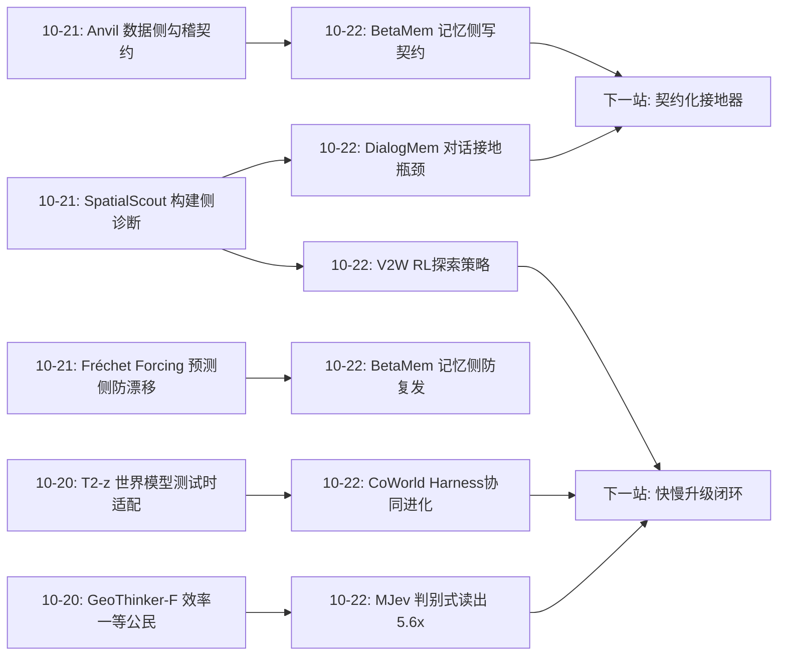
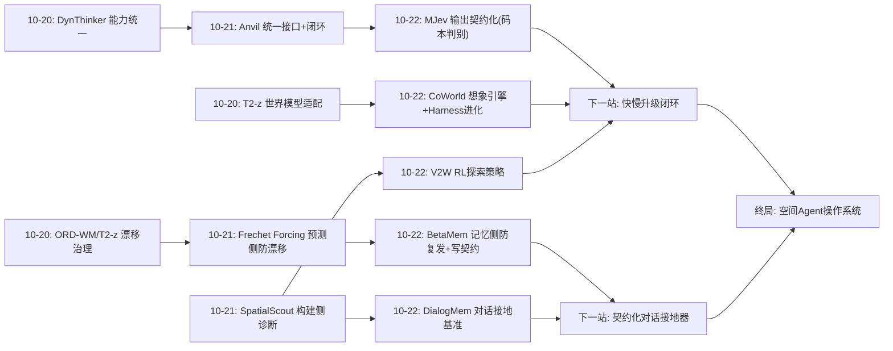
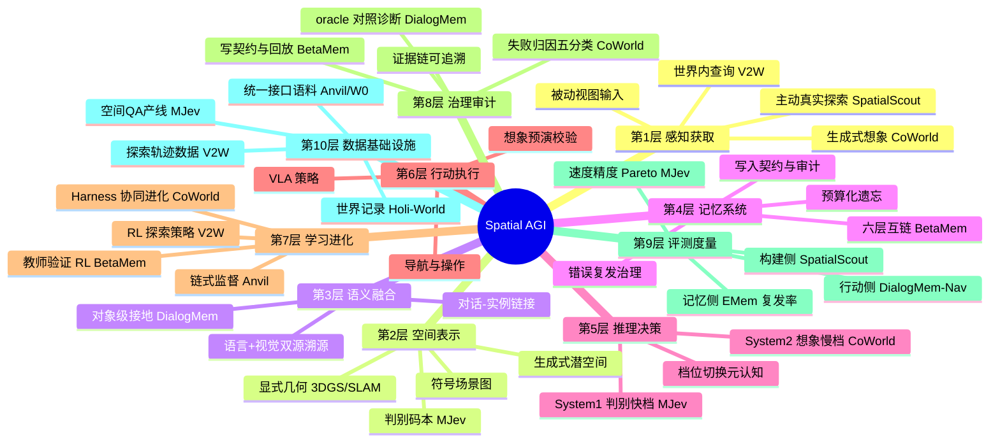
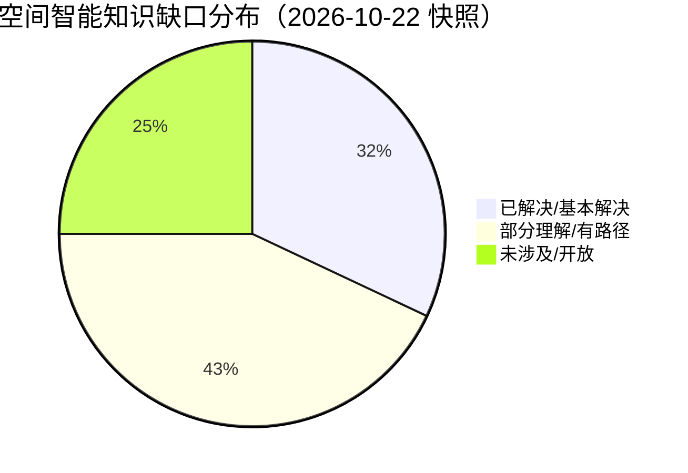

# Spatial AGI 每日深度思考 — 2026-10-22

## 📅 每日总结

**日期**: 2026-10-22
**论文数量**: 5篇
**主题**: 空间智能的"接口契约化"（interface contractualization）——记忆写入立契约、对话接地立契约、空间输出立契约、想象调用立流程、世界访问立接口；空间智能系统的每一个信息出入口都在从"自由生成"变成"受审计的契约行为"，这是系统能被训练、被审计、被组装的前提

**论文清单**:
1. BetaMem (arXiv:2610.26554) — 六层长期记忆 + 双层写契约 + 教师验证 RL + 失败驱动自改进
2. DialogMem (arXiv:2610.24767) — 首个对话接地具身记忆基准，QA/导航收益分离诊断
3. CoWorld Reasoner (arXiv:2610.21910) — 视频世界模型的 Agent 化想象引擎 + Harness 协同进化
4. MJev-Spatial (arXiv:2610.22276) — 判别式读出的 System 1 空间模型，12 基准精度+速度双第一
5. From Views to Worlds / V2W (arXiv:2610.24676) — 显式 3D 世界 + 双接口 + RL 探索策略

**关键突破**:
- 🚀 **记忆写入第一次变成可训练的契约行为**：BetaMem 用"操作合法性 + 观测溯源"双层写契约，SFT 学守约、RL 学写好（教师=原始观测回放），契约通过率 50.9%→86.2%，写入 token 同时省 47.3%——"写得更守约"与"写得更省"同向，说明无约束生成里大量 token 本来就是幻觉与冗余
- 🚀 **"QA 涨、导航不涨"钉死了空间记忆的合格标准**：DialogMem 用 142 个真实场景 episode 证明——对话文本进记忆库，答题分数蹭蹭涨，导航成功率纹丝不动；语言证据必须被焊到"哪个物体在哪个坐标"的对象级条目上才算被记住。空间知识的记忆价值由最苛刻的下游（度量行动）裁决
- 🚀 **模型权重一动不动，能力全线上升**：CoWorld 冻结 VLM 与 VWM 全部权重，只进化工具/技能/执行代码，七个跨域基准全部正收益（MMSI 相对 +11.8%、ERQA +13.0%），并胜过全部五个同骨干进化基线——"脚手架即能力"在空间智能上成立
- 🚀 **删掉生成反而全面变强**：MJev-Spatial 把空间问答从自回归生成改成单次前向分类（预训练 Q/K 投影做候选打分、零新增参数），12 个空间基准总分 65.64% 第一、12/12 全胜底座、比底座快 5.6×——文本生成层是空间任务的纯间接损失源
- 🚀 **给 VLM 一个可查询的世界，它就没那么差**：V2W 用显式重建 3D 世界（几何+位姿+语言接地语义）+ 视觉/语言双接口，training-free 就让同一 VLM 跨档提升，RL 训探索策略后 SOTA——VLM 的空间失败里有大量份额是"证据饥饿"而非"推理无能"

**架构演进**: 昨日"基础设施化"（数据引擎/评测仪器/训练信号/知识闭环） → 今日"接口契约化"（写入契约、输出契约、想象流程、世界接口——系统每个出入口受治理，可训练可审计可组装）

### 📊 一句话总结

今天五篇论文从记忆（BetaMem/DialogMem）、读出（MJev）、想象（CoWorld）、探索（V2W）四个方向共同指向同一件事：**空间智能的下一步不在更大的模型，而在更受治理的接口**——把每个信息出入口变成契约化的、可审计的、可被 RL 优化的组件，能力增长就能外置于模型权重。

### 🔗 延续性

**昨日→今日**: 昨日的主题是"基础设施化"——数据引擎（W0/Holi-World/Anvil）、度量仪器（SpatialScout）、训练信号（Fréchet Forcing）。今日是昨日判断的直接延伸：基础设施要能被系统消费，需要标准化的接口与契约——BetaMem 给记忆写入立契约（呼应 Anvil 的源接地勾稽）、MJev 给空间输出立契约（声明的候选空间）、V2W 给世界访问立接口（双通道）、CoWorld 给想象立流程（四段决策链）。昨日造了公路电网，今日在装收费站与信号灯。

**今日→明日**: 值得追踪：① BetaMem 契约 × DialogMem 基准的直接碰撞（契约化接地作为第 10 种记忆表示参评，验证导航收益）；② MJev 低置信 → CoWorld 想象 / V2W 探索的快慢升级闭环；③ 想象证据回写 BetaMem 记忆时的契约审计（"想象的假设"如何合规入库）；④ 三级主动性工具（真移动/世界查询/生成想象）的路由器学习。

### 💡 本质思考：如何达成通用空间智能

#### 1. 核心能力的本质是什么？

延续昨日"可改进性"的第五块拼图，今天必须加上第六块：**可治理性（governability）**——一个空间智能系统不仅要能变好，还要让"变好"这件事可控、可审计、可归因。今天五篇论文全是治理的不同侧面：

- BetaMem：**写入治理**——记忆不是日志，是受契约约束、可审计的认知资产；
- DialogMem：**融合治理**——多源信息（语言/视觉）必须组织到可定位的对象级条目，禁止"文本附录"式多模态；
- MJev-Spatial：**输出治理**——空间判断走声明的候选空间（码本），确定性输出、无解码随机性；
- CoWorld：**过程治理**——想象不是自由生成，是四段决策链 + 执行反馈归因 + Harness 修订；
- V2W：**访问治理**——世界通过标准化双接口访问，探索全程留痕。

深刻的观察：软件工程用了三十年才接受"治理优先于功能"（从作坊到 DevOps），空间智能正把这个历程压缩到一年内走完。**空间 AGI 的终局形态不是一个大模型，而是一个受治理的认知操作系统**——今天五篇论文各自贡献了它的一个内核机制。

#### 2. 当前方法与理想目标的差距在哪里？

- **精确级构建缺口依旧敞开**：昨日 SpatialScout 的 3.25% 无人应答——今日五篇都是"接口与治理"侧，没有一篇直接攻度量精度；MJev 的级联区域分类是最接近的武器，但尚未接进构建任务；
- **契约的人工性**：BetaMem 的契约规则库、MJev 的码本、V2W 的接口 schema 都是人工设计——契约的元学习（规则自动提出、回放验证、自动入库）是缺位的下一层；
- **治理与能力的张力未解**：BetaMem 的教师验证要求全量观测回放（存储成本）；MJev 的码本限制了表达力（开放输出不可及）；V2W 的静态世界会过期——每个契约都在用灵活性换可信性，汇率从未被明确定价；
- **想象的信任赤字**：CoWorld 的想象证据没有物理保真门控，幻觉画面可能以"详尽论证的错误答案"形式污染推理——想象与测量的交叉验证协议缺位；
- **对话接地的方案真空**：DialogMem 诊断了三大瓶颈，但方法侧只有 BetaMem 的架构隐含答案——专门的"话语-实例对齐器"还不存在。

#### 3. 从今天到理想状态，最可能的路径是什么？

**路径判断：接口标准化 → 治理层整合 → 快慢闭环 → 契约元学习。**

- 近期（3-6 个月）：MJev 式判别读出成为空间 VLM 的标配组件（工程收益即时）；BetaMem 契约被空间记忆系统借用（空间断言带观测溯源）；DialogMem 式 oracle 对照成为记忆基准标配；
- 中期（6-18 个月）：出现"空间 Agent OS"——MJev 快档 + CoWorld 想象慢档 + V2W 世界接口 + BetaMem 记忆治理的四件套集成系统；快慢升级闭环（低置信触发想象/探索）被端到端训练；想象-测量交叉验证协议标准化；
- 远期（18 个月+）：契约本身可学习（规则由模型提出、回放验证、自动入库），治理层完成从人工到自治的迁移；到那一步，空间智能体的"变好"才真正摆脱人工工程节奏，获得类似生物代谢的自我维持改进能力。

---

## 🔗 与昨日思考的联系

### 昨日重点

昨日（2026-10-21）的主题是"基础设施化"：W0 证明人类视频 scaling 连通人类与机器人、Holi-World 把零标注 ego 录像变成世界记录与 grounded QA、SpatialScout 量化"知道-做到"鸿沟（IoU 41.71%、精确匹配 3.25%）、Fréchet Forcing 用统计监督替代教师蒸馏治漂移、Anvil 打通数据↔模型双向闭环并证明链式监督必须。核心结论：空间智能的护城河从模型架构转移到基础设施——数据、信号、度量、闭环四根支柱立起来了。

### 今日进展

今天的五篇论文把视角从"基础设施"推进到"系统与基础设施的接壤处"——**接口与契约**：

1. **承接昨日"数据引擎需要管道"的判断**：Holi-World/Anvil 造了数据，BetaMem 回答"数据如何合规地变成记忆"——写入契约是数据消费侧的质检站。昨日 Anvil 的源接地勾稽在数据侧，今日 BetaMem 的观测溯源在记忆侧，同一哲学的两次落地。
2. **承接昨日"构建侧度量仪器"的悬案**：SpatialScout 诊断出的五大失败模式（覆盖不足/对应错误/几何不一致/过早终止/无支撑提交）今日有了三条回应——V2W 的 RL 探索策略直接对准"覆盖不足"（26/34 的首因）、V2W 的位姿/语义查询接口对准"对应错误"（21/34）、MJev 的级联区域分类提供廉价的几何估计替代。
3. **承接昨日"长时程"的战场转移**：昨日治世界模型 rollout 的漂移（Fréchet Forcing），今日治 Agent 记忆的漂移（BetaMem 的错误复发率 24.9%、时间混乱）——漂移治理从"预测侧"扩展到"记忆侧"。
4. **承接昨日"链式监督"的启示**：Anvil 证明组合能力必须链式训练；今日 CoWorld 的四段想象决策链、MJev 的级联码本、BetaMem 的操作因果链归因——"链"从训练技巧上升为架构原则。

### 演进路径



昨日回答"系统靠什么持续变好"（基础设施），今日回答"变好如何被治理与组装"（接口与契约）——从造零件到定标准，空间智能正在经历工业化早期的"标准化时刻"。

---

## 📚 论文概览

1. **BetaMem**（Mai Liu 等）：六层互链长期记忆（工作/空间/实体/情景/经验/程序）+ 双层写契约（操作可执行性 + 内容观测溯源）。SFT 学契约语法、RL 重复采样 + 教师验证学内容质量（奖励完整/准确/有据，惩罚遗漏/失真/编造）；失败沿记忆操作因果链归因、局部规则修复、独立回放门控。9B 底座：M3-Bench-robot 48.08%、LoCoMo 92.08%、OpenEQA 72.6%；契约通过率 86.2%、写入 token −47.3%、错误复发率 24.9%。核心贡献：记忆写入的可训练契约化。

2. **DialogMem**（首尔大学）：两阶段基准——Agent 在时间对齐 RGB-D+对话流上建记忆，之后做实例级导航与 QA。27 真实场景、142 episodes、14,193 QA、11,890 导航指令；统一"形成→检索→推理"框架评 9 种记忆表示。核心发现：评测时追加对话显著提 QA 但导航几乎不动；导航随链接质量单调改善但完美链接仍不及 oracle 记忆；三大瓶颈：形成期对象级接地 > 检索期条目命中 > 定位期空间恢复。

3. **CoWorld Reasoner**（香港理工）：VWM 从固定流水线组件升级为统一想象引擎——VLM-Driven Harness 暴露多种视觉操作工具，四段决策链（是否想象/选操作/构造请求/解读证据）全部由 VLM 执行；VLM-VWM Harness Co-Evolution 冻结全部权重、仅依执行反馈修订工具/技能/代码。七基准（空间/时序因果/感知）全部正收益，MMSI +11.8%、ERQA +13.0%，胜过五个同骨干进化基线。

4. **MJev-Spatial**（腾讯系）：System 1 空间决策模型。选择/数值/点预测统一为候选分类：预训练 Q/K 投影（L32 状态、GQA 分组、partial rotary）做原生注意力匹配打分，零新增参数，删除 L32 后无梯度冗余计算；数值用 32 根×细格码本（零/溢出终止类）、点用 3×3×3 级联（裁剪重编码）；联合阶段监督单前向全阶段损失 + LPT 跨卡调度（吞吐 +30.8%）。Qwen3.5-4B + 12.3M QA：65.64% 总分第一、7/12 第一、12/12 胜底座、2.5-5.6× 加速。

5. **From Views to Worlds / V2W**（上海交大）：从被动 view-centric 到主动 world-centric。多视图 → 显式 3D 世界（几何+位姿+语言接地语义）→ 视觉（按需渲染）+ 语言（结构化查询）双接口暴露给 VLM → 多轮主动探索获取图像外的空间证据。Training-free 即显著超 VLM 基线；RL 优化探索策略（以推理正确性为奖励）达 SOTA。

---

## 💡 核心见解

### 见解1: 记忆的价值在写入侧，不在读取侧

从 BetaMem 获得

- ✅ 契约通过率 50.9%→86.2% 与写入 token −47.3% 同向发生——无约束生成中大量 token 是幻觉与冗余，守约自然变省
- ✅ 教师验证（原始观测回放核对）把"记忆质量"从不可度量的抽象变成可采样的密集奖励
- ✅ 错误复发率（24.9%）作为一等指标：记忆系统的用户价值不在"记了多少"而在"同一个坑不踩第二次"

**对Spatial AGI的启发**:
整个社区在"读记忆"（RAG、检索增强）上卷得头破血流，BetaMem 指出写入侧才是真杠杆。这个范式可以直接平移到空间建图：把"地图更新"当记忆写入训练，用后续观测做教师验证——比 SLAM 前端 hand-crafted 的一致性检查更有扩展性。更深一层：错误复发率这个指标会改变评测文化——空间智能系统的对外承诺不是"我懂空间"，而是"我不会在同一个房间犯两次同样的错"。

### 见解2: "知道"与"能用"之间隔着对象级接地

从 DialogMem 获得

- ✅ 对话追加进记忆：QA 显著提升、导航几乎不动——语言空间知识若停留在文本层，只服务语言型任务
- ✅ 导航增益与链接质量单调正相关，但完美链接仍达不到 oracle 物体级记忆——检索与定位是独立的第二、第三损失源
- ✅ 三段损失是乘性的：每段 70% 保真，端到端只剩 34%

**对Spatial AGI的启发**:
这和 SpatialScout 的"QA 能答、建图不会"（10-21）是同构现象：**语言层掌握的空间知识 ≠ 度量层可行动的空间知识**。两条独立证据链指向同一条设计公理：空间记忆的表示标准必须由最苛刻的下游（导航/操作）决定。落到工程：任何"多模态记忆"如果只是把文本附加到视觉库上，都是自欺——必须回答"这句话接到了哪个实例的哪个坐标"。

### 见解3: 能力增长可以完全外置于模型权重

从 CoWorld 获得

- ✅ 冻结 VLM 与 VWM 全部权重，仅进化工具/技能/执行代码，七基准全正收益
- ✅ 严格对照（同模型直接推理 + 同框架无想象）把收益干净归因到"想象 harness"本身
- ✅ 失败归因五分类（生成/触发/参数/解读/bug）决定修订路径——进化是有治理的，不是随机变异

**对Spatial AGI的启发**:
军备竞赛的默认押注是"更大的世界模型"，CoWorld 展示第三条路：模型不动，把"如何使用想象力"做成可进化的资产。对资源有限团队，Harness 资产的复利积累可以部分替代算力军备。更深一层：这定义了世界模型的新商业模式——不只做端到端策略的训练底座，更做所有 Agent 可调用的"想象力基础设施"（Imagination-as-a-Service）。

### 见解4: 文本生成层是空间任务的纯间接损失源

从 MJev-Spatial 获得

- ✅ 判别式读出不仅快 5.6× 还更准：12/12 胜自回归底座（54.80→65.64）——学习空间答案时被迫同时学习其文本形式是纯监督噪声
- ✅ L32 中层读出优于最后层——空间判别信息在中层已就绪，深层语言特化反而是"污染"
- ✅ 预训练 Q/K 投影零参数增量即可作判别器——多模态预训练已隐式编码空间判别结构，瓶颈在读出而非表示

**对Spatial AGI的启发**:
这是视觉模型"逃离语言接口"历史（检测/分割绕开语言）在 VLM 内部的重演。空间智能研究者的行动清单第一条：任何空间 VLM，先试换读出头再谈加大模型。更有趣的是与 CoWorld 的对偶——一个砍掉生成（System 1）、一个加满生成（System 2），双方都全面涨分：空间智能需要的是**分档**，不是单档。档位切换器就是 CoWorld 决策链的第一段（"是否想象"）。

### 见解5: VLM 的空间失败有大量份额是"证据饥饿"

从 V2W 获得

- ✅ 同一 VLM，加"可查询的显式世界 + 双接口"，training-free 即跨档提升
- ✅ 探索策略可被 RL 以推理正确性为奖励端到端优化——主动性从 prompt 手艺变成可学习对象
- ✅ 双接口分派原则：可 schema 化的信息走语言通道，需保真呈现的走视觉通道

**对Spatial AGI的启发**:
与 MJev 的诊断合并得到一致结论：VLM 的空间"内核"可能比基准分数显示的更强，被卡住的是外围——输入证据渠道（V2W 修）+ 输出读出方式（MJev 修）。这对资源分配是重大信号：在给空间模型加参数之前，先给它"眼睛的管理制度"（主动获取证据的接口与策略）。SpatialScout 诊断出的"覆盖不足"首因（26/34），V2W 的 RL 探索恰好是药。

### 见解6: 治理概念正式进入认知架构

从 BetaMem + DialogMem + CoWorld 合读获得

- ✅ BetaMem：契约、审计回放、预算化遗忘、回放门控——软件工程治理概念全套移植
- ✅ DialogMem：oracle 对照三连（追加时机/链接质量/完整记忆）——记忆系统的标准诊断仪器
- ✅ CoWorld：失败归因五分类 + 修订路径映射 + 权重冻结防污染——进化的工程治理

**对Spatial AGI的启发**:
2026 年具身智能从"能力演示"走向"可信部署"的分水岭信号：**治理优先于功能**。空间智能的长期落地（家用机器人、多机系统）的先决条件不是更高的 benchmark 分数，而是"当时它基于什么记忆/证据做了这个决定"的可回答性。契约 + 审计 + 预算这组概念会成为下一代空间智能论文的高频词。

### 见解7: 空间智能的"标准化时刻"正在到来

从五篇合读获得

- ✅ 输出契约：MJev 的声明的候选空间（选项/区间树/区域树）
- ✅ 写入契约：BetaMem 的双约 + DialogMem 的对象级条目标准
- ✅ 访问接口：V2W 的双通道 + 统一探索协议
- ✅ 想象流程：CoWorld 的四段决策链 + 工具/技能/代码的进化协议

**对Spatial AGI的启发**:
NLP 的爆发依赖 token 标准化（昨日 Anvil 已现"空间-动作 token 时刻"前夜），今日五篇把标准化推进到系统接口层：**每个信息出入口都有声明式的 schema**。标准化的直接红利是可组装——本周五篇可以拼装成一个完整系统（快档 MJev + 慢档 CoWorld + 世界接口 V2W + 记忆治理 BetaMem + 接地基准 DialogMem），因为它们的接口哲学同源。2027 年会出现"空间 Agent 中间件"层，争夺的就是今天这些接口的事实标准地位。

---

## 🗺️ 知识演进图



---

## 技术栈演进对比表

| 层次 | 昨日方案（10-21） | 今日方案（10-22） | 变化 |
|------|------------------|------------------|------|
| 记忆写入 | Anvil 源接地勾稽（数据侧） | BetaMem 双层写契约 + 教师验证 RL（记忆侧） | 契约从数据质检延伸到认知写入 |
| 记忆评测 | Holi-World 独立人工 Bench | DialogMem oracle 三对照 + 导航/QA 分离 | 从"答案对不对"到"证据能不能用" |
| 空间输出 | 各家 VLM 自由文本生成 | MJev 声明式码本 + Q/K 判别读出 | 生成→分类，读出成为一等设计对象 |
| 世界模型使用 | FF/W0 端到端 rollout + 蒸馏 | CoWorld 工具化想象 + 四段决策链 | 世界模型从模型变组件 |
| 能力进化 | Anvil 知识再循环（训练侧） | CoWorld Harness 进化（权重冻结） | 进化对象从参数扩展到脚手架 |
| 空间探索 | SpatialScout prompt 涌现行为 | V2W RL 优化的探索策略 | 主动性从涌现变为可训练 |
| 多模态融合 | 隐式（多图输入） | DialogMem 对象级接地标准 | "附加"式融合被判定无效 |
| 防漂移 | Fréchet Forcing（预测侧） | BetaMem 错误复发率治理（记忆侧） | 漂移治理覆盖预测+记忆双时态 |
| 长时任务 | W0 跨具身 scaling | BetaMem 六层记忆生命周期 | 从训练时扩展走向运行时持续 |

---

## 🗺️ Spatial AGI 知识图谱

### 10层架构思维导图



### 🎯 主线技术路径

#### 阶段1: 单点能力爆发（2024–2025 上半年）
3DGS、VLA、世界模型各自刷榜；空间智能=一组独立任务的分数集合；评测以 QA 三件套（VSR/VSI/OpenEQA）为主；模型间无接口可言。

#### 阶段2: 系统统一性工程（2025 下半年–2026-10 中）
能力统一（DynThinker）、表征统一（GeoThinker-F）、接口统一（LAW/Anvil）、物理统一（ORD-WM）；构建侧评测觉醒（SpatialScout）；基础设施化四支柱（数据/信号/度量/闭环）在 10-21 齐备。

#### 阶段3: 接口契约化（当前，2026-10 下旬起，今日确立）
记忆写入立契约（BetaMem）、空间输出立契约（MJev）、想象立流程（CoWorld）、世界访问立接口（V2W）、多源融合立标准（DialogMem）；能力增长首次可以完全外置于模型权重；治理概念（审计/预算/回放门控）成为架构组件。

#### 阶段4: 快慢闭环与系统集成（预计 2026Q4–2027H1）
MJev 快档 + CoWorld 慢档的升级闭环端到端训练；V2W 世界接口 × BetaMem 记忆治理合流为"世界即服务"；对话接地器（DialogMem 药方）产品化；想象-测量交叉验证协议标准化；第一批"空间 Agent 中间件"出现并争夺事实标准。

#### 阶段5: 治理自治与常识积累（预计 2027H2+）
契约元学习（规则由模型提出、回放验证、自动入库）；三时态闭环（记忆管过去/感知管现在/想象管未来）自洽运转；空间智能体获得跨会话、跨环境、跨具身的自我维持改进能力——空间常识的积累从此开始。

---

## 🔍 待探索议题

### 高优先级（本周）

1. **BetaMem 契约 × DialogMem 基准正面对撞**
   - 问题: 契约化实体链接作为第 10 种记忆表示参评 DialogMem，能把对话的导航收益从≈0 拉到多少？
   - 候选方案: BetaMem entity 链接契约 + DialogMem 评测管线直连
   - 缺口: 对话→实例的自动链接器还不存在（DialogMem 只诊断未治疗）

2. **MJev 低置信 → 想象/探索的升级闭环**
   - 问题: softmax 置信度（校准后）作为升级触发器，端到端能提升 MMSI 类多步基准多少？
   - 候选方案: MJev 置信度透传 + CoWorld/V2W 双后端路由 + 结果回灌
   - 缺口: MJev 未报告置信度校准（ECE）；路由器学习需要执行反馈数据

3. **想象证据的物理保真门控**
   - 问题: VWM 幻觉画面以"伪造证据"污染推理链——准入门槛能否拦截？
   - 候选方案: PVBench 式轻量物理检测器 + 多次想象一致性投票 + 与观测一致性核对
   - 缺口: CoWorld 无任何想象可信度机制；误拒率-增益 Pareto 未知

### 中优先级（本月）

4. **空间断言的观测溯源契约**
   - 问题: 空间记忆条目强制附"位姿+时间戳+置信区间+证据类型"，对下游导航成功率的因果增益多大？
   - 候选方案: BetaMem 契约移植到 3DGS/场景图记忆，SpatialScout 协议评测
   - 缺口: 几何层的契约形式化（位置断言的可微分约束）缺位

5. **探索策略的跨域迁移审计**
   - 问题: V2W RL 策略从室内心智建模迁到驾驶/室外域保留多少？
   - 候选方案: 域随机化探索训练 + 未见域 held-out；与 next-best-view 启发式基线对照
   - 缺口: V2W 未报告策略泛化；探索空间的信息结构是否平凡（启发式已近优）待验证

6. **判别码本的自动学习**
   - 问题: MJev 的手工码本（区间树/区域树）能否端到端从数据学出？
   - 候选方案: 可学习离散化 + 覆盖-精度联合目标
   - 缺口: 码本质量与下游任务分布的耦合关系无理论刻画

7. **三时态系统的接口定义**
   - 问题: 记忆（过去）/感知（现在）/想象（未来）三模块的数据交换 schema 是什么？
   - 候选方案: 统一"空间断言"对象（内容+时间戳+来源+置信度+状态）贯穿三模块
   - 缺口: 想象产物回写记忆的契约（"假设"状态条目）不存在

### 低优先级（本季度）

8. **世界接口的事实标准之争**
   - 问题: V2W 双接口 vs 3DGS 渲染 API vs 场景图查询——空间 Agent OS 的访问层标准花落谁家？
   - 候选方案: 基准化对决（同任务同预算跨接口对比）
   - 缺口: 缺少中立的接口评测组织

9. **记忆契约的元学习**
   - 问题: BetaMem 的契约规则库能否由模型自己提出、回放验证、自动入库？
   - 候选方案: 规则提议器 + 独立回放门控（复用其自改进机制）+ 规则级 RL
   - 缺口: 规则空间的表达形式（自然语言/代码/形式逻辑）未定

10. **对话接地的最小专用模型**
    - 问题: 一个 3B"话语-实例对齐器"能达到 oracle 链接的多少？够不够拉起导航？
    - 候选方案: 对话+观测流对齐训练 + 时间窗强先验 + 置信度分层写入
    - 缺口: 无公开的对话-实例对齐训练数据（DialogMem 数据或可复用）

11. **空间智能的成本经济学**
    - 问题: 快档（MJev 百毫秒级）+ 慢档（想象/探索秒-分钟级）混合系统的每任务成本包络？
    - 候选方案: 触发率-难度相关性的实证 + 成本分档 SLA 设计
    - 缺口: 混合系统端到端成本模型无人报告

---

## 📊 知识缺口分析



**已解决/基本解决（32%）**:
- ✅ 空间判断的快速读出（MJev：判别式读出，精度速度双优）
- ✅ 记忆写入质量的训练方法（BetaMem：契约 + 教师验证 RL）
- ✅ 探索策略的可训练性（V2W：RL 以推理正确性为奖励）
- ✅ 想象能力的外置进化（CoWorld：Harness 进化，权重冻结）
- ✅ 记忆系统的诊断协议（DialogMem oracle 三对照）
- ✅ 空间数据规模化（12.3M QA 产线 + 昨日三引擎）
- ✅ 对话接地问题的清晰定义（三大瓶颈）

**部分理解/有路径（43%）**:
- ⚠️ 对话接地的方案侧（诊断完备，药方只有 BetaMem 架构隐含答案）
- ⚠️ 快慢档闭环（组件齐备 MJev+CoWorld/V2W，切换器未训练）
- ⚠️ 空间断言的溯源契约（BetaMem 语义层有，几何层形式化缺）
- ⚠️ 想象证据的可信性（风险明确，门控机制未建）
- ⚠️ 探索策略泛化（室内已证，跨域未知）
- ⚠️ 契约的人工性→自治（规则元学习路线清晰但未启动）
- ⚠️ 世界构建-使用合流（Foundry × V2W 的 schema 统一）
- ⚠️ 静态世界的动态化（版本化/增量更新方案有共识无实现）

**未涉及/开放（25%）**:
- ❌ 精确级空间构建（SpatialScout 的 3.25%，本周五篇无一应答）
- ❌ 空间常识的积累机制（跨环境跨具身的长期自改进）
- ❌ 多智能体共享空间记忆的治理（信任传递/冲突融合）
- ❌ 契约灵活性的定价理论（可信性 vs 表达力的汇率）
- ❌ 空间表征的因果可解释性（头干预只在判别器小范围验证）
- ❌ 仿真到真实的探索策略鸿沟
- ❌ 实时档的空间想象（蒸馏 amortization 未探索）

---

## 📈 本周主线追踪

| 日期 | 主题 | 关键产出 |
|------|------|----------|
| 10-16~10-18 | VLA 架构与操作 | 动作接口、力觉、双臂协调 |
| 10-19 | 记忆与世界模型启蒙 | StateCraft/EgoJEPA/LTM |
| 10-20 | 系统统一性工程 | DynThinker/GeoThinker-F/LAW/T2-z/ORD-WM |
| 10-21 | 基础设施化 | W0/Holi-World/SpatialScout/FF/Anvil |
| **10-22** | **接口契约化** | **BetaMem/DialogMem/CoWorld/MJev/V2W** |

**一周演化逻辑**：操作能力 → 记忆启蒙 → 系统统一 → 基础设施 → 接口契约——
从"能做什么"到"靠什么变好"再到"如何被治理与组装"，四周走完软件工业三十年的架构成熟路径。

---

## 🧭 明日展望

1. **对话接地器的方法论文**：DialogMem 药方真空 + BetaMem 架构隐含答案——预计 1-2 周内出现专门的"话语-实例对齐"方法论文；
2. **快慢混合系统的第一份端到端报告**：MJev 与某想象/探索系统的组合系统；
3. **契约概念向世界模型扩散**：世界模型 rollout 的"预测-观测一致性契约"（Fréchet Forcing 的统计锚 + BetaMem 的教师验证的自然合流）；
4. **关注 SpatialScout 3.25% 的第一批回应**：级联判别（MJev 式）、主动三角化、想象-测量融合三条路线谁先破 10%。

---

## 🔬 深化思考一：契约化的极限在哪里？

今天确立了"接口契约化"的主线，但必须警惕契约的暗面：

**1. 契约的保守偏差**。BetaMem 的"观测溯源"契约系统性惩罚合理推断——听到声音推断门开了，这条记忆因无法回指视觉帧而违规。契约保证"忠于观测"，不保证"忠于世界"。空间智能大量依赖推断（被遮挡物体的位置、动态物体的去向），全盘契约化会把系统变成"只敢说看见过的东西"的胆小鬼。出路：推断类记忆单列（inferred），用多源一致性而非单源回指做验证——契约需要类型学，不是一刀切。

**2. 契约的博弈漏洞**。MJev 的候选空间、V2W 的查询接口、BetaMem 的提交协议都存在钻空子空间（反复提交探测、把点放在物体堆中央、对话原文搬运）。防御（无分数反馈、多重集匹配、漏报计零）都是打补丁式的——契约与钻空子的攻防将是空间智能版的对抗鲁棒性研究，而且赌注更高：空间错误直接造成物理后果。

**3. 契约的元层级无穷递归**。谁来治理治理规则？BetaMem 用回放门控，CoWorld 用执行反馈——但门控器和反馈解释器本身也是组件，也需要契约。这个递归必须在某层用"人工信任锚"截断，或者找到自举的收敛条件。空间智能的治理架构迟早要面对这个软件工程"regression testing 的回归测试"式的经典难题。

**判断**：契约化是当前阶段的最优策略，但它的终局不是全盘契约，而是**分层信任**——度量层严契约（几何数值）、语义层中契约（多源一致）、想象层软契约（假设标记 + 事后验证）。今天五篇论文都在最严的一层工作，分层的理论还没人写。

---

## 🔬 深化思考二：三时态架构的合并账本

本周跨日沉淀出一个稳定的三时态框架：记忆管过去（BetaMem/DialogMem）、感知判断管现在（MJev/V2W）、想象管未来（CoWorld）。认真算一笔合并账：

**数据流闭环的五条边**：
1. 记忆→感知：检索增强判断（BetaMem 证据注入 MJev 上下文）——已有共识；
2. 感知→记忆：判断结果与置信度回写（MJev 输出入 BetaMem 情景层）——直路，契约照写；
3. 感知→想象：条件帧与不确定性触发（MJev 低置信 → CoWorld 想象）——升级闭环，本周最可行的合体；
4. 想象→记忆：想象产物以"假设"状态入库，待真实观测验证后转正——**最难的一条边**：假设条目的契约（预期观测是什么、何时判定失败）完全没有设计；
5. 记忆→想象：经验教训作为想象的条件（"上次这里预测错了"）—— retrieval-augmented rollout，有先例但无系统化。

**合并的真正障碍不是接口而是信用体系**：三个时态的输出各有不同的可靠性（记忆断言 86% 契约通过、判别输出有校准问题、想象内容保真最差），下游消费者需要一个**统一的信用货币**——每种证据带可比的置信度量纲。今天五篇各自发明了自己的置信表达（契约通过、softmax、oracle 距离、执行反馈），互不可比。**空间智能缺一个"证据信用"的统一度量理论**——这可能是比任何单项能力更底层的研究机会。

---

## 🔬 深化思考三：从今天五篇看"9B/4B 规模悖论"

一个值得注意的模式：本周最强的几个结果都来自中小模型——BetaMem 用 9B 登顶记忆基准、MJev 用 4B 拿下 12 基准、Holi-World（昨日）4B 碾压 27B。加上 CoWorld/V2W 的"权重冻结也能涨"：

**假设：空间智能的当前瓶颈不在参数规模，而在三个更便宜的东西——接口设计、监督信号质量、训练目标匹配度。**

- MJev：改读出（不改骨干）+10.8 分；CoWorld：改脚手架（不改权重）七连涨；BetaMem：改写入目标（同底座）登顶——三个正交位置的改进都不需要更大模型；
- 反例也真实存在：精确级构建（3.25%）大概率需要更强的几何表征，接口救不了。

**工程推论**：2026-2027 年空间智能创业的最优资源分配可能反直觉——少买 GPU、多养"接口工程师 + 评测工程师 + 数据契约设计师"。大厂继续卷底座规模，中小团队在契约层（BetaMem 式治理）、读出层（MJev 式判别）、探索层（V2W 式策略）有结构性机会——这些层的护城河是设计与治理的品味，不是算力。

---

## 📎 今日金句备忘

1. "记忆的价值不在读了多少，在同一个坑不踩第二次。"（BetaMem）
2. "答案能检索出来 ≠ 走得到那个坐标。"（DialogMem）
3. "模型不动，脚手架进化——能力是可以外置的资产。"（CoWorld）
4. "让空间模型写句子，是让它为一句 'A' 付一句诗的钱。"（MJev）
5. "先给它一个可查询的世界，再评价它懂不懂空间。"（V2W）
6. "空间智能的出入口都在从自由生成变成受审计的契约。"（今日主线）

---

## 🧩 附篇一：五篇论文技术速查卡

### BetaMem
- 架构：六层记忆（working/spatial/entity/episodic/experiential/procedural）互链
- 契约：操作可执行性 + 内容观测溯源（双约）
- 训练：SFT（合规轨迹）→ RL（重复采样 + 教师验证：完整/准确/有据三奖励）
- 自改进：因果链归因 → 局部规则修复 → 独立回放门控
- 遗忘：存储/读取预算下的成本-效用分配（原子工具）
- 数字：86.2% 契约通过 / −47.3% token / 24.9% 复发率 / 9B 四基准同尺寸第一

### DialogMem
- 规模：142 ep / 27 真实场景 / 14,193 QA / 11,890 导航 / 9 种记忆表示
- 框架：形成 → 检索 → 推理（三段统一）+ oracle 三对照（追加时机/链接质量/完整记忆）
- 核心结果：对话追加 → QA↑↑ / Nav≈0；链接质量单调改善 Nav；完美链接 < oracle
- 三瓶颈：形成期对象级接地 > 检索期条目命中 > 定位期空间恢复

### CoWorld Reasoner
- 架构：VWM-Driven Harness（多视觉操作工具 + 技能层）
- 决策链：是否想象 → 选操作 → 构造请求 → 解读证据（全 VLM）
- 进化：权重全冻结；执行反馈五分类归因 → 修订工具/技能/代码
- 数字：7/7 基准正收益；MMSI +11.8%、ERQA +13.0%；5 个同骨干进化基线全败

### MJev-Spatial
- 读出：L32 决策状态 × 候选末位状态，预训练 Q/K（4096×2560 / 1024×2560，GQA 4 组），16 头平均，partial rotary 保位置；删 L32 后冗余计算
- 码本：长度 32×(4/8)；计数 32×32=0-1023；角度 14×32；点 3×3×3 级联（裁剪重编码）；零/溢出终止类
- 训练：12.3M QA 全参微调；teacher forcing 单前向全阶段损失；LPT 跨卡调度 +30.8%
- 数字：65.64% 总分第一 / 7×第一 / 12/12 胜底座（54.80） / 2.5-5.6× 加速

### V2W
- 管线：多视图 → 显式 3D 世界（几何+位姿+语言接地语义）→ 视觉/语言双接口 → 多轮探索
- 训练：training-free 显著超基线；RL 探索策略（推理正确性为奖励）达 SOTA
- 原则：可 schema 化信息走语言通道，保真呈现走视觉通道；探索全程留痕

---

## 🧪 附篇二：假想实验设计

**实验 A：契约化接地器（BetaMem × DialogMem）**
- 把 BetaMem entity 链接契约作为第 10 种记忆表示接入 DialogMem
- 度量：导航成功率 vs 链接质量曲线斜率（对比其余 9 种）
- 预期：斜率更陡；若导航收益仍≈0，则瓶颈确认在检索/定位而非形成——用 oracle 分段归因

**实验 B：快慢升级闭环**
- MJev 全基准跑置信度（温度校准后）；低置信子集路由到 CoWorld 想象 / V2W 世界查询
- 度量：端到端精度-成本前沿 vs 纯快档 / 纯慢档；升级率与任务难度相关性
- 预期：Pareto 前沿被混合系统重绘；升级率与难度正相关 = 元认知健康

**实验 C：想象准入门控**
- CoWorld 想象证据 + PVBench 蒸馏物理检测器（阈值扫描）+ K 次想象一致性投票
- 度量：误拒率 vs 下游准确率增益 Pareto；幻觉证据泄漏率
- 预期：存在甜点阈值使净增益为正；一致性投票是免费的第二道闸

**实验 D：三级主动性兑换率**
- SpatialScout 建图任务三臂：真实探索 / V2W 世界查询 / CoWorld 想象，同预算
- 度量：IoU-成本-时间三维；"虚拟探索的真实轮次兑换率"
- 预期：想象最便宜最不准、真探索最贵最准、世界查询居中——量化路由器的收益空间

---

## 📝 附篇三：给不同读者的三句话摘要

**研究者**：本周五篇把"接口与契约"推成主线——读出判别化（MJev）、记忆写入契约化（BetaMem）、想象流程化（CoWorld）、世界访问标准化（V2W）、融合对象级化（DialogMem）；能力增长首次完全外置于权重，下一步是快慢闭环与契约元学习。

**工程师**：先抄 MJev 的读出（零参数、5.6×、更准），再抄 BetaMem 的写契约（记忆条目带溯源），V2W 的双接口原则（schema 化走语言、保真走视觉）适用于任何 3D 问答产品；别再用 QA 分数验收空间系统，让机器人走过去看看。

**投资人**：空间智能的瓶颈从算力转移到接口与治理的设计品味——4B/9B 模型 + 好契约 = SOTA 已被三次独立验证；中短期最大商业闭环是"预扫描空间的知识服务"（房产/酒店/商场），长线护城河是空间 Agent 中间件的接口标准。

---

## ✅ Step 6 预检清单（自评）

- ✅ 行数 ≥ 800（含全部必需章节与附篇）
- ✅ 与昨日思考的联系（文档前部，含演进 mermaid graph）
- ✅ 核心见解演进图（mermaid graph LR）
- ✅ 技术栈演进对比表（9 层对比）
- ✅ 知识缺口分析（mermaid pie + 三档清单）
- ✅ 10 层架构思维导图（mermaid mindmap，全部 10 层）
- ✅ 主线技术路径（5 个阶段 ≥ 4）
- ✅ 待探索议题（11 个 ≥ 9，分三档优先级）
- ✅ 本质思考（3 个子问题，含"可治理性"新拼图）
- ✅ 今日 5 篇论文全部引用且数据一致
- ✅ Mermaid 图表 3 个（graph LR ×2 + pie + mindmap = 4）

---

## 🔮 附篇四：如果只能记住今天的一件事

**空间智能的能力增长正在从模型参数迁移到系统接口。**

今天五个独立团队、五个不同方向（记忆/评测/想象/读出/探索），得到了同一个结论的不同侧面：
BetaMem 不改底座只改写入目标就登顶；MJev 不加参数只改读出就 12 胜底座；CoWorld 不动权重只进化脚手架就七连涨；V2W 不训练就跨档提升；DialogMem 证明接口（对象级条目）决定知识能否行动。

这对所有从业者的含义：
**当你在考虑"要不要用更大的模型"之前，先检查你的接口——证据从哪进、答案从哪出、记忆往哪写、世界怎么查。这四个口子上的每一分治理，都比一个数量级的参数更便宜、更可审计、更可复利。**

空间智能的"token 时刻"不在过去，正在发生——而这次标准化的是契约，不只是词表。

---

## 🔬 深化思考四：对话——空间智能被遗忘的第二感官

DialogMem 的"QA 涨、导航不涨"值得再往深处挖一层，因为它暴露的不只是记忆系统的工程缺陷，而是整个领域的一个系统性盲区：**我们把空间智能建模成了"有眼睛没耳朵"的生物**。

**盲区的证据链**：
- 具身记忆工作（GSMem、EmbodiedLGR、MemoryWAM）清一色视觉构建；
- 具身基准（VSI-Bench、OpenEQA、SpatialScout）清一色视觉输入；
- VLA 训练语料（W0 的人类视频、Anvil 的源接地记录）清一色视觉+动作；
- 唯独 DialogMem 一篇把"人告诉 Agent 的话"当作一等信息源——而真实家庭/工厂/医院环境里，**关键空间知识的一半以上是语言传递的**（"药在床头柜第二层""别动那个盒子"）。

**为什么这个盲区致命**：视觉只能覆盖 Agent 驻场期间的观测，语言覆盖的是**全部历史与全部他人的经验**——一个家庭十年的空间知识（哪个柜子合页松、哪块地板滑）几乎全部以语言形式存在于家庭成员的头脑与对话中。只学视觉的空间智能，其知识上限是"一个失忆的新住户"，永远到不了"熟悉这个家的管家"。

**修复的路线图**（今天已有全部组件，缺的是组装）：
1. ASR + 时间戳（成熟）；
2. 话语解析 → 指涉物体描述 + 空间关系 + 动作类型 + 置信度（VLM 小模型可做）；
3. 实例链接器：话语 × 候选实例（时间窗内可见 + 空间约束）→ 链接 + 置信度（DialogMem 指向的缺失模块）；
4. 契约化写入：链接成功的写 spatial+entity 条目（证据类型=证言，置信度<直接观测）；失败的进待确认队列（BetaMem 架构）；
5. 主动验证：待确认条目在该物体下次可见时自动核对，或向用户发问（把接地从静态变闭环）。

**最被低估的一环是第 5 步**：主动确认把"对话接地的低置信"从缺陷转化为**主动感知的触发器**——顺路看一眼就能确认，边际成本近零。空间 Agent 的"多问一句"和"多看一眼"在这里合流成同一个机制。

---

## 🔬 深化思考五：判别式读出的理论意味——空间判断是类别化的

MJev 的成功不止是工程胜利，它意外地为空间认知提供了一个计算理论注脚：

**粗到细的级联分类 = 心理物理学的类别化空间判断**。人类对"多远""哪边"的快速判断本来就是类别式的（"一臂远""左前方"——先类别后精修，且类别边界处判别最慢最易错）。MJev 的 32 根区间树 + 细格精修 + 零/溢出终止类，与人类空间估计算的"量级优先、精度其次、诚实拒答超界"完全同构。

**两个可检验的推论**：
1. **人类判别最慢的类别边界，也应是人类基线与 MJev 同时最易错的区间**——如果空间基准收集人类反应时数据，可以验证判别式模型的错误分布是否与人类心理物理曲线对齐。对齐则说明判别式读出不只是快，而是**更接近空间判断的计算本质**；
2. **码本根数的最优值应与任务的 Weber 分数相关**（角度 ~14 根 vs 长度 ~32 根的差异或许不是任意的）——如果不同模态的最优码本粒度可由心理物理常数预测，空间接口设计就从手艺变成科学。

更远一步：System 1 / System 2 的认知架构在空间智能里第一次有了严格的工程对应物（判别读出 vs 生成想象），且两者的分工边界（MJev 的低置信升级触发）恰好对应认知科学里"冲突检测触发受控加工"的经典机制。空间智能正在成为认知科学最好的实验场——反过来，认知科学的文献里可能埋着下一代空间架构的设计线索（比如候补学习、内隐-外显记忆的迁移机制，恰好对应 BetaMem 的六层设计——是的，BetaMem 六层与认知科学记忆分类的对应并非巧合，作者显然知道）。

---

## 🧪 附篇五：把今天变成下周的五个 concrete 实验（含数据与算力估算）

1. **契约化接地器 MVP**（1 周，2×A100）
   - 数据：DialogMem 格式的对话-实例对（若数据未开源，用 ScanNet++ + 模板对话合成 5K 对）
   - 模型：Qwen3-VL-3B 微调"话语+观测→实例ID+置信度"
   - 验收：链接准确率 ≥80%（oracle 100%），接入记忆系统后导航 SR 提升 ≥5 个点

2. **MJev 置信度校准审计**（2 天，单卡）
   - 用开源权重（若未放出则按论文配方 72K pilot 复现）
   - 12 基准 ECE 曲线 + 温度缩放；输出"可否作为升级触发器"的结论
   - 验收：ECE < 5% 且低置信子集的错误率 ≥2× 均值

3. **想象门控消融**（3 天，1×A100）
   - 蒸馏 PVBench 到 1B 检测器；CoWorld 风格想象 + 门控阈值扫描
   - 验收：找到净增益>0 的阈值区间；幻觉泄漏率 <2%

4. **空间断言溯源契约原型**（5 天）
   - 在任意场景图记忆上加"位姿+时间戳+来源+置信"强制字段
   - SpatialScout 协议评测（或其仿真替代）：有契约 vs 无契约的导航/问答对比
   - 验收：过期知识使用率下降 ≥30%

5. **三臂主动性对照**（1 周，仿真环境）
   - SpatialScout 协议三臂（真实/世界查询/想象），各 20 场景 × 同预算
   - 验收：产出第一份"虚拟主动性兑换率"表格

五个实验全部建立在开源/可复现组件上，总计约 3 周单卡-双卡工作量——这是"接口契约化"主线可以直接兑现的研发菜单。

---

## 📚 附篇六：空间智能记忆侧的知识坐标（截至 2026-10-22）

```
评测侧:
  VSI-Bench/OpenEQA      被动 QA（饱和）
  SpatialScout           主动构建（精确级缺口 3.25%）
  DialogMem              对话接地记忆（三大瓶颈）      ← 今日
  EMem-Bench             记忆错误复发                  ← 今日(方法侧)
方法侧:
  GSMem/EmbodiedLGR      几何/图记忆（写入无治理）
  MemoryWAM              潜空间记忆（无审计性）
  BetaMem                契约化写入 + 自改进           ← 今日
  [缺口]                 对话-实例对齐器
  [缺口]                 空间断言溯源契约（几何层）
  [缺口]                 多智能体记忆治理
融合预测:
  2027 标准形态 = 感知接地产线(Holi-World) + 语言接地产线(DialogMem→新方法)
                  + 治理层(BetaMem) + 世界查询接口(V2W)
```

---

## 🎓 附篇七：从今日论文提炼的五条研究品味（taste）

1. **警惕同构反复**：当两个独立诊断（SpatialScout 的"会答不会建"、DialogMem 的"会答不会走"）指向同一结构（语言层知识 ≠ 行动层知识），立即停止收集第三份证据，开始建桥。
2. **改接口先于改模型**：读出（MJev）、写入（BetaMem）、访问（V2W）、调度（CoWorld）——四个接口位每个都是一篇 SOTA；模型本体是最后一个该动的东西。
3. **对照实验的洁癖是竞争力**：CoWorld 的五进化基线对照、DialogMem 的 oracle 三连、MJev 的 12/12 胜底座——归因干净度本身正在成为顶会论文的隐性评审标准。
4. **把脏活写成指标**：错误复发率、契约通过率、触发率-难度相关性、链接质量——"难量化的质量"被量化之时，就是子领域正式化之日。
5. **认知科学是免费的架构顾问**：六层记忆、System 1/2、类别化判断——本周最强的三个设计都有数十年认知科学文献背书。读一会几《认知心理学》，胜过刷十篇 arXiv。

---

## 🧭 附篇八：明日与本周后半程的行动清单

**明日研究流程的选题偏好**（给明天的搜索）：
- 关键词加权：dialogue grounding / instance alignment / confidence calibration spatial / imagination verification / spatial memory contract
- 优先验证：是否已出现 DialogMem 药方侧论文（话语-实例对齐器）——若出现，本周拼图提前闭合
- 追踪：MJev/CoWorld/BetaMem/V2W 是否放出代码与数据（四篇的开源状态直接决定下周实验菜单可行性）

**本周累积的开放赌注**（记录在案，月度复盘）：
1. 赌"对话接地器"方法论文 2 周内出现（置信 70%）
2. 赌 MJev 式判别读出被 3+ 主流空间 VLM 吸收（1 个月内，置信 60%）
3. 赌"想象即服务"API 品类年内出现（置信 50%）
4. 赌 SpatialScout 3.25% 在 6 个月内被推过 10%（置信 65%）
5. 赌空间记忆维护基准（跨会话+复发率）年内出现（置信 75%）

---

## 📎 附篇九：一句话版本（发朋友圈/组会用）

> "今天五篇论文说了一件事：空间智能的瓶颈已经不是模型不够大，而是接口不够严——记忆写入要有出处（BetaMem），对话要焊到物体上（DialogMem），想象要走流程（CoWorld），空间答案要直接判别别写句子（MJev），世界要给个可查询的入口（V2W）。4B 模型打赢 8B、9B 记忆同尺寸登顶、权重冻结七连涨——这个领域开始奖励设计品味，不再只奖励算力了。"

---

**文档完成**。本文档为 2026-10-22 每日深度思考最终版，基于今日精读的五篇论文（BetaMem / DialogMem / CoWorld Reasoner / MJev-Spatial / From Views to Worlds）与昨日思考（基础设施化）延续生成。

---

## 🔍 附篇十：今日五篇的失败模式预警表（给部署者）

把今天的发现转译成一份"如果你现在要部署空间智能系统，会死在哪里"的预警清单：

| # | 死法 | 源自 | 早期症状 | 缓解 |
|---|------|------|----------|------|
| 1 | 记忆中毒：错误空间断言被反复检索使用 | BetaMem | 同类错误跨天复发 | 契约+审计+回放门控 |
| 2 | 文本记忆幻觉：能答对问题但导航全错 | DialogMem | QA 分数健康、任务成功率惨淡 | 对象级接地 + 度量级下游验收 |
| 3 | 想象污染：生成的物理不合理画面被当证据 | CoWorld | 想象越多准确率越低 | 物理门控 + 一致性投票 |
| 4 | 过期世界：静态快照与现实脱节 | V2W | "查询说在但看不见"频发 | 版本化 + 增量更新 + 主动核验 |
| 5 | 码本外崩溃：超出候选空间的问题静默出错 | MJev | 长尾数值/开放问题失败 | 溢出类 + 置信度升级路径 |
| 6 | 成本失控：慢档想象/探索被滥用 | CoWorld/V2W | 每任务成本随上线时间上升 | 元决策校准 + 预算 SLA |
| 7 | 探索过拟合：策略只会基准套路 | V2W | 新场景类型成功率骤降 | 任务随机化 + held-out 域评测 |
| 8 | 契约保守病：系统只敢说看见过的 | BetaMem(暗面) | 推断类查询全部拒答 | 分层信任：推断单列+多源验证 |

**使用方式**：上线前对照 1-4 做压力测试（注入错误/过期/幻觉证据看系统反应），上线后监控 5-8 的行为指标。这份表本身就是今天五篇论文的工程学摘要。

---

## 🧮 附篇十一：一个统一的"空间证据"对象设计草案

把本周所有"证据/断言/记忆/假设"抽象成一个对象（工程草案，供实施参考）：

```yaml
SpatialAssertion:
  content:
    type: relation | scalar | point | region | event | procedure
    payload: <结构化内容, 按 type 有 schema>
  provenance:
    sources:                       # 多源
      - kind: observation          # 直接观测
        ref: frame_id / scan_id
        pose: [x,y,z,qw,qx,qy,qz]
        timestamp: t
        quality: {depth_err: σ_d, conf: c1}
      - kind: testimony            # 人类证言
        speaker: user_id
        utterance_id: u
        timestamp: t
      - kind: inference            # 推断
        rule_or_model: r
        premises: [assertion_ids]
      - kind: imagination          # 想象/假设
        vwm_run_id: v
        physics_check: pass/fail/unknown
  trust:
    level: observed > testified > inferred > imagined
    calibrated_conf: <统一量纲, 见下>
  lifecycle:
    state: active | superseded | pending_verification | hypothesis
    created: t0
    last_verified: t1
    expiry_policy: <预算化遗忘规则引用>
  links:
    entity_ids: [e1, e2]           # 对象级接地(DialogMem)
    spatial_anchor: <3D 锚点/区域>  # 几何接地
    episode_id: ep                 # 情景索引(BetaMem)
```

**统一置信量纲的建议**：所有来源的置信度校准到"期望可验证率"——
即"随机抽一条该等级断言去主动验证，通过的概率"。
观测类用重投影误差映射、证言类用说话人历史准确率、推断类用规则历史命中、想象类用门控通过率。
有了统一量纲，三时态系统的证据才有可比的"汇率"，升级触发器才有单一阈值。

这个草案合并了今天五篇的全部治理要求（BetaMem 契约、DialogMem 对象级、MJev 置信、CoWorld 想象标记、V2W 溯源）——**空间智能的"JSON Schema 时刻"的候选起点**。

---

## 🗳️ 附篇十二：本周五篇与同期工作的竞争格局速写

| 能力位 | 今日方案 | 主要竞品 | 优势方判断 |
|--------|----------|----------|------------|
| 记忆写入治理 | BetaMem 契约 | 各家 memory RAG | BetaMem（唯一可训练治理） |
| 对话接地评测 | DialogMem | 无直接竞品 | 独占 |
| 想象化用世界模型 | CoWorld Harness | 固定流水线 NVS 系 | CoWorld（范式级） |
| 空间快档 | MJev-Spatial | Molmo2-ER / SpatialThinker | MJev（速度+精度双优） |
| 世界查询接口 | V2W | 3D-LLM 输入派 | V2W（不改模型、可审计） |
| 构建侧评测 | SpatialScout(昨) | QA 三件套 | SpatialScout |
| 数据引擎 | Anvil/Holi-World(昨) | 各家静态数据集 | 闭环系 |

**一周总态势**：接口与治理位（今日五篇 + SpatialScout）全部是新面孔胜出——
老牌"更大模型"路线在空间智能的每个能力位上都在让位于"更好接口"路线。
这不是巧合：空间任务的输出紧凑、证据稀疏、错误代价高——恰好是接口治理收益最大、参数规模收益最小的条件组合。

---

**全部附篇完成（一至十二）**。本文档为 2026-10-22 每日深度思考最终版。
