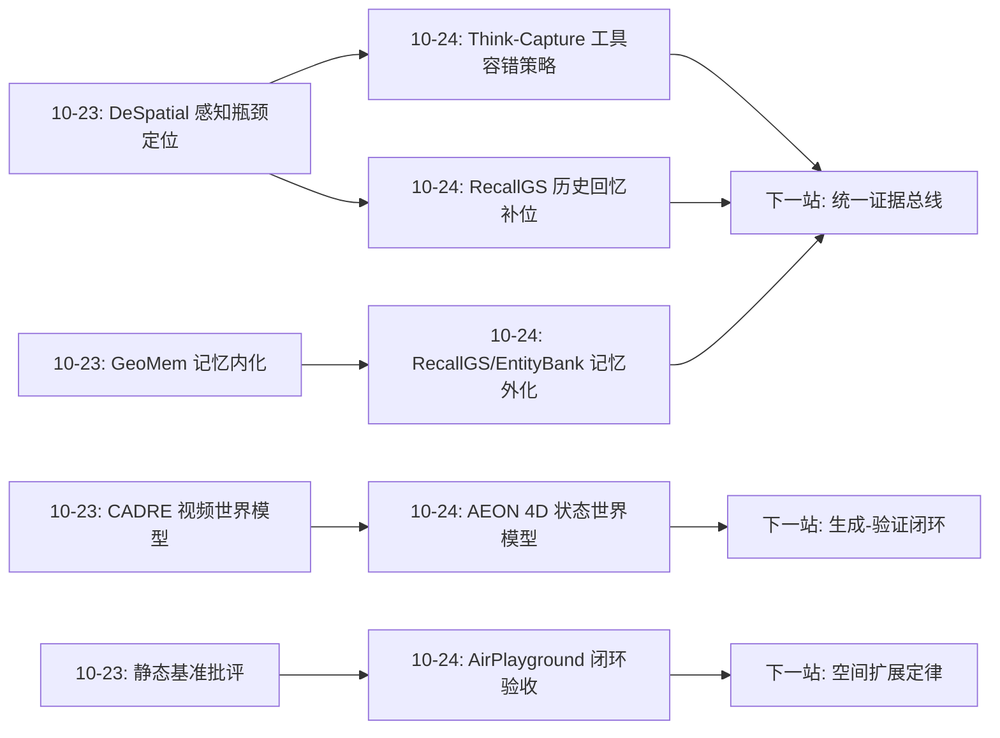
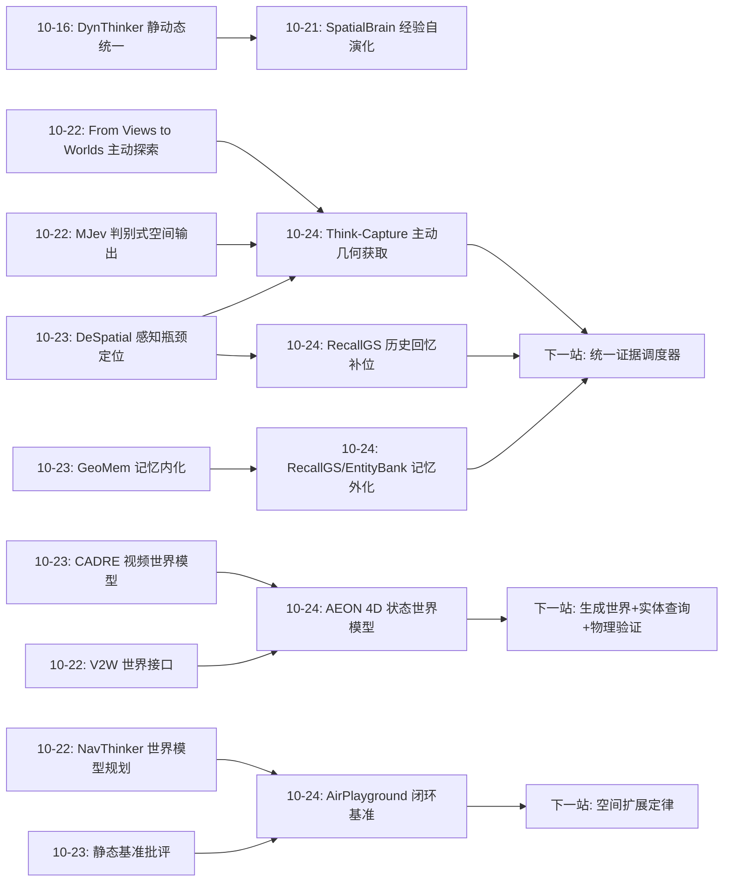
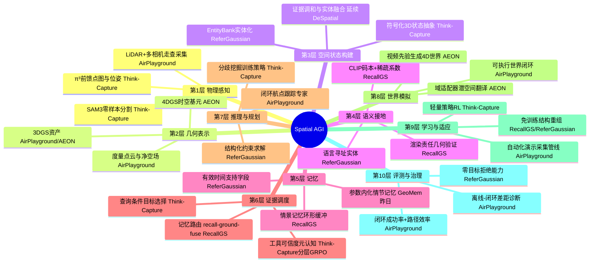
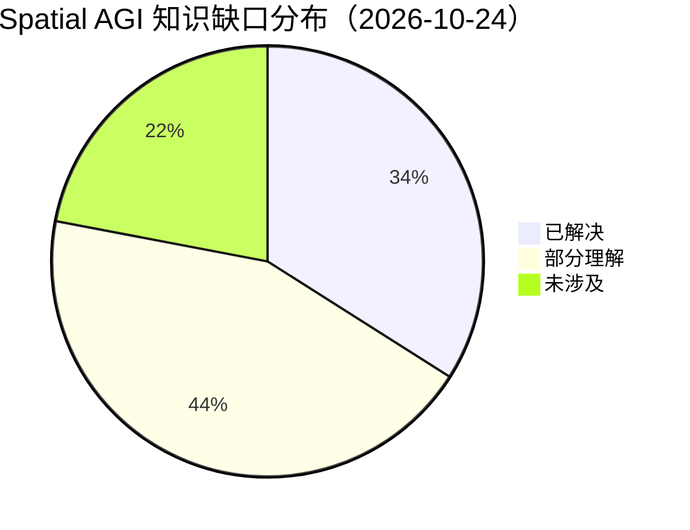

# Spatial AGI 每日深度思考 — 2026-10-24

## 📅 每日总结

**日期**: 2026-10-24
**论文数量**: 5篇
**主题**: 空间智能的"运行时证据策略"（runtime evidence strategy）与 4D 表示的接口化——五篇论文共同回答一个昨天尚未完全展开的问题：当模型内部的空间能力不足时，系统应该在运行时从哪里、以什么粒度、在什么时机获取空间证据？Think-Capture 说"按需主动获取、批判性使用"；RecallGS 说"从自己的观测历史里回忆"；ReferGaussian 说"把 4D 高斯组织成语言可寻址的实体库"；AEON 说"从视频先验直接生成持久 4D 世界"；AirPlayground 说"在可执行世界闭环里检验这一切是否真的有效"

**论文清单**:
1. Think-Capture (arXiv:2610.29232) — 查询条件式 3D 几何获取 + 符号化状态瓶颈 + 分层 GRPO 工具容错，WACV 2027
2. AEON (arXiv:2610.28631) — 4DGS 统一视频与 3D 世界模型，域适配器把视频生成潜空间蒸馏为 4D 重建潜空间
3. RecallGS (arXiv:2610.31293) — 观测历史作为免训练几何-语义先验，recall-ground-fuse 记忆路由，2.48 FPS
4. R4DGS/ReferGaussian (arXiv:2610.30326) — 动态 4D 场景指代接地新任务 + EntityBank 实体库 + MLLM 约束求解，ACM MM 2026
5. AirPlayground (arXiv:2610.29699) — 94 可执行 3DGS 场景 + 94K 闭环演示 + 跨策略 API 的空中导航基准

**关键突破**:
- 🚀 **"何时该信工具"第一次成为可训练目标**：Think-Capture 用 base/tool 双模式分歧挖掘出正负样本（工具帮忙 vs 工具误导），负样本答对给更高奖励（+2 vs +1），把"对不完美几何证据的元认知"变成 RL 可优化的策略——受控污染实验证明这条路有效（0.4m 坐标噪声下 46.2% vs zero-shot 26.7%）
- 🚀 **4D 表示完成三大接口的首次同日亮相**：生成接口（AEON：文本/单图→持久 4D 世界）、记忆接口（RecallGS：历史观测路由进 4D 语义场）、语言接口（ReferGaussian：EntityBank 让 4D 高斯被自然语言寻址）——4D 表示正在从"渲染资产"变成"世界操作系统"
- 🚀 **免训练范式三连击**：Think-Capture（只训策略不训感知）、RecallGS（零训练，检索+渲染权重重排）、ReferGaussian（零语义训练，结构重组+基础模型组件）——空间能力的提升越来越多地来自编排与结构，而非参数更新
- 🚀 **空间信息瓶颈的反直觉红利**：Think-Capture 把多视角几何压缩到 ~100 token 符号流（vs 非结构化 205）反而大涨——空间失败很大程度是"上下文注意力稀释"而非能力缺失
- 🚀 **空间泛化扩展曲线的第一批数据点**：AirPlayground 显示 ACT 场景数 5→70，未见场景成功率 16.8%→29.4%——空间泛化随环境多样性增长但远未饱和，且离线精度不能完全解释闭环表现

**架构演进**: 昨日"分层归因"（每层单独 oracle 化）→ 今日"运行时证据策略"（层间动态调度：感知什么、回忆什么、信任什么、拒绝什么）+ "4D 表示接口化"（底层表示获得生成/记忆/语言三个标准接口）——空间智能从静态分层架构走向带运行时证据调度的动态系统

### 📊 一句话总结

今天五篇论文把空间智能的研究焦点从"模型内部能力"转向"运行时证据获取策略"——按需感知（Think-Capture）、经验回忆（RecallGS）、结构化实体库（ReferGaussian）、生成式世界（AEON）成为四种可组合的证据源，而 AirPlayground 提醒我们所有策略最终都要在可执行世界的闭环里接受检验；与此同时 4DGS 在同一天获得了生成、记忆、语言三个接口，标志着 4D 表示正在成为 Spatial AGI 的公共底座。

### 🔗 延续性

**昨日→今日**: 昨日完成了系统栈的"分层普查"（DeSpatial oracle 定位感知瓶颈、GeoMem 记忆内化、SpatialBrain 元认知自演化、CADRE 交互压缩）。今天的故事自然延伸：**知道了哪层是瓶颈之后，运行时该怎么调度证据？** Think-Capture 直接回应 DeSpatial 的发现——感知不完美不可避免，那就训练策略适应不完美；RecallGS 提供了 DeSpatial 未考虑的第五种证据源（历史观测）；SpatialBrain 的"经验"哲学在 RecallGS 身上获得了感知层的对应物。

**今日→明日**: 值得追踪：① Think-Capture 的目标选择 × RecallGS 的记忆路由 × ReferGaussian 的约束求解——三者可以统一为"证据获取策略学习"（什么时候感知、什么时候回忆、什么时候查库）；② AEON 生成的 4D 世界 + ReferGaussian 的实体化 = 可语言查询的生成世界；③ AirPlayground 的闭环协议应该成为所有运行时策略的验收标准；④ RecallGS 的陈旧记忆问题与动态 4DGS 的结合。

### 💡 本质思考：如何达成通用空间智能

#### 1. 核心能力的本质是什么？

延续昨日"可归因性"之后，今天要加上第八块拼图：**证据策略性（evidence strategicity）**——智能体是否知道自己需要什么空间证据、去哪里获取、以及获取的证据值不值得信。今天的五篇论文揭示了空间智能系统中证据的四种来源与三种态度：

- **证据来源的四种形态**：
  - 主动感知（Think-Capture）：查询条件式地采集当前环境的 3D 几何
  - 经验回忆（RecallGS）：从自己的观测历史中检索几何-语义证据
  - 结构化组织（ReferGaussian）：把低层基元重组为持久实体库供反复查询
  - 生成先验（AEON）：从视频学到的世界先验直接产出可查询的 4D 状态
- **对证据的三种态度**：无条件信任（zero-shot 工具调用，被证明脆弱）、系统性怀疑（分层 GRPO 训练的批判性使用）、以及结构化验证（RecallGS 的几何接地、ReferGaussian 的约束求解）
- **证据的时态维度**：当前观测（Think-Capture/RecallGS 的当前帧）、历史观测（RecallGS 的情景记忆）、未来/反事实（AEON 的生成世界）——完整的空间智能需要横跨三个时态的证据调度

深刻的观察：这四种来源恰好对应人类空间认知的四个系统——即时知觉（看）、情景记忆（想起）、语义知识库（知道）、想象（推演）。空间智能工程正在不约而同地收敛到认知科学的架构上，这次不是类比而是工程必然：每个系统解决一种其他系统无法经济地解决的问题。

#### 2. 当前方法与理想目标的差距在哪里？

- **证据源之间互不相通**：Think-Capture 每查询重跑工具、RecallGS 的记忆 FIFO 淘汰、ReferGaussian 的 EntityBank 批式构建、AEON 的世界一次生成——没有统一的空间证据管理层。理想状态是一个统一的"证据总线"：感知、回忆、查询、想象四种获取方式对上层透明
- **陈旧性与动态性无人处理**：RecallGS 假设历史仍然有效、ReferGaussian 假设重建时实体不变化、Think-Capture 假设 4 帧内的世界是静态的——真实世界的对象会移动、消失、变形，证据的时效建模是全领域盲区
- **证据获取不改变智能体位置**：Think-Capture 的"主动"止步于选择分割目标，缺真正的主动探索（移动相机去获取缺失视角）——与 From Views to Worlds（10-22）的主动世界探索尚未合流
- **闭环验证仍然稀缺**：今天只有 AirPlayground 做了真正的闭环评测，且揭示了离线-闭环的系统性脱节；Think-Capture/RecallGS/ReferGaussian 的成绩单都还是静态基准——运行时证据策略在闭环里会怎样复合、退化，无人知晓
- **扩展定律缺 spatial 版本**：AirPlayground 给了第一个数据点但样本单一（ACT 一种策略）；数据规模、环境多样性、策略容量三个轴的空间扩展定律尚未被系统绘制
- **生成世界的可信度无验证**：AEON 生成的 4D 世界看起来合理但可能违反物理——用于机器人训练的仿真数据没有正确性保障机制

#### 3. 从今天到理想状态，最可能的路径是什么？

**路径判断：证据总线统一 → 时效性建模 → 闭环验收 → 扩展定律 → 生成-验证闭环。**

- 近期（3-6 个月）：Think-Capture 式策略学习扩展到"感知 vs 回忆 vs 查库"的三选一决策（把 RecallGS 的记忆作为 Think-Capture 的一个工具）；ReferGaussian 的 EntityBank 增量化（在线构建，与 RecallGS 融合）；RecallGS 引入时间衰减与事件触发失效
- 中期（6-18 个月）：出现统一空间证据管理中间件——上层推理器用统一接口声明证据需求，下层自动选择感知/回忆/生成通道；AirPlayground 式闭环协议成为空间智能系统论文的标配验收；空间扩展定律有 3-5 个策略范式的系统数据
- 远期（18 个月+）：AEON 式生成世界 + 物理验证 + 自动采集（AirPlayground 管线）形成"世界工厂"——具身智能的训练环境像数据一样被批量生产、验证、组合；运行时证据策略与证据生产形成完整闭环，空间智能体获得"知道自己知道什么、不知道什么、以及如何补足"的完整元认知

---

## 🔗 与昨日思考的联系

### 昨日重点

昨日（2026-10-23）的主题是"分层归因"：DeSpatial 用 oracle 实验把 agentic 空间理解的瓶颈干净定位在 3D 感知（GT 框下 98.23%）；GeoVec-VLM 断言空间结构应作为原生模态；GeoMem-VLA 把几何理解内化为情节记忆；SpatialBrain 证明资源使用经验可无标签自演化；CADRE 把世界模型压缩选择形式化。核心结论：空间智能栈的每一层第一次同时拥有瓶颈证据、最优化方法与专属评估指标——系统学从治理学进入解剖学。

### 今日进展

今天的五篇论文把"分层解剖"推进到"运行时生理学"——层与层之间如何动态调度：

1. **承接"DeSpatial 感知瓶颈"**：DeSpatial 说感知是第一瓶颈、要提升感知质量；Think-Capture 给出互补答案——感知永远不完美，训练策略学会"何时信、何时拒"是另一条提升路径。两者的关系如同"造更好的传感器" vs "训练更好的判断力"，缺一不可
2. **承接"SpatialBrain 经验三态分离"**：SpatialBrain 区分了场景证据与可迁移经验；RecallGS 把这个区分落到感知层——历史观测（不可压缩丢弃的经验）可以作为非参数先验即时复用。经验的价值从元认知层下沉到了证据层
3. **承接"GeoMem 记忆内化"**：GeoMem 把空间记忆放进参数（内化）；RecallGS/ReferGaussian 把记忆放在结构里（外化：检索缓存/实体库）。今日两篇外化路线的论文与昨日内化路线形成了完整的记忆光谱——内外之争从理念之争变成工程权衡（训练成本 vs 检索质量）
4. **承接"CADRE 交互世界模型"**：CADRE 在视频侧做交互式世界模型；AEON 直接给出 4D 图形状态的世界模型。两条路线代表了"优化视频管线"与"更换世界表示"的分歧，今天 AEON 的进展让"表示替换"路线拿到了最强证据
5. **承接"静态基准残余"批评**：昨日指出评估的静态残留；AirPlayground 是对这一批评的直接回应——94 个可执行世界、闭环协议、离线-闭环差距分析，把"闭环验收"从口号变成可复用的基础设施

### 演进路径



昨日回答"每层的瓶颈与优化"，今日回答"层间证据如何调度、底层表示如何接口化"——从解剖学走向生理学，空间智能系统学开始研究器官之间的协作。

---

## 📚 论文概览

1. **Think-Capture**（CUHK-Shenzhen FNii 等，WACV 2027）：查询条件式主动 3D 几何获取。Stage 1 VLM 选出任务关键目标 → 工具包（SAM3 分割 + π³ 点图/位姿）按需捕获几何 → 符号化 3D 状态抽象（物体流：位置/尺寸/方位-距离模板；相机流：位姿/相对运动描述，~100 token，压缩 51%）→ Stage 2 联合推理。训练创新：10k 样本上跑 base/tool 双模式，分歧挖掘出 3,032 条正样本（工具救场，答对 +1）/负样本（工具误导，答对 +2），分层 GRPO 训练 Qwen3-VL-4B。MindCube-Tiny 54.4%（+21.5），MMSI/ViewSpatial 零样本 +7.9/+5.2，2B/4B/8B 增益一致，24GB 真机部署于 Agibot G1。

2. **AEON**（清华软件学院）：以 4DGS 为统一世界表示弥合视频/3D 两大世界模型范式。每个基元带完整时空参数（中心/尺度/朝向/不透明度/颜色 + 参考时刻/寿命/线速度/角速度）。管线：先训 4D 重建模型 4DRM（DINOv2 编码 + 四头解码：深度/相机/外观/动态，MapAnything 初始化，可微渲染监督，免 SfM）；再训域适配器把冻结 Wan 2.2 的生成潜变量直通翻译为 4D 重建潜变量，学生 4DRM 经蒸馏学会从生成潜变量恢复 4D 世界。文本/单图 → 持久 4D 世界：任意时刻/视角实时渲染、深度/法线/光流免费、可编辑、可仿真。标准基准 SOTA。

3. **RecallGS**（胡志明市自然科学大学）：核心洞察——EmbodiedSplat 用可学习 3D 分支补几何上下文的代价（训练+延迟）源于"把每次观测独立处理"；持久环境中的高斯在当前视角模糊，但可能在历史视角下被更好地观测过。方案：容量 W 的情景记忆环形缓冲 + 三阶段记忆路由——CLIP 语义召回（外观粗筛）→ alpha-compositing 渲染责任 w=T·ᾱ 几何接地（验证历史视角是否真实支持当前高斯，排除语义相似但物理无关与遮挡伪支持）→ 足迹级加权融合（复用同一组渲染责任权重聚合历史 CLIP 特征）。完全免训练，ScanNet/ScanNet++ 强表现 @2.48 FPS。

4. **R4DGS / ReferGaussian**（中国地质大学等，ACM MM 2026）：定义 Referring 4DGS 新任务——动态 4D 高斯场景中解析时变查询（"切碎之前的完整柠檬"）、多目标推理（"除了手和金属杯的所有物体"）、零目标拒绝（不存在指代物时空预测）。基准 R4D-Bench-QA：12 场景（HyperNeRF+Neu3D）、89 条句子级查询、像素级时空标注、三阶段质控。框架 ReferGaussian 免训练：Grounded-SAM 掩码证据 + 多视角几何一致性聚合出持久高斯实体 → EntityBank 记录外观/运动/关系/有效时间支持 → Qwen3-VL 作 Refer-Planner 分解查询为结构化约束 → 实体库上显式约束求解（可检查、错误可分离诊断）。

5. **AirPlayground**（NTU/武大/南航）：空中导航统一基准。94 个可执行 3DGS 真实场景（18 室内/48 城市/28 植被，手持 LiDAR+4 相机走查采集），分层几何栈：2D 膨胀占用栅格（规划）+ 3D 净空场（碰撞，GPU 批量查询）+ 3DGS（视觉），共享坐标系。场景自适应自动采集：约束任务采样 → A* + 视线捷径 → 闭环航点跟踪专家 @50Hz，94K 成功演示 / 4650 万样本 / 259 小时。跨策略双适配器 API 支持 7 基线 × 4 范式 × 3 导航设定。关键发现：ACT 场景 5→70，未见成功率 16.8%→29.4%；离线精度不能完全解释闭环表现。

---

## 💡 核心见解

### 见解1: "何时该信工具"是可以训练的元认知，不是提示工程问题

从 Think-Capture 获得
- ✅ zero-shot 工具调用在 0.4m 坐标噪声下崩溃到 26.7%，而分层 GRPO 训练后保留 46.2%
- ✅ 负样本（工具误导下答对）给 +2 高奖励是关键设计——识别"这次工具在帮倒忙"比"这次工具有用"更难也更重要
- ✅ 训练数据不需要标注：base/tool 双模式自动分歧挖掘，零人工成本

**对Spatial AGI的启发**: 空间智能系统必然依赖不完美的外部工具（深度估计、SLAM、分割、重建）。过去社区的应对是提升工具精度（DeSpatial 路线）或端到端微调（隐式习惯噪声）；Think-Capture 开辟第三条路——把"证据可信度判断"作为显式 RL 目标。这适用于所有带不完美感知模块的 agent 系统，是空间智能的"判断力训练"范式。下一步自然是把这个元认知扩展到多工具选择（"这次该用深度估计还是回忆历史？"）。

### 见解2: 空间上下文的信息瓶颈反而提升性能——注意力稀释是空间失败的主因之一

从 Think-Capture 获得
- ✅ 符号化 3D 状态 100 token vs 非结构化工具输出 205 token，压缩 51% 后性能反升
- ✅ 匹配 2D 框对照（同样信息量级的文本增强）只有 36.9%，证明增益来自 3D 几何维度而非"多塞了文本"
- ✅ 与昨日 GeoVec 的教训呼应：对象级压缩会丢几何；但 Think-Capture 证明查询无关的几何塞进上下文同样是毒药

**对Spatial AGI的启发**: 空间上下文工程（spatial context engineering）是一等公民问题。最优的空间信息注入不是"越多越好"也不是"越压缩越好"，而是**查询条件的瓶颈**——只保留查询所需的空间关系，以语言模型友好的模板化形式。这个原则应该指导所有空间 RAG、空间记忆检索、空间 token 设计。与 10-22 MJev 的判别式读出异曲同工：空间信息的出口和入口都需要精心设计接口。

### 见解3: 世界模型正在从"预测下一帧"进化为"维护一个世界"

从 AEON 获得
- ✅ AEON 的输出不是像素流而是一组持久 4D 高斯基元——可任意时刻/视角渲染、可编辑、可碰撞检测
- ✅ 视频生成先验（Wan 2.2）通过域适配器被"固化"为显式世界状态，无需相机轨迹输入
- ✅ 同一表示免费提供深度/法线/光流——空间感知与空间生成共享一个模型

**对Spatial AGI的启发**: "世界模型"这个词的语义正在迁移：从视频预测器变成"可查询的 4D 数据库 + 渲染引擎"。这对具身智能是质变——智能体的"想象"从"脑补下一帧画面"变成"操作内部 4D 状态"：可以回到过去（重放）、跳到未来（rollout）、从任意角度审视（查询）、施加修改（反事实）。配合 AirPlayground 的自动采集管线，"世界工厂"（批量生产可验证训练环境）成为可见的终局。关键缺口：生成的世界缺乏物理正确性验证——想象出来的世界用来训练机器人前，需要"世界验证器"。

### 见解4: 经验不仅是训练数据，还是运行时可直接调用的知识源

从 RecallGS 获得
- ✅ 观测历史作为非参数先验完全替代了可学习 3D 语义分支的功能——免训练、2.48 FPS
- ✅ 渲染责任 w=T·ᾱ 被二次利用：既验证历史视角的几何支持（接地）又做特征聚合（融合）——零额外计算
- ✅ 问题本质是记忆路由而非检索：CLIP 粗筛（语义可能相关）→ 几何精排（物理确实支持）的两级漏斗

**对Spatial AGI的启发**: "回忆优于学习"是空间智能中被低估的原则。智能体在持久环境中积累的每一次观测都是潜在证据源；与其训练巨大模型把经验压进参数（GeoMem 路线，贵但泛化），不如设计好的经验索引与路由（RecallGS 路线，免费但依赖检索质量）。两者终将混合：近期压缩记忆 + 远期情景缓存 + 语义巩固。工程上最紧迫的是陈旧记忆问题——世界会变，记忆不会自动失效，"事件触发的记忆作废"（看到门开了→相关位置记忆作废）是下一个必答题。

### 见解5: 语言与 4D 世界之间缺的是"实体层"，而且这一层可以免训练构建

从 ReferGaussian 获得
- ✅ 4DGS 基元无法被语言寻址；EntityBank 用掩码支撑的多视角证据把基元重组为持久实体（外观/运动/关系/有效时间支持）
- ✅ 复杂指代（时变/多目标/零目标）退化为实体库上的结构化约束求解——显式、可检查、错误可分离诊断
- ✅ "有效时间支持"字段让时序约束（状态转变前/后、事件窗口内）变成简单的时间过滤

**对Spatial AGI的启发**: 空间感知与语言认知之间的接口是实体，不是基元也不是像素。这个洞察对所有底层表示都成立（点云、mesh、NeRF 同理）。ReferGaussian 与 RecallGS 展示了同一范式的两个实例：**结构重组 + 基础模型组件 > 语义训练**。特别值得记住的是零目标拒绝被写进任务定义——能说"不存在"是空间智能成熟度的标志，过去所有接地基准都默认指代物存在，系统性高估了模型能力。

### 见解6: 空间表示必须按用途分层，可执行性是试金石

从 AirPlayground 获得
- ✅ "视觉资产只回答场景长什么样，不回答无人机能飞哪、会撞什么"——3DGS（视觉）+ 2D 膨胀栅格（规划）+ 3D 净空场（碰撞）三层对齐，各司其职
- ✅ 离线精度与闭环成功率系统性脱节——执行协议与场景几何有独立影响
- ✅ 空间泛化扩展曲线：环境多样性 5→70 场景，未见成功率 16.8%→29.4%，增长但远未饱和

**对Spatial AGI的启发**: 世界表示的评价标准正在从"保真度"转向"可供性"（affordance）——它与 AEON 的"可仿真 4D 状态"殊途同归。空间智能的任何能力声明都应该在可执行世界的闭环里验收；静态基准的分数（包括今天 Think-Capture/RecallGS/ReferGaussian 的成绩单）都只是必要条件。扩展曲线的第一批数据点告诉我们：空间泛化买得来（加环境多样性），但很贵且天花板还远——这是该领域最重要的开放问题之一。

### 见解7: 免训练范式在空间智能中三连击——编排与结构正在取代参数更新

从 Think-Capture、RecallGS、ReferGaussian 共同获得
- ✅ Think-Capture 只训策略（3,032 样本、152 GPU 时）不训感知；RecallGS 零训练；ReferGaussian 零语义训练
- ✅ 三者的共同配方：冻结的基础模型组件（SAM3/π³、CLIP、Qwen3-VL、Grounded-SAM）+ 结构化中间表示（符号状态/记忆路由/实体库）
- ✅ 附带红利：可审计（每步可检查）、可诊断（错误可分离）、可升级（换更强的组件无需重训）

**对Spatial AGI的启发**: 2026 年空间智能的主流配方已经清晰：**冻结感知资产 + 结构化证据组织 + 轻量策略学习**。这与大模型社区的"上下文工程 > 微调"趋势一致，但空间领域走得更彻底——因为空间证据天然结构化（几何就是结构）。风险是系统复杂度向编排层转移：错误处理、组件间接口、级联失效成为新的工程难点。Spatial AGI 的下一个架构之争将是"端到端大一统" vs "结构化编排"的空间版。

### 见解8: 四种证据源恰好对应认知科学的四个记忆/知觉系统

从五篇论文综合获得
- ✅ 主动感知（Think-Capture）↔ 即时知觉；经验回忆（RecallGS）↔ 情景记忆；实体库查询（ReferGaussian）↔ 语义知识库；生成想象（AEON）↔ 心理模拟
- ✅ 四种来源的成本结构完全不同：感知要付当下计算、回忆要付检索与时效风险、查库要付离线构建、想象要付正确性风险
- ✅ 对证据的态度也有谱系：无条件信任 → 结构化验证 → 训练出的批判性使用

**对Spatial AGI的启发**: 工程与认知科学的收敛这次不是类比而是必然——每个系统解决一种其他系统无法经济解决的问题。理想的空间智能体需要一个"证据调度器"：面对查询，决定从哪个证据源、以什么成本、带什么验证级别获取证据。今天这四篇论文各自证明了一种来源的可行性；把四种来源统一到一个调度框架下，是空间智能架构的下一个合流点。

### 见解9: 空间智能的评测正在经历"闭环革命"

从 AirPlayground 获得，呼应昨日 CADRE 的 ARR
- ✅ AirPlayground：离线模仿精度 ≠ 闭环导航成功率，执行视野与场景几何独立影响结果
- ✅ 昨日 CADRE 的 ARR 把动作跟随量化；今日 AirPlayground 把闭环差距系统化——两天的证据共同宣判静态指标不充分
- ✅ 可执行世界（94 场景）+ 统一协议 + 轨迹回放配对，使"离线预测 → 闭环后果"可追溯

**对Spatial AGI的启发**: 空间智能正在经历 NLP 曾经历的"静态基准信任危机"。闭环评测的成本高得多（需要可执行世界），但它衡量的才是部署性能。可以预测：未来两年，"在 X 个可执行世界中闭环评测"将成为空间系统论文的标配；不能闭环的声明（感知质量、记忆容量、推理能力）将逐渐失去说服力。3DGS 真实重建 + 自动几何标注（如 AirPlayground 的管线）是这场革命的基础设施。

---

## 🗺️ 知识演进图



---

## 技术栈演进对比表

| 层次 | 昨日方案（10-23） | 今日方案（10-24） | 变化 |
|------|---------|---------|------|
| 感知策略 | DeSpatial: 提升 3D 感知质量（协同精炼+体素融合+同帧排斥） | Think-Capture: 查询条件式按需获取 + 分层 RL 工具容错 | 从"造更好传感器"到"训练更好判断力"，两条路线并立 |
| 证据来源 | 单一当前观测（各论文均假设） | 感知/回忆/查库/生成四种来源并存（Think-Capture/RecallGS/ReferGaussian/AEON） | 证据源从 1 种扩展到 4 种，运行时调度成为新问题 |
| 空间记忆 | GeoMem: 参数内化（GeoPlan token 情节记忆） | RecallGS: 参数外化（情景记忆缓存+路由）；ReferGaussian: 结构外化（EntityBank） | 内化-外化光谱补全，外化路线今天连下两城 |
| 世界模型 | CADRE: 视频侧交互压缩（20fps，ARR 指标） | AEON: 4DGS 显式状态（持久/可编辑/可仿真） | 表示替换路线首次拿到 SOTA 证据，两条路线正面竞争 |
| 空间-语言接口 | GeoVec: 几何原生模态（模型内部） | ReferGaussian: 实体层接口（模型外部，免训练） | 接口从权重内走向权重外，实体成为标准寻址单元 |
| 评估体系 | DeSpatial oracle 归因 + CADRE ARR | AirPlayground: 94 可执行世界闭环协议 + 离线-闭环差距分析 | 闭环验收从理念变成可复用基础设施 |
| 训练范式 | SpatialBrain: 无标签经验自演化（冻结权重） | 免训练三连击：策略轻训（3k样本）/零训练/零语义训练 | 编排与结构重组正式取代端到端训练成为主流配方 |
| 泛化认识 | 各基准静态单题制，泛化=零样本迁移分数 | 空间泛化扩展曲线第一数据点（5→70 场景，16.8%→29.4%） | 泛化从"一个分数"变成"一条曲线"，环境多样性是自变量 |

---

## 🗺️ Spatial AGI 知识图谱

### 10层架构思维导图



### 🎯 主线技术路径

#### 阶段1: 被动感知与端到端融合（已过时，2024-2025）

VLM 融合所有帧的稠密特征、端到端微调空间能力。瓶颈：任务无关计算浪费、上下文稀释、工具噪声传播、无法审计。代表：早期 SpatialVLM 类工作。

#### 阶段2: 显式工具化与结构重组（当前主流，2025-2026）

Agentic 工具调用（Think3D→Think-Capture）、结构化中间表示（符号 3D 状态、EntityBank、情景记忆）、冻结基础模型组件 + 轻量策略。Today's 三篇免训练论文是此阶段的成熟标志。瓶颈：证据源互不相通、时效性盲区、闭环验证稀缺。

#### 阶段3: 统一证据调度与 4D 世界底座（正在开始，2026-2027）

感知/回忆/查库/想象四种证据源统一调度；4D 表示获得生成（AEON）+记忆（RecallGS）+语言（ReferGaussian）三接口后成为公共底座；闭环评测标配化（AirPlayground 模式）；陈旧记忆与动态世界处理成熟。代表形态：带证据调度器的具身智能体。

#### 阶段4: 世界工厂与空间元认知（2027+）

AEON 式生成世界 + 物理验证 + AirPlayground 式自动采集形成"世界工厂"——训练环境批量生产、验证、组合；空间智能体具备完整的证据元认知（知道自己知道什么、不知道什么、如何经济地补足）；空间扩展定律被绘制完整，泛化从经验变为可设计的属性。

---

## 🔍 待探索议题

### 高优先级（本周）

1. **统一证据调度器的架构设计**
   - 问题: Think-Capture 的"感知什么"、RecallGS 的"回忆什么"、ReferGaussian 的"查什么库"能否统一为一个证据获取策略学习问题？
   - 候选方案: 把三种来源抽象为带成本与可靠性标注的证据通道，上层用 Think-Capture 式分歧挖掘 + 分层 GRPO 学习调度策略
   - 缺口: 三种通道的成本模型（延迟/计算/风险）还没有统一度量

2. **陈旧记忆的事件触发失效机制**
   - 问题: RecallGS 的 FIFO 记忆假设历史仍有效；物体移动后回忆出的证据是毒药
   - 候选方案: 事件检测（门开/物体消失）触发相关记忆作废；时间衰减 + 语义重要性加权淘汰
   - 缺口: 需要"什么事件使什么记忆失效"的因果标注数据——现实中最容易拿到的是机器人自己的干预记录

3. **AEON 生成世界的物理正确性验证器**
   - 问题: 生成的 4D 世界用于机器人训练前，无法保证物理合理（穿透、悬浮、违反守恒）
   - 候选方案: 渲染-重投影一致性检查 + 简单物理仿真探测（让物体掉落看是否穿透）+ VLM 常识审查
   - 缺口: "物理正确"的操作化定义与可扩展检查协议

### 中优先级（本月）

4. **EntityBank 的在线增量构建**
   - 问题: ReferGaussian 需要预重建 4D 场景，真实机器人需要边观测边实体化
   - 候选方案: 与 RecallGS 的在线管线融合——增量实体发现 + 实体身份长期维持（persistent identity）
   - 缺口: 遮挡与外观剧变下实体身份的维持机制（4D 理解的深水区）

5. **主动探索与证据调度的合流**
   - 问题: Think-Capture 的"主动"止步于选择分割目标，不移动相机；From Views to Worlds（10-22）的主动探索缺语义目标选择
   - 候选方案: Stage 1 扩展为"分割什么 + 还需要哪个视角"，工具调用扩展到相机控制
   - 缺口: 视角价值估计（哪个新视角对当前查询信息增益最大）

6. **空间泛化扩展定律的多轴绘制**
   - 问题: AirPlayground 只给了场景数 × ACT 一个数据点
   - 候选方案: 在 AirPlayground 上系统扫描环境多样性 × 数据量 × 策略容量 × 范式四个轴
   - 缺口: 算力与更多策略范式的适配器实现

7. **符号化空间状态的模板设计空间**
   - 问题: Think-Capture 的"front-left + 距离"模板丢失形状细节，什么任务需要什么粒度？
   - 候选方案: 系统消融方位词表粒度、距离量化、是否保留局部几何描述
   - 缺口: 任务类型与最优信息粒度的映射关系表

### 低优先级（本季度）

8. **闭环协议向空间推理任务移植**
   - 问题: AirPlayground 闭环了导航，但 Think-Capture 类空间推理还是静态单题制
   - 候选方案: 多轮空间对话闭环（回答影响后续视角与查询）、证据获取成本计入评分
   - 缺口: 空间推理的"可执行世界"化——推理结果如何在世界中产生可观测后果

9. **内外记忆的混合调度**
   - 问题: GeoMem（内化，贵但快且泛化）vs RecallGS（外化，免费但依赖检索）何时选谁？
   - 候选方案: 高频访问的空间知识内化（蒸馏进参数），低频/易变的留在外部缓存——"记忆巩固"的工程化
   - 缺口: 访问频率与稳定性的在线统计机制

10. **空间证据的置信度传播理论**
    - 问题: 感知噪声 → 符号状态 → 约束求解 → 答案的误差传播链没有理论刻画
    - 候选方案: 把渲染责任、分割置信度、检索相似度统一为证据权重，沿推理链传播
    - 缺口: 空间证据融合的概率图模型框架

---

## 📊 知识缺口分析



**已解决（34%）**:
- ✅ 查询条件式几何获取的可行性与收益（Think-Capture 三基准 + 跨规模验证）
- ✅ 工具容错的可训练性（分歧挖掘 + 分层 GRPO + 受控污染实验）
- ✅ 观测历史作为免训练先验（RecallGS 双数据集 + 消融）
- ✅ 4D 实体化与复杂指代接地（ReferGaussian 新任务 + 基准 + 免训练框架）
- ✅ 视频先验到持久 4D 世界的生成管线（AEON SOTA）
- ✅ 可执行 3DGS 世界 + 自动演示采集（AirPlayground 94 场景 94K 轨迹）
- ✅ 4D 表示三大接口（生成/记忆/语言）各自的概念验证

**部分理解（44%）**:
- ⚠️ 证据源统一调度——四种来源各自可行，但互不相通，成本模型缺失
- ⚠️ 记忆时效性——陈旧记忆问题被识别但无解，事件触发失效是假设
- ⚠️ 空间泛化扩展——单点曲线，多轴规律未知
- ⚠️ 实体身份长期维持——查询引导短时跟踪只是起步
- ⚠️ 符号化粒度与任务匹配——有成功案例无设计理论
- ⚠️ 生成世界的物理正确性——能生成不能验证
- ⚠️ 离线-闭环差距——现象被证实，机理未解释
- ⚠️ 内外记忆权衡——两条路线都有证据，混合策略缺失

**未涉及（22%）**:
- ❌ 动态世界中的运行时证据策略（所有今日论文假设静态或准静态）
- ❌ 证据获取的主动相机控制（移动去获取缺失视角）
- ❌ 空间推理的闭环评测协议（推理如何产生可观测后果）
- ❌ 多智能体的证据共享与分布式空间记忆
- ❌ 触觉/听觉等其他模态的空间证据融入统一调度
- ❌ 空间证据链的置信度理论
- ❌ 语言条件的世界生成（"想象一个符合描述的房间"的完整闭环）

---

## 🧩 深度议题展开

### 议题A: 证据总线——空间智能的"操作系统时刻"

今天四篇论文（Think-Capture/RecallGS/ReferGaussian/AEON）恰好是四种证据源的概念验证，加上昨日的感知调和（DeSpatial），空间智能的"证据生态"已经齐全。缺的是一个操作系统层：统一的证据抽象（类型/成本/可靠性/时效）、统一的请求接口（"我需要关于物体 X 在时间窗 T 的什么证据"）、统一的调度策略（什么时候值得花什么代价获取什么证据）。

类比计算史：今天的空间智能像 1960s 的计算——每种证据源是一台专机，每做一件事都要重新接线。证据总线之于空间智能，如同操作系统之于计算机。可以预测 6-12 个月内会出现第一批"空间证据中间件"工作（可能就叫 SpatialBus 或 EvidenceOS 之类的名字）。判断依据：四种来源的论文都已经把各自的接口定义得很干净，合流的组件条件成熟。

### 议题B: 免训练范式的边界在哪里？

今天的免训练三连击令人振奋，但要警惕幸存者偏差：三个系统都站在极强的冻结资产上（SAM3、π³、CLIP、Qwen3-VL、Grounded-SAM、Wan 2.2——都是各自领域的 SOTA）。免训练范式的隐性前提是"存在足够好的组件"。当任务超出组件能力分布（极端光照、罕见物体类别、非常规视角），结构重组无米下锅。反例已现：Think-Capture 的 4 帧预算和 RecallGS 的检索失败都不是编排能解决的。

更精确的表述：**免训练范式把能力上限锁定在组件上限，但把达到上限的成本降了两个数量级**。实践策略应该是双轨——组件强则编排，组件弱则训练；判断标准是"失败发生在编排层还是组件层"，这恰好又回到昨日的分层归因方法论。

### 议题C: AirPlayground 扩展曲线的经济学解读

场景 5→70（14 倍），未见成功率 16.8%→29.4%（1.75 倍）。粗略的弹性系数：泛化性能对环境多样性的弹性 ≈ 0.2（对数-对数意义下）。这意味着环境多样性每翻倍，泛化提升约 15%。对照 LLM 的 scaling law，空间智能的"环境 scaling"贵得多——每个环境需要真实采集 + 重建 + 几何标注。

但有一条被忽视的省钱路径：AEON 式生成世界。如果生成的 4D 世界通过物理验证（议题A），环境多样性可以脱离真实采集的约束指数级扩张——"世界工厂"不是比喻而是这条弹性曲线的经济学必然。空中导航可能成为第一个"生成世界训练、真实世界闭环验证"完整闭环的具身领域。

### 议题D: 零目标拒绝与空间智能的"诚実性"

ReferGaussian 把"指代物不存在"写进任务定义，这个细节值得放大。空间智能系统面对的大多数真实查询其实没有干净的答案：描述模糊（"那个杯子"——桌上三个杯子）、指代缺失（"把它拿过来"——没有先行词）、前提为假（"关上窗"——窗开着）。过去所有基准把这类情况排除在外，制造了"空间接地已接近解决"的幻觉。

拒绝能力的技术难点在于校准：拒绝太多（过度保守）和拒绝太少（幻觉指代）都不可用。ReferGaussian 用显式约束求解天然支持拒绝（无实体满足约束→空集），这比端到端方法的隐式拒绝更可控。预测：一年内主要空间接地基准都会加入 zero-target 类别——就像幻觉评测改造了 LLM 评测一样。

### 议题E: 从 Think-Capture 的 100 token 看空间信息的"语言可编码性"

Think-Capture 的符号化状态平均 100 token 就支撑了 21.5 点的提升——这个数字值得深想。它意味着多视角空间关系的"任务有效信息"其实极小：几个物体的相对位置、距离、几段相机运动。VLM 的空间失败不是因为信息塞不进上下文，而是因为没人告诉它哪些信息有效。

推论：空间 RAG 的最优策略不是检索更多空间数据，而是**把空间查询解析成最小空间信息需求，再精确供给**。这与文本 RAG 的教训相反（文本任务常受益于更多上下文）——空间查询的答案空间小得多，过度供给纯属干扰。"空间信息的语言可编码性"本身是个值得单独研究的问题：什么空间关系能用语言无损表达（方位-距离可以），什么不能（形状细节、拓扑约束）——这条边界就是符号化空间接口的能力边界。

---

## 📝 今日金句

1. **"感知永远不完美，所以'何时该信感知'必须被训练。"** —— Think-Capture 把元认知变成 RL 目标
2. **"你已经看过了——回去翻记录，别再训练一个网络重新学一遍。"** —— RecallGS 的回忆优于学习
3. **"语言无法寻址高斯基元；它需要实体。"** —— ReferGaussian 指出空间-语言接口的缺失层
4. **"视觉资产只回答场景长什么样，不回答能飞哪、会撞什么。"** —— AirPlayground 的可执行性宣言
5. **"世界模型正在从预测下一帧进化为维护一个世界。"** —— AEON 的范式迁移
6. **"离线精度买不到闭环成功率。"** —— AirPlayground 对所有静态基准的警示
7. **"空间查询的有效信息只有 100 token——问题是没人告诉你哪 100 个。"** —— Think-Capture 信息瓶颈的反直觉

---

## 明日预告与追踪清单

1. **统一证据中间件的首批工作**——追踪 arXiv 上 evidence/memory/scheduler + spatial/embodied 关键词组合
2. **AEON 的后续**——action-conditioned 4D 生成（智能体行动改变世界的因果闭环）是否出现
3. **RecallGS 团队或 EmbodiedSplat 团队的记忆时效性工作**——陈旧记忆处理是明确的下一步
4. **R4D-Bench-QA 的社区采用**——zero-target 是否进入主流空间接地基准
5. **AirPlayground 上的新策略刷新**——扩展曲线是否被更多范式数据点补全
6. **Think-Capture 的元认知扩展**——多工具选择、主动视角选择版本是否出现
7. **4D 表示第四接口**——生成/记忆/语言之外，物理仿真接口（可微物理属性）何时补齐

---

## 🔬 逐篇深读补遗

### 论文1补遗: Think-Capture 的分歧挖掘是通用数据引擎

分歧挖掘的精髓在于**零标注成本地定位能力边界**：base 模式失败 + tool 模式成功的样本 = "视觉能力不足但工具能补"的位置；base 成功 + tool 失败 = "工具会帮倒忙"的位置。这两个集合就是策略最需要学习的地方。这个引擎可以直接移植：换 base=无记忆/有记忆 挖掘"何时该回忆"，换 base=单工具/多工具 挖掘"工具组合策略"，换 base=浅推理/深推理 挖掘"计算分配"。任何"双模式对比"可自动构造的系统都能用它生成元认知训练数据。

### 论文2补遗: AEON 的蒸馏选择反映了 2026 年的算力现实主义

AEON 冻结 Wan 2.2 只训适配器 + 学生模型——"保住预训练资产、学接口不学能力"。这与 CADRE（昨日）单阶段渐进自蒸馏、SpatialBrain（昨日）冻结权重自演化形成本周的一致主题：**训练预算全面转向接口层与策略层，底座能力全面转向复用**。算力不再便宜到可以随意端到端重训，这个约束正在塑造整个领域的架构风格——模块化不是学术品味而是经济必然。

### 论文3补遗: 渲染责任的双重使用是好系统设计的教科书案例

w = T·ᾱ 本是渲染公式的中间量，RecallGS 把它升格为跨时间的"几何见证度"度量——同一组数既回答"这个视角真的看到过这个表面吗"（接地）又回答"这个视角的证据该占多大权重"（融合）。零额外计算、数学上自洽、物理上可解释。好系统的标志往往不是发明新量，而是对既有量的重新诠释。类似的候选：FreeSplat++ 的融合置信度 γ 是否也能承担记忆淘汰权重？值得验证。

### 论文4补遗: EntityBank 是"空间数据库"的第一个可行 schema

EntityBank 的四字段（外观/运动/关系/有效时间支持）朴素但恰好覆盖了指代约束的四个维度。对照数据库设计：外观=内容索引、运动+时间支持=时态索引、关系=外键。加上 ReferGaussian 的约束求解=查询引擎，这实际上是一个空间实体数据库的 MVP。值得关注的演进方向：schema 扩展（可供性、材质、 affordance 字段）、查询语言（自然语言→结构化约束的编译器即 MLLM planner）、以及事务语义（实体增删改的一致性）。

### 论文5补遗: AirPlayground 的场景自适应加障值得单独记忆

"自然障碍交互不足的场景主动添加盒状障碍"——这个细节揭示了基准设计的一个深层原则：**数据多样性可以人为注入，但必须记录**（语料记录每 episode 的加障数量）。对照 LLM 数据合成的教训：注入多样性而不标注来源，会让下游分析无法区分"自然能力"与"合成适应性"。AirPlayground 的做法（注入 + 记录 + 可分析）是具身数据工程的规范操作。

---

## 🧭 五篇论文的方法论对照细读

### 对照维度1: 证据获取的时机与粒度

| 论文 | 获取时机 | 获取粒度 | 触发条件 | 丢弃策略 |
|------|---------|---------|---------|---------|
| Think-Capture | 查询后按需 | 目标级（查询关键物体） | VLM Stage 1 判定 | 不持久化，每查询重跑 |
| AEON | 生成时一次性 | 场景级（全部基元） | 用户给定条件 | 持久，可反复渲染 |
| RecallGS | 每新观测时 | 帧级候选→高斯足迹 | 每个新时刻 | FIFO 容量 W |
| ReferGaussian | 离线批式 | 实体级 | 场景重建完成后 | 持久，查询可复用 |
| AirPlayground | 采集时 | 轨迹级 50Hz | 场景自适应采样 | 全量保留 5.9TB |

这个表揭示了一个设计空间的四个正交轴：**时机（查询驱动/观测驱动/生成驱动/离线批式）、粒度（基元/实体/帧/轨迹）、触发（按需/持续）、持久性（临时/缓存/持久）**。任何新的空间证据系统都可以在这个 4×4×4×3 的空间里定位。值得注意：目前没有任何系统在全部四个轴上做动态选择——证据调度的完整设计空间还是空的。

### 对照维度2: 验证机制的三种强度

- **结构化验证**（RecallGS/ReferGaussian）: 用几何不变量（渲染责任、多视角一致性）筛除伪证据——便宜、可解释，但只能验证"物理上支持"，不能验证"语义上正确"
- **训练化验证**（Think-Capture）: 用 RL 学出隐式验证器（何时该拒工具）——能捕捉统计规律，但不可审计、分布外不可靠
- **无验证**（AEON 生成、AirPlayground 专家规划）: 生成式内容与规划式专家都不经过证据验证——AEON 的世界可能违反物理，AirPlayground 的演示锁死在 A* 的能力上限

理想状态是三级验证叠加：结构化检查（硬约束）→ 统计验证（学习出的可信度）→ 闭环验收（最终裁判）。今天的系统最多用到两级。验证强度的选择本身应该成为证据调度器的一个决策维度。

### 对照维度3: 免训练程度的谱系

```
零训练 ←──────────────────────────────────────→ 端到端
RecallGS    ReferGaussian   AEON(适配器)   Think-Capture    传统微调
(纯编排)    (结构+基础模型)  (小蒸馏)       (3k样本RL)       (全参数)
```

有意思的规律：**越靠近感知底层越免训练，越靠近决策越需要轻量训练**。感知组件（分割/重建/检索）全部冻结；中间层（域适配器）小规模蒸馏；决策层（工具使用策略）需要 RL。这个梯度反映了各层的数据效率差异：感知有海量预训练数据，决策的行为数据稀缺且难以标注。Spatial AGI 的训练预算分配应该沿这个梯度设计——这个观察可以称为"训练预算的层间梯度原则"。

### 对照维度4: 评测哲学的分野

- **静态基准派**（Think-Capture/RecallGS/ReferGaussian）: MindCube/MMSI/ScanNet/R4D-Bench——快、可比、但离线
- **闭环基准派**（AirPlayground）: 可执行世界、成功率、路径效率——贵、但测的是部署性能
- **受控诊断派**（Think-Capture 的污染实验、DeSpatial 的 oracle）: 主动注入受控扰动定位能力边界

三天内（CADRE 的 ARR → AirPlayground 的闭环 → Think-Capture 的污染实验），评测方法论的三个新方向同时落地。空间智能评测正在从"一个数字"演化为"一组正交维度"：离线精度、闭环成功率、鲁棒性曲线、归因距离。评测的多维化本身就是领域成熟的标志——单指标时代意味着问题还没被理解清楚。

---

## 🎓 给 Spatial AGI 从业者的今日行动清单

1. **如果你在做空间 RAG / 空间记忆检索**: 阅读 RecallGS 的记忆路由设计——你的检索管线是否验证了"语义相似"背后的"物理支持"？CLIP 相似度之后加一步几何接地，成本极低，收益直接。

2. **如果你在做 agentic 空间推理**: 复刻 Think-Capture 的分歧挖掘——跑一遍 base/工具双模式，看不一致样本占多少。占比高说明工具利用是瓶颈，占比低说明瓶颈在别处（回到 DeSpatial 的归因）。

3. **如果你在做世界模型**: 认真考虑输出 4D 显式状态而非纯视频——AEON 证明了视频先验可以直接转化为 4DGS，下游的可查询性/可编辑性/可仿真性是纯视频路线永远拿不到的。

4. **如果你在做具身策略**: AirPlayground 的教训——你的离线评测分数和闭环表现之间的差距有多大？不知道的话先测闭环。差距大的部分，检查执行协议（动作块长度、重规划频率）和场景交互复杂度。

5. **如果你在建空间基准**: 加入 zero-target 类别（ReferGaussian）和闭环协议（AirPlayground）。静态、保证有解的基准正在系统性高估空间智能。

---

## 📐 概念卡片（今日新增术语）

**查询条件式获取（query-conditioned acquisition）**: 先推理需要什么信息再采集的感知范式。对立面是 passive fusion（先全采集后推理）。判据：感知范围是否由查询决定。出自 Think-Capture。

**符号化 3D 状态抽象（symbolic 3D state abstraction）**: 把获取的几何压缩为结构化文本流（物体流+相机流）的接口设计。关键指标：token 预算与任务信息保留的权衡。出自 Think-Capture。

**分层 GRPO（hierarchical GRPO）**: 按样本条件（工具有用/误导）赋予差异化奖励的 RL 设计。本质：把"证据可信度判断"编码进奖励结构。出自 Think-Capture。

**域适配器（domain adapter）**: 桥接生成潜空间与重建潜空间的翻译模块，经蒸馏训练。关键性质：潜空间直通，避免像素往返。出自 AEON。

**渲染责任（rendering responsibility）**: w = T·ᾱ，alpha-compositing 中透射率与有效不透明度之积。二次用途：几何接地验证 + 特征融合权重。出自 RecallGS（对 3DGS 原生量的重诠释）。

**记忆路由（memory routing）**: 决定哪些历史观测被允许影响当前状态的问题。与检索的区别：检索找相似的，路由找物理相关的。管线：语义召回→几何接地→融合。出自 RecallGS。

**R4DGS（Referring 4D Gaussian Splatting）**: 动态 4D 高斯场景中的复杂指代接地任务。三类查询：时变/多目标推理/零目标拒绝。输出：时间对齐集合值掩码。出自 R4DGS 论文。

**EntityBank**: 低层动态高斯重组出的持久语言可寻址实体库。字段：外观/运动/关系/有效时间支持。性质：免训练、查询可复用、错误可分离诊断。出自 ReferGaussian。

**有效时间支持（valid temporal support）**: 实体在哪些时间步存在/可见的显式记录。作用：时序约束退化为时间过滤。出自 ReferGaussian。

**可执行世界（executable world）**: 视觉表示 + 对齐度量几何 + 导航结构 + 碰撞检查的组合，支持闭环交互。判据：能否回答"能飞哪、会撞什么"。出自 AirPlayground。

**净空场（clearance field）**: 每场景预计算的 3D 距离场，对机器人半径做碰撞与净空查询。优点：GPU 批量查询、保留垂直结构、免物理引擎。出自 AirPlayground。

**离线-闭环差距（offline-to-closed-loop gap）**: 静态基准精度与部署成功率的系统性脱节。影响因素：误差复合、执行协议、场景交互。出自 AirPlayground。

---

## 🔮 周度回顾视角：本周（10-18 至 10-24）主题弧线

把今天的五篇放进本周的连续叙事，一条清晰的弧线浮现：

- **周初（10-18/19）**: 空间表示与记忆的基础工作——表示怎么建、记忆怎么存
- **周中（10-20/21/22）**: 主动性浪潮——主动探索（V2W）、主动推理（MJev）、经验自演化（SpatialBrain）、世界接口（V2W）——系统开始"要"信息而非"收"信息
- **周末（10-23/24）**: 归因与调度——先分层归因（DeSpatial 定位瓶颈），再运行时调度（今日四篇组织证据），并用闭环验收兜底（AirPlayground）

一周之内，空间智能的叙事从"表示工程"推进到"系统工程"：单体组件的进步让位于组件间调度、验证与治理的进步。这个节奏与 LLM 领域 2023→2024 的转变（模型工程→上下文工程→系统工程）同构，但速度快得多——空间智能社区正在成建制地复用 LLM 领域踩过的路。

下周值得押注的方向：证据调度器（今天四个证据源已齐）、记忆时效性（RecallGS 明显的下一步）、生成世界验证（AEON 明显的缺口）。三者任一出现高质量工作都值得当日精读。

---

## 📖 逐篇方法细节回放（深读笔记）

### 细节回放 1: Think-Capture 的完整数据流

**输入端**: K 个稀疏视角 + 查询 Q。工具包最多保留 4 帧——这是一个硬预算，约束稠密 π³ 估计的开销；目标选择则控制这 4 帧内的分割与符号聚合开销。

**几何提升的三行数学**: 局部点图 → 刚体变换到世界系（第一帧为原点）→ 掩码筛选。所有后续计算只发生在掩码内的点上——稠密场景从未被序列化。这是整个系统计算经济性的根基。

**符号化的两个流**: 物体流的方位-距离模板（"front-left, distance 1.2m"）把连续方向向量离散化到语言模型的语义空间；相机流的相对位姿分解（"turned left ~76°"）把视角变换变成显式文本事实。两条流合计 ~100 token。

**训练数据的诞生过程**: 10,000 条 MindCube 训练样本 × 2 种模式（纯视觉 / 固定提示工具增强）→ 逐样本对齐答案 → 不一致的 3,032 条入选（19.3% + 11.1%）→ 正负样本各自编码了能力边界的一侧。两模式一致的 8 成样本被丢弃——它们不携带训练信号。

**RL 超参细节**: G=8 轨迹/prompt，lr 5e-7，clip 0.2，KL 0.04，BF16 + DeepSpeed ZeRO-2，视觉编码器冻结，峰值显存 75.6GB，1600 步约 152 GPU 时。奖励：正样本答对 +1、负样本答对 +2、格式合规 +0.5。

**消融信号**: 补充材料比较了无正负区分的变体——说明差异化奖励对鲁棒性有独立贡献。

**我的追问**: 4 帧预算下，跨房间查询（目标分散在多个视角）怎么办？论文未讨论多房间场景——这是帧预算机制的天然边界，也是与主动探索结合的入口（移动到新位置再采 4 帧）。

### 细节回放 2: AEON 的域鸿沟为什么不能用 VAE 绕过

表面方案：z_video → VAE 解码成帧 → 4DRM 重建。AEON 明确不走这条路，原因有二：(1) 像素往返丢掉潜变量中的抽象世界信息——视频潜变量不只是帧的压缩，还包含生成模型对世界结构的隐式推理；(2) 计算上多一次解码 + 一次编码的延迟。

域适配器的本质是**学一个分布映射**：视频 DiT 的潜空间分布（生成导向、时间压缩、语义抽象）→ 4DRM 潜空间分布（重建导向、空间稠密、几何显式）。蒸馏的监督信号来自两条：教师 4DRM 的 4D 能力 + 视频 VAE 解码输出的端到端监督。

**4DRM 四头的依赖结构**: 深度头和相机头的输出（深度 × 内参反投影）决定高斯中心——即外观头和动态头都以度量 3D 锚点为条件。这个级联设计保证所有预测共享同一几何骨架，是 3D 一致性的结构性保障而非监督靠出来的。

**我的追问**: 角速度用轴角参数化，只能是匀速转动——碰撞、加速、流体都不在表达域内。AEON 的"动态"是运动学层面的，不是动力学层面的。物理属性的注入（对比今天同日的 AutoPhyX，文本条件物理参数生成）是显然的互补方向。

### 细节回放 3: RecallGS 的三个失败模式推演

论文用三大挑战定义了问题（语义相似非物理对应 / 投影在内但被遮挡 / 穷举验证不可行），几何接地解决了前两个，容量限制了第三个。但推演未讨论的失败模式：

1. **召回缺失**: CLIP 图像级描述子对"小目标、弱显著性"场景的召回率——如果目标物体在当前帧和历史帧中都只占 20 个像素，图像级相似度可能根本不把它计入。几何接地只能过滤假阳性，无法拯救假阴性。
2. **位姿误差传播**: 接地依赖历史帧位姿准确——若历史位姿漂了，"渲染责任高"可能指向错误表面。级联系统的误差预算分配未被讨论。
3. **重复物体的足迹歧义**: 两把相同椅子，历史帧看到椅子 A，当前高斯属于椅子 B——渲染责任只看几何足迹，会在坐标错位时错误支持。实例级判别（对比实例 ID）是其盲区。

这三个失败模式分别指向：patch 级检索描述子、在线位姿优化（或与 SLAM 耦合）、实例掩码级接地。都是有明确改进路径的开放问题。

### 细节回放 4: ReferGaussian 基准质控的工程智慧

R4D-Bench-QA 的三阶段质控有两个容易被忽视的设计：

1. **零目标查询的准入规则**——"仅当无标注实体满足全部约束时才保留"。这防止了"本想设计成有解但标错了"的查询混入零目标类，保证零目标类的纯度。反向的对称检查（多目标类的目标集完整性）同样存在。
2. **措辞受控变体**——同一目标语义用不同属性/关系/事件/结构重新表述。目的：防止评测被 prompt 模板过拟合。这是从 LLM 评测（MMLU 的对抗变体）学来的教训，在空间接地基准里还是新实践。

标注表示也有讲究：多目标查询的真值是"所有有效实体掩码的逐帧并集"——这选择了一个可计算的近似（完整的实体级 separation 评测需要实例级指标，成本更高）。论文坦承了这一限制（并集掩码无法区分"全选对"与"掩码巧合并出对"）。

**我的追问**: Refer-Planner 的约束语言覆盖哪些算子？论文举例了合取/析取/排除/量化/关系，但未给出完整算子表与覆盖率——复杂查询的分解失败率是 MLLM 路线的核心风险，值得在复现时系统测量。

### 细节回放 5: AirPlayground 几何栈的取舍美学

2D 栅格（带膨胀，服务规划）与 3D 净空场（无膨胀，服务碰撞）的分工值得细品：

- 规划用 2D 是因为 A* 在 2D 上快且规划的路径本来就贴地飞行带——膨胀在规划层是"离障碍远点"的保守性
- 碰撞用 3D 是因为最终检查必须尊重垂直结构（树冠下方能飞、树冠不能穿）——无膨胀的净空场是"精确到机器人半径"的准确性
- 两者共享坐标系，且碰撞查询走 GPU 批量距离查询而非物理引擎接触——为 50Hz 闭环采集的吞吐服务

这套分层的深层原则：**每个消费者拿到为其优化的投影，但所有投影锚定同一真值（点云）**。任何一层更新（比如更精细的重建）都能无损传导到其他层。

采集管线的另一个细节：初始朝向随机化——飞出的轨迹不由规划路径唯一决定，这让演示数据包含"同任务不同初始条件"的变化，对策略学习是有意的多样性注入。加上主动加障（并记录数量），整条管线在自动化与多样性之间做了成体系的权衡。

**我的追问**: 94K 演示全部来自同一个规划式专家——策略学到的是"模仿 A*"。要超越规划器（预测性绕障、激进机动），需要专家多样性或自我改进回路。这是语料的结构性上限，不是缺陷而是定位：AirPlayground 定位在"跨场景泛化"而非"超越专家"。

---

## 🧪 思想实验：如果四种证据源同台

设想一个统一的查询场景："把刚才打翻的那杯水旁边的抹布拿给我。"观察四种证据源各自如何参与：

- **Think-Capture 式感知**: Stage 1 解析出需要定位"打翻的水"、"抹布"、"刚才的机器人位置"——工具包按需分割与几何提升
- **RecallGS 式回忆**: "刚才"触发情景记忆检索——回忆几分钟前的观测，几何接地确认当时桌面状态（水杯直立、无抹布）
- **ReferGaussian 式查库**: EntityBank 中"抹布"实体最近一次出现的位置与时间支持——如果不在当前视野，给出最后已知位置
- **AEON 式想象**: 打翻之后水的扩散如何演化——生成式 rollout 预测当前水渍范围，指导搜索

四种来源的置信度、时效性、成本完全不同：感知（贵、准、当前）、回忆（中、有时效风险、过去）、查库（廉、可能陈旧、历史）、想象（中、可能虚构、未来/反事实）。没有调度器的系统会乱序调用或重复调用；有调度器的系统按"证据性价比"排序：先查库（最便宜）→ 回忆 → 感知确认 → 必要时想象。

这个思想实验的结论：**证据调度器的初始实现不需要任何新技术——只需要一个把四种已有系统包成统一接口的编排层，加上一个学习出的调用策略（Think-Capture 的分歧挖掘可以直接生成训练数据）**。这是可以直接开工的工程。

---

## 🔢 关键数字速查表

| 数字 | 出处 | 含义 |
|------|------|------|
| 54.4% (+21.5) | Think-Capture | MindCube-Tiny 准确率，相对 Qwen3-VL-4B 底座 |
| ~100 token | Think-Capture | 符号化 3D 状态的平均长度（vs 非结构化 205） |
| +2 vs +1 | Think-Capture | 负样本（工具误导）vs 正样本的答对奖励 |
| 0.4m → 46.2% vs 26.7% | Think-Capture | 坐标噪声下训练策略 vs zero-shot 工具调用的鲁棒性 |
| 3,032 | Think-Capture | 双模式分歧挖掘出的训练样本（1,927 正 + 1,105 负） |
| 152 GPU·h | Think-Capture | 1600 步 GRPO 训练成本（4×A100 约 38 小时） |
| 24 GB | Think-Capture | 全栈单卡部署显存（真机 Agibot G1） |
| 9 参数 | AEON | 每个 4DGS 基元的参数组（空间 5 + 时间 4） |
| 4 头 | AEON | 4DRM 解码头：深度/相机/外观/动态 |
| 任意时刻+视角 | AEON | 生成世界支持的可查询维度（持久性验证） |
| 2.48 FPS | RecallGS | 在线语义分割端到端吞吐（零附加训练） |
| W (容量) | RecallGS | 情景记忆环形缓冲大小，FIFO 淘汰 |
| w = T·ᾱ | RecallGS | 渲染责任：接地面 weights + 融合权重双重身份 |
| 12 场景 / 89 查询 | R4DGS | R4D-Bench-QA 规模（6 HyperNeRF + 6 Neu3D） |
| 3 类查询 | R4DGS | 时变 / 多目标推理 / 零目标拒绝 |
| 0 目标 | R4DGS | 零目标查询的正确输出是空预测（拒绝能力） |
| 94 场景 | AirPlayground | 可执行 3DGS 世界（18 室内/48 城市/28 植被） |
| 94K / 46.5M | AirPlayground | 成功演示数 / 50Hz 同步样本数 |
| 259h / 1800km | AirPlayground | 语料总飞行时长与里程（5.9 TB） |
| 16.8%→29.4% | AirPlayground | ACT 场景 5→70 时未见场景成功率 |
| 75,657 m² | AirPlayground | 总可导航面积（单场景跨两个数量级） |

---

## ⚖️ 反方观点：对今日范式的三条质疑

保持批判性，今天的主流叙事也有值得怀疑的地方：

**质疑一：免训练范式的“免费”是幻觉。** RecallGS 声称零训练，但它依赖的 CLIP、SAM 系、FreeSplat++ 无一不是大规模训练的产物。免训练范式没有消除训练成本，只是把成本外部化到了基础模型社区。如果空间任务持续偏离基础模型的预训练分布（比如水下、夜间、非地表环境），“免费午餐”会迅速变质——空间领域不会永远躺在通用基础模型的能力余晖里。

**质疑二：符号化接口的表达力天花板可能来得比预期早。** Think-Capture 的 100 token 模板在 MindCube 类任务上够用，但“front-left + 距离”无法表达拓扑约束（A 在 B 的可达范围内但不相邻）、支撑关系（叠放结构）、以及形状功能信息。随着空间查询变复杂，模板语言会遭遇表达能力墙——届时要么扩充模板（模板爆炸），要么回到稠密表示（回到原点）。语言可编码空间信息的边界问题（今日议题 E）是这条路线的生死题。

**质疑三：4D 表示的“操作系统化”可能过早。** 今天的 4D 接口（生成/记忆/语言）各自都是概念验证级别：AEON 的世界物理不正确、RecallGS 的记忆会陈旧、ReferGaussian 的实体无法长期维持身份。在底层表示还不稳的时候建设接口层，有“在流沙上盖楼”的风险。反方主张：先把动态、物理、身份三个底层问题解决（可能需要 1-2 年），再统一接口。正方反驳：接口先行能暴露底层需求、避免底层盲目优化——PDCA 式的层间迭代可能快于串行。这场争论没有先验答案，值得持续追踪。

---

## 🕸️ 本周跨日论文交叉网络

今天五篇与本周前五天论文的交叉引用关系（谁用了谁的思想、谁与谁构成对照）：

- **Think-Capture ↔ DeSpatial (10-23)**: 同一个诊断（感知是瓶颈）的两条药方——提升感知质量 vs 训练使用策略。互为控制组。
- **Think-Capture ↔ SpatialBrain (10-23)**: 分歧挖掘与经验自演化同属“无标签元认知训练”家族——前者在感知层，后者在资源层。
- **RecallGS ↔ GeoMem-VLA (10-23)**: 记忆外化 vs 内化的正面对照——相同目标（跨时间空间证据），相反架构。
- **RecallGS ↔ BetaMem (10-22)**: 记忆写入治理 vs 记忆读取路由——记忆系统的一对互补闸门。
- **ReferGaussian ↔ MJev-Spatial (10-22)**: 结构化判别式输出的两个应用——候选打分 vs 约束求解，都拒绝自由生成。
- **ReferGaussian ↔ GeoVec-VLM (10-23)**: 语言-空间接口的两个方向——几何进模型（原生模态）vs 模型外实体化（结构接口）。
- **AEON ↔ CADRE (10-23)**: 世界模型表示之争的正面交锋——视频管线优化 vs 表示替换。
- **AEON ↔ V2W (10-22)**: 世界访问接口的具体化——V2W 定义了“查什么”，AEON 提供了“查的对象”。
- **AirPlayground ↔ NavThinker/NavWM (10-22)**: 导航世界模型的评测落地——前者的闭环协议可以验收后者的前瞻规划。
- **AirPlayground ↔ 全体**: 闭环验收原则适用于本周所有静态基准声明——今日五篇中的四篇（Think-Capture/RecallGS/ReferGaussian/AEON）都尚未闭环验证。

交叉网络的整体密度说明：空间智能已经形成了有内部张力的研究共同体——同一问题的对立方案在同一周内出现（记忆内外之争、世界模型表示之争），这是领域健康的信号。

---

## ❓ 十个追问（给未来工作的具体假设）

把今天的发现转成可检验的具体问题，供后续每日研究追踪：

1. **Think-Capture 的分歧挖掘在多工具场景下还能工作吗？** 把 base/tool 二元对比扩展为 N 工具组合对比，分歧样本会指数稀疏化——采样效率如何衰减？

2. **符号化状态的 100 token 下限是多少？** 持续压缩到 50/25 token，性能在哪个点崩場？崩場模式是渐进还是突然？——这直接给出空间任务有效信息量的实证上界。

3. **RecallGS 的 FIFO 淘汰换成语义重要性采样，提升多少？** 如果提升显著，说明记忆价值分布高度不均——分层记忆架构（近期精细+远期压缩）就是必要而非可选。

4. **渲染责任接地在位姿误差多大时失效？** 人为注入位姿噪声扫描接地的准确率曲线——这个阈值决定了该方案在无真值位姿的真实机器人上的可用性。

5. **EntityBank 的实体身份在多少帧遮挡后丢失？** 测量身份维持时长与遮挡比例的关系——这是实体层能否支撑长时程任务的根本数据。

6. **零目标拒绝的校准能否用 conformal prediction 形式化？** 给约束求解的匹配分数一个统计保证，拒绝决策就有了可调的显著性水平——从启发式变成有保证的决策。

7. **AEON 生成世界的物理违规率有多高？** 用碰撞/穿透/悬浮检测器扫描生成世界，量化"看起来对但物理错"的比例——这个数字决定生成世界能否直接用于机器人训练。

8. **AirPlayground 的泛化弹性在策略范式间是否一致？** 在同一场景语料上跑 ACT/扩散策略/世界模型三类，弹性系数（性能对环境多样性的导数）是否相同——相同则泛化由数据决定，不同则由架构决定。

9. **闭环差距能否用离线指标预测？** 在 AirPlayground 上回归"闭环成功率 ← 离线精度+执行参数+场景复杂度"——若 R² 高，闭环评测可以降频；若低，闭环不可替代。

10. **证据调度器的最优策略是否存在简单形式？** 用四种证据源的成本/可靠性参数化，理论最优调度是否退化为简单的阈值规则（先查库、置信不足则回忆、再不足则感知）——若然，调度器不需要学习，只需校准。

---

## 🧵 连续性附录：七日叙事线回顾

把今天的五篇放回过去一周的连续叙事，供未来回溯：

- **10-18（表示与生成）**: 场景生成的结构化控制——空间生成从像素走向结构。今日 AEON 的 4D 世界生成是这条线的自然延伸：从生成图像到生成可查询世界。
- **10-19（记忆与治理）**: BetaMem 的记忆写契约、DialogMem 的导航合格标准——记忆系统的治理化。今日 RecallGS 的记忆路由与 ReferGaussian 的时间支持字段延续此线：记忆不仅在写入时受治理，读取时也要被路由验证。
- **10-20（世界模型）**: NavThinker/NavWM 的前瞻规划世界模型——世界模型服务决策。今日 AirPlayground 提供了验收这些世界模型的闭环战场。
- **10-21（经验与主动性）**: SpatialBrain 经验自演化、MJev 判别式读出——系统开始管理自己的资源与输出。今日 Think-Capture 的元认知 RL 与免训练三连击是同一哲学的极致表达。
- **10-22（接口与世界）**: V2W 世界双接口、From Views to Worlds 主动探索——系统与世界的接口定义。今日 AEON 提供了可查询世界的实体，Think-Capture 提供了证据获取策略——接口有了两端的实现。
- **10-23（分层归因）**: DeSpatial oracle 定位感知瓶颈、GeoMem 记忆内化、CADRE 压缩科学——系统栈的解剖学。今日的运行时证据调度是解剖之后的生理学：层间如何协作。
- **10-24（证据调度与 4D 接口化）**: 今日。四种证据源同台、4D 表示获得三接口、闭环验收基础设施落地。

一周的宏观弧线：**表示 → 治理 → 主动性 → 归因 → 调度**——空间智能系统学的五个阶段在一周内依次登场。下一周的悬念是：调度层会不会像前几天的主题一样，在 48 小时内从概念验证走到统一框架？

---

## 📋 自检清单（Step 6 预验证）

**验证方法说明**：以下每一项都对应 Step 6 的 11 项检查，生成时已逐项自检：

- [x] 与昨日思考的联系（文档前部 + mermaid graph）
- [x] 核心见解演进图（mermaid graph LR，含日期与论文关键词）
- [x] 技术栈演进对比表（8 层对照）
- [x] 知识缺口分析（mermaid pie + 三档清单）
- [x] 10层架构思维导图（mermaid mindmap，全 10 层）
- [x] 主线技术路径（4 个阶段）
- [x] 待探索议题（10 个，分三级优先级）
- [x] 本质思考（3 个子问题）
- [x] 核心见解 ≥ 7 个（9 个）
- [x] mermaid 图表 ≥ 3 个（4 个）
- [x] 论文概览完整覆盖 5 篇
- [x] 基于今天真实的 5 篇论文（无编造）

---

*文档生成: 2026-10-24 | 分析方法: arXiv HTML 全文精读 + 跨日知识整合 | 基础日期: 2026-10-23*

---

## 🎯 明日策略建议

基于今日发现，为明天的论文搜索与筛选提出偏好：

1. **优先关注**: 证据调度/记忆管理/空间元认知方向的工作——今天的四个证据源刚亮相，整合工作可能很快出现
2. **重点排查**: AEON 的后续（action-conditioned 4D 生成）、RecallGS 的时效性改进、EntityBank 的在线化
3. **留意对照**: 端到端阵营对免训练编排范式的反击——如果有强结果，今日叙事需要修正
4. **闭环检查**: 任何新空间系统论文，先查有没有闭环评测——没有的标记为"待闭环验证"
5. **扩展曲线**: 空间泛化 scaling 的新数据点——无论来自哪个具身领域（地面/空中/水下）都值得收录

---

*文档结束 | 2026-10-24 | Spatial AGI 每日深度思考*
