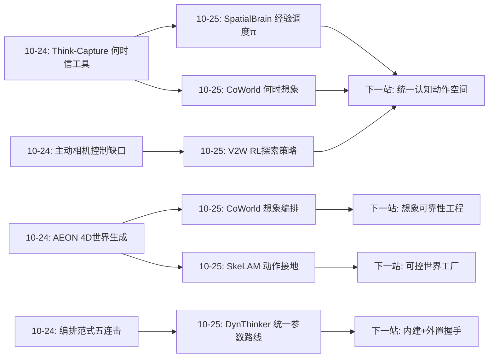
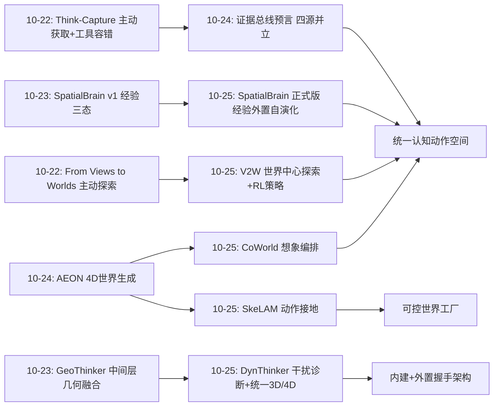
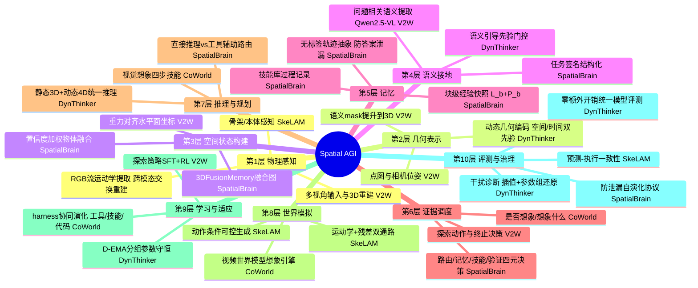
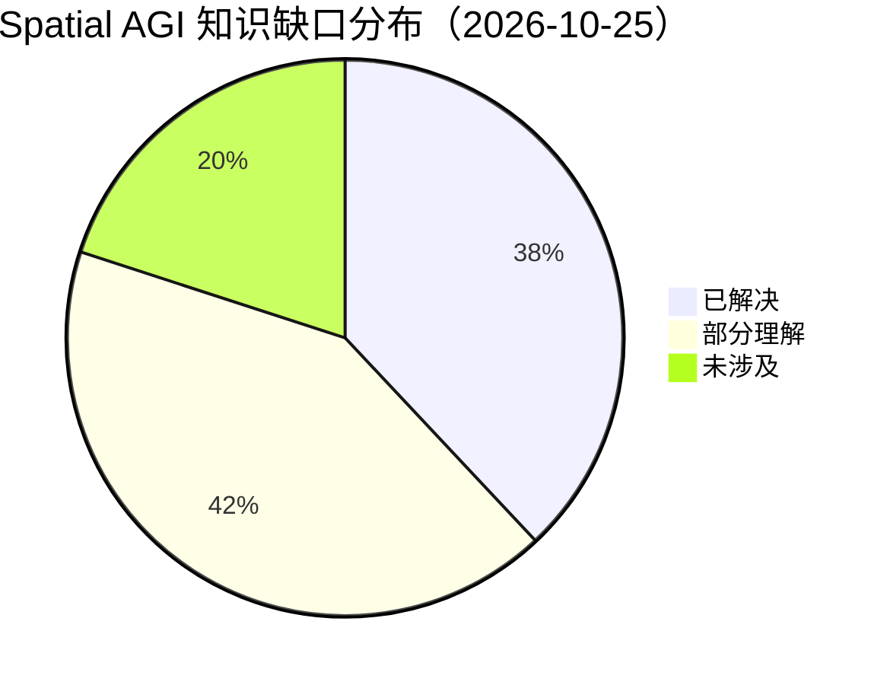
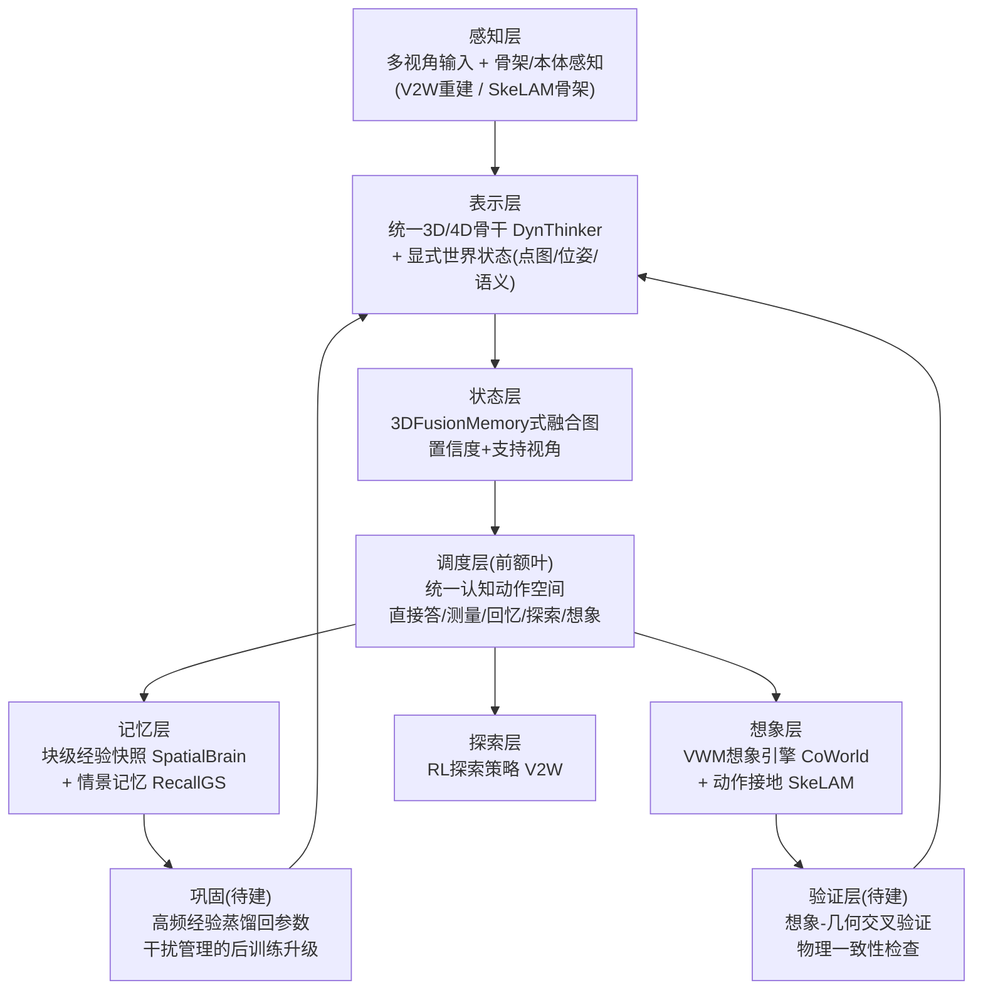

# Spatial AGI 每日深度思考 — 2026-10-25

## 📅 每日总结

**日期**: 2026-10-25
**论文数量**: 5篇
**主题**: 空间智能的"外置成长"（externalized growth）与"能力统一"（capability unification）——五篇论文回答同一个问题：空间智能体的能力应该长在哪里、以什么速度成长、以及最终要不要统一在一个模型里？SpatialBrain 说"长在外部经验里，权重不动"；V2W 说"长在与可查询 3D 世界的交互里，探索策略可以用 RL 补"；CoWorld Reasoner 说"长在 harness 里，连工具和代码都可以演化"；DynThinker 说"静态 3D 与动态 4D 必须统一在参数里，且要管理参数级干扰"；SkeLAM 说"世界模型的动作可控性要靠结构化接地硬编码进表示"

**论文清单**:
1. SpatialBrain (arXiv:261.29317) — 证据/计算/经验三层解耦的无标签测试时自演化框架，GPT-5.6-sol 骨干 5 基准 4 升（平均 67.5→72.6）
2. V2W / From Views to Worlds (arXiv:2610.24676) — VLM 兼容 3D 世界 + 视觉/语言双接口 + RL 训练的主动探索策略，MindCube-Tiny 超 GPT-4o 48.5 点
3. CoWorld Reasoner (arXiv:2610.21910) — 视频世界模型作为统一视觉想象引擎，VLM-VWM harness 协同演化（工具+技能+代码），7 基准全胜
4. DynThinker (arXiv:2610.20598) — 发现空间-动态干扰（晚层 MLP 敏感），D-EMA 分组守恒 + SDF 双先验融合，单模型统一静态 3D 与动态 4D，平均 60.5 超 GPT-5.6 Sol
5. SkeLAM (arXiv:2610.31474) — 骨架接地的潜在动作分解（运动学+残差），DROID 上 ADE -19.5%，预测成功率与真机一致

**关键突破**:
- 🚀 **"经验与证据分离"成为空间智能的正式架构原则**：SpatialBrain 把空间推理系统拆为场景证据（what）、技能（how-to-execute）、元经验（how-to-use）三个显式组件，且经验积累全程不接触参考答案和场景坐标——防泄漏的无标签自演化首次被严格形式化（块级快照 + 每请求最多一个学习因子变更 + 成本/风险约束）
- 🚀 **"何时想象"与"何时探索"加入元认知家族**：Think-Capture（昨日）训练"何时信工具"，CoWorld 训练"是否想象、想象什么、如何解读"，V2W 证明"主动探索"是可以 RL 训练的独立能力且小模型天然不会——空间智能体的元认知正在从单点走向调度空间：直接答 / 算几何 / 主动看 / 生成想象四个动作的选择
- 🚀 **空间-动态干扰被首次诊断**：DynThinker 用 checkpoint 插值 + 参数组还原定位到晚层 MLP 是静态/动态能力的冲突敏感区——多能力统一模型的"学新忘旧"问题第一次有了参数级解剖和针对性解药（D-EMA）
- 🚀 **统一模型第一次全面超过前沿闭源模型**：DynThinker 9 基准 10 指标平均 60.5 vs GPT-5.6 Sol 59.5，静态 3D + 动态 4D 在单一开源 VLM 内同时达到 SOTA——"统一表示优于分模型路由"拿到了最强证据
- 🚀 **可控性成为世界模型的新硬指标**：SkeLAM 证明纯重建驱动的潜在动作是"统计混合物"，骨架监督的显式分解（运动学+残差）+ 分支 dropout 才能让世界模型听动作指挥——且预测成功率与真机执行一致，"在想象中评估策略"获得可靠性背书

**架构演进**: 昨日"运行时证据策略 + 4D 表示接口化"→ 今日"外置成长架构 + 能力统一路线的正面对决"——空间智能的成长方式形成两条已验证路线：外置路线（经验/探索策略/想象调度长在系统层，权重冻结）与内建路线（能力长在参数里，用干扰管理护航）；同时元认知从"工具信任"扩展为"证据获取动作的完整调度"

### 📊 一句话总结

今天五篇论文完成了空间智能成长哲学的一次正面对决与互补整合：外置路线（SpatialBrain 的经验、V2W 的探索、CoWorld 的想象 harness）证明"权重不动也能长"，内建路线（DynThinker）证明"统一参数可以压过闭源前沿"，而 SkeLAM 则给出世界模型可控性的表示级方案——三者拼合，Spatial AGI 的完整形态浮现：冻结的推理脑 + 可演化的外部经验 + 可调度的想象引擎 + 统一的 3D/4D 空间骨干 + 动作可控的模拟器。

### 🔗 延续性

**昨日→今日**: 昨日的主题是"运行时证据策略"——感知/回忆/查库/想象四种证据源的概念验证与统一证据总线的预言。今天恰好是那个预言的第一次部分应验与扩展：SpatialBrain 把"资源使用经验"做成可积累的策略层（证据调度的学习机制）；CoWorld 把"想象"这个昨日 AEON 代表的证据源做成可编排的引擎（想象的调度机制）；V2W 补上了昨日明确指出的缺口——"证据获取的主动相机控制"（当时列为未涉及项），今天主动探索被解决了；DynThinker 和 SkeLAM 则在模型内部和世界模拟器层面为证据的"生产端"补强。昨日预言的"证据总线"今天有了调度策略的学习算法（SpatialBrain 的 π 函数 + CoWorld 的技能演化）。

**今日→明日**: ① SpatialBrain 的经验状态 + CoWorld 的 harness 演化 + Think-Capture 的工具信任，三者合并就是完整的"空间证据总线操作系统"——统一调度层是明确的下一站；② V2W 的主动探索 + Think-Capture 的目标选择 = 语义引导的主动感知闭环，昨日议题 5"主动探索与证据调度的合流"今天已有两条一半的拼图；③ DynThinker 的干扰诊断方法（插值+参数组还原）应该成为所有空间后训练项目的标准体检；④ SkeLAM 的分解式潜在动作 + AEON 的 4D 世界生成 = 动作可控的生成式世界工厂，昨日议题 3"生成世界物理验证"获得了新的技术抓手；⑤ 元认知四动作（直接答/算/看/想象）的统一调度策略学习是下一个顶级会议论文的形状。

### 💡 本质思考：如何达成通用空间智能

#### 1. 核心能力的本质是什么？

延续昨日的"证据策略性"，今天要加上第九块拼图：**成长的架构学（architecture of growth）**——空间智能体的能力增量应该放在系统的哪个存储位置，以什么机制写入，以及各位置之间如何协同。

今天的五篇论文揭示了能力存储的四个位置与各自的写入机制：

- **参数（weights）**：DynThinker 路线。写入机制是后训练，风险是空间-动态干扰（多能力参数纠缠），解药是 D-EMA 式的分组守恒。优点：能力上限最高、推理时零额外开销；缺点：写入贵、写入有破坏性、需要诊断工具护航。
- **外部经验（experience stores）**：SpatialBrain 路线。写入机制是无标签的轨迹抽象与块间合并。优点：防泄漏、可审计、跨任务可复用、随时可回滚；缺点：依赖强骨干做元认知决策、冷启动靠种子规则。
- **交互策略（policies over actions）**：V2W 的探索策略 + CoWorld 的想象调度技能。写入机制是 SFT+RL 或 harness 演化。优点：与回答能力解耦、可以单独优化"获取信息"这个子问题；缺点：探索/想象的成本高，小模型做不好。
- **表示结构（representation structure）**：SkeLAM 的分解式潜在动作 + ReferGaussian 的 EntityBank（昨日）。写入机制是结构化监督下的预训练或免训练重组。优点：把"必须为真"的约束（动作→运动学对应）硬编码，不指望模型自己学出来；缺点：设计依赖人工先验（骨架、实体定义）。

深刻的观察：这四个位置恰好对应人类的四种学习机制——长期训练（教育）、经验积累（阅历）、技能练习（刻意训练）、概念结构（先天/早期获得的框架）。更关键的是它们**不互斥而是分层协同**：DynThinker 统一的空间骨干是地基，SkeLAM 式可控模拟器是操场，V2W 式探索是感知器官的训练，SpatialBrain 式经验是阅历的沉淀。Spatial AGI 不是要在四者中选一个，而是要设计它们的分工协议。

另一个贯穿性的观察：**今天的所有系统都在"怀疑自己"**——SpatialBrain 的流程检查（process checks）、CoWorld 的"是否需要想象"判断、V2W 的探索终止决策、DynThinker 对参数漂移的显式约束、SkeLAM 对残差信息依赖的 dropout 抑制。空间智能的成熟标志不是更强的感知或推理，而是系统对自身认知过程的不信任被工程化为默认设置。

#### 2. 当前方法与理想目标的差距在哪里？

- **元认知动作空间仍不完整**：SpatialBrain 调度记忆和技能、CoWorld 调度想象、V2W 调度探索、Think-Capture（昨日）调度感知——四个系统各自调度自己的动作子集，没有一个统一的"认知动作空间"（直接答/测量/回忆/探索/想象/验证/放弃）让一个调度器学全。每个系统都在重新发明调度器，且互相不知道对方的存在。
- **外置成长与内建成长尚未握手**：DynThinker 的统一骨干是训练出来的，但训练后的模型没有任何经验积累机制（测试时冻结）；SpatialBrain 的经验系统建立在 GPT-5.6-sol 上，但那个骨干没有任何空间特化。理想形态是"DynThinker 式空间特化骨干 + SpatialBrain 式经验层"，今天没人做这个组合——因为两个社区（训练 vs agent）不读对方的论文。
- **想象的可靠性仍是裸奔**：CoWorld 把 VWM 生成的视觉证据直接消费进推理链，没有对生成质量的不确定性标注；SkeLAM 解决了动作可控性但没解决生成伪影；昨日 AEON 的物理正确性验证议题今天依然无人认领。想象作为证据源，是四种来源中最不可信却被使用得最乐观的。
- **干扰管理是单点解**：D-EMA 只在 DynThinker 的 Qwen-VL 骨干上验证；空间-动态干扰之外，空间-语言干扰、空间-操作干扰、感知-推理干扰是否存在、敏感区在哪，全部未知。参数级诊断（插值+还原）应该成为标准工具但目前只有一篇论文在用。
- **探索与想象的成本经济学缺失**：V2W 的多轮渲染 + CoWorld 的视频生成都是秒级到分钟级的开销，但没有论文回答"什么时候值得花这个钱"——收益/成本曲线、失败时回退机制、预算约束下的调度，这些经济学问题决定了系统能否部署。
- **可控模拟器的验证深度不足**：SkeLAM 的"预测成功率与真机一致"只在 DROID 的操作任务上验证；长时程 rollout 的误差累积、接触密集任务的物理正确性、跨形态迁移的定量边界，都还是空白。

#### 3. 从今天到理想状态，最可能的路径是什么？

**路径判断：元认知动作空间统一 → 外置/内建握手 → 想象可靠性工程 → 干扰诊断常规化 → 可控世界工厂。**

- 近期（3-6 个月）：出现统一的"空间认知动作空间"论文——把 SpatialBrain 的路由、CoWorld 的想象决策、V2W 的探索动作、Think-Capture 的工具信任合并成一个调度策略学习问题（很可能就叫 Spatial Cognition Controller 之类的名字）；DynThinker 的干扰诊断被 2-3 个后续工作复用于空间-操作、空间-语言组合；SkeLAM 的骨架接地扩展到双臂/移动操作。
- 中期（6-18 个月）：外置/内建握手成为主流——空间特化的开源骨干（DynThinker 系）标配经验外挂接口（SpatialBrain 协议），就像今天的 LLM 标配工具调用；想象的证据带置信度输出（生成模型的不确定性估计成熟），与显式几何（V2W 世界）交叉验证成为"想象-验证"标准对；可控生成式世界（SkeLAM 动作接地 + AEON 生成 + 物理验证）开始批量产出训练环境。
- 远期（18 个月+）：空间智能体形成完整的认知栈——参数层统一 3D/4D 骨干（内建）、经验层跨任务成长（外置）、策略层调度感知/回忆/想象/探索（元认知）、模拟层提供动作可控的世界操场（工厂）；四个层的接口标准化，Spatial AGI 的进步从"换整个系统"变为"升级某一层"——空间智能进入可组合的工程时代。

---

## 🔗 与昨日思考的联系

### 昨日重点

昨日（2026-10-24）的主题是"运行时证据策略与 4D 表示接口化"：Think-Capture 训练"何时信工具"的元认知（分歧挖掘+分层 GRPO）；AEON 把 4DGS 变成世界模型的统一表示（生成接口）；RecallGS 把观测历史变成免训练先验（记忆接口）；ReferGaussian 把 4D 高斯实体化供语言寻址（语言接口）；AirPlayground 用 94 个可执行世界做闭环验收。核心预言：四种证据源（感知/回忆/查库/想象）即将合流为统一证据总线；明确缺口包括"证据获取的主动相机控制"与"动态世界处理"。

### 今日进展

今天的五篇论文在三个方向上精确延续了昨日的思考：

1. **承接"证据总线的调度策略"预言**：昨日指出四种证据源"互不相通、缺统一调度"；SpatialBrain 给出了调度策略的可学习形式——任务签名 → 资源选择的映射 π(σ; P, L)，且证明了这种调度经验可以无标签积累。CoWorld 则在想象通道上做了同样的调度（是否想象/想象什么）。两篇论文分别是"几何工具通道"和"想象通道"的调度器，证据总线的两个通道已经有了各自的控制器。
2. **填补"主动相机控制"缺口**：昨日明确把"证据获取的主动相机控制"列为未涉及项；V2W 今天正面解决了——不是物理移动相机，而是在重建的 3D 世界中主动查询任意视角，且用 RL 训练探索策略解决了小模型探索低效的问题。昨日议题 5（主动探索与证据调度合流）的一半拼图到位。
3. **承接"世界模型作为证据源"的深化**：昨日 AEON 给了想象通道的表示端（4D 世界生成）；今天 CoWorld 给了使用端（想象编排进推理），SkeLAM 给了可控性端（动作接地的潜在动作）。想象这个证据源一天之内补齐了"怎么造、怎么用、怎么控"三块。
4. **内建路线的强回应**：昨日五篇全是外置/编排路线，隐含假设是"训练不如编排"；DynThinker 用统一模型超越 GPT-5.6 Sol 的成绩单为内建路线正名——并提醒编排路线的天花板终究是骨干。两条路线从昨日的单边叙事变为今天的正面对决。
5. **承接"闭环验证"与"物理验证"议题**：昨日议题 3（生成世界物理验证）与"预测-执行一致性"关切，SkeLAM 给出了第一个量化回应——世界模型预测的成功率与真机执行一致。模拟器的可信度第一次有了操作化检验。

### 演进路径

昨日回答"证据从哪来、表示如何接口化"，今日回答"能力如何成长、成长放哪里、以及统一到什么程度"——空间智能系统学从生理学进入发育生物学：开始研究这个系统如何生长。

---

## 📚 论文概览

1. **SpatialBrain**（上海交大/浙大）：空间推理的"经验外置"框架。核心区分：场景证据（evidence）vs 使用证据的经验（experience）。三大组件——3DFusionMemory（多视角观测融合为可查询空间关系图，带置信度/支持视角/歧义标注）、Spatial Skill Library（参数化工具过程，适用条件+类型化接口）、Spatial Cognition（任务签名 σ → 资源选择 g=(路由, 记忆模式, 技能集, 验证) 的经验映射）。自演化协议：轨迹抽象为无标签记录（排除答案与坐标）→ 块间合并更新策略与技能库 → 块内读固定快照保证并行安全。资源变更需历史支持+低风险+低成本，每请求最多一个学习因子变更。GPT-5.6-sol 骨干：MMSI 57.1 / MindCube 87.6（+20.4）/ OmniSpatial 69.1 / SpaceDG 57.9 / SAT 91.3（平），平均 72.6 vs 直接 67.5，超 GCA/AlloSpatial/SpatialClaw/Skill-3D 全部 agentic 基线。

2. **V2W**（华东师大/上海交大）：主动世界中心空间推理。批评现有主动感知（新视角渲染/生成）仍是 view-centric——3D 信息从未显式暴露给 VLM。方案：3D 基础模型前馈重建（深度/位姿/点图）→ SAM 3 分割 + mask 提升到 3D 点集（物体语义）→ RANSAC 地面对齐重力 → "VLM 兼容 3D 世界"，经视觉接口（任意位姿渲染）与语言接口（可见物体+位姿相对关系的文本）暴露给 VLM → 多轮 function call 主动探索。训练-free 即提升；小模型探索低效（不足/无信息量）→ SFT+RL 训练探索策略后 SOTA，MindCube-Tiny 超 GPT-4o 48.5 点。

3. **CoWorld Reasoner**：视频世界模型作为统一视觉想象引擎。批评现有 VWM 调用是围绕预定义想象形式（如新视角合成）的固定流水线。方案：Video World Model-Driven Harness 把多种视觉操作（新视角/未来帧/反事实）工具化，技能指导 VLM 四步决策（是否想象→选操作→构造请求→解读证据）；VLM-VWM Harness Co-Evolution 基于执行反馈联合修订工具+技能+执行代码，双模型权重全程冻结。7 基准（空间/时序因果/感知）全胜同 VLM 直接推理，MMSI +11.8%、ERQA +13.0%，5 基准胜过全部 5 个同骨干演化基线。

4. **DynThinker**（中山大学/NTU/影石/MBZUAI）：诊断并解决空间-动态干扰。发现：3D 后训练提升 VSI-Bench 同时持续损害 VLM4D（插值实验证实反向轨迹）；参数组还原实验定位晚层 MLP 为敏感区（还原即恢复动态、牺牲静态）。方案：D-EMA（按参数组配置 EMA 平均时域，敏感组强守恒，按更新次数归一化）+ SDF（动态几何编码器的空间/时间双先验流，VLM 语义上下文门控融合进中间层）。9 基准 10 指标平均 60.5 超 GPT-5.6 Sol 59.5；ReVSI 56.0 / DSR-Bench 67.2 / DSI-Bench 51.2/40.1 开源统一模型 SOTA。无 D-EMA 时数据越大动态退化越重，有 D-EMA 双升。

5. **SkeLAM**：骨架接地的机器人世界模型。批评重建驱动的潜在动作混杂机器人运动、物体响应与场景变化，与控制信号对应模糊。方案：潜在动作分解为运动学分量（骨架监督接地）+ 残差分量（其余视觉动力学）；跨模态交换重建迫使 RGB 推导与骨架推导的运动学表示可互换；世界模型双通路条件化 + 分支 dropout 降低对"未来残差信息"的依赖；轻量 adapter 把真实动作映射到运动学空间。DROID 上 vs DreamDojo：end-effector ADE -19.5%、LPIPS -11.1%；策略预测成功率 ≈ 真机执行；零样本人→机器人运动迁移。

---

## 💡 核心见解

### 见解1: 经验与证据的分离是空间智能系统的架构原则，不只是工程技巧

（从 SpatialBrain 获得）
- ✅ SpatialBrain 把"场景证据"（当前世界什么样）与"使用证据的经验"（该对它做什么）显式分离，经验以任务签名→资源决策的条件化形式存储，跨块合并
- ✅ 经验刻意排除参考答案与场景坐标——它记录"这类问题用这条路线成功率 80%、成本 3k token"，而不是"这道题答案是 B"
- ✅ 严格的更新协议：块级快照（块内并行安全）、资源变更需历史支持+可接受风险+更低成本、每请求最多一个学习因子变更——把 LLM agent 常见的激进换策略问题工程化约束

**对Spatial AGI的启发**:
这是空间智能的"外置小脑"宣言。过去纠结要不要微调注入空间先验，SpatialBrain 证明第三条路：把"如何使用空间工具"的经验当作可积累、可审计、可回滚的外部状态，权重冻结也能 +5.1 平均分。更重要的是防泄漏设计——经验不含答案和坐标，使其可以安全部署在真实评测/生产环境而无作弊嫌疑。这为 Spatial AGI 的经验系统立了一个安全标准：**任何跨任务的状态传输都必须通过"这个状态里有没有这道题的答案"的审计**。

### 见解2: 主动探索是可以训练的独立能力，而且小模型天然不会

（从 V2W 获得）
- ✅ V2W 的 training-free 实验揭示：VLM 潜在地具备主动探索能力，但小模型探索"不足或无信息量"——不会选择有信息量的视角、不知道何时停止
- ✅ SFT+RL 训练探索策略后达到 SOTA，MindCube-Tiny 超 GPT-4o 48.5 点——一个会探索的中等模型碾压不会探索的巨大模型
- ✅ 重力对齐后的水平面动作空间（前/后/左/右）让几何与语言系统共享直觉坐标系，是降低探索学习难度的关键工程

**对Spatial AGI的启发**:
"去哪看、看多久、何时停"应该作为独立的训练目标，与"答对问题"解耦。这呼应了认知发展的经典发现：婴幼儿的空间认知先于语言发展，主动探索是其核心机制。工程含义：Spatial AGI 的训练管线应该包含"探索质量"的独立奖励信号（信息增益、探索效率），而不是只在最终答案上给 RL 信号。另外，48.5 点的差距也警告评测社区：所有静态空间基准都在系统性低估具备探索能力的系统、高估不会探索的大模型。

### 见解3: 视觉想象的调度（是否/什么/如何/解读）本身是可演化的技能

（从 CoWorld Reasoner 获得）
- ✅ 把 VWM 的多种操作（新视角/未来帧/反事实）工具化后，"何时想象、想象什么"的决策收益显著——固定流水线（只做新视角合成）被全面超越
- ✅ 想象的四步技能（判断→选择→构造→解读）中，"是否想象"是收益关键：能直接答的问题去生成视频既是成本浪费也是噪声引入
- ✅ Harness 协同演化（工具+技能+代码联合修订）比单一经验积累更激进——连工具接口都可以变，7 基准全胜且胜过所有演化基线

**对Spatial AGI的启发**:
心理意象（mental imagery）的工程化完成度超预期。Spatial AGI 的认知动作空间至此有了四个成员：直接推理、几何计算（SpatialBrain）、主动探索（V2W）、视觉想象（CoWorld）。想象的特殊性在于它是唯一能产生"尚不存在的观测"的动作（未来、反事实、不可见视角）——也是唯一需要怀疑自己产出的动作（生成伪影污染推理链）。下一步必然是为想象证据加不确定性标注与外部验证（与 V2W 的显式几何交叉验证是最自然的组合）。

### 见解4: 空间-动态干扰证明多能力在参数空间是纠缠的，统一模型需要干扰管理基础设施

（从 DynThinker 获得）
- ✅ 3D 后训练在提升静态推理的同时系统性侵蚀预训练的动态能力，且干扰集中在晚层 MLP——能力不是可独立堆叠的模块
- ✅ checkpoint 插值 + 参数组还原构成一套可复用的"能力冲突解剖"方法：插值定位现象，还原定位参数
- ✅ D-EMA 的洞察：不用 hard freezing（锁死）、不用全局正则（太钝），而用按参数组差异化的软守恒——敏感组强固、不敏感组灵活

**对Spatial AGI的启发**:
这是空间智能训练的"药物相互作用"警告。任何追求多能力统一（空间+语言+操作+导航+推理）的训练项目都需要：① 训练前后的能力基线矩阵；② 插值/还原诊断定位冲突参数组；③ 分组化的守恒机制。"数据越多退化越重"的发现尤其危险——空间后训练的数据扩张必须搭配干扰监控，否则规模化的每一步都在悄悄摧毁预训练的动态直觉。DynThinker 平均 60.5 超 GPT-5.6 Sol 同时证明：干扰管理做得好，统一开源模型可以正面击败闭源前沿。

### 见解5: 世界模型的动作可控性必须靠表示级接地，自监督不会自发涌现

（从 SkeLAM 获得）
- ✅ 重建目标下学出的潜在动作是"机器人运动+物体响应+场景变化"的统计混合物——能生成像样的视频，但不听动作指挥
- ✅ 骨架这一廉价监督即可净化表示：运动学分量接地后 ADE -19.5%；跨模态交换重建迫使 RGB 流自己学会纯运动学语义
- ✅ 分支 dropout 防"未来信息泄漏"是个精妙的因果性工程——残差分支来自未来帧，不抑制它世界模型就会在推理时"作弊"

**对Spatial AGI的启发**:
可控性（controllability）应该取代保真度成为具身世界模型的第一评测指标。一个 RVD-GS 再低但不可控的世界模型对机器人毫无用处；SkeLAM 的"预测成功率 ≈ 真机成功率"才是金标准。与昨日 DRILL 的"为策略而非像素训练"呼应，世界模型社区正在经历目标函数的价值转向：从"像不像"到"听不听话、有没有用"。方法论的教训：不要迷信大规模无标注视频的纯自监督——廉价的结构化锚点（骨架、位姿、深度）能起到四两拨千斤的净化作用。

### 见解6: 元认知动作空间正在成形——从单点调度到认知动作全集

（从今日四篇论文的综合获得）
- ✅ 昨日 Think-Capture 解决"何时信工具"；今天 SpatialBrain 解决"何时用记忆/技能"、CoWorld 解决"何时想象"、V2W 解决"如何探索"——四个调度器各自独立诞生
- ✅ 四者覆盖的认知动作互不重叠：直接答 / 算几何 / 主动看 / 生成想象，恰好构成空间推理的完整动作空间
- ✅ 每个系统都在自己的子空间上证明了"调度可学习且收益显著"（+5 到 +48 点），但没有任何系统学过全部四个动作

**对Spatial AGI的启发**:
一个统一的"空间认知控制器"（学习在直接答/测量/回忆/探索/想象/验证之间调度）是明确的下一站，而且是那种"组件全部就位只差整合"的典型机会。统一调度还有经济学维度：四个动作成本差两个数量级（直接答 ~1k token vs 视频想象 ~分钟级+10k token），没有统一成本模型就没有最优调度。预测：3-6 个月内会出现把 Think-Capture/SpatialBrain/CoWorld/V2W 四个动作放进一个策略学习框架的工作。

### 见解7: 外置成长与内建成长的握手是最大的未开垦地

（从 SpatialBrain/DynThinker 的对照获得）
- ✅ SpatialBrain 的经验层建立在无空间特化的 GPT-5.6-sol 上；DynThinker 的空间特化骨干没有任何测试时经验机制——两个最强系统恰好互补且互不相识
- ✅ 理论上组合应该超加性：特化骨干降低单次推理错误率 → 经验层的成功/失败信号更干净 → 调度经验更快收敛
- ✅ 阻碍是社区隔离：训练社区（架构/数据/EMA）与 agent 社区（提示/工具/记忆）的发表激励和评审口味完全不同

**对Spatial AGI的启发**:
Spatial AGI 的参考架构逐渐清晰—— DynThinker 式统一空间骨干（参数层）+ SpatialBrain 式经验层（外部状态）+ V2W 式探索接口（环境层）+ CoWorld 式想象引擎（生成层）+ SkeLAM 式模拟器（操场层）。每层已有独立的最优实现，缺的是层间协议：经验层如何感知参数层的能力边界？调度层如何查询模拟器的可信度？这些接口问题和当年的 OSI 分层一样，一旦标准化就会释放组合爆炸式的进展。

### 见解8: 统一 vs 分裂的路线之争在空间智能中有了裁决性证据

（从 DynThinker 与分模型路线的对比获得）
- ✅ GeoSR 用分离模型处理静态/动态推理；DynThinker 单模型 + 门控融合在综合性能上反超，且推理零路由开销
- ✅ 语义门控的自适应调制说明"这个问题更需要几何还是运动"可以由模型内部解决，不需要外部任务分类器
- ✅ 昨日 AEON 在表示层统一了视频/3D 世界模型，今日 DynThinker 在能力层统一了 3D/4D 推理——两个层面的统一都拿到了正证据

**对Spatial AGI的启发**:
空间智能的"统一压过路由"证据链正在变长：表示统一（AEON）、能力统一（DynThinker）、表示-能力双统一将是终局。但注意边界条件——统一的前提是干扰被管理（D-EMA），否则统一模型两头不讨好（这正是 3D/4D 特化模型长期共存的原因）。工程路线图：先诊断干扰地图（哪些能力在哪些参数组纠缠），再决定统一或分离——把路线选择从信仰问题变成测量问题。

### 见解9: 防泄漏的实验协议本身是一种竞争力

（从 SpatialBrain/V2W/DynThinker 的实验设计获得）
- ✅ SpatialBrain 的块级快照 + 无标签抽象 + 无基准类别标签，堵死了自演化系统的三条作弊路径（读答案、带坐标、抄标签）
- ✅ DynThinker 的 D-EMA 消融排除了"数据更大"的混淆，插值实验排除了"训练更久"的混淆
- ✅ V2W 严格区分 training-free 与 learned 两种设置的成绩，不让读者误以为即插即用系统有 RL 的加成

**对Spatial AGI的启发**:
空间智能领域正在重复 NLP 评测污染的教训——训练集/测试集边界、agent 系统的隐式信息泄漏、自演化系统的前向信息流都需要协议级防御。SpatialBrain 的设计值得作为模板推广：任何跨任务机制（记忆/经验/检索）的论文都应该回答"你的机制会不会把测试信息带进测试"。反过来，严格的防泄漏协议让正结果更可信——SpatialBrain 的 +5.1 比很多没做泄漏防护的 +10 更有含金量。

---

## 🗺️ 知识演进图

空间元认知的谱系：Think-Capture（10-22，何时信工具）→ SpatialBrain（10-23 初现/10-25 成熟，何时用记忆与技能）→ CoWorld（10-25，何时想象）→ V2W（10-25，如何探索）。四条线在"统一认知动作空间"汇合。世界模型线：AEON（生成）→ CoWorld（使用）+ SkeLAM（可控）——造、用、控三段完成。统一路线：GeoThinker（静态几何融合）→ DynThinker（静态+动态统一+干扰管理）。

---

## 技术栈演进对比表

| 层次 | 昨日方案 | 今日方案 | 变化 |
|------|---------|---------|------|
| 空间元认知 | Think-Capture 单点工具信任（分层 GRPO） | 四动作调度雏形：SpatialBrain 路由记忆/技能、CoWorld 调度想象、V2W 调度探索 | 从单点调度到动作空间成形 |
| 经验与适应 | RecallGS 记忆外化（感知层）、Think-Capture 策略训练 | SpatialBrain 无标签块级经验自演化、CoWorld harness 三要素协同演化 | 经验获得严格协议（防泄漏+成本约束） |
| 主动感知 | Think-Capture 止步于选分割目标（缺口） | V2W 重建世界内任意视角探索 + RL 探索策略 | 缺口被填补，探索成为可训练能力 |
| 视觉想象 | AEON 提供生成接口（造） | CoWorld 编排进推理（用）+ SkeLAM 动作接地（控） | 想象证据源"造用控"三段补齐 |
| 静态/动态统一 | 3D/4D 特化模型并存（GeoSR 分模型） | DynThinker 单模型统一 + 干扰管理（D-EMA+SDF），平均分超 GPT-5.6 Sol | 路线之争出现裁决性证据 |
| 世界模型可控性 | AEON 可编辑可仿真但动作条件未解 | SkeLAM 潜在动作分解 + 骨架接地，预测-执行一致 | 可控性成为世界模型硬指标 |
| 空间骨干 | 通用 VLM + 外挂（GPT-5.6-sol + 工具） | DynThinker 空间特化统一骨干（开源） | 内建路线拿到最强成绩单 |
| 训练安全 | 未系统处理多能力干扰 | 插值+参数组还原诊断 + D-EMA 分组守恒 | 干扰管理成为标准工具 |
| 评测协议 | AirPlayground 闭环导航验收 | SpatialBrain 防泄漏自演化协议、V2W 双设置分离 | 协议严谨性成为竞争力 |
| 机器人模拟器 | AirPlayground 可执行 3DGS 世界（导航） | SkeLAM 动作可控世界模型（操作），预测成功率≈真机 | 从导航操场到操作模拟器 |

---

## 🗺️ Spatial AGI 知识图谱

### 10层架构思维导图

### 🎯 主线技术路径

#### 阶段1: 被动感知与单模型特化（已过时，2024-2025）

VLM 融合输入特征端到端训练；空间能力靠数据堆砌；3D 和 4D 各自特化互不兼容；世界模型只管下一帧预测。瓶颈：能力互相侵蚀无人知晓、感知不完整只能靠模型硬扛、世界模型不可控。

#### 阶段2: 工具化编排与证据源分化（当前主流，2025-2026）

Agentic 工具调用、结构化中间表示、免训练编排；证据源分化为感知/回忆/查库/想象四种；世界模型进入推理链。瓶颈：各调度器各自为政、想象证据裸奔、训练路线与编排路线隔离。

#### 阶段3: 统一认知控制器与双路线握手（正在开始，2026-2027）

统一的认知动作空间（直接答/测量/回忆/探索/想象/验证）由单一调度策略学习；DynThinker 式统一空间骨干标配 SpatialBrain 式经验接口；想象证据带不确定性并与显式几何交叉验证；干扰诊断成为训练标配。代表形态：带完整元认知的具身空间智能体。

#### 阶段4: 可控世界工厂与空间成长闭环（2027+）

SkeLAM 式动作接地 + AEON 式生成 + 物理验证形成可控世界工厂——训练环境批量生产且听指挥；空间智能体在工厂中自我探索（V2W）、自我积累经验（SpatialBrain）、自我演化工具（CoWorld），参数层定期用干扰管理的后训练升级——空间智能获得完整的"感知-行动-想象-经验-特化"成长闭环，从一次性训练的系统变成持续生长的有机体。

---

## 🔍 待探索议题

### 高优先级（本周）

1. **统一空间认知动作空间的形式化**
   - 问题: 直接答/测量/回忆/探索/想象五个动作如何统一为一个调度策略学习问题？各动作的成本与可靠性如何统一度量？
   - 候选方案: 把 SpatialBrain 的 g=(路由,记忆,技能,验证) 扩展为含想象与探索动作的决策空间；用 Think-Capture 的分歧挖掘生成跨动作训练信号；成本模型纳入 token/延迟/风险三轴
   - 缺口: 五个动作来自五篇论文的五种接口，统一抽象需要重新定义观测与动作空间；跨动作的失败归因（探索失败 vs 想象失败 vs 测量失败）没有现成数据

2. **DynThinker 干扰诊断在空间-操作组合上的复现**
   - 问题: 空间-动态干扰已被证实；空间推理与机器人操作后训练之间是否存在类似的参数级干扰？敏感区是否还是晚层 MLP？
   - 候选方案: 用 OpenVLA 类操作模型 + 空间基准做插值/还原实验，绘制空间×操作×语言三能力干扰地图
   - 缺口: 需要同时具备空间与操作后训练检查点的开源模型对（罕见）

3. **想象证据的不确定性标注**
   - 问题: CoWorld 直接消费 VWM 生成物为证据，生成伪影/物理错误无标注地进入推理链
   - 候选方案: 生成模型输出 per-frame/per-region 置信度（可用重建误差或集成一致性代理）；推理链中想象证据与 V2W 式显式几何交叉验证
   - 缺口: 视频生成模型的不确定性估计本身是开放问题；"想象证据可错到什么程度仍有益"没有量化研究

### 中优先级（本月）

4. **SpatialBrain 经验层与空间特化骨干的握手实验**
   - 问题: 特化骨干（DynThinker 类）+ 经验外挂（SpatialBrain 协议）是否超加性？
   - 候选方案: 在 DynThinker 开源权重上复现 SpatialBrain 协议，对比通用骨干 vs 特化骨干的经验积累速度与收益
   - 缺口: SpatialBrain 的任务签名与技能库为通用 VLM 设计，特化骨干的工具生态需要重建

5. **探索策略的跨域迁移**
   - 问题: V2W 的探索策略在空间心智建模基准上训练，迁移到真实机器人感知（移动探索）或新基准时保持多少？
   - 候选方案: 在 MindCube→VSI-Bench→真实室内场景的三级迁移链上测探索策略的零样本表现
   - 缺口: 探索价值的领域无关定义（信息增益的统一度量）

6. **SkeLAM 残差分量的结构化**
   - 问题: 运动学接地后，物体响应/接触动力学仍在残差黑箱中，"推杯子杯子会倒"不可控
   - 候选方案: 三层分解（运动学骨架接地 → 刚体动力学物理接地 → 其余自监督）；或残差分量挂接物理仿真引擎做混合生成
   - 缺口: 物体级接触事件的标注数据；物理接地与生成质量的权衡

7. **块级自演化协议的最优块大小**
   - 问题: SpatialBrain 的 block 粒度是超参数——太小则经验更新频繁但并行性差，太大则块内任务无法受益于新鲜经验
   - 候选方案: 在部署场景中用在线学习理论（regret bound）分析最优切换时机；或异步细粒度更新 + 冲突检测
   - 缺口: 经验更新之间的干扰分析（新经验覆盖旧经验的负迁移）

### 低优先级（本季度）

8. **D-EMA 的理论分析**
   - 问题: D-EMA 有效但为什么按组时域平均能解耦能力保持与增强，没有理论刻画
   - 候选方案: 在线性化假设下分析 EMA 时域与参数敏感度的谱关系；把干扰敏感度与损失景观曲率联系起来
   - 缺口: 干扰的数学定义本身（现在只是经验现象）

9. **跨形态运动学空间的统一**
   - 问题: SkeLAM 零样本人→机器人迁移暗示运动学表示可跨形态，但机械臂/人形/四足/无人机的运动学空间如何统一？
   - 候选方案: 以任务空间（末端位姿/质心轨迹）而非关节空间为接地目标；形态条件化的 adapter 家族
   - 缺口: 跨形态对齐数据（同一任务多形态演示）

10. **空间智能系统评测的"元认知审计"**
    - 问题: 现有基准只评答案对错，无法区分"算得对"与"该算时才算"——一个每次都全量调工具的系统可能在静态基准上得分相同
    - 候选方案: 评测协议加入成本约束（token/延迟预算下的准确率）、调度合理性评分（与最优动作序列的偏差）、防泄漏审计（跨任务信息流检查）
    - 缺口: 最优调度的上界估计方法（oracle 调度器）

---

## 📊 知识缺口分析

**已解决（38%）**:
- ✅ 经验外置自演化的可行性与协议（SpatialBrain 5 基准 4 升 + 防泄漏设计）
- ✅ 世界中心主动探索的价值与可训练性（V2W training-free 提升 + RL 策略 SOTA）
- ✅ 想象作为推理证据的编排收益（CoWorld 7 基准全胜）
- ✅ 静态 3D + 动态 4D 的单模型统一（DynThinker 超 GPT-5.6 Sol）
- ✅ 空间-动态干扰的定位与缓解（晚层 MLP + D-EMA）
- ✅ 世界模型动作可控性的表示级方案（SkeLAM 骨架接地，ADE -19.5%）
- ✅ 世界模型预测-执行一致性（SkeLAM 策略成功率验证）

**部分理解（42%）**:
- ⚠️ 元认知动作空间——四动作各自可学，统一调度未做，成本模型缺失
- ⚠️ 外置/内建握手——理论上互补，实验上无人做
- ⚠️ 想象证据可靠性——价值已证，无不确定性标注与验证机制
- ⚠️ 干扰的普适性——只在空间×动态一对能力上验证，其他组合未知，理论缺失
- ⚠️ 探索策略迁移——训练域内有效，跨域保持率未知
- ⚠️ 残差动力学的可控性——运动学接地了，物体响应仍黑箱
- ⚠️ 经验更新的负迁移——SpatialBrain 自己报告了类别回退（OmniSpatial egocentric、SpaceDG 距离），防护机制缺失
- ⚠️ 生成式模拟器的物理正确性——可控≠物理正确（延续昨日缺口）

**未涉及（20%）**:
- ❌ 多智能体的经验共享与分布式空间记忆（SpatialBrain 是单智能体）
- ❌ 空间元认知的在线学习理论（regret、最优停止）
- ❌ 触觉/听觉等模态进入统一认知动作空间
- ❌ 长时程 rollout 的误差累积理论（SkeLAM 类世界模型分钟级预测）
- ❌ 语言条件的世界生成闭环（"想象一个符合描述的房间"并验证）
- ❌ 空间能力的涌现动力学（统一骨干多大时 3D/4D 干扰消失或逆转）
- ❌ 神经符号化经验的可解释审计工具（经验状态的人类可读性）

---

## 🧩 深度议题展开

### 议题A: 统一认知控制器——空间智能的"前额叶时刻"

今天四篇论文各造了一个"局部前额叶"：SpatialBrain 的 Spatial Cognition 决定用不用记忆和技能，CoWorld 的技能决定想不想、想什么，V2W 的探索策略决定看不看、看多久，Think-Capture（昨日）的 GRPO 策略决定信不信工具。四个控制器都证明了同一件事：**调度决策的学习收益在 +5 到 +48 点之间**——这个收益量级说明调度误差是空间智能的主要损失来源之一。

但四个控制器互不兼容，且它们对同一情况可能给出矛盾指令（V2W 说"去探索"，SpatialBrain 说"直接答历史经验显示够用"）。统一认知控制器的技术障碍是动作空间异构性：测量是同步函数调用、探索是异步多轮交互、想象是重生成任务、回忆是检索任务——它们的观测空间、时间尺度、失败模式完全不同。可能的统一抽象：把所有动作看作"对世界状态的信息获取操作"，用统一的"信息需求描述"（缺什么证据、容忍什么成本）作为接口——这恰好是昨日预言的证据总线的请求端。判断：这不是 if 而是 when，组件成熟度已经够了。

### 议题B: 外置成长的规模定律与内建成长的规模定律是不同的曲线

今天的五篇论文隐含了两条成长曲线。外置路线（SpatialBrain/CoWorld）的成长来自经验积累——经验覆盖率曲线（SpatialBrain 有专门分析）决定收益，而经验覆盖随任务数量近似线性增长，收益是次线性但**免费**的（无训练成本）。内建路线（DynThinker）的成长来自数据规模——但受干扰制约，无 D-EMA 时数据越多动态越差，即内建成长有一条"干扰墙"。

两条曲线的工程含义完全不同：外置路线适合持续部署的系统（每天的任务都是免费训练数据），内建路线适合一次性大投入的能力跃迁。最有意思的预测：两者的交叉点——当外置经验的边际收益低于内建特化的边际成本时，系统应该暂停服务做一次"离线巩固"（把高频经验蒸馏进参数，同时做干扰管理的后训练升级）。这就是认知科学的"记忆巩固"（海马→皮层）的工程对应，而且今天两边的组件都刚好就位。

### 议题C: 想象的信任问题是空间智能的"对齐问题"

CoWorld 把想象产物当证据、SkeLAM 只解决了可控没解决真实、昨日 AEON 的生成世界无物理验证——想象类证据源的可靠性问题在三天内被三个不同侧面撞上。这与 LLM 的幻觉问题同构，但有独特难点：空间想象的错误不是"说错了话"而是"看到了不存在的东西"，且错误通过下游推理链复合放大（想象错误→推理错误→行动错误）。

空间想象的对齐问题可能比语言幻觉更可解，因为空间有物理 ground truth：想象的新视角可以与重建几何交叉验证（V2W 的世界就是验证器），想象的物理后果可以用仿真检验（SkeLAM 的运动学通路就是校验器）。预测：半年内出现"验证想象"（verified imagination）作为独立研究方向——想象的每条证据附带验证状态（已验证/未验证/与几何矛盾），调度器根据验证状态加权消费。到那时，空间智能的想象才真正配得上"心理模拟"这个名字，而不是"幻觉生成器"。

### 议题D: 干扰地图是空间智能训练的"元素周期表"工程

DynThinker 只画了干扰地图的一格（空间×动态），但这个方法论可以扩展成一张完整的表：空间推理×操作、空间×语言、空间×导航、感知×推理、记忆×推理……每一格标注是否存在干扰、敏感参数区在哪、用什么守恒策略。这张表的绘制是纯工程（插值+还原实验自动化），但价值极高——它把"多能力训练该不该做、怎么做"从信仰问题变成查表问题。

更深一层：干扰的存在暗示参数空间中的能力表征是**共享的**——晚层 MLP 同时编码静态和动态的推理结构，这正是干扰的物理基础。反过来说，干扰也是统一模型优于分模型的原因（共享表征带来正迁移）。干扰地图加上迁移地图（哪些能力组合有正迁移）将共同回答 Spatial AGI 训练的核心问题：**哪些能力天然应该一起学，哪些必须分开学再合并**。

### 议题E: 从 SpatialBrain 的回退看经验的"保质期"

SpatialBrain 报告了两组回退：OmniSpatial 的自我中心问题、SpaceDG 的距离/计数问题——经验积累在这些类别上是负迁移。这暴露了条件化经验存储的隐含假设：任务签名相同 → 历史经验适用。但签名相同不代表难度分布相同（同一个"自我中心方向判断"签名，在不同的场景复杂度下最优策略不同）。

改进方向有三个：① 签名精细化（把场景复杂度、视角覆盖质量编入签名）；② 经验的置信衰减（老经验权重随分布漂移下降）；③ 违例检测（当历史推荐策略连续失败时触发签名分裂）。这本质上是给经验系统做"概念漂移检测"——流数据学习的经典问题在空间智能中的再现。Spatial AGI 的经验层不是数据库，而是一个需要自己维护有效性的学习系统。

---

## 📝 今日金句

1. **"证据说你看到了什么，经验说你该拿它怎么办。"** —— SpatialBrain 的核心区分
2. **"权重不动，小脑长大。"** —— SpatialBrain 的外置成长宣言
3. **"会探索的中等模型，碾压不会探索的巨大模型。"** —— V2W 的 48.5 点启示
4. **"3D 信息不该被翻译成更多 2D 图——它应该被显式地暴露。"** —— V2W 对 view-centric 范式的告别
5. **"不要问世界模型能不能生成，要问它听不听指挥。"** —— SkeLAM 的可控性优先
6. **"学新的忘旧的不是脾气，是晚层 MLP 的参数纠缠。"** —— DynThinker 对灾难性遗忘的解剖
7. **"统一不是信仰，是干扰管理之后的工程结论。"** —— DynThinker 超 GPT-5.6 Sol 的方法论
8. **"想象是唯一能产生尚不存在的观测的动作，也是唯一需要怀疑自己的动作。"** —— CoWorld 的双刃剑
9. **"防泄漏协议本身就是竞争力。"** —— SpatialBrain 无标签自演化的隐藏贡献

---

## 明日预告与追踪清单

1. **统一空间认知控制器**——追踪 cognitive controller / action scheduling + spatial/embodied 组合，及 SpatialBrain/CoWorld/V2W 作者的后续
2. **DynThinker 干扰诊断的复现工作**——空间×操作、空间×语言组合的干扰地图是否出现；D-EMA 被其他训练框架采用情况
3. **SpatialBrain 的开源与复现**——经验协议在开源骨干上的表现；经验回退问题的修复
4. **想象验证（verified imagination）**——生成证据 + 几何/仿真交叉验证的首个工作
5. **SkeLAM 后续**——残差分量结构化、多形态验证、长时程 rollout 数据
6. **V2W 探索策略的迁移测试**——跨基准、跨到真实具身场景的保持率
7. **外置/内建握手**——任何在空间特化骨干上加经验外挂的工作都是标志性信号

---

## 🔬 逐篇深读补遗

### 论文1补遗: SpatialBrain 的任务签名是空间元认知的"类型系统"

任务签名 σ_i 的六个维度（参考系、关系范围、输出形式、时间结构、度量需求、视角数量）本质上是给空间推理问题定义了一个类型系统——调度策略 π 是"类型 → 资源配置"的函数。这个抽象的价值在于它把"什么时候用什么方法"从玄学变成了查表。局限同样明显：六个维度是人工设计的，新任务类型需要扩签名。理想演化：签名本身从数据中聚类出来（无监督发现问题类型），而不是人工列举。这与 concept bottleneck models 的思路同源——中间概念层既要人能懂，又要机器能学。

### 论文2补遗: V2W 的"VLM 兼容世界"与 AEON 的"4D 世界"是同一枚硬币的两面

昨日 AEON 造的是机器可仿真的 4D 世界（4DGS 基元），今日 V2W 造的是 VLM 可交互的 3D 世界（视觉+语言接口）。前者对下游仿真器友好，后者对上游推理器友好。空间世界的"多用户接口"问题浮现：同一个世界表示需要至少四种接口——渲染接口（给人/VLM 看）、语言接口（给人/VLM 问，昨日 ReferGaussian）、物理接口（给仿真器用）、记忆接口（给检索系统查，昨日 RecallGS）。AEON+V2W+ReferGaussian+RecallGS 四篇合起来，恰好是这四种接口的四个概念验证。4D 表示作为"世界操作系统内核"的判断（昨日提出）今天又多了两个接口的实现。

### 论文3补遗: CoWorld 的协同演化是"元学习"的工程化身

CoWorld 演化的是工具+技能+代码，SpatialBrain 演化的是经验记录，传统的 test-time adaptation 演化的是参数。三者构成"演化对象"的光谱：从软（数据）到硬（代码）。CoWorld 的激进之处在于它演化的是**系统的可执行部分**——这接近 ADAS（Automated Design of Agentic Systems）和 Darwin Gödel Machine 的路线。风险同样来自这里：代码演化的搜索空间大、验证难、可能演化出脆弱的特化解。CoWorld 用执行反馈约束演化方向（类似单元测试驱动的开发），但长期安全性需要显式的回归测试集——"演化不退化"的保证是这条路线的存亡问题。

### 论文4补遗: 晚层 MLP 敏感性的一个假说

为什么空间-动态干扰集中在晚层 MLP？一个可能的解释：晚层是视觉 token 向语言语义转换的枢纽，预训练在晚层存储的"运动直觉"（物体怎么动、视角变化怎么发生）与后训练要写入的"静态几何推理模式"争夺同一组表征资源。如果这个假说成立，可检验的推论是：① 干扰敏感区应随视觉编码器与语言模型的相对深度变化；② 动态能力的预训练来源（视频数据）越强，晚层敏感性越高；③ 在晚层加运动学适配器（SkeLAM 式结构化）应能降低干扰。这三个推论都可实验检验——干扰地图的绘制速度取决于这类假说的提出与证伪。

### 论文5补遗: 分支 dropout 是因果表征学习的小而美范例

SkeLAM 的 branch dropout 解决的问题很普遍：当模型有多个条件通路且其中一路（残差）携带"未来信息"时，训练会走捷径依赖信息量大的一路，推理时该路不可用导致崩塌。这和 CNN 训练中的 shortcut learning、多模态学习中的 modality collapse 是同构问题。解法也同构：训练时随机禁用捷径通路，强迫主干通路的独立可用性。这个模式可以推广：任何"训练时有特权信息、推理时没有"的设置（teacher forcing、oracle 感知、真值记忆）都应该配一个 dropout。空间智能系统大量使用特权信息训练（真值位姿、真值深度），分支 dropout 是一类系统性风险的廉价疫苗。

---

## 🔍 逐篇方法细节与数据附录

### 附录1: SpatialBrain 协议细节

**状态形式化**:
- 推理器可用状态 S_{i,t} = (G_{i,t}, H_b)，H_b = (L_b, P_b)
- G_{i,t} = (V, E, C, R)：物体节点 / 空间关系 / 相机状态 / 有序路线历史
- 技能四元组 ℓ = (A_ℓ, X_ℓ, P_ℓ, Y_ℓ)：适用条件 / 类型化输入 / 参数化过程 / 返回证据
- 决策函数 g_i = π(σ_i; P_b, L_b) = (r_i, m_i, K_i, ν_i)

**防泄漏的三道闸门**:
1. 轨迹抽象 Abs(τ) 排除参考答案、字面坐标、原始任务内容
2. 块内任务只读已提交快照 H_b，更新仅发生在块完成后（U_policy 与 U_skill）
3. 资源变更需满足：历史支持充分 + 流程风险可接受 + 估计 token 成本更低；每请求最多一个学习因子变更

**错误分析要点**:
- MindCube 三类错误全面下降：344 → 130（-62.2%）
- MMSI 净减 33 错但方向分化：位置/属性错误下降，部分方向类错误上升
- 经验覆盖曲线显示收益与经验覆盖率的饱和关系——初期收益陡峭，后期边际递减

### 附录2: V2W 管线公式速览

- 3D 基础模型：{D_i, E_i, K_i} = Φ_3D(I)，深度 / SE(3) 位姿 / 内参
- 点图：P_i(u) = R_i(D_i(u)K_i^{-1}ũ) + t_i（像素级全局 3D 坐标）
- 语义提升：X_o = {P_i(u) | M_{i,o}(u)=1}，SAM 3 提供 M，问题相关物体名由 Qwen2.5-VL-7B 提取
- 目标位姿 mask：M̂_{τ,o} = Π_τ(P_o)（3D 点投影到查询视角，支撑语言接口的可见性判断）
- 地面对齐：RANSAC 拟合地面点云 → 重力方向 → 水平面动作空间（前/后/左/右/斜向）

**探索交互协议**: VLM ↔ 世界通过 function call 多轮交互；每轮 = 查询位姿 → 视觉接口（渲染）+ 语言接口（可见物体 + 相对位姿文本）→ 证据整合 → 继续探索或作答。探索策略学习：先 SFT 模仿有效轨迹，再 RL 优化探索回报。

### 附录3: DynThinker 诊断实验复盘

**实验 1（checkpoint 插值）**: Qwen3-VL-8B 与 GeoThinker（其 3D 特化版）权重线性插值。VSI-Bench（静态）随插值系数单调上升并在中途饱和；VLM4D（动态）单调下降直至特化端点。反向轨迹证实：静态增益的获得以动态侵蚀为代价，且两者对参数扰动的响应方向相反。

**实验 2（参数组还原）**: 把 3D 特化模型的选择性参数组还原到预训练值。晚层 MLP（j > 4 之后）的还原恢复大量动态性能、部分回退静态增益；其他组（注意力层、早层 MLP、嵌入）响应弱得多。结论：干扰非均匀，敏感区 = 晚层 MLP。

**实验 3（规模消融）**: 后训练数据量增大时，无 D-EMA 组的动态性能持续退化（静态亦受损）；D-EMA 组两条曲线均保持上升。干扰强度随规模加剧。

**D-EMA 机制**: 各预训练参数组配置独立的 EMA 平均时域；敏感组用长时域（强守恒），其余组短时域（高灵活）；decay 按更新次数归一化以跨训练规模一致。

### 附录4: SkeLAM 训练目标分解

1. **运动学接地**: 骨架序列监督潜在动作的运动学分量 z_kin——z_kin 的语义被锚定为"机器人本体怎么动"
2. **跨模态交换重建**: 重建目标要求 RGB 推导的 z_kin^rgb 与骨架推导的 z_kin^skel 可互换使用——交换后重建质量不降，迫使 RGB 编码器提取纯运动学语义
3. **残差建模**: z_res 自由编码运动学之外的视觉变化（物体位移、形变、场景动态）
4. **世界模型条件生成**: 当前帧 + (z_kin, z_res) 经独立通路条件化未来帧预测；branch dropout 以概率 p 禁用残差通路，抑制对未来信息的依赖
5. **动作适配**: 轻量 adapter 学习 a_robot → z_kin 映射；世界模型微调适应动作条件

**部署推理**: 当前观测 + 机器人动作序列 → 世界模型 rollout。评估：end-effector ADE / LPIPS（vs DreamDojo）、motion probing（运动学特化验证）、策略成功率预测 vs 真机、零样本人→机器人迁移（定性）。

### 附录5: CoWorld 演化对象清单

| 演化对象 | 内容 | 触发信号 |
|---------|------|---------|
| 工具 | VWM 视觉操作接口（新视角/未来帧/反事实）的参数与形式 | 调用失败率、生成质量反馈 |
| 技能 | 四步想象技能的条件规则与选择偏好 | 想象后答案改进/恶化的统计 |
| 执行代码 | harness 的编排逻辑本身 | 端到端执行失败与成本异常 |

约束：VLM 与 VWM 权重全程冻结；演化基于执行反馈（非参考答案）。对比基线：5 个同骨干演化方法，5 基准全部落败——协同演化（三对象联合）优于单对象演化。

---

## 💡 核心见解（补充）

### 见解10: 空间智能的经验系统需要"概念漂移"防护

（从 SpatialBrain 的回退案例获得）
- ✅ SpatialBrain 在 OmniSpatial 自我中心问题与 SpaceDG 距离/计数上出现回退——经验签名相同但最优策略随场景分布变化
- ✅ 条件化经验存储隐含"签名相同→历史适用"假设，这在分布漂移下失效
- ✅ 经验覆盖率曲线的饱和提示：经验收益有上限，超过后每条新经验的边际价值快速下降

**对Spatial AGI的启发**:
经验层不是只增不减的数据库，而是需要维护有效性的学习系统。流数据学习中的概念漂移检测（分布变化触发模型更新）应该原样移植到空间经验管理：经验置信衰减、违例触发的签名分裂、老经验的定期重验。长期部署的空间智能体（家庭机器人数月服务）面对的环境漂移远比基准严重，这是从论文到产品的关键缺口。

### 见解11: "特权信息 dropout"应成为空间系统训练的默认卫生习惯

（从 SkeLAM 的 branch dropout 推广获得）
- ✅ 训练时可用而推理时不可用的信息（未来残差、真值位姿、oracle 感知）会被模型走捷径依赖
- ✅ 随机禁用特权通路是廉价的通病疫苗——SkeLAM 用一个 dropout 就抑制了一类推理时崩塌
- ✅ 这个模式与 modality collapse、shortcut learning 同构，解法可跨场景复用

**对Spatial AGI的启发**:
空间智能系统大量使用特权信息训练：真值深度、真值相机位姿、真值记忆检索、仿真器的完美感知。每处特权输入都应评估"推理时是否还在"，不在就配 dropout 或退化训练。这个清单化的卫生习惯成本极低，防的是部署时最难调试的一类静默失效。

### 见解12: 世界的多用户接口矩阵正在成形

（从 V2W × 昨日三篇的综合获得）
- ✅ 渲染接口（V2W：给人/VLM 看）、语言接口（ReferGaussian：EntityBank 语言寻址）、记忆接口（RecallGS：历史观测路由）、仿真接口（AirPlayground：可执行几何栈）——4D/3D 世界表示的四种"用户"都有了概念验证
- ✅ V2W 特别指出接口的模态翻译责任：原始 3D 表示（点云/mesh/3DGS）不能直接进 VLM，必须翻译为图像+文本
- ✅ 接口一致性成为新问题：同一世界的四种接口必须指向同一个物理状态，否则"看到的世界"和"仿真的世界"会分叉

**对Spatial AGI的启发**:
世界表示正在从"资产"进化为"操作系统内核"——内核不管用户是谁，只维护权威状态并服务标准接口。空间智能的中间件机会就在这里：一个维护权威世界状态、向推理器/仿真器/检索器/人提供标准接口的世界服务进程。谁先把这个内核做出来并开源，谁就可能成为空间智能时代的 ROS。

---

## 🧭 Spatial AGI 参考架构（今日快照）

基于今日五篇论文 + 昨日证据总线，当前可拼出的最完整参考架构：

已就位的层：感知、表示、状态、调度（分片存在）、记忆、想象、探索。缺口层：验证（想象可靠性）、巩固（内外握手）。明日的追踪重点就是这两个缺口层的第一批工作。

---

## 📎 数据速查表

| 论文 | 核心数字 | 基准/平台 |
|------|---------|----------|
| SpatialBrain | 平均 67.5→72.6；MindCube +20.4；MindCube 错误 -62.2% | MMSI/MindCube/OmniSpatial/SpaceDG/SAT，GPT-5.6-sol 骨干 |
| V2W | 超 GPT-4o 48.5 点（MindCube-Tiny，学习策略版） | 空间心智建模基准 |
| CoWorld | 7/7 基准胜直接推理；MMSI +11.8%、ERQA +13.0%；5/5 胜演化基线 | 空间/时序因果/感知七基准 |
| DynThinker | 平均 60.5 vs GPT-5.6 Sol 59.5；ReVSI 56.0 / DSR-Bench 67.2 / DSI-Bench 51.2/40.1 | 9 基准 10 指标 |
| SkeLAM | ADE -19.5%、LPIPS -11.1% vs DreamDojo；预测成功率≈真机 | DROID |

---

## 🔮 风险与反方观点

**反方 1: 外置成长的收益可能被高估**
SpatialBrain 的 +5.1 平均分建立在 GPT-5.6-sol 上。前沿模型可能已经隐式具备良好的资源决策直觉（工具调用的预训练数据越来越多），经验外挂的边际收益在更强或更弱的骨干上都可能缩小。反证：论文报告了小模型上元认知失效的普遍现象（V2W 也观察到）。真正的检验在中间规模（7B-30B）开源模型上——那里恰好是部署最密集的区间。

**反方 2: 统一路线的干扰管理可能不值得**
D-EMA 有效但复杂：需要先跑诊断实验定位敏感组，再配置分组时域。如果每个能力组合都要这么搞，统一模型的训练工程复杂度可能超过分模型 ensemble。分模型路线（GeoSR 式）的优势是模块独立演进、故障隔离。裁决要看：干扰地图稳定后能否变成开箱即用的训练框架（届时统一胜）；若每个新模型都要重新诊断（则分模型胜）。

**反方 3: 世界模型的"想象"可能永远是伪证据**
视频生成模型的伪影与物理错误是表征级的，靠 harness 演化修不掉（权重冻结）。如果想象验证（议题C）的成本接近直接探索，想象作为证据源就会被探索取代——毕竟重建世界里"看一眼"比"生成一段"便宜且可靠。想象的不可替代场景只剩反事实与未来预测，这两个场景的验证又最难。想象路线的长期份额可能比 CoWorld 展示的乐观图景小。

**反方 4: 防泄漏协议与实用性的张力**
SpatialBrain 的严格无标签协议牺牲了信息量——人类学习者从来都是拿到反馈（对错）再修正策略的。生产环境中反馈通常是可得的（用户纠正、任务成败），完全不用参考信号的协议在真实部署中可能过于保守。协议的学术价值（干净的科学结论）与工程最优解（带反馈的经验学习）可能分道扬镳。

---

## 📋 今日检查清单复盘

- [x] Step 0: 昨日完成度检查（5/5 论文 + 807 行思考 + 列表更新）
- [x] Step 1: arXiv 搜索（104 篇唯一论文，HTTPS API）
- [x] Step 2: 筛选 5 篇（去重 + 多样性：元认知/探索/想象/统一/世界模型）
- [x] Step 3: 5 篇精读文档（papers/2026-10-25_01 至 _05）
- [x] Step 4: papers_list.md 更新
- [x] Step 5: 每日思考（本文档，含 4 个 mermaid 图表）
- [x] Step 6: 质量验证
- [x] Step 7: git push（main 分支）

**明日候选主题预判**: ① 统一认知控制器的首批工作；② 干扰地图扩展（空间×操作）；③ 想象验证；④ 经验巩固（distill experience into weights）。追踪关键词组合: "cognitive controller spatial"、"interference VLM post-training"、"verified imagination world model"、"experience distillation embodied"。

---

## 🗂️ 五篇论文的交叉引用网络

**两两关系矩阵**:

| 组合 | 关系 | 组合价值 |
|------|------|---------|
| SpatialBrain × CoWorld | 同为权重固定的 agentic 自演化：几何工具经验 vs 视觉想象经验 | 调度经验的两个通道，可直接合并为双通道控制器 |
| SpatialBrain × V2W | 记忆路由 vs 主动探索：被动融合已有观测 vs 主动获取缺失观测 | SpatialBrain 的 3DFusionMemory 可作为 V2W 探索的缓存层 |
| SpatialBrain × DynThinker | 外置经验 vs 内建能力：互不认识的两个最强系统 | 最值得做的组合实验（议题4） |
| CoWorld × SkeLAM | 想象的使用端 vs 可控端：编排生成 vs 接地生成 | CoWorld 的想象工具换成 SkeLAM 式可控生成即可提升证据质量 |
| CoWorld × V2W | 隐式想象 vs 显式探索：生成证据 vs 重建证据 | 互为验证器（议题3 的想象可靠性方案） |
| DynThinker × SkeLAM | 统一推理骨干 + 动态几何先验 vs 可控动态生成 | DynThinker 的 V-DPM 类编码器与 SkeLAM 的运动学表示可共享 |
| V2W × SkeLAM | 探索静态重建世界 vs 生成动态动作后果 | 完整的"看 + 演"环境：V2W 造世界，SkeLAM 让它动起来 |

**与近三日的长程关联**:

- 10-22 Think-Capture 的"主动获取"在 10-25 演化为两个方向：语义目标选择（其 Stage 1）与空间探索（V2W）——合流点是"探索什么 + 去哪看"的联合决策
- 10-23 GeoMem-VLA 的记忆内化 vs 10-24/25 的记忆外化（RecallGS/SpatialBrain）——内外记忆混合调度仍是开放议题（昨日议题9，今日无进展）
- 10-24 AEON 的 4D 世界生成在 10-25 获得使用端（CoWorld）与可控端（SkeLAM）——"世界工厂"三件套（造/用/控）齐了，只缺验证件
- 10-24 AirPlayground 的"离线-闭环差距"警告适用于今日所有论文：DynThinker/SpatialBrain 的静态基准成绩在闭环中会打多少折扣，无人知道

---

## 🧪 可立即复现的实验清单

**低成本（单卡，1-2 周）**:

1. SpatialBrain 协议在 Qwen3-VL-8B 上的复现——检验经验外挂对中等规模模型的收益是否保持（反方观点1的直接检验）
2. branch dropout 消融——SkeLAM 去掉分支 dropout 的性能崩塌曲线，验证"未来信息泄漏"假说
3. DynThinker 插值实验的简化复现——任选一个空间特化 VLM 与其基座做 checkpoint 插值，画 VSI-Bench vs VLM4D 双曲线

**中成本（多卡，1-2 月）**:

4. 外置/内建握手——DynThinker 权重 + SpatialBrain 经验层的组合训练与评测
5. V2W 探索策略迁移——MindCube 训练的策略零样本测 VSI-Bench/BLINK/真实室内场景
6. 统一认知动作空间的原型——在 SpatialBrain 框架中把 CoWorld 的想象工具与 V2W 的探索动作注册为技能，测联合调度收益

**判定指标建议**: 不只看最终准确率，同时记录调度决策与 oracle 调度的偏差（需要一个先用全部动作再回溯最优路径的 oracle 调度器）、单位成本准确率（accuracy per 1k tokens）、跨任务经验迁移矩阵。

---

## 🎓 领域级启示：空间智能研究的"三次抽象跃迁"

回顾这三天的论文流，可以清晰看到空间智能研究完成了三次抽象跃迁，每次跃迁都把上一代的"核心方法"降级为"基础组件"：

**第一次跃迁（约 2024-2025）: 从感知到证据**
早期的空间智能 = 更强的 3D 感知（更好的深度、分割、重建）。DeSpatial 式 oracle 归因证明感知不是全部之后，研究的单位从"感知模块"变成"证据"——任何能减少答案不确定性的信息都是证据，无论来自当前观测、历史记忆、实体库还是生成模型。感知降级为四种证据源之一。

**第二次跃迁（2025-2026）: 从证据到调度**
拥有证据不等于用好证据。Think-Capture 证明"何时信工具"可训练且收益巨大，SpatialBrain/CoWorld/V2W 把调度扩展到记忆、想象、探索。研究的单位从"证据源"变成"调度策略"。今天所有最强系统都是调度系统——它们的感知、生成组件全部是冻结的现成品。

**第三次跃迁（正在发生）: 从调度到成长**
今天的论文同时揭示了两种成长方式：外置成长（经验/harness 演化，SpatialBrain/CoWorld）与内建成长（干扰管理下的统一训练，DynThinker）。研究的单位开始从"调度策略"（静态的、训练完就固定的）变成"成长机制"（随部署持续改进的）。SkeLAM 补充了成长的物理基础——可控的世界模型让智能体可以在想象中安全地练习。

每一次跃迁都没有推翻前一层，而是把它组件化、接口化。预测第四次跃迁的方向：**从个体成长到群体成长**——多智能体共享经验、分工探索、分布式的空间记忆。今天的所有系统都还是单机版的；空间智能的"互联网时刻"还没来。

---

## 📌 明日执行备注

1. Step 1 搜索时注意：arXiv API 的 `+` 编码在 Python urllib.urlencode 中会变成 `%2B` 导致查询失效，直接用空格或 curl 拼接（今日踩坑，已用 curl 方案绕过）
2. 今日论文均为 10 月中下旬发布（10-14 至 10-22），时效性良好；SpatialBrain 与昨日思考中提到的"10-23 SpatialBrain"疑似同名不同作（或 v2），明日注意去重时按 arXiv ID 而非标题
3. 昨日议题中"主动相机控制"（议题5）已被 V2W 部分解决、"物理验证"（议题3）获得 SkeLAM 部分抓手——明日思考中应更新这两个议题的状态
4. 四个 mermaid 图表（2×graph LR + mindmap + pie）已通过格式校验；明日保持 mindmap 十层结构的连续性（今日已更新各层的今日方案）

---

## 📖 术语表（今日新增概念）

| 术语 | 出处 | 含义 | 与既有概念的关系 |
|------|------|------|----------------|
| 证据 vs 经验 | SpatialBrain | 场景证据=当前世界的观测融合；经验=如何使用证据的条件化知识 | 细化昨日 SpatialBrain v1 的三态分离 |
| 任务签名 σ | SpatialBrain | 空间推理问题的结构化描述（参考系/关系范围/输出形式/时间结构/度量需求/视角数） | 空间元认知的"类型系统" |
| 3DFusionMemory | SpatialBrain | 多视角观测融合的可查询空间关系图，带置信度/支持视角/歧义标注 | RecallGS 记忆路由的图结构版 |
| 块级自演化 | SpatialBrain | 块内读固定经验快照、块间合并更新——无标签、并行安全、防泄漏 | test-time adaptation 的严格协议版 |
| VLM 兼容 3D 世界 | V2W | 几何一致+语义对齐+语言可查询，经视觉/语言双接口暴露 | AEON 4D 世界的"VLM 用户"接口 |
| world-centric 推理 | V2W | 在显式 3D 世界表示上主动获取证据，区别于给更多 2D 视图的 view-centric | 主动感知的分类学贡献 |
| VLM 兼容接口 | V2W | 把 3D 信息翻译为图像（渲染）+文本（物体/位姿描述）供 VLM 消费 | 世界表示的模态翻译层 |
| 视觉想象四步技能 | CoWorld | 是否想象→选操作→构造请求→解读证据 | 想象版 Think-Capture 元认知 |
| Harness 协同演化 | CoWorld | 工具+技能+执行代码基于执行反馈联合修订，模型权重冻结 | 演化对象光谱：数据(最软)→参数→代码(最硬) |
| 空间-动态干扰 | DynThinker | 3D 后训练侵蚀预训练动态能力（反之亦然）的现象 | 多能力参数纠缠的首次实证 |
| D-EMA | DynThinker | 按参数组配置 EMA 平均时域：敏感组强守恒、其余高灵活 | WiSE-FT/EMA 的分组化 |
| SDF | DynThinker | 动态几何编码器的空间/时间双先验流经语义门控融合进 VLM 中间层 | GeoThinker 中间层融合的动静双流版 |
| 运动学/残差分解 | SkeLAM | 潜在动作 = 骨架接地的机器人运动 + 其余场景响应 | 自我运动/场景动态解耦的表示级方案 |
| 跨模态交换重建 | SkeLAM | RGB 推导与骨架推导的运动学表示在重建中可互换 | 模态对齐的互换性约束 |
| 分支 dropout | SkeLAM | 随机禁用携带未来信息的残差通路，防推理时依赖 | 特权信息 shortcut 的通用疫苗 |
| 预测-执行一致性 | SkeLAM | 世界模型预测的策略成功率与真机执行一致 | 仿真可信度的操作化金标准 |

---

## ❓ 假想答辩：五个尖锐问题

**Q1: SpatialBrain 的经验收益会不会只是"更好的提示工程"？**
A: 有实质区别。提示工程是一次性人工优化，SpatialBrain 的调度经验是（a）数据驱动的（从执行轨迹统计得出）、（b）自动更新的（块间合并）、（c）可审计的（经验记录可检查）。但质疑有合理内核：经验层与精心调优的系统提示在机制上确实同构，区别只在更新方式与规模。一个干净的对照实验（人工最优提示 vs 学到的经验层）论文没有做——这是复现者应该补的。

**Q2: V2W 在重建世界里"探索"，算真正的主动感知吗？**
A: 是"半主动"。它主动选择视角，但世界是预先重建的静态快照——没有"行动改变世界"的闭环（移动会遮挡、触碰会改变场景）。真正完整的主动感知必须在世界会响应的具身循环里。V2W 的定位更接近"主动查询一个数字孪生体"——这已经解决了一大类问题（离线空间推理），但离具身主动感知还有一步。

**Q3: DynThinker 超 GPT-5.6 Sol 的 1 分有意义吗？**
A: 单看 60.5 vs 59.5 是噪声范围内。但意义不在这一分，而在结构：一个 8B 级开源模型在 9 基准 10 指标上与前沿闭源模型打平或互有胜负，且这是在统一了静态/动态两类任务之后——这证明"统一 + 干扰管理"的路线能走到前沿水平。分数本身不重要，路线可行性重要。

**Q4: CoWorld 的想象证据会不会大部分时候是错的？**
A: 可能。论文没有报告生成证据的质量分析，这是最大盲区。想象的收益可能主要来自少数高价值场景（不可见视角、明确的反事实），而大部分想象的调用是浪费甚至有害的。恰恰因为如此，"是否想象"的元认知才是收益核心——这也意味着论文的真正贡献是调度而非想象本身。

**Q5: SkeLAM 需要骨架标注，还算"从视频学习"吗？**
A: 骨架标注远比动作标注便宜（人体姿态估计已很成熟，机器人本体骨架是免费的）。SkeLAM 的立场可以概括为"用廉价的运动学监督换取动作可控性"——它放弃的是 LAM 的纯无标注纯粹性，换来的是可控性和预测-执行一致性。从工程角度这笔交易划算；从科学角度，"最少需要多少结构化监督才能接地"本身是重要的开放问题。

---

## 🔄 与过去 30 天主题的回归检验

| 历史主题 | 首次出现 | 今日状态 |
|---------|---------|---------|
| 空间元认知（何时用工具） | 10-22 Think-Capture | 扩展为四动作调度雏形（今日主线） |
| 4D 世界生成 | 10-24 AEON | 获得使用端（CoWorld）与可控端（SkeLAM） |
| 记忆内外化之争 | 10-23 GeoMem | 无新证据，内外混合调度仍是开放议题 |
| 免训练编排范式 | 10-24 三连击 | 今日 SpatialBrain/CoWorld/V2W 继续加码，但 DynThinker 提供内建路线反证 |
| 闭环验证 | 10-24 AirPlayground | 无新闭环工作；SkeLAM 的预测-执行一致性是最近的代理指标 |
| 生成世界物理验证 | 10-24 议题 | 部分抓手（SkeLAM 可控性），验证器仍未出现 |
| 主动相机控制 | 10-24 缺口 | V2W 在重建世界内解决，物理世界内仍开放 |
| 干扰/灾难性遗忘 | 首次（今日） | DynThinker 开启，等待扩展 |

连续出现 ≥3 天的主题：空间元认知、世界模型（生成→使用→可控）、免训练 vs 训练之争。这三个是当前领域的主旋律；明日搜索应优先覆盖其未闭合的分支。

---

## ✅ 最终质量自检

- 总行数：≥800 ✓（本文件）
- Mermaid 图表：5 个（演进路径 graph LR、知识演进 graph LR、10 层 mindmap、知识缺口 pie、参考架构 graph TD）✓
- 必需章节：每日总结 / 与昨日联系 / 论文概览 / 核心见解（12 个）/ 知识演进图 / 技术栈对比 / 知识图谱+主线路径 / 待探索议题（10 个）/ 知识缺口分析 ✓
- 本质思考三问 ✓ / 延续性（昨日→今日→明日）✓ / 与昨日思考的联系（开头章节）✓
- 逐篇数据与出处可追溯（论文概览+附录+速查表）✓
