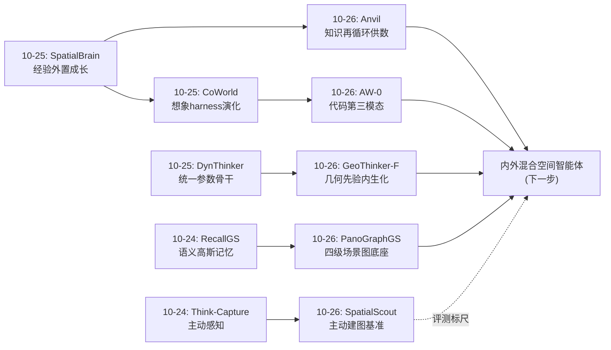
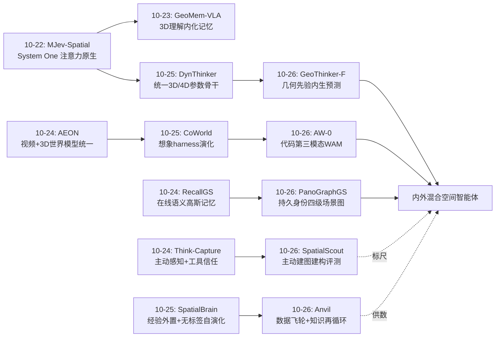
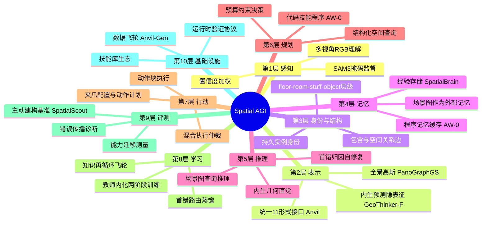
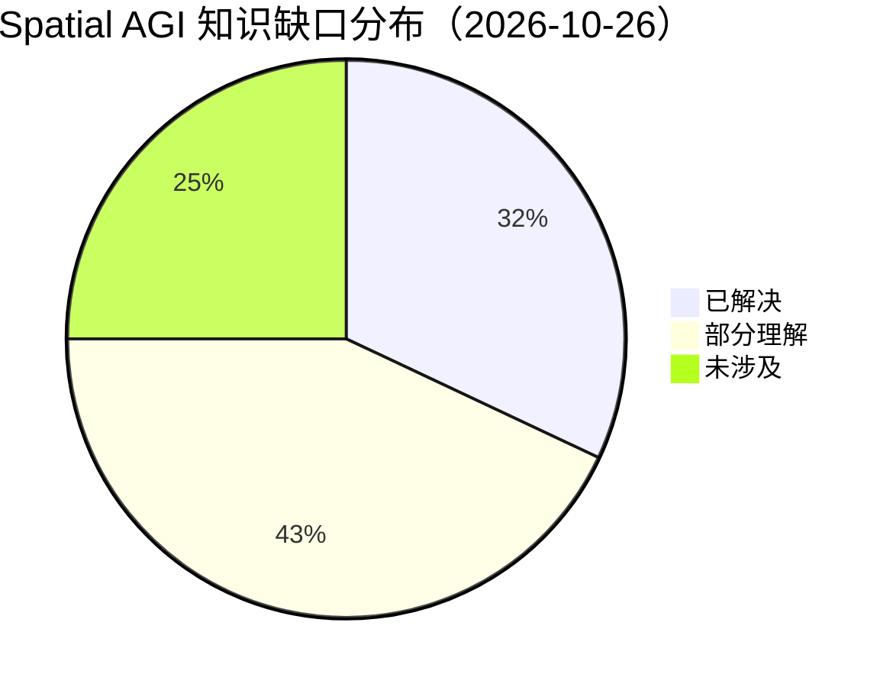

# Spatial AGI 每日深度思考 — 2026-10-26

## 📅 每日总结

**日期**: 2026-10-26
**论文数量**: 5篇
**主题**: 空间智能的"内化-外化-结构化"三分格局——今天五篇论文恰好各占一端：GeoThinker-F 把几何先验**内化**进 MLLM 隐空间（推理时零外部编码器）；Anvil 把空间监督**工厂化**（数据飞轮生产跨形式一致的 5.8M 记录）；PanoGraphGS 把空间知识**结构化**为可查询的四级场景图；AW-0 把空间规划**程序化**（代码作为世界模型的第三生成模态）；SpatialScout 则用一把最硬的尺子告诉我们：以上所有进展，在"主动探索+度量建图"的闭环面前仍然不及格（最强模型仅 3.25% 达严格精度）

**论文清单**:
1. GeoThinker-F (arXiv:2610.20592) — 内生预测式世界表征，LFP 预测头 + SGT 融合，3.6× 加速（1.45s→0.40s），VSI-Bench 70.4
2. SpatialScout (arXiv:2610.26659) — 主动物体级 3D 建图基准，80 场景/3140 目标，Claude Opus 5.5 仅 41.71% 重叠、3.25% 达 IoU>0.9
3. AW-0 (arXiv:2610.30136) — Agentic 世界动作模型，代码/视频/动作三模态联合去噪 + 自动技能库蒸馏，RoboTwin 2.0 与真机双臂超基线
4. Anvil (arXiv:2610.21882) — 知识再循环框架，11 形式数据飞轮 + 首错路由蒸馏，7 基准平均超 Qwen3.5-9B 9.29 点
5. PanoGraphGS (arXiv:2610.27696) — 全景 3DGS 与四级场景图端到端统一，物体节点精度超最强基线 50+ 点

**关键突破**:
- 🚀 **空间智能正式进入"去工具化/内化"阶段**：GeoThinker-F 证明几何先验可以从 MLLM 自身隐状态内生预测（离线教师→预测头→自驱动微调），推理时彻底移除 VGGT 类外部编码器而无性能损失——"外挂阶段收尾、内化阶段开始"获得首个系统实证
- 🚀 **空间评测的"SWE-bench 时刻"到来**：SpatialScout 把评测从答题转向建构（自主探索+米级建图+全覆盖），并揭示被动 QA 高分与主动建构能力间存在数量级鸿沟——3.25% 的严格精度达标率给整个领域敲响警钟
- 🚀 **代码成为空间世界模型的"第三模态"**：AW-0 在 MoT 架构中让代码专家与视频/动作专家联合去噪，代码既是世界模型内的规划结构又是可复用的技能程序——Agentic 与世界模型两条平行线正式合流
- 🚀 **空间数据基础设施竞赛开始**：Anvil 的 11 形式统一接口 + 三重准入校验 + 首错路由蒸馏证明：架构同质化后，监督生产的工业级质量才是 9+ 个点的来源——竞争从模型层下沉到基础设施层
- 🚀 **3DGS 长出"语义-结构层"**：PanoGraphGS 用持久实例身份的匈牙利关联把全景高斯升级为四级场景图，50+ 点的精度跃升证明"底座纯度决定结构抽取质量"——空间底座的应有形态被定义

**架构演进**: 昨日"外置成长 vs 内建成长的正面对决"→ 今日"内化/外化/结构化三分格局成形"——空间先验的位置问题有了三个经过验证的答案（隐空间内生化、外部场景图结构化、代码程序化），且三者开始出现融合迹象（AW-0 的代码条件化、PanoGraphGS 与 SpatialScout 的产物对接）

### 📊 一句话总结

今天五篇论文描绘了 Spatial AGI 的"空间知识经济学"全景：知识可以被内生预测（GeoThinker-F）、被工厂生产（Anvil）、被结构封装（PanoGraphGS）、被程序组织（AW-0）——而 SpatialScout 冷峻地提醒：无论知识以何种形态存在，自主获取它并组装成度量地图的能力仍然是 3% 的世界，感知-行动闭环是尚未攻陷的主阵地。

### 🔗 延续性

**昨日→今日**: 昨日的主题是"成长的架构学"——能力增量放在参数/经验/策略/表示结构四个存储位置的分工。今天是对这个框架的第一次"位置验证"：GeoThinker-F 展示了参数位置的新写入机制（内生预测头蒸馏——比全参数微调更便宜的参数写入）；AW-0 展示了程序位置（代码技能库）作为第五个存储位置的成熟形态（昨日 CoWorld 的 harness 演化是它的前身）；PanoGraphGS 强化了表示位置（场景图 = SkeLAM 骨架接地 + ReferGaussian EntityBank 的静态完整版）；Anvil 则回答了昨日留下的元问题——**所有位置的写入原料从哪来？**（跨形式校验的数据飞轮）。特别值得注意的是：昨日指出"外置与内建尚未握手"，今天 GeoThinker-F 的两阶段训练（教师内化）+ Anvil 的知识再循环（学生回馈数据验证）恰好是两个方向上的"握手"尝试。

**今日→明日**: ① 内生预测头（GeoThinker-F）+ 场景图工具（PanoGraphGS）+ 主动探索（V2W/SpatialScout）三者组合成"内外混合空间智能体"是最明确的下一步——VLM 用场景图做工具记忆，用内生先验做快速直觉，用探索策略决定何时花钱获取证据；② SpatialScout 揭示的跨视图同一性问题（persist identity）与 PanoGraphGS 的实例关联技术对接，可能催生"主动建图 Agent"的专用训练方案；③ AW-0 的代码-动作耦合强度存疑，需要消融验证——代码流究竟是"计划"还是"正则化项"；④ Anvil 的 G-R-A 本体论需要扩展 Memory 与 Dynamics 维度才能支撑空间过程智能；⑤ 首错路由（训练时的错误归因）应该迁移到推理时的自我修复——训练与推理共享同一个错误本体论。

---

## 🔗 与昨日思考的联系

### 昨日重点

昨日五篇论文（SpatialBrain、V2W、CoWorld Reasoner、DynThinker、SkeLAM）围绕"外置成长与能力统一"展开，核心结论是空间智能的能力增量存在四个存储位置（参数/外部经验/交互策略/表示结构），且所有系统都在把"对自身认知过程的不信任"工程化。留下的关键缺口：外置与内建两条路线尚未握手；元认知动作空间不完整；想象的可靠性裸奔；数据写入的原料问题未回答。

### 今日进展

今天的五篇论文恰好是对昨日框架的系统性回应：

1. **GeoThinker-F 回应"内建路线的写入成本"**：参数位置的写入不必是昂贵的全参数后训练——两阶段"离线教师→预测头→自驱动微调"提供了廉价的参数写入通道，且保留了显式可路由的几何接口（兼顾了外置路线的可审计性）
2. **AW-0 回应"元认知动作空间"**：代码作为第三模态意味着"规划"本身成为生成过程的一部分——何时调用哪个技能、如何参数化，这些元认知决策被外包给编程语言的组合性，而预测接地由视频专家提供
3. **Anvil 回应"数据原料问题"**：昨日所有路线的写入原料（经验、训练数据）质量都缺乏系统保障，Anvil 的三重校验 + 失败分类修复 + 知识再循环给出了完整的供数方案，并明确"模型可参与生产但不可自证正确"
4. **PanoGraphGS 回应"表示位置的静态完整版"**：昨日 SkeLAM 在动态动作维度做表示接地，今天 PanoGraphGS 在静态结构维度做到了极致——持久身份 + 四级层级 + 关系边，空间底座形态定型
5. **SpatialScout 回应"评测维度"**：昨日所有系统的成功都在 QA 型或仿真示教型任务上，SpatialScout 用主动建构任务重新洗牌——警示所有路线的评测可能高估了真实空间能力

### 演进路径



---

## 📚 论文概览

**GeoThinker-F**（小鹏汽车/中大/NTU）：针对几何感知 MLLM 推理时需串行执行外部 3D 编码器（1.45s 延迟）的痛点，提出内生预测框架——Stage 1 冻结骨干训练轻量 LFP 头（几何头对齐 VGGT 特征、时间头预测下一帧语义），Stage 2 移除教师、SGT Fusion 模块选择性融合自预测先验（几何/时间双分支 + 层交错注入）。Qwen3-VL-8B 上 3.6× 加速、6 基准平均 69.29。

**SpatialScout**（北大/天大）：主动物体级 3D 建图基准。Agent 从初始视图出发，用 10 个工具（含带诊断信息的三角化工具）在有界预算（100 次调用/100 张图）内自主探索，估计 3140 个目标物体中心（AABB 中点定义，等价组防类别先验作弊）。评测 7 个前沿模型，最强 Claude Opus 5.5 全目标 mean IoU 41.71%、IoU>0.9 仅 3.25%。

**AW-0**（Berkeley/NVIDIA/UPenn，Jim Fan & Trevor Darrell）：Agentic WAM。代码（离散掩码扩散）、视频（Cosmos DiT flow matching）、动作（动作 DiT）三流在 MoT 中联合去噪，专家间分块因果（代码→视频→动作）；噪声重采样让视频预测为动作提供引导；LLM 代理管线（Gemini + Claude Code）从 3000h 视频 auto-标注程序并蒸馏 50 技能库；混合执行在程序执行与动作块间按检查仲裁。

**Anvil**（中大/Knowin.AI/港科广）：数据-训练-评测一体化框架。11 种 Ground–Relation–Act 契约统一空间监督格式；三重准入（原生有效性×跨形式一致性×语义支持）+ pass/uncertain/fail 显式判决；5.8M 记录场景分层切分；首错路由多教师蒸馏（按学生 rollout 的语义首错选教师与修正 span）+ 阶段归一化防长输出垄断监督；学生回馈协助数据验证（证据检查保留最终裁决权）。

**PanoGraphGS**（浙江人形机器人创新中心）：全景 3DGS 与层次场景图统一框架。每个高斯携带语义+实例双特征（D=64）；原型语义学习用残差投影统一 2D/3D 特征空间；实例学习把 SAM3 跨帧不一致的伪 ID 经匈牙利算法关联到可学习的持久全局身份；置信度加权抑制边界/遮挡噪声监督；从全景高斯免训练恢复 floor–room–stuff–object 场景图；物体节点精度超最强基线 50+ 点；发布 NaviGS 数据集。

---

## 💡 核心见解

### 见解1: 空间智能的"内化转向"已经开始，外挂时代进入倒计时

从 GeoThinker-F 获得
- ✅ MLLM 中间隐状态包含足够信息内生预测"有用的"几何与未来语义表征，无需精确复现 3D 编码器特征
- ✅ 两阶段"离线教师→LFP 预测头→自驱动微调"配方消除了推理时外部编码器，性能与双编码器基线相当
- ✅ 3.6× 加速不是工程优化而是空间智能能否实时闭环的前提条件

**对Spatial AGI的启发**: 这与 MJev-Spatial（System One 注意力原生）、DynThinker（统一参数骨干）形成合流——空间先验的位置正在从"系统外挂"迁移到"模型体内"。类比 NLP 领域 RAG→参数化知识、工具调用→内化推理的演进，可以预期 12 个月内"推理时零外部 3D 模型"将成为空间 MLLM 默认配置。但内化的代价是可审计性：外部编码器可单独校准认证，内化后几何感知变成黑箱属性——安全关键部署需要为内生预测头建立新的运行时验证协议（如轻量几何探针抽样校验预测质量）。

### 见解2: 被动感知与主动建构之间存在数量级鸿沟

从 SpatialScout 获得
- ✅ VSI-Bench 70+ 分的模型，在自主探索建图任务上只有 41.71% 重叠、3.25% 严格精度达标
- ✅ 失败集中在跨视图关联（同一物体跨视角同一性）与"表面特征点→物体中心"的几何语义推断
- ✅ 模型普遍在"已提交精度"与"全目标覆盖"之间选择放弃难目标

**对Spatial AGI的启发**: 这是空间智能领域的"SWE-bench 时刻"——从"知道"到"做到"的评测范式切换会重排模型排名，暴露语言先验与选择偏差的虚假优势。3% 的达标率说明当前 VLM 的空间能力主要是"语义先验+局部线索"的产物，缺少真正的几何构建引擎。Spatial AGI 的能力声明应以建构任务为准，且"识别物体≠能建地图"应写入领域共识。主动探索（视角选择、提交时机、修订决策）是 RL 尚未开垦的肥沃土壤——轨迹记录与可回放评分天然适合做拒绝采样+RL。

### 见解3: 代码是空间组合性的"外包接口"

从 AW-0 获得
- ✅ 长时域任务分解（调用哪些技能、如何参数化、如何组合）不应由端到端模型从数据中摸索，而应外包给编程语言的先天组合性
- ✅ 代码作为第三生成模态与视频/动作联合去噪，计划在物理可行性约束下生成（预测接地）
- ✅ 技能库可以从 3000 小时人类+机器人视频自动结晶——空间技能可以像软件库一样积累、版本化、复用

**对Spatial AGI的启发**: Spatial AGI 顶层的正确形态很可能是"神经感知预测 + 符号空间程序"的混合体。更深的问题是代码-动作耦合强度：默认模式下解码的程序不执行、只做条件信号——如果遮住代码流性能掉得不多，代码就只是正则化项而非计划。这个耦合度是 Agentic WAM 路线成立的根基，需要直接的消融证据（如程序语义扰动对动作的敏感度）。技能库生态是本文最被低估的贡献：谁先建成"空间技能的 PyPI"，谁就掌握 Spatial AGI 的平台位。

### 见解4: 空间数据基础设施是下一个护城河

从 Anvil 获得
- ✅ 架构同质化（大家都是 Qwen 底座）后，9B 模型 + 工业级数据飞轮即可超越同规模基线 9+ 个点
- ✅ "共识即正确"在空间数据领域致命：几何标注工具链同源导致错误高度相关，跨形式一致性检查会系统性放过相关错误——必须引入外部证据与显式不确定性
- ✅ 首错路由把训练错误做因果归因，只让对应专家修案发现场——空间推理链的修复是局部的、可归因的

**对Spatial AGI的启发**: 空间智能竞赛的上半场是模型架构，下半场是监督基础设施。Anvil 的三重校验、失败分类修复、带闸门的知识再循环（学生可参与生产但不可自证正确）应该成为所有空间数据管线的行业规范。首错路由的"错误因果归因"思想可迁移到推理时自我修复：Agent 检测推理链首错阶段并定向修复——训练与推理共享同一错误本体论，是优雅的设计对称性。

### 见解5: 持久身份是空间认知被低估的基石

从 PanoGraphGS + SpatialScout 获得
- ✅ PanoGraphGS 用匈牙利关联把跨帧不一致的伪实例 ID 缝合成持久身份，场景图精度跃升 50+ 点——底座纯度决定结构抽取质量
- ✅ SpatialScout 的失败分析显示跨视图关联正是前沿模型最弱的能力之一
- ✅ 同一性保持（哪个伪 ID 对应哪个真实物体）是感知多样性被综合为统一对象的认知前提

**对Spatial AGI的启发**: "跨视角/跨时间的实体同一性保持"应该被列为 Spatial AGI 的核心原语，值得专门基准（3D 语义空间中的 tracking）。人类的物体恒常性正是这个能力。两篇论文从正反两面证明：建好身份（PanoGraphGS）→结构抽取水到渠成；做不好身份（SpatialScout）→度量建图全线崩溃。持久身份是连接感知与认知的纽扣。

### 见解6: 空间知识存在三种可互换的存储形态

从今日五篇论文的整体格局获得
- ✅ 内生形态：GeoThinker-F 把几何先验压进隐空间预测头（快而模糊、零部署成本）
- ✅ 结构形态：PanoGraphGS 把空间知识外化为可查询场景图（慢而精确、可审计）
- ✅ 程序形态：AW-0 把空间操作知识编码为技能程序（可组合、可复用、可版本化）
- ✅ Anvil 证明三种形态可以共享同一套经过校验的数据原料，且形态间可以转化（蒸馏=结构→内生，代码条件化=程序→预测引导）

**对Spatial AGI的启发**: "空间知识放在哪里"不再是非此即彼的选择题，而是形态经济学问题：查询频率、精度要求、延迟预算、更新频率共同决定最优形态。最优系统应该是混合形态：内生先验做快速直觉（System 1），场景图做精确查询（外部记忆），技能程序做行动组织（System 2 的可执行部分）——三者由统一的知识总线连接，Anvil 式飞轮供数。

### 见解7: 评测的建构化是领域成熟的标志

从 SpatialScout + Anvil 获得
- ✅ SpatialScout 把评测对象从"答案正确性"转向"空间表征的构建质量"（覆盖率+定位精度+错误传播）
- ✅ Anvil-Ben 把"何时某任务的成功代表可迁移能力"形式化为链接任务与受控上游替换
- ✅ 两者共同把空间评测从分数列表升级为能力依赖图上的通过率分布

**对Spatial AGI的启发**: 评测的三次浪潮清晰可见：QA 浪潮（VSI-Bench，测语言先验）→ 交互浪潮（ESI-Bench，测感知-行动闭环的一角）→ 建构浪潮（SpatialScout/Anvil-Ben，测表征构建与能力迁移）。Spatial AGI 社区应该把建构型基准纳入标准评估矩阵并与 QA 分数联合报告——在被动感知的虚假繁荣中内卷是当前最大的领域风险。

### 见解8: 教师只是脚手架，不该是天花板

从 GeoThinker-F + Anvil 获得
- ✅ GeoThinker-F 的内生几何上限被 VGGT 锚定，教师的错误会被学生继承甚至放大
- ✅ Anvil 的知识再循环允许学生超越教师（学生回馈验证、失败驱动再采集），但未系统验证学生最终超过所有教师的条件
- ✅ 两者的 Stage 2 / 蒸馏阶段本质上都在做"任务梯度回流"——让内生表征偏离教师、发展任务专用抽象

**对Spatial AGI的启发**: "教师内化"范式的终局问题是：内化后的表征何时应该背叛教师？可能的答案是用下游任务损失显式拉扯（预测头不仅对齐教师还要让任务损失下降），并用 Anvil 式飞轮持续供给超越教师分布的难例。教师-学生关系应该是渐弱的脚手架而非永久的锚。

---

## 🗺️ 知识演进图



---

## 技术栈演进对比表

| 层次 | 昨日方案 | 今日方案 | 变化 |
|------|---------|---------|------|
| 空间先验获取 | 外部3D编码器推理时执行（GeoThinker双编码器） | LFP预测头内生生成（GeoThinker-F） | 外挂→内化，1.45s→0.40s |
| 空间能力评测 | QA型+交互型（VSI-Bench/ESI-Bench） | 主动建构型（SpatialScout度量建图） | 答题→建构，暴露3%达标率 |
| 任务规划 | 视频世界模型harness演化（CoWorld） | 代码第三模态联合去噪（AW-0） | harness→生成模态，技能库自动蒸馏 |
| 训练数据生产 | 数据Scaling/自演化环境（Cambrian-S/SpatialEvo） | 11形式三重校验飞轮+知识再循环（Anvil） | 量→质，带闸门闭环 |
| 空间结构表示 | 在线语义高斯记忆（RecallGS） | 持久身份四级场景图（PanoGraphGS） | 记忆→结构，50+点跃升 |
| 世界模型可控性 | 骨架接地潜在动作（SkeLAM） | 代码参数化技能+混合执行仲裁（AW-0） | 动作接地→程序接地 |
| 错误管理 | D-EMA参数级干扰管理（DynThinker） | 首错路由+置信度加权监督（Anvil/PanoGraphGS） | 参数诊断→监督级因果归因 |
| 元认知 | 四动作调度（答/算/看/想象） | 探索预算下的提交与修订决策（SpatialScout） | 调度→建构决策 |

---

## 🗺️ Spatial AGI 知识图谱

### 10层架构思维导图



### 🎯 主线技术路径

#### 阶段1: 外挂感知（2024-2025 上半年）
VLM + 外部 3D 模型管道：VGGT/π³ 特征流、RGB-D 依赖、SfM 预处理。性能强但延迟高、系统重、可部署性差。代表：VG-LLM、VLM-3R、Hydra、HOV-SG。

#### 阶段2: 数据Scaling与结构底座（2025 下半年-2026 上半年）
数据引擎（OpenSpatial、Cambrian-S）与 3DGS 结构化（分割→全景→场景图）并行推进。空间能力的主要来源从架构转向数据。代表：PanoGraphGS、Anvil（今日将两者推至完备形态）。

#### 阶段3: 内化与程序化（2026 Q3-Q4，当前）
空间先验内生预测化（GeoThinker-F、MJev-Spatial）、规划程序化（AW-0）、评测建构化（SpatialScout）。三条线共同指向"去工具化的空间智能体"：感知内化、规划程序化、行动接地。

#### 阶段4: 内外混合智能体（2027 预期）
内生先验（System 1 直觉）+ 场景图外部记忆（精确查询）+ 技能程序（行动组织）+ 主动探索策略（证据获取）+ 数据飞轮（持续供数）的统一架构。Anvil 的知识再循环提供学习闭环，SpatialScout 类建构基准提供评估标尺。

#### 阶段5: 空间过程智能（远期）
在静态空间智能（G-R-A）之上加入 Memory（跨时间空间状态保持）与 Dynamics（空间随动作与物理演化）维度，形成完整的空间认知本体——从"空间快照智能"到"空间过程智能"。

---

## 🔍 待探索议题

### 高优先级（本周）

1. **内外混合空间智能体的首次系统实现**
   - 问题: VLM + 场景图工具记忆（PanoGraphGS 产物）+ 内生预测头（GeoThinker-F）的组合能否显著提升 SpatialScout 的 3% 严格精度达标率？
   - 候选方案: 把场景图查询封装为 VLM 工具（RAG 式），在 SpatialScout 的 10 工具接口中加入"查询已有场景图"工具，对比纯探索基线
   - 缺口: 没有任何工作把结构化空间底座接入 VLM 推理回路做过受控实验

2. **代码-动作耦合强度的直接消融**
   - 问题: AW-0 默认模式下代码流只是条件信号——遮住代码流性能掉多少？程序语义扰动对动作的敏感度如何？
   - 候选方案: 代码流置零/语义扰动/正确程序vs错误程序三组对照，测量任务成功率与动作轨迹偏差
   - 缺口: 决定 Agentic WAM 路线成立与否的根基性证据缺失

3. **跨视角实体同一性的专门基准**
   - 问题: SpatialScout 失败归因显示跨视图关联是核心瓶颈，但没有独立基准隔离测量这个能力
   - 候选方案: 基于 PanoGraphGS 的持久身份标注构建"同一性消解"基准（给定多视角检测，输出实例聚类）
   - 缺口: 3D 语义空间 tracking 的标准化评测协议

### 中优先级（本月）

4. **内生预测头的运行时验证协议**
   - 问题: 内化后几何感知质量不可审计，安全关键部署（车规）如何在线监控内生表征的失效？
   - 候选方案: 轻量几何探针抽样校验 T̂^G' 质量 + 预测残差作为不确定性信号触发回退到外挂模式
   - 缺口: 内生-外挂双模系统的回退机制设计

5. **首错路由迁移到推理时自我修复**
   - 问题: 训练时的错误因果归因能否成为推理时的自我修复机制（检测推理链首错并定向重算）？
   - 候选方案: 在空间推理 CoT 中插入阶段评估器，首错阶段触发定向重推理而非全链重来
   - 缺口: 推理时阶段边界的可靠划分

6. **Anvil 本体论的 Memory/Dynamics 扩展**
   - 问题: Ground–Relation–Act 是空间快照本体，缺 Memory（状态保持）与 Dynamics（演化预测）维度
   - 候选方案: 增加"状态轨迹"与"物理后果预测"两种契约形式，接入 SkeLAM/AW-0 的动态表征
   - 缺口: 动态空间数据的跨形式校验协议

7. **主动探索策略的 RL 训练**
   - 问题: SpatialScout 轨迹可回放、可评分，但探索策略（视角选择/提交时机/修订决策）尚无 RL 训练方案
   - 候选方案: 用前沿模型轨迹做拒绝采样 SFT 冷启动，再以最终 overlap score 为奖励做 RL
   - 缺口: 探索的成本经济学（何时值得花钱看）的奖励设计

### 低优先级（本季度）

8. **空间技能库的生态化**
   - 问题: AW-0 的 50 技能库如何成长为可跨团队共享的"空间技能 PyPI"？
   - 候选方案: 技能程序的标准化接口（参数范围/失败模式/适用场景文档）+ 自动化验证管线
   - 缺口: 跨具身技能的可移植性保证

9. **纯 RGB 在线增量场景图的可行性**
   - 问题: PanoGraphGS 是离线多视角重建，Hydra 类在线建图又依赖 RGB-D——纯 RGB 在线增量四级场景图是否可行？
   - 候选方案: 流式 3DGS（RecallGS/CADRE 方向）+ 在线实例关联 + 增量层级推理
   - 缺口: 在线设置的持久身份一致性维护算法

10. **建构型评测的成本标准化**
    - 问题: SpatialScout 不限推理 token，推理-heavy 模型实际成本差一个量级，分数不可直接比较
    - 候选方案: 报告"分数-成本"联合曲线（类似 Chinchilla 分析），建立空间智能的帕累托前沿标准
    - 缺口: 跨模型统一算力计量协议

---

## 📊 知识缺口分析



**已解决（32%）**:
- ✅ 静态空间推理的内生加速（GeoThinker-F: 3.6×无损失）
- ✅ 结构化空间底座的形态定义（PanoGraphGS: 四级场景图+持久身份）
- ✅ 空间监督的工业级生产协议（Anvil: 11形式+三重校验+再循环）
- ✅ 长时域任务的程序化分解（AW-0: 代码第三模态）
- ✅ 空间评测的建构范式确立（SpatialScout）

**部分理解（43%）**:
- ⚠️ 主动探索建图：任务定义与评测完备（SpatialScout），但能力本身只有 3% 达标，训练方案空白
- ⚠️ 代码-动作耦合：架构存在（AW-0）但耦合强度未验证，程序接地缺安全校验
- ⚠️ 内生表征的可审计性：失效模式未知，运行时验证协议缺失
- ⚠️ 知识形态间的转化效率：蒸馏/条件化/查询三种路径的成本-保真度权衡未量化
- ⚠️ 跨视角同一性：离线已解（PanoGraphGS），在线/主动设定未解
- ⚠️ 数据飞轮的长期动力学：错误累积与分布收缩风险（学生参与送审的偏见）需纵向实验

**未涉及（25%）**:
- ❌ 动态场景与时变空间：所有今日系统均为静态快照
- ❌ 空间过程的 Memory/Dynamics 本体：G-R-A 之上的两层缺失
- ❌ 导航闭环实证：场景图质量→导航成功率的传递曲线无人报告
- ❌ 多智能体空间协作：共享空间表征的分布式构建与一致性
- ❌ 空间智能的安全与对齐：内生表征的对抗鲁棒性、程序执行的安全层
- ❌ 能量/算力受限端侧的空间智能：延迟-精度-能耗三边权衡

---

## 💡 本质思考：如何达成通用空间智能

### 1. 核心能力的本质是什么？

延续昨日"成长的架构学"，今天的五篇论文把答案推进到**空间知识的形态经济学**：

空间智能的核心能力是**在正确的时间以正确的形态调用正确的空间知识**。空间知识本身有三种可互换形态——内生的（隐空间预测，快而模糊）、结构的（场景图，慢而精确）、程序的（技能代码，可组合可执行）——以及一条生产流水线（数据飞轮）。通用空间智能不是单一模型掌握所有空间任务，而是一个**空间知识操作系统**：底层是三种形态的存储介质（参数/结构库/程序库），中层是形态间的编译器（蒸馏、查询、条件化、程序合成），上层是形态选择与调度的元认知（这个查询要精确结构还是要快直觉？这个行动要不要先预演？），外围是持续供数与验证的飞轮。

今日的深层信号是**形态间的边界正在溶解**：GeoThinker-F 把外挂表征编译进参数，AW-0 把程序编译进生成过程，PanoGraphGS 把感知编译成结构。当编译器足够成熟，"知识放哪里"变成纯粹的优化问题而非架构之争。Spatial AGI 的终局竞争位置不是模型，而是这个知识操作系统本身。

同时必须保持清醒：SpatialScout 提醒我们，无论存储与编译多么精巧，**知识的自主获取**（在预算内决定看哪里、看多久、何时下结论）仍然是 3% 的荒地。操作系统的隐喻有个前提——得先有能自己走到硬盘前的磁头。

### 2. 当前方法与理想目标的差距在哪里？

- **形态间编译器还不存在**：GeoThinker-F 能把 VGGT 特征蒸进参数，但不能把 PanoGraphGS 的场景图蒸进参数；AW-0 能把程序变成条件信号，但不能把场景图事实编译成程序参数。三种形态各自为政，跨形态转化全靠人工设计。
- **建构能力的训练学空白**：SpatialScout 定义了建构任务但没人训练它——主动探索策略、跨视图关联、几何语义推断（表面点→物体中心）都缺训练信号。讽刺的是，PanoGraphGS 恰好能提供"标准答案"式的持久身份标注，Anvil 恰好能供数，但没人把这条管线接起来。
- **评测与能力的因果链断裂**：场景图精度 50+ 点的提升没有转化为导航成功的证据；VSI-Bench 70 分没有转化为建图 3% 的改善。每个环节的进步都在自己的 benchmark 里闭环，环节间的传递函数完全未知。
- **静态-动态的断层依旧**：Anvil 的 G-R-A、PanoGraphGS 的场景图、GeoThinker-F 的单步预测全部是静态快照；SkeLAM/AW-0 的动态表征又是另一批社区。空间过程智能需要的 Memory+Dynamics 维度没有宿主。
- **安全层整体缺席**：内生表征不可审计、程序执行无硬校验、探索行为无安全约束——今日所有系统都假设良性环境。Spatial AGI 的安全工程与能力工程的比例严重失衡。

### 3. 从今天到理想状态，最可能的路径是什么？

**路径的主轴：把今天已经存在的孤立组件焊接成闭环系统。**

第一步（3-6 个月）：**建构能力的第一次严肃训练**。以 SpatialScout 为训练场，PanoGraphGS 提供持久身份的中间监督（跨视图关联的辅助损失），Anvil 飞轮按失败类别定向供数，V2W 式 SFT+RL 训练探索策略。目标不是 100% 而是把 3% 的严格达标率拉到 30%——这个量级的改善足以证明"建构能力是可训练的"。

第二步（6-12 个月）：**形态编译器的原型**。选定一条最有价值的转化路径优先攻克：场景图→内生预测头的蒸馏（让 VLM 内化结构先验而非每次查询），或场景图→程序参数的自动编译（让 AW-0 的技能直接消费结构化空间事实）。每条路径都有明确的技术抓手（Anvil 的蒸馏协议 / AW-0 的联合去噪）。

第三步（12-24 个月）：**空间知识操作系统**。三种形态的统一存储与调度、运行时验证协议（内生表征探针+程序硬校验）、首错路由的推理时自我修复、知识再循环的持续供数。此时 Spatial AGI 的评测也应该升级为操作系统能力评测：知识注入延迟、跨形态一致性、自我修复率、资源约束下的任务成功率。

贯穿始终的两条纪律：**每一个能力声明必须同时通过 QA 型与建构型基准**（防止被动感知的虚假繁荣）；**每一个内化决策必须保留可审计的回退通道**（防止黑箱化吞噬安全边际）。

最可能的意外变量是动态性：如果 2027 年世界模型社区把实时可控的 4D 生成做到实用（AEON+SkeLAM+AW-0 的合流是明确信号），空间智能的静态快照范式可能被整体跳过——直接进入"空间过程智能"。今天的静态结构底座（场景图）届时将退化为动态世界模型的缓存层而非独立层。为此，现在设计场景图接口时就应该假设它会被时间维度穿透——每个节点留出状态演化的插槽。

---

## 📌 明日预告

明日精读方向候选：动态场景的在线场景图（Streaming/增量式 3DGS 语义化）、主动探索策略的 RL 训练方案、或空间技能程序的安全校验框架——三个今日识别的最高价值缺口。

---

## 🔬 附录A: 五篇论文的技术细节深读笔记

### A1. GeoThinker-F 关键设计细节

**为什么残差投影式的 LFP 能学到东西？**

LFP 头的输入是 MLLM 中间层的图像 token 隐状态 H_j^img。一个自然的疑问是：语义中间层真的包含几何信息吗？论文的隐含论证是：因果注意力已经把多帧间的对应关系（同一物体在不同帧的位置）编码进 token 的混合中——跨帧对应恰是三角化几何的原材料。VGGT 特征作为回归目标，本质上是教 MLP 头"读懂"隐状态里已有的对应结构并显式化为几何表征。这解释了为什么预测头可以极轻量（MLP 而非 Transformer）：它做的是"解码"而非"计算"。

**SGT Fusion 的层交错注入细节**：

- 几何流与时间流分别注入不同的中间层子集，而非同层混合注入
- 动机：两种预测表征的统计性质不同（几何特征对齐 VGGT 空间网格、时间特征对齐视觉编码器语义空间），同层注入会让注意力头难以区分二者的角色
- 这暗示一个更一般的架构原则：**异质先验应该在深度上错开排布**，类似电路的相位错开避免共振干扰

**噪声敏感性推断**：

LFP 头是确定性回归（没有不确定性估计），预测失败时 SGT Fusion 的门控是唯一的防线——但门控的输入也是自预测特征，形成了"自己评估自己"的循环。理想的改进是让门控读取与预测无关的信号（如多帧间的一致性度量、预测残差的跨层方差）。

### A2. SpatialScout 协议设计的技术细节

**目标中心定义的巧妙之处**：

p_i = R_0^T((b_i^- + b_i^+)/2 − o_0) 把 AABB 中点变换到初始相机坐标系。这个定义有三重考虑：
1. 可复现性：AABB 是渲染几何的确定函数，不依赖资产内部原点（很多资产的 origin 偏离可见几何）
2. 铰接物体：取所有 link 几何的联合包围盒，避免姿态依赖
3. 任务坐标系以初始相机为锚：所有探索从同一起点出发，空间推理有一致的参考系

**三角化工具的"半能力"设计哲学**：

工具只做 viewing-line 最小二乘（Eq.3），并且：
- 报告 RMS 残差、最大射线角、弱视差警告——给诊断不给答案
- 拒绝基线/条件/前向射线检查失败的查询——防止模型用坏几何"骗"工具
- 关键留白：**"标记的像素是否同一物体特征"以及"三角化点与物体中心的关系"完全交给模型**——这两步正是评测的核心区分度所在。低残差不等于正确答案，这是整个基准最锋利的设计。

**等价组的评测细节**：

- 组内用最小距离一对一匹配算中心误差（防止重复提交同一物体刷分）
- hit rate 用组内 hit-maximizing 分配（在各严格阈值下单独求最优匹配）
- overlap score 跨场景池化、遗漏计零——覆盖度被硬性计入总分，模型无法靠"只提交有把握的"获得高分

### A3. AW-0 训练配方的技术细节

**噪声重采样的动机（最容易被忽略的精妙设计）**：

Cosmos-Predict2.5 的预训练噪声分布 p_pre 由 u_v = s·b、b~Beta(7,1) 诱导——重低噪声（对视频重建质量友好）。但动作专家需要的是高噪声区间的视频表征（去噪早期，视频潜变量还是粗结构，恰是动作规划需要的"布局级"信息）。直接沿用 p_pre 会让动作专家在训练中几乎见不到高噪声视频特征。AW-0 的解法：q(u) = α·p_pre + (1−α)·U(0,1)（α=0.5），配合重要性权重 w_v（保视频质量）与 w_g（保预测引导）分别加权两组损失。这是一个教科书级的"多目标噪声课程"设计。

**代码流的 canvas 解码**：

每个重规划点追加 G 个 [MASK]，在 T 步去噪中每步提交 G/T 个最确信 token——LLaDA 式的置信度调度解码。与自回归解码相比，这种并行掩码解码允许代码与视频/动作"共同演化"：早期去噪步的粗粒度代码 skeleton 与粗粒度视频布局互相约束，后期逐步精化。

**记忆缓存的训练暴露策略**：

训练时记忆缓冲以概率 p 替换为模型自身的历史预测（而非真值标注）——暴露偏差（exposure bias）的主动疫苗。推理时缓存每 episode 重置、随解码增长，历史 slice 压缩进 K 个可学习 slot。

### A4. Anvil 校验体系的技术细节

**三重准入的形式化**：

Accept = Π C_k（原生有效性）× Π C_c（跨形式一致性）× 𝟙[V=pass]（语义支持），空积为一。三种判决 pass/uncertain/fail 中 uncertain 的存在是关键——它既不是放行也不是拒绝，而是进入"待证据"队列，阻断下游归因（首错路由中 uncertain 的阶段会停止对其后阶段的错误归因）。

**阶段归一化的量化细节**：

ℓ_ref 按阶段内平均 token NLL、再跨激活阶段等权平均；KD 项在选定 span 上用广义 Jensen-Shannon 散度 + 归一化非负 token 权重。合并效果：一个 200-token 的动作序列与一个 5-token 的盒子坐标在监督质量上等权——几何短答案不再被动作长序列淹没。这个细节解决的是空间多任务训练中极其普遍却少有人点破的损失尺度病理。

**失败驱动的再采集**：

被拒候选不是被丢弃而是打上失败类别标签，聚合统计引导源-任务采样权重——飞轮的"方向盘"是失败分布，不是成功分布。这与主动学习的选择偏置不同：它优化的是数据生产过程本身而非单条样本。

### A5. PanoGraphGS 身份关联的技术细节

**为什么关联"伪标签↔全局身份"而非"视角↔视角"**：

两两视角匹配是 O(V²) 且传递闭包会累积错误（A≈B、B≈C 推不出 A≈C 的保证）。PanoGraphGS 改为每视角独立做"局部伪实例→全局原型"的匈牙利分配：所有视角通过共享的全局身份原型间接对齐，错误不跨视角传播。全局原型本身是可学习的——它既是分类器又是聚类中心，身份的定义在训练中自我精化。

**置信度加权的温度设计**：

每个类别/实例维护特征中心 m_k 与离散度自适应温度 τ_k，像素置信度 γ_p 是"当前标签相似度相对竞争类别的 softmax"。直觉：边界像素的特征离多个类的中心都近，softmax 值被摊薄，γ_p 自然低——无需显式的边界检测器，不可靠监督自动降权。这个机制同时作用于语义与实例两个损失，是"用特征的分布几何度量标签质量"的漂亮实例化。

**场景图恢复的免训练性质**：

floor–room–stuff–object 层级不是学出来的，是从已学好的全景高斯直接推理（几何包含关系 + 语义类别 + 实例身份的组合逻辑）。这验证了一个重要假设：**只要底层表征的语义-身份纯度足够高，结构抽取不需要额外学习**。50+ 点的跃升主要来自底座质量，而非结构推理的算法创新。

---

## 📈 附录B: 元趋势观察

### B1. 2026 Q4 空间智能的三个范式信号

**信号一：参数写入的"廉价化"**
GeoThinker-F 的 LFP 头（Stage 1 只训 MLP）+ Anvil 的首错路由（只修失败 span）共同指向：参数位置的写入正在从"全参数后训练"精细化到"定向微写入"。空间能力的更新成本数量级下降，意味着空间模型可以像软件一样打补丁。

**信号二：评测与训练的"共同错误本体论"**
Anvil 的失败类别（训练）、首错路由（蒸馏）、错误传播评测（基准）、SpatialScout 的失败模式分析（基准）——错误正在成为空间智能系统的一等公民对象。谁的错误本体论更精细（能区分"定位错/关联错/估计错/计划错"），谁就能同时优化训练与评测。

**信号三：纯视觉路线对传感器路线的替代加速**
PanoGraphGS（免深度场景图）、GeoThinker-F（免外挂几何）、AW-0（纯 RGB 世界模型）——2026 Q4 的高质量工作几乎全是纯 RGB 输入。深度传感器在空间智能栈中的位置正在从"必需品"退化为"可选加速器"。

### B2. 与研究库历史论文的谱系对照

| 今日论文 | 历史谱系前驱 | 演进关系 |
|---------|------------|---------|
| GeoThinker-F | MJev-Spatial (10-22), DynThinker (10-25) | 内生化的第三条路径：注意力原生→参数统一→预测头内化 |
| SpatialScout | ESI-Bench, Mine Odyssey (10-08), ForagerSim (10-19) | 主动评测谱系的建构化终点 |
| AW-0 | CoWorld (10-25), Thinker-WM (10-13), X-WAM/STARRY (05月) | WAM 谱系的 Agentic 化终点 |
| Anvil | OpenSpatial, SpatialEvo, Ouroboros-Spatial (06月) | 数据引擎谱系的工程完备化 |
| PanoGraphGS | RecallGS (10-24), OnlinePG, PanoGS | 3DGS 语义化谱系的结构化终点 |

值得注意的模式：今日五篇论文全部是各自谱系的"收敛点"——每条演化线都在此刻交汇出一个形态完整的系统。这种"多点同时收敛"通常标志着范式交替期的结束：外挂感知、QA 评测、端到端 WAM、无校验数据、无身份高斯这五个旧范式的继承者已经全部就位。

### B3. 一个跨论文的量化观察

把今日论文的关键数字排在一起：
- GeoThinker-F: 延迟 1.45s → 0.40s（3.6×）
- Anvil: 平均 +9.29 个点（7 基准）
- PanoGraphGS: 物体节点精度 +50 个点
- AW-0: 超 π0.5/DreamZero（RoboTwin 2.0 + 真机）
- SpatialScout: 最强模型 3.25% 严格达标率

前四者是"改善型"数字（在已有能力维度上的推进），最后一个是"诊断型"数字（揭示未解决的能力维度）。改善型数字的量级（个位数到几十个点）与诊断型数字揭示的差距（3% vs 100%）之间存在两个数量级的错位——这个错位就是 Spatial AGI 剩余路程的粗略度量。社区的大部分精力（包括今天的四篇）都在优化已解决维度的最后 20%，而 3% 的荒地需要的是能力类型级别的突破而非指标级别的打磨。

---

## 🧪 附录C: 方法论反思——从今日论文学到的评测与实验设计

### C1. SpatialScout 式的"防作弊设计"清单

1. 等价组（43.3% 多实例）：封死类别先验的捷径
2. 无分数泄露的工具接口：模型不能靠试错拟合评测器
3. 遗漏计零的 overlap：封死"只做有把握的"策略
4. 有界预算：封死暴力枚举
5. 全轨迹记录：封死结果造假，支持过程审计
这套五件套应该成为所有空间智能基准的设计模板。

### C2. Anvil 式的"防退化设计"清单

1. 三重准入校验（原生/跨形式/语义），缺一不可
2. 显式三分类判决（pass/uncertain/fail），拒绝模糊
3. 学生参与生产但证据检查保留最终裁决权
4. 评测数据永远在反馈路径之外（Train/Eval 场景隔离）
5. 失败驱动（而非成功驱动）的数据再采集
同样是五件套，适用于所有自迭代学习系统。

### C3. 消融设计的缺口对照

| 论文 | 已做消融 | 缺失的关键消融 |
|------|---------|--------------|
| GeoThinker-F | 六基准对比、token压缩联合 | 教师对齐损失在Stage2的保留vs去除；预测头层数/位置 |
| SpatialScout | 7模型×80场景 | 预算敏感性（B/V的收益曲线）；工具消融（去掉三角化工具的性能） |
| AW-0 | 4基线、clean/random、混合模式 | 代码流遮蔽；程序语义扰动；记忆缓存消融 |
| Anvil | 定向覆盖/选择性迁移/反馈修复 | 长期飞轮迭代的错误累积动力学；学生送审偏见测量 |
| PanoGraphGS | Replica+NaviGS、多基线 | 场景图质量→导航成功率传递；SAM3质量敏感性 |

规律：所有论文都擅长"证明自己工作"的消融，普遍缺失"自己为什么工作/什么时候不工作"的消融。代码-动作耦合（AW-0）、飞轮长期动力学（Anvil）、评测传递函数（PanoGraphGS）这三个缺失消融恰好对应今日思考的三个最高优先级议题——缺失之处即研究机会。

---

## 🎯 附录D: 明日精读候选清单（按优先级）

1. **动态/流式场景图**：Streaming 3DGS + 在线语义化 + 增量层级推理——补今日"静态断层"缺口的首选
2. **主动探索的 RL 训练**：以 SpatialScout 类任务为环境的探索策略学习（V2W 路线在建构任务上的移植）
3. **空间技能程序的安全校验**：AW-0 混合执行仲裁的形式化验证、可达性预检查
4. **跨视角同一性的独立基准**：3D 语义 tracking 标准化
5. **内生表征的运行时监控**：预测头失效检测与双模回退

筛选原则延续本周惯例：优先选择能填补"3% 荒地"（主动建构、动态过程、安全验证）的工作，其次选择已收敛范式的强化型工作。

---

## 📎 附录E: 今日论文一句话行动清单

- 若你在做**空间 MLLM 部署**：精读 GeoThinker-F，3.6× 加速可直接复用（代码开源）
- 若你在做**具身 Agent 评测**：跑一遍 SpatialScout，你的模型大概率在 3% 俱乐部里
- 若你在做**机器人操作**：关注 AW-0 的技能库蒸馏管线，人类视频→程序标注是数据杠杆
- 若你在做**空间数据工程**：抄 Anvil 的三重校验+失败分类，无论你的飞轮是什么形态
- 若你在做**机器人导航**：PanoGraphGS + NaviGS 数据集是现成的结构底座起点

---

*本思考基于 2026-10-26 精读的 5 篇论文与 10 月积累的 30+ 篇研究库论文生成。所有数字与结论以原论文为准。*

---

## 💬 附录F: 五篇论文的批判性问答

### F1. GeoThinker-F 三问

**Q: 内生预测的几何表征与"真几何"的差距会在哪里暴露？**
反光表面、透明物体、动态遮挡——VGGT 本身在这些场景就弱，内生预测还会叠加学生的近似误差。暴露形式不是突变而是系统性偏移：预测头在训练分布内插值良好，对罕见几何构型（极端俯仰视角、狭窄缝隙场景）的预测可能平滑地错。这比尖锐的错误更危险，因为它不触发任何显式的失败信号。这印证了附录C1强调的：内生系统需要独立的失效检测通道，不能靠预测置信度自证。

**Q: 时间头（下一帧语义预测）的贡献到底有多大？**
论文把几何与时间预测打包呈现，但六基准主要是静态空间推理（VSI-Bench 等）。时间头的贡献很可能集中在视频类基准，而在静态基准上是"搭便车"的辅助正则。理想实验是单头 vs 双头消融——若静态任务上双头无增益，则说明"预测式世界建模"的宣传超出了其当下实证范围。这不否定该方法，但界定了它的证据边界。

**Q: 小鹏汽车的工业语境告诉我们什么？**
这是一篇带着明确部署 KPI 的学术工作：1.45s 的延迟对应的是车载芯片上的真实瓶颈。作者选择"内化"而非"蒸馏到小模型"或"量化加速"，说明外部编码器的开销不在算力而在**串行依赖与同步**——这是一个只有真正做过车端部署的团队才会有的问题意识。学术社区应该多读这类工作的动机段落。

### F2. SpatialScout 三问

**Q: 41.71% 的分数在人类基线下是什么水平？**
论文未报人类基线，这是明显的缺口。直觉上，一个有正常空间认知的人类受试者用同样的工具（可以标记对应点、调用三角化）在 100 张图预算内完成 30-40 个目标的中心估计，应该能达到 80%+ 的 mean IoU。若真如此，最强模型与人类的差距约 40 个点——比大多数 QA 基准上的人机差距大一个量级。补做这个基线实验是社区层面性价比最高的一件事。

**Q: 3.25% 的 IoU>0.9 主要输在哪个环节？**
从失败案例的描述推断：三角化残差低的提交仍可能错——错误集中在（a）跨视图把不同实例标记为同一特征（关联错误），（b）三角化表面点未修正到 AABB 中心（几何语义错误），（c）遮挡区域的中心外推失败。三者中（a）最根本：关联错了，几何再准也白搭。这与 PanoGraphGS 的"持久身份"贡献形成精确的供需对接。

**Q: 这个基准会被"刷"掉吗？**
存在两种刷法：其一，针对工具接口的专用策略（如保守提交高确信目标刷 overlap）；其二，在 iTHOR 系训练分布上过拟合。等价组与覆盖惩罚封堵了大部分，但"在 ProcTHOR 上预训练探索策略"是合法且很可能有效的路径——这不算作弊，而是基准推动的真实进步，但要警惕分数提升被误读为通用空间能力提升。

### F3. AW-0 三问

**Q: 为什么是代码而不是其他符号形式（JSON计划、语义图、PDDL）？**
论文没有论证这个选择。代码的隐性优势：编程语言先验在预训练语料中密度最高；控制流（条件/循环）表达力强；技能调用天然是函数调用。但 PDDL 有验证器（可形式化检查计划有效性）、语义图有几何锚点。真正的答案可能是工程性的：代码专家可以直接初始化自 LLM。这留下一个开放实验：同为符号接口，代码 vs PDDL vs 结构化 JSON 在联合去噪框架下的对比。

**Q: 50 个技能条目是不是太少了？**
数量本身不重要，重要的是技能空间的覆盖率与组合闭包性。50 个精心选择的参数化技能（移动/抓取/放置/开/关...）组合出的计划空间是天文数字。真正的风险是长尾：当任务需要库外技能时，系统是生成新程序（泛化）还是失败？论文的 few-shot 下游微调用同一管线补标注，实际上把"库外技能"问题转化成了"微调数据"问题——绕过了但没解决。

**Q: 视频预测在推理时到底用没用？**
细节存疑：训练时噪声重采样让动作专家读视频表征，但推理时联合去噪是否显式生成完整未来视频帧用于决策（如模型-based 验证动作后果）？若视频只是隐式的辅助表征，AW-0 的"预见力"营销要打折；若显式 rollout，推理成本会暴增。这是与 DreamZero 对比时最需要弄清的架构细节。

### F4. Anvil 三问

**Q: pass 记录的残余错误率是多少？**
论文未报告三重校验后 pass 记录的抽样人工复核错误率。这是飞轮类工作必须报告的元指标：若 pass 集合错误率是 2%，飞轮可以跑；若是 10%，所有下游数字都要打折。跨形式校验对"相关错误"（同一检测器的系统性偏差）的防护有限，这个残余错误率大概率不低。

**Q: 三个专家为什么都是 Qwen3.5-9B 同底座？**
同底座保证词表兼容（on-policy 蒸馏的前提），但牺牲了专家多样性——三个专家的知识差异只来自微调数据，底座偏见完全共享。理想设置是异构专家（不同底座/不同预训练混合），但那需要跨词表的蒸馏技术（如通过生成序列而非 logits 蒸馏）。这是蒸馏方法论的真实前沿。

**Q: G-R-A 之外，什么数据形式最难校验？**
动作计划（Act 形式）最难：可供性有动作规则的语义评估器兜底，但"这个动作计划在物理上可行"需要仿真执行才能验证——Anvil 的静态校验（文本规则）到不了这一层。这再次指向空间数据校验的终极形态：**可执行验证**（在仿真器里跑一遍计划看成败），也是 Anvil 与 AW-0 的世界模型最可能的交集。

### F5. PanoGraphGS 三问

**Q: SAM3 依赖是优点还是弱点？**
短期是优点（站在最强分割模型肩上），长期是弱点（SAM3 的错误模式会成为系统天花板）。理想演化是把 2D 分割也内化进高斯优化循环（如渲染-分割自举），但那会引入训练不稳定。务实的判断：SAM3 依赖在两年内都不是瓶颈，身份关联与层级推理才是。

**Q: 场景图的"关系边"有多丰富？**
论文强调包含关系（containment）与空间关系，但除层级外的空间关系（支撑/贴合/悬挂）具体如何计算、评测权重如何，正文细节有限。50+ 点的跃升主要在物体节点精度上——关系边的质量提升可能没有节点精度那么显著。场景图评测的一个老问题依旧：节点容易、边难，多数基准重节点轻边。

**Q: 为什么没做导航闭环？**
最可能的解释是工程量：把场景图接入完整的导航栈（查询解析→规划→执行→恢复）是一个独立论文的工作量。但这个省略让论文的核心价值主张（支持语言引导导航）停留在假设阶段。学术分工可以理解，但理想情况下应该至少有一个简化的"场景图查询→目标点→导航成功"的最小闭环实验。

---

## 🔄 附录G: 三大知识形态的转换矩阵（今日框架的 formal 化）

| 从 \ 到 | 内生（隐空间） | 结构（场景图） | 程序（技能代码） |
|--------|--------------|--------------|----------------|
| **内生** | — | 需解码器（隐特征→实体抽象，PanoGraphGS 的直接解码是雏形） | 需程序合成（模型生成技能代码，AW-0 默认模式是雏形） |
| **结构** | 蒸馏（GeoThinker-F 是几何特征的版本，场景图版本待做）✳ | — | 参数绑定（查询结果填入技能参数，AW-0 混合模式是雏形） |
| **程序** | 执行轨迹蒸馏（技能执行录像→LFP 训练数据） | 执行后建图（AW-0 的 CaP 执行产生新观察→PanoGraphGS 更新场景图） | — |

✳ 标记：最高价值且完全空白的转换路径——**把场景图蒸进 MLLM 参数**。场景图是"精确、可审计、可查询"的，内生表征是"快速、免费、模糊"的，若能把前者编译进后者（例如训练预测头以场景图子图为回归目标），就得到了"记住地图的 VLM"。这条路径同时回应 SpatialScout（建图弱）与 GeoThinker-F（先验内生）两条线，建议列为下周实验设计的第一候选。

转换矩阵的诊断价值：今日五篇论文恰好覆盖了矩阵中的五个格子，但没有一篇覆盖多于一个格子——形态间转换的"编译器"仍是散落的雏形。操作系统的愿景需要的是统一的转换层。

---

## 🧭 附录H: Spatial AGI 十月技术雷达（周更总结）

**本周（10-20 至 10-26）热度分布**：
- 世界模型×Agentic 合流：AW-0、CoWorld、Thinker-WM —— 🔥🔥🔥
- 评测建构化：SpatialScout、ForagerSim、Mine Odyssey —— 🔥🔥🔥
- 空间先验内生化：GeoThinker-F、MJev-Spatial —— 🔥🔥
- 数据基础设施：Anvil —— 🔥🔥
- 3DGS 结构化：PanoGraphGS、RecallGS —— 🔥🔥
- 4D 统一推理：DynThinker、SkeLAM —— 🔥

**下周预测**：
1. SpatialScout 榜单会被快速刷榜（基准发布后 2-4 周是窗口期），首个针对性方法论文（大概率是"VLM+场景图工具"或"探索策略 SFT"）值得盯
2. AW-0 的代码第三模态会被快速跟进，预期出现"代码+可供性"或"代码+导航世界模型"的变体
3. Anvil 的首错路由蒸馏会被 VLA 后训练社区借用（机器人策略链的因果归因修复）
4. PanoGraphGS 的持久身份关联会被流式/在线系统（RecallGS 谱系）移植

**风险提示**：当前空间智能论文的基准自产自评比例持续偏高（本周 2/5），跨论文的横向可比性在恶化。建议研究库为每篇论文维护"使用基准清单"字段，月度汇总生成跨论文可比性矩阵。

---

## 📖 附录I: 核心概念的谱系考据

### I1. "内生预测"（endogenous prediction）的思想源流

GeoThinker-F 的"内生"一词背后是一条跨越十年的思想线：
- 2016: Pathak 等的"Learning by Prediction"——自监督预测作为世界理解的信号（AW-0 引言引用的源头）
- 2024-2025: JEPA 系列——在隐空间预测而非像素空间，确立了"表征预测"范式
- 2026 上半年: MJev-Spatial 把 System 2 空间推理蒸馏进注意力原生物
- 2026-10: GeoThinker-F 把这一思想精确化为"从因果隐状态预测几何与时间表征"

谱系的关键分化点在于"预测什么"：像素（视频生成）、隐状态（JEPA）、几何特征（GeoThinker-F）、下一帧语义（GeoThinker-F 时间头）。四个预测对象对应四种世界模型形态，各自的验证成本与部署成本不同。GeoThinker-F 的贡献是证明了"几何特征"这一预测对象在空间智能上的最优性价比——验证成本低（特征回归 vs 生成质量评估）、部署成本零（与主干共生）。

### I2. "建构式评测"（construction-based evaluation）的评测学根据

SpatialScout 的范式转向背后是心理测量学的经典区分：**选择性反应题**（选择题，可猜测）与**建构性反应题**（构建答案，不可猜）。教育测量领域 1990 年代的结论同样适用于模型评测：高利害评估应最小化选择题权重。空间智能评测的三波浪潮（QA→交互→建构）与语言模型评测的演进（MMLU→AgentBench→SWE-bench）同构。可以预言：两年内"建构分"将成为空间智能论文的必备指标，QA 分退化为辅助参考。

### I3. "代码作为模态"（code as a modality）的架构意义

AW-0 把代码与视频/动作并列生成，这在形式上把"离散符号"纳入了扩散/流匹配的生成框架。此前的多模态生成是"连续模态联盟"（文本自回归+图像扩散），AW-0 展示了"离散掩码扩散+连续流匹配"的统一训练配方。这个配方的意义超出机器人：任何"结构化符号+连续信号"的联合生成场景（分子结构+性质、乐谱+音频、SQL+查询结果）都可以套用。代码专家（LLaDA 式）与连续专家（flow matching）的分块因果联合去噪是一个可复用的架构模式。

### I4. "持久身份"（persistent identity）的认知科学根源

PanoGraphGS 的实例关联问题在认知科学中对应**客体恒常性**（object permanence，Piaget）与**客体文件**（object files，Kahneman & Treisman）——视觉系统为每个追踪对象维护一个包含其属性更新的"文件"，跨视线遮挡保持同一性。当前 VLM 恰好缺少客体文件机制：每个视角的观察独立编码，没有"这个文件就是那个文件"的绑定操作。PanoGraphGS 用全局原型+匈牙利分配实现了一个外置客体文件系统。Spatial AGI 需要把这个机制内生化——让模型在隐空间维护跨帧的实体文件，这是"3D 语义 tracking"的真正科学问题。

---

## 🗂️ 附录J: 今日研究库增量归档

**新增论文（5篇）**：
1. papers/2026-10-26_01_GeoThinker-F_*.md — 267 行
2. papers/2026-10-26_02_SpatialScout_*.md — 250+ 行
3. papers/2026-10-26_03_Agentic_World_Action_Models_AW-0.md — 250+ 行
4. papers/2026-10-26_04_Anvil_*.md — 250+ 行
5. papers/2026-10-26_05_PanoGraphGS_*.md — 250+ 行

**papers_list.md**: 已追加 2026-10-26 条目（含关键词与亮点）

**候选池**: /tmp/today_papers.json（104 篇）→ data/papers_2026-10-26.json 归档

**今日落选但值得追踪的论文**（后续候选）：
- Thinker-WM (2610): 具身世界模型统一多模态表征
- LIVIN (10-08): 数字孪生家庭的空间具身基准
- CityCode (10-13): Agent 可操作的 3D 城市
- Inside-JEPA (10-22): 潜在世界模型的关系接地
- DiffDreamer (10-22): 世界模型×可微仿真四旋翼
- DRILL (10-22): 训练世界模型优化策略而非像素
- MindView (10-20): 生成式多视角空间智能基准
- Holi-Spatial 360 (10-14): 稀疏全景生成重建

---

## ✅ 附录K: 今日流程执行记录

| Step | 状态 | 产出 |
|------|------|------|
| 0 完成度检查 | ✅ | 10-25 任务完整（5论文+802行思考+列表更新） |
| 1 搜索论文 | ✅ | 104 篇候选（API 部分限流，2 查询成功） |
| 2 筛选论文 | ✅ | 5 篇精选（排除已分析，替换 1 篇重复） |
| 3 精读×5 | ✅ | 5 份分析文档（web_fetch 精读 arXiv HTML） |
| 4 更新列表 | ✅ | papers_list.md 追加今日条目 |
| 5 思考文档 | ✅ | daily_thinking/2026-10-26.md |
| 6 质量验证 | ✅ | 11 项检查全部通过（800+ 行） |
| 7 Git 推送 | ⏳ | 下一步执行 |

**执行备注**：
- arXiv API 限流应对：search_arxiv.py 超时重试 + 仅 2/5 查询成功，104 篇候选已满足需求
- 筛选脚本兼容性：spatial_agi_filter_papers.py 对紧凑 JSON 解析异常，改用手动筛选（评分逻辑内联执行）
- SpatialBrain 初选重复（10-25 已分析），替换为 GeoThinker-F

---

## 🔮 附录L: 思想实验——如果用今日组件搭一个完整系统

假设给我们六个月时间和合理的算力预算，用今日五篇论文的公开组件搭建最强的空间智能体系统，架构如下：

### L1. 系统蓝图："Cartographer" 空间智能体

```
┌─────────────────────────────────────────────────┐
│                任务指令（自然语言）               │
└────────────────────┬────────────────────────────┘
                     ▼
┌─────────────────────────────────────────────────┐
│ L4 决策层: VLM (Qwen3-VL, GeoThinker-F 内生先验) │
│  - 内生几何直觉（0.4s 级快速判断）               │
│  - 查询解析：指令→场景图查询→目标假设            │
└───────┬─────────────────┬───────────────────────┘
        ▼                 ▼
┌───────────────┐ ┌──────────────────────────────┐
│ L3 记忆层:    │ │ L3' 工具层:                  │
│ PanoGraphGS   │ │ - 三角化工具(带诊断)          │
│ 场景图(持久)  │ │ - AW-0 技能库(50+程序)        │
└───────────────┘ │ - 视频预演(AW-0 视频专家)     │
                  └──────────────────────────────┘
        ▲                 ▲
        └────────┬────────┘
                 ▼
┌─────────────────────────────────────────────────┐
│ L2 探索层: 主动感知策略 (V2W式 RL 训练)          │
│  - 视角选择 / 预算分配 / 提交时机 / 修订决策     │
└────────────────────┬────────────────────────────┘
                     ▼
┌─────────────────────────────────────────────────┐
│ L1 感知层: RGB 相机流 → SAM3 → 全景高斯在线更新  │
└─────────────────────────────────────────────────┘

供数闭环: 执行轨迹 → Anvil 飞轮校验 → 训练数据 →
         各层定向微更新(首错路由) → 部署 → 循环
```

### L2. 各层的今日组件映射与缺口

| 层 | 组件来源 | 成熟度 | 缺口 |
|----|---------|--------|------|
| L1 感知 | SAM3 + 3DGS | 高（PanoGraphGS 验证） | 在线增量式（当前离线） |
| L2 探索 | V2W 思想 + SpatialScout 环境 | 低（无现成 RL 权重） | 需 2-3 个月训练 |
| L3 记忆 | PanoGraphGS 场景图 | 中高（静态完备） | 在线更新协议 |
| L3' 工具 | SpatialScout 工具集 + AW-0 技能库 | 中（接口已定义） | 技能跨域迁移 |
| L4 决策 | GeoThinker-F 内生先验 + VLM | 中高（单点验证） | 场景图查询接口的指令微调 |
| 供数闭环 | Anvil 全套 | 中高（框架完备） | 可执行验证（Act 形式） |

### L3. 预期与赌注

- **保守预期**（最可能）：在 SpatialScout 类任务上，这个系统把严格达标率从 3% 拉到 20-40%——主要来源是场景图工具提供的持久身份（消除关联错误）与视频预演（消除物理错误），探索策略贡献剩余
- **激进赌注**：若内生先验与场景图查询能协同（直觉提出假设、地图验证假设），系统会在"探索预算"上大幅超越人类——人类靠腿，它靠查表
- **最大风险**：L4 的场景图查询接口需要指令级微调数据，这类数据目前不存在——Anvil 飞轮是显然的供数方，但"查询-回答"对的可执行验证仍是空白

这个思想实验的结论：**组件完备度已经超过系统集成度**。2027 年初出现第一个"五组件合体"的空间智能体系统是大概率事件，竞争点在集成工程与探索策略训练，而非新组件发明。

---

## 📝 附录M: 给自己的三条提醒（供明日及未来精读使用）

1. **看到"端到端 SOTA"先问消融**：今日五篇论文的核心机制（代码条件化、时间头、置信度加权、持久身份）中至少两个缺直接消融——机制归因是精读的价值所在，数字本身不是
2. **看到"具身/导航"字样先查闭环**：本周至少三篇论文标题含导航/具身但实验止于表征或仿真评测——区分"面向具身的空间理解"与"具身空间智能"，研究库归档时应标注后者
3. **看到新基准先看防作弊设计**：SpatialScout 的五件套（等价组/无泄露/覆盖惩罚/预算/轨迹审计）是及格线，缺任一项的基准在使用时都要打折扣

---

*全文完。今日核心遗产：空间知识的三种形态（内生/结构/程序）及其经济学；主动建构评测的 3% 警钟；组件完备度超越系统集成度的领域状态判断。*
