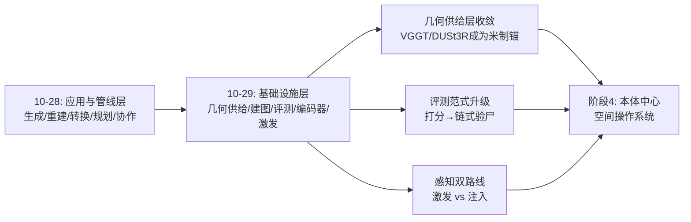
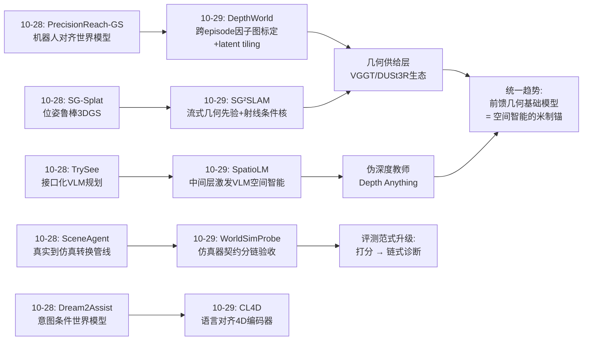
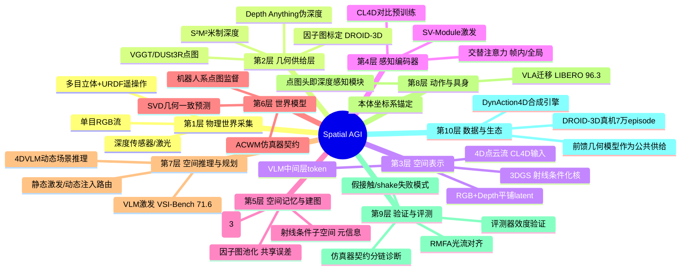
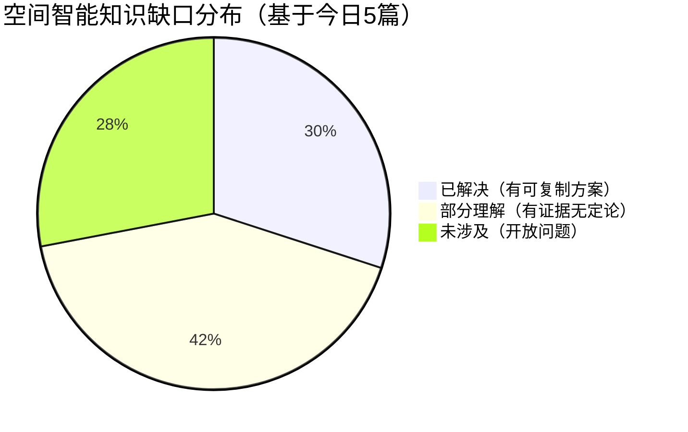

# Spatial AGI 每日思考 - 2026-10-29

## 今日概况

- **论文总数**: 5篇（全部全文精读）
- **来源**: arXiv（2026-08 至 10-26 公开，检索日 10-29）
- **覆盖层**: 具身数据基础设施（DROID-3D）、建图基础设施（单目户外3DGS-SLAM）、评测基础设施（世界模型仿真器忠实度）、4D感知基础编码器（CL4D）、VLM空间能力激发（SpatioLM）
- **昨日关联**: 与10-28的 PrecisionReach-GS / SG-Splat / SceneAgent / TrySee / Dream2Assist 形成上下游对话——昨日是"应用与管线"，今天是"地基与量尺"

---

## 一、今日五篇论文的核心脉络

### 1.1 五篇论文一览

| # | 论文 | 层次 | 核心贡献 | 关键数字 |
|---|------|------|---------|---------|
| 1 | DepthWorld (2610.08780) | 数据基础设施 | DROID-3D标定 + spatial latent tiling 几何一致世界模型 | 外参4.9mm/0.39°（基线23×差），RGB +1.48dB |
| 2 | SG²SLAM (2610.36312) | 建图基础设施 | 流式几何先验 + 射线条件化3DGS核的户外单目SLAM | KITTI平均ATE 6.24m，PSNR 22.70dB 全第一 |
| 3 | WorldSimProbe (2608.09298) | 评测基础设施 | 可观察仿真器契约 + 5套件诊断ACWM忠实度 | 18,000实例/6模型；shake保真≈0 |
| 4 | CL4D (2608.18734) | 感知编码器 | 首个语言对齐4D对比预训练编码器 + 4DVLM | 检索+16.75%，VQA超Gemini/GPT-5 |
| 5 | SpatioLM (2608.01899) | 空间推理 | 冻结VLM+旁路SV-Module激发空间智能 | VSI-Bench 71.6首破70，通用能力零损 |

### 1.2 一条隐藏的叙事线：空间智能的"公共基础设施"正在成形

昨天的论文是应用层的五种角色（生成/重建/转换/规划/协作）；今天的五篇恰好是支撑这些应用的五个基础设施层，而且互相咬合：

1. **几何生产**（DepthWorld / SG²SLAM）：前馈几何基础模型（VGGT/DUSt3R/S²M²）产生的米制点图，成为一切下游空间任务的监督锚
2. **几何消费-注入派**（CL4D）：直接以4D点云为原生输入的语言对齐编码器
3. **几何消费-激发派**（SpatioLM）：纯RGB输入，从冻结VLM中间层激发潜在空间知识，伪深度做训练脚手架
4. **质量闸门**（WorldSimProbe）：无论哪条路线产出的世界模型，都要过"动作→运动→响应"因果链验收

**今天是"造地基、验地基、用地基"的一天。**

---

## 二、跨论文主题分析

### 2.1 主题一：前馈几何基础模型成为空间智能的"米制锚"（本周最强主线）

DepthWorld 用 VGGT 系点图监督世界模型，SG²SLAM 用 VGGT 类网络流式预测位姿/点图/置信度，SpatioLM 用 Depth Anything V3 伪深度做辅助监督，CL4D 的未来数据源正是 SLAM/世界模型产出的真机4D流。四个不同层次的工作共享同一个依赖：**VGGT/DUSt3R/Depth Anything 这一族前馈几何基础模型**。

**结构性判断**: 空间智能栈出现了事实上的"几何供给层"——类似于LLM时代的"基础模型层"。下游所有创新（世界模型、SLAM、VLM激发、4D编码器）的天花板都被这个供给层的质量决定。这解释了为什么今天的论文一半篇幅在"标定""尺度校正""置信度过滤"——都是在与供给层噪声做工程搏斗。

**推论**: 几何基础模型的下一次跃迁（更大规模、动态场景原生、置信度校准）对空间智能的杠杆率，可能大于任何下游架构创新。

### 2.2 主题二：物理坐标系锚定——"机器人本体中心"范式的确立

DepthWorld 的核心创新是把手眼标定、关节偏置与场景外参放进同一张因子图，把感知锚定到机器人基座坐标系；SG-Splat（昨日）与 PrecisionReach-GS（昨日）同样强调机器人坐标系对齐；WorldSimProbe 的契约要求环境响应归因于"实现的智能体运动"——本质上也是本体中心的因果链。

**三天的证据链汇成一个范式判断**: 具身空间智能正在从"相机中心"转向"本体中心"。物体-机械臂的空间关系只有在统一的物理坐标系中才可验证、可学习、可执行。对 Spatial AGI 的含义：空间表示的"原点"选择不是实现细节，而是能力分水岭——没有本体锚定的空间理解无法支撑接触级操作。

### 2.3 主题三：激发 vs 注入——动态/静态的分界线浮现

今天最有方法论张力的对峙：

| 维度 | 注入派（CL4D） | 激发派（SpatioLM） |
|------|---------------|-------------------|
| 输入 | 4D点云原生 | 纯RGB |
| 空间知识来源 | 对比预训练+几何输入 | 冻结VLM中间层 + 伪深度脚手架 |
| 优势 | 动态场景语言推理超前沿VLM | 部署零开销、通用能力零损 |
| 弱点 | 依赖深度传感器/重建；数据合成 | 运动动态任务退化（作者自认）；伪标签天花板 |
| 表示论假设 | 几何必须显式进入token | 空间知识已在权重里，只需激发 |

**边界假说**: 激发与注入的分界可能就是"静态空间 vs 动态空间"。SpatioLM 承认几何监督与运动动态线索竞争；CL4D 的优势恰在动态（4D）。而 SG²SLAM 的射线条件化核给出了第三种视角：**几何证据本身是视角（观察条件）的函数**——空间表示应内建"何时可靠"的元信息。Spatial AGI 的感知层可能需要按场景动态性做路由：静态用激发（便宜），动态用注入（准确）。

### 2.4 主题四：评测从"打分"到"验尸"——诊断式评测范式的确立

WorldSimProbe 是今天方法论上最重要的工作：它不问"哪个模型好"，而问"模型在哪一环、以何种模式坏"。五套件沿因果链定位失败；人类验证评估器本身；诊断排序与下游OOD性能闭环。

**与昨日 TrySee 的呼应**: 昨日"两级归因调试法"、HiMeco"元认知监控"，今日"仿真器契约分链验收"——**失败定位正在成为空间智能的一等公民研究**。深度剖析：打分式评测（leaderboard）假设能力是单维标量；诊断式评测承认能力是因果链上的分布，链条任何一环断裂都会伪装成"整体不行"。空间智能系统比语言模型多出"物理因果"这一维，链式诊断是其唯一合适的评测形态。

**金句级发现**: "视觉重叠≠抓取"、"near≠contact"——模型学到了空间共现，没学到空间因果。这一发现比任何分数都更有行动指导性：下一代世界模型训练需要**接触前提条件的显式监督**（DepthWorld 的机器人系点图恰好能提供）。

### 2.5 主题五：零侵入架构改造的两种范式汇合

DepthWorld 的 spatial latent tiling（只扩位置编码）与 SpatioLM 的旁路SV-Module（零投影注入）+ SG²SLAM 的射线条件化核（不动标准渲染管线，只换核函数），都在回答同一个问题：**如何给强预训练模型加空间能力而不毁掉它**。

三种答案的共同语法：
1. 新模态/新能力走旁路，主干权重冻结或原样保留
2. 注入点用零初始化/温和参数化起步，训练自然决定融合强度
3. 推理时可拆可卸（DPT头拆除、SV-Module停用、ζ→0退化为vanilla GS）

**这是2026年空间智能架构设计的成型语法**：不再有"重建模型"的豪赌，只有"为先验装支架"。预训练先验（SVD/LLM/3DGS）是不可再生的资产，架构创新的全部艺术在于支架设计。

---

## 🔗 与昨日思考的联系

### 昨日重点

昨日（10-28）五篇是空间智能的**应用与管线层**切片：PrecisionReach-GS（机器人对齐3DGS世界模型造腕部数据）、SG-Splat（位姿噪声鲁棒3DGS）、SceneAgent（真实→仿真智能体转换管线）、TrySee（三函数视觉接口+闭环VLM规划）、Dream2Assist（意图条件RSSM世界模型+共享控制）。提炼出的核心模式：生成-验证分离（第9次出现）、世界模型多角色化、意图双通道（语言先验+行为likelihood）、小数据杠杆化、部署工程独立成学。

### 今日进展

今天五篇恰好是支撑昨日应用的**基础设施层**，且逐篇咬合：

1. 昨日 PrecisionReach-GS 需要"机器人对齐"，今日 DepthWorld 给出通用解：跨episode因子图把手眼/关节偏置与场景外参联合标定——把特化技巧升级为平台级流水线；
2. 昨日 SG-Splat 治单场景位姿噪声，今日 SG²SLAM 治序列级建图+尺度，且共同语法是"训练分布暴露+鲁棒优化"；
3. 昨日 SceneAgent 造转换管线，今日 WorldSimProbe 提供管线质量的标准验收量尺（仿真器契约）；
4. 昨日 TrySee 证明"瓶颈在接口"（外挂工具提升VLM 3.6%→83.6%），今日 SpatioLM 证明"瓶颈在激发"（旁路模块零训练提升）——两种零侵入路线汇合成"零侵入改造"设计语法；
5. 昨日 Dream2Assist 用RSSM做行为意图推断，今日 CL4D 补上时空语义的感知底座——语言先验（CL4D嵌入）+行为证据（RSSM）的贝叶斯意图模型两半终于齐全。

### 演进路径

### 延续判断

**昨日→今日**: 应用切片暴露的共同瓶颈（几何从哪来、质量谁保证）今日全部有解。

**今日→明日**: (1) WorldSimProbe 契约扩展到动态场景与真实世界？(2) 激发/注入能否在单一架构内按场景路由？(3) DROID-3D 标定能否推广到单目数据生态？(4) 射线条件化能否推广到语义/可供性维度？

### 3.2 上下游咬合详表

| 昨日（应用/管线） | 今日（基础设施） | 咬合关系 |
|------------------|-----------------|---------|
| PrecisionReach-GS 机器人对齐世界模型 | DepthWorld | 昨日需要"机器人对齐"，今日给出标定流水线（DROID-3D）作为通用解 |
| SG-Splat 位姿噪声鲁棒3DGS | SG²SLAM | 同为3DGS+位姿问题，昨日治单场景重建，今日治序列建图+尺度 |
| SceneAgent 真实→仿真转换 | WorldSimProbe | 昨日造转换管线，今日提供转换质量的验收量尺 |
| TrySee 接口化VLM规划 | SpatioLM | 昨日"瓶颈在接口"，今日"瓶颈在激发"——两种零训练提升VLM空间能力的路径 |
| Dream2Assist 意图世界模型 | CL4D | 行为意图（RSSM）+ 时空语义（CL4D）= 双通道空间理解的感知底座 |

### 3.2 知识演进图

### 3.3 延续判断（简）

几何供给层收敛是今日最重要判断，详见主题一；完整链式诊断与双路线感知路由详见主题三、主题四。

---

## 四、核心见解（7个）

### 见解1: 深度监督是生成模型的免费午餐
（从 DepthWorld 获得）
- ✅ 同架构同数据同预算下，仅增加深度预测目标就带来 RGB +1.48dB——显式几何监督不但不与生成质量冲突，反而是正则化器
- ✅ 共享 spatial latent grid 本身足以促使 U-Net 学到跨模态/跨视角约束，显式 3D 损失只需做细粒度正则

**对Spatial AGI的启发**: "端到端纯隐式"与"显式3D"之争有了实验答案：把显式几何作为辅助监督注入生成式骨干，两者兼得。为所有空间生成模型（世界模型、视频生成、场景合成）提供了默认设计选项：**永远加深度头**。

### 见解2: 系统误差要靠跨样本池化才能暴露
（从 DepthWorld 获得）
- ✅ 单场景优化无法区分手眼漂移（机器人级系统误差）与外参噪声（场景级噪声）；把同一机器人的全部 episode 池化进一张因子图，系统误差的修正信号被 episode 数放大
- ✅ 结果是数量级的差距：23× 重投影误差改善，且消灭了逐场景优化 18% 的不收敛失败

**对Spatial AGI的启发**: 这是"误差分解需要正确的事实分组"的教科书案例。任何空间智能系统的标定/校准层都应该问：哪些参数是"同一物理实体的固有属性"（应跨样本共享），哪些是"每次观测的偶然扰动"（应独立吸收）。分组错误 = 信息量被浪费。

### 见解3: 几何证据是观察条件的函数——空间表示应内建"何时可靠"
（从 SG²SLAM 获得）
- ✅ 射线条件化核把"观察方向"参数化进高斯原语（6维均值/协方差 = 空间块+视线子空间），闭式条件统计 + 有界衰减不透明度，机制性消除掠射角漂浮
- ✅ 消融证明：条件化核让 SSIM 0.78→0.89，且不需要任何额外监督——它改变的是表示的表达空间而非损失

**对Spatial AGI的启发**: 空间智能不是"3D重建+视角无关渲染"，而是"知道什么信息在什么观察条件下可靠"。把这个思想推广到语义记忆（"这个物体从哪些视角可识别"）和可供性（"这个表面从哪些视角可抓"），可能催生"观察条件感知的空间记忆"——每个记忆条目自带适用域标签。

### 见解4: 块级流式处理是无限空间经验的通用模板
（从 SG²SLAM 获得）
- ✅ chunk 化（200帧/块+重叠）+ 块内自洽重建 + 块间 Sim(3) 图一次求解融合——把任意长度序列变成统一的流式处理单元
- ✅ 代价是块大小敏感：200/300/500帧 → ATE 1.49/1.92/2.42m，块内先验噪声随块长传播

**对Spatial AGI的启发**: 这与 VGGT-Long、DiskChunGS、以及记忆管理类工作（SMI，10-11）形成同一范式家族：**空间经验的处理单元既不能太小（误差级联）也不能太大（先验失效）**。"最优块大小"可能不是超参数，而是可以由先验置信度自适应决定的量——置信度衰减到阈值时切块，是比固定窗口更原则的设计。

### 见解5: 评测工具本身的效度必须单独验证
（从 WorldSimProbe 获得）
- ✅ VLM 裁判在 OOD 控制下与人类判断一致性仅 0.450（91.7% 判"遵循动作" vs 人类 42.2%）；IDM 反推在早期策略/跨动作控制下误差放大 3.1×/5.6×——两种流行评测方法测的是自己的解码失败，不是模型的忠实度
- ✅ RMFA（参考端掩码+光流）与人类判断 ρ=0.750，且不依赖生成端分割质量

**对Spatial AGI的启发**: 空间智能评测的元问题是"尺子准不准"。任何自动评测器（VLM裁判、逆动力学、LLM-as-judge）在分布外控制下的效度都可能崩塌，必须做"评估器的评估"。方法论制度化建议：论文评测部分应包含 Table 4 式的人类一致性验证，否则分数不可解释。

### 见解6: 几何原生输入在动态场景击败规模
（从 CL4D 获得）
- ✅ 7B 的 4DVLM（点云输入）在动态场景 VQA 全面超越 Gemini/GPT-5（同场景视频输入，甚至三视角渲染）——"喂什么表示"比"模型多大"更重要
- ✅ 点云（而非骨架）使同一编码器覆盖人/物/机械臂，跨具身泛化有结构性优势

**对Spatial AGI的启发**: 与 SpatioLM 的"激发"路线对峙后，得到一个分层结论：静态空间理解可以激发（RGB够用），动态空间理解需要注入（几何原生）。空间智能的感知路由器应按场景动态性选择编码路径——这是"架构即路由"思想在感知层的具体化。

### 见解7: 空间知识是"锁着的"而非"没有的"
（从 SpatioLM 获得）
- ✅ 冻结 VLM 中间层（16/24层）token + 6×50M 旁路 + 伪深度/射线监督 = VSI-Bench 71.6 首破 70，通用能力零损——空间能力可被小代价解锁
- ✅ 零投影注入保证训练起点不扰动预训练分布；空间 token 每隔 s 层反复注入，几何信息需要在每个抽象层级参与语言推理

**对Spatial AGI的启发**: 预训练视觉表征中的空间信息密度被系统性低估了。这意味着"空间智能专用预训练"的必要性存疑——更经济的路线可能是"通用预训练+空间激发"。但要警惕天花板的形状：预训练分布中不存在的空间结构（高频动态、极端尺度）激发不出来，MVBench 运动退化就是天花板露头。**激发的上限 = 预训练分布的空间覆盖**。

---

## 五、技术栈演进对比表

| 层次 | 昨日方案 | 今日方案 | 变化 |
|------|---------|---------|------|
| 数据基础设施 | PrecisionReach-GS 单任务3DGS世界模型 | DepthWorld: DROID-3D 通用标定流水线（任意多目+URDF） | 从任务特化到平台级数据供给 |
| 建图 | SG-Splat 单场景位姿鲁棒3DGS | SG²SLAM 序列级流式几何+射线条件核 | 从鲁棒重建到全局一致建图 |
| 评测 | SceneAgent 生成-审查管线（任务内） | WorldSimProbe 契约化分链诊断（跨模型跨平台） | 从工程审查到标准化验尸 |
| 感知编码 | （昨日无） | CL4D: 语言对齐4D编码器 | 新增"动态几何的语言接口"层 |
| 空间推理 | TrySee 接口化VLM（外挂工具） | SpatioLM 内在激发（无外挂） | 空间能力从工具依赖转向权重内生 |
| 世界模型验证 | （昨日靠策略成功率间接判断） | WorldSimProbe 直接测动作-运动-响应链 | 增加物理忠实度直测 |

---

## 六、Spatial AGI 知识图谱

### 10层架构思维导图

### 主线技术路径

#### 阶段1: 几何供给统一化（当前正在发生）
前馈几何基础模型（VGGT/DUSt3R/Depth Anything 系）成为所有空间任务的米制锚。今天的 DepthWorld、SG²SLAM、SpatioLM 全部以此为基础。供给层质量决定全域天花板。

#### 阶段2: 双路线感知路由（正在成形）
静态空间用激发路线（SpatioLM，RGB-only 零开销），动态空间用注入路线（CL4D，几何原生）。路由器按场景动态性/几何可用性选择编码路径。射线条件化思想（SG²SLAM）为两条路线提供"可靠性元信息"的表示语法。

#### 阶段3: 世界模型的仿真器化验收（开始落地）
WorldSimProbe 的契约 + DepthWorld 的几何监督形成"训练-验收"闭环：几何监督针对接触前提（假接触失败）和动力学原语（shake缺失）提供显式信号，WorldSimProbe 验收改进是否真实转化为仿真器忠实度。合成数据引擎（Dream2Assist 生态、CL4D 的 DynAction4D）在此闸门下获得质量分级。

#### 阶段4: 本体中心的空间操作系统（12个月展望）
机器人坐标系锚定（DepthWorld/SG-Splat/PrecisionReach）+ 块级流式空间记忆（SG²SLAM/SMI）+ 统一空间编码器（CL4D/SpatioLM 融合）→ 智能体拥有持续更新、按观察条件标注可靠性、可被语言查询的"本体中心空间操作系统"。动作、感知、记忆共享同一坐标系。

---

## 七、待探索议题

### 高优先级（本周）

1. **接触前提条件的显式监督**
   - 问题: WorldSimProbe 发现"假接触"是最弱环节（38.6），模型依赖视觉接触线索而非控制支持——如何在训练中直接监督"接触是否物理成立"？
   - 候选方案: 用 DepthWorld 的机器人系点图 + URDF 接触检测器生成接触真值，作为世界模型的辅助二分类头
   - 缺口: 真实数据（非仿真）的接触标注获取

2. **激发/注入路由器**
   - 问题: 静态用 SpatioLM 激发、动态用 CL4D 注入——路由信号是什么？动态性如何在推理时低成本估计？
   - 候选方案: 光流幅度/帧差作为门控；SV-Module 的几何 token 置信度作为路由依据
   - 缺口: 两条路线的训练目标不兼容（2D RGB vs 4D点云），需要统一骨干

3. **DROID-3D 式标定推广到单目生态**
   - 问题: 联合因子图依赖多目立体+URDF；Open X-Embodiment 大部分是单目数据
   - 候选方案: SG²SLAM 的米制深度锚定 + 跨 episode 手眼共享，把"多相机"约束放松为"多episode"
   - 缺口: 单目场景腕-外对应缺失时的锚定信号

### 中优先级（本月）

4. **射线条件化推广到语义/可供性**
   - 问题: SG²SLAM 只条件化几何；"从哪些视角可识别/可抓"的元信息如何进入表示？
   - 候选方案: 在高斯原语上附加视角条件的语义/可供性子空间，用多视角标注监督
   - 缺口: 带视角标注的语义数据集

5. **动力学原语的数据补课**
   - 问题: shake 保真 0-1.2% 说明视频先验中高频振荡动力学稀薄；任务成功导向的数据永远不含 shake
   - 候选方案: 仿真器批量生成"失败原语库"（WorldSimProbe 的 8 原语 × 大规模扰动）；或真实传感器记录的振动/碰撞数据
   - 缺口: 原语级真值的高效获取与验证

6. **伪深度教师的天花板突破**
   - 问题: SpatioLM/DepthWorld 都被教师模型（Depth Anything/DUSt3R）的质量上限锁死
   - 候选方案: 自举回路——下游任务梯度（WorldSimProbe 契约损失）反哺教师微调；多教师集成置信度加权
   - 缺口: 反哺时的灾难遗忘与不稳定

### 低优先级（长线）

7. **块大小的自适应化**
   - 问题: SG²SLAM 块大小敏感（200帧最优）；固定窗口不是原则性设计
   - 候选方案: 先验置信度衰减触发的动态切块；按场景复杂度（动态物体密度）调整
   - 缺口: 置信度校准与切换点的理论分析

8. **Global 检索的开放世界能力**
   - 问题: CL4D Cluttered 段 Global R@1 仅 3.11——开放世界"找回刚才发生的事"远不可用
   - 候选方案: 分层检索（场景级→区域级→实例级）+ 空间索引（SG²SLAM 地图做空间剪枝）
   - 缺口: 大规模 4D 记忆的索引结构与负样本挖掘

9. **评测器的标准化效度协议**
   - 问题: VLM 裁判/IDM 在 OOD 下效度崩塌，但社区仍在普遍使用
   - 候选方案: 建立"评测器基准"——固定人类标注集+分控制条件的效度报告模板（WorldSimProbe Table 4 式）
   - 缺口: 跨实验室的人类标注共识成本

10. **世界模型长时程几何漂移**
    - 问题: DepthWorld rollout 仅 5 帧（~1秒）；几何一致性在长程自回归下未验证——而这恰是策略评估最需要的
    - 候选方案: WorldSimProbe 契约扩展到长时程+闭环；定期"几何重锚定"（用 SLAM 位姿回路校正漂移）
    - 缺口: 长时程真值参考的获取

---

## 八、知识缺口分析

**已解决（30%）**:
- ✅ 多目遥操作数据的监督级3D标定（DROID-3D流水线，任意多目+URDF可复制）
- ✅ 单目户外序列的几何一致建图（SG²SLAM三件套，KITTI/Waymo验证）
- ✅ VLM空间能力的非侵入激发（SV-Module配方，VSI-Bench 71.6）
- ✅ 世界模型的多模态扩展语法（latent tiling/旁路注入/核替换三范式）
- ✅ 动态点云的语言对齐预训练（CL4D配方+数据引擎）

**部分理解（42%）**:
- ⚠️ 仿真器忠实度的失败模式分类（假接触/响应衰减已命名，修复方案未验证）
- ⚠️ 激发vs注入的适用边界（静态/动态假说有间接证据，无对照实验）
- ⚠️ 几何供给层噪声对下游的传导规律（各论文各自搏斗，无系统研究）
- ⚠️ 长时程 rollout 的几何漂移（有意识，无量化）
- ⚠️ 空间评测器的效度（RMFA 是好的开始，覆盖面有限）
- ⚠️ 跨具身4D表征（点云统一性有初步证据，规模和域覆盖不足）
- ⚠️ 尺度/块化的最优粒度（经验值存在，原则缺失）

**未涉及（28%）**:
- ❌ 动态物体/可变形场景的世界模型几何监督
- ❌ 真实世界（非仿真）的接触与动力学真值获取
- ❌ 多智能体共享空间的表示与冲突消解
- ❌ 语义/可供性的视角条件化表示
- ❌ 安全关键场景的空间可靠性保证（SpatioLM明示不可靠）
- ❌ 户外大尺度+恶劣条件（雨夜/森林）的4D感知
- ❌ 空间智能的能耗/延迟预算体系

---

## 九、方法论收获（可复用思考工具）

### 9.1 "误差分解先于优化"
DepthWorld 教的一课：优化前先问哪些参数共享（机器人级）哪些独立（场景级）。错配的参数分组让优化在错误的自由度上消耗信息。

### 9.2 "先验支架"设计法
三种零侵入改造（tiling/旁路/换核）的共同语法：旁路计算+温和初始化+推理可拆。设计空间智能架构时，默认先问"预训练先验是什么、支架怎么搭"，而不是"从头设计什么"。

### 9.3 "评估器的评估"
任何自动评测（VLM裁判/IDM/LLM-judge）必须附带分控制条件的效度验证。OOD 下裁判与人类判断的分歧度，往往比被评模型的分数更有信息量。

### 9.4 "链式验尸"评测法
把能力分解为因果链（动作→运动→接触→响应），每环独立构造受控干预，失败定位到环而非模型整体。适用于一切多环节空间系统。

### 9.5 "观察条件标注"表示法
射线条件化核的推广：任何空间记忆条目都应携带"在什么观察条件下可靠"的元信息。可靠性是表示的维度，不是系统的自信。

---

## 十、今日金句摘录

- "深度监督改善 RGB 预测本身"——显式几何是隐式生成的正则化器（DepthWorld）
- "视觉重投影一致性对刚性漂移不变"——自洽不等于对齐，锚定必须来自本体（DepthWorld）
- "一个 rig 可以内部自洽但物理上与机器人错位"——（同上）
- "跟踪误差被吸收进地图，地图又为下一轮匹配提供退化参考"——级联退化的正反馈回路（SG²SLAM）
- "原语对与其条件子空间一致的射线保持不透明，否则平滑消失"——表示自带适用域（SG²SLAM）
- "rollout 可能看起来动作感知且物理合理，却既没有忠实执行动作、交互也无物理支撑"——外观≠仿真器（WorldSimProbe）
- "near ≠ contact；视觉重叠 ≠ grasp"——空间共现≠空间因果（WorldSimProbe）
- "fidelity 在原语间的差异远大于模型间差异"——瓶颈在数据分布不在模型（WorldSimProbe）
- "喂给模型什么表示比模型多大更重要"——7B 几何原生击败前沿视频 VLM（CL4D）
- "空间知识是锁着的，不是没有的"——中间层激发假设（SpatioLM）

---

## 十一、五篇论文的技术细节备忘（深度回顾用）

### 11.1 DepthWorld
- 标定: Stage1 S²M²米制深度→两遍BA（外对齐→机器人系放置）；Stage2 URDF渲染+LoMA-G对应+跨episode因子图（每episode 12DoF外参修正 + 共享6DoF手眼+7DoF关节偏置），Cauchy鲁棒核+GPU LM/Schur
- 模型: SVD（Ctrl-World初始化），192×320×3视角×2模态，VAE不改，latent 72×80（RGB+depth横拼，视角纵叠），11帧窗口（6+5@5Hz），DPT点图头（VGGT初始化）置信度加权+Barron ρ
- 训练: Stage1 40k步（λ_pm=0）→ Stage2 50k步（λ_pm=0.005）

### 11.2 SG²SLAM
- 前端: VGGT类ΦΘ流式（Nw帧窗→200帧chunk/30重叠）+米制深度Ψ，s̄k=med(r)±3MAD 锚定，共轭Sk=diag(s̄k·I₃,1)
- 核: μ,Σ∈R⁶/S⁶（空间3+视线3），块Cholesky，A=V₁₂V₂₂⁻¹阻尼，α=min(αmax, o(q)(1−σ)/ζ) 有界多项式衰减
- 融合: 链约束尺度几何平均√(s_ov·s̄A/s̄B)，回环逐像素比中位数+c²ₙ加权，Sim(3)图7(K−1)维单次求解
- 结果: KITTI 11序列 ATE 6.24m/PSNR 22.70dB；WOD 0.63m；无回环超GigaSLAM 21%

### 11.3 WorldSimProbe
- 契约: r̂≈ΦR(rt,et,a) ∧ ê≈ΦE(et,r̂) 联合成立；A_task⊂A_phys 覆盖缺口
- 5套件: T1局部标定（oracle相对分数）、T2全局覆盖（跨任务回放+RMFA）、T3源保持（RMFA）、T4接地（无接触三对照+TAPNext++位移）、T5动力学（8原语+Qwen3-VL裁判，人类验证94-97%）
- 关键数: 假接触38.6/干扰物75.0；shake 0-1.2%；VLM 0.450/IDM 0.284/RMFA 0.750；下游OOD 53/34/21%

### 11.4 CL4D
- 编码器: PointNet（64组×32点, d1=512）→Vs 4层（d2=512）→{MAX,CLS,MEAN}堆成3×512×32伪图像→Vt ViT-B/16（patch16, d3=768）；DistilBERT文本；对称InfoNCE，150epoch，B=72
- 4DVLM: Vst→4096维投影→LLaVA-v1.5-7b，冻结骨干只训投影10epoch
- 数据: DynAction4D（HumanML3D SMPL→Unity→增广→点云; Humoto交互; 杂乱场景; VQA）+RH20T
- 结果: 检索+16.75%；VQA BLEU 0.0729 超 Gemini-3.0F/GPT-5

### 11.5 SpatioLM
- 架构: 冻结VLM（ViT第16/24层取token）+K=6 SV-Block（各50M，帧内/全局交替注意力）+零投影注入每s层LM block+双DPT头（深度+射线图，训练期）
- 训练: 15数据集643K QA+20K视频，64×H200，感知600ep/理解2ep
- 结果: VSI-Bench 71.6首破70；MD-S 83.5；通用能力持平（VideoMMMU+12%）；LIBERO VLA0 79.2→91.0、OFT 95.3→96.3
- 自认局限: 伪标签天花板、运动-静态权衡、安全关键不可靠

---

## 十二、五篇论文的联动组合方案

### 组合A: 几何监督世界模型 + 契约验收（DepthWorld + WorldSimProbe）
用 DROID-3D 的机器人系点图监督，针对 WorldSimProbe 暴露的两大失败模式定向加损失：接触前提二分类头（治假接触）、振荡动力学增广数据（治shake缺失）。验收用 WorldSimProbe 五套件——形成"诊断→定向训练→再诊断"的闭环。这是今天最有把握立即可做的组合。

### 组合B: 标定流水线+SLAM地图+4D编码器（DepthWorld + SG²SLAM + CL4D）
DROID-3D 式标定产出真机4D流 → SG²SLAM 式建图提供空间索引 → CL4D 在真机4D数据上替换合成训练—— CL4D 的合成-真实鸿沟由前两者填平。产出：可语言查询的动态空间记忆系统。

### 组合C: 双路由空间VLM（SpatioLM + CL4D）
共享 LLM 骨干，静态场景走 SV-Module（RGB），动态场景走 4D 编码器投影。路由门控用光流幅度或 SV-Module 几何 token 置信度。评测在 VSI-Bench（静态）+ DynAction4D-VQA（动态）双榜验证路由收益。

### 组合D: 世界模型作为SLAM先验（DepthWorld + SG²SLAM）
DepthWorld 的深度预测头为 SG²SLAM 提供前向几何先验（替代独立的米制深度网络 Ψ），SLAM 的位姿回路反过来校正世界模型长程漂移——世界模型与 SLAM 互为对方的"重锚定机制"。

---

## 十三、开放问题（值得后续追踪）

1. WorldSimProbe 契约扩展到动态场景/真实世界后，"外生变化固定"的归因假设如何放松？
2. 激发路线的上限是否真的等于预训练分布的空间覆盖？能否设计实验直接测量"可激发空间知识总量"？
3. SG²SLAM 的射线条件化子空间能否承载语义——"同一表面不同视角的语义证据不等价"如何参数化？
4. DROID-3D 因子图的"共享/独立"参数分组能否自动化（从数据中学习分组结构）？
5. CL4D 的对比嵌入能否作为世界模型 rollout 的语义一致性度量（替代像素 MSE 的 DRILL 教训）？
6. 深度监督提升 RGB 的机制是什么（正则化？信息耦合？）——需要分解实验。
7. 8 个交互原语之外，还有哪些"视频先验盲区"动力学？能否系统性枚举？

---

## 十四、元思考：作为研究者的观察

今天的五篇论文有一个反直觉的共同点：**最重的贡献都不在模型里，而在模型外**。DepthWorld 一半篇幅在标定，SG²SLAM 一半在融合，WorldSimProbe 全部在评测，CL4D 一半在数据引擎，SpatioLM 的价值一半在"保留了什么"。这印证了一个正在成型的判断：空间智能进入了"基础设施红利期"——架构创新边际收益递减，数据质量、标定精度、评测效度的边际收益巨大。

另一个观察：本周论文对"失败"的态度发生了质变。昨天的 HiMeco 给失败做元认知，今天的 WorldSimProbe 给失败建分类学（假接触/响应衰减/shake盲区），且明确"评测器也要验尸"。失败从要隐藏的尴尬变成了要命名的科学对象——这是领域成熟度的标志。

最后，几何基础模型作为"米制锚"的收敛值得警惕地乐观：收敛意味着全栈共享单点依赖（VGGT 系的盲区 = 全栈盲区）。动态物体、透明/镜面材质、极端天气——这些 VGGT 系的已知弱点，会沿着供给层传导到世界模型、SLAM、VLM 激发、4D 编码器的每一个角落。**供给层多样性**可能是未来两年被低估的战略议题。

## 💡 本质思考：如何达成通用空间智能

### 子问题1: 核心能力的本质是什么？

综合今日五篇，通用空间智能的核心能力可以分解为四个正交维度，每篇论文恰好各自照亮一个：

**（1）度量接地能力**（DepthWorld/SG²SLAM）：把像素观察转化为带尺度、带坐标系、带置信度的几何事实。没有这一层，后续一切推理都是漂浮在相对量上的类比。本质是"观察→物理事实"的映射，且这个映射必须锚定在一个可验证的坐标系上（相机系不够，要本体系/世界系）。

**（2）视角条件化的可靠性自知**（SG²SLAM 射线条件化核）：空间智能不是知道"世界是什么样"，而是知道"在什么观察条件下我关于世界的知识可靠"。人类空间认知天然带这种元信息（背对着的东西"不可见但知道在"）；当前 AI 表示普遍缺失这个维度。射线条件化是它的几何版本，WorldSimProbe 的置信度过滤是它的数据版本——两者是同一个能力在不同层的投影。

**（3）因果支持的空间推理**（WorldSimProbe）：从"空间共现"上升到"空间因果"——环境变化必须可归因于动作诱导的运动及其接触事件。near≠contact、视觉重叠≠grasp：模型必须持有"物理前提条件"的概念，而不是模式匹配视觉线索。这是当前与世界模型差距最大的一环，也是空间智能区别于视频生成的分水岭。

**（4）可激发的语言接口**（CL4D/SpatioLM）：空间知识必须能被语言查询、也必须能从语言指令出发被激活。两条路线（几何原生注入 vs 中间层激发）证明了语言-空间接口存在多种实现，但共同要求是接口不能牺牲通用智能——空间模块必须是可插拔的支架，不是模型的重塑。

**综合判断**：通用空间智能 = 度量接地 × 可靠性自知 × 因果支持 × 语言接口。四者是乘法关系：任何一项为零，整体能力为零。今天的进展是把（1）（4）推到工程可用，（2）（3）推到"能命名、能测量、不能修复"。

### 子问题2: 当前方法与理想目标的差距在哪里？

**差距一：动态世界的几何供给是空的。** 几何供给层（VGGT/DUSt3R/Depth Anything）全部为静态场景设计。今日所有下游创新（世界模型深度监督、SLAM先验、VLM伪深度蒸馏、4D编码器数据）的天花板都锁死在"静态场景几何"上。动态物体、可变形对象、流体——这些真实世界的大部分内容，在供给层就是盲区。DepthWorld 的深度头预测的其实是"准静态桌面的深度"，SG²SLAM 明确把动态交通留给了未来。

**差距二：物理因果只有检验，没有训练信号。** WorldSimProbe 能诊断"假接触"和"shake盲区"，但没有任何一篇论文给出修复方案。接触前提条件、动力学原语保真——这些能力的训练信号在现有数据分布里不存在（任务成功导向的数据永不包含失败交互和振荡动力学）。检验工具领先训练方法整整一代。

**差距三：长时程几何一致性无人负责。** DepthWorld rollout 5帧，SG²SLAM 靠回环约束在轨迹层面纠正但不处理地图内容的语义漂移，4DVLM 处理短片段。"智能体运行一小时后对世界的几何认知还剩多少可信度"这个问题，今天是零回答。块级流式处理（200帧chunk）是工程妥协不是理论解。

**差距四：通用性与空间能力的交换率未定。** SpatioLM 证明当前可以零损失（VideoMMMU 还+12%），但这是在静态空间任务上。一旦路由到动态场景（CL4D 注入路线），几何原生输入与语言模型的预训练分布的错配程度、对通用能力的挤压，完全未知。交换率曲线的形状决定空间智能的产业化路径。

**差距五：评测与训练的迭代速度不匹配。** WorldSimProbe 18,000实例的诊断要仿真器回放+人类验证+VLM裁判，一次评测的成本远超一次训练。检验领先于修复但落后于迭代需求——"诊断驱动的定向训练"（组合A方案）卡在评测吞吐上。

### 子问题3: 从今天到理想状态，最可能的路径是什么？

**路径判断：三阶段收敛，每阶段由前阶段的基础设施解锁。**

**近期（6个月）：诊断驱动的定向修复。** 组合A路线（DepthWorld监督+WorldSimProbe验收闭环）成本最低、条件最成熟：接触前提二分类头和动力学原语数据增广都是现成技术的组合。这一步的产出不是通用能力跃迁，而是"物理忠实度"成为世界模型的标配指标——类似 LLM 领域的 RLHF 前夜的 reward model。

**中期（1-2年）：动态几何供给层诞生。** 当前供给层是静态的，但需求压力（世界模型、户外SLAM、4D编码器全部需要动态几何）已经到位。最可能的形态是"VGGT 的动态版"——视频原生的前馈几何模型，输出带动态分割与逐物体运动场的点图。SG²SLAM 的射线条件化和 DepthWorld 的因子图标定是其配套基础设施。这一步解锁后，4D 编码器（CL4D）的训练数据从合成换成真机流，激发路线（SpatioLM）的伪深度教师也升级为动态教师——整个栈的水位一起上涨。

**远期（2-4年）：本体中心空间操作系统。** 三条路线汇合：(1) 感知路由器成熟（静态激发/动态注入，路由信号由几何供给层的动态性估计提供）；(2) 空间记忆与建图统一（SG²SLAM 的 chunk 融合 + SMI 的记忆管理 + CL4D 的语义索引，共享射线条件化的可靠性元信息）；(3) 世界模型成为该操作系统的"前向模拟器"，接受 WorldSimProbe 式契约的持续验收。此时空间智能体的形态：一个持续更新的、按观察条件标注可靠性、可被语言查询、可前向模拟的本体中心世界模型——这就是通用空间智能的工程形态。

**最大风险**：供给层单点依赖。全栈压在 VGGT 系生态上，其盲区（动态/透明/恶劣天气）将成为全栈的系统性风险。对冲手段是供给层多样性——这正是今日数据（LiDAR/SVS/事件相机等多模态供给）研究的战略价值所在。

## 补充思考：今日论文的再深想

### 再想1: 深度监督为什么能提升 RGB？（机制追问）

DepthWorld 报告 +1.48dB 但未解释机制。三个假说：(a) 正则化假说——深度是低频结构约束，抑制了扩散模型的高频幻觉；(b) 信息耦合假说——深度与遮挡/光照物理耦合，预测深度迫使模型理解场景成因而非统计纹理；(c) 容量再分配假说——U-Net 把原本用于"猜不可见区域"的容量转向"共享可见结构"。验证实验：把深度目标换成随机噪声深度（如果(a)对则仍应有部分提升）、换成错误深度（如果(b)对则应退化到基线以下）。这个消融没人做过，值得追踪。

### 再想2: 射线条件化与人脑视角记忆的同构性

SG²SLAM 的高斯原语"对一致的射线不透明，对不一致的射线消失"，与人脑场景记忆的视角依赖性高度同构：心理学中的边界扩展（boundary extension）效应表明人对场景的记忆自带"观察位置"标签。这提示：观察条件化不是工程 trick，而是空间表示的普遍必要属性——任何足够复杂的空间学习系统都可能自发演化出类似结构（值得在世界模型 latent 中寻找对应物：是否存在"视角选择性"的隐单元？）。

### 再想3: WorldSimProbe 的shake发现暗示"数据-engine 对齐"

六个模型在 shake 上全部≈0 且高度一致——这不是六个独立的失败，而是一个共享的失败：视频预训练分布中振荡动力学太稀薄。推论：**模型多样性不能替代数据覆盖**。再进一步：任务成功导向的数据采集（遥操作只做成功演示）系统性地排除了失败原语——数据引擎需要"原语级多样性预算"，像生物多样性保护一样有意维持低频动力学样本。这可能是物理 AI 数据引擎与互联网视频预训练的本质区别：后者靠规模自然覆盖，前者必须有意设计覆盖。

### 再想4: CL4D 与 SpatioLM 的评测主场问题

两篇各自的胜利都发生在自建/自家基准上（CL4D 的 DynAction4D-VQA，SpatioLM 的 MD-S/DR）。真正的问题域交叉点——"动态场景语言推理，几何原生 vs 激发，同数据同评测"——不存在。需要社区中立基准：同一组动态场景，同时提供 RGB 视频+点云双模态输入，统一问题集。这是明年最值得做的 benchmark 之一。

### 再想5: 因子图分组的自动化（DepthWorld 的隐藏贡献）

DROID-3D 成功的关键是手工正确分组了参数（机器人级共享 vs 场景级独立）。通用化问题：给定任意传感-具身系统，能否自动学习"哪些参数是系统固有、哪些是观测偶然"？这本质上是层次贝叶斯模型的先验结构学习。如果可自动化，标定流水线就能推广到任意新机器人形态而无需专家设计因子图——这是 DROID-3D 从"DROID 专用"到"平台级"的关键一步。

### 再想6: 评测吞吐是物理 AI 的隐形瓶颈

WorldSimProbe 一次完整诊断 = 18,000 实例 × 仿真器回放 × 3种子 × （VLM裁判+人类验证）。对比 LLM 领域一次 eval 的成本，物理仿真评测贵 2-3 个量级。可能的加速方向：3DGS 可微渲染作为仿真器的廉价代理（昨日 SceneAgent 论文3的审查器思路）、重要性采样只重评高不确定性实例、评测器蒸馏（把人类验证过的 VLM 裁判蒸馏成轻量专用分类器）。"评测加速器"可能本身成为一个产品类别。

## 每日总结

**日期**: 2026-10-29
**论文数量**: 5篇（全文精读）
**主题**: 空间智能的公共基础设施日——几何供给、建图、评测、4D感知编码、VLM空间激发

**关键突破**:
- 🚀 DepthWorld: 跨episode因子图标定（23×误差改善）+ 零侵入latent tiling，深度监督反哺RGB +1.48dB
- 🚀 SG²SLAM: 射线条件化3DGS核从机制上消除漂浮原语，流式几何先验替代2D-3D关联范式
- 🚀 WorldSimProbe: 仿真器契约+链式验尸，暴露shake盲区（≈0%）与假接触（38.6）两大系统性失败模式
- 🚀 CL4D: 首个语言对齐4D编码器，7B几何原生击败前沿视频VLM
- 🚀 SpatioLM: 6×50M旁路激发VMI内在空间知识，VSI-Bench 71.6首破70且通用能力零损

**架构演进**: 应用管线层（昨日）→ 基础设施层（今日）：几何供给层收敛 + 评测从打分到验尸 + 感知激发/注入双路线成形

### 📊 一句话总结

今天证明了空间智能的瓶颈正在从模型架构转移到基础设施：前馈几何模型成为全域米制锚、评测从排行榜转向因果链验尸、而感知层分裂为"激发（静态RGB）"与"注入（动态4D）"两条待路由的路线。

### 🔗 延续性

**昨日→今日**: 应用五篇暴露"几何从哪来、质量谁保证"的瓶颈，今日五篇全部作答。
**今日→明日**: 诊断驱动的定向训练（组合A）是下一步最可执行的动作；动态几何供给层是12个月维度的最大变量。

## 补充：逐篇细节备忘与延伸数据

### A. DepthWorld 标定精度全表（表1要点）

| 指标 | PointWorld式逐场景基线 | SG联合优化（本文） | 提升 |
|------|----------------------|------------------|------|
| 外-外重投影（EE） | 基线 | 1/23 | 23× |
| 腕-外重投影（WE） | 基线 | 1/13 | 13× |
| 机器人深度误差（RD） | 基线 | 1/8 | 8× |
| URDF渲染Mask IoU | 基线 | +37 绝对点 | 大幅 |
| 不收敛失败率 | ~18% | 无逐场景失败模式 | 消除 |
| GT外参验证 | 72mm / 3.0° | 4.9mm / 0.39° | ~15× |
| REALM仿真验证 | — | 6.4mm / 0.3° | — |
| 关节偏移恢复 | — | 0.14°（7关节） | — |

**要点解读**：EE 提升最大（23×）说明跨相机一致性主要受益于联合图对共享运动学参数的约束放大；GT 验证的 15× 差距说明逐场景基线的误差不是随机噪声而是系统性偏差，逐场景优化无法吸收。

### B. SG²SLAM KITTI 逐序列轨迹误差（表2要点，ATE RMSE m）

| 序列 | 回环 | GigaSLAM | DiskChunGS | Ours |
|------|------|----------|-----------|------|
| 00 | ✓ | OOM | OOM | 5.42 |
| 01 | × | 209.17 | 208.82 | 22.34 |
| 02 | ✓ | OOM | OOM | 9.83 |
| 03 | × | 1.33 | 1.34 | 1.77 |
| 04 | × | 1.69 | 1.72 | 1.65 |
| 05 | ✓ | 4.54 | 4.85 | 5.09 |
| 06 | ✓ | 1.41 | 1.37 | 1.30 |
| 07 | ✓ | 2.67 | 2.82 | 1.33 |
| 08 | ✓ | OOM | OOM | 12.21 |
| 09 | ✓ | 4.70 | 4.74 | 5.68 |
| 10 | × | 2.14 | 2.11 | 1.98 |

**要点解读**：序列 01（高速公路，高速运动）是所有方法的难例（GigaSLAM/DiskChunGS 都>200m），本文 22.34m 仍然是最好但绝对值大——高速场景下帧间位移大，chunk 内先验质量下降。序列 03/09 略逊于基线：低动态简单序列上流式先验的开销收益比下降。这提示按场景特性自适应选择是否启用流式先验的空间。

### C. WorldSimProbe 六模型分套件成绩（表2要点，宏平均）

| 模型 | 架构族 | T1局部 | T2全局 | T3源 | T4接地 | T5动力 | 总体跨度 |
|------|--------|--------|--------|------|--------|--------|---------|
| IRASim | 动作注入 | 49-62 | 49-80 | 46-74 | 42-68 | 16-22 | 44-55 |
| Ctrl-World | 动作注入 | 52-63 | 51-78 | 49-78 | 50-78 | 20-25 | 49-57 |
| BWM | 动作注入 | 39-49 | 46-78 | 35-75 | 44-64 | 19-24 | 38-52 |
| DreamDojo | 动作注入 | 35-70 | 42-81 | 39-73 | 47-65 | 20-27 | 39-57 |
| LingBot-VA | 统一动作-视频 | 48-77 | 60-83 | 51-75 | 53-76 | 16-30 | 52-64 |
| Cosmos-3-Nano | 统一动作-视频 | 33-67 | 46-77 | 35-73 | 37-61 | 20-25 | 36-51 |

**要点解读**：两个架构族都跨越高低排名——架构不决定仿真器忠实度（跨平台 Spearman ρ=0.695 的排名一致性也支持这点）。LingBot-VA 的 T5 动力学相对最强（ManiSkill 30.2）但也仅三成——动力学是全域短板而非某模型短板。

### D. CL4D 消融全景（表2要点，DynAction4D-HumanOnly，R@1%）

| 变体 | Batch R@1 | Global R@1 |
|------|-----------|-----------|
| CL4D 完整 | 70.32 | 8.07 |
| w. ViT-Small | 69.61 | 4.80 |
| w. ViT-Base | 68.43 | 4.45 |
| w. ViT-Large | 66.95 | 4.66 |
| w. 冻结文本编码器 | 56.63 | 2.76 |
| w. SigLIP 损失 | 66.97 | 4.03 |
| w. 未训练 ViT | 63.32 | 3.52 |
| w. 帧序打乱 | 60.97 | 3.08 |
| CL4D-mini | 67.18 | 4.24 |

**要点解读**：ViT-Large 反而不如 ViT-Small/B——时序编码器的规模不是瓶颈，权重迁移质量才是（ViT-B/16 是预训练分布与时序 patches 分布最匹配的档位）。冻结文本编码器降 14 分说明文本端适应（1e-5 学习率）贡献巨大——跨模态对齐是双向适配。帧序打乱降 9.4 分是时序建模真实性的直接证据。

### E. SpatioLM 通用能力保留对比（图6要点，相对基线变化）

| 基准 | SpatioLM（两个底座） | Spatial-MLLM（外挂编码器） |
|------|---------------------|--------------------------|
| MMMU(val) | -1% ~ +1% | -16% ~ -24% |
| VideoMMMU | +1% ~ +12% | -17% ~ -23% |
| VideoMME | -2% ~ -3% | -8% ~ -12% |
| MVBench | -7% ~ -8% | -25% ~ -67% |

**要点解读**：MVBench 是唯一明显下降的（运动密集子任务），作者归因于几何-运动权衡。Spatial-MLLM 在 MVBench 的 -67% 极端值说明外挂编码器方案的遗忘可以是灾难性的。非侵入设计的价值在动态/通用任务上被放大。

## 补充：逐篇核心问答（三问速查）

### DepthWorld 三问速查

**Q1 核心算法一句话**：跨episode联合因子图把DROID升级为机器人坐标系下的监督级3D语料，spatial latent tiling让SVD在不动预训练VAE/U-Net的前提下联合预测多视角RGB+深度。

**Q2 Spatial AGI关系一句话**：为空间智能提供"监督级具身几何数据"的生产范式，并证明显式几何监督是生成模型的正则化器而非负担。

**Q3 创新/局限一句话**：创新是参数分组正确的联合标定+零侵入架构扩展；局限是强硬件假设（多目+URDF）、5帧短rollout、深度GT自举风险。

**必记数字**：外参4.9mm/0.39°（基线72mm/3.0°）；EE 23×/WE 13×/RD 8×；RGB +1.48dB/+1.02dB；70k episodes；latent 72×80；40k+50k步。

### SG²SLAM 三问速查

**Q1 核心算法一句话**：chunk级流式米制几何先验（VGGT类+深度锚定）同时监督跟踪与建图，射线条件化高斯核（视线子空间+有界衰减）消除掠射漂浮，Sim(3)全局图一次求解所有chunk融合。

**Q2 Spatial AGI关系一句话**：示范"统一几何先验服务多任务"的架构原则和"空间表示应内建视角可靠性"的表示观。

**Q3 创新/局限一句话**：创新是3D-3D关联范式替换+原语级视角感知；局限是依赖冻结双大模型、块大小敏感（300帧即退化）、ATE绝对值仍大、恶劣条件未验证。

**必记数字**：KITTI平均ATE 6.24m/PSNR 22.70dB；WOD 0.63m；无回环超GigaSLAM 21%；消融ATE 2.65→1.49m；块200/300/500帧→1.49/1.92/2.42m；射线条件核使SSIM 0.78→0.89。

### WorldSimProbe 三问速查

**Q1 核心算法一句话**：可观察仿真器契约（动作→运动→响应双链一致性）实例化为5个受控诊断套件，配oracle相对分数、RMFA光流对齐、点跟踪位移、VLM原语分类四类评估器。

**Q2 Spatial AGI关系一句话**：给空间智能的预测组件提供能力学验收框架，并证明空间共现≠空间因果是当前世界模型的根本缺口。

**Q3 创新/局限一句话**：创新是契约形式化+评测器效度验证+下游闭环；局限是仿真器内评测、静态/准静态归因假设、VLM裁判语言化偏差。

**必记数字**：18,000实例/6模型/3平台；假接触38.6 vs 干扰物75.0；shake 0-1.2%；RMFA ρ=0.750 vs VLM 0.450 vs IDM 0.284；下游OOD 53/34/21%。

### CL4D 三问速查

**Q1 核心算法一句话**：PointNet逐帧编码→空间Transformer→帧特征伪图像进ViT-B/16时序编码，对称InfoNCE与DistilBERT文本对齐；再投影进LLaVA-7b只训投影层。

**Q2 Spatial AGI关系一句话**：填补"几何×时间"的感知编码器空白，证明动态场景语言推理中几何原生输入优于像素代理（即使多视角渲染）。

**Q3 创新/局限一句话**：创新是首个语言-4D对比预训练+首个4D原生VLM；局限是合成数据主场、Global检索弱（Cluttered 3.11）、规模小、点云依赖上游采集。

**必记数字**：检索R@1提升~16.75%；VQA BLEU 0.0729（GPT-5仅0.0184）；HumanOnly 70.32/8.07；ObjInteractions 49.40/23.29；帧序打乱降9.4分；ViT-Large反而不及ViT-Small。

### SpatioLM 三问速查

**Q1 核心算法一句话**：冻结VLM中间层（16/24层）token+6个50M旁路SV-Block（帧内/全局交替注意力）+零投影注入+伪深度/射线图双DPT辅助监督，推理期DPT头可拆。

**Q2 Spatial AGI关系一句话**：证明空间知识可被小代价激发而非必须注入，给出空间智能与通用智能兼容的架构范式（RGB-only、零推理开销、可插拔）。

**Q3 创新/局限一句话**：创新是非侵入激发范式+VSI-Bench首破70+VLA迁移；局限是伪标签天花板、运动动态退化（MVBench -7%）、自建感知基准主场成分。

**必记数字**：VSI-Bench 71.6；MD-S 83.5；DA-2K 83.8；ScanQA CIDEr 101.8；LIBERO 79.2→91.0/95.3→96.3；SV-Module单独贡献MD-S +22.1；64×H200。

### 三天论文交叉速查表

| 维度 | 10-27 | 10-28 | 10-29 |
|------|-------|-------|-------|
| 几何监督来源 | 离线VGGT教师（GeoThinker-F） | 3DGS世界模型（PrecisionReach-GS） | DROID-3D因子图（DepthWorld） |
| 3DGS鲁棒性 | — | SG-Splat混合位姿训练 | SG²SLAM射线条件核 |
| 仿真器角色 | Thinker-WM统一表征 | SceneAgent转换+审查 | WorldSimProbe契约验收 |
| VLM空间提升 | GeoThinker-F中层预测 | TrySee接口化 | SpatioLM内在激发 |
| 动态场景 | DynThinker 4D推理 | Dream2Assist RSSM | CL4D 4D点云编码 |
| 失败处理 | HiMeco元认知 | 两级归因调试 | 链式验尸+失败分类学 |

**三天合观**：几何监督的教师从"离线VGGT"→"任务特化世界模型"→"平台级标定数据集"进化；失败处理从"元认知监控"→"分层归因"→"契约化分类学"进化。两条线都在从"技巧"沉淀为"制度"。

### F. 本周七天论文全景对照

| 日期 | 主题 | 代表作 | 层次 |
|------|------|--------|------|
| 10-23 | 3D先验/空间推理方法 | DeSpatial, GeoMem-VLA | 感知-推理 |
| 10-24 | 主动探索/4D分割 | Think-Capture, AEON, RecallGS | 感知-表示 |
| 10-25 | 世界模型训练范式 | CoWorld, SkeLAM | 世界模型 |
| 10-26 | 多智能体/长时程 | （当日论文） | 系统 |
| 10-27 | 元认知/统一表征 | same_space_or_not, Thinker-WM | 验证-表征 |
| 10-28 | 应用管线 | PrecisionReach-GS, TrySee, Dream2Assist | 应用层 |
| 10-29 | 公共基础设施 | DepthWorld, WorldSimProbe, SpatioLM | 地基层 |

**一周弧线**：从感知方法 → 世界模型 → 应用管线 → 地基设施——一周之内恰好把空间智能栈从顶到底走了一遍。今天到达的"地基层"是本周最重要的发现位：基础设施的收敛（几何供给层、评测契约、双路线感知）比任何单点模型突破更能预示领域的成熟方向。

## 补充：可执行实验设计（供后续研究直接采用）

### 实验设计1: 深度监督机制分解（呼应再想1）

- **目的**：区分正则化/信息耦合/容量再分配三假说
- **设置**：DepthWorld同配置三组对照——(a)真深度目标、(b)随机噪声深度目标、(c)错误但结构化的深度目标（如固定平移偏移）
- **预期读数**：若(a)提升主要来自正则化，(b)也应部分提升；若(b)不提升而(c)退化到基线以下，则信息耦合主导
- **成本**：单次40k步训练×3，一张A100节点约一周
- **风险**：噪声深度可能破坏latent分布导致训练不稳定，需小学习率预实验

### 实验设计2: 激发vs注入的交叉评测

- **目的**：检验静态/动态边界假说
- **设置**：SpatioLM与4DVLM在统一双模态基准上交叉评测——静态集（ScanQA/SQA3D子集+VSI-Bench）与动态集（DynAction4D-VQA+RH20T）
- **关键控制**：两模型拿到等价信息量（SpatioLM拿RGB视频，4DVLM拿同场景点云），问题集完全一致
- **预期读数**：若边界假说对，SpatioLM在静态集不输、动态集大幅输；4DVLM反之
- **产出**：一个可路由的"场景动态性→编码路线"决策曲线

### 实验设计3: 接触前提监督的定向修复

- **目的**：针对WorldSimProbe假接触失败（38.6）做定向训练
- **设置**：在DepthWorld训练目标上加接触前提二分类头——用URDF接触检测器+机器人系点图距离场生成"该接触/不该接触"真值，仿真器批量构造无接触对照
- **验收**：WorldSimProbe T4三对照子分数变化，重点看假接触子项能否从38.6显著抬升
- **风险**：接触真值在真机数据上不可得（只能仿真内验证），sim-to-real泛化未知

### 实验设计4: 射线条件化语义子空间

- **目的**：把SG²SLAM的视角条件化推广到语义（"哪些视角可识别"）
- **设置**：3DGS原语附加视角条件语义向量，多视角语义标注（ScanNet++多视角标注可用）监督；评测视角相关的开词表分割一致性
- **预期读数**：条件化子空间应比视角平均语义向量在"已观察视角"上更准、在"未观察视角"上给出更低置信度——即校准提升
- **产出**：带视角校准的语义3DGS，可直接用于空间记忆的可靠性标注

### 实验设计5: 因子图分组的自动学习

- **目的**：DROID-3D参数分组的通用化
- **设置**：在多机器人混合数据上，将"共享/独立"分组作为隐变量，用层次贝叶斯+变分推理自动恢复分组结构；以人工分组为GT评估恢复精度
- **预期读数**：若恢复精度>90%，标定流水线可推广到任意新具身形态
- **延伸**：分组恢复的错误模式本身有科学价值（哪些系统误差难区分？）

### 实验设计6: 世界模型隐空间中的视角选择性探测

- **目的**：检验"观察条件化是否自发涌现"
- **设置**：对DepthWorld/Ctrl-World的latent做线性探针——能否从latent解码出当前观察视角与场景几何的关系？对同一物理点在不同视角rollout中的latent做相似度分析
- **预期读数**：若存在视角选择性单元，同点不同视角的latent相似度应低于同视角不同帧；若有条件化结构，应能找到"仅对特定视角激活"的方向
- **意义**：连接工程表示与认知科学（视角记忆）的桥梁实验

### 优先级排序建议

1. 实验设计3（组合A落地，条件最熟）
2. 实验设计2（方法论张力直接对峙，benchmark价值最高）
3. 实验设计1（机制澄清，成本低）
4. 实验设计4（表示论贡献，中等成本）
5. 实验设计5（通用化潜力大，理论门槛高）
6. 实验设计6（探索性强，不确定性大）

---

*文档创建时间: 2026-10-29 03:00 (UTC+8)*
*分析方法: 5篇全文精读（HTML+PDF），跨论文主题综合*

## 附：术语速查表

| 术语 | 全称/含义 | 出处 |
|------|----------|------|
| 因子图 | 将多源约束表示为变量节点+因子节点的图优化结构 | DepthWorld |
| 手眼标定 | 相机相对机器人末端执行器的外参标定 | DepthWorld |
| Schur补 | 分块矩阵求逆中消除部分变量的代数技巧 | SG²SLAM |
| 掠射角 | 视线与表面法线接近垂直的观察角度 | SG²SLAM |
| RMFA | Robot-Masked Flow Alignment，参考端机械臂掩码光流对齐 | WorldSimProbe |
| ACWM | Action-Conditioned World Model，动作条件世界模型 | WorldSimProbe |
| IDM | Inverse Dynamics Model，逆动力学模型 | WorldSimProbe |
| SMPL | 人体参数化网格模型 | CL4D |
| InfoNCE | 对比学习负采样损失 | CL4D |
| SV-Module | Spatio-Vision Module，空间视觉旁路模块 | SpatioLM |
| VSI-Bench | 视频空间智能基准 | SpatioLM |
| zero-init projection | 零初始化投影，训练起点不扰动预训练分布 | SpatioLM |
| DPT | Dense Prediction Transformer，稠密预测头 | DepthWorld/SpatioLM |
| ATE RMSE | 绝对轨迹误差均方根 | SG²SLAM |

## 附：今日论文影响力速评（非正式）

- **最可能被大量引用**：WorldSimProbe（评测框架类论文引用曲线长）
- **最可能被工程复用**：DepthWorld标定流水线（痛点真实、可复制性强）
- **最可能改变架构设计**：SpatioLM（激发范式若被验证可大规模套用）
- **最可能开新方向**：SG²SLAM射线条件化（视角条件化表示的首次机制实现）
- **最需要跟进验证**：CL4D（主场评测严重，需中立复现）
