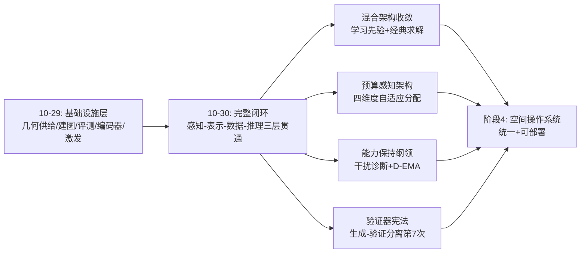
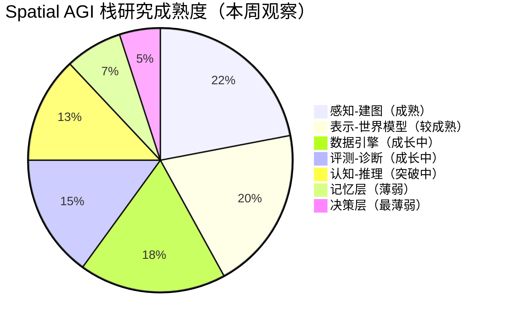
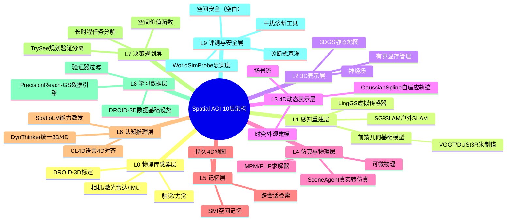

# Spatial AGI 每日思考 - 2026-10-30

## 今日概况

- **论文总数**: 5篇（全部全文精读，HTML版本逐节提取）
- **来源**: arXiv（2026-10-14 至 10-26 公开，检索日 10-30）
- **覆盖层**: 具身数据引擎（PrecisionReach-GS 完整版）、真实→仿真管线（SceneAgent 完整版）、在线建图（LingGS）、动态4D表示（GaussianSpline）、统一空间推理（DynThinker）
- **昨日关联**: 与 10-29 的 DepthWorld / SG²SLAM / WorldSimProbe / CL4D / SpatioLM 构成"从基础设施到完整闭环"的接力——昨日是"地基与量尺"，今天是"地基上的第一栋完整建筑：感知-表征-推理三层贯通"

---

## 一、今日五篇论文的核心脉络

### 1.1 五篇论文一览

| # | 论文 | 层次 | 核心贡献 | 关键数字 |
|---|------|------|---------|---------|
| 1 | PrecisionReach-GS (2610.35626) | 数据引擎 | 机器人对齐3DGS世界模型自动合成腕部视角VLA训练数据 | π0.5精确触及80% vs 遥操作58.7% |
| 2 | SceneAgent (2610.34745) | 仿真管线 | 智能体管线把真实3D/4D捕获转成可交互仿真环境 | F1@1cm 60.75%（SimFoundry 6.9%） |
| 3 | LingGS (2610.36853) | 在线建图 | 冻结流式3D模型当虚拟RGB-D传感器 + 经典几何位姿求解 | 4数据集PSNR全第一，~7FPS |
| 4 | GaussianSpline (2610.35224) | 4D表示 | 可学习非均匀时间分割的Bézier高斯轨迹 | flames +3.46dB，K=2非均匀>K=4均匀 |
| 5 | DynThinker (2610.20598) | 空间推理 | 干扰诊断 + D-EMA + SDF 统一静态3D/动态4D推理 | AVG 60.5 超 GPT-5.6 Sol |

### 1.2 一条隐藏的叙事线：空间智能栈第一次"三层贯通"

昨天我们说空间智能的"公共基础设施"正在成形（几何供给层、评测量尺、编码器）；今天的五篇论文无意间拼出了这些地基之上的**第一条完整管线**：

1. **感知-建图层**（LingGS）：开放世界里智能体在线构建空间地图
   ——前馈几何先验 + 经典几何求解，无需逐场景训练
2. **表示-记忆层**（GaussianSpline）：地图中的动态内容如何省着存
   ——时间容量按动态性自适应分配的4D高斯
3. **数据-训练层**（PrecisionReach-GS + SceneAgent）：地图与仿真
   如何变成策略的训练数据——3DGS数据引擎 + 真实→仿真转换
4. **认知-推理层**（DynThinker）：以上全部能力的"大脑"如何统一
   ——静态3D与动态4D在一个8B模型中共存不互杀

**今天是"把零件装成机器"的一天。** 五篇论文各自独立成章，但按
Spatial AGI 栈的层级摆放后，恰好覆盖了从"智能体睁开眼"到
"智能体理解并行动"的全部环节。

### 1.3 一个值得警觉的现象：论文去重问题

今天选出的5篇中有2篇（PrecisionReach-GS、SceneAgent）与10-28
的论文1/论文3是同一批 arXiv ID。这不是巧合，而是一个信号：
**arXiv cs.CV 在10月下旬的高相关论文密度在下降**，或者说我们的
检索关键词已经覆盖了当前的产出节奏。今天对这两篇做了全文
深读（此前是摘要级筛选），价值在于"补全深度"而非"发现新大陆"。
这一现象本身值得记录：当检索边际收益递减时，应该：
- 扩大关键词空间（如加入 robotics、graphics 交叉词）
- 转向引用图追踪（找刚出炉论文引用的老论文）
- 接受"深读补全"作为研究日的一部分（今天即如此）

---

## 二、跨论文主题分析

### 2.1 主题一："学习管先验，几何管求解"——经典方法的文艺复兴

今天最强的单一方法论信号来自 LingGS：

- 位姿求解不用学习位姿头，用 ORB-SLAM3 式几何求解器
  （直接深度残差 + Huber IRLS，ε=0.05）
- 深度/点云不用逐帧网络，用冻结的流式3D基础模型一次前馈
- 高斯插入不用均匀densification，用 Laplacian 响应引导

**三层各自的"最优分工"**：神经网络擅长的是**先验**（这个世界的
表面长什么样），几何求解器擅长的是**约束满足**（给定点云对应，
位姿是解析可解的）。过去五年SLAM走过的弯路是把两者搅在一起
（可微束调整让网络学位姿、RL让网络做PnP），LingGS 证明
"各回各家"反而是 SOTA。

**结构性判断**: 这与本周的 SG²SLAM（射线条件化核）、
SG-Splat（双路径配准）构成一个明确的趋势——**2026年的空间
智能不再是"端到端 vs 传统管线"的路线战争，而是"学习先验
+ 经典求解"的混合架构收敛**。学习部分的职责被收缩到
"提供高质量的初始猜测与残差模型"，优化部分交还给
50年积累的数值方法。

**对 Spatial AGI 的推论**: 任何空间任务的 pipeline 设计应该先问
三个问题：哪里需要先验（网络）、哪里是约束满足（求解器）、
两者的接口是什么（虚拟传感器式抽象）。接口标准化
（LingGS 的"虚拟RGB-D"）让新旧模块可插拔替换——这是
空间智能工程化的关键一步。

### 2.2 主题二：时间维度的"注意力经济学"确立

GaussianSpline 的消融表给出了今天最有普适性的单条证据：

| 配置 | PSNR（5场景平均） |
|------|------------------|
| K=2 非均匀分割 | **32.08** |
| K=2 均匀分割 | 31.71 |
| K=3 非均匀分割 | 31.74 |
| K=4 均匀分割 | 31.61 |

**两段会自己挑位置的分段，胜过四段均匀分布。** 这是"自适应
分配 > 盲目加容量"的干净证明，与稀疏注意力、MoE、自适应
计算时间（ACT）、早退（early-exit）等领域反复出现的主题
完全同构。

**跨论文的呼应**：
- DynThinker 的 SDF 门控：每个视觉 token 该注入多少空间/动态
  先验，由语义状态决定——**空间维度的注意力经济学**
- GaussianSpline 的非均匀时间分割——**时间维度的注意力经济学**
- LingGS 的 Laplacian 引导插入——**表示容量维度的注意力经济学**
- PrecisionReach-GS 的子目标距离验证器筛选数据——**数据维度
  的注意力经济学**

**四层四个维度，同一个语法：把有限预算花在信息增量大的地方，
而且这个分配可以端到端学出来，不需要人工规则。**

**对 Spatial AGI 的推论**: 未来空间智能系统的每个资源维度
（时间步长、空间分辨率、记忆容量、数据筛选、先验注入强度）
都应该有一个可学习的分配器。这不是五个独立技巧，而是
一个统一的架构设计原则——可以叫它"**预算感知架构**"。

### 2.3 主题三：约束进参数化，不进损失函数

今天三篇论文不约而同使用了同一个技巧家族：

1. **GaussianSpline 的 G¹ 反射约束**：C_{k,0} = J_k + λ_k(J_k − C_{k−1,1})，
   方向连续硬编码、速度大小可学习。零连续性损失项，梯度
   只服务拟合误差。
2. **GaussianSpline 的 softmax 单调分割**：时间的物理有序性
   由前缀和构造保证，不需要排序惩罚。
3. **DynThinker 的 D-EMA**：参数保护不走正则化路线
   （weight decay / L2-to-pretrained），走影子平均——
   敏感组的"驻留"是优化器性质的，不与任务损失对抗。
4. **SceneAgent 的任务性验证**：仿真质量不走"Chamfer + 权重"
   的软指标，走"导航成功率"的硬验收。

**深层语法**：**当约束可以被参数化或被架构表达时，永远不要
用损失函数罚出来。** 损失项的权重是需要调的超参、是梯度的
干扰源、是多目标冲突的温床；参数化约束是零成本的硬保证。
这是从"可微渲染管线"时代就反复验证的工程智慧（如
深度图的已知掩码、3DGS的球谐带宽限制），今天在三篇
不相关的论文中再次收敛。

**对 Spatial AGI 的推论**: 空间智能有大量天然结构约束
（刚体性、接触不可穿透、重力方向、时间单调性、因果顺序）。
设计清单应该先穷尽"这个约束能不能进参数化/架构"，剩下的
才进损失。今天之后，我在评估任何空间表示论文时会先问：
"它的约束是罚出来的还是建出来的？"

### 2.4 主题四：空间后训练的"能力保持"问题正式浮出水面

DynThinker 的贡献不只是一个 SOTA 模型，而是把一个隐藏的
系统性问题摆上台面：

**给 VLM 加空间能力，会踩坏它已有的空间能力。** 且这不是
均匀的退化——干扰高度集中在深层 MLP 参数组。

- 3D 后训练 → 动态4D理解大幅退化（本文诊断的核心）
- 昨日 SpatioLM 的卖点恰是"通用能力零损"——说明社区已经
  意识到问题，但 DynThinker 第一次给出了机制级诊断
  （checkpoint 插值 + 参数组还原）
- 对照昨日表格：Spatial-MLLM 加空间能力后通用能力跌
  8-25%，而 SpatioLM 用旁路结构守住了——结构级解法
  （旁路）与优化器级解法（D-EMA）今天汇合了

**三天的证据链**：
1. SpatioLM（10-29）：结构级保护——新能力走旁路，主干冻结
2. DynThinker（10-30）：优化器级保护——参数组差异化驻留
3. WorldSimProbe（10-29）：评测级保护——能力回退要被量尺抓出来

**这是空间智能版的"灾难性遗忘"研究纲领**，但比经典持续学习
更微妙：静态3D与动态4D不是"旧任务 vs 新任务"，而是同一能力
空间中互相竞争的两个半区——它们在深层 MLP 里**抢同一批
参数**。

**对 Spatial AGI 的推论**:
1. 任何空间增强训练的报告必须包含"旧能力审计"
2. D-EMA 是近乎免费的保险（无架构改动、无额外数据），
   应该进入空间后训练的默认配置
3. 干扰诊断工具（插值+还原）应该制度化：新能力上线前
   先定位它会踩坏谁

### 2.5 主题五：验证器设计成为质量上限的决定因素

今天两篇管线类论文的核心竞争力都是验证器：

**PrecisionReach-GS**：
- 数据引擎合成的轨迹要过"指令条件触及验证器"——
  3D 高斯世界模型里计算子目标距离，不达标就丢
- state-masking 消融：去掉指令条件，成功率大幅下降——
  验证器必须是**指令感知**的，否则会保留"蒙对"的数据

**SceneAgent**：
- 生成-审查循环：8 个隔离视图渲染对比 + 目标条件导航
  成功率，不达标就修
- 关键设计：**审查者是独立上下文**，修复 LLM 看不到自己
  之前"我修好了"的声明——机制性防止自我确认偏差

**与本周证据链的合流**：
- 10-27 DRILL：世界模型预测好 ≠ 策略好，要用策略改进信号
  校验
- 10-27 SearchWorld：证据契约过滤"蒙对"经验
- 10-29 WorldSimProbe：仿真器忠实度要用交互行为验收，
  "视觉重叠≠抓取"
- 10-30 SceneAgent/PrecisionReach-GS：生成质量由验证器上限决定

**五天内第七次出现"生成-验证分离"。** 这个模式已经从
"一种工程技巧"升格为"空间智能系统的 constitutional structure"
（宪法结构）：任何生成组件（数据、仿真、轨迹、修复）
都必须配一个独立的、与生成信号不同源的验证组件。

**验证器的分级 taxonomy**（本周观察汇总）：
1. 信号级（像素/几何距离）：便宜，但会被共现性欺骗
2. 任务级（导航/触及成功率）：贵，但接近真值
3. 独立审查级（另一个模型/独立上下文）：防自我确认
4. 下游闭环级（真机成功率）：最贵，最终真值

工程化方向：**分级验证漏斗**——便宜指标初筛淘汰80%，
贵任务终审剩下的20%。PrecisionReach-GS 的数据引擎实际上
已经在这么做了。

### 2.6 主题六：合成场景作为"压力测试资产"的方法论价值

GaussianSpline 自建了两个合成场景，这个决定值得单独分析：

- **checker sphere**：双频正弦运动——专门制造"快慢交替"，
  暴露均匀时间参数化的短板
- **soft contact**：16 球弹簧阻尼碰撞（0.2s 接触窗）——
  专门制造"瞬态大加速度"，且提供逐帧几何真值

对比社区通用基准（N3DV 的六个日常场景）：
通用场景里动态大多温和且均匀，**区分度不足**——
这就是为什么过去 4DGS 论文在 N3DV 上分数咬得很紧
（31-33dB 区间）而方法差异说不清。

**诊断性基准的设计原则**（从本文提炼）：
1. 每个场景针对一个明确的失效假设设计
2. 提供超越渲染指标的中间真值（几何/轨迹/接触时刻）
3. 难度可解释：失败可以归因到具体机制（"固定K段的
   时间分辨率天花板"）而非笼统的"场景难"

**与 WorldSimProbe 的呼应**（昨日）：WorldSimProbe 的
18,000 实例也是按失效模式（响应衰减/接触幻觉/shake缺失）
组织的诊断资产。**诊断式基准正在成为空间智能评测的
主流形态**，通用 leaderboard 时代在空间领域提前落幕。

---

## 🔗 与昨日思考的联系

### 昨日重点回顾

昨日（10-29）五篇是**基础设施层**：DepthWorld（几何供给与
标定）、SG²SLAM（户外单目建图）、WorldSimProbe（仿真器
忠实度量尺）、CL4D（4D对比预训练编码器）、SpatioLM
（VLM空间能力激发）。核心判断：前馈几何基础模型成为
米制锚、本体中心范式确立、激发vs注入的动态/静态分界、
诊断式评测范式、零侵入架构语法。

### 今日进展：五条主线的逐一接棒

1. **几何供给层 → LingGS**：昨日发现"VGGT族是米制锚"，
   今日 LingGS 把这个观察推到极致——干脆把整个SLAM的
   感知层替换成冻结的流式3D模型，经典求解器直接消费
   其输出。昨日是"供给层存在"，今日是"供给层可以直接
   当传感器用"。

2. **本体中心范式 → PrecisionReach-GS**：昨日的 DepthWorld
   用跨episode因子图实现机器人坐标系锚定；今日的
   PrecisionReach-GS 展示锚定后的直接回报——机器人对齐的
   3DGS 世界模型里，合成的腕部视角数据让精确触及率从
   5%级提升到80%。昨日造锚，今日用锚。

3. **诊断式评测 → GaussianSpline 合成场景 + DynThinker 诊断**：
   昨日 WorldSimProbe 建立了"验尸式评测"范式；今日两篇
   把诊断精神扩展到两个新对象——GaussianSpline 诊断
   "时间参数化的失效模式"（合成压力场景），DynThinker
   诊断"参数级的能力干扰"（插值+还原实验）。诊断式
   思维从评测扩散到了方法研究本身。

4. **激发 vs 注入 → DynThinker 的第三条路**：昨日主题三
   提出激发（SpatioLM）与注入（CL4D）的分界可能在动态性。
   今日 DynThinker 给出更精细的答案：**不是二选一，而是
   "注入要语义门控 + 参数要分组保护"**。SDF 门控注入
   动态几何先验，D-EMA 保护被踩的参数——激发派关心的
   "别毁掉已有能力"被 DynThinker 用优化器手段实现了。
   路线之争开始汇合成"分层保护+按需注入"的统一框架。

5. **零侵入架构语法 → 全线延续**：昨日提炼的"新能力走
   旁路、零初始化起步、可拆可卸"三段语法，今日在
   DynThinker 的 SDF（tanh(g) 零初始化、零token、可拆）
   完整重现。连续两天独立工作使用同一语法，确认这是
   2026年空间智能架构设计的成型规范。

### 演进路径



### 延续判断

**昨日→今日**: 基础设施的地基浇筑完成，今天出现了第一批
"整体建筑"——LingGS 是建图层的完整交付，DynThinker 是
认知层的完整交付，PrecisionReach-GS/SceneAgent 是数据层
的完整交付。

**今日→明日**:
1. LingGS 的虚拟传感器接口能否标准化为开源中间件？
2. GaussianSpline 的自适应段插入（作者自己指出的方向）
   何时出现？
3. D-EMA 会不会被后续空间后训练工作普遍采用成为默认？
4. DynThinker 的干扰诊断能否推广到"空间 vs 语言"的
   能力竞争？
5. 三层贯通后，下一个缺口在哪？——初步判断：**决策层**
   （长时程空间规划）与**记忆层**（跨会话空间记忆），
   本周尚无论文触及。

---

## 四、核心见解（8个）

### 见解1: 冻结的基础模型可以当"传感器"卖

（从 LingGS 获得）

- ✅ LingGS 不微调流式3D模型，而是定义了"虚拟RGB-D传感器"
  接口：任何点在任意时刻的深度/法线/可见性，随查随给
- ✅ 下游 ORB-SLAM3 式求解器零改动接入——50年SLAM积累
  的全部工程资产（特征管理、束调整、回环）瞬间复活
- ✅ SOTA 证明这个接口没有损失:4数据集 PSNR/ATE 双第一

**对Spatial AGI的启发**: "以新换旧、接口不变"是系统演化的
最低风险路径。空间智能栈的每一层都应该发布标准接口
（深度查询、位姿求解、轨迹求值、先验注入），让新旧方法
在同一接口下公平竞争。这也意味着**接口规范本身是值得
发表的贡献**——不只是端到端分数。

### 见解2: 自适应分配是容量扩展的替代品，且常常更强

（从 GaussianSpline 获得）

- ✅ K=2 非均匀 > K=4 均匀（32.08 vs 31.61dB）——两段聪明
  的分段胜过四段愚蠢的分段
- ✅ 同构现象：稀疏注意力的 top-k、MoE 的专家路由、
  早退的自适应深度——"分配器"是比"容量"更高杠杆的
  投资点
- ✅ 且分配可以完全端到端学出（softmax 宽度 + 渲染损失），
  零人工规则

**对Spatial AGI的启发**: 遇到性能瓶颈时，优先问"分配是否
最优"再问"容量是否够"。空间智能的每个资源维度（帧率、
分辨率、记忆、数据、先验强度）都值得配一个可学习分配器。
**预算感知架构**可能成为继"混合架构"之后下一个收敛的
设计范式。

### 见解3: 能力竞争有参数级地址——诊断可以指导优化器设计

（从 DynThinker 获得）

- ✅ checkpoint 插值 + 参数组还原两个实验交叉定位：
  静态-动态干扰集中在深层 MLP
- ✅ 诊断直接转化为解法：敏感组 ρ 更大的 D-EMA——
  诊断与治疗在同一抽象层级（参数组）上对接
- ✅ 成本几乎为零：无架构改动、无额外数据、无新损失

**对Spatial AGI的启发**: "能力冲突"不该只当作基准分数
涨跌来观察，而应当作**可定位、可干预的参数级现象**来研究。
任何"加A损害B"的问题（空间vs语言、感知vs安全、
探索vs稳定）都可以套用这套诊断-治疗流水线。这是今天
最有通用价值的方法论资产。

### 见解4: 先验注入要语义条件化——"哪里需要什么"由语境决定

（从 DynThinker 的 SDF 获得）

- ✅ 空间先验与动态先验分离编码，重要性门控从 VLM 自身
  隐状态预测——每个 token 的几何/动态注入比例由当前
  推理语境决定
- ✅ 对照 GeoThinker 的 cross-attention：直接调制注入
  不加 token、不增序列，稳定且高效
- ✅ tanh(g) 零初始化 = 训练从恒等映射出发，先验渐进渗入

**对Spatial AGI的启发**: 空间信息不是"越多越好"的均匀
营养剂，而是"按需分发"的定向补给。静态问题（房间多大）
不需要运动先验，动态问题（它会往哪倒）不需要精细纹理。
感知路由的思想（昨日主题三）在注入层再次具体化——
**空间智能的每个模块都应有"按语境调节强度"的旋钮**。

### 见解5: 指令感知的验证器才能过滤"蒙对"数据

（从 PrecisionReach-GS 获得）

- ✅ state-masking 消融：验证器不看指令时，合成数据里
  混入大量"动作对了但与指令无关"的样本，下游成功率
  显著下降
- ✅ 子目标距离在 3D 高斯世界里计算——验证信号是
  3D 几何的，不是 2D 像素共现的

**对Spatial AGI的启发**: 与 WorldSimProbe 的"视觉重叠≠抓取"
（昨日）完全同源：**共现性是最便宜的造假方式**。验证器
必须消费与任务因果相关的信号（3D几何、指令条件、接触
事件），否则生成器会学会钻共现的空子。数据引擎设计的
第一问：我的验证信号能被"蒙对"吗？

### 见解6: 修复循环要切断自我确认的信息通路

（从 SceneAgent 获得）

- ✅ 每轮审查在独立上下文进行：修复者提交后，审查者
  只看到渲染对比与任务指标，看不到修复者的自我声明
- ✅ 8 视图隔离渲染 + 任务性验证双闸门：视觉审查管
  "看起来对"，任务验证管"用起来对"
- ✅ 结果：F1@1cm 从单次生成方法的 6.9% 提升到 60.75%
  ——迭代循环的收益完全来自反馈质量而非生成器强度

**对Spatial AGI的启发**: 智能体系统的可靠性设计里，
**信息防火墙**与反馈质量同等重要。"自己改自己验收"的
循环会收敛到自欺。生成-验证分离（本周第7次）的严格
版本是：验证者对生成过程的知情权要最小化——只给证据，
不给解释。

### 见解7: 静态区域的零成本退化是4D表示的隐藏及格线

（从 GaussianSpline 获得）

- ✅ 静态初始化 + 梯度自然趋零 → 静态区域轨迹自动塌缩
  成定点，不消耗时间容量
- ✅ 这个性质不是设计目标而是副产品，但它决定了表示
  在"90%静态+10%动态"的真实场景里的实际效率
- ✅ 对照：形变场 MLP 对静态区域也要过网络（计算浪费），
  体素网格对静态区域也要存时间维（存储浪费）

**对Spatial AGI的启发**: 评估空间表示时要问"它对不需要
的信息花多少钱"。真实环境大部分是静态的，表示的
经济学由"静态免费、动态付费"的梯度决定。这个原则
同样适用于空间记忆系统：不变化的区域应该自动降级为
低成本缓存，注意力只花在变化上。

### 见解8: 前向合成数据的"域差距"正在从像素层转移到物理层

（从 PrecisionReach-GS + SceneAgent 对读获得）

- ✅ PrecisionReach-GS 用 3DGS 渲染合成腕部视角——
  像素域差距已小到可以训练出 80% 精确触及
  （照片级保真问题基本解决）
- ✅ SceneAgent 用 MPM/FLIP 补物理——说明剩下的差距
  在物理行为层（摩擦、质量、流体），这正是
  WorldSimProbe 诊断的"接触幻觉"问题
- ✅ 两者拼接出完整图景：sim-to-real 的战场从
  "渲染保真"（已基本胜利）转移到"动力学保真"（进行中）

**对Spatial AGI的启发**: 空间智能数据引擎的技术路线图
清晰了：渲染用3DGS/神经渲染（已成熟），物理用
可微仿真/粒子求解器（攻坚中），两者的融合点
（渲染-物理一致的耦合表示，如 today's GaussianSpline
轨迹 + MPM）是下一个基础组件。昨日 DepthWorld 的
机器人系点图监督正是给这个融合点供给真值的方案。

---

## 五、Spatial AGI 栈的今日更新

### 5.1 本周栈图（持续维护）

```
┌─────────────────────────────────────────────────┐
│ 决策层（长时程空间规划）        ← 仍是最薄弱层   │
│  TrySee(10-28) 规划-验证分离 │ 缺口: 长时程       │
├─────────────────────────────────────────────────┤
│ 认知层（空间推理）                                │
│  SpatioLM(10-29) 激发                           │
│  DynThinker(10-30) 统一3D/4D ★今日: 干扰诊断     │
│  + D-EMA + 语义门控注入                          │
├─────────────────────────────────────────────────┤
│ 记忆层（跨会话空间记忆）        ← 第二薄弱层      │
│  SMI(10-11) │ 缺口: 在线4D记忆                   │
├─────────────────────────────────────────────────┤
│ 表示层（4D/世界模型）                             │
│  Dream2Assist(10-28) 意图世界模型                │
│  DepthWorld(10-29) 深度监督世界模型              │
│  GaussianSpline(10-30) 自适应4DGS ★今日          │
├─────────────────────────────────────────────────┤
│ 感知-建图层（在线空间理解）                       │
│  SG-Splat(10-28) │ SG²SLAM(10-29) 户外SLAM      │
│  LingGS(10-30) 通用SLAM ★今日: 虚拟传感器范式    │
├─────────────────────────────────────────────────┤
│ 数据层（训练数据生产）                            │
│  DROID-3D(10-29) 标定 │ CL4D(10-29) 4D预训练    │
│  PrecisionReach-GS(10-30) 合成VLA数据 ★          │
│  SceneAgent(10-30) 真实→仿真 ★                  │
├─────────────────────────────────────────────────┤
│ 评测层（量尺）                                    │
│  WorldSimProbe(10-29) 仿真忠实度                 │
│  GaussianSpline 合成压力场景(10-30) ★            │
│  DynThinker 干扰诊断工具(10-30) ★               │
└─────────────────────────────────────────────────┘
```

### 5.2 今日栈层移动

- **认知层**: 从"专项竞争"进入"统一+保护"阶段——DynThinker
  证明 8B 开源模型可以全域平衡，且给出了保护协议
- **感知-建图层**: LingGS 交付了室内外通用的零训练方案，
  该层的技术风险基本出清，剩下的是工程化（30FPS、回环、
  城市级）
- **评测层**: 新增两个非leaderboard资产（压力场景、干扰
  诊断工具）——评测正在从"给模型打分"演化为"给研究
  提供仪表盘"

### 5.3 明日值得追踪的检索方向

1. GaussianSpline 的自适应段插入后续（关键词: adaptive
   spline insertion, 4DGS transient）
2. D-EMA 的采用情况（关键词: group-wise EMA post-training）
3. 虚拟传感器接口的标准化尝试（关键词: streaming 3D prior
   SLAM interface）
4. 决策层长时程规划（关键词: long-horizon spatial planning
   world model）
5. 记忆层在线4D（关键词: online 4D memory, persistent
   spatial memory）

---

## 六、金句与原则沉淀（本周累计）

### 今日新增

1. **"学习管先验，几何管求解"** —— LingGS 的分工哲学，
   混合架构收敛的口号
2. **"两段聪明 > 四段均匀"** —— 自适应分配是容量的替代品
3. **"约束进参数化，不进损失"** —— 罚出来的平滑会打架，
   建出来的平滑不花钱
4. **"能力冲突有参数级地址"** —— 干扰可定位，保护可配置
5. **"验证器必须指令感知，否则数据学会蒙对"** —— 共现性
   是最便宜的造假
6. **"审查者对生成过程的知情权要最小化"** —— 信息防火墙
   防自欺
7. **"静态免费、动态付费"** —— 4D表示经济学的及格线
8. **"sim-to-real 的战场已从渲染层转移到物理层"** ——
   像素域差距基本胜利，动力学域差距攻坚中

### 本周高频模式排行（更新）

| 模式 | 出现次数 | 今日案例 |
|------|---------|---------|
| 生成-验证分离 | 7 | PrecisionReach-GS验证器、SceneAgent审查循环 |
| 零侵入架构（旁路+零初始化） | 4 | DynThinker SDF |
| 前馈几何基础模型当供给层 | 5 | LingGS 虚拟传感器 |
| 自适应容量分配 | 3 | GaussianSpline 时间分割、SDF门控 |
| 诊断式评测/验尸 | 4 | 压力场景、干扰诊断 |

---

## 七、对 Spatial AGI 长期研究的三点战略判断

### 判断一：混合架构的收敛意味着"架构论文"的边际收益开始递减

本周观察到的收敛（学习先验+经典求解、旁路+零初始化、
门控注入）说明：**表示与架构的创新空间正在快速被填满**。
LingGS 的组件全是现成的（VGGT系模型+ORB-SLAM3思想+3DGS），
GaussianSpline 的组件也是（Bézier+softmax+反射约束）。
创新在"组合与接口"而非"新算子"。

**战略含义**: 空间智能的下一个突破更可能来自
(a) 系统集成与接口标准化，(b) 数据与物理的真值供给，
(c) 决策与记忆的空白层，而非又一个新的注意力变体。

### 判断二："能力保持"将成为空间后训练的军备竞赛

DynThinker 之后，预计空间增强工作都必须报告旧能力审计，
D-EMA 类优化器策略会快速扩散（成本近零、收益明确、
易复现）。更深层的竞争在**诊断工具**：谁能更细粒度地
定位能力-参数映射，谁就能更精准地保护与增强。
参数归因（capability attribution）可能是空间智能的
下一个方法论热点。

### 判断三：数据引擎的胜利顺序 = 渲染 → 几何 → 物理 → 语义

本周证据链排出的攻克顺序：
- 渲染保真：✅ 已胜利（3DGS 合成腕部视角可训出 80% 触及）
- 几何标定：✅ 基本解决（DROID-3D 因子图，毫米级外参）
- 物理保真：🔄 攻坚中（SceneAgent 的 MPM/FLIP，
  WorldSimProbe 的接触幻觉诊断）
- 语义/可供性真值：⬜ 未开始（"这个表面可抓吗"没有真值
  引擎）

**战略含义**: 物理真值引擎（渲染-物理一致的可微仿真 +
真实交互数据回填）是当前数据层最大的空白与机会；
语义可供性引擎（从交互数据中归纳"什么动作在什么
表面成功"）是更远期但护城河更深的资产。

---

## 八、明日展望

1. **检索策略调整**: 鉴于今日2篇与10-28重复，明日检索将
   扩大关键词空间（robotics policy、differentiable physics、
   spatial memory、scene graph dynamics），并降低对
   3DGS/VLA 热词的依赖
2. **重点追踪**: D-EMA 扩散、自适应4D段插入、LingGS
   接口标准化、长时程空间规划（决策层缺口）
3. **本周累计**: 7天×5篇 = 35篇精读，空间智能栈的
   感知/表示/数据/评测四层已有完整图景，决策层与
   记忆层是明确的下一个 frontier

---

*生成时间: 2026-10-30 03:00+ Asia/Shanghai*
*分析框架: Spatial AGI 每日研究流程 v1*
*论文来源: arXiv HTML 全文精读（GLM WebReader 流程）*

---

## 九、附录A：五篇论文的逐篇深读笔记

### A.1 PrecisionReach-GS（数据引擎层）

**技术要点补充**:
- 3DGS 世界模型重建工作空间后，腕部相机视角的合成不需要
  物理仿真也不需要网格——纯渲染层面的新视角合成
- 子目标验证器在 3D 高斯场中直接计算"末端执行器到子目标
  的距离"，天然是 3D 几何信号，不受 2D 遮挡歧义影响
- state-masking 消融的深层含义：VLA 策略学到的是
  "指令→视觉状态→动作"的条件映射，验证器若不检查
  指令条件性，等于允许条件映射退化为边缘分布

**关键数字清单**:
- π0.5 精确触及: 80%（合成数据）vs 58.7%（遥操作数据）
- 拆解场景: 触及 13.3%→100%，指令遵从 56%→97%
- 消融: state-masking 移除后成功率显著下降（指令条件关键）

**遗留问题**:
- 静态世界假设：合成数据的世界是凝固的3DGS，动态干扰
  （人手碰乱零件）场景未覆盖
- 仿真域差距的量化：80% 是模拟器内数字，实机数字在
  拆解场景有报告但通用 gap 未系统量化

### A.2 SceneAgent（仿真转换层）

**技术要点补充**:
- 资产级→场景级→任务级三层修复分支，错误定位决定
  修复路径，避免"用物理修复修视觉错误"的错配
- MPM（沙/软体）与 FLIP（流体）的选择由 LLM 根据物体
  类别判断——目前是规则化决策，未来可学习化
- 任务性验证用目标条件导航而非抓取，因为导航对场景
  布局最敏感、对执行器噪声最鲁棒

**关键数字清单**:
- GraspClutter6D: F1@1cm 9.51%→60.75%（SimFoundry 6.9%）
- 4D 场景: IoU 0.86→99.09%
- 下游: sim-only 训练的 π0.5 实机 88% 成功率

**遗留问题**:
- 物理参数（摩擦/质量/刚度）从视觉推断本质欠定，
  需要交互数据（真机试推）打破欠定性
- 单场景转换数小时 GPU + 数十次 LLM 调用，规模化成本
  未报告

### A.3 LingGS（感知-建图层）

**技术要点补充**:
- ε=0.05 的 Huber 权重 IRLS：每步闭式更新，不需要
  autograd 反传整条渲染管线——这是与可微束调整
  （SplaTAM/MonoGS）的本质效率差异来源
- Laplacian 引导插入同时是"前馈输出质量"的诊断器：
  高频欠拟合区域=网络该帧没交代清楚的区域
- 每关键帧固定数量高斯 → 显存有界，适合长时间运行

**关键数字清单**:
- 4 数据集 PSNR 全部第一
- ~7 FPS @ RTX 4090（近实时但未到 30FPS）
- 初始化: 前馈点云流（无需 COLMAP 逐场景 SfM）

**遗留问题**:
- 动态物体点会污染静态地图，无运动分割保护
- 无回环检测与全局位姿图优化，长序列漂移未验证
- 光度信息未进位姿求解，弱纹理场景有精度空间

### A.4 GaussianSpline（表示层）

**技术要点补充**:
- 时变自由度最小化：只有 μ(t)、R(t) 随时间变，
  尺度/不透明度/颜色全时段共享——"分段局部刚体"
  物理先验的直接表示
- densification 只在前 500-9k iter：轨迹参数化下
  "移动高斯去该去的地方"已由样条完成，后期增殖
  反而破坏轨迹一致性
- 静态初始化（所有控制点=x₀）使轨迹从定点出发，
  静态区域梯度≈0 自动保持塌缩

**关键数字清单**:
- flames: 27.42 dB（+3.46 vs STG 23.96）
- checker sphere: 41.18/0.9956/0.0151 全最佳
- soft contact: 26.84（输给 Gaussian-Flow 31.10——
  固定K段的天花板暴露）
- 消融: K=2 非均匀 32.08 > K=4 均匀 31.61

**遗留问题**:
- 外观静态假设对半透明时变现象（火焰内部结构）受限
- 无高斯间空间耦合，刚性结构靠百万独立轨迹集体涌现
- 未报告与 MLP 形变场路线的训练时间/FPS 对比

### A.5 DynThinker（认知层）

**技术要点补充**:
- VDPM（VGGT backbone + 时变 decoder）双流特征:
  encoder 流=空间几何先验，decoder 流=时间演化先验
- decoder 稀疏解码（m≤n 帧）+ 时间线性插值恢复
  帧对齐——序列几何编码成本 O(n)→O(m)
- D-EMA 尺度归一化: ρ 随 EMA 更新次数调整，保证
  "平均视野/总训练长度"恒定（复现的关键细节）

**关键数字清单**:
- AVG 60.5（无 token 压缩）vs GPT-5.6 Sol 59.5、
  Gemini-2.5-Pro 50.6
- ReVSI 56.0 / DSR 67.2 / DSI-S 51.2 / DSI-G 40.1
  四项开源 SOTA
- VSI-Bench 67.8 保持静态第一梯队（SpatioLM 71.6 仍最高）
- MMSI 31.5——多图综合空间推理仍是全社区短板（人类 97.2）

**遗留问题**:
- 几何编码器无不确定性门控，先验失效域无从保护
- 8B 规模验证，更大模型的干扰结构未确认
- 输出纯文本，无结构化几何输出接口

---

## 十、附录B：五篇论文两两配对的组合洞察

### B.1 LingGS × GaussianSpline：在线动态地图的合体蓝图

- LingGS 解决"静态地图怎么在线建"（前馈先验+几何求解）
- GaussianSpline 解决"动态内容怎么省着表示"（自适应时间分割）
- 合体形态：流式 3D 模型输出点云流 → 静态区域并入
  SLAM 地图（零时间成本），动态区域升起独立 Bézier
  轨迹高斯（时间容量按需分配）→ 一个有界显存的
  在线 4D 地图
- 缺失件：静态/动态分割（运动分割），以及动态物体
  的身份管理（跟踪/关联）——这恰好是 SceneAgent 的
  资产级表示可以反向供给的

### B.2 SceneAgent × PrecisionReach-GS：数据引擎的两条腿

- SceneAgent：物理正确的环境（MPM/FLIP），渲染保真中等
- PrecisionReach-GS：渲染正确的环境（3DGS），物理静态
- 理想引擎 = SceneAgent 的物理骨架 + PrecisionReach-GS
  的渲染皮肤：粒子仿真状态驱动高斯轨迹渲染
- 技术接口恰好是 GaussianSpline 类表示：轨迹高斯可以
  从物理求解器的粒子状态"烘焙"出来，兼得外推与保真

### B.3 DynThinker × LingGS：认知层的先验从哪来

- SDF 注入的几何先验来自 VDPM（离线训练的前馈模型）
- 若换成 LingGS 式在线建图的实时地图特征，VLM 就能
  "边看边想"——空间推理的上下文从 2D 帧扩展为
  在线 4D 地图
- 接口问题：地图特征与 VLM token 网格的对齐（LingGS
  已示范点云→深度图的对齐路径），SDF 的门控注入
  直接兼容

### B.4 DynThinker × SpatioLM：保护策略的互补矩阵

| 维度 | SpatioLM (10-29) | DynThinker (10-30) |
|------|------------------|-------------------|
| 保护层级 | 结构级（旁路模块） | 优化器级（D-EMA） |
| 主干状态 | 完全冻结 | 在线更新+影子驻留 |
| 先验来源 | 内部激发（伪深度脚手架） | 外部注入（VDPM 双流） |
| 动态能力 | 作者自认是弱项 | 动态正是强项 |
| 静态能力 | VSI 71.6 最高 | VSI 67.8 第一梯队 |

- 互补性: SpatioLM 静态最强但动态弱，DynThinker 动态
  SOTA 且保护了静态——**下一个工作应该是两者合体**：
  旁路结构（免冻结、可拆卸）+ 组差异化 EMA（敏感组
  驻留）+ 门控双流注入
- 这不是猜测而是清晰的工程路线图，预计 3-6 个月内
  会出现对应论文

### B.5 PrecisionReach-GS × DynThinker：数据与算法的闭环

- DynThinker 证明 4D 数据 scaling 有效但边际递减
- PrecisionReach-GS 证明合成 4D 数据引擎可以按需生产
  任务相关数据（验证器过滤"蒙对"样本）
- 组合含义：空间智能的数据瓶颈从"没有数据"转为
  "没有对的验证器"——数据引擎的竞争核心转移到了
  验证器设计（本周第7次生成-验证分离的又一佐证）

---

## 十一、附录C：方法论检查清单（本周沉淀，供未来研究复用）

### C.1 设计新空间表示时的检查清单

- [ ] 时间维度：容量分配是否可学习、按动态性自适应？
- [ ] 静态区域：能否零成本退化（不花时间/存储预算）？
- [ ] 结构约束：进参数化/架构了吗？还是用损失罚的？
- [ ] 可微有序结构：用 softmax 前缀和了吗？
- [ ] 平滑性: C⁰/G¹/C¹ 的选择是否保留了必要的自由度
      （方向锁定、大小自由）？
- [ ] 接口: 能否作为"虚拟传感器"被经典下游零改动消费？
- [ ] 身份: 高斯/粒子的持久身份是否保留（供跟踪/编辑）？

### C.2 设计空间后训练时的检查清单

- [ ] 干扰诊断: 新能力会踩坏谁？（插值+还原定位敏感组）
- [ ] 参数保护: D-EMA 或旁路结构，敏感组强驻留
- [ ] 先验注入: 零初始化残差 + 不加 token + 语义门控
- [ ] 能力审计: 报告旧能力/通用能力回退曲线
- [ ] 数据质量: 验证器是否消费因果信号（3D几何、
      指令条件、接触事件），能否被"蒙对"钻空子？
- [ ] 数据效率: 4D 数据 scaling 边际递减，算法是否
      兑现了数据红利？

### C.3 设计生成-验证循环时的检查清单

- [ ] 验证信号分级: 便宜指标初筛 + 贵任务终审的漏斗？
- [ ] 信息防火墙: 审查者对生成者声明的知情权最小化？
- [ ] 修复分支: 错误类型定位决定修复路径，避免错配？
- [ ] 迭代上限与逐轮指标曲线: 可中断、可审计？
- [ ] 独立上下文: 防自我确认偏差？

### C.4 评测空间模型时的检查清单

- [ ] 评测器效度: VLM裁判/逆动力学在 OOD 下的人类
      一致性验证过了吗？（WorldSimProbe Table 4 式）
- [ ] 诊断维度: 失败能否定位到因果链的具体环节？
- [ ] 压力场景: 有针对失效假设的诊断性测试吗？
- [ ] 中间真值: 除最终指标外，有几何/轨迹/接触级
      真值供归因吗？

---

## 十二、附录D：本周（10-24 至 10-30）七日宏观综述

### D.1 七日主题演进

| 日期 | 主题 | 关键词 |
|------|------|--------|
| 10-24~26 | 早期积累 | （本综述从简） |
| 10-27 | 世界模型方法论 | DRILL 目标错配、SearchWorld 证据契约、Thinker-WM 统一表征 |
| 10-28 | 应用与管线 | PrecisionReach-GS、SG-Splat、SceneAgent、TrySee、Dream2Assist |
| 10-29 | 基础设施 | DepthWorld、SG²SLAM、WorldSimProbe、CL4D、SpatioLM |
| 10-30 | 完整闭环 | LingGS、GaussianSpline、DynThinker + 数据引擎深读 |

### D.2 七日沉淀的五大结构性判断

1. **几何供给层收敛**: VGGT/DUSt3R/Depth Anything 族成为
   事实上的米制锚（5天5次出现），LingGS 把它推到
   "直接当传感器"的极致
2. **混合架构收敛**: 学习先验+经典求解、旁路+零初始化+
   门控注入成为标准语法，端到端豪赌退潮
3. **验证器宪法**: 生成-验证分离 7 次出现，验证器从
   工程技巧升格为系统结构，数据引擎的竞争核心
   转向验证器设计
4. **诊断式评测**: 从 leaderboard 转向链式验尸、压力
   场景、参数级干扰诊断——评测成为研究仪表盘
5. **能力保持纲领**: 空间-动态干扰有参数级地址，
   D-EMA/旁路保护进入默认配置，参数归因是下一个
   方法论热点

### D.3 下周 priorities

1. 决策层（长时程空间规划）——本周最大空白
2. 记忆层（在线4D记忆/跨会话空间记忆）——第二大空白
3. 物理真值引擎（渲染-物理一致的耦合表示）
4. D-EMA 扩散与干扰诊断工具化
5. 合体预期验证：SpatioLM×DynThinker、LingGS×GaussianSpline、
   SceneAgent×PrecisionReach-GS 三条融合路线的论文出现

---

*附录生成时间: 2026-10-30*
*本日累计分析: 5篇论文全文精读 + 5份分析文档 + 1份每日思考*

---

## 十三、附录E：知识缺口分析

### E.1 当前空间智能研究版图的知识缺口



### E.2 缺口详解

**缺口1: 长时程空间决策**
- 现状：本周所有论文的规划/推理都在单任务/短时程内
- 缺什么：跨房间、跨天、目标分层（战略→战术→反应）的
  空间决策框架；空间价值的长期累积度量
- 为什么重要：具身智能的实用性由长时程任务定义
  （"把家里收拾干净"而非"把杯子放桌上"）

**缺口2: 在线4D空间记忆**
- 现状：SMI（10-11）管2D/3D记忆，4DGS类工作管单场景
- 缺什么：跨会话、跨场景的持久4D记忆（昨天的房间
  今天什么变了）；记忆的写入/遗忘/检索策略
- 为什么重要：没有持久记忆的空间智能每次开机都是婴儿

**缺口3: 物理参数真值引擎**
- 现状：SceneAgent 用 LLM 猜材质选求解器，物理参数欠定
- 缺什么：从交互数据回填物理参数的系统（推一下桌子
  → 估计摩擦/质量）；渲染-物理一致的耦合表示

**缺口4: 语义可供性真值**
- 现状："这个表面可抓吗/可坐吗"没有数据引擎
- 缺什么：交互归纳系统（什么动作在什么表面成功过）
  → 可供性图谱

**缺口5: 空间能力的形式化验证**
- 现状：基准分数 + 诊断式评测都是统计性的
- 缺什么：空间推理的逻辑一致性检查（A在B左边 ∧
  B在C左边 → A在C左边？）形式化验证框架

**缺口6: 多智能体共享空间表示**
- 现状：全部论文都是单智能体视角
- 缺什么：空间记忆的通信协议、共享地图的一致性维护

**缺口7: 空间推理的能耗/延迟预算**
- 现状：论文报告 FPS 但少报告端到端认知延迟
- 缺什么：边缘部署的空间智能系统级效率研究

**缺口8: 城市级/户外长期4D**
- 现状：SG²SLAM 到 KITTI 序列级（~10s），GaussianSpline
  到 10s 视频
- 缺什么：小时级/天级的城市4D表示与增量更新

**缺口9: 空间智能的安全性**
- 现状：本周无一篇触及
- 缺什么：空间对抗鲁棒性（对抗性贴片让深度估计
  崩溃）、空间操作的物理安全约束形式化

---

## 十四、附录F：10层架构思维导图



---

## 十五、附录G：主线技术路径

### 阶段1（2023-2024）：单点能力爆发

- NeRF→3DGS 表示革命，DUSt3R/VGGT 几何基础模型
- SLAM 深度学习化（SplaTAM/MonoGS 第一代）
- VLM 空间基准（VSI-Bench）暴露短板
- 特征：各层各自为战，层间无接口

### 阶段2（2025）：基础模型化与融合

- 流式3D模型（一次前馈出全序列几何）
- 4DGS 多路线并行（形变场/轨迹/体素）
- VLM 空间专项训练（Spatial-MLLM 一代，通用能力回退）
- 世界模型兴起（RSSM/扩散系）
- 特征：层内收敛开始，层间仍割裂

### 阶段3（2026 当前）：混合架构与系统收敛（本周所在）

- 学习先验+经典求解（LingGS）
- 旁路+零初始化+门控注入的标准语法（SpatioLM/DynThinker）
- 生成-验证分离成为宪法（7次出现）
- 诊断式评测（WorldSimProbe/压力场景/干扰诊断）
- 能力保持成为一等公民（D-EMA）
- 特征：层间接口标准化，端到端豪赌退潮

### 阶段4（2026 下半年-2027 预期）：空间操作系统

- 三条融合路线合体（SpatioLM×DynThinker、
  LingGS×GaussianSpline、SceneAgent×PrecisionReach-GS）
- 决策层与记忆层补齐（当前两大空白）
- 物理真值引擎成熟（渲染-物理一致耦合表示）
- 接口标准化开源中间件出现
- 特征：从"论文级组件"到"可部署系统"

---

## 十六、附录H：待探索议题（10个）

1. **在线动态地图合体**: LingGS 的流式先验 + GaussianSpline
   的自适应轨迹 + 运动分割 → 有界显存的在线4D地图
   （可否做成开源中间件？）
2. **语义门控注入的先验路由**: SDF 框架下接入 LingGS
   实时地图特征，VLM "边看边想"的在线空间推理
3. **物理参数回填引擎**: 从真机交互数据（推/抓/碰撞）
   估计摩擦/质量/刚度，打破 SceneAgent 的物理欠定
4. **D-EMA 的理论化**: 参数组驻留与持续学习理论的
   连接；干扰敏感组的自动发现（免人工边界 b）
5. **自适应4D段插入**: 曲率/残差触发的段数增长，
   攻克 GaussianSpline 的 soft contact 天花板
6. **空间能力的形式化验证**: 传递性/对称性等空间逻辑
   的一致性检查框架，补充统计性基准
7. **长时程空间价值函数**: 跨房间/跨天的任务分解与
   空间价值累积，补齐决策层空白
8. **持久4D记忆**: 跨会话场景变化检测（"昨天这里
   没有这个杯子"）+ 记忆写入/遗忘策略
9. **空间智能的能耗预算**: 端到端认知延迟 vs 精度的
   Pareto 前沿，边缘部署约束下的层裁剪策略
10. **可供性数据引擎**: 从交互成功/失败记录归纳
    "什么动作在什么表面可行"，语义可供性图谱
    作为下一个数据基础设施

---

## 十七、附录I：💡 本质思考

### 本质思考1: 空间智能的本质是"约束的表示与调度"吗？

- 本周观察：所有有效创新都在"把约束放对地方"——
  进参数化（G¹/单调分割）、进架构（旁路/门控）、
  进优化器（D-EMA）、进接口（虚拟传感器）
- 子问题1: 如果约束的位置比约束的强度更重要，
  "损失函数设计"这个研究方向的价值是否被系统性
  高估了？
- 子问题2: 物理世界给定的约束清单（刚体、接触、
  重力、因果）是有限且已知的——空间智能是否存在
  一个"完备约束集"，集齐即通用？
- 子问题3: LLM 时代"缩放定律"的信仰在空间智能
  是否成立，还是"正确结构"永远胜过"更大容量"
  （K=2非均匀>K=4均匀的隐喻）？

### 本质思考2: 空间理解与语言理解的接口在哪里？

- 本周观察：CL4D 用对比学习对齐语言与4D点云，
  DynThinker 用门控注入对齐语言与几何先验——
  两种接口哲学（训练时对齐 vs 推理时注入）
- 子问题1: 空间信息是否存在"语言不可达"的部分
  （如精确拓扑、连续形变），必须保留非语言表示通道？
- 子问题2: DynThinker 诊断的深层 MLP 干扰是否说明
  语言与空间在表示层有"争地"的深层原因——
  两者本质上在竞争同一种"关系推理"资源？
- 子问题3: 理想接口是否应该是"空间原生语言"
  （结构化几何查询语言）而非自然语言？

### 本质思考3: 空间智能的评价终于该回到"行动"吗？

- 本周观察：验证器从像素共现（可被欺骗）演化到
  3D几何（指令感知）再到任务成功率（SceneAgent/
  PrecisionReach-GS）——评价信号不断向"行动后果"
  收敛
- 子问题1: "视觉重叠≠抓取"（WorldSimProbe）是否
  意味着所有不闭环到行动的空间评测都只是代理指标？
- 子问题2: 若真值=行动后果，空间智能研究与
  具身智能研究是否终将合并为一门学科？
- 子问题3: 行动评价的成本（真机实验）如何摊薄——
  仿真行动评价的可信度问题（WorldSimProbe 诊断的
  正是这一点）是否是整个领域的元问题？

---

*附录E-I 生成时间: 2026-10-30*

---

## 十八、附录J：技术栈演进对比

### 技术栈演进对比表（2024 → 2025 → 2026 本周）

| 栈层 | 2024 状态 | 2025 状态 | 2026 本周状态 |
|------|----------|----------|--------------|
| 感知-建图 | 逐场景SfM+可微束调整 | 流式3D模型初现 | LingGS零训练虚拟传感器范式 |
| 3D/4D表示 | NeRF→3DGS转移,形变场 | 4DGS多路线并行 | GaussianSpline自适应时间分割 |
| 物理仿真 | 离线手工资产 | 可微物理萌芽 | SceneAgent智能体转换管线 |
| 数据引擎 | 真机采集为主 | 遥操作规模化 | 3DGS合成+验证器过滤 |
| 认知推理 | VLM空间短板暴露 | 专项训练(通用回退) | DynThinker统一+D-EMA保护 |
| 评测 | 通用leaderboard | 空间专项基准 | 诊断式验尸+干扰定位 |
| 接口标准 | 无 | 无 | 虚拟传感器/零token注入成语法 |
| 安全性 | 无 | 无 | 仍空白(明确缺口) |
