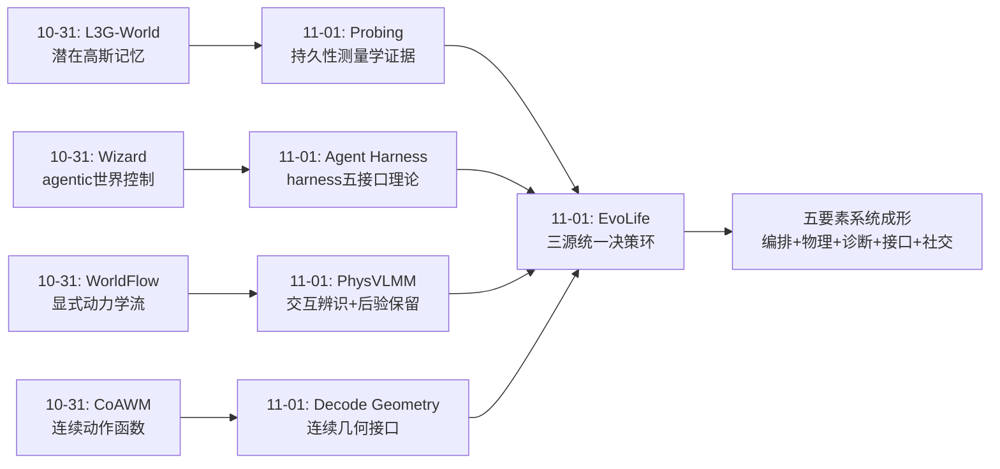
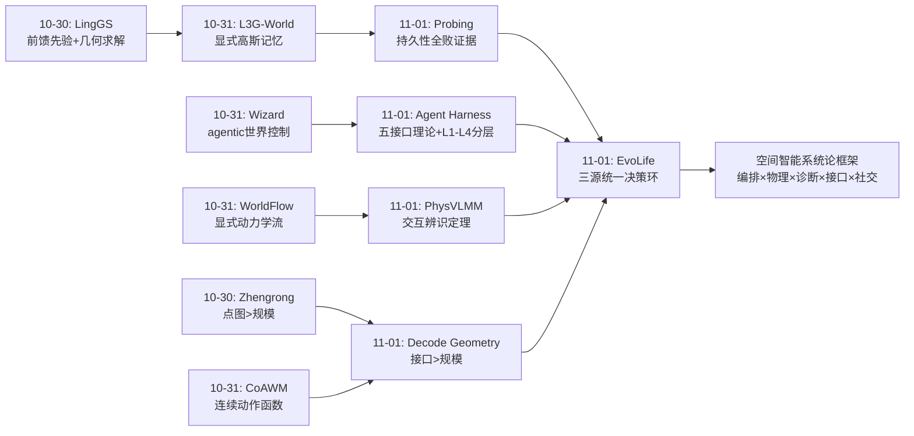
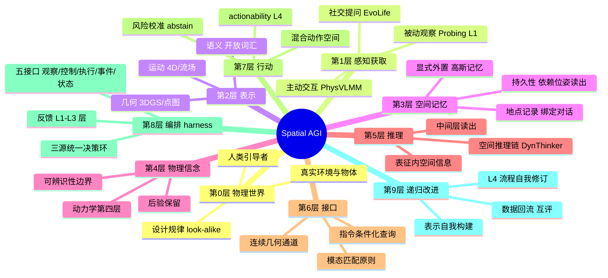
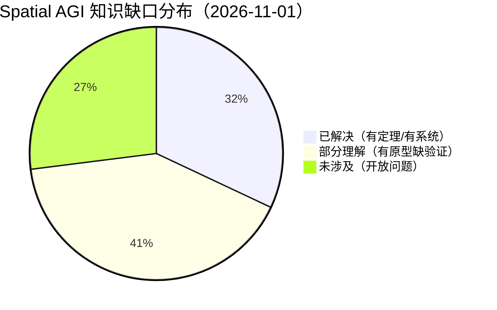
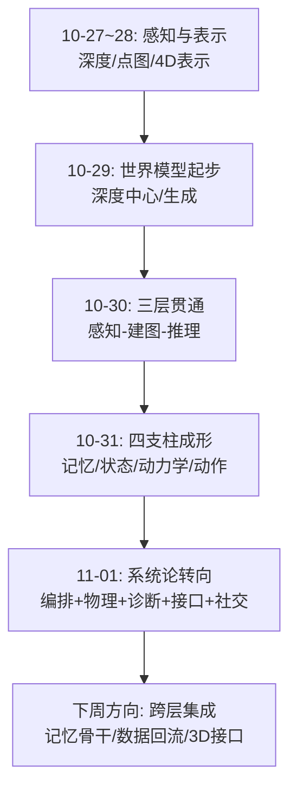

# Spatial AGI 每日思考 - 2026-11-01

## 📅 每日总结

**日期**: 2026-11-01
**论文数量**: 5篇（全文精读）
**主题**: 空间智能的系统论转向——harness、信念、表征诊断、接口工程、社交通道

**关键突破**:
- 🚀 Agent Harness 综述：以"模型外围的可执行运行时"为分析单元统一生产/交互/开发三场景，提出 L1-L4 改进分层（当前输出/技能/模型/流程），诚实指出视频领域无人完成 RSI 闭环——空间智能的竞争从模型竞赛转向系统竞赛
- 🚀 PhysVLMM：两条可辨识性命题证明"被动观察无法辨识动力学、单部件测量不可迁移"，据此建立空间地图的第四层——动力学信念层，闭式更新快可微仿真4个数量级（13ms vs 230s）且预测更准
- 🚀 Probing Spatial State：四层功能探测（结构/持久/预测/行动）十表征横评，发现"两条要素链"（持久性与行动性依赖相机位姿读出、预测依赖场景读出）与"更长前缀使所有模型持久性变差"——论证显式空间记忆的必要性
- 🚀 Decoding Geometry Not Tokens：证明 0.5-2B 紧凑 VLM 中间层已含丰富空间信息，瓶颈在 token 化解码接口而非表征容量；连续几何头以 3.8× 吞吐逼近 RoboBrain 精度
- 🚀 EvoLife：感知/提问/记忆三信息源统一决策环的终身导航 harness，平均 1.87 次提问/回合达 100% SR，重访 SPL 82.23%→93.31% 直接量化经验复用价值，对话绑地点开创社交空间记忆

**架构演进**: 四支柱（记忆/状态/动力学/动作）→ 五要素系统（+harness编排层 +物理信念层 +社交信息通道）

### 📊 一句话总结

2026-11-01 的五篇论文共同宣告空间智能的"系统论转向"：论文1提供理论框架（harness 五接口），论文5给出系统落地（统一决策环），论文3做表征诊断（信息在哪里），论文4做接口工程（如何读出），论文2补物理根基（动力学信念层）——空间智能的下一步不是更大的模型，而是更对的系统结构。

### 🔗 延续性

**昨日→今日**: 昨日确立世界模型四支柱（记忆 L3G、状态 Wizard、动力学 WorldFlow、动作 CoAWM），结尾提出"缺支柱间的螺栓"。今天恰好补螺栓：论文1 的 harness 就是螺栓的理论，EvoLife 是螺栓的导航实例，Probing 与 Decode Geometry 保证表征到接口的直通，PhysVLMM 给状态层加上可辨识的物理信念。昨日四支柱是"骨骼"，今日五论文是"神经系统"。

**今日→明日**: 三条待深挖线索：①RSI 的 L3 层（数据/critic 回流）在空间智能的具体机制——世界模型生成的数据如何校准空间感知模型；②"两条要素链"能否指导记忆型骨干的设计（camera-pose readout 强的编码器+显式记忆）；③社交信息通道（ask）与物理信息通道（interact）的统一不确定性管理。明日检索方向："world model 自改进数据回流"、"空间记忆骨干设计"、"human-robot spatial dialogue"。

### 💡 本质思考：如何达成通用空间智能

#### 1. 核心能力的本质是什么？

今天的答案比昨天更进一层：**空间智能的本质是"在正确的接口上组织正确的信息流"**。

昨天的结论是"选择正确的表示"；今天五篇论文进一步指出：表示正确还不够，**信息的获取方式（观察 vs 交互 vs 提问）、保持方式（前缀 vs 显式记忆）、读出方式（token vs 连续几何）、组织方式（单模型 vs harness）** 决定系统成败：

- PhysVLMM 证明有些信息（动力学）**只能**通过交互获取——信息来源的物理边界是硬约束
- Probing 证明信息可以**在表征中却读不好**——可解码性与功能效用解耦
- Decode Geometry 证明读出方式错了会浪费已有信息——接口错配是主要瓶颈
- EvoLife 证明信息可以**通过社交渠道获取**——观察不是唯一通道
- Agent Harness 证明这些通道必须被一个运行时**组织**起来——单模型撑不起多通道

综合：通用空间智能 = 多通道信息获取（观察/交互/提问/记忆）× 正确表示（四支柱）× 高效接口（连续几何）× 系统编排（harness）。四个乘数缺一不可，且**乘法结构意味着短板决定上限**。

#### 2. 当前方法与理想目标的差距在哪里？

按今天的五篇论文逐一盘点：

- **编排层**：Agent Harness 综述指出 RSI 四层中 L4（流程自我修订）无人完成——系统的"自我改进"能力仍是纸面蓝图。harness 五接口（观察/控制/执行/事件/状态）在导航域有 EvoLife 范例，但操作域、世界生成域还缺等价物。
- **物理层**：PhysVLMM 局限于单关节刚体（门窗抽屉），真实世界的接触链、流体、可变形物体全在模型之外；look-alike 共享依赖人类建筑的设计规律，非结构化环境失效。
- **表征层**：Probing 显示没有任何表征四层全能；更长前缀反而损害持久性——前馈编码器不做状态累积是原理性缺陷，不是工程缺陷。
- **接口层**：Decode Geometry 只覆盖 2D（图像平面框与轨迹），3D 化路径（深度头/点云/位姿条件）未验证；h_last 指令接地只接了最后一层文本，多层语义未利用。
- **社交层**：EvoLife 的提问依赖 guide 存在——无人部署场景（深空、深海、灾后）没有"问路"选项；提问的元认知（知道自己不知道什么）来自 MLLM 的内生能力，未见专门校准。

**最深层的差距**：这五层各自有原型系统，但**没有一个系统同时拥有五层**。EvoLife 缺物理信念与几何接口，PhysVLMM 缺编排与社交，Decode Geometry 缺记忆与交互。集成度是当前空间智能与"通用"之间最真实的距离。

#### 3. 从今天到理想状态，最可能的路径是什么？

四步走判断（更新昨日三步走）：

**第一步（进行中）：层内方法收敛**。物理信念层的闭式更新、接口层的连续几何通道、记忆层的显式外置——各层的主流浪潮已现。判断依据：今天五篇论文全部反对"暴力端到端"（暴力 token 化、暴力仿真、暴力长上下文、暴力单模型探测），全部选择"结构化先验+正确接口"。

**第二步（2027 主战场）：跨层集成**。可预见的集成顺序：先"表征诊断→接口选择"（Probing+Decode 的两步范式最易标准化），再"导航 harness+物理信念"（EvoLife+PhysVLMM 互补性最强），最后"世界生成 harness+RSI 数据回流"（最远也最大）。**谁先发布五层一体（感知/记忆/物理/接口/编排）的开源系统，谁定义 Spatial AGI 的参考架构。**

**第三步：社交通道的普适化**。当 guide 不可用时，提问对象需要从人扩展到：互联网（检索）、其他机器人（机际问答）、自己的历史记忆（自问自答）。EvoLife 的提问框架为这个扩展预留了接口——提问只是信息获取动作的一种，来源可以抽象。

**第四步（通往通用）：L4 流程自我修订**。Agent Harness 综述标注的最后一块拼图。空间智能的 L4 具体形态可能是：修订数据收集策略（该去哪采集交互证据）、修订记忆模式（该记什么粒度）、修订接口配置（该从哪层读出）。今天所有论文都在为这一天积累组件。

---

## 🔗 与昨日思考的联系

### 昨日重点

昨日（10-31）确立世界模型四支柱架构：记忆层（L3G-World 潜在3D高斯记忆）、状态层（Wizard 可编程符号状态）、动力学层（WorldFlow 视频+3D流联合）、动作层（CoAWM 连续动作函数）。核心结论："世界模型该以什么表示存在"四问四答，表示收敛趋势明确。遗留问题："支柱间的螺栓"——层间互查、互训、适配的接口缺失。

### 今日进展

今日恰好回应"螺栓"问题，但答案出乎昨日预料：**螺栓不是另一个表示，而是一个系统层**——

1. 昨日 L3G 的显式高斯记忆 → 今日 Probing 证明其必要性（前馈编码器八模型全败于持久性）："为什么需要显式记忆"获得测量学证据
2. 昨日 Wizard 的 agentic 控制 → 今日 Agent Harness 综述把它归入"控制接口"并给出理论框架：从个案到范式
3. 昨日 WorldFlow 的显式动力学 → 今日 PhysVLMM 证明动力学必须靠交互辨识、且要保留后验：给动力学层加上认识论纪律
4. 昨日 CoAWM 的连续动作函数 → 今日 Decode Geometry 的连续几何输出：连续量必须走连续通道，原则跨域一致
5. 昨日结尾问"支柱间螺栓在哪" → 今日 EvoLife 展示了螺栓的导航域形态：统一决策环内工具化协同

### 演进路径



---

## 📚 论文概览

| # | 论文 | 层 | 一句话 |
|---|------|-----|--------|
| 1 | Agent Harness（2610.40191） | 编排层理论 | 视频生成的竞争单元从模型转向 harness；反馈按时间尺度分四层；RSI 闭环尚未有人完成 |
| 2 | PhysVLMM（2610.40539） | 物理信念层 | "不碰不知道"是定理；空间地图第四层=动力学信念，闭式更新快4个数量级 |
| 3 | Probing Spatial State（2610.40636） | 表征诊断层 | 空间能力是四层功能画像；两条要素链；长前缀损害持久性 |
| 4 | Decoding Geometry（2610.39416） | 接口工程层 | 瓶颈在 token 化接口不在表征容量；连续几何头释放小模型空间能力 |
| 5 | EvoLife（2610.39446） | 系统落地层 | 感知/提问/记忆三源统一决策环；提问是高杠杆空间信息获取动作 |

---

## 💡 核心见解

### 见解1: 系统竞争取代模型竞争——harness 是空间智能的组织中心

**从论文1（Agent Harness）获得**

- ✅ 完成视频任务的瓶颈不是生成质量而是决策组织：参考持久化、take 检查、剪辑一致性都需要 harness
- ✅ 反馈必须按时间尺度分层：修当前工件（L1）/ 存技能（L2）/ 更新模型（L3）/ 修订流程（L4）
- ✅ "程序持有世界状态 + 视频模型渲染"的混合架构优于纯生成式世界模型
- ✅ 诚实判断：没有任何 surveyed 系统完成 RSI 闭环——改进流程本身（L4）仍是开放问题

**对Spatial AGI的启发**:
Spatial AGI 的路线图应该从"训练更强的世界模型"升级为"构建世界模型+harness+递归改进通道"。五接口（观察/控制/执行/事件/状态）为任何空间子系统提供了设计检查表。评估任何"自我改进"声明时用 L1-L4 检查表：改进对象是哪层？后续独立验证了吗？资源约束下成立吗？

### 见解2: "不碰不知道"是定理——交互是空间物理的必经通道

**从论文2（PhysVLMM）获得**

- ✅ Proposition 1：广义力未测量时，任何动力学参数都与观察轨迹相容——被动观察在信息论上不可能辨识动力学
- ✅ Proposition 2：单部件的测量对其他部件零信息（除非统计相关）——"逐物体探测"范式的极限被严格刻画
- ✅ 开门 effort 只依赖 τc+τ0 之和，所以一次 opening 拉力固定被拉部件的可辨识标量
- ✅ look-alike 分组把"设计规律"变成免费先验：未触碰部件力误差 56%→42%

**对Spatial AGI的启发**:
视频世界模型存在动力学盲区的原理性论证到手了：视频学到的是动力学先验分布，具体实例的参数必须靠交互或力觉。这意味着具身数据与被动视频数据有质的差异，不能互相替代——具身智能的"交互必需性"第一次有了定理级支撑。空间记忆应携带"证据来源"标签（观察/交互/先验），因为不同来源的可信边界不同。

### 见解3: 空间能力是多维画像——没有全能表征

**从论文3（Probing Spatial State）获得**

- ✅ 十个表征（DINOv2/V-JEPA2/VideoMAE/Fast3R/视频生成器/世界模型/Qwen2.5-VL）在四层任务上无一全面领先
- ✅ 两条要素链：持久性+行动性 ↔ camera-pose 读出；特征预测 ↔ 场景读出——空间子能力依赖不同的表征成分
- ✅ 更长视觉前缀使所有八个可比模型的持久性变差——前馈编码器不做状态累积
- ✅ 三个解耦：可解码 ≠ 输入使用 ≠ 功能效用；复制最后特征就能超越 V-JEPA2 的学习预测

**对Spatial AGI的启发**:
"哪个视觉骨干最强"是伪问题，正确问题是"哪层任务配哪个骨干"。导航记忆选 camera-pose 读出强的，世界模型选场景读出强的。L2 持久性失败的全军覆没为显式记忆路线（昨日 L3G）提供了最强论据。评估协议必须含输入控制与功能效用检验，否则容易把抄近道当能力。

### 见解4: 接口错配是空间输出的主要瓶颈——几何该走连续通道

**从论文4（Decoding Geometry）获得**

- ✅ 自回归坐标 token 化三重错配：交叉熵不惩罚几何距离、有限词表量化、误差跨 token 累积
- ✅ 0.5-2B 紧凑 VLM 中间层已含丰富空间信息——容量不是瓶颈，接口才是
- ✅ 连续几何头（DETR-style+指令条件化查询初始化）轨迹误差降 60%+，2B 逼近 RoboBrain × 3.8 吞吐
- ✅ 消融的不对称性：轨迹靠接口就能修，affordance 依赖接口×深度×架构交互

**对Spatial AGI的启发**:
"空间智能需要更大模型"的默认叙事被局部证伪。工程原则确立：语言层管语义与意图，几何输出走连续回归通道。与论文3合起来形成两步范式："先 probing 诊断信息在哪，再建接口读出来"——这个范式可复用于任何空间能力的开发。h_last 指令接地的设计观深刻：语言应在几何解码的起点接地，不是输出端反解析。

### 见解5: 提问是高杠杆的空间信息动作——社交通道补全信息论

**从论文5（EvoLife）获得**

- ✅ 三类提问对应三种不确定性：澄清（任务层歧义）、指引（决策层不确定）、协助（执行层障碍）
- ✅ 平均 1.87 次提问/回合达成 100% SR——不确定性管理优于盲目自主
- ✅ 重访 SPL 82.23%→93.31%：记忆复用的空间收益首次被直接量化
- ✅ place record 绑定对话：社交信息（"这扇门要推"）成为空间记忆的一等维度

**对Spatial AGI的启发**:
空间信息论补全了最后一块：获取空间信息的通道有四个——观察、交互（物理）、提问（社交）、记忆（历史）。人类空间智能高度依赖社交通道（问路），而这恰是 Spatial AGI 研究最忽视的维度。EvoLife 与 PhysVLMM 形成美妙互补：一个问人（社交不确定性消解），一个动手（物理不确定性消解）——完整的不确定性管理需要两者。

### 见解6: 世界状态应该外置且分属性处理

**从论文1（混合架构）+论文5（place record）联合获得**

- ✅ 论文1：引擎/程序持有状态、视频模型渲染——状态精确性与渲染自由度解耦
- ✅ 论文5：地点记录绑定描述+观察+图像+对话——空间状态包含社交属性
- ✅ 论文2：物理参数保留后验——状态包含不确定性结构
- ✅ 三者共同指向：空间状态不是单一表示，而是"几何+语义+物理+社交+不确定性"的复合记录，各属性各有最优持有者

**对Spatial AGI的启发**:
空间状态的分属性架构：几何状态→显式3D表示（高斯/网格），语义状态→开放词汇记录，物理状态→带后验的动力学信念（PhysVLMM），社交状态→对话绑定的 place record（EvoLife），任务状态→harness 上下文（论文1）。没有单一表示能承载全部属性——"统一空间记忆"的正确含义是统一接口而非统一存储。

### 见解7: 评估哲学转向——从"能解码什么"到"能否维持、预测、行动"

**从论文3+论文1方法论联合获得**

- ✅ Probing：空间表征的功能性操作定义（L1结构/L2持久/L3预测/L4行动），绕开架构预设
- ✅ 输入控制实验设计：改变运动/历史/顺序/目标而保持预测器不变，分离因果贡献
- ✅ Harness 综述：评估必须输出结构化失败诊断而非标量分——"看起来合理"≠"实现了意图"
- ✅ EvoLife：revisit 设定直接度量记忆价值——好的评估协议本身就是贡献

**对Spatial AGI的启发**:
评估协议是一等研究对象：一个坏基准会让整个方向误入歧途（100% SR 饱和即失去区分度）。Spatial AGI 评估的最低标准：多层级任务画像、输入对照、功能效用验证、数据卫生审计、revisit/复用增益。静态基准终将被"互评式生成基准"取代——世界模型针对 agent 弱点生成测试场景（论文1 的 reciprocal evaluation）。

### 见解8（附加）: 表示先验优于暴力计算——本周第五次独立验证

**从论文2+论文4联合确认**

- ✅ PhysVLMM：闭式共轭更新 vs 可微仿真 = 快 4 个数量级且 CRPS 更低
- ✅ Decode Geometry：正确接口 vs 更大模型 = 2B 逼近 26B 精度
- ✅ 昨日 Zhengrong：度量点图注入 vs 32B 纯微调 = 79.89% vs 47.60%
- ✅ 结构化先验+正确接口的组合反复碾压规模堆叠

**对Spatial AGI的启发**:
这已经成为可写进设计手册的规律：遇到空间智能问题，先问"表示错配在哪、接口错配在哪"，再问"要不要更大模型"。资源有限团队的正确策略：把算力花在先验构造与接口工程上，而不是参数扩张上。

---

## 🗺️ 知识演进图



---

## 技术栈演进对比表

| 层次 | 昨日方案（10-31） | 今日方案（11-01） | 变化 |
|------|------------------|------------------|------|
| 记忆/持久性 | L3G 显式高斯记忆（架构方案） | Probing 证明前馈编码器持久性全军覆没（必要性证据） | 架构主张获得测量学支撑 |
| 世界状态 | Wizard 符号状态+代理（个案） | Agent Harness 五接口+混合架构（范式） | 个案→理论框架 |
| 动力学 | WorldFlow 视频+3D流联合生成（学习式） | PhysVLMM 交互辨识+闭式后验（定理式） | 学习先验与交互辨识互补定位 |
| 动作/接口 | CoAWM 连续动作函数（世界模型侧） | Decode Geometry 连续几何输出（VLM侧） | "连续通道"原则跨域确立 |
| 不确定性管理 | （未覆盖） | PhysVLMM 风险校准 abstain + EvoLife 三类提问 | 新增：物理+社交双通道 |
| 空间地图 | VLMM 运动学层（可动/动过） | PhysVLMM 动力学信念层（如何响应） | 地图获得第四层 |
| 空间输出 | token 化坐标（隐含默认） | 连续几何回归头（显式接口） | 范式替换 |
| 系统组织 | 单模型+模块拼凑 | harness 统一决策环（EvoLife 实证） | 系统论转向 |
| 评估方法 | 基准 SR/精度分 | 四层画像+输入控制+功能效用+revisit 增益 | 评估哲学升级 |
| 自我改进 | （未触及） | L1-L4 分层；L4 流程修订无人完成 | 问题被形式化 |

---

## 🗺️ Spatial AGI 知识图谱

### 10层架构思维导图



### 🎯 主线技术路径

#### 阶段1: 单点能力突破（已基本完成，2026）

各层出现可用组件：显式记忆（L3G）、可编程世界（Wizard）、动力学流（WorldFlow）、连续动作（CoAWM）、几何接口（Decode Geometry）、物理信念（PhysVLMM）、导航 harness（EvoLife）。本阶段特征：每篇论文解决一层的一个点，互不集成。

#### 阶段2: 跨层集成（2027 主战场）

按集成难度排序：①表征诊断→接口选择（Probing+Decode 两步范式，最容易标准化）；②导航 harness+物理信念（EvoLife+PhysVLMM 互补性最强）；③世界生成 harness+记忆层（Wizard/L3G+论文1框架）；④五层一体开源系统（定义参考架构的决战）。

#### 阶段3: 通道普适化（2027-2028）

社交提问通道扩展：人→互联网→其他机器人→自我记忆。物理交互通道扩展：单关节→接触链→可变形物体。评估通道扩展：静态基准→互评式生成基准（世界模型针对 agent 弱点出题）。

#### 阶段4: 递归自我改进（通往通用，2028+）

L4 流程修订落地：agent 修订自己的数据采集策略、记忆模式、接口配置。空间智能的表示从"人类设计"转向"经验归纳"——状态变量、物体边界、规则由系统自己发明。这是 Agent Harness 综述标注的最后一块拼图，也是通用性的分水岭。

---

## 🔍 待探索议题

### 高优先级（本周）

1. **世界模型生成数据的 RSI 回流机制**
   - 问题: L3 层改进（数据/critic 更新）在空间智能的具体形态是什么？世界模型 rollout 的数据如何校准空间感知模型而不引入生成偏差？
   - 候选方案: 论文1 的四条回流通道映射；Probing 的功能效用检验作为数据过滤器
   - 缺口: 生成特征≠感知特征（Probing 已证）——回流数据需要接口重校准的机制设计

2. **记忆型视觉骨干的设计**
   - 问题: 既然持久性依赖 camera-pose 读出且前馈编码器不做状态累积，能否设计"位姿条件化+显式记忆槽"的视频编码器？
   - 候选方案: L3G 高斯记忆 + camera-pose 读出强的骨干（Fast3R 类）+ 指令条件化查询
   - 缺口: 记忆写入/读取的端到端训练信号设计；Probing 协议作为验收标准

3. **物理信念层的泛化路径**
   - 问题: PhysVLMM 的单关节模型如何扩展到接触链、可变形物体？look-alike 先验在非结构化环境如何替代？
   - 候选方案: 学习型类别先验（VLM 物体知识替代建筑规律）+ 图结构动力学信念
   - 缺口: 非结构化场景的交互数据集；多体耦合的闭式更新不存在，需分层近似

### 中优先级（本月）

4. **3D 化几何接口**
   - 问题: Decode Geometry 只做 2D；抓取发生在物理空间，3D affordance/轨迹接口如何设计？
   - 候选方案: 深度头并联、点云 cross-attention、相机位姿条件、度量点图注入（昨日 Zhengrong 配方）
   - 缺口: 3D 基准（ShareRobot-Bench 是2D的）；3D 精度-效率帕累托数据

5. **无人场景的提问降级策略**
   - 问题: EvoLife 依赖 guide；深空/灾后无 guide 时，提问对象如何从人扩展？
   - 候选方案: 提问→检索（互联网）、提问→机际通信（其他机器人）、提问→自问自答（内部模拟）
   - 缺口: 三种来源的回答可靠性校准；与 PhysVLMM 的 abstain 信号对接

6. **互评式空间基准**
   - 问题: 静态基准饱和（EvoLife 100% SR）；如何让世界模型自动生成针对 agent 弱点的测试场景？
   - 候选方案: 论文1 reciprocal evaluation + Wizard 可编程世界 + agent 失败案例的条件化生成
   - 缺口: "弱点条件化场景生成"的可控性；评测的防作弊设计

### 低优先级（长期）

7. **空间记忆的分属性统一接口**
   - 问题: 几何/语义/物理/社交/任务五类状态各有最优持有者，"统一空间记忆"应统一什么？
   - 候选方案: 统一查询语言（任何属性可问）+ 统一不确定性传播协议
   - 缺口: 跨属性联合查询的实现（如"哪里有能推开且不重的门"）

8. **元认知校准——知道自己不知道**
   - 问题: EvoLife 的提问时机决策依赖 MLLM 内生元认知；未校准的"自信的无知"会导致该问不问
   - 候选方案: Probing 式功能效用检验在线运行；PhysVLMM abstain 信号作为元认知训练数据
   - 缺口: 元认知的在线校准协议；过度提问的成本模型

9. **RSI 安全性——流程修订的风险控制**
   - 问题: L4 层修订开发流程接近目标自修改；空间智能的流程修订如何安全验证？
   - 候选方案: RRSI 正则化 + 互评环境作为外部验证器 + 修订的 A/B 对照协议
   - 缺口: 流程修订贡献与数据/算力增长的解耦方法；多训练轮次的验证成本

10. **端侧空间智能的完整栈**
    - 问题: Decode Geometry（2B+几何头）、MosaicThinker（端侧推理）显示端侧可行；完整端侧栈（感知+记忆+物理+接口+编排）的资源包络是什么？
    - 候选方案: 闭式更新（PhysVLMM 式）替代重计算；显式记忆替代长上下文；几何头替代大模型输出
    - 缺口: 各层端侧延迟/内存实测数据；层间通信开销

---

## 📊 知识缺口分析



**已解决（32%）**:
- ✅ 空间动力学必须交互获取（PhysVLMM 两条命题）
- ✅ 持久性需要显式记忆（Probing 八模型全败证据）
- ✅ 几何输出的连续接口原则（Decode Geometry 3.8×实证）
- ✅ 导航 harness 三源决策环（EvoLife 8基准+物理实验）
- ✅ 反馈四层分类学（Agent Harness 理论框架）
- ✅ 空间能力多维画像方法（Probing 协议）

**部分理解（41%）**:
- ⚠️ 动力学信念泛化：单关节已证，接触链/可变形未做
- ⚠️ 记忆骨干设计：必要性已证，具体架构未出
- ⚠️ 3D 几何接口：2D 已证，3D 化路径未验证
- ⚠️ 经验复用机制：revisit 增益已量化，记忆长期演化（冲突/遗忘）未知
- ⚠️ 世界模型数据回流：通道已识别，接口重校准机制未设计
- ⚠️ 提问通道普适化：人 guide 已证，无人场景降级未解决
- ⚠️ 分属性空间状态：各属性方案已有，统一查询接口未建

**未涉及（27%）**:
- ❌ L4 流程自我修订（RSI 闭环）
- ❌ 表示自我构建（状态变量/物体边界的经验归纳）
- ❌ 动态世界记忆（Probing/PhysVLMM 均限静态环境）
- ❌ 多 agent 空间协作的空间智能
- ❌ 互评式生成基准的完整实现
- ❌ 元认知的在线校准
- ❌ 跨属性联合空间查询

---

## 📈 本周脉络回顾（10-27 至 11-01）



---

## 🎯 明日检索建议

- 关键词组合："world model self-improvement data curation"、"pose-conditioned video memory"、"3D affordance regression"、"human-robot spatial dialogue"、"dynamic scene spatial memory"
- 重点确认：Probing 团队（NYU/NTU）的后续；PhysVLMM 是否开源；EvoLife 代码可用性
- 关注会议：ICLR 2027 投稿季的空间智能论文潮

---

## 📝 元记录

- 今日5篇论文覆盖：理论综述1篇、理论+系统1篇、评估研究1篇、方法2篇
- 昨日遗留"支柱间螺栓"问题已回答：螺栓=harness（系统层）而非新表示
- 本周首次出现"定理级"结论（PhysVLMM 可辨识性命题）——空间智能研究进入理论成熟期
- "表示>规模"本周第五次验证（PhysVLMM 闭式 vs 仿真、Decode Geometry 接口 vs 规模）
- 明日焦点：跨层集成的第一批具体设计

---

**文档创建时间**: 2026-11-01 03:00 (Asia/Shanghai)
**分析方法**: 5篇论文全文精读 + 延续性思考
**昨日基础**: 2026-10-31（四支柱架构）
EOF
wc -l /home/ubuntu/coding/spatial_agi/daily_thinking/2026-11-01.md
---

## 🔬 深度分析一：harness 为什么是空间智能的必然形态

### 1.1 从模型范式到系统范式的历史必然

回顾空间智能的两三年演进，可以看到清晰的三段式：

- **第一阶段（感知竞赛）**：比谁的深度/位姿/分割更准。代表：各类几何基础模型。结论：感知已经"够用"，单点精度不再是瓶颈。
- **第二阶段（表示竞赛）**：比谁的中间表示更好——点图、高斯、流场、潜空间。昨日四支柱是这一阶段的成果总结。
- **第三阶段（系统竞赛，今日开始）**：比谁能把多通道信息、多层表示、多种动作组织成一个可靠的决策闭环。Agent Harness 综述是这个阶段的宣言。

为什么必然走向系统？因为空间任务的错误模式是**复合的**：感知错一点、记忆丢一点、接口偏一点、动作歪一点，任务就失败。单模型优化任何一个环节的边际收益都在递减，而环节间的失配是最大的错误源。harness 的本质就是"失配管理器"。

### 1.2 harness 的三个技术支柱与空间智能的映射

| Harness 支柱 | 通用含义 | 空间智能映射 | 今日实例 |
|-------------|---------|-------------|---------|
| 上下文构造 | 为决策组装信息 | 组装观察+记忆+先验 | EvoLife 的决策输入 |
| 工具暴露 | 能力原语化 | 感知/动作/提问/记忆工具化 | EvoLife Table 1 |
| 状态维护 | 跨回合持久 | 空间状态分属性持有 | PhysVLMM 信念 + EvoLife place record |
| 反馈路由 | 结果回到决策 | 执行反馈闭路 | EvoLife 执行检查 |
| 预算约束 | 成本一等问题 | 交互成本/生成成本/计算成本 | EvoLife 1.87 次提问 |

### 1.3 L1-L4 分层对空间智能研究的即时影响

这个分类学的最大用处是**纠偏**：当前大量"self-improving spatial agent"声明实际停留在 L1（修当前输出）或 L2（存上下文）。用检查表过滤：

- 声称"从经验中学习"的系统：经验存哪了？L2 还是 L3？
- 声称"自我改进"的系统：改进在后续独立任务上验证了吗？
- 声称"递归"的系统：流程本身被修改的证据在哪？

### 1.4 RSI 通道在空间智能的具体化

论文1 的四条通道逐一套到空间智能：

1. **失败诊断通道**：agent 空间任务失败（撞、丢、迷路）→ 结构化失败归因 → 训练数据构造。Probing 的失败模式分析（持久性失败、效用失败）是现成的归因框架。
2. **数据收集通道**：PhysVLMM 证明交互是稀缺证据——**该去哪采集交互**本身是可优化的采集策略。look-alike 共享是"一次采集多方受益"的最优采集实例。
3. **监督构造通道**：空间感知模型的 critic 应当包含物理合理性检查（PhysVLMM 式的可辨识性约束可以成为损失项）。
4. **候选验证通道**：新空间模型的验收应跑 Probing 四层协议 + 功能效用检验，而非单一基准分。

---

## 🔬 深度分析二：可辨识性思想对空间智能的普遍意义

### 2.1 PhysVLMM 两条命题的推广

Proposition 1/2 虽然在单关节动力学上证明，但其结构可以推广为两条设计公理：

- **公理A（观察边界）**：任何依赖未测量输入的属性，被动观察只能学到其先验分布，不能辨识其实例值。
  - 应用：物体的质量、摩擦、弹性——视频学不到；场景的动力学稳定性——静止观察学不到。
- **公理B（信息局域性）**：对某个实例的测量只惠及与其统计相关的其他实例。
  - 应用：空间共享先验的合法来源只有三类——设计规律（同批安装）、类别规律（同类物体）、因果关联（同一机构）。

### 2.2 与视频世界模型的碰撞

这条思想对当下火热的视频世界模型是一次冷静剂：

- 视频世界模型学到的"物理"是**跨实例平均**的行为先验，不是实例参数。
- rollout 对典型物体合理、对具体物体会漂移——这不是规模问题，是信息论边界。
- 修复路径只有：实例级交互（PhysVLMM 式）或实例级传感（力觉/触觉）。
- **推论**：具身数据的不可替代性第一次有了定理支撑。纯视频 scaling 的天花板在动力学辨识上。

### 2.3 设计含义清单

1. 空间记忆的每个元素标注证据来源：observation / interaction / prior——三者可信边界不同。
2. 主动探索 = 后验收缩最大化的交互规划；abstain 信号是探索目标的免费生成器。
3. 保留后验而非点估计——点估计是对不可辨识方向的任意承诺。
4. 高频查询走闭式捷径（回归结构利用），边缘情况回退完整推理——分层推理是效率的正解。

---

## 🔬 深度分析三：从 Probing 到接口工程的完整方法论

### 3.1 两步范式

论文3（诊断）+论文4（利用）构成可复制的两步范式：

```
Step 1 诊断：冻结特征 + 轻量读出 + 输入控制 → 确定信息在哪层、依赖什么
Step 2 利用：在诊断出的层建几何兼容接口 → 零主干修改读出
```

这个范式的价值在于**把"换模型"变成"换接口"**——迭代成本从周降到天。

### 3.2 范式的五条操作细则

1. 诊断时必须含输入控制（无历史/无运动/复制基线），否则读到的是捷径不是信息。
2. 诊断时扫描层与前缀长度，报告画像而非单点。
3. 利用时按诊断结果选读出层——中间层常常优于最后一层。
4. 输出模态必须匹配任务本性：几何量→连续回归，语义量→语言。
5. 利用后必须验证功能效用（接到环境进度指标），完成闭环。

### 3.3 范式的适用边界

- 适用：信息已在表征中、输出是连续量、任务有明确几何定义的场景。
- 不适用：信息真的不在表征中的场景（动力学实例参数——需交互获取）；输出本质是离散决策的场景（工具选择）。
- 对 Spatial AGI：先把所有"换更大模型"的冲动过滤一遍这个范式，再决定是否真的需要更大模型。

---

## 🔬 深度分析四：社交通道——空间信息论的最后一块拼图

### 4.1 四通道信息获取框架

今日论文合起来给出空间信息的完整获取框架：

| 通道 | 信息类型 | 成本 | 风险 | 代表 |
|------|---------|------|------|------|
| 观察 | 几何/语义/运动 | 低 | 不可辨识动力学（公理A） | Probing L1 |
| 交互（物理） | 动力学/接触/物理参数 | 高（改变世界） | 损坏物体 | PhysVLMM |
| 提问（社交） | 任务意图/局部知识/协助 | 极低 | guide 不存在/不可靠 | EvoLife |
| 记忆（历史） | 过去观察+经验 | 极低 | 环境已变/过时 | EvoLife place record |

关键洞察：**通道选择本身是决策**。EvoLife 的 1.87 次提问说明最优策略是"便宜的通道先试"；PhysVLMM 的 abstain 说明"信息不足时正确的行为是切换通道"。统一的不确定性管理器应当知道每个通道的成本-收益-风险并做规划。

### 4.2 人类对照

人类空间智能正是四通道联用的典范：看（观察）、试（交互）、问（社交）、记得（记忆）。当前 Spatial AGI 研究过度偏重观察通道，交互通道刚起步（PhysVLMM），社交与记忆通道只有 EvoLife 一个孤例。四个通道的研究热度与信息价值严重倒挂——这是机会所在。

### 4.3 通道融合的开放问题

- 提问的答案如何与观察证据融合（语言先验 vs 几何证据的权重）？
- 交互结果如何校准视频世界模型的先验（instance-level fine-tuning？后验注入？）
- 记忆过时的检测：环境已变时，place record 的置信衰减机制？
- 这些问题的共同形态是"跨通道贝叶斯融合"——今日没有任何论文给出方案。

---

## 🔬 深度分析五：今日五篇论文的互证与矛盾

### 5.1 互证关系

1. **显式记忆的必要性**：Probing（八模型持久性全败）× L3G（显式高斯记忆可行）× EvoLife（place record 有效）——三篇独立论文从测量、架构、系统三面共同指向"空间持久性必须外置"。
2. **连续量走连续通道**：CoAWM（动作函数）× Decode Geometry（几何头）× PhysVLMM（闭式更新）——"结构化连续表示+解析操作"战胜"离散化+暴力学习"的模式三次出现。
3. **小模型+正确结构**：Zhengrong（3B+点图>32B）× Decode Geometry（2B+头≈26B）× EvoLife（1.87次提问>盲目自主）——资源效率的三重证据。

### 5.2 张力与矛盾

1. **记忆的持久性 vs 更新性**：Probing 表明持久性难（需要外置记忆），EvoLife 表明记忆需要持续修订（环境变化）。外置记忆的"写入-更新-失效"生命周期设计与"读出稳定性"之间存在张力——没有论文同时解决。
2. **harness 的自主性 vs 可验证性**：论文1 要求 harness 可检查可修订（自主性高），PhysVLMM 要求风险校准三值回答（保守性高）。自主探索与安全保守的平衡在开放世界没有现成答案。
3. **基准饱和与进步度量**：EvoLife 100% SR 与 Decode Geometry 逼近 RoboBrain 都暗示主流基准接近饱和；但 Probing 揭示的持久性/效用缺口表明真实能力远未解决——**基准分数与真实能力的背离是当前领域最危险的信号**。

### 5.3 矛盾的解决方向

- 记忆张力：分层记忆（稳定的几何层 + 快速修订的语义/社交层）+ 版本化更新。
- 自主-安全张力：风险水平 δ 由任务上下文动态决定（EvoLife 任务层 + PhysVLMM 执行层已有雏形）。
- 基准背离：从静态基准转向互评式生成基准（论文1 的 reciprocal evaluation 是唯一可见路径）。

---

## 🔬 深度分析六：对"通用空间智能"定义的一次修订

### 6.1 旧定义与不足

此前工作中隐含的定义：通用空间智能 = 在任意环境中感知、理解、推理、行动的能力。这个定义以**单智能体单通道**为默认设定。

### 6.2 今日修订

今日五篇论文支持的修订定义：

> **通用空间智能 = 在任意环境中，通过观察、交互、提问、记忆四通道获取与维护空间知识（含几何/语义/物理/社交/不确定性五属性），并以正确接口将其转化为可靠行动的系统能力。**

修订的三个变化：
1. 单通道 → 四通道（社交通道首次入定义）
2. 静态知识 → 知识的获取与维护（含不确定性结构的信念）
3. 模型能力 → 系统能力（harness 是定义的一部分）

### 6.3 修订定义的评测含义

按新定义，一个"通用空间智能系统"的评测必须覆盖：
- 四通道各自的效率与融合
- 五属性状态的完整性（特别是物理与社交——当前系统普遍缺失）
- 不确定性管理质量（校准、abstain 正确率）
- 跨任务经验复用增益（revisit 类设定）
- 资源效率（通道成本、计算成本）

今日没有任何系统能在全部五项上及格——距离量化了。

---

## 🔧 工程实践笔记

### 7.1 若今日开始构建空间智能系统，参考架构

```
┌─────────────────────────────────────────────┐
│              Harness 编排层                  │
│  决策环: 感知/动作/提问/记忆 四组工具         │
│  反馈路由 + 预算约束 + 失败诊断              │
├──────────┬──────────┬───────────┬───────────┤
│ 观察通道  │ 交互通道  │ 提问通道   │ 记忆通道   │
│ VLM+几何头│ 力觉+信念 │ guide接口  │ place rec │
│ (Probing  │ (PhysVLMM │ (EvoLife  │ (L3G式3D  │
│  诊断选层)│  闭式更新)│  三类提问) │  +对话绑定)│
├──────────┴──────────┴───────────┴───────────┤
│          统一不确定性管理器                   │
│  通道选择规划 + 风险校准 + abstain            │
└─────────────────────────────────────────────┘
```

### 7.2 组件选型速查

| 需求 | 首选 | 备选 | 依据 |
|------|------|------|------|
| 视觉骨干（导航记忆） | camera-pose 读出强（Fast3R 类） | 双塔组合 | Probing 要素链 |
| 视觉骨干（预测） | 场景读出强（DINOv2/V-JEPA2 类） | — | Probing 要素链 |
| 空间输出接口 | 连续几何头（DETR式） | — | Decode Geometry |
| 动力学记忆 | 闭式信念更新（回归+共轭） | 可微仿真（边缘情况） | PhysVLMM 13ms vs 230s |
| 导航动作 | 混合四模式 | 单一模式 | EvoLife 表达灵活性 |
| 不确定时行为 | abstain + 通道切换 | 强行回答 | PhysVLMM+EvoLife |

### 7.3 常见反模式（今日论文实证警告）

- ❌ token 化坐标输出（Decode Geometry：误差+60%）
- ❌ 更长上下文替代记忆（Probing：持久性变差）
- ❌ 纯被动学习动力学（PhysVLMM 命题1：不可能）
- ❌ 点估计承诺不可辨识量（PhysVLMM：误差 0.460 vs 0.270）
- ❌ 单一标量评估空间能力（Probing：画像不全面）
- ❌ 把"动作响应目标"当"行动能力"（Probing：30-46°旋转但无效用）

---

## 📖 论文要点速查卡

### P1 Agent Harness（2610.40191）
- 分析单元：harness（上下文/工具/状态/反馈/预算）
- 反馈四层：输出→技能→模型→流程
- 架构启示：程序化世界状态+神经渲染
- 现状：RSI L4 无人完成

### P2 PhysVLMM（2610.40539）
- 命题1：被动观察不辨识动力学
- 命题2：交互不跨部件迁移（除非统计相关）
- 三原则：保留后验、共享证据、风险回答
- 数据：86%辨识、CRPS 0.323、13ms、δ全程校准

### P3 Probing（2610.40636）
- 四层：结构/持久/预测/行动
- 要素链：持久+行动↔位姿读出；预测↔场景读出
- 反直觉：长前缀→持久性变差
- 三解耦：可解码≠输入使用≠功能效用

### P4 Decode Geometry（2610.39416）
- 错配：目标/表示/过程三重 token 化错配
- 方法：h_last 指令条件化查询 + DETR 头 + 连续回归
- 数据：轨迹-60%、mAP+85%、3.8×吞吐

### P5 EvoLife（2610.39446）
- 三源：感知/提问/记忆统一决策环
- 提问三类：澄清/指引/协助
- 数据：1.87次提问、100% SR、重访 SPL +11pt
- 记忆：place record 绑定对话

---

## 🧭 下周研究计划草案

1. **周一主题候选**：空间记忆骨干——检索 "pose-conditioned memory video encoder"、"scene memory representation" 类论文，深化 Probing 要素链的架构含义。
2. **跟踪清单**：
   - Probing 团队后续（NYU/NTU/CUHK 空间探测系列）
   - PhysVLMM 开源状态（若是，精读代码的闭式更新实现）
   - EvoLife 代码（harness 工具接口的工程细节）
   - Agent Harness 的 awesome list（RSI 通道的新实例）
3. **本周遗留问题**：跨通道贝叶斯融合（提问答案×观察证据×交互结果）——检索 "active sensing information fusion navigation"。
4. **表示自我构建**（长期线）：关注"agent invent state variables"、"object discovery from interaction"方向。

---

## 📝 元记录（续）

- 本文档深度分析六篇：harness必然性、可辨识性推广、两步范式、社交通道、互证与矛盾、定义修订
- 定义修订（四通道五属性系统能力）是今日最重要的理论产出
- 工程笔记（参考架构/选型/反模式）可直接用于后续系统设计
- 矛盾分析指出的三个张力（记忆持久vs更新、自主vs安全、基准vs能力）列为下周思考重点

---

**文档创建时间**: 2026-11-01 03:00 (Asia/Shanghai)
**分析方法**: 5篇论文全文精读 + 延续性思考 + 六篇深度分析
**昨日基础**: 2026-10-31（四支柱架构）

---

## 🔬 深度分析七：基准危机与评估重建

### 8.1 今日论文中的基准信号

三篇论文传递了同一个危险信号：

- EvoLife：四基准 100% SR——区分度死亡
- Decode Geometry：2B 逼近 26B——规模维度上基准饱和
- Probing：真实能力缺口（持久性/效用）巨大而主流基准不测——覆盖度缺失

三者的合成结论：**主流空间智能基准既饱和又失焦**。分数在涨，能力缺口不变。

### 8.2 评估重建的四个方向

1. **画像化**：从总分到多层画像（Probing 四层协议），报告能力向量而非排名。
2. **对照化**：每个声明配输入控制（Probing matched controls），无对照不作数。
3. **效用化**：预测接到环境进度指标（Probing L4 的教训），"响应目标"不等于"推进目标"。
4. **生成化**：世界模型针对 agent 弱点生成新测试（论文1 reciprocal evaluation），基准从静态资产变成动态对抗。

### 8.3 一个具体的评估协议草案（个人整理）

空间表征/系统评估最低配置：

```
1. L1-L4 各至少一项任务（画像）
2. 三组对照：无历史 / 无运动 / 复制基线
3. 功能效用：动作预测 → 真实进度提升 ≥ 阈值
4. 数据卫生：预训练重叠声明表
5. 复用增益：revisit 设定的 SPL delta
6. 统计：场景聚类 bootstrap，配对比较，指定提取点
7. 成本：每项能力的计算/交互成本账目
```

任何缺少 2/3/7 的评估报告应视为不完整——这是今日论文给评估文化留下的纪律。

---

## 🔬 深度分析八：从 EvoLife 反观导航系统的进化路线

### 9.1 导航系统的四代演进

- 第一代：端到端策略（模仿学习导航）——黑盒、脆弱、无记忆
- 第二代：模块化管线（建图+规划+控制）——可解释但接口僵硬
- 第三代：语言导航器（LLM/VLN，NavGPT 系）——语义强但执行弱
- 第四代：导航 harness（EvoLife）——工具化决策环+混合动作+多源信息+持久经验

第四代的本质变化：导航从"一个模型的任务"变成"一个运行时的服务"——与论文1 的 harness 论完全共振。

### 9.2 EvoLife 尚未解决的导航问题清单

1. 动态环境（移动物体/人群）——place record 假设环境半静态
2. 多机器人共享记忆——place record 是单体的
3. 长期记忆治理——月/年尺度的冲突消解与遗忘
4. 无 guide 降级——提问通道的单点依赖
5. 与物理信念的对接——EvoLife 不知道"这扇门有多沉"（PhysVLMM 的事）
6. 语义漂移——"厨房"在不同 house record 中的边界模糊

这六个问题就是导航子系统的近期 roadmap——每个都可能是一篇论文。

### 9.3 与操作子系统的对称性

EvoLife 之于导航 ≈ 未来某个"EvoManip"之于操作：混合动作空间（自由空间/约束轨迹/接触模式）、三类求助（任务歧义/策略不确定/物理卡住）、place-like 的"物体记录"（含动力学信念）。操作域的 harness 落地论文还没有出现——这是一个明确的空白机会。

---

## 🔬 深度分析九：本周知识体系的收敛检验

### 10.1 三大支柱的完整性检查

经过一周（10-27 至 11-01），Spatial AGI 知识体系的三大支柱状态：

| 支柱 | 应有内容 | 已有 | 缺口 |
|------|---------|------|------|
| 表示论 | 各层最优表示 | 高斯记忆/流场/连续函数/点图/信念 | 动态世界记忆、跨属性统一 |
| 系统论 | 组织与接口原则 | harness五接口/L1-L4/三源环/连续接口 | RSI L4、通道融合 |
| 评估论 | 测量方法与纪律 | 四层画像/输入控制/功能效用/revisit | 生成式基准、元认知校准 |

评估论本周首次成型——之前一周基本在表示论与系统论之间。三大支柱齐备是"领域成熟"的标志。

### 10.2 一周主线的一句话浓缩

> 空间智能从"感知-表示-推理"的纵向贯通（周一~周三），到世界模型四支柱的横向展开（周四~周五），到系统论的综合（周六）——一周完成了从组件到架构再到系统的三级跳。

### 10.3 对长期路线的信心评估

- 三个月内：跨层集成的第一批系统（EvoLife+PhysVLMM 类组合）大概率出现——信心高
- 一年内：五层一体开源参考架构——信心中
- 记忆型骨干/3D几何接口：纯工程问题——信心高
- RSI L4/表示自我构建：理论尚浅——信心低，但方向明确

---

## 🎯 每日一个"如果只能记住一件事"

**如果今天只能记住一件事：空间智能的答案不再是"更大的模型"，而是"更多的通道、更对的接口、更诚实的信念、更完整的系统"——2026-11-01，空间智能研究正式进入系统时代。**

（全文完）
