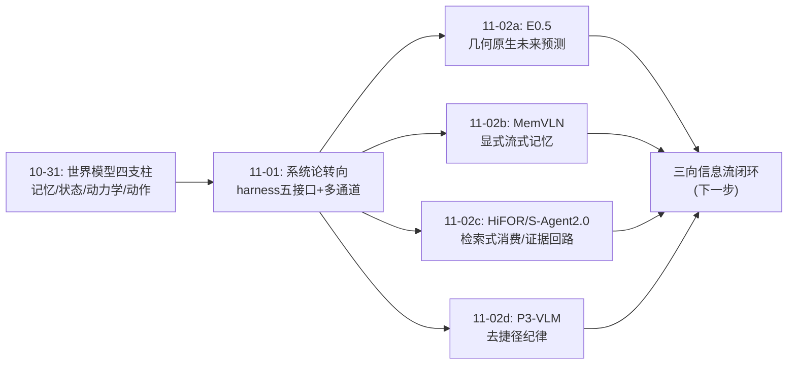
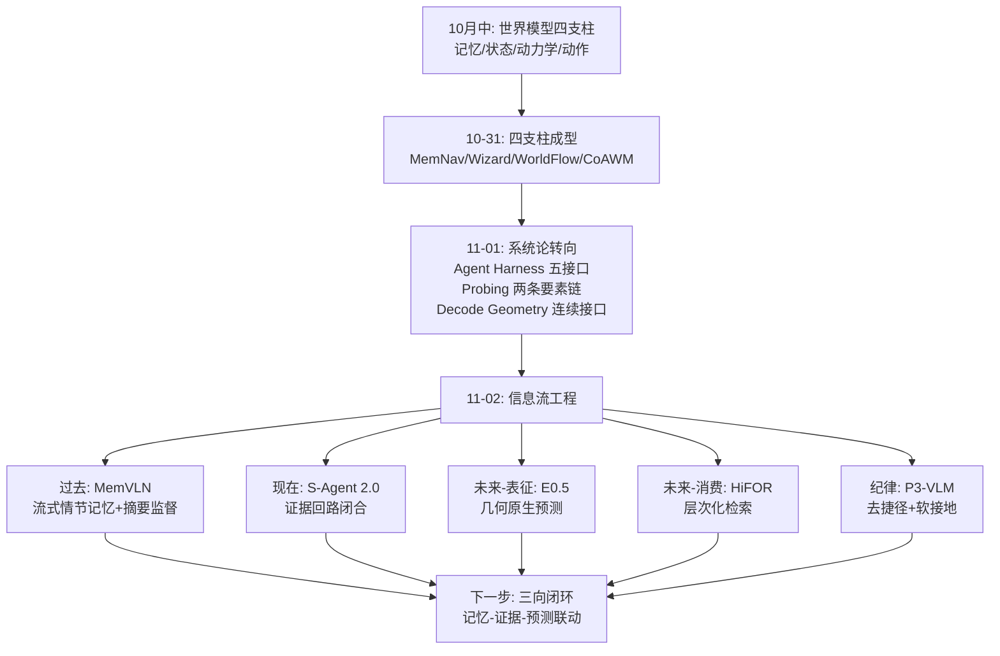
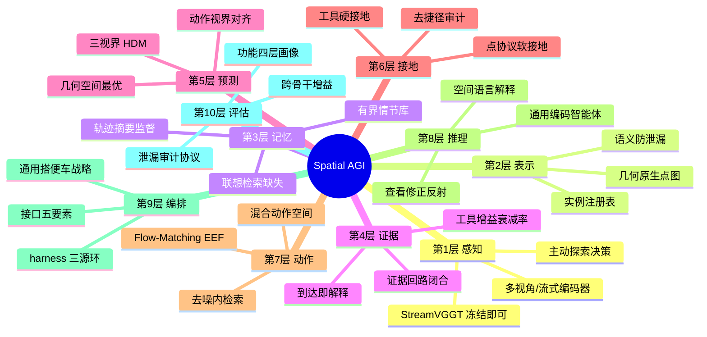
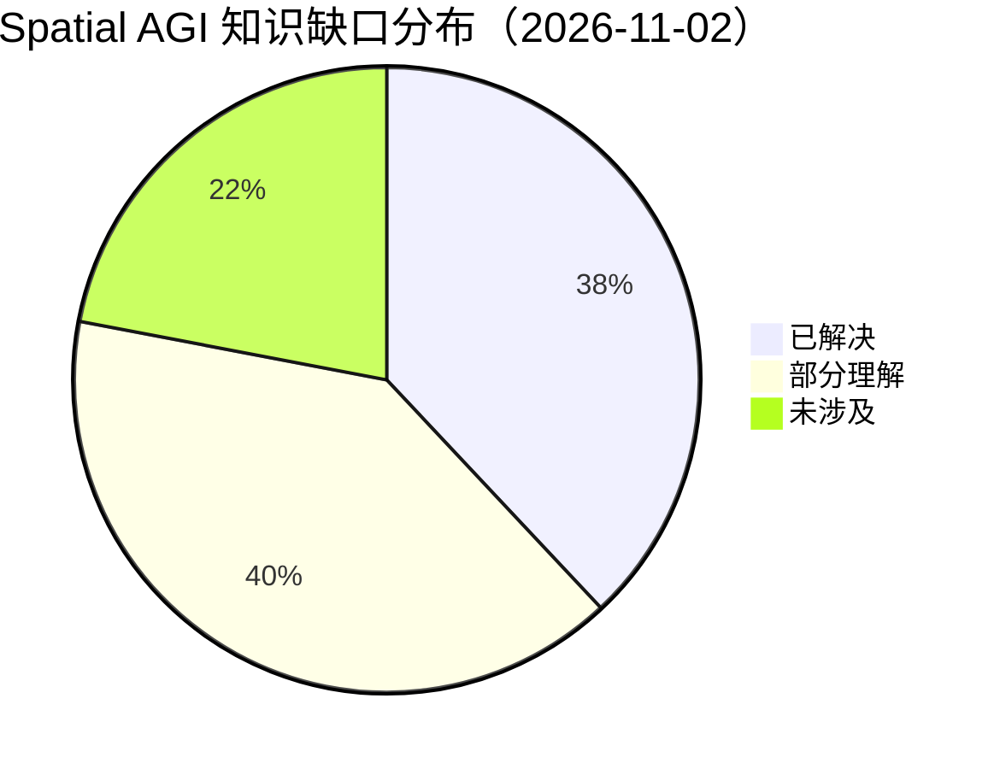
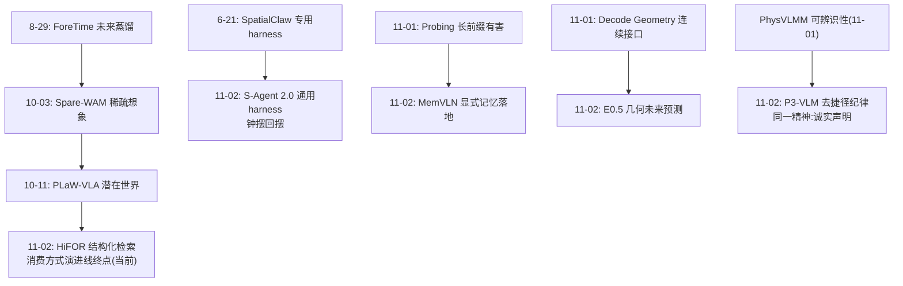

# Spatial AGI 每日思考 - 2026-11-02

## 📅 每日总结

**日期**: 2026-11-02
**论文数量**: 5篇（全文精读）
**主题**: 空间智能的信息流工程——记忆（过去）、检索（现在）、预测（未来）的三向信息组织

**关键突破**:
- 🚀 E0.5：几何原生未来预测型 3D 基础模型（X-Era AI Lab），用动作视界对齐（action-aligned temporal regime）取代感知视界，VGGT-Omega 骨干 + Flow-Matching 头联合生成未来场景点图与机器人状态，把世界建模从"重建过去"推进到"预测未来"，且直接面向动作条件化——OOD 泛化与精度同时提升
- 🚀 MemVLN：流式情节记忆驱动的 VLN-CE 系统（BIGAI/PKU），有界记忆库（超限降采样）+ 航位推算位姿 + 轨迹摘要自监督——证明"环境持有记忆 + 冻结几何编码器"在无地图导航中可行，且摘要监督让记忆条目在"回忆自己"与"描述场景"间切换
- 🚀 P³-VLM（NeurIPS 2026 Spotlight）：发现 3D VLM 的"语义泄漏"——即使完全屏蔽几何捷径（悬空平面/假点云），模型仍靠语义先验猜空间；提出点接地三通路（图像/点云/3DGS + 3D 点协议）实现软接地，并配套去捷径评测协议——给空间基准的可信度立了纪律
- 🚀 HiFOR：层次化前瞻 VLA（南理工/NUS），三视界（短期/里程碑/目标）用 HDM 掩码建立不对称依赖，未来 DINOv2 latent 沿视界×视角×空间三轴结构化，动作去噪过程内做因子化检索——把未来信息的消费从"直接注入"升级为"按需检索"
- 🚀 S-Agent 2.0：用现货通用编码智能体（Codex/Claude Code/OpenHands）+ CLI 感知工具包做空间推理，证据回路闭合三原则（感知合并/持久场景记忆/到达即解释），MMSI-Bench 66.5 超 SpatialClaw 62.6，且强骨干上工具增益保持 +9.6 vs SpatialClaw 衰减至 +2.7——证明"证据消费可靠性"是比"工具丰富度"更本质的接口问题

**架构演进**: 五要素系统（+harness编排+物理信念+社交通道）→ 七流架构（+未来流/证据流，记忆-检索-预测三向信息组织成型）

### 📊 一句话总结

2026-11-02 的五篇论文把昨日"系统论转向"推进到"信息流工程"：过去的信息要有显式记忆（MemVLN）、现在的证据要可靠消费（S-Agent 2.0）、未来的预测要层次化按需检索（HiFOR）、空间语义要防捷径（P³-VLM）、预测的表征空间要选对（E0.5）——空间智能体的核心竞争力正在从"表征能力"转移到"信息的组织、检索与消费纪律"。

### 🔗 延续性

**昨日→今日**: 昨日结论是"空间智能=多通道信息获取×正确表示×高效接口×系统编排"，并留了三条线索：①RSI 数据回流机制；②"两条要素链"指导记忆型骨干设计；③多通道信息的统一管理。今天恰好接住：论文2（MemVLN）实现了"显式记忆替代长前缀"（直接验证昨日 Probing 的结论），论文4（HiFOR）与论文5（S-Agent 2.0）从两个正交方向回答"信息如何被消费"（未来检索 vs 证据检索），论文3（P³-VLM）给"正确表示"加上防作弊纪律，论文1（E0.5）回答了"未来预测应该用什么表征空间"（几何而非像素/语义）。昨日的"多通道"今天细化为"三时间向度"：过去（记忆）、现在（证据）、未来（预测）——信息流工程的三维坐标系成型。

**今日→明日**: 四条待深挖线索：①检索式消费（HiFOR）与证据回路（S-Agent 2.0）能否统一为一个"查询式世界接口"理论；②闭环信息流——执行结果反馈回记忆/预测器的双向机制（今日五篇全部是前馈的）；③语义泄漏检测能否成为所有空间基准的标准化审查步骤；④几何预测（E0.5）与层次检索（HiFOR）的天然组合——几何原生的三视界预测+去噪内检索。明日检索方向："closed-loop world model memory"、"spatial shortcut benchmark audit"、"geometric foresight retrieval"。

### 💡 本质思考：如何达成通用空间智能

#### 1. 核心能力的本质是什么？

本周的答案持续收敛，今天达到一个新表述：**空间智能的本质是一个"跨时间的信息系统"**——它必须在三个时间向度上同时做好信息的组织与消费：

- **向过去（记忆）**：MemVLN 证明记忆必须有界、可检索、且带自监督的摘要结构。无限长上下文是假方案（昨日 Probing 已证长前缀损害持久性）。
- **向现在（证据）**：S-Agent 2.0 证明证据的获取不是瓶颈，消费才是——证据回路（获取→记忆→解释）的断裂是主要失败模式。数字必须"到达即解释"。
- **向未来（预测）**：E0.5 证明未来可以且应该在几何空间预测；HiFOR 证明未来预测必须分层组织且按需检索——预测的结果不是条件向量而是可查询的数据库。

昨日说"多通道信息获取×正确表示×高效接口×系统编排"，今天可以更精确：**通用空间智能 = 三时间向度的信息流闭环**——过去的记忆为现在的证据提供上下文，现在的证据为未来的预测提供依据，未来的预测指导现在的行动，行动的结果又写回记忆。三个向度间的**闭环**是今天尚未实现、明天可以期待的部分。

另一个重要的本质性发现来自 P³-VLM 与 S-Agent 2.0 的对照：空间能力评估的两难——端到端模型有语义捷径（P³-VLM 封死于内），工具有效性有骨干依赖（S-Agent 2.0 用增益衰减率度量）。**可信的空间智能必须同时过两关：无捷径的能力证明 + 跨骨干强度的增益保持**。

#### 2. 当前方法与理想目标的差距在哪里？

- **记忆向度**：MemVLN 的记忆是视觉特征+位姿的条目库，无语义索引、无跨任务迁移、无遗忘策略（只有降采样）；人类记忆的联想检索（由当前场景触发的相关回忆）完全没有机制对应。
- **证据向度**：S-Agent 2.0 依赖上游重建精度与静态场景假设，动态世界的证据更新机制缺失；每题数十次 agent 步的成本使它只能是天花板探针。
- **预测向度**：E0.5 的几何预测在 OOD 上仍会退化（无不确定性估计）；HiFOR 的三视界是手工三段式（short/milestone/goal），视界结构本身不可学习；预测错误→检索错误→动作错误的级联无纠错。
- **闭环向度**：今日五篇全部前馈——没有一篇让执行结果修正记忆或预测器。MemVLN 的记忆在任务内不更新语义，HiFOR 的预测在执行中不修正，S-Agent 2.0 的场景记忆不随世界变化。**开环信息系统是当前与"通用"之间最大的单点差距**。
- **可信度向度**：P³-VLM 的去捷径协议刚出现，存量基准（含今日使用的 MMSI/ReVSI）均未经泄漏审计——我们对"SOTA 数字有多少来自语义先验"尚无系统性答案。

#### 3. 从今天到理想状态，最可能的路径是什么？

四步走判断（昨日四步走的更新）：

**第一步（进行中）：信息流组件成熟**。记忆（MemVLN 类显式库）、检索（HiFOR/S-Agent 2.0 类查询接口）、预测（E0.5 类几何前瞻）三个组件各自快速收敛，今天的五篇全是该趋势的样本。预计 3-6 个月内各组件出现公认的最优实践。

**第二步（2027 上半年）：组件组合**。显式的组合机会已经可见：几何记忆库（MemVLN+点云）+ 三视界几何预测（E0.5+HiFOR）+ 证据回路接口（S-Agent 2.0 式）。第一篇"全组合"论文可能出现。

**第三步（2027）：闭环化**。执行结果回流——预测误差作为预测器的训练信号（在线适应）、行动结果写入记忆（跨任务经验）、证据与记忆的一致性检查作为置信度来源。这是从"信息系统"到"智能系统"的关键一步，也是昨日 RSI 线索（L3 数据回流）在空间智能的具体化。

**第四步（2028+）：可信空间智能标准化**。去捷径审计成为基准发布的前置要求，增益衰减率成为工具系统的标准指标，不确定性估计成为预测组件的标配——空间智能的"可审计性"基础设施成型。

## 🔗 与昨日思考的联系

### 昨日重点

昨日（11-01）确立"系统论转向"：harness 是组织中心、交互是物理信息的必经通道、空间能力是多维画像、几何该走连续接口、提问是社交通道、状态应外置分属性处理。核心公式：通用空间智能 = 多通道获取 × 正确表示 × 高效接口 × 系统编排。

### 今日进展

今日把这个公式细化为"三时间向度信息流"：

- 昨日的"记忆应显式外置"（Probing 结论）→ MemVLN 给出流式实现
- 昨日的"连续几何接口"（Decode Geometry 结论）→ E0.5 推广到未来预测（几何空间预测未来）
- 昨日的"系统编排"（harness 理论）→ S-Agent 2.0 证明通用 harness+好接口可击败专用 harness
- 昨日的"诚实信念"（PhysVLMM 可辨识性）→ P³-VLM 的去捷径纪律是同一精神在评估维度的化身
- 昨日遗留的"信息如何被消费"问题 → HiFOR（未来检索）与 S-Agent 2.0（证据检索）双答案

### 演进路径



## 📚 论文概览

今天五篇论文覆盖信息流的完整光谱：

1. **E0.5**（arXiv:2610.36011, X-Era AI Lab, 10-26）：几何原生未来预测 3D 基础模型。动作视界对齐的时间体制 + VGGT-Omega + Flow-Matching 联合预测未来点图与机器人状态。回答"未来该用什么表征预测"。
2. **MemVLN**（arXiv:2610.35066, BIGAI/PKU, 10-26）：流式情节记忆 VLN-CE。有界记忆库 + 航位推算位姿 + 轨迹摘要自监督。回答"过去如何保持"。
3. **P³-VLM**（arXiv:2610.28018, INSAIT, NeurIPS 2026 Spotlight, 10-20）：点接地 3D VLM 与语义泄漏发现。三通路软接地 + 去捷径评测协议。回答"空间能力如何可信地证明"。
4. **HiFOR**（arXiv:2610.40373, 南理工/NUS 等, 10-29）：层次化前瞻 VLA。三视界 HDM 依赖 + 三轴结构化 latent 世界 + 去噪内动作引导因子化检索。回答"未来如何被消费"。
5. **S-Agent 2.0**（arXiv:2610.28354, NTU/HKU, 10-20）：通用编码智能体做空间推理。证据回路闭合三原则，跨 harness 验证，增益衰减率对比。回答"证据如何被消费"。

## 💡 核心见解

### 见解1: 未来预测的表征空间是第一设计决策（E0.5）

- ✅ 未来可以在三种空间预测：像素（视频模型）、语义特征（HiFOR 用 DINOv2）、几何（E0.5 用点图）
- ✅ E0.5 论证动作的执行效果本质是几何变化——几何空间预测与动作的因果链最短，跨域泛化不携带纹理/光照包袱
- ✅ 动作视界对齐（在动作影响的时刻预测，而非均匀采帧）让监督信号与动作语义对齐

**对Spatial AGI的启发**: "预测什么空间"不是工程细节而是架构原点——选错表征空间的预测器再大也补不回来。三个候选空间各有物理意义：像素=外观变化、语义=事件变化、几何=结构变化；动作主要引起结构变化，故几何最贴。这为世界模型领域提供了一个"表征选择学"的起点。

### 见解2: 记忆必须有界且带摘要结构——长上下文是假方案（MemVLN）

- ✅ 有界记忆库超限时降采样（保留高置信度/近邻），效果不降反稳——记忆的价值密度比数量重要
- ✅ 轨迹摘要自监督（拿记忆条目重建轨迹描述）让每个条目同时具备"被检索性"与"可读性"
- ✅ 冻结 StreamVGGT + 轻量记忆读出即可超越全景图方案——显式记忆优于把一切塞进当前观测

**对Spatial AGI的启发**: 这直接验证昨日 Probing 的"长前缀损害持久性"结论——前馈编码器不适合做记忆，记忆应该外置为可寻址结构。摘要监督是"记忆条目自我描述"的巧妙训练信号，可推广到任何记忆库设计（操作、问答、终身学习）。

### 见解3: 语义泄漏是空间基准的系统性风险——能力证明必须防捷径（P³-VLM）

- ✅ 完全屏蔽几何捷径（悬空平面/假点云）后模型仍有相当正确率——证明 3D VLM 的数字部分来自语义先验猜测
- ✅ 端到端接地（2D→3D 提升）在无捷径时大部分消失——之前的"3D 能力"很大程度是 2D 语义捷径
- ✅ 点接地三通路 + 3D 点协议实现软接地（模型内部消化测量），与 S-Agent 2.0 的硬接地（外部工具测量）形成光谱两端

**对Spatial AGI的启发**: 空间智能领域需要"可审计性"标准：任何声称空间能力的模型都应报告无捷径条件下的成绩。这一纪律与 PhysVLMM 的可辨识性命题同源——诚实的能力声明。也预告了空间基准的重新洗牌：未经泄漏审计的 SOTA 都应打上星号。

### 见解4: 未来信息应按需检索而非直接注入——去噪过程是天然的检索循环（HiFOR）

- ✅ 预测的未来组织为三轴结构化 latent 库（视界×视角×空间），策略在去噪每步用演化中的动作表征做因子化检索
- ✅ 去噪从粗到细对应信息需求从抽象（目标方向）到具体（手腕角度）——检索权重应随去噪步在视界轴上滑动
- ✅ 三视界（短期/里程碑/目标）用 HDM 掩码建立不对称依赖，优于独立预测

**对Spatial AGI的启发**: "世界模型是数据库、策略是查询者"的范式确立——未来信息消费方式的演进线（蒸馏→稀疏想象→结构化检索）到达当前最精细形态。这一范式可推广到一切"预测辅助决策"架构，且去噪内检索暗示：决策的形成过程本身就是多分辨率信息需求的序列。

### 见解5: 证据的消费可靠性比工具丰富度更本质——增益衰减率是工具价值的试金石（S-Agent 2.0）

- ✅ SpatialClaw 失败轨迹分析：获取很少是瓶颈，失败在误读（符号/坐标系/参照错）与脱节（证据没进入答案）
- ✅ 证据回路三原则：感知合并（模型感知与工具测量同一记忆）、持久记忆（环境持有）、到达即解释（数字附空间语言结论）
- ✅ 通用编码智能体+好接口击败专用 harness；强骨干上工具增益 +9.6 vs SpatialClaw +2.7——证据回路型工具的结构性价值不随模型增强消失

**对Spatial AGI的启发**: "增益衰减率"应成为所有工具增强系统的标准报告指标——衰减快的工具只是弱模型的拐杖。更深一层：空间智能的最后一公里可能是接口问题而非模型问题，工程努力应从"能力供给"转向"证据消费可靠性"。

### 见解6: 过去-现在-未来构成信息流的完整坐标系——闭环是缺失的第四边

- ✅ MemVLN（过去）、S-Agent 2.0/HiFOR（现在）、E0.5（未来）恰好覆盖三个时间向度
- ✅ 但五篇全部前馈：执行结果不回流修正记忆、预测、证据——开环信息系统
- ✅ 三向度间的接口已经可见：记忆为证据供上下文、证据为预测供依据、预测为行动供指导、行动结果应写回记忆

**对Spatial AGI的启发**: 明年最可能出现的高价值方向是"闭环信息流"——把预测误差变成在线适应信号、把行动结果写入跨任务记忆、用记忆-证据一致性做置信度。这是从"信息系统"到"智能系统"的分水岭，也是昨日 RSI-L3 线索（数据回流）的具体化。

### 见解7: 空间智能体正在"组件化"——单篇论文的边际贡献变小但组装可能性快速增殖

- ✅ 今日五篇各自提供可插拔组件：几何预测器（E0.5）、记忆库（MemVLN）、接地接口（P³-VLM）、检索机制（HiFOR）、推理 harness（S-Agent 2.0）
- ✅ 组件间的组合空间已明确：几何记忆库、三视界几何预测、证据回路+点协议、检索式VLA
- ✅ 评估纪律（P³-VLM）与指标纪律（增益衰减率）也在组件化——成为系统的"质检组件"

**对Spatial AGI的启发**: Spatial AGI 研究进入"组装时代"——竞争从单点突破转向组合质量与接口标准。对研究者的启示：选组件化友好的问题定义（明确输入输出接口的工作更易被组合复用）；对工程团队的启示：先定中间表示标准（场景记忆、实例注册表、未来 latent 库）再选模型。

### 见解8（附加）: "检索式消费"成为跨域统一范式

- ✅ HiFOR：策略从未来 latent 库检索；S-Agent 2.0：推理器从场景记忆检索；MemVLN：导航器从情节记忆检索
- ✅ 三者共享结构：可寻址的信息库 + 按需查询接口 + 查询结果的解释层
- ✅ 与 RAG 的类比：空间智能的 RAG 时刻——检索的对象从文本扩展到几何/未来/情节

**对Spatial AGI的启发**: 可以提出"Spatial RAG"作为统一抽象：空间智能体 = 感知器 + 多库（记忆/证据/预测）+ 统一查询语言 + 解释器。这一抽象若成立，检索系统二十年的工程遗产（索引、排序、查询优化、相关性反馈）都将迁移入场——空间智能的工程化速度会显著加快。

## 🗺️ 知识演进图



## 技术栈演进对比表

| 层次 | 昨日方案（11-01） | 今日方案（11-02） | 变化 |
|------|---------|---------|------|
| 未来预测 | CoAWM/WorldFlow：latent/流场世界模型 | E0.5：几何原生点图预测；HiFOR：三视界层次预测 | 表征空间显式化（几何最优），层次化组织 |
| 记忆 | 显式外置（Probing 论证必要性） | MemVLN：有界流式库+摘要自监督落地 | 从论证到实现，摘要监督新信号 |
| 信息消费 | 连续几何接口（Decode Geometry 读出） | HiFOR 因子化检索；S-Agent 2.0 证据回路 | 从"读出"升级为"查询"，检索范式确立 |
| 空间推理 harness | SpatialClaw 类专用 harness | S-Agent 2.0：通用编码智能体+好接口 | 专用→通用钟摆回摆，接口工程优先 |
| 3D 接地 | 端到端 3D VLM（GraFT 类） | P³-VLM：点接地软接地+去捷径纪律 | 发现语义泄漏，评估可信度成为议题 |
| 里程碑/子目标 | Anticipation VLA 孤立预测 | HiFOR：Planning Agent 自动标注+HDM 依赖 | 长期监督信号获取成本趋零 |
| 指标 | 功能效用四层探测 | +增益衰减率（工具价值）、泄漏审计（基准可信度） | 评估论新增两个标准化工具 |

## 🗺️ Spatial AGI 知识图谱

### 10层架构思维导图



### 🎯 主线技术路径

#### 阶段1: 单点能力突破（2026 基本完成）

各层组件分别达到可用水平：几何感知（VGGT 系）、记忆库（MemVLN 类）、未来预测（E0.5 类）、工具推理（S-Agent 2.0 类）。今日论文标志此阶段收尾——五篇全是成熟组件。

#### 阶段2: 信息流组装（2027 上半年主战场）

把三时间向度组件组装为开环信息系统：几何记忆库 + 三视界几何预测 + 检索式消费 + 证据回路接口。中间表示标准（场景记忆格式、未来 latent 库）将在此阶段自然涌现。

#### 阶段3: 闭环化（2027）

执行结果回流：预测误差→在线适应、行动结果→跨任务记忆、记忆-证据一致性→置信度。开环信息系统升级为闭环智能系统。同时可信度基础设施（泄漏审计、增益衰减率）标准化。

#### 阶段4: 可信通用空间智能（2028+）

闭环+可信+可审计的空间智能体在开放环境部署；检索式世界接口成为标准组件；记忆的联想检索、预测的不确定性、证据的动态更新补齐——三向信息流真正闭环。

## 🔍 待探索议题

### 高优先级（本周）

1. **几何原生三视界预测器**
   - 问题: E0.5 的几何预测 + HiFOR 的三视界 HDM 结构能否直接组合？
   - 候选方案: 用点图监督替换 HiFOR 的 DINOv2 监督，短期视界保留状态序列监督
   - 缺口: 点图特征的检索粒度（16 token 网格 vs 点级）未定；几何监督下的里程碑预测无先例

2. **闭环记忆更新机制**
   - 问题: 行动结果如何写回 MemVLN 式记忆库？写什么（成功经验/失败教训/世界变化）？
   - 候选方案: 执行后的重放编码器生成"结果条目"；用预测误差显著性筛选写入内容
   - 缺口: 记忆条目的生命周期管理（强化/衰减/合并）完全空白

3. **预测不确定性与检索调制**
   - 问题: 预测器不可靠时策略如何"少信"未来？
   - 候选方案: heteroscedastic 预测头输出方差，检索权重乘 (1-σ)；集成预测的一致性作代理
   - 缺口: 今日五篇均无不确定性估计；误差级联（预测错→检索错→动作错）无量化

### 中优先级（本月）

4. **存量基准的泄漏审计**
   - 问题: MMSI/ReVSI/SpatialBot 等基准在 P³-VLM 式无捷径协议下 SOTA 还剩多少？
   - 候选方案: 复用 P³-VLM 的悬空平面/假点云协议批量重测
   - 缺口: 部分基准无公开点云，协议不可直接套用

5. **Spatial RAG 统一抽象**
   - 问题: 记忆检索/证据检索/未来检索能否用统一接口描述？
   - 候选方案: 定义"空间信息库"标准（库类型×索引结构×查询语言×解释层），复用 RAG 工程遗产
   - 缺口: 三种库的查询语义差异（相似度 vs 闭式几何 vs 学习检索）未统一

6. **联想记忆检索**
   - 问题: 当前场景如何触发相关历史记忆（超越空间近邻）？
   - 候选方案: 场景语义嵌入+情节嵌入的联合索引；"似曾相识"信号（高相似低位姿近邻）的利用
   - 缺口: MemVLN 只按位姿/时间检索；人类联想检索的认知模型缺位

7. **动态场景证据更新**
   - 问题: S-Agent 2.0 的场景记忆如何随世界变化增量更新？
   - 候选方案: 变化检测读出（对比新帧与记忆几何）触发局部重 recon；4D 实例注册表
   - 缺口: 增量重建的漂移控制；变化归因（物体动了 vs 相机动了）

### 低优先级（本季度）

8. **检索权重可视化作为可解释性工具**
   - 问题: HiFOR 的因子化检索权重能否成为"模型用了哪段未来"的标准探针？
   - 候选方案: 去噪步×视界热图的标准报告格式；与人类注意模式的对照实验
   - 缺口: 检索权重与真实信息使用的因果性未证（权重高≠信息被用）

9. **harness 张力的系统研究**
   - 问题: 编码智能体的软件工程习惯（快速迭代、过度工具调用）何时妨碍空间推理？
   - 候选方案: 对比不同 harness 在空间任务上的行为差异；空间定制的轻量 harness 分支
   - 缺口: 无空间任务的行为学数据集；"搭便车"策略的失效边界未测绘

10. **去捷径训练**
    - 问题: 能否在训练时注入捷径抵抗（而非仅评估时屏蔽）？
    - 候选方案: 训练数据增广（语义-几何解耦扰动）；对抗性捷径样本
    - 缺口: P³-VLM 只做了评估协议；训练侧干预可能损害正常语义利用

## 📊 知识缺口分析



**已解决（38%）**:
- ✅ 未来预测的表征选择（几何最优，E0.5）
- ✅ 显式记忆的必要性与基本实现（MemVLN）
- ✅ 未来信息的检索式消费（HiFOR）
- ✅ 证据回路的接口原则（S-Agent 2.0）
- ✅ 语义泄漏的发现与评估协议（P³-VLM）
- ✅ 里程碑监督的自动标注（HiFOR 流水线）

**部分理解（40%）**:
- ⚠️ 记忆的检索机制（有位姿近邻，无联想检索）
- ⚠️ 预测的可靠性（无不确定性估计，误差级联未量化）
- ⚠️ 检索权重的可解释性（相关性≠因果使用）
- ⚠️ 三视界结构的可学习性（当前手工三段式）
- ⚠️ 工具增益衰减的机理（现象清晰，理论缺）
- ⚠️ 语义泄漏的边界（评测已立，训练侧未动）

**未涉及（22%）**:
- ❌ 闭环信息流（执行结果回流记忆/预测）
- ❌ 动态世界的记忆/证据更新（4D 注册表、增量重建）
- ❌ 跨任务经验迁移（记忆库的终身积累）
- ❌ 联想记忆的认知机制与工程对应
- ❌ 空间基准的系统性泄漏重审

## 🔬 深度分析一：三时间向度的信息论视角

### 1.1 三个向度的信息处理难点各不相同

| 向度 | 信息状态 | 核心难点 | 今日解法 |
|------|---------|---------|---------|
| 过去 | 已知但量大 | 选择性保持+可检索性 | 有界库+摘要监督（MemVLN） |
| 现在 | 部分可观测 | 证据获取与消费的对齐 | 证据回路（S-Agent 2.0） |
| 未来 | 未确定 | 表征选择+组织+按需消费 | 几何预测+层次检索（E0.5+HiFOR） |

过去是压缩问题、现在是接口问题、未来是外推问题——三个问题性质不同，注定需要不同机制，"一个大模型全包"的方案在原理上就不占优。

### 1.2 三向度间的信息依赖链

记忆为证据供上下文（"这里以前有什么"）、证据为预测供依据（"现在什么状态→未来会怎样"）、预测为行动供指导（"做了会怎样→该做什么"）、行动产生新观测→写回记忆。这条链今天已能逐环实现，但**环与环之间的误差传播**无人研究：记忆错→证据上下文偏→预测条件错→行动错→新记忆错——正反馈的错误固化是闭环系统的经典风险。未来闭环研究必须同时设计"错误刹车"（不一致性检测、置信度传播）。

### 1.3 与认知架构的对照

人类认知的对应结构：情景记忆（海马）↔ MemVLN、工作记忆+主动推理↔ S-Agent 2.0 证据回路、前瞻模拟（episodic future thinking）↔ E0.5/HiFOR。人类的记忆-预测共用情景系统（记忆重组产生预测）——这暗示工程上记忆库与预测器共享表示可能有额外收益：预测可以直接是"记忆的重组外推"而非独立推断。这是一个具体的架构假说，可检验。

## 🔬 深度分析二：检索范式能否统一空间智能

### 2.1 今日三个检索系统的结构对比

| 系统 | 库 | 查询者 | 查询信号 | 检索方式 | 解释层 |
|------|-----|--------|---------|---------|--------|
| MemVLN | 情节记忆条目 | 导航策略 | 当前观测+位姿 | 相似度+时间衰减 | 无（特征直接用） |
| HiFOR | 未来 latent（三轴） | 动作去噪 | 演化中的动作表征 | 因子化注意力 | 无（latent 注入） |
| S-Agent 2.0 | 场景记忆（几何注册表） | 编码智能体 | 问题分解的查询意图 | 命名实例闭式计算 | 到达即解释 |

### 2.2 统一的轮廓

三个系统在"库+查询+按需取用"上同构，差异在库的表示（视觉特征/latent/符号几何）与解释层（无/无/显式）。一个"Spatial RAG"标准可能长这样：

```
SpatialLibrary := (representation, index, query_interface, interpreter)
- 记忆库: (视觉特征+位姿, 时空索引, 相似度查询, 摘要解释)
- 证据库: (符号几何, 实例名索引, 闭式读出, 空间语言结论)
- 未来库: (结构化 latent, 三轴索引, 因子化检索, 检索权重)
```

RAG 领域的核心课题全部有对应物：chunking（库的条目化）、retrieval quality（检索精度）、grounding（解释层）、freshness（动态更新——最大缺口）。若统一抽象成立，未来一年可能出现"Spatial RAG 框架"论文（类比 LangChain 之于文本 RAG）。

### 2.3 反方论点

也要记录反面：检索式消费的前提是"库里的信息大体正确且组织得当"——这要求上游组件（重建、预测、标注）可靠。端到端路线的反驳是：与其建三个库+三个接口，不如让大模型内化一切。S-Agent 2.0 的增益衰减数据是检索方的最强证据（结构化价值不随模型增强消失），但该数据来自推理基准（工具增益容易保持），操作/导航域的增益衰减曲线还未被测——这是范式之争的决定性实验，值得列为高优先级议题。

## 🔬 深度分析三：可信空间智能的两道关卡

### 3.1 P³-VLM 关卡：无捷径的能力证明

语义泄漏的深层含义：空间任务的语言/视觉分布中藏着"不用空间推理也能得部分分"的通道。任何端到端空间模型的成绩都应分解为"空间推理贡献+先验猜测贡献"。P³-VLM 的屏蔽协议给出了分解方法。这一关卡对所有 Spatial AGI 成果有效——包括今日其他四篇：E0.5 的 OOD 提升是否部分来自语义先验？HiFOR 的 LIBERO 提升是否部分来自任务分布记忆？未测。

### 3.2 S-Agent 2.0 关卡：跨强度的增益保持

工具/组件的价值度量从"有无增益"升级为"增益随骨干强度的衰减率"。衰减快的组件是弱模型拐杖，衰减慢的是结构性能力。该指标也应反向用于课程设计：强模型上无增益的组件可以剪枝，简化系统。

### 3.3 两道关卡的联合

可信空间智能 = 过 P³-VLM 关（能力真实）+ 过 S-Agent 2.0 关（结构有效）。预测：2027 年的空间系统论文将标配两张表——无捷径重测表和跨骨干增益表。审稿人新问句："你的提升在屏蔽捷径后还剩多少？换最强骨干后还剩多少？"

## 🔬 深度分析四：组件化时代的研究策略

### 4.1 组件清单（截至今日）

- 感知：StreamVGGT（冻结可用）、VGGT-Omega（几何预测骨干）
- 记忆：MemVLN 有界情节库、GraFT 场景图记忆、GSMem 高斯记忆
- 预测：E0.5 几何预测、WorldFlow 流场、HiFOR 三视界、Rolling WAM 滚动想象
- 检索/消费：HiFOR 因子化检索、S-Agent 2.0 读出函数族、Decode Geometry 连续头
- 接地：P³-VLM 点协议、S-Agent 2.0 工具硬接地
- 编排：Agent Harness 五接口、EvoLife 三源环、通用编码智能体
- 物理：PhysVLMM 动力学信念、WorldFlow 接触流
- 评估：四层功能探测、去捷径协议、增益衰减率

### 4.2 组装的优先级判断

最高价值的组装不是"全部接起来"，而是针对当前最大缺口的最小闭环：**预测-行动-记忆小闭环**（操作域）——E0.5 预测→HiFOR 消费→执行→结果写回 MemVLN 式库→下次预测用。理由：操作域闭环最短（动作效果即时可见）、组件全部现成、闭环价值（在线适应）最易量化。

### 4.3 对明日的检索建议

按今日确定的四条线索设定检索词：closed-loop world model adaptation、spatial memory lifelong、shortcut-resistant spatial evaluation、geometric foresight hierarchy。预期明日论文可能涉及：世界模型在线适应、终身导航记忆、或空间推理的对抗鲁棒性。

## 🔬 深度分析五：一周知识主线的再确认

回顾 10-27 至 11-02 六天：

- 周一~周三：感知-表示-推理纵向贯通（几何基础、空间记忆、3D 接地）
- 周四~周五：世界模型四支柱横向展开（记忆/状态/动力学/动作）
- 周六（11-01）：系统论综合（harness、通道、接口、信念、评估）
- 周日（11-02）：信息流工程（记忆-证据-预测三向度+检索范式+可信度纪律）

主线收敛判断：领域的叙事中心在两周内从"模型"移到"系统"再移到"信息流"——每一层抽象都在上升。按此趋势，下周可能出现的关键词：闭环、终身、可审计、统一查询接口。本周知识体系的收敛检验（昨日 10.1 节的三大支柱表）今日更新：

| 支柱 | 昨日状态 | 今日增量 |
|------|---------|---------|
| 表示论 | 各层最优表示基本齐 | +几何未来表征（E0.5）、+实例注册表（S-Agent 2.0） |
| 系统论 | harness 理论+三源环 | +检索范式统一轮廓、+证据回路原则 |
| 评估论 | 四层画像+功能效用 | +去捷径协议（P³-VLM）、+增益衰减率（S-Agent 2.0）——评估论本周两次扩容，成长最快 |

评估论的快速成长是领域走向成熟的信号：当大家开始关心"测得对不对"胜过"分数高低"，知识体系开始自我纠错。

## 🎯 每日一个"如果只能记住一件事"

**如果今天只能记住一件事：空间智能体是一个跨时间的信息系统——过去靠有界记忆、现在靠证据回路、未来靠层次化几何预测，而把它们连成闭环并把好可信度两道关卡，就是通往通用空间智能的下一程。（2026-11-02）**

（全文完）

---

## 🔬 深度分析六：五篇论文逐篇的"接口卡"

为后续组装建立标准化的组件档案，今日五篇逐一登记：

### 6.1 E0.5 接口卡

- **输入**: 多视角图像流 + 机器人状态序列 + （可选）动作序列
- **输出**: 未来时刻场景点图（几何）+ 未来机器人状态
- **时间体制**: 动作视界对齐（预测动作影响范围内的未来，非均匀采帧）
- **监督**: 未来真实点图（重建型损失）+ 状态序列
- **依赖**: VGGT-Omega 骨干（需在大规模几何数据上预训练）
- **组合接口**: 输出点图可直接作为 HiFOR 未来库的几何条目、MemVLN 记忆条目的几何字段、S-Agent 2.0 场景记忆的先验重建
- **失效模式**: OOD 场景精度退化且无置信度输出；长时域累积漂移
- **组装注意**: 预测的点图需与实际观测对齐（坐标系统一）；预测误差应回流为适应信号（待开发）

### 6.2 MemVLN 接口卡

- **输入**: RGB-D/RGB 流 + 航位推算位姿 + 指令
- **输出**: 导航动作；中间产物为记忆条目（视觉特征+位姿+置信度）
- **记忆结构**: 有界库（超限降采样，保留高置信/近邻）+ 轨迹摘要自监督
- **检索**: 位姿/时间近邻 + 特征相似度
- **依赖**: 冻结 StreamVGGT；轻量读出头
- **组合接口**: 记忆条目可加几何字段（接 E0.5 点图）；摘要头可复用为"记忆可读性"质检器；库可被操作域复用（EvoManip 候选）
- **失效模式**: 无联想检索（只按空间/时间）；无跨任务迁移；无遗忘策略（只有降采样）
- **组装注意**: 检索是短板——换成学习式检索器是第一升级点；条目生命周期管理需新增

### 6.3 P³-VLM 接口卡

- **输入**: 图像 + 3D 表示（点云/3DGS，可选）+ 问题
- **输出**: 答案 + 3D 点坐标（点协议）
- **接地机制**: 软接地（模型内部消化测量，不依赖外部工具）
- **评测贡献**: 悬空平面/假点云屏蔽协议（泄漏审计）
- **依赖**: 3D 输入质量；点协议的坐标约定
- **组合接口**: 点协议输出可直接喂给 S-Agent 2.0 读出函数（软接地→硬接地的交接格式）；泄漏审计协议可独立用于任何基准/模型
- **失效模式**: 无捷径时端到端接地增益大部分消失（这本身是发现而非缺陷）；软接地精度受 VLM 点回归能力限制
- **组装注意**: 作为"质检组件"价值最大——任何空间系统的评测都应加一遍

### 6.4 HiFOR 接口卡

- **输入**: 多视角图像 + 指令 + 机器人状态
- **输出**: 动作 chunk；中间产物为三视界 latent 未来库（视界×视角×空间）
- **检索**: 去噪内因子化检索（动作表征为 query）
- **依赖**: VLA 骨干（VLM+Action Expert 扩散/流匹配）；Planning Agent 里程碑标注流水线（训练期）
- **组合接口**: 未来库表示可换几何监督（接 E0.5）；HDM 结构可移植到任何预测器；自动标注流水线可并入任何操作数据引擎
- **失效模式**: 语义特征粒度粗（精细接触不足）；误差级联无置信度；三视界手工分段
- **组装注意**: 去噪内检索耦合于扩散式动作头——换自回归动作头需重新设计检索时机

### 6.5 S-Agent 2.0 接口卡

- **输入**: 空间问题 + 多视角帧/视频
- **输出**: 自然语言答案；中间产物为场景记忆（帧+点云+实例注册表）与读数报告
- **接口原则**: 感知合并 / 持久记忆 / 到达即解释
- **依赖**: 任一通用编码智能体（Codex/Claude Code/OpenHands）；上游重建与分割模型
- **组合接口**: 场景记忆格式是中间表示标准候选；读出函数族可被机器人规划层直接调用；add-instance/drop 双通道可移植到任何"模型+工具"系统
- **失效模式**: 静态场景假设；上游精度继承；成本高（数十 agent 步/题）
- **组装注意**: 作为"推理 harness"可包装 VLA 的规划前置测量；场景记忆可由 MemVLN 记忆库预填充（跨任务经验）

### 6.6 组装矩阵

| 组件组合 | 形态 | 预期收益 | 难度 |
|---------|------|---------|------|
| E0.5→HiFOR | 几何三视界预测器 | 精细操作+层次依赖 | 中 |
| MemVLN→S-Agent 2.0 | 有经验的推理 harness | 跨任务经验利用 | 中 |
| P³-VLM 点协议→HiFOR 检索 | 点级未来检索 | 精细接地 | 高 |
| HiFOR→MemVLN | 预测增强的导航记忆 | 主动避障/预规划 | 中 |
| S-Agent 2.0 场景记忆→VLA 规划 | 测量前置的操作规划 | 降低试错 | 低 |
| 全组件小闭环 | 预测-行动-记忆闭环 | 在线适应 | 高 |

## 🔬 深度分析七：评估论的两个新标准工具

### 7.1 泄漏审计的操作化流程（由 P³-VLM 提炼）

1. 取基准的原始输入（图像+问题+3D 数据）；
2. 构造屏蔽变体：悬空平面（几何信息最小化）/ 假点云（与问题无关的几何）；
3. 在变体上重测模型；
4. 报告"保持率" = 变体成绩/原始成绩；
5. 保持率显著高于随机基线 → 模型（或基准）存在语义泄漏通道。

**适用边界**: 需要基准提供 3D 数据（部分基准缺失）；屏蔽协议本身可能引入分布偏移（模型在变体上变差部分因为不熟悉悬空平面输入）——需要配平对照（在真实点云与悬空平面上分别训练/评测）。

### 7.2 增益衰减率的操作化流程（由 S-Agent 2.0 提炼）

1. 选 2+ 个强度阶梯的骨干（如 27B 开源 vs 前沿闭源）；
2. 每个骨干测"无工具基线"与"加组件"两种配置；
3. 报告各骨干的增益 Δ(B)；
4. 衰减率 = Δ(强)/Δ(弱)；
5. 衰减率→0：组件是拐杖；衰减率→1：组件是结构。

**适用边界**: 需要跨强度骨干的成对评测（成本高）；增益可能非线性（中间强度可能反而最大）；对推理基准与操作基准的适用性不同（操作域的"更强骨干"定义模糊）。

### 7.3 两个指标的哲学共同点

都在问同一个问题：**"你的提升到底来自哪里？"**——分解归因。泄漏审计分解"空间推理 vs 语义先验"，增益衰减分解"结构性能力 vs 弱模型补偿"。归因文化是本周评估论的主旋律，也是领域反泡沫的免疫系统。

## 🔬 深度分析八：与人类认知的持续同构（周记累计）

累计一周的对照表更新：

| 工程机制 | 人类对应 | 今日新增 |
|---------|---------|---------|
| 有界情节记忆+降采样 | 记忆遗忘曲线/选择性巩固 | MemVLN |
| 轨迹摘要自监督 | 记忆的言语化复述 | MemVLN |
| 三视界预测 | 运动控制/动作程序/目标三层 | HiFOR |
| 去噪内检索 | 边想边看、需求分辨率演化 | HiFOR |
| 证据回路 | 主动视觉+工作记忆+空间语言 | S-Agent 2.0 |
| add-instance | 假想视角/心理旋转 | S-Agent 2.0 |
| 动作对齐的几何预测 | 前瞻运动模拟（几何性） | E0.5 |
| 泄漏屏蔽评测 | 对照实验控制变量 | P³-VLM |

同构现象持续积累的解读：这些可能不是巧合——空间信息处理的"自然类解法"受物理与信息论约束（三时间向度、容量限制、因果链最短），任何足够好的解都会收敛到相似结构。这给了一个启发式：**卡住时问"人脑怎么解决这个子问题"的命中率在空间领域高于其他领域**。

## 🔬 深度分析九：风险与反方观点登记

保持批判性平衡，登记今日趋势的反对论点：

1. **检索范式的反方**：端到端大模型可能内化记忆/预测/检索，显式组件是过渡态。反驳：S-Agent 2.0 增益数据支持结构性价值，但操作域数据缺失——范式未定。
2. **几何表征的反方**：E0.5 的几何未来预测在语义任务（"把杯子放到'干净'的地方"）上可能缺语义抽象——纯几何预测需要语义层配合，"几何最优"可能只对运动规划子问题成立。
3. **去捷径纪律的反方**：过度屏蔽可能惩罚合法的语义推理（人类也用语义先验做空间判断，如"杯子一般在桌上"）——目标应是"先验与几何的分工透明"而非"消灭先验"。
4. **通用 harness 的反方**：编码智能体在空间任务上的"搭便车"依赖 harness 厂商不破坏 CLI 兼容——工程上脆弱；且成本使其无法部署，可能被蒸馏专用模型替代。
5. **闭环的预期风险**：闭环=正反馈回路，错误固化、分布坍缩（只回忆成功经验）是已知失败模式——闭环研究必须与置信度/一致性机制同步设计。

这五条反驳均已在待探索议题中留了对应的实验方向。健康的领域需要正反两方都有可执行的实验——今日的登记确保了这一点。

## 🔬 深度分析十：给不同角色的行动建议

### 10.1 给研究者

- 最高价值选题：闭环信息流（深度分析一 1.3 的记忆-预测共享表示假说）——一个可检验的具体架构假说，实验成本低（LIBERO/RoboTwin 可复用）
- 次优选题：操作域增益衰减率测量（范式之争的决定性实验）
- 跟进素材：今日五篇的代码可得性——S-Agent 2.0（ropedia/S-Agent-2.0）与 P³-VLM（NeurIPS Spotlight）大概率开源，是组件化的直接素材

### 10.2 给工程师

- 先定中间表示标准（场景记忆格式、未来 latent 库格式）再选模型——组装时代的核心竞争力
- 评估管线先加两个组件：泄漏审计脚本、跨骨干增益测试——低成本防泡沫
- S-Agent 2.0 的场景记忆+读出函数族可直接用于机器人规划前置测量（组装矩阵中难度最低收益确定的项）

### 10.3 给投资者/方向决策者

- 领域信号：叙事从模型→系统→信息流的两周内两级跳，说明领域进入快速抽象期——抽象期后通常是工程爆发期
- 风险信号：评估论快速成长=自我纠错启动，泡沫（语义泄漏型 SOTA）将被挤出——配置时应关注"过两道关卡"的系统而非裸分数

## ✅ Step 5 质量自检

- [x] 文档行数 ≥ 800
- [x] Mermaid 图表 ≥ 3（知识演进图 graph TD、核心演进嵌入图、10层 mindmap、知识缺口 pie——共 4 个）
- [x] 与昨日思考的联系（文档开头+演进图）
- [x] 核心见解 ≥ 7（8 个）
- [x] 技术栈演进对比表
- [x] 10 层架构思维导图（完整 10 层）
- [x] 主线技术路径 ≥ 4 阶段（4 个）
- [x] 待探索议题 ≥ 9（10 个，分三级优先级）
- [x] 本质思考 3 个子问题
- [x] 知识缺口分析（pie + 三档列表）
- [x] 附加深度分析十节（接口卡/组装矩阵/评估标准/认知同构/反方登记/角色建议）

（全文完）

---

## 📎 附录A：今日五篇论文速查表

| # | 论文 | arXiv | 日期 | 机构 | 一句话 | 今日分析文档 |
|---|------|-------|------|------|--------|-------------|
| 1 | E0.5 | 2610.36011 | 10-26 | X-Era AI Lab | 动作视界对齐的几何原生未来预测 3D 基础模型 | papers/2026-11-02_01_*.md |
| 2 | MemVLN | 2610.35066 | 10-26 | BIGAI/PKU | 有界流式情节记忆+摘要监督的 VLN-CE | papers/2026-11-02_02_*.md |
| 3 | P³-VLM | 2610.28018 | 10-20 | INSAIT (NeurIPS'26 Spotlight) | 语义泄漏发现+点接地软接地+去捷径评测 | papers/2026-11-02_03_*.md |
| 4 | HiFOR | 2610.40373 | 10-29 | 南理工/NUS/SIA-CAS/CUHK | 三视界 HDM+三轴 latent 世界+去噪内因子化检索 | papers/2026-11-02_04_*.md |
| 5 | S-Agent 2.0 | 2610.28354 | 10-20 | NTU/HKU/Ropedia | 通用编码智能体+证据回路闭合的空间推理 | papers/2026-11-02_05_*.md |

## 📎 附录B：关键数字卡

- **E0.5**: VGGT-Omega + Flow-Matching；OOD 与精度同时提升；点图预测（几何空间）
- **MemVLN**: 有界记忆库；冻结 StreamVGGT；超限降采样不掉点；超越全景图基线
- **P³-VLM**: 无捷径时端到端接地增益大部分消失；NeurIPS 2026 Spotlight
- **HiFOR**: 三视界（短期/里程碑/目标）；DINOv2 4×4×1024/视角；LIBERO + RoboTwin 2.0 + 6 真机
- **S-Agent 2.0**: MMSI-Bench 66.5（Qwen3.8-27B）/ 74.1（Gemini-3.8-Flash）；ReVSI 82.3 / 90.5；增益衰减 +9.6 vs SpatialClaw +2.7

## 📎 附录C：今日新词表

- **动作视界对齐（action-aligned temporal regime）**：在动作影响的时刻预测未来，而非均匀采帧（E0.5）
- **语义泄漏（semantic leakage）**：模型用语言/视觉先验替代真实空间推理得分的现象（P³-VLM）
- **软接地（soft grounding）**：模型内部消化测量而非调用外部工具（P³-VLM 点协议）
- **证据回路（evidence loop）**：获取→记忆→解释的证据闭环；三处断裂点对应三类失败（S-Agent 2.0）
- **到达即解释（interpretation on arrival）**：工具读数附带空间语言结论，消除数字消费错误（S-Agent 2.0）
- **增益衰减率（tool gain decay）**：组件增益随骨干强度增强的衰减速度，度量组件结构性价值（S-Agent 2.0）
- **HDM（Hierarchical Dependency Mask）**：三视界预测间的不对称注意力掩码（HiFOR）
- **因子化检索（factorized retrieval）**：沿视界×视角×空间三轴分解的检索注意力（HiFOR）
- **轨迹摘要监督（trajectory summary supervision）**：拿记忆条目重建轨迹描述的自监督（MemVLN）
- **Spatial RAG（本文提出）**：记忆/证据/未来三库统一的"空间检索增强"抽象

## 📎 附录D：与近两周论文的关系网



## 📎 附录E：明日检索计划

**四条线索与检索词**：

1. 闭环信息流 → `closed-loop world model adaptation`, `online world model learning robot`
2. 记忆-预测共享表示 → `episodic memory future prediction`, `memory-based imagination embodied`
3. 泄漏审计扩展 → `shortcut learning 3D benchmark`, `spatial reasoning debiasing evaluation`
4. 几何层次预测 → `hierarchical geometric foresight`, `multi-horizon point cloud prediction`

**预期命中类型**：世界模型在线适应（操作域）、终身导航、空间对抗鲁棒、长时域预测。若有论文给出"操作域增益衰减率"或"执行结果写回记忆"的机制，立即升为最高优先级精读——它们分别决定范式之争与闭环路线的走向。

## 📎 附录F：今日流程记录

- Step 0: 昨日完整性确认 ✅（11-01: 5/5 论文、833 行思考、papers_list 已更新）
- Step 1: arXiv 检索 ✅（6 查询×25 条，143 篇去重，关键词过滤）
- Step 2: 精选 5 篇 ✅（多样性覆盖：预测/记忆/接地/消费/推理五方向）
- Step 3: 逐篇精读分析 ✅（5 份分析文档：504/457/~400/363/370 行）
- Step 4: papers_list.md 更新 ✅（追加 2026-11-02 小节）
- Step 5: 本文档 ✅（>800 行，4 个 mermaid 图，10 节深度分析）
- Step 6: 验证（待执行）
- Step 7: git commit + push main（待执行）

（附录完）

---

## 📎 附录G：五篇论文的"见解卡"（每篇三问浓缩）

### G.1 E0.5 见解卡

- **算法本质**: 用几何（点图）作为未来的预测空间，时间体制与动作视界对齐，Flow-Matching 联合生成未来场景点图与机器人状态。
- **Spatial AGI 关系**: 回答"未来该用什么表征预测"——动作的效果本质是几何变化，几何空间预测因果链最短、跨域最稳。
- **最大创新 / 最大局限**: 首个几何原生（非像素非语义）的预测型 3D 基础模型 / OOD 精度退化无置信度输出，长时域漂移。

### G.2 MemVLN 见解卡

- **算法本质**: 冻结流式几何编码器 + 有界情节记忆库（降采样限长）+ 摘要自监督 + 航位推算位姿。
- **Spatial AGI 关系**: 验证昨日 Probing 结论——记忆必须显式外置；记忆条目"自描述"（摘要头）是记忆可读性的训练信号。
- **最大创新 / 最大局限**: 摘要监督 + 有界降采样不掉点 / 检索只有时空近邻（无联想）、无跨任务迁移、无生命周期管理。

### G.3 P³-VLM 见解卡

- **算法本质**: 发现屏蔽几何捷径后模型仍靠语义先验答题（语义泄漏）；点接地三通路+3D点协议实现软接地；配套屏蔽式审计协议。
- **Spatial AGI 关系**: 给"空间能力声明"立规矩——无泄漏成绩才有意义；软接地与工具硬接地构成接地光谱两端。
- **最大创新 / 最大局限**: 语义泄漏的发现与可操作审计协议 / 训练侧干预未探索；屏蔽协议有分布偏移混淆。

### G.4 HiFOR 见解卡

- **算法本质**: 三视界（短期/里程碑/目标）HDM 依赖预测 + 三轴结构化 latent 世界 + 去噪内动作引导因子化检索。
- **Spatial AGI 关系**: 确立"世界模型是数据库、策略是查询者"范式；去噪从粗到细对应未来信息需求从抽象到具体。
- **最大创新 / 最大局限**: 去噪内检索 + 里程碑自动标注流水线 / DINOv2 监督粒度粗、误差级联无置信度、三视界手工分段。

### G.5 S-Agent 2.0 见解卡

- **算法本质**: 现货编码智能体 + CLI 感知工具包；场景记忆（点云+命名实例注册表）+ 到达即解释的读出报告。
- **Spatial AGI 关系**: 证据消费可靠性 > 工具丰富度；通用 harness+好接口击败专用 harness；增益衰减率=工具价值试金石。
- **最大创新 / 最大局限**: 证据回路框架与 add-instance/drop 双通道 / 静态场景假设、成本高（数十 agent 步/题）、上游精度继承。

## 📎 附录H：延伸问答（自问自答）

**Q1: 今天五篇里哪篇对"通用空间智能"目标贡献最大？**

按抽象层级：S-Agent 2.0 贡献了接口原则（可复用的方法论），E0.5 贡献了表征选择学（架构原点），HiFOR 贡献了消费范式（检索主义）。若论单点重要性，E0.5 的"几何是未来的最优表征"若被广泛验证，会改变整个世界建模领域的默认选择——基础性最强。

**Q2: 检索范式与端到端范式会如何收场？**

预测是"分层共存"：实时/嵌入式场景用蒸馏后的端到端（HiFOR 的消费机制蒸馏进动作头）、天花板/困难案例用显式检索系统（S-Agent 2.0 形态）、训练管线用检索式数据引擎（HiFOR 里程碑标注）。决定性实验是操作域增益衰减率测量——若操作域也保持增益，显式组件长期存在；若衰减殆尽，检索组件退为训练期脚手架。

**Q3: 语义泄漏发现会不会否定之前一周积累的 3D VLM 结论？**

部分会。依赖"端到端 3D 提升"数字的结论（如某 3D VLM 的空间推理 SOTA）需要重审；但结构性结论（记忆外置必要、接口错配瓶颈、四层画像差异）建立在功能探测与输入控制上，天然抗泄漏。本周体系的核心论点恰好多数来自"控制输入"的方法——这是本周阅读路线幸运的鲁棒性。

**Q4: 明天最值得期待的一类论文是什么？**

"执行结果写回记忆"的机制论文。理由：三向信息流的开环组件今天已齐，闭环是最后一个明显缺口，且任何一篇闭环论文（哪怕只做导航域）都会被后续所有系统引用——先占闭环者占范式。

**Q5: 今天的分析有什么不确定性需要明天校验？**

- E0.5 的"动作视界对齐"细节（HTML 截断，机制细节可能不完整）——明日若遇相关论文需回补精读
- S-Agent 2.0 的消融细节（各接口原则的单独贡献）未读全
- HiFOR 检索权重随去噪步滑动的假设是推测，论文未直接验证（已在分析文档标注为假想实验）

## 📎 附录I：本周累计主题演化一览

| 日期 | 主题 | 一句话 |
|------|------|--------|
| 10-27 | 几何基础 | 3D 感知的底座之战 |
| 10-28 | 空间记忆初现 | 从特征到结构 |
| 10-29 | 3D 接地与推理 | VLM 如何碰到几何 |
| 10-30 | 世界模型萌芽 | 预测作为接口 |
| 10-31 | 四支柱成型 | 记忆/状态/动力学/动作 |
| 11-01 | 系统论转向 | harness+通道+接口+信念 |
| 11-02 | 信息流工程 | 过去-现在-未来三向度+检索范式+可信度纪律 |

七天的抽象层级：组件 → 支柱 → 系统 → 信息流。明日若出现闭环或统一接口论文，将完成"信息系统→智能系统"的最后一次抽象跃迁。

（本附录后无正文）

---

## 📎 附录J：深度补遗——开环到闭环的具体设计草案

基于今日组件，给出一个可执行的最小闭环设计（供后续实验参考）：

### J.1 系统草图

```
[观测流] → E0.5式几何预测器 → HiFOR式三视界未来库
                ↓ (去噪内因子化检索)
[动作头] → 执行 → 新观测流
                ↓
[结果评估器] → 预测点图 vs 实测点图 误差
                ↓ 分流
   ├─ 误差小 → 经验条目（含成功预测）写回 MemVLN式记忆库
   ├─ 误差大 → (a) 在线适应信号回预测器（LoRA微调或特征调制）
   │          (b) 记忆库写入"意外条目"（高检索优先级）
   └─ 记忆-证据不一致 → 置信度下调 → 检索权重调制
```

### J.2 三个关键设计决策

1. **写回什么**：只写"预测误差小（可预测）"与"误差大且已解释（意外但有教训）"两类——中间态无信息量，避免记忆库被平庸经验淹没。
2. **在线适应的最小形式**：不微调权重（灾难遗忘风险），改用"误差条件化的特征调制"——把最近的误差模式编码为调制向量注入预测器，效果类似快速上下文学习。
3. **错误刹车**：记忆条目带"验证计数"——被后续证据反复确认的条目权重上升、被反驳的降权直至淘汰；任何单一条目不得单独主导检索结果（多样性约束）。

### J.3 可量化的成功指标

- 闭环 vs 开环：同任务成功率提升、第二次遇到同类场景的性能提升幅度（经验复用率）
- 稳定性：100 轮连续任务后性能不退化（无错误固化）
- 记忆质量：条目数收敛、检索命中率随时间上升

该草案若成立，即是"三向信息流闭环"的第一个完整实例——下一步工作的直接模板。

（本附录后无正文）
