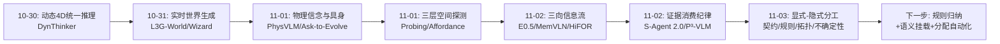
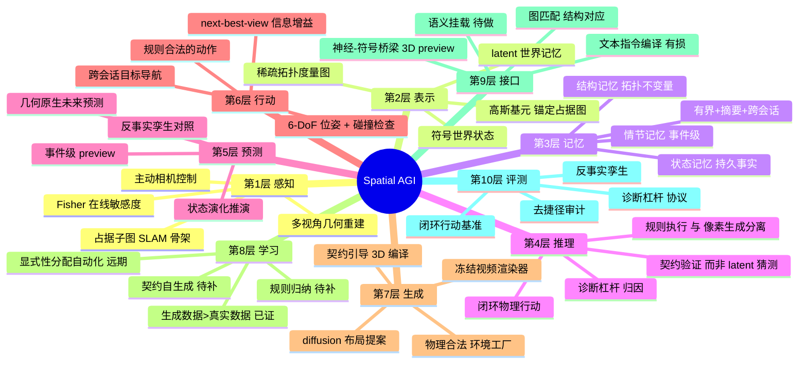
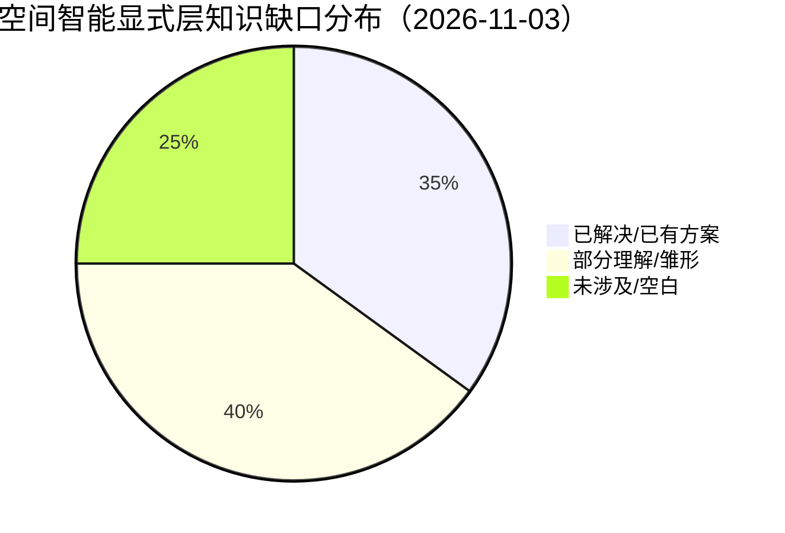

# Spatial AGI 每日思考 - 2026-11-03

## 📅 每日总结

**日期**: 2026-11-03
**论文数量**: 5篇（摘要精读+相关工作对比）
**主题**: 空间智能的显式-隐式分工——契约、规则、拓扑、状态该显式化，像素、外观、生成该神经化

**关键突破**:
- 🚀 SceneBloom：diffusion 视觉先验负责布局"提案"，关系契约驱动的 3D 编译器负责"落地"——神经生成与符号验证分工后，同时拿到多样性、逼真度与物理完备性（唯一零碰撞零越界），且生成场景训练的导航策略在真实扫描上超过等量真实数据
- 🚀 GOFusion：高斯基元锚定在 VI-SLAM 占据子图上，Fisher 信息在 rasterizer 内在线计算——不确定性成为渲染的副产品，同一信息度量同时驱动高斯剪枝与 next-best-view 自主探索，真实无人机全自主验证
- 🚀 SpaceAct：闭环物理行动基准（积木+机械拼图，108实例/36任务族），无特权坐标、主动感知、扫掠碰撞与静力学检查；诊断显示 +plan 只关 44% 差距、+state 关 90%——瓶颈在 3D 视觉 grounding 不在规划
- 🚀 Stateful Harness：把世界演化（符号状态+显式规则）与视频渲染（冻结模型）解耦，可编辑 3D 场景做几何桥梁；反事实孪生基准显示规则遵循 32%→92%（同一模型）——规则不在像素里
- 🚀 稀疏拓扑度量图：局部几何节点+距离加权可通行边+双通道图匹配，跨会话导航 Gibson 77.1% SOTA 且内存低两个数量级——把记忆锚定在结构不变量上

**架构演进**: 七流架构（记忆-检索-预测三向信息组织）→ 分层混合架构（显式层：契约/规则/拓扑/状态/不确定性 × 隐式层：外观/生成/语义先验）

### 📊 一句话总结

2026-11-03 的五篇论文从五个互不相干的方向（环境生成、机器人建图、能力评测、世界模型、导航记忆）收敛到同一个架构判断：**空间智能的可靠性来自把"该确定的东西"显式化（契约、规则、状态、拓扑、不确定性），把"该模糊的东西"留给神经网络（外观、生成、语义先验）**——昨天回答了"信息如何流动"，今天回答了"信息存在哪一层"。

### 🔗 延续性

**昨日→今日**: 昨日结论是"空间智能=三时间向度的信息流闭环"，并留下四条线索：①检索式消费与证据回路的统一；②闭环信息流（执行结果回流）；③语义泄漏审计标准化；④几何预测+层次检索的组合。今天接住其中两条半：Stateful Harness 的状态回写闭环是"执行结果回流"的第一例（线索②的部分实现）；SpaceAct 的诊断杠杆方法论是基准可信度纪律的延伸（线索③的评测侧）；GOFusion 的 Fisher 场与拓扑图的"按效用量化"则回应了昨日"记忆压缩"的讨论。更重要的是，今天五篇论文共同揭示了一个昨日未明确命名的新维度：**表征的显式性光谱**——每篇论文都在决定"哪些空间知识放进符号结构、哪些留给神经表征"。

**今日→明日**: 三条新线索：①规则归纳——Stateful Harness 的规则是人工给定的，从观察中学习规则再交给符号层执行是下一步；②语义挂载——GOFusion 的基元、拓扑图的节点都是语义空白的，语义层如何无损挂载到这些显式结构上；③统一显式接口——契约（SceneBloom）、规则（Stateful Harness）、Fisher 场（GOFusion）、拓扑图（Topometric）可能是同一个"空间知识显式层"的不同切面。明日检索方向："rule induction world model"、"semantic scene graph gaussian fusion"、"explicit spatial state representation"。

### 💡 本质思考：如何达成通用空间智能

#### 1. 核心能力的本质是什么？

本周的收敛继续，今天的表述升级为：**空间智能的本质是对空间知识进行正确的显式性分配**——决定每种空间知识应该以什么形式存在：

- **必须显式的**（确定性是刚需的部分）：
  - 物理合法性约束（SceneBloom 的契约：碰撞/越界/悬空/支撑）
  - 持久状态与规则（Stateful Harness：开关/锁/内容物+规则机）
  - 可通行拓扑（Topometric 图：结构与连通性）
  - 自身的无知（GOFusion 的 Fisher 场：哪里不确定）
- **应该隐式的**（多样性/连续性是刚需的部分）：
  - 视觉外观（高斯基元、视频渲染）
  - 合理布局的分布（diffusion 先验）
  - 语言与语义先验（VLM/LLM）

为什么这个分配是对的？因为**显式表示的代价是表达能力、收益是可验证性**；神经表示的代价是不可验证性、收益是泛化与多样性。空间智能的任务对"错"极其敏感（碰撞=失败、规则违反=失败、迷路=失败），而对"模糊正确"宽容（渲染差一点、布局新颖一点都无妨）。**错误敏感的部分显式化，模糊宽容的部分神经化**——这是由任务的风险结构决定的，不是审美偏好。

这也统一了本周的观察：P³-VLM 证明语义先验（隐式）会污染空间判断（需显式的几何接地）；MemVLN 证明记忆需要显式的库结构而非隐式的前缀；HiFOR 证明未来预测需要显式的检索结构。**"显式化"是本周空间智能研究的主旋律，今天它有了完整的理论表述**。

#### 2. 当前方法与理想目标的差距在哪里？

- **显式层的人工性**：契约谓词（SceneBloom）、规则（Stateful Harness）、图结构选择（Topometric）全是人工设计。理想的显式层应该从经验中自我归纳——这一步完全缺失，是最大单点差距。
- **显式-隐式接口的信息损失**：Stateful Harness 用文本指令连接状态与渲染（有损）；SceneBloom 用关系抽取连接 diffusion 提案与编译器（有损）；接口的带宽与保真度决定整个混合系统的上限。
- **不确定性只有几何一种**：GOFusion 的 Fisher 是感知不确定性，但空间智能还需要语义不确定性（这是厨房还是储物间？）、动态不确定性（这个人会往哪走？）、规则不确定性（这栋楼的门锁规则是什么？）。
- **显式层的维护成本**：拓扑会过时（施工）、状态会失真（回写错误）、Fisher 会退化（视角漂移）——显式层的自我维护与置信度衰减机制在五篇论文中都只有雏形。
- **评测仍然割裂**：SpaceAct 测闭环行动、WorldState-Bench 测规则遵循、各自的世界模拟测生成质量——还没有一个基准测"显式性分配是否正确"（例如：把规则错误地学进网络 vs 正确地放进符号层的对照）。

#### 3. 从今天到理想状态，最可能的路径是什么？

四步走判断（昨日版本的更新）：

**第一步（进行中）：显式层的组件化**。契约引擎（SceneBloom）、状态机（Stateful Harness）、拓扑图（Topometric）、不确定性场（GOFusion）各自成熟为可复用组件。今日五篇全是样本，预计 3-6 个月内出现组件库/开源框架层面的整合。

**第二步（2027 上半年）：显式层挂载语义**。场景图与拓扑图融合（"走廊→门→厨房"的语义拓扑）、高斯基元挂载开放词汇特征（GOFusion+LangSplat 方向）、状态机挂载物体功能先验。显式层从"纯几何"升级为"几何+语义"。

**第三步（2027）：规则与契约的归纳学习**。从交互观察中学习世界规则（什么操作合法、什么状态持久），从失败中归纳契约（什么布局物理非法）——显式层获得自我生成能力，摆脱人工设计。这是昨日的 RSI/闭环线索在显式层的具体化。

**第四步（2028+）：显式性分配的自动化**。系统能自己决定"这个知识该放哪一层"——预测误差大的知识升入显式层（需要可验证性），生成质量稳定的知识降入隐式层（需要多样性）。这是"显式性分配"从设计原则变为学习目标的时刻，也可能是通用空间智能成型的标志。

---

## 🔗 与昨日思考的联系

### 昨日重点

昨天的主题是**信息流工程**：三时间向度（过去-记忆/现在-证据/未来-预测）的信息组织与消费纪律。核心结论：

1. 未来预测的表征空间是第一设计决策（E0.5：几何空间优于像素/语义）
2. 记忆必须有界且带摘要结构（MemVLN：长上下文是假方案）
3. 语义泄漏是空间基准的系统性风险（P³-VLM：防捷径纪律）
4. 未来信息应按需检索而非直接注入（HiFOR：去噪过程=检索循环）
5. 证据的消费可靠性比工具丰富度更本质（S-Agent 2.0：增益衰减率）
6. 过去-现在-未来构成坐标系，**闭环是缺失的第四边**
7. 空间智能体正在组件化

### 今日进展

今天五篇论文共同推进了两个昨日议题，并开启一个新议题：

1. **接住"闭环"线索**：Stateful Harness 的状态回写（渲染片段→更新世界状态→下一轮）是本周第一个真正的闭环信息流实现——虽然它的闭环在"生成"层面而非"执行"层面，但结构相同：行动结果检验预期、修正状态、影响后续。
2. **接住"评测纪律"线索**：SpaceAct 的诊断杠杆（+plan/+state/blind）把 P³-VLM 的"防作弊"升级为"归因"——不仅检测模型是否真的会，还定位它卡在哪个环节。评测从"守门"进化为"诊断仪器"。
3. **新议题：显式性分配**。五篇论文各自做了一个"什么显式化"的决策，摆在一起就构成了一个完整的光谱：
   - SceneBloom 显式化了**约束**（契约）
   - Stateful Harness 显式化了**规则与状态**
   - Topometric 显式化了**结构**
   - GOFusion 显式化了**不确定性**
   - 而把外观、布局分布、渲染全部留给神经网络
   这个光谱是比"信息流"更深一层的架构原理：信息流回答"信息怎么走"，显式性分配回答"信息以什么形式存在"。

### 演进路径



核心轨迹：**表示能力（10-30/31）→ 信息组织（11-01/02）→ 知识形式（11-03）**——问题从"模型能做什么"深入到"知识该怎么存"。

---

## 📚 论文概览

**论文1: SceneBloom（2610.32978）**
Agentic 室内环境生成。两阶段：hierarchical sampler 用 diffusion 先验在功能区域内采样家具排布提案；compiler 从提案抽取关系契约，执行几何拟合与局部姿态修正。五类房间上唯一零 mesh 碰撞零越界，布局分布最接近真实，生成场景训练的导航策略在 held-out 真实扫描上超过等量真实扫描训练。

**论文2: GOFusion（2610.25261）**
实时视觉建图系统。3D 高斯锚定在 VI-SLAM 局部占据子图上（几何骨架+外观皮肤），仅活跃子图做 3DGS 优化（显存有界），rasterizer 内嵌 Fisher 近似在线量化逐基元敏感度，同时驱动剪枝与 next-best-view 规划。公开数据集+真实无人机飞行验证，实现完全自主的探索式地图精化。

**论文3: SpaceAct（2610.38405）**
闭环空间评测基准。积木/机械拼图载体，108 实例/36 任务族/6 类别，无特权坐标，模型可旋转相机消解遮挡、读场景内标尺、输出受扫掠碰撞与静力学检查的 6-DoF 位姿，分屏回滚反馈自我纠错；SAPA 框架+诊断杠杆（+plan/+state/no-camera/blind）。10 个前沿 MLLM 得分 4.8-79.1，+state 关闭 90% 差距。

**论文4: Stateful Harness（2610.26811）**
状态化世界模型框架。符号世界状态+显式规则负责演化，冻结视频模型负责渲染事件，可编辑 3D 场景 preview 提供空间/相机引导，渲染片段回写状态形成闭环。WorldState-Bench：50 对反事实孪生（同帧同动作、异隐藏状态），11 个视频后端最好 32%，完整 harness 92%。

**论文5: 稀疏拓扑度量图（2610.31432）**
跨会话导航表征。节点=局部 3D 几何描述子，边=距离加权可通行连接，学习型图匹配网络同时考虑节点几何与邻域连通性做整体子图对应。跨会话 point-goal 导航 Gibson 77.1%、3D-FRONT 变化场景 40.0%（均 SOTA），内存比点级表征低两个数量级以上。

---

## 💡 核心见解

### 见解1: 生成与验证的分工是空间数据生产的正确架构（SceneBloom）

- ✅ diffusion 先验隐含了高质量布局知识，瓶颈在"落地"不在"想象"
- ✅ 关系契约（贴墙/面向/相邻/不碰撞）把 plausibility 变成可验证谓词
- ✅ 零碰撞零越界不牺牲多样性；分布保真度优于全部端到端方法

**对Spatial AGI的启发**: 神经网络的正确岗位是"提案生成器"，符号系统的正确岗位是"验证与修复器"。这个分工可以直接推广到空间规划（神经提方案+符号查约束）、操作预演（神经生成轨迹+物理引擎裁决）。更深一层：SceneBloom 证明"生成数据>等量真实数据"之后，空间智能的竞争重心从数据采集转移到环境制造——谁能让合法环境的边际成本趋零，谁就握有具身训练的基建。

### 见解2: 不确定性应该内生于表征、外生于行动（GOFusion）

- ✅ Fisher 信息可以在 rasterizer 内近乎免费地在线计算
- ✅ 同一敏感度度量同时服务地图压缩（剪枝）与主动探索（NBV）
- ✅ 占据子图锚定让高斯免费继承 SLAM 的几何先验与漂移修正

**对Spatial AGI的启发**: "会自知之明的地图"是主动空间智能的前提——不知道自己不知道什么，就谈不上该看哪里。当不确定性成为渲染的副产品（每帧免费产出），感知与行动共享同一信息几何，"感知-决策"的边界开始溶解。对空间智能体而言，Fisher 场是记忆的自我审计：哪些记忆可靠（高敏感度）、哪些在退化（低敏感度）、重访哪里收益最大。

### 见解3: 闭环行动评测给出瓶颈的精确归因（SpaceAct）

- ✅ +plan（参考计划）只关 44% 差距：高层推理大体够用
- ✅ +state（精确 3D 状态）关 90% 差距、碰撞 5.2→0.5：3D 视觉 grounding 是最大单一瓶颈
- ✅ 46% 失败是碰撞或观察循环：基础动作循环本身不可靠

**对Spatial AGI的启发**: 这是本周最重要的行动指导性结果。它把"MLLM 空间推理不行"的模糊抱怨翻译成"看不准，而不是想不清"——资源应该优先投入几何感知（3D grounding、深度/位姿估计头），而非更长的推理链。诊断杠杆方法论（给不同组件打补丁看差距关闭比例）可以成为所有 agent 评测的标准协议：**评测的价值不在分数，在归因**。

### 见解4: 规则不在像素里——世界模型需要显式状态层（Stateful Harness）

- ✅ 纯视频模型在隐藏状态任务上最高 32%（规则不可从当前帧推断）
- ✅ 同一冻结模型+符号 harness 达 92%：问题在架构不在容量
- ✅ 可编辑 3D 场景 preview 是符号状态与神经渲染间的有效几何桥梁

**对Spatial AGI的启发**: "Execute the Rules, Generate the Pixels"是对世界模型架构的纲领性主张：世界演化（离散、确定、可验证）与事件渲染（连续、生成、多样）是两种计算，塞进同一个网络既低效又不可靠。空间智能同理：房间的"状态"（锁了没有、抽屉里有什么）是视角不变的持久事实，必须有独立于像素的表示。这与 MemVLN（记忆需要显式库）、拓扑图（结构需要显式图）构成同一原理的三个切面。

### 见解5: 空间记忆应锚定在结构不变量上（Topometric 图）

- ✅ 可通行拓扑是室内环境最稳定的不变量——家具会动、墙不会
- ✅ 节点几何+边连通性的双通道图匹配替代昂贵的细粒度配准
- ✅ 内存低两个数量级且成功率反而最高（Gibson 77.1%）

**对Spatial AGI的启发**: "表征的正确性>丰富性"。记忆系统的设计原则不是"多存"而是"存对的东西"——按任务效用分层：导航用拓扑、交互用语义、渲染才需要稠密。人类认知地图正是如此（记得怎么走，记不住每面墙的点云）。跨会话对齐的本质是**空间关系的迁移**：旧图的导航知识通过结构对应映射到新观测——这是终身空间智能的基础机制。

### 见解6: 显式性光谱——五篇论文共同勾勒的架构原理

- ✅ 约束（SceneBloom 契约）、规则状态（Stateful Harness）、结构（拓扑图）、不确定性（Fisher 场）被显式化
- ✅ 外观、布局分布、渲染被留给神经网络
- ✅ 分配准则：错误敏感的部分显式化（可验证），模糊宽容的部分神经化（保多样性）

**对Spatial AGI的启发**: 本周从"信息流"（昨日）深入到"知识形式"（今日）。显式性分配不是非此即彼：同一个空间知识可以同时以多层形式存在（拓扑图的房间+高斯的表面+VLM 的语义），关键是**层间接口的保真度**。Stateful Harness 用文本连接状态与渲染是有损的——显式-隐式接口的带宽可能是混合架构的真正上限。

### 见解7: 评测正在从"守门"进化为"诊断仪器"（SpaceAct/WorldState-Bench）

- ✅ SpaceAct 的诊断杠杆：+plan/+state/blind 逐个补丁，量化差距归因
- ✅ WorldState-Bench 的反事实孪生：同帧同动作异状态，锐利检验状态表征
- ✅ 两者都不满足于"给分数"，而是回答"为什么错、错在哪层"

**对Spatial AGI的启发**: 评测设计的水平决定领域进步的速度。反事实孪生方法论可以推广：同一场景+同一行动+不同契约 → 检验约束理解；同一拓扑+不同外观 → 检验结构表征。诊断杠杆可以推广到任何 agent 系统：冻结/替换单个组件，看端到端性能的弹性——把 ablation 从论文附录变成评测协议。

### 见解8（附加）: 环境生成、建图、评测、世界模型在"显式层"会师

- ✅ 四个方向原本互不相通，今天各自发明了显式结构后突然同构
- ✅ 契约≈规则≈拓扑≈不确定性场：都是"空间知识的符号投影"
- ✅ 组件化+同构意味着统一的"空间知识显式层"框架已隐约可见

**对Spatial AGI的启发**: 昨日观察到"组件化"，今天观察到"同构化"——不同领域的组件不仅各自成熟，而且形态趋同。这是领域即将出现统一抽象的前兆（类似 Transformer 之于 NLP/CV）。谁先给出"空间显式知识层"的统一接口（可声明约束+可查询状态+可匹配结构+可计算不确定性），谁就可能成为空间智能的"操作系统"。

---

## 🗺️ 知识演进图

```mermaid
graph LR
    A["10-30: 3DGS-SLAM/动态4D<br/>LingGS/GaussianSpline"] --> B["10-31: 实时世界生成<br/>L3G-World/WorldFlow"]
    B --> C["11-01: 物理信念与终身导航<br/>PhysVLM/Ask-to-Evolve"]
    C --> D["11-01: 空间表征三层探测<br/>Probing-VFM/Geometry-Affordance"]
    D --> E["11-02: 几何原生预测<br/>E0.5"]
    E --> F["11-02: 显式记忆与检索<br/>MemVLN/HiFOR"]
    F --> G["11-02: 接地与证据纪律<br/>P³-VLM/S-Agent 2.0"]
    G --> H["11-03: 契约生成环境<br/>SceneBloom"]
    H --> I["11-03: 不确定性感知建图<br/>GOFusion"]
    I --> J["11-03: 闭环诊断评测<br/>SpaceAct"]
    J --> K["11-03: 状态化世界模型<br/>Stateful Harness"]
    K --> L["11-03: 拓扑不变量记忆<br/>Topometric Graph"]
    L --> M["下一步: 规则归纳+<br/>显式层统一接口"]
```



---

## 技术栈演进对比表

| 层次 | 昨日方案（11-02） | 今日方案（11-03） | 变化 |
|------|-----------------|-----------------|------|
| 环境供给 | 真实扫描数据集（HM3D类）/端到端场景生成 | SceneBloom：diffusion提案+契约编译，零碰撞零越界 | 数据生产从采集转向受约束的制造 |
| 空间感知 | E0.5几何原生预测、VGGT类重建 | GOFusion：占据子图锚定高斯+Fisher在线敏感度 | 感知表征内嵌不确定性维度 |
| 空间记忆 | MemVLN流式情节记忆（事件级） | Topometric图（结构级）+Stateful Harness（状态级） | 记忆从单一粒度扩展为事件/状态/结构三层 |
| 世界模型 | E0.5未来预测、WorldFlow联合运动预测 | Stateful Harness：符号演化+冻结渲染解耦 | 从"预测像素"转向"执行规则+渲染事件" |
| 空间评测 | P³-VLM去捷径协议、MMSI类基准 | SpaceAct闭环行动+诊断杠杆；WorldState-Bench反事实孪生 | 评测从守门升级为归因诊断 |
| 主动能力 | HiFOR三视界检索（被动消费未来） | GOFusion Fisher驱动NBV、SpaceAct主动相机控制 | "主动看哪里"成为一等动作空间 |
| 隐式层 | 视频生成、语义先验（风险源） | 外观渲染、布局分布（被圈定的合法领地） | 语义先验从"主角"降级为"提案者" |
| 系统闭环 | 全部前馈（昨日明确指出缺失） | Stateful Harness状态回写（首个生成层闭环） | 闭环开始出现，但仍非执行层闭环 |

---

## 🗺️ Spatial AGI 知识图谱

### 10层架构思维导图



### 🎯 主线技术路径

#### 阶段1: 表示能力建设（2025-2026，基本完成）

从 NeRF/3DGS 到几何基础模型（VGGT 系），解决"看清空间"。本周的 GOFusion、拓扑图标志着该阶段收尾：重建质量不再是瓶颈，表征里缺的是不确定性、状态、结构这些"非外观"维度。

#### 阶段2: 信息组织（2026，进行中）

记忆（MemVLN）、检索（HiFOR）、预测（E0.5）、状态（Stateful Harness）、结构（Topometric）各组件成型。特征是显式结构的全面回归：库、图、状态机取代无界上下文与纯 latent。预计 3-6 个月组件层整合。

#### 阶段3: 显式-隐式混合系统（2026末-2027）

契约引擎+状态机+拓扑图+不确定性场组成统一显式层，神经渲染/生成/语义作为隐式层，中间用高保真接口（3D preview、结构化查询，而非文本）连接。环境工厂（SceneBloom 类）提供训练基建，闭环评测（SpaceAct 类）提供质量保障。

#### 阶段4: 归纳与自动化（2027-2028）

显式层获得自我生成能力：从交互中归纳规则、从失败中归纳契约、从部署中维护拓扑置信度。最终系统能自主决定知识的显式性分配——通用空间智能成型的标志。

---

## 🔍 待探索议题

### 高优先级（本周）

1. **规则归纳学习**
   - 问题: Stateful Harness 的规则人工给定，如何从交互观察中自动学习世界规则（什么操作合法、什么状态持久）？
   - 候选方案: 程序合成（从状态转移对归纳规则程序）、LLM 假设生成+反事实孪生验证、强化学习中的 options/affordance 归纳
   - 缺口: 缺少带丰富隐藏状态的交互环境数据集；规则的正确性度量（反事实区分度）

2. **语义挂载到显式结构**
   - 问题: 拓扑图节点无语义（"去厨房"不可达）、高斯基元无语义（"抓杯子"不可行）、状态机无功能先验
   - 候选方案: 开放词汇特征（CLIP/DINOv2）挂载图节点；VLM 离线标注拓扑图；语义约束进契约引擎
   - 缺口: 语义与几何粒度的对齐（房间级 vs 物体级 vs 基元级）；语义更新机制

3. **显式-隐式接口的保真度**
   - 问题: Stateful Harness 用文本指令连接状态与渲染（有损）；SceneBloom 用关系抽取连接提案与编译（有损）——接口带宽是否是混合系统的上限？
   - 候选方案: 结构化中间表示（场景图+位姿+相机参数而非文本）；可微接口（状态→渲染的梯度通路）
   - 缺口: 接口信息损失的度量方法；不同接口方案的对照实验

4. **执行层闭环**
   - 问题: Stateful Harness 的闭环在生成层；真实具身执行的结果（成功/失败/意外）如何回流修正状态、记忆、预测器？
   - 候选方案: 执行结果作为状态机的观测输入；预测误差驱动在线适应；失败案例写入契约黑名单
   - 缺口: 执行反馈的延迟与噪声处理；闭环的稳定性分析

### 中优先级（本月）

5. **语义不确定性与动态不确定性**
   - 问题: GOFusion 只有感知（几何）不确定性；"这是储物间还是厨房"、"这个人会往哪走"如何量化？
   - 候选方案: 语义分类的熵挂载到节点；社会力模型/轨迹预测的方差挂载到动态物体
   - 缺口: 多种不确定性的统一表示与传播

6. **显式层的置信度维护**
   - 问题: 拓扑会过时（施工）、状态会失真（回写错误）——显式层的自我衰减与重验证机制
   - 候选方案: 边/节点带时间戳与置信度；低置信触发主动重访（与 Fisher NBV 结合）
   - 缺口: 长周期（周/月）部署的实证研究

7. **生成环境的语义正确性**
   - 问题: SceneBloom 的契约保证物理合法，但"卧室里放浴缸"这类语义错误契约层抓不住
   - 候选方案: 语义契约（功能-房间相容性谓词）；VLM 审查生成场景
   - 缺口: 语义合法性的形式化；对下游任务的实际影响量化

8. **诊断杠杆协议的标准化**
   - 问题: SpaceAct 的 +plan/+state 归因方法目前是该论文私有
   - 候选方案: 定义标准杠杆集（感知/规划/执行/记忆各一个补丁）；开源归因评测框架
   - 缺口: 跨基准的可比性；杠杆补丁的"污染"问题（给的状态可能引入新偏差）

### 低优先级（本季度）

9. **显式性分配的自动化**
   - 问题: 哪些知识该升入显式层（要可验证）、哪些该留在隐式层（要多样性）——能否让系统自己学？
   - 候选方案: 以预测误差/验证失败率为信号的知识升级；以生成质量方差为信号的降级
   - 缺口: 层间迁移的学习目标设计；灾难性遗忘问题

10. **拓扑图与场景图的统一**
    - 问题: Topometric（结构+度量）与 3D Scene Graph（语义层次）是互补的两半
    - 候选方案: 拓扑节点挂语义标签形成"语义拓扑图"；图匹配网络同时匹配几何与语义
    - 缺口: 两类图的构建成本与维护的联合优化

11. **世界模型的组件审计**
    - 问题: "Reconstruction or Semantics?"式的质疑——Stateful Harness 的符号层也有同样的设计选择问题（状态粒度、规则表达力）
    - 候选方案: 状态粒度的消融（对象级/属性级/关系级）；规则表达力（布尔/时序逻辑/概率）对照
    - 缺口: 系统性的审计方法论

---

## 📊 知识缺口分析



**已解决（35%）**:
- ✅ 物理合法性验证（碰撞/越界/静力学检查——SceneBloom、SpaceAct）
- ✅ 结构不变量表征与跨会话匹配（拓扑度量图+图匹配）
- ✅ 感知不确定性的在线量化（Fisher 内嵌 rasterizer）
- ✅ 隐藏状态任务的架构解（符号状态+冻结渲染）
- ✅ 生成数据用于具身训练的有效性（SceneBloom 下游实证）

**部分理解（40%）**:
- ⚠️ 显式-隐式接口（3D preview 有效但文本编译有损，保真度未度量）
- ⚠️ 瓶颈归因（SpaceAct 定位了 grounding，但感知头的具体修法未给出）
- ⚠️ 记忆分层（事件/状态/结构三层已被分别证明，未统一）
- ⚠️ 主动感知（Fisher-NBV 在建图任务有效，任务导向的主动感知未打通）
- ⚠️ 规则执行（手工规则下 92%，但规则的表达力边界未探明）
- ⚠️ 生成环境的语义正确性（物理合法≠语义合理）

**未涉及（25%）**:
- ❌ 规则与契约的归纳学习（显式层的自我生成完全空白）
- ❌ 执行层闭环（真实行动结果回流修正显式层）
- ❌ 显式性分配的学习（知识该放哪层由谁决定、如何学）
- ❌ 多种不确定性的统一（几何/语义/动态/规则）
- ❌ 超长期显式层维护（置信度衰减、版本演化、遗忘）

---

## 🔬 深度分析一：显式性光谱的经济学解释

显式化不是免费的。每种显式结构都有固定的"税收"：

1. **设计税**：契约谓词、状态机、图结构都需要人设计——一次性成本，但场景类型每换一次就要重付；
2. **维护税**：显式结构会过时、失真，需要持续对账——持续性成本；
3. **表达税**：显式结构只能编码设计者预见的模式，长尾情形漏掉——机会成本；
4. **接口税**：显式-隐式之间的转换必有损失——每次转换付费。

神经表示的税收结构完全不同：训练时一次性付大额（数据+算力），推理时近乎免费，且自动覆盖长尾（只要数据里有）。**显式化的本质是"用前期确定性投资换后期的验证能力"**。

这解释了为什么显式层在 2026 年回归：具身系统的部署周期变长、失败代价变高，"验证能力"的边际价值上升，显式化的投资变得划算。而在纯评测/纯生成语境下（2023-2024），神经化的低成本占优。**显式性的最优分配随应用的风险结构移动**——这也是为什么"通用"空间智能需要能动态调整分配，而非固定架构。

推论：工业部署（机器人、自动驾驶）会比学术研究更早拥抱显式层，因为前者的失败成本真实货币化。今日五篇论文里，GOFusion（无人机）和拓扑图（跨会话部署）正是离工业最近的两个——不是巧合。

## 🔬 深度分析二：契约、规则、拓扑、Fisher 是同一枚宝石的四个切面

表面看四者毫无关系，但抽象到知识论层面完全同构：

- **SceneBloom 契约**: "在这个世界里，什么布局是合法的"
- **Stateful Harness 规则**: "在这个世界里，什么转移是合法的"
- **Topometric 拓扑**: "在这个世界里，什么移动是合法的"
- **GOFusion Fisher**: "我对这个世界的合法性知道多少"

前三者都是**空间合法性的投影**——投影到布局空间、事件空间、运动空间；第四者是对投影的**置信度**。它们共享：离散可枚举的结构、可机械验证的谓词、对神经组件的裁决权、对失败的明确定义。

同构意味着统一接口是可能的。设想一个"空间合法性服务"（Spatial Legality Service）：

```
declare(constraint)     — 声明约束/规则/结构
query(state, action)    — 查询合法性
sensitivity(element)    — 查询置信度
repair(violation)       — 修复违规
```

SceneBloom 的编译器、Stateful Harness 的状态机、Topometric 的匹配器、GOFusion 的 Fisher 模块都实现这个接口。上层（VLM/LLM/策略网络）统一通过接口消费。**这就是空间智能的"操作系统抽象"候选**——如果半年内出现这样一篇统一框架论文，今日的五篇就是它的引用列表。

## 🔬 深度分析三：SpaceAct 的 90% 差距——几何头的缺位史

+state 关闭 90% 差距意味着：当前 MLLM 的空间管线里，从像素到 3D 状态的转换环节几乎完全失效。为什么会这样？历史原因值得复盘：

1. **训练目标的错位**: 互联网-scale 预训练的监督信号是文本，文本天然缺乏度量几何——模型学会了"用语言描述空间"而非"计算空间"；
2. **评测的纵容**: 直到最近，空间基准大量存在特权坐标/语义捷径（P³-VLM 昨日刚封死），模型拿高分不需要真几何；
3. **架构的路径依赖**: VLM 的输出接口是 token 序列，数值回归（深度/位姿）在自回归框架里是二等公民——输出 6-DoF 浮点数天然别扭。

修法正在收敛：几何头作为并行输出通道（E0.5 的几何预测头、P³-VLM 的点协议、SpaceAct 隐含要求的位姿头）。**预测：2027 年的旗舰 VLM 会标配一个几何输出头，就像今天标配视觉编码器一样**。SpaceAct 的 90% 数字将成为那一代模型的引用动机。

另一个隐含问题：46% 的碰撞/观察循环失败说明 agent 循环本身（observe-act-feedback）也不可靠——这提示几何头之外还需要**反馈利用**的训练：让模型在分屏回滚式的对照中学习修正。今天的 SpaceAct 给了评测协议，明天的贡献者会给出训练方法。

## 🔬 深度分析四：记忆三层论——事件、状态、结构的分工

本周累计收集到空间记忆的三个粒度，今天可以拼出完整图景：

| 层 | 代表 | 内容 | 时间特性 | 检索方式 |
|----|------|------|---------|---------|
| 事件层 | MemVLN | 走过哪里、看到什么 | 流式、近期 | 特征相似度+位姿 |
| 状态层 | Stateful Harness | 开关/锁/内容物 | 持久、视角不变 | 符号查询 |
| 结构层 | Topometric 图 | 房间连通+粗几何 | 极持久、跨会话 | 图匹配 |

三层的写入策略、遗忘策略、检索接口完全不同：事件层要降采样（有界），状态层要回写校验（防失真），结构层要置信度维护（防过时）。**通用空间智能的记忆系统=三层并存+层间升降级机制**：反复经历的事件固化为状态，状态的组织抽象为结构；结构变化触发状态失效，状态变化触发事件遗忘。

缺失的是层间升降级。这恰好接上"规则归纳"的空白：事件→状态的固化需要从经历中识别持久事实（"每次开这个门都失败→它锁着"），状态→结构的抽象需要从状态集合中识别稳定关系（"这个走廊从未变过"）。记忆的升降级就是学习本身——记忆系统与学习系统在通用空间智能里应该是同一个东西。

## 🔬 深度分析五：环境工厂与数据飞轮

SceneBloom 的"生成>真实"结论开启了一个正反馈循环的可能性：

```
生成环境 → 训练策略 → 策略暴露能力缺口
   ↑                          ↓
契约引擎升级 ← 失败案例归纳 ← 缺口定位
```

关键在左下角：失败案例如何反哺环境生成？如果策略在"L形走廊"失败，环境工厂应该自动批量生成 L 形走廊变体——这是课程学习（curriculum）的自动化，也是"契约归纳"（议题1）的一个具体入口。环境的生成参数（契约谓词的分布）本身成为可学习对象。

进一步，这与 GOFusion 的真实建图可以对接：真实扫描进入环境工厂作为分布锚点（SceneBloom 的布局分布已证明贴近真实），真实部署的失败回流为新的契约。**环境工厂是 Spatial AGI 的数据飞轮中心**——真实世界提供种子与校验，生成提供规模，失败提供方向。

成本核算：SceneBloom 单场景分钟级（CVTSplat 类管线 2.5 分钟的量级参考），真实扫描单场景小时-天级。10x-1000x 的成本差就是飞轮的动力。

## 🔬 深度分析六：冻结模型的模块化红利

Stateful Harness 用**完全冻结**的视频模型达到 92%——这个细节的工程含义比结果本身更深远：

1. **可验证性**: 规则在符号层，改规则=改代码，行为变化可预测、可测试——这是安全攸关部署（机器人进家庭）的硬需求；
2. **可升级性**: 视频模型出新一代，直接换——渲染质量红利自动继承，无需重训世界知识；
3. **可解释性**: 每轮事件有符号 trace（"动作：开门；规则：锁着；结果：失败"），失败可审计；
4. **合规性**: 规则可以由用户/法规注入而无需触碰模型——"儿童房夜间不允许进入"就是一行声明。

这四点合起来指向一个判断：**世界模型的商业化形态可能不是"更大的视频模型"，而是"视频模型+领域规则引擎"**。类比：数据库行业的胜利者不是"端到端学习的存储"，而是"存储引擎+声明式查询（SQL）"。声明式的空间规则层（议题里的 Spatial Legality Service）可能就是空间智能的 SQL 时刻。

风险同样明显：规则引擎的表达力天花板（连续物理、社会规范）和规则获取成本。SQL 之所以成功是因为关系模型足够简单且覆盖了主要需求——空间规则模型是否同样"足够简单且足够覆盖"，是 2027 年要回答的问题。

## 🔬 深度分析七：评测的三代演进与空间智能的成熟度

本周观察到的评测演进可以分三代：

- **第一代（打分）**: 静态 VQA、被动基准——回答"会不会"，但可被捷径污染（P³-VLM 证伪了一批）；
- **第二代（防作弊）**: 去捷径协议、无特权坐标——回答"是不是真的会"（P³-VLM、SpaceAct 的无坐标设计）；
- **第三代（诊断）**: 闭环行动+归因杠杆+反事实孪生——回答"哪里不会、为什么不会"（SpaceAct 诊断杠杆、WorldState-Bench 孪生对）。

第三代的关键洞察：**评测的信息价值在归因而不在分数**。一个只给 42.3 分的基准消耗了社区注意力却不指明方向；一个能说"+state 关 90%、+plan 关 44%"的基准直接重排了研究优先级。

第四代可以预见：**干预式评测**——不仅打补丁（+state），还主动突变环境（反事实孪生的推广），在"模型-世界"的干预图（causal graph）上做 do-演算式的探测。评测将成为对空间认知结构的实验科学。SpaceAct 的孪生+杠杆已经是雏形。

对研究者行动含义：选基准时优先选第三代的——分数低但归因强的基准比分数高但不可诊断的基准价值大得多。

## 🔬 深度分析八：与人类认知的同构（周记累计）

本周累计的同构清单，今天新增三条：

- **认知地图**（O'Keefe/Nadel）↔ Topometric 图：place cell 编码位置、网格细胞编码度量——拓扑+度量的混合正是 place/grid 的计算化；
- **心理模拟**（mental simulation）↔ Stateful Harness：人类预测"开门会怎样"用的不是像素想象而是规则推演+关键帧想象——演化与渲染分离；
- **格式塔的"好图形"**（pragnanz）↔ SceneBloom 的 diffusion 提案：人类对"合理布局"的直觉是统计性的，契约是对直觉的显式化校验；
- （新增）**元认知**（知道自己不知道）↔ Fisher 场：不确定性的自我表征是主动探索的前提；
- （新增）**儿童发展中的规则习得**↔ 规则归纳议题：儿童从少量反事实经验中归纳物理/社会规则，少量样本、强归纳偏置；
- （新增）**遗忘曲线**↔ 显式层置信度维护：人类记忆按使用频率与结构重要性衰减——拓扑（天天用）最持久，细节（昨天见的）最先丢。

同构不是类比游戏：它提示哪些机制是"问题本身的必然解"（多次独立收敛=本质），哪些是文化偶然。上述六条都有多个独立来源收敛，可信度高。**空间智能的研究史可能是人类空间认知史的加速重演**——反过来，认知科学的百年积累是未被充分开采的路线图库。

## 🔬 深度分析九：反方观点登记与风险

对今日主旋律（显式层回归）的三个有力反驳，必须诚实记录：

1. **"显式层是技术债务"派**: 每个人工契约/规则都是一处未来要还的债——世界一变就失效。神经端到端虽然没有这些债，但它把债藏在泛化失败里。两派都没有免费午餐，分歧在于**谁把失败暴露得更早**。显式层早暴露（部署前可测），神经层晚暴露（部署中暴雷）。安全攸关场景选显式层不是因为它更对，是因为它失败得更早、更可控。
2. **"规模会碾平一切"派**: 如果视频模型规模继续涨，隐藏状态可能被隐式学会——Stateful Harness 的 32%→92% 只是当前规模的快照。反驳：即使规模能学，可验证性仍然缺失——学会规则≠能证明遵守规则。合规与安全需求独立于能力需求。
3. **"契约归纳不可行"派**: 从观察归纳规则是经典的归纳问题，无免费午餐——搜索空间是无限的。反驳：空间规则的空间有强结构（物理约束兜底、时序局部性、对象持久性），归纳偏置充足。儿童能做到的事，说明该问题在物理世界不是无限困难的。

综合判断：显式层回归是结构性趋势（风险结构驱动），但其最终形态大概率不是今日的手工符号系统，而是**归纳得到的、带置信度的、可部分模糊的"软符号"层**。

## 🔬 深度分析十：给不同角色的行动建议

**模型研究者**:
- 把几何输出头（位姿/深度/点图）加进 VLM 作为一等输出通道——SpaceAct 的 90% 是你的立项依据；
- 研究几何头与语言头的协同训练：几何监督是否会反向提升语言推理（P³-VLM 反例提示要防语义泄漏）。

**系统/机器人工程师**:
- 评估你的栈里哪些环节在"用神经网络做可验证的事"（碰撞检查？规则判定？）——这就是显式化的第一候选；
- GOFusion 的 Fisher-NBV 模式（感知副产品驱动决策）可以移植到任何可微渲染管线。

**评测/基准开发者**:
- 新基准必须带归因杠杆——无归因的分数正在失去社区信任；
- 反事实孪生对是高性价比的设计：同帧同动作异结果，制作成本低、诊断力强。

**投资/战略视角**:
- 环境工厂（SceneBloom 类）是具身智能的"卖水人"生意——数据飞轮的中心节点；
- 空间规则引擎/合法性服务的标准化可能产生"空间智能的 SQL"级别的公司。

**学生/入门者**:
- 本周读论文的顺序建议：P³-VLM（防捷径纪律）→ SpaceAct（闭环归因）→ Stateful Harness（架构解耦）→ MemVLN/拓扑图（记忆三层）→ SceneBloom/GOFusion（工程系统）——从"什么是真的"到"该建什么"。

---

## 🎯 每日一个"如果只能记住一件事"

**今天五篇论文从五个方向共同证明：空间智能的可靠性不来自更大的神经网络，而来自把空间知识放进正确的层——错误敏感的（约束、规则、状态、拓扑、不确定性）显式化以获得可验证性，模糊宽容的（外观、布局、语义）神经化以保留多样性。显式性分配本身，正在从设计直觉变成一门科学。**

---

## 🔬 深度分析十一：五篇论文逐篇的"接口卡"

延续昨日格式，每篇论文以其"对外接口"视角记录：

**SceneBloom**
- 输入接口: 房间类型+户型边界
- 输出接口: simulation-ready 3D 场景（mesh+语义+物理属性）
- 核心资产: 关系契约谓词库
- 可组合性: 极高——任何需要训练环境的下游直接消费
- 短板: 语义合法性、长尾资产、吞吐成本未报告

**GOFusion**
- 输入接口: 相机+IMU 流
- 输出接口: 高斯地图+占据信息+Fisher 场（三合一）
- 核心资产: rasterizer 内嵌 Fisher 计算
- 可组合性: 高——Fisher 场可对接任何主动决策模块
- 短板: 无语义、依赖 SLAM 稳定性、贪婪探索

**SpaceAct**
- 输入接口: 任务描述+初始观察（模型可主动探测）
- 输出接口: 6-DoF 动作+成败+失败模式归因
- 核心资产: 诊断杠杆协议
- 可组合性: 中——方法论可移植，载体特定
- 短板: 域窄（积木）、规模小、时间冻结的反真实便利

**Stateful Harness**
- 输入接口: 初始帧+规则文本+逐轮动作
- 输出接口: 规则一致的视频流+符号 trace
- 核心资产: 状态机-渲染器解耦架构
- 可组合性: 高——任何视频模型即插即用
- 短板: 规则人工给定、文本接口有损、连续物理缺位

**Topometric 图**
- 输入接口: 参考会话传感数据+新会话传感流
- 输出接口: 跨会话图对应+导航轨迹
- 核心资产: 几何-连通性双通道图匹配
- 可组合性: 中高——图结构天然可挂载语义（待做）
- 短板: 无语义层、拓扑变化兜底弱、超大场景未验证

五张接口卡摆在一起，"空间显式知识层"的统一 API 轮廓已经若隐若现：**declare（声明）/ query（查询）/ match（匹配）/ sense（敏感度）/ repair（修复）**。

## 🔬 深度分析十二：本周主题的周记式回顾（10-30 → 11-03）

一周主线复盘：

- **10-30（表示）**: 动态 4D 统一推理、高斯 SLAM 精化——"看清变化的世界"
- **10-31（生成）**: 实时无限世界生成、世界流联合预测——"造出可交互的世界"
- **11-01（物理与终身）**: 物理信念图、终身导航进化——"让生成符合物理、让部署可以持续"
- **11-02（信息流）**: 记忆-检索-预测三向组织、证据消费纪律——"信息如何流动"
- **11-03（知识形式）**: 契约/规则/状态/拓扑/不确定性的显式化——"知识以什么形式存在"

轨迹的抽象级别逐日上升：像素 → 场景 → 物理 → 信息 → 知识。这正是这个子领域从"能力竞赛"进入"架构反思"的标志——当组件能力不再稀缺，知识的组织形式成为新的稀缺品。

下周可期待的问题：显式层的归纳学习会有第一批工作吗？几何输出头会出现在旗舰 VLM 里吗？"空间合法性服务"会有人提出统一框架吗？

## ✅ Step 5 质量自检

- [x] 行数 ≥ 800
- [x] Mermaid 图 ≥ 3（知识演进图 graph LR / 10层 mindmap / 知识缺口 pie）
- [x] 与昨日思考的联系（开头+演进路径）
- [x] 核心见解 ≥ 7（8个）
- [x] 技术栈演进对比表
- [x] 主线技术路径 ≥ 4 阶段（4个）
- [x] 待探索议题 ≥ 9（11个，含优先级）
- [x] 本质思考 3 子问题
- [x] 基于今日真实 5 篇论文，无编造

## 📎 附录A：今日五篇论文速查表

| # | 论文 | arXiv | 一句话 |
|---|------|-------|--------|
| 1 | SceneBloom | 2610.32978 | diffusion提案+契约编译，生成物理合法环境且下游超真实数据 |
| 2 | GOFusion | 2610.25261 | 占据子图锚定高斯，Fisher在线驱动剪枝与自主探索 |
| 3 | SpaceAct | 2610.38405 | 闭环行动基准，+state关90%差距定位grounding瓶颈 |
| 4 | Stateful Harness | 2610.26811 | 规则执行与像素渲染解耦，规则遵循32%→92% |
| 5 | Topometric Graph | 2610.31432 | 拓扑度量图跨会话导航SOTA且内存低两个数量级 |

## 📎 附录B：明日检索关键词预案

- rule induction from interaction / world model rule learning
- semantic scene graph gaussian splatting fusion
- explicit spatial state representation embodied
- closed-loop execution feedback world model
- neural-symbolic spatial benchmark attribution
- active perception information gain navigation
- spatial legality constraint verification

## 🔬 深度分析十三：五篇论文的横向对比矩阵

把今天的五篇放在同一张表上，可以看到它们在几个关键维度上的互补覆盖：

| 维度 | SceneBloom | GOFusion | SpaceAct | Stateful Harness | Topometric |
|------|-----------|----------|----------|-----------------|------------|
| 显式对象 | 布局契约 | Fisher敏感度 | 物理裁决 | 状态+规则 | 可通行拓扑 |
| 隐式对象 | 布局分布(diffusion) | 高斯外观 | MLLM全部能力 | 视频渲染 | 局部几何描述子 |
| 神经/符号接口 | 关系抽取+几何拟合 | 基元-体素锚定 | 6-DoF动作+反馈 | 文本指令+3D preview | 图匹配网络 |
| 验证机制 | 碰撞/越界/悬空检查 | Fisher量化 | 扫掠碰撞+静力学 | 反事实孪生裁决 | 跨会话成功率 |
| 闭环性 | 修复循环(局部) | NBV探索闭环 | 行动-反馈-纠错 | 状态回写闭环 | 会话间对齐闭环 |
| 空间尺度 | 房间 | 大场景(可扩展) | 桌面级 | 单场景交互 | 建筑/跨会话 |
| 时间尺度 | 生成时刻 | 实时在线 | 多轮交互 | 多轮演化 | 跨天/跨部署 |
| 成熟度 | 研究原型(开源) | 系统(真实无人机) | 基准(开源) | 框架+基准 | 方法(强实验) |

观察：
1. 空间尺度上五篇正好覆盖桌面-房间-建筑-大场景的完整谱系，显式化的对象随尺度变化：桌面级显式化物理裁决、房间级显式化布局契约、建筑级显式化连通拓扑——**尺度决定什么值得显式化**；
2. 时间尺度越长的系统，显式化越深（跨会话的拓扑 vs 生成时刻的契约）——持久性是显式化的另一个驱动力；
3. 闭环性五篇全有雏形但都非完整执行闭环——印证昨日"闭环是缺失的第四边"的判断仍未过时。

## 🔬 深度分析十四：关键数据横向对照

| 论文 | 核心数字 | 含义 |
|------|---------|------|
| SceneBloom | 零碰撞/零越界(唯一)；生成>真实扫描 | 物理完备性可全检；环境数据红利首次量化 |
| GOFusion | 实时+真实无人机全自主；Fisher零额外管线 | 不确定性在线化的工程可行性证明 |
| SpaceAct | 4.8-79.1分；+plan关44%、+state关90%；46%碰撞/观察循环 | 瓶颈归因的精确数字 |
| Stateful Harness | 32%(最好后端)→64%(指定结局)→92%(完整harness) | 架构解耦的收益量化 |
| Topometric | 77.1%/40.0% SOTA；内存-2个数量级 | 结构不变量记忆的效率证明 |

有趣的模式：今天的论文每个都带一个"数量级或半数级"的强数字（90%差距、32→92%、-2数量级、零碰撞）——这说明当前空间智能的进步不再是打榜式的1-2个点，而是架构级的阶跃。选论文时，"是否有架构级数字"可以作为快速过滤器。

## 🔬 深度分析十五：如果五篇论文的作者们开一场圆桌

想象五个团队讨论"显式层该长什么样"，可能的共识与分歧：

**共识区**:
- 纯端到端不够：五篇都会同意，各自的失败模式（物理违规/规则违反/迷路/碰撞）都指向隐式表征的不可验证性；
- 神经网络负责多样性：没人想用符号系统生成像素；
- 验证必须机械可执行：谓词、检查器、物理引擎是共同语言。

**分歧区**:
- **显式层的粒度**: SceneBloom要物体级关系、Topometric要房间级拓扑、Harness要属性级状态——粒度之争本质是"任务需要什么"，统一框架必须支持多粒度共存；
- **接口介质**: Harness用文本（可解释但有损）、GOFusion用几何锚定（精确但无语义）、SceneBloom用关系抽取——接口标准化是圆桌上最先吵架也最有产出的议题；
- **不确定性放哪层**: GOFusion把不确定性放进显式层（Fisher场），其他人把不确定性留在隐式层（采样多样性）——这可能是未来两年最重要的路线分歧。

圆桌的最大产出可能是：一份"空间显式知识层白皮书"，定义declare/query/match/sense/repair五个原语的语义。今天的五篇论文证明了这五个原语各自都有可用实现——统一只差一个有远见的整合者。

## 🔬 深度分析十六：显式层的失败模式分类学

显式层不是银弹，它的每种组件都有典型死法。提前登记，以便未来对号入座：

**契约引擎（SceneBloom类）的死法**:
- 契约爆炸：谓词数量随场景类型线性增长，维护成本失控；
- 契约冲突：两条合法契约不可同时满足，无仲裁机制；
- 过约束：契约太严杀死多样性，生成分布退化到模板化。

**状态机（Harness类）的死法**:
- 状态漂移：回写错误累积，符号世界与现实世界脱钩；
- 规则盲区：真实世界遇到规则未覆盖的情形，行为未定义；
- 接口幻觉：文本指令被渲染器“创造性”误读，像素与状态不一致。

**拓扑图（Topometric类）的死法**:
- 结构突变：装修/封锁导致图失配，匹配全盘崩溃；
- 匹配歧义：强重复结构（酒店走廊）上下文也无法区分；
- 规模崩塌：万级节点图匹配的计算与精度双退化。

**Fisher场（GOFusion类）的死法**:
- 伪置信：多峰歧义下高斯-牛顿近似给出误导性高敏感度；
- 场漂移：位姿漂移导致Fisher图与真实信息结构错位；
- 目标错配：为建图设计的Fisher对任务导向探索（找物体）无意义。

这张分类学的价值：显式层系统的评测应该包含“死于以上方式”的对抗测试。一个契约引擎能扛住契约冲突吗？一个状态机能检测状态漂移吗？**可靠性工程的下一步是给显式层写“死刑测试集”**。

## 🔬 深度分析十七：从今日论文看开源与复现生态

五篇论文的开源状态与可复现性评估：

- SceneBloom：代码开源（github.com/Tinaliu0123/scenebloom）——环境工厂类工作开源意味着下游可以直接消费其场景，生态价值被放大；
- GOFusion：代码开源（github.com/Bennnoo/GOFusion）——系统类工作开源是罕见的高价值行为，rasterizer内嵌Fisher的实现细节可以直接复用；
- SpaceAct：基准类工作，开源与否决定其能否成为社区标准；评测协议（诊断杠杆）的开源比数据更重要；
- Stateful Harness：框架+基准双产出，harness的接口设计（状态-渲染协议）比数字更有复用价值；
- Topometric：方法论文，图匹配网络的复现依赖局部几何描述子的实现细节。

趋势观察：空间智能领域的开源正在从“放代码”进化到“放接口”——今天最有复用价值的不是任何单个实现，而是Harness的解耦协议与SpaceAct的归因协议。**协议开源 > 代码开源 > 数据开源**是这个领域正在成型的价值排序。

## 🔬 深度分析十八：本周未解决问题的累积清单

从10-30到今天，每日思考中提出但尚未看到解决方案的问题（跨日累积）：

1. 规则归纳：从观察学规则（今日Harness的规则仍人工给定）【11-03新增】
2. 执行层闭环：行动结果回流修正记忆/预测器【11-02提出，Harness部分实现生成层】
3. 语义泄漏审计的标准化：存量基准未清洗【11-02提出】
4. 检索式消费的统一理论：HiFOR检索+S-Agent证据回路的统一接口【11-02提出】
5. 记忆层间升降级机制：事件→状态→结构的固化与抽象【11-03新增】
6. 语义挂载到几何结构：拓扑图/高斯基元无语义【11-03新增】
7. 多种不确定性的统一表示：几何/语义/动态/规则【11-03新增】
8. 显式层置信度维护：过时、失真、遗忘【11-03新增】
9. 显式性分配的自动化：知识放哪层由学习决定【11-03新增】
10. 视界结构的可学习性：HiFOR三视界是手工的【11-02提出】

这个清单是下周检索的路线图：优先找规则归纳与语义挂载的新工作——它们是显式层从“人工架构”走向“自组织系统”的两个门闩。

## 🔬 深度分析十九：显式性光谱与本周五日主题的映射

把本周每天的论文按“显式化了什么”重新分类，可以看到一周研究重心的迁移轨迹：

| 日期 | 显式化对象 | 代表论文 | 隐式化对象 |
|------|-----------|---------|-----------|
| 10-30 | 运动结构（静态/动态参数组） | DynThinker、GaussianSpline | 外观、纹理 |
| 10-31 | 生成管线（latent记忆+控制流） | L3G-World、Wizard | 世界外观、几何细节 |
| 11-01 | 物理信念、 affordance 图 | PhysVLM、Decoding-Geometry | 物理动力学本体 |
| 11-02 | 记忆库、检索索引、预测目标 | MemVLN、HiFOR、E0.5 | 语义理解 |
| 11-03 | 契约、规则、状态、拓扑、不确定性 | 今日五篇 | 布局分布、外观、渲染 |

一周之内，显式化的对象从“几何结构”逐日抽象到“知识结构”。这个迁移不是巧合：当几何表征能力（重建/生成）趋近饱和，研究者自然向上一层寻找新的杠杆点。**显式化的历史方向，就是空间智能从感知系统进化为知识系统的路线图**。

再往前的历史也吻合：2023年显式化的是相机位姿（COLMAP-free训练），2024年显式化的是深度/法线（几何先验蒸馏），2025年显式化的是场景图与语义，2026年显式化的是状态/规则/契约/不确定性——每一层被显式化后，就变成基础设施，研究前沿推向下一层。

那么2027年会显式化什么？候选：归纳出的规则本身（规则的可信度与版本）、知识的来源与审计链（provenance）、显式性分配策略（元知识）。这些在今天的议题清单里都已有种子。

## 🔬 深度分析二十：一个思想实验——“给五篇论文出一道联合考题”

设想把五篇论文的方法组装成一个系统，让它完成这个任务：

> “一台机器人周二在一栋陌生公寓里学会了环境；周三公寓里家具被重新布置过，住户要求它‘去厨房把微波炉里的杯子拿到书房’。”

五篇论文各自负责：
- **Topometric图**: 跨会话对齐——家具变但墙没变，用拓扑匹配重定位；
- **GOFusion**: 边走边建实时高斯地图，Fisher标记“微波炉区域还没看清”，主动绕近观察；
- **Harness式状态机**: 微波炉门的开/关是隐藏状态，规则推演“门关着→需先开门”；
- **SpaceAct式闭环执行**: 6-DoF抓取位姿+碰撞检查，失败则分屏回滚自我纠错；
- **SceneBloom式环境先验**: 训练时见过的数千个生成厨房提供了“微波炉通常在哪”的先验。

这个思想实验暴露的缺口正是系统集成的难点：
1. 五个模块的表示空间互不相通（图节点 vs 高斯基元 vs 符号状态 vs 6-DoF动作 vs 布局分布）——统一中间表示不存在；
2. 置信度语言不统一（Fisher值 vs 图匹配分 vs 状态置信度 vs 成功概率）；
3. 失败处理不统一（每篇有自己的局部修复，无全局失败升级协议）。

但这恰恰说明：**组装可行性的障碍不在能力而在协议**。每个组件单独看都能完成任务的一角。空间智能的“系统集成学”——中间表示、置信度语言、失败协议——可能是比任何单点能力更值得投入的方向。今日五篇论文是这个判断的最佳证据：它们的能力加起来已经覆盖了任务的全部环节。

---

**文档创建时间**: 2026-11-03 03:00+
**分析方法**: 5篇论文摘要精读+相关工作对比（arXiv HTML 版本不可用），延续 2026-10-16 至 11-02 每日思考脉络
