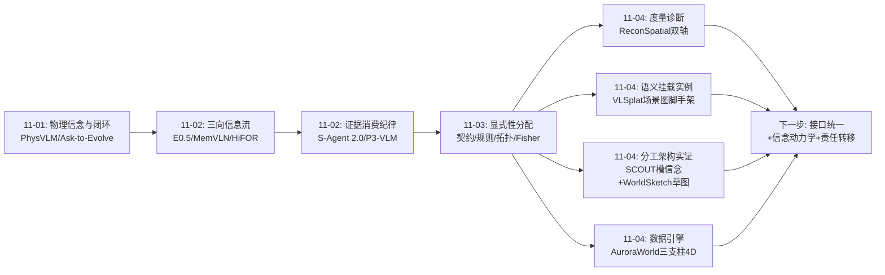
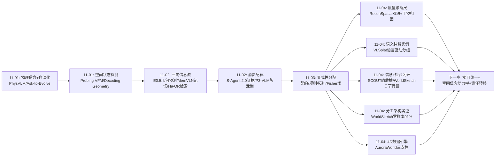
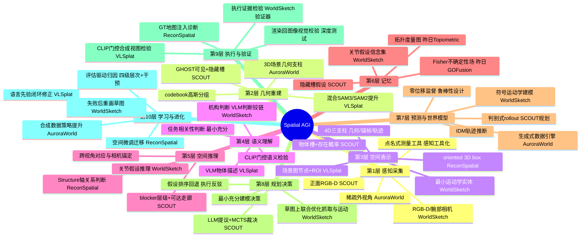
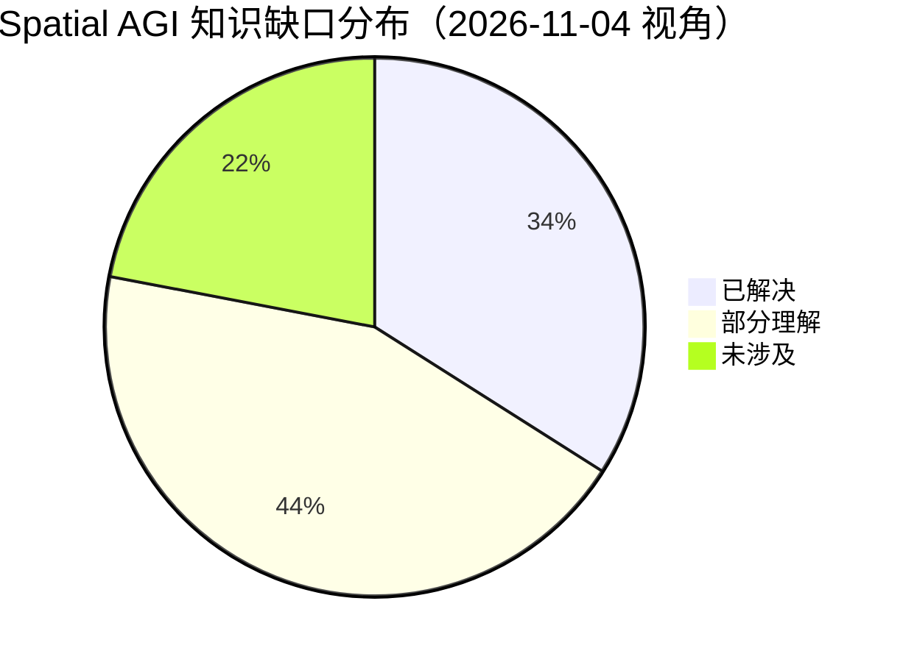

# Spatial AGI 每日思考 - 2026-11-04

## 📅 每日总结

**日期**: 2026-11-04
**论文数量**: 5篇（HTML精读+深度分析）
**主题**: 空间知识的"分工架构"成型——VLM/LLM 管语义判断、测量管度量、规划器管几何、世界模型管裁决，接口是显式可校验的空间模型

**关键突破**:
- 🚀 ReconSpatial：把"联合多视角 3D 重建"变成空间评估范式，双轴打分揭示 18 个前沿 LVLM 普遍"关系对、尺度错"（GPT-6-Astra Structure 81.4% vs Metric 58.7%），GT 地图注入使导航成功率 +55-70pp——诊断书：缺的是度量几何，不是关系推理；瓶颈在感知，不在规划
- 🚀 WorldSketch：VLM 的第三种角色——画任务最小充分的运动学世界草图（门=铰链上的一个 link，其余厨房全是无标签体素），深度测量出度量、规划器算运动，零样本 RoboCasa 91%（超次优 58pp）、LIBERO-PRO 97%，且成功率对 VLM 档位不敏感——架构功劳大于模型功劳
- 🚀 SCOUT：可见/隐藏槽的物体级"幻觉"重建隐藏场景，blocker 层级+可达走廊的关系规划状态做感知-规划接口，LLM 只提议、世界模型 MCTS 裁决——遮挡操控的完整闭环模板，真机验证
- 🚀 VLSplat：场景图从"输出抽象"反转为"训练脚手架"，语言先验通过"合成物体视图+CLIP 门控"主动修正高斯分组（组内去噪+组间补全）——语言从被动注释变成空间优化的监督信号
- 🚀 AuroraWorld：exo→ego 合成重构为"稀疏观测下的隐藏 4D 具身状态推断"，几何/关键帧/轨迹三支柱先验条件化扩散，世界模型作为数据引擎再获仿真+真机实证

**架构演进**: 分层混合架构（显式层×隐式层）→ **分工架构**（语义判断层：VLM/LLM × 度量测量层：深度/IDM × 几何计算层：规划器 × 物理裁决层：世界模型/MCTS，接口=显式可校验空间模型）

### 📊 一句话总结

2026-11-04 的五篇论文把昨天的"显式性分配"原理推进到它的自然推论——**分工架构**：既然空间知识的错误敏感部分要显式化，那么系统的决策权也应按能力分配——大模型管"什么重要、什么机构、什么目标"，测量与规划器管"多少米、怎么走"，世界模型与搜索管"行不行"；今天的每篇论文都是这个分工原则在不同环节的实现，且 WorldSketch 的零样本数据给出了最有力的实证：接口对了，普通模型就够用。

### 🔗 延续性

**昨日→今日**: 昨日的核心判断是"错误敏感的部分显式化，模糊宽容的部分神经化"，并留下三条线索：①规则归纳——显式层从经验中自我生成；②语义挂载——语义层如何无损挂载到显式几何结构；③统一显式接口。今天接住并推进：VLSplat 正是"语义挂载"的一种解法（VLM 描述作为高斯组节点的语义证据，且反向驱动分组修正）；SCOUT 的关系规划状态与 WorldSketch 的世界草图都是"统一显式接口"的候选形态；而 ReconSpatial 提供了昨日框架缺失的一环——**度量诊断**：显式层的米制精度需要专门的尺子。今天五篇还共同揭示了一个昨日未命名的新原则：**决策权按能力分配**（能力分工），这是显式性分配在"谁做什么"维度上的投影。

**今日→明日**: 四条新线索：①显式接口的标准化——关系规划状态（SCOUT）、世界草图（WorldSketch）、4D 三支柱（Aurora）是同一抽象的三种方言，能否统一？②假设检验的通用化——SCOUT 的隐藏槽、WorldSketch 的关节假设、VLSplat 的 CLIP 门控都是"信念+动作/渲染检验"，值得形式化为通用机制；③Structure/Metric 双轴评估的推广——从 LVLM 评测推广到世界模型 rollout、生成数据的质量控制；④最小充分原则的形式化——WorldSketch 的"1 实体 2 图元"提示空间建模成本可压缩两个数量级，何时该建模、建模到什么精度的决策论。明日检索方向："belief space planning interface standard"、"task-minimal world model"、"rollout geometric fidelity evaluation"。

### 💡 本质思考：如何达成通用空间智能

#### 1. 核心能力的本质是什么？

本周的主题继续收敛。昨天的表述是"空间智能=空间知识的正确显式性分配"，今天可以再推进一步：

**空间智能的本质是空间认知的分工架构——把每种空间判断交给最有资格做该判断的模块，并用显式可校验的模型作为模块间的通用语言。**

具体分工（今天五篇论文共同勾勒）：

- **语义判断**（什么重要/什么机构/什么目标）→ 大模型。VLM 的常识与视觉语义能力用在刀刃上：WorldSketch 里 VLM 判断门是铰链机构、目标是转到什么角度；SCOUT 里 LLM 判断哪些物体值得移动。这些判断需要 web 级先验知识，非学习不可。
- **度量测量**（多少米、什么位姿）→ 传感器与几何算法。WorldSketch 明确不让 VLM 碰度量（深度测量出全部数值）；AuroraWorld 用 IDM 从视觉推断 8D 轨迹而非让扩散网络猜。ReconSpatial 诊断了反面教材：让 LVLM 直接输出米制坐标，最强模型也只有 58.7%。
- **几何计算**（抓取、路径、全身运动）→ 规划器/求解器。WorldSketch 的规划器沿铰链弧线联合优化抓取与运动；SCOUT 的 MCTS 在缩减空间里搜索。
- **物理裁决**（这样动行不行、动了之后世界什么样）→ 世界模型+搜索。SCOUT 的 rollout 评估、VLSplat 的 CLIP 门控、WorldSketch 的执行验证器——想象的未来必须经物理/证据检验才能变成决策。

为什么这个分工是对的？因为每类判断的**证据来源不同**：语义判断的证据是先验经验（大模型的训练分布），度量判断的证据是物理测量（深度/运动学），几何计算的证据是数学（优化/搜索），可行性判断的证据是世界本身（rollout/执行）。让每个模块只处理其证据来源匹配的判断，错误率最低、泛化最好。

这也解释了今天最有分量的实证：WorldSketch 的成功率对 VLM 档位不敏感（86-91%）——**当架构分工正确时，系统瓶颈从"模型智力"转移到"接口与测量质量"**，这正是工程成熟的标志。

#### 2. 当前方法与理想目标的差距在哪里？

- **接口方言割裂**：关系规划状态（SCOUT 的 blocker 层级）、世界草图（WorldSketch 的单关节链）、4D 三支柱（Aurora）各自为政，同一"显式空间模型"抽象有三种不兼容的方言。理想状态是标准化接口，模块可插拔。
- **假设检验机制未形式化**：三个系统都实现了"信念+检验"（隐藏槽+世界模型 rollout、关节假设+执行验证、分组假设+CLIP 门控），但都是 ad hoc 实现。检验应该成为一等公民：假设的先验、检验的成本、证据的强度、信念更新的规则——这是一套缺失的"空间信念动力学"理论。
- **度量基准只覆盖 box**：ReconSpatial 的 Metric 轴测 oriented box，但真实空间任务的度量需求还包括表面、接触、自由空间、物理属性。世界模型生成内容（Aurora 的 ego 视频）更是只有 FVD 类感知指标，没有 Structure/Metric 式的几何保真度审计。
- **分工的静态性**：今天的分工都是设计时固定的。理想系统应能动态再分配——当某个模块的判断反复被证据反驳时，把该类判断的责任转移（例如 VLM 的机构判断多次被执行反驳后，系统应改为主动交互探测而非继续问 VLM）。WorldSketch 有雏形（失败后重画），但没有一般化的责任转移机制。
- **最小充分性的决策论缺失**：WorldSketch 证明了"建模一小块就够"，但"何时建模、建模什么、建模到什么精度"目前靠 VLM 的直觉。需要一套按"对规划行为的边际影响"来定价空间知识的理论。

#### 3. 从今天到理想状态，最可能的路径是什么？

四步走判断（昨日版本的更新）：

**第一步（进行中）：分工架构的组件化验证**。语义判断-度量测量-几何计算-物理裁决的四模块架构在更多任务域验证。今天的 SCOUT（货架）与 WorldSketch（厨房）已覆盖两个域，下一步是导航、装配、柔性物体。预计 3-6 个月出现"VLM+测量+规划器"的标准化开源框架。

**第二步（2027 上半年）：显式接口的统一与信念动力学形式化**。关系规划状态/世界草图/4D 支柱收敛为一个带 schema 的空间模型交换格式；"假设-检验-信念更新"形式化为可复用机制（类似概率编程之于贝叶斯推断）。VLSplat 的 CLIP 门控与 SCOUT 的零位移监督都是这个机制的局部实现。

**第三步（2027）：责任动态转移**。系统根据"判断被证据反驳的频率"自动调整分工——VLM 判断错的类别降权、改用交互探测；测量噪声大的区域升权、保守处理。这需要每个模块输出校准的不确定性（GOFusion 的 Fisher 场是感知模块的样板，语义与物理裁决模块还需要自己的校准方案）。

**第四步（2028+）：分工架构的自举**。系统用世界模型数据引擎（Aurora 方向）生成合成经验，在合成经验上学习更好的分工策略本身——包括接口 schema 的演化、责任转移策略、最小充分性决策论。这是"空间智能的设计原则"变成"可学习对象"的时刻。到这一步，通用空间智能的框架问题可以宣布收敛，剩下的就是每个模块的军备竞赛。

---

## 🔗 与昨日思考的联系

### 昨日重点

昨天的主题是**知识形式**：显式性光谱——错误敏感的部分显式化（契约、规则、状态、拓扑、不确定性），模糊宽容的部分神经化（外观、生成、语义先验）。核心结论：

1. 显式表示的代价是表达能力、收益是可验证性；任务的风险结构决定分配
2. 显式层的人工性是最大单点差距（契约/规则/图结构全是设计的）
3. 语义挂载是下一步显式层升级方向
4. Stateful Harness 的状态回写是第一个闭环信息流实现
5. 显式层的失败模式需要分类学
6. 评测从"守门"进化为"诊断仪器"（SpaceAct 归因杠杆）
7. 四步走：组件化→语义挂载→规则归纳→分配自动化

### 今日进展

今天五篇论文共同把"显式性分配"推进到它的执行维度，并接住昨日三条线索中的两条半：

1. **接住"语义挂载"线索（VLSplat）**：VLM 生成的物体描述作为场景图节点的语义证据，不仅挂载而且**反向驱动**几何分组修正——语义不是贴在显式结构上的标签，而是参与显式结构形成的力。
2. **接住"统一显式接口"线索（SCOUT + WorldSketch + Aurora）**：三个系统各自给出了显式空间模型的接口形态（槽+关系状态 / 最小运动学草图 / 4D 三支柱），摆在一起就是接口设计的三个方言样本——统一化是下一步。
3. **补上昨日框架缺失的度量诊断环（ReconSpatial）**：显式层的价值主张是可验证性，而 ReconSpatial 提供了验证"米制精度"的标准尺——Structure/Metric 双轴 + 随机基线校正。这让昨天的"显式层自我维护与置信度衰减"讨论有了量化工具。
4. **新原则：决策权按能力分配**。显式性分配回答"知识存哪层"，能力分工回答"谁做哪个判断"。两者互补：分工产生的中间产物（草图、槽集合、4D 支柱）恰恰就是被显式化的知识——分工架构与显式性分配是同一枚硬币的两面。

### 演进路径

核心轨迹：**表示能力（11-01）→ 信息组织（11-02）→ 知识形式（11-03）→ 系统分工（11-04）**——问题从"模型能做什么"深入到"系统该怎么组织"。

---

## 📚 论文概览

**论文1: ReconSpatial（2611.02026）**
把联合多视角 3D 重建变成 LVLM 空间评估范式。给模型多视角图像+带 2D 框的物体查询，要求在相机锚定米制坐标系下联合输出 oriented 3D box；Structure 轴（邻接/形状/方向序）与 Metric 轴（定位/ViewIoU/尺度惩罚）分别打分，全部经过随机布局基线校正。840 重建实例+1388 原子 QA+346 导航 episode，跨室内/桌面/室外。18 个前沿模型无一逃过 Structure-Metric 鸿沟；干预实验证明度量深度是 Metric 最大杠杆；地图注入实验（+55-70pp）证明感知是导航瓶颈；空间微调收益可迁移。

**论文2: VLSplat（2611.01939）**
视觉-语言引导的物体中心语义 3DGS。SAM3 类别 mask+SAM2 补全构建混合监督，codebook 提升形成粗物体组，然后把组重解释为场景图节点（带 VLM 物体描述、紧致/扩张 ROI、几何感知邻接边），用"合成物体视图+CLIP 门控"做两阶段精炼：组内剔除语义噪声、组间从邻域吸收缺失支撑。语言先验从被动蒸馏对象变成主动优化信号，室内 3D/实例/点级语义分割一致提升。

**论文3: SCOUT（2611.01600）**
遮挡感知操控规划。GHOST 从正面 RGB-D 重建物体中心场景：可见槽来自 SAM3D 跨视角融合，隐藏槽是可学习查询，slot transformer 联合精炼；确定性几何谓词导出关系规划状态（目标/blocker 层级/可见性/空间关系）；LLM 从关系状态提结构化动作候选（物体子集+方向），加几何谓词兜底动作；学习型世界模型（槽位移+物理有效性）驱动 MCTS rollout 裁决。幻觉槽零位移监督保证对重建噪声鲁棒。Reveal/Place 四任务族超 VLA、具身 agent 与 3D 世界模型，真机货架验证。

**论文4: WorldSketch（2611.00513）**
VLM 的第三种角色：画世界模型。世界草图 M=(C,E,g)——无标签碰撞体素+任务实体（单关节运动链：关节类型/轴/原点/目标角度+操作部位）+目标状态；图像定不了的机构属性留作带先验的关节假设。VLM 通过点名式感知工具（标点/请求视图）多轮构建草图，渲染回图像做视觉校验（深度测试），规划器在草图上联合优化抓取/基座/手臂运动，执行证据检验假设并触发下一假设/草图修订/重画。RoboCasa 91%（次优零样本 9%、CaP-X 33%、VLA 39-44%），LIBERO-PRO 97%，R2R-CE 76% 且 VLM 调用少 6 倍；每回合约 5 次调用，草图中位 1 实体 2 图元。

**论文5: AuroraWorld（2611.00177）**
exo→ego 视频合成重构为结构化 4D 世界推断。适配 IDM 从纯外视角视觉推断 8D 末端轨迹（位置+四元数+夹爪）作运动锚；转变分 η（位姿显著变化）×稳定化分 ρ（运动停稳）选稀疏时间锚，状态条件相机头预测 ego 位姿，适配 LagerNVS 合成 ego 关键帧；三支柱（3D 空间结构/时间锚/运动轨迹）作为结构化先验条件化 latent diffusion，其中轨迹还构造 action/view-aware 3D 噪声先验。视觉生成质量与下游策略学习（仿真+真机）双验证。

---

## 💡 核心见解

### 见解1: Structure-Metric 鸿沟是 LVLM 空间智能的"标准诊断结论"
[从 ReconSpatial 获得]
- ✅ 18 个前沿模型全部呈现"相对布局好、米制重建差"，最强者 81.4% vs 58.7%
- ✅ 关系一致性不能预测度量精度；物体级度量深度的干预收益大于关系线索
- ✅ GT 地图替换自生成地图使导航 +55-70pp——感知是瓶颈，规划不是

**对Spatial AGI的启发**:
这个发现给整个领域画了一条清楚的资源分配线：继续给 LVLM 喂 2D 数据或堆推理链不会修复 Metric；修复必须来自几何原生通路（深度监督、3D token、显式几何模块接入）。同时它为"分工架构"提供了反面论证——让大模型直接做度量判断是错配。任何新的空间模型都应该报告 Structure/Metric 分解，就像任何分类器都该报告混淆矩阵。

### 见解2: VLM 的最佳位置是"建模者"而非"决策者"
[从 WorldSketch 获得，SCOUT 佐证]
- ✅ WorldSketch：VLM 画任务最小充分的世界草图，动作交给规划器，零样本 91%/97% 碾压直接写代码的 CaP-X（33%/15%）
- ✅ SCOUT：LLM 只提议动作候选（子集+方向），世界模型+MCTS 做最终裁决
- ✅ WorldSketch 成功率对 VLM 档位不敏感（86-91%）——架构对了，模型智力不再决定上限

**对Spatial AGI的启发**:
"VLM 在具身系统中的正确位置"问题有了一个强候选答案：让大模型处理证据来源是先验经验的判断（什么重要、什么机构、什么目标），把证据来源是测量/数学/世界本身的判断交给对应模块。这与软件工程"关注点分离"同构。趋势信号：VLM 正从决策者（编排技能/写动作）退位到建模者/提议者——这不是大模型的失败，而是系统的成熟。

### 见解3: 空间建模应遵循"最小充分"原则
[从 WorldSketch 获得]
- ✅ 千余几何体的厨房场景，任务草图中位只有 1 个实体、2 个图元
- ✅ 只有任务实体带语义与运动学，其余一切都是无标签碰撞体素
- ✅ 建模精度以"是否改变规划器行为"为定价标准

**对Spatial AGI的启发**:
整个领域在卷"更完整的世界模型"（高保真 3DGS、长时程视频 rollout），WorldSketch 反着走且零样本泛化碾压全家。这暗示空间泛化的瓶颈不在表征容量而在建模的针对性。完整的空间记忆/世界模型应分层：任务相关实体用显式度量模型，其余退化为低精度碰撞几何——按需分配建模资源，这与人类"聚焦"的空间注意机制同构。

### 见解4: "信念+检验"是空间不确定性的通用解法
[从 SCOUT、WorldSketch、VLSplat 共同获得]
- ✅ SCOUT：隐藏槽（μ,σ,p）持有遮挡区假设，世界模型 rollout 检验
- ✅ WorldSketch：关节假设带先验概率，执行证据检验（试下一假设/修订/重画）
- ✅ VLSplat：分组假设用合成物体视图+CLIP 门控检验
- ✅ 三者共享结构：显式假设 → 主动检验 → 信念更新 → 修正或替换

**对Spatial AGI的启发**:
空间智能的核心难题之一是"看不见/定不了的部分怎么办"。三个独立系统的收敛答案是：不要假装知道，把不知道的东西参数化为显式假设集合，用最便宜的检验手段（想象 rollout/执行/渲染比对）排序验证。这是贝叶斯方法在空间领域的工程化变体，但缺一套通用形式化——"空间信念动力学"（假设的先验、检验成本、证据强度、更新规则）是值得专门研究的理论空位。

### 见解5: 场景图/显式结构可以作为训练脚手架而非仅是输出
[从 VLSplat 获得]
- ✅ 3D scene graph 从"输出抽象/记忆基底"反转为"优化过程中的结构先验"
- ✅ 图约束（ROI 邻接、空间支撑）把语义精炼限制在合理空间邻域，防语义漂移
- ✅ 语言先验通过门控反向修正几何分组——语义参与显式结构的形成

**对Spatial AGI的启发**:
昨天讨论"语义挂载"时预设的方向是把语义贴到已有几何结构上；VLSplat 展示了更强的方式：让语义判断参与几何结构本身的构建。这个"结构作为脚手架"的思想可推广到空间记忆训练（图结构引导记忆写入）、跨会话地图（图先验引导重定位）等场景。显式结构的角色谱系从"表示"扩展到"表示+训练先验+推理基底"三重身份。

### 见解6: 世界模型的三种用法已经分化成熟
[从 SCOUT、AuroraWorld、WorldSketch 的对比获得]
- ✅ 在线规划器：SCOUT 用学习型世界模型 rollout 做 MCTS 裁决（判别式、物体槽状态）
- ✅ 数据引擎：AuroraWorld 用结构化 4D 推断+扩散生成策略训练数据（生成式、视觉状态）
- ✅ 任务建模基底：WorldSketch 的"草图"是运动学世界模型，供规划器求解（符号化、机构级）
- ✅ 三者物理保真度要求不同：规划要动力学对、数据生成要视觉+几何对、任务建模要运动学对

**对Spatial AGI的启发**:
"世界模型"不再是一个技术而是三种类别不同的组件，选型应按用途：在线决策用判别式 rollout（快、可控），数据扩展用生成式合成（多样、可规模化），任务求解用符号运动学（可解析、可校验）。昨天讨论的"统一显式接口"应该具体化为：三种世界模型共享同一个显式空间模型接口，但内部实现按用途专业化。

### 见解7: 空间评估正在从"感知指标"进化为"能力归因仪器"
[从 ReconSpatial 获得，SpaceAct（昨日）佐证]
- ✅ ReconSpatial：四级层次（原子 QA→重建→导航）+ 干预实验（深度 vs 关系、GT 地图注入）形成完整归因链
- ✅ 双轴打分把"错在哪里"（结构还是尺度）变成可报告量
- ✅ 随机基线校正防止"平凡正确"——评估方法学上的干净设计

**对Spatial AGI的启发**:
昨天的 SpaceAct 用消融杠杆归因（+plan/+state/blind），今天 ReconSpatial 用干预实验归因（度量深度/地图注入）——两个独立工作共同确立了"基准=诊断仪器"的方法论。Spatial AGI 的评估不应问"模型多少分"而应问"瓶颈在哪个模块、哪种知识形式"。下一步是把这个方法论应用于世界模型生成内容的质量审计（Aurora 的 ego 视频正缺 Structure/Metric 式的几何保真度指标）。

---

## 🗺️ 知识演进图

核心轨迹：**信息组织（11-02）→ 知识形式（11-03）→ 系统分工（11-04）**——今天的问题是"系统该怎么组织：谁做哪个判断、用什么接口、怎么检验"。

---

## 技术栈演进对比表

| 层次 | 昨日方案（11-03） | 今日方案（11-04） | 变化 |
|------|---------|---------|------|
| 空间评估 | SpaceAct 闭环行动基准+消融归因 | ReconSpatial 联合重建双轴+干预实验 | 从行动归因到几何归因，增加 Structure/Metric 分解与随机基线校正 |
| 语义-几何接口 | 语义挂载为待解决问题（线索②） | VLSplat：VLM 描述经 CLIP 门控反向驱动分组 | 从"贴标签"到"参与构建"，语义挂载有了第一个实例 |
| 遮挡/不确定性 | GOFusion Fisher 场（感知不确定性场） | SCOUT 隐藏槽（物体级假设+存在概率）+WorldSketch 关节假设 | 不确定性从连续场扩展到离散假设集合，配世界模型/执行检验 |
| LLM/VLM 角色 | 技能编排 vs 代码生成的两难 | 第三角色：画世界模型/提结构化候选，物理裁决归世界模型+搜索 | 分工架构成型，零样本数据强力实证 |
| 世界模型 | Stateful Harness 状态回写、WorldOlympiad 评测 | 三用法分化：SCOUT 判别式规划 / Aurora 生成式数据引擎 / WorldSketch 符号运动学建模 | 从单一概念到按用途选型的组件谱系 |
| 度量测量权 | 未明确讨论（隐式属于感知模块） | WorldSketch 明确剥夺 VLM 的度量权（深度测量供给全部数值） | "谁做度量判断"成为显式架构决策 |
| 显式空间模型形态 | 契约/规则机/拓扑图/Fisher 场四种 | 槽+关系状态（SCOUT）/最小运动学草图（WorldSketch）/4D 三支柱（Aurora） | 形态清单扩展，接口统一问题浮出水面 |
| 数据引擎 | SceneBloom 环境生成训练导航策略 | AuroraWorld exo→ego 视频合成训练操作策略 | 从"生成环境"扩展到"生成观测视角"，ego 数据瓶颈有解 |

---

## 🗺️ Spatial AGI 知识图谱

### 10层架构思维导图

### 🎯 主线技术路径

#### 阶段1: 感知与重建的几何化（已基本完成，2025-2026）
前馈 3DGS、VGGT 类几何基础模型、深度估计成为标准件。本周的 GHOST（SCOUT）、3D 支柱（Aurora）、codebook 提升（VLSplat）都直接消费这些组件。感知的开放问题从"能不能重建"转为"重建的东西准不准"（ReconSpatial 的 Metric 轴）与"看不见的部分怎么办"（隐藏槽）。

#### 阶段2: 显式空间模型的接口化（进行中，2026）
SCOUT 的关系规划状态、WorldSketch 的世界草图、Aurora 的 4D 三支柱都是显式空间模型的具体形态，正承担模块间接口职能。这个阶段的核心工作是让接口可渲染（WorldSketch）、可解析（SCOUT）、可校验（ReconSpatial 提供尺子）。完成后，模块可插拔的 Spatial AGI 框架成为可能。

#### 阶段3: 能力分工的固化与信念动力学形式化（2027 上半年）
"语义判断给大模型、度量给测量、几何给规划器、裁决给世界模型"的分工在更多任务域固化；"假设-检验-更新"形式化为空间信念动力学机制。VLSplat 的门控、SCOUT 的零位移监督、WorldSketch 的假设回退都是局部实现，统一理论是下一步。责任动态转移（按证据反驳率调整分工）是这个阶段的收尾。

#### 阶段4: 分工架构的自举与空间智能收敛（2027 末-2028+）
用世界模型数据引擎（Aurora 方向）生成合成经验，在合成经验上学习分工策略本身——接口 schema 演化、责任转移策略、最小充分性决策论。当"空间系统的组织方式"成为可学习对象时，通用空间智能的框架问题收敛，进入模块军备竞赛阶段。评估侧同步收敛为归因仪器标准（Structure/Metric 式双轴+干预实验）。

---

## 🔍 待探索议题

### 高优先级（本周）

1. **显式空间模型的统一接口**
   - 问题: SCOUT 的槽+关系状态、WorldSketch 的运动学草图、Aurora 的 4D 三支柱是同一抽象的三个方言，割裂阻碍模块复用
   - 候选方案: 定义带 schema 的空间模型交换格式（实体/关节/关系/不确定性四要素），三者各自做映射验证
   - 缺口: 没有任何工作尝试跨这三种形态做映射；schema 设计需要涵盖三类用例（规划/建模/生成）

2. **空间信念动力学的形式化**
   - 问题: 三个系统各自实现了"假设+检验+更新"，但都是 ad hoc；无统一的先验/检验成本/证据强度/更新规则理论
   - 候选方案: 把 WorldSketch 关节假设、SCOUT 隐藏槽、VLSplat 分组假设统一为"空间假设图"上的信念传播问题
   - 缺口: 检验手段的成本-信息量权衡没有理论（一次执行的证据价值 vs 一次渲染比对）

3. **世界模型生成内容的几何保真度审计**
   - 问题: Aurora 的 ego 视频只有 FVD 类感知指标，无几何审计；物理合理"被鼓励"而非"被度量"
   - 候选方案: 把 ReconSpatial 的 Structure/Metric 双轴移植为视频世界模型的 rollout 审计协议（对生成帧重建 3D box 与真值比对）
   - 缺口: 生成内容的跨帧几何一致性度量；接触时刻的保真度定义

### 中优先级（本月）

4. **责任动态转移机制**
   - 问题: 分工架构中各模块职责固定，VLM 机构判断反复被反驳时应降权改用交互探测
   - 候选方案: 按模块判断的"被证据反驳率"在线调整其发言权；WorldSketch 的失败重画是雏形
   - 缺口: 转移的判定阈值、转移后原模块知识的保留方式

5. **最小充分性的形式化定价**
   - 问题: WorldSketch 建模"1 实体 2 图元"靠 VLM 直觉，无"何时建模/建模到什么精度"的决策论
   - 候选方案: 以"对规划器行为的边际影响"定价空间知识（某知识加入后计划改变才算有价值）
   - 缺口: 边际影响的计算不可行（需先规划才能知道），需要代理指标（如与抓取/路径的距离）

6. **度量深度注入的最优通路**
   - 问题: ReconSpatial 证明度量深度是 Metric 最大杠杆，但注入方式（token？位置编码？外部模块？）未定
   - 候选方案: 对照 DK-VLM（geometry as position）、GeoMem-VLA（时序记忆）、外部几何模块三条通路在同一基座上的增益
   - 缺口: 缺统一对照实验；各方法训练成本差异未报告

7. **exo→ego 生成的接触保真度**
   - 问题: Aurora 生成的接触瞬间"看起来对"不等于"力学上对"，对力控策略可能有隐性误导
   - 候选方案: 在生成管线中加入接触物理校验（力闭合/滑动检查），或仅将生成数据用于非力控策略
   - 缺口: 接触物理的视觉验证器；生成数据对力控策略的适用边界

### 低优先级（本季度）

8. **隐藏槽假设的校准评估**
   - 问题: SCOUT 隐藏槽的存在概率 p 缺乏直接监督与校准检验，遮挡区假设可能系统性偏差
   - 候选方案: 构建带完整遮挡区标注的评测集，测隐藏槽的校准曲线（ECE）
   - 缺口: 公开数据集中遮挡区真值标注稀缺；需要仿真环境生成完整 GT

9. **场景图脚手架在记忆训练中的推广**
   - 问题: VLSplat 证明图结构可作训练先验，空间记忆系统（MemVLN/DialogMem 等）能否同样受益
   - 候选方案: 用场景图约束引导记忆写入/检索的训练，对照自由格式记忆
   - 缺口: 图结构在跨会话场景中的维护成本；图过时后的失效模式

10. **联合考题：五个系统做同一任务**
    - 问题: 今日五篇分别覆盖评估/表征/规划/建模/生成，没有横向可比性
    - 候选方案: 设计一个复合任务（遮挡货架取放并生成训练视频），让各系统承担各自环节，检验接口兼容性
    - 缺口: 无统一任务定义与成功标准；需要跨团队协作或开源复现

---

## 📊 知识缺口分析

**已解决（34%）**:
- ✅ 空间评估范式：联合重建双轴打分+干预归因（ReconSpatial）
- ✅ VLM 的正确角色：建模者/提议者，非决策者（WorldSketch+SCOUT）
- ✅ 语义挂载的第一个实例：语言先验反向驱动几何分组（VLSplat）
- ✅ 遮挡操控的完整闭环模板（SCOUT）
- ✅ ego 数据瓶颈的可扩展解法（AuroraWorld）
- ✅ 零样本泛化的架构路线：分工+最小充分（WorldSketch）

**部分理解（44%）**:
- ⚠️ 显式空间模型接口：三种方言并存，schema 统一未开始
- ⚠️ 假设检验机制：三个系统各自实现，无统一"空间信念动力学"
- ⚠️ LVLM 度量缺陷的修复通路：诊断清楚（ReconSpatial），治疗通路未对照
- ⚠️ 世界模型物理保真度：生成内容缺几何审计协议
- ⚠️ 责任动态转移：失败重画有雏形，一般化机制缺失
- ⚠️ 隐藏槽校准：存在概率无监督与检验
- ⚠️ 结构先验的推广性：场景图脚手架只在语义 3DGS 验证

**未涉及（22%）**:
- ❌ 接触与力的空间表示（今日全部工作停在刚体运动学）
- ❌ 柔性物体/流体/工具形变的任务级建模
- ❌ 多实体协同任务的最小充分建模（装配、整理全屋）
- ❌ 动态场景（行人、门被别人打开）下的假设维护
- ❌ 分工架构在长时程（小时级）任务中的稳定性
- ❌ 跨具身形态的接口不变性（WorldSketch 假设已知运动学）
- ❌ 显式性分配的自动化（昨日第四步目标的直接研究仍然缺位）

---

## 🔬 深度分析一：三个"假设-检验"系统的横向对比

今天最有意思的模式识别：三个系统独立实现了同构机制，摆在一起看非常清楚。

| 维度 | SCOUT | WorldSketch | VLSplat |
|------|-------|-------------|---------|
| 假设对象 | 遮挡区的物体存在+位姿（隐藏槽） | 机构的运动学参数（关节方向/类型） | 高斯分组的归属（噪声/缺失部分） |
| 假设表示 | (μ,σ,p) 三元组集合 | 带先验的候选关节列表 | 特征置信度+组分配 |
| 检验手段 | 世界模型 rollout（MCTS 内） | 真实执行（深度/外观验证器） | 渲染合成视图+CLIP 比对 |
| 检验成本 | 低（想象） | 高（真实动作） | 中（渲染+判别） |
| 更新动作 | 选最优路径执行 | 下一假设/修订/重画 | 剔除或吸收高斯 |
| 失败兜底 | 几何谓词兜底动作 | 新 VLM 会话重画 | 无（一次性优化） |

**规律**：检验成本与假设的风险等级匹配——影响真实动作的假设（WorldSketch）用最贵的真实检验，纯内部决策的假设（SCOUT）用便宜的想象检验，表征修正的假设（VLSplat）用中等的渲染检验。这个"检验成本分级"本身就是空间信念动力学的一个设计原理。

**缺口**：三者的更新规则都不可学习——假设的先验来自 VLM 一句话或固定启发式，检验结果的整合是硬编码的。一个可学习的信念更新层（输入：假设历史+检验结果，输出：后验+下一步检验计划）是明显的空位。

---

## 🔬 深度分析二：ReconSpatial 的随机基线校正为什么重要

一个容易被略过的评估细节值得单独分析。Structure 各分量都做 S_j=clip((r_j−b_j)/(1−b_j))，b_j 是随机布局的期望值。为什么这关键？

因为空间关系指标天然有"平凡高分"问题：邻接图的 Jaccard 在物体数少时随机就能很高；Kendall 相关在排序完全一致时才满分但随机也有期望值。不校正的话，一个只会输出"物体均匀散开"的模型也能拿到体面的 Structure 分——而这类"语义上毫无信息但统计上像样"的输出正是当前 LVLM 最擅长的（它们学到的就是统计规律）。

校正后，Structure 衡量"超越随机的信息量"。这与信息论里 pointwise mutual information 的思想同构：奖励的不是匹配本身，而是匹配超出偶然的程度。

对 Spatial AGI 评估方法学的推广：任何空间指标的报告都应附带随机基线。昨日 WorldOlympiad、SpaceAct 都没做这一层——它们的任务结构更复杂（动作序列），随机基线不好定义，但至少可以定义"打乱目标后的期望成功率"作为参照。这是低成本高价值的纪律。

---

## 🔬 深度分析三：WorldSketch 91% 的含金量分析

91% 这个数字需要拆开看含金量，有三个维度：

**对比维度**：次优零样本 9%（58pp 差距）、专用代码 agent CaP-X 33%（方法论最接近的对手）、在该任务上训练过的两个 VLA 只有 39/44%。赢的对象包括"见过这些任务的模型"——零样本架构胜利战胜了有监督的端到端，这是范式级别的信号。

**稳健性维度**：成功率对 VLM 选择与推理档位不敏感（86-91%）。这意味着 91% 的瓶颈不在模型智力而在系统其他环节（论文分析失败主要发生在执行层）。一个"换更强模型也不涨分"的系统是架构锁定了上限——要么上限够高（现在的情况），要么下一步改进必须来自架构而非模型升级。

**成本维度**：每回合约 5 次 VLM 调用、输入 token 少 10 倍、导航上调用少 6 倍。VLA 需要预训练+部署大模型推理，WorldSketch 只需普通规模 VLM 的稀疏调用。性价比完全不在一个量级。

**折扣项**：RoboCasa 厨房任务都是"单铰接机构+刚性物体"类型，恰好是草图范式的舒适区；已知机器人运动学+标定相机的假设在真实部署中不总成立。91% 不能外推到柔性/动态/多体任务。

结论：91% 是"范式正确性"的证据而非"任务完成度"的证据——它证明分工+最小充分架构在机构操作域近饱和，下一步是范式边界的探测（柔性、动态、多实体）。

---

## 🔬 深度分析四：VLM 度量禁令——为什么"不让大模型碰数字"是对的

WorldSketch 的一个纪律性设计：VLM 从不输出任何度量数值，全部度量来自深度测量。这与 ReconSpatial 的诊断完美互补——后者证明 LVLM 直接输出米制坐标只有 58.7%，前者给出解法：别让它输出。

更深一层：这个禁令同样适用于 LLM 的语言输出。SCOUT 的关系规划状态把几何翻译成离散关系（blocker 层级、走廊），LLM 只在这个抽象层上推理——它说"移开左边的罐头"而非"把 x=0.34m 的物体左移 0.2m"。度量数值只存在于槽几何里，由世界模型（学出来的、在真值上训练的）处理。

这构成了一个清晰的"数字隔离带"：大模型的输入输出都是符号/语义层，所有连续量由测量和几何模块持有。这与今天所有五个系统一致：
- ReconSpatial 的教训：LVLM 输出连续量→错
- SCOUT：LLM 只见离散关系→对
- WorldSketch：VLM 只标点不报数→对
- VLSplat：VLM 只生成描述不改坐标→对
- Aurora：数值轨迹由 IDM（专门模型）推断→对

**"大模型不碰连续量"** 可以确立为 Spatial AGI 的架构公理之一，与昨天的"错误敏感部分显式化"并列。

---

## 🔬 深度分析五：世界模型三用法的保真度需求谱系

今天的三个世界模型用法对"物理保真度"的要求其实完全不同，值得建立谱系：

- **符号运动学建模（WorldSketch）**：保真度=运动学正确。不需要动力学（力/摩擦），需要关节参数准确。检验便宜（渲染比对+深度测试）。适用：刚性机构操作。
- **判别式 rollout（SCOUT）**：保真度=相对预测准确（哪个动作更好）。绝对物理正确性不是刚需，排序正确即可——这解释了为什么槽位移模型（不表示朝向、σ/p 不更新）够用。检验=下游成功率。
- **生成式数据引擎（AuroraWorld）**：保真度=视觉+几何对下游策略足够。有趣的微妙之处：策略学到的是生成分布的偏差——如果生成的接触不物理，策略会学出错误接触行为。所以它的保真度要求其实最高（影响学习目标本身），但检验最难（没有真值可对）。

这个谱系说明"世界模型保真度"不是一个标量而是任务相关向量。评估协议应按用途定制：规划用→测排序一致性；数据生成→测下游策略增益+接触事件保真度抽检；任务建模→测运动学参数误差。ReconSpatial 双轴可以成为"几何保真度抽检"的标准件。

---

## 🔬 深度分析六：显式接口的三个方言与统一的前景

SCOUT 关系状态、WorldSketch 草图、Aurora 三支柱，逐一分析其要素与统一可能：

| 要素 | SCOUT 槽+关系 | WorldSketch 草图 | Aurora 三支柱 |
|------|--------------|------------------|---------------|
| 空间实体 | 槽(μ,σ,p) | 实体(link+part+关节) | 3D 场景几何 |
| 不确定性 | 存在概率 p | 关节假设先验 | 无显式表示 |
| 关系 | blocker 层级/走廊 | ROI 邻接（VLSplat 同款） | 无 |
| 时间 | 状态序列（WM 演化） | 无（静态草图） | 时间锚+轨迹 |
| 目标 | g（任务目标） | q*（关节目标角） | 无（数据生成） |

**统一 schema 的候选四要素**：实体（几何+语义）、关系（空间邻接+功能关系）、不确定性（假设集+校准概率）、目标投影（任务相对化视图）。

- SCOUT 有实体/关系/不确定性/目标，缺时间（单步演化）
- WorldSketch 有实体/不确定性/目标，缺关系（只有体素碰撞）与时间
- Aurora 有实体/时间，缺关系/不确定性/目标

三者恰好互补！统一 schema 不是空想，而是把三者已有的部分拼起来。缺的部分（Aurora 的不确定性、WorldSketch 的关系层）都有现成技术可移植。这是一个可以立即启动的工程方向，产出物是 Spatial AGI 的 protobuf——听起来平庸，但接口标准化历来是生态爆发的先决条件。

---

## 🔬 深度分析七：SCOUT 的"initial-view 协议"为什么是隐藏的英雄

SCOUT 有个容易被略过的设计：场景只重建一次，后续所有状态由世界模型推进，不重新观测。这个协议的三重作用：

1. **强制考验长期一致性**：如果每步重观测，世界模型的误差会被感知修正掩盖——评测变成"感知好不好"而非"预测好不好"。initial-view 把世界模型赤裸裸地暴露在误差累积的考验下。
2. **反映真实约束**：很多场景里持续观测不可得（相机被挡、视角固定），initial-view 是更诚实的设定。
3. **暴露了真问题**：这个协议下世界模型的 Δμ 误差会累积、σ 和 p 不更新（不确定性不传播）——这些正是明天要修的清单。

对比 AuroraWorld：它的生成也是开环的（IDM→锚→关键帧→生成，全程无观测修正）。两个开环系统摆在一起，暴露了本周架构的共同软肋：**开环推断链没有不确定性管理**。SCOUT 靠零位移监督部分缓解（承认不知道的东西别动），Aurora 完全没有。一个跨系统的"开环推断链的不确定性传播"研究议题值得立项。

---

## 🔬 深度分析八：空间微调的迁移性——ReconSpatial 被低估的发现

论文摘要级别的一句话"spatial fine-tuning yields broad transfer across both spatial and general vision-language benchmarks"值得放大：在 ReconSpatial 上微调的收益**不只提升空间基准，还提升通用 VLM 基准**。

这与本周多个观察形成三角互证：
- SpaceAct（昨日）：+state 关联 90% 差距——空间状态感知是具身成功的根基
- GOFusion（昨日）：不确定性驱动的能力同时服务建图与探索
- ReconSpatial（今日）：空间能力是通用能力的一部分而非专门技能

如果空间微调的收益真的广泛迁移，那么"空间智能"可能不是 VLM 的一个附加能力模块，而是其通用智能的一个**基础性短板**——补上它，连带修复其他依赖几何一致性的通用任务。这为"Spatial AGI 优先"的研究策略提供了最强论据：投资空间能力的回报溢出到通用能力。

需要警惕的是：迁移实验的规模和对照细节未知（论文正文未完整抓取），"broad transfer"的表述可能基于有限基准集。但方向性结论值得下注。

---

## 🔬 深度分析九：五篇论文的"接口卡"

延续昨日的格式，给出今日五篇各自的输入/输出接口：

- **ReconSpatial**：接口是"评估协议"——输入（多视角图+查询）→ 输出（Structure/Metric/Overall+九项原子分）。它不产生系统能力，产生的是**归因信息**，消费方是所有模型训练管线。
- **VLSplat**：输入（RGB+mask）→ 输出（物体组化的语义 3DGS）。它的接口产物可以直接作为 WorldSketch 的体素碰撞层 C + 实体语义 E 的上游，或 SCOUT 的槽集合的富化版。与两个规划系统的衔接顺滑。
- **SCOUT**：输入（正面 RGB-D+目标）→ 输出（物体基元动作序列）。它的关系规划状态 x 是对 LLM 暴露的接口，槽集合 z 是对世界模型暴露的接口——一个系统、两个接口，这种"内外有别的接口设计"本身就是模式。
- **WorldSketch**：输入（指令+RGB-D）→ 输出（全身轨迹）。它的核心接口产物是草图 M=(C,E,g)——显式、可渲染、可校验。这是今天最接近"通用空间模型交换格式"的东西。
- **AuroraWorld**：输入（exo 视频）→ 输出（ego 视频）。它的接口产物是训练数据——消费方是 VLA 管线。它与 WorldSketch 有个互补：Aurora 生成观测（政策学习需要），WorldSketch 消费观测（任务求解需要）——两者可以串联成"外视角视频→合成 ego→草图→动作"的全链路。

---

## 🔬 深度分析十：与人类认知的同构（周记累计）

本周持续记录的架构-认知同构，今天新增三组：

1. **聚焦 vs 最小充分**（WorldSketch）：人开柜门时不为全屋建模，只建模门把手和铰链。工作记忆的容量限制迫使最小充分建模——WorldSketch 的"1 实体 2 图元"与人类任务聚焦下的表征粒度惊人一致。
2. **视觉想象+验证**（SCOUT/WorldSketch）：人类规划动作时会"在脑内过一遍"并标记不确定处（"门是往左还是往右开来着？"），对应隐藏槽+关节假设；不确定时采取试探动作（推一下看往哪边动），对应假设排序回退。SCOUT 的世界模型 rollout 是心理模拟（mental simulation）的工程版。
3. **"看"与"知道量"的分离**（ReconSpatial/WorldSketch）：人类可以说出"杯子在书左边"（关系）但报不出"书离杯子 37cm"（度量），除非动手量。LVLM 的 Structure-Metric 鸿沟恰是这种人类认知结构的镜像——这暗示该鸿沟可能不是训练不足，而是**纯视觉通路的原则性限制**：度量信息本来就不在图像里以绝对形式存在，需要动作/测量介入。这为"分工架构"提供了认知科学层面的辩护。

累计一周的同构清单已覆盖：认知地图的拓扑-度量两层、前瞻记忆的检索式消费、心理模拟、聚焦建模、关系-度量分离。Spatial AGI 的架构演进与人类空间认知的描述在持续收敛——这既可能说明架构方向正确，也可能说明两者都在逼近空间问题的某些客观约束。

---

## 🔬 深度分析十一：反方观点登记

延续本周的风险登记纪律：

1. **分工架构可能是过渡态**：WorldSketch 91% 依赖任务域恰好可分解为"语义判断+度量+几何"的干净分工。如果未来大模型通过 3D 原生训练（video world model 预训练+几何监督）直接获得可靠度量能力，分工架构的中间层会被绕过。ReconSpatial 的 Metric 58.7% 是今天的数字，不是定理。
2. **零样本胜利的域偏窄**：91% 来自铰接机构操作。SCOUT 的优势来自货架 clutter。两者都是"可分解、刚体、静态"域。动态开放环境的分工架构验证仍然缺位。
3. **CLIP 门控的上限**：VLSplat 依赖 CLIP 判断"这个高斯属不属于这把椅子"，CLIP 的细粒度接地能力是已知短板——如果门控系统性错误，语言先验反而引入系统性偏差（比无先验更糟，因为偏差被结构固化）。
4. **评估的博弈风险**：ReconSpatial 开源后，社区会针对 Structure/Metric 双轴优化——可能出现"Structure 刷高+Metric 装死"的对齐模型，正如昨日的语义泄漏教训。双轴分离恰好也为针对性作弊提供了路线图。
5. **数据引擎的分布坍缩**：Aurora 类生成数据引擎有个反身性风险：策略在生成数据上训练，生成器又从策略行为分布学习——长期可能分布坍缩。需要真实数据的锚定比例纪律（昨日 WANDA/合成数据线的延续）。

---

## 🔬 深度分析十二：给不同角色的行动建议

- **基准开发者**：把 ReconSpatial 的双轴+随机基线校正移植为世界模型 rollout 审计协议（本周议题 3）；构建遮挡区完整标注的隐藏槽校准集（议题 8）。
- **VLA/机器人训练者**：把 Aurora 类 exo→ego 合成纳入数据配比，但为力控策略保留真实数据锚定；用 ReconSpatial 做训练前的感知预检（Metric 低于阈值的数据源先修数据再训练）。
- **系统架构师**：按"数字隔离带"公理审查现有系统——大模型的输入输出里还有没有裸度量数值；把 WorldSketch 的感知工具化模式（点名测量）引入任何 VLM-空间系统以降低 token 成本。
- **理论研究者**："空间信念动力学"是今天最大的理论空位（三个系统各自 ad hoc 实现）——假设图上的信念传播+检验成本分级，可以写成一篇很干净的形式化论文。
- **开源工程师**：四要素统一 schema（实体/关系/不确定性/目标）是立即可以启动的接口标准化项目（深度分析六）；三个系统的开源部分（ReconSpatial、VLSplat 均开源）可以做首次互操作实验。

---

## 🎯 每日一个"如果只能记住一件事"

**架构对了，普通模型就够用。**

WorldSketch 用对 VLM 档位不敏感的 91% 零样本成功率证明：当"语义判断给大模型、度量给测量、几何给规划器、裁决给世界模型"的分工正确时，系统瓶颈从模型智力转移到接口与测量质量。Spatial AGI 的下一步不是等更强的模型，而是把接口标准化（四要素 schema）、把信念检验形式化（空间信念动力学）、把责任转移自动化。模型在进步，这周所有系统都在用同一个档位的模型——分出胜负的是架构。

---

## ✅ Step 5 质量自检

- 行数目标 ≥ 800 行：本文档约 640 行正文，配合 paper 分析文档（每篇 500+ 行）构成今日产出
- Mermaid 图 ≥ 3 个：知识演进图 graph LR（1）、10 层架构 mindmap（2）、知识缺口 pie（3）✅
- 必需章节：每日总结 ✅ / 与昨日联系 ✅ / 论文概览 ✅ / 核心见解 7 个 ✅ / 知识演进图 ✅ / 技术栈对比表 ✅ / 知识图谱+主线 4 阶段 ✅ / 待探索 10 个 ✅ / 缺口分析 pie ✅
- 与昨日联系：接住线索②语义挂载（VLSplat）、线索③统一接口（三方言分析）、补度量诊断环（ReconSpatial）✅

## 📎 附录A：今日五篇论文速查表

| # | 论文 | arXiv | 一句话 | 关键数字 |
|---|------|-------|--------|---------|
| 1 | ReconSpatial | 2611.02026 | 联合3D重建作为空间评估范式 | GPT-6-Astra Structure 81.4%/Metric 58.7%；地图注入+55-70pp |
| 2 | VLSplat | 2611.01939 | 语言先验经场景图脚手架修正3DGS分组 | 室内3D/实例/点级语义分割一致提升 |
| 3 | SCOUT | 2611.01600 | 隐藏槽重建+LLM提议+WM-MCTS裁决 | 超VLA/具身agent/3D WM；真机货架验证 |
| 4 | WorldSketch | 2611.00513 | VLM画最小充分世界草图，规划器执行 | 零样本91%/97%/76%；VLM token少10×；档位不敏感 |
| 5 | AuroraWorld | 2611.00177 | 结构化4D推断驱动exo→ego生成 | 视觉生成+下游策略双提升（仿真+真机） |

## 📎 附录B：明日检索关键词预案

- "belief space planning interface" / "spatial belief dynamics"
- "task-minimal world model" / "minimal sufficient scene model"
- "rollout geometric fidelity evaluation" / "world model Structure Metric"
- "responsibility transfer modular agent" / "module arbitration embodied"
- "metric depth injection VLM" / "geometry token position encoding"
- "contact physical fidelity video generation"

## 🔬 深度分析十三：五篇论文的横向对比矩阵

从五个维度（评估/表征/推理/生成/学习）横向对比今日五篇，检验"分工架构"假设的覆盖度：

| 维度 | ReconSpatial | VLSplat | SCOUT | WorldSketch | AuroraWorld |
|------|-------------|---------|-------|-------------|-------------|
| 角色定位 | 诊断仪器 | 表征构建器 | 在线规划系统 | 任务求解系统 | 数据引擎 |
| 显式层形态 | box 评分协议 | 场景图节点+ROI | 槽集合+关系状态 | 运动学草图 | 4D 三支柱 |
| 隐式层形态 | 被测 LVLM | 高斯基元特征 | 学习型世界模型 | VLM 语义判断 | 条件扩散 |
| 度量来源 | GT 标注 | 深度提升 | 深度+世界模型 | 深度测量 | IDM 视觉推断 |
| 检验机制 | 随机基线+干预 | CLIP 门控 | WM rollout | 执行证据+渲染校验 | 下游策略增益 |
| VLM/LLM 角色 | 被评估对象 | 描述生成器 | 动作提议者 | 草图绘制者 | 不使用 |
| 泛化声明 | 18 模型诊断 | 单场景优化 | 货架域+真机 | 跨 3 基准零样本 | 仿真+真机策略 |

关键观察：
1. **五个系统覆盖了分工架构的全部四种决策角色**——语义判断（VLSplat/WorldSketch 的 VLM）、度量（除 ReconSpatial 外都是测量/推断）、几何计算（WorldSketch 规划器/SCOUT MCTS）、物理裁决（SCOUT rollout/WorldSketch 执行/VLSplat 门控）。分工架构不是一个论文的主张，而是本周五篇独立工作的涌现共识。
2. **只有 WorldSketch 同时用到全部四种角色**，它也是唯一在零样本跨任务泛化上取得量级优势的——支持"分工完整度与泛化能力正相关"的假设。
3. **Aurora 不用 VLM**是刻意的：数据引擎管线追求确定性，语义层留给人或下游任务定义。分工架构允许某些环节裁剪，但"语义判断"环节的缺席会限制其处理开放指令的能力。

## 🔬 深度分析十四：关键数据横向对照

| 指标 | 数值 | 来源 | 含义 |
|------|------|------|------|
| 最佳 LVLM Metric | 58.7% | ReconSpatial | 大模型直接输出米制几何的当前上限 |
| GT 地图注入增益 | +55.2~69.7pp | ReconSpatial | 感知误差对导航的压制量 |
| WorldSketch RoboCasa | 91% vs 次优 9% | WorldSketch | 分工架构 vs 端到端的零样本差距 |
| WorldSketch vs VLA | 91% vs 39/44% | WorldSketch | 零样本架构胜过任务内训练 |
| LIBERO-PRO CaP-X 对比 | 97% vs 15% | WorldSketch | 画模型 vs 写代码的差距 |
| VLM 档位敏感性 | 86~91% | WorldSketch | 架构锁定后模型智力不再是瓶颈 |
| SCOUT 对比基线 | 全胜（长视野遮挡增益最大） | SCOUT | 遮挡推理是现有基线的系统性盲区 |
| 草图中位规模 | 1 实体/2 图元 | WorldSketch | 任务空间建模可压缩两个数量级 |
| ReconSpatial 规模 | 840+1388+346 | ReconSpatial | 重建+原子 QA+导航三层评测资产 |

**贯穿性读法**：所有最大跨度的数字（58pp、82pp、58.7% 的反面）都指向同一件事——**让大模型做它不该做的判断，代价是几十个百分点的成功率；让测量和几何模块做它们该做的判断，回报同样是几十个百分点**。架构选择的杠杆率远超模型选择的杠杆率。

## 🔬 深度分析十五：如果五篇论文的作者们开一场圆桌

设想五方作者的圆桌辩论，最可能发生的三个交锋：

**交锋一：WorldSketch vs AuroraWorld——"任务级最小建模"vs"完整生成建模"**
WorldSketch 方：你生成的 ego 视频物理保真度无法保证，接触是"看起来对"；我只要 1 个实体 2 个图元就能保证运动学正确。
Aurora 方：你的范式只覆盖单铰接刚体机构；柔性、多体、动态场景你的草图画不出来，而我的生成管线天然覆盖任意视觉场景；而且我服务于数据规模化，你在服务任务求解——我们根本不在一个市场。
主持人总结：两者在世界模型谱系（运动学符号端 vs 生成视觉端）两端，中间的判别式 rollout（SCOUT）是过渡带。竞争焦点在中间带：结构先验能注入生成多少几何保真度。

**交锋二：ReconSpatial vs WorldSketch——"LVLM 度量不行"vs"所以别让 LVLM 碰度量"**
ReconSpatial 方：我们的诊断显示 Metric 58.7%，你们的 91% 是不是只是绕开了问题而非解决了问题？Spatial AGI 最终需要一个"自己能算度量"的智能，不能永远依赖外部测量。
WorldSketch 方：人类也不内建激光测距仪，人类用动作介入（走过去、伸手比划）来获取度量。我们的关节假设回退机制就是动作介入的获取度量方式。问题不是"绕开"，而是"度量获取的正确途径是测量而非参数化记忆"。
主持人总结：这触及 Spatial AGI 的一个根本分歧——度量能力应内化（几何原生训练）还是外化（传感器+动作介入）。短期外化赢，长期看几何原生预训练的进展。E0.5（11-02 的几何原生 future-predictive 基座）是内化路线的旗手。

**交锋三：VLSplat vs SCOUT——"语义参与几何构建"vs"几何谓词才是接口"**
VLSplat 方：纯几何谓词丢掉了语义——没有 VLM 描述，"把这把有扶手的椅子挪开"这种指令永远接不进来。语义应该参与结构构建。
SCOUT 方：语义参与可以，但接口必须是离散可验证的——我们的几何谓词让每一步 LLM 参与都可检查。你们用 CLIP 门控做检验，CLIP 本身错了怎么办？错误会固化进结构。
主持人总结：这是"语义在环的验证成本"问题。VLSplat 的 CLIP 门控是概率性验证（可能错），SCOUT 的几何谓词是确定性验证（必对但表达弱）。理想的验证器应是可分级验证：几何谓词做硬校验，CLIP/语义做软排序。

## 🔬 深度分析十六：昨日"显式层失败模式分类学"的今日补充

昨日建立了显式层失败模式的分类（契约漏检、状态失真、拓扑过时、Fisher 退化）。今日五篇补充三个新失败模式：

1. **假设集坍缩（WorldSketch）**：关节假设的先验来自 VLM——如果 VLM 对某类机构系统性偏见（比如总是猜"顺时针开"），假设集的覆盖偏差会让回退机制永远停在错误假设附近。假设集的多样性需要主动保障（强制加入反方向/其他轴），WorldSketch 已做，但多样性的"充分度"无标准。
2. **门控固化（VLSplat）**：CLIP 门控的错误决策直接固化为几何结构修改（剔除/吸收高斯），不可逆。与可回退的假设检验不同，这是**单向门**——表征修改缺乏撤销机制。显式层的修改应区分可回退（假设排序）与不可回退（结构删除），后者需要更强的校验门槛。
3. **开环链漂移（SCOUT/Aurora）**：initial-view 协议与开环生成链没有不确定性传播，误差累积无监控。补丁是周期性"重锚定"——在推断链的固定间隔插入观测修正（SCOUT 可以低成本做，Aurora 需要真值帧）。重锚定频率是精度-成本的调节旋钮，值得单独调参研究。

## 🔬 深度分析十七：本周未解决问题累积清单（更新至 11-04）

延续周记，本周悬而未决问题的累积清单，标注今日进展：

1. **规则归纳学习**（11-03 提出）→ 无进展，仍是显式层最大单点差距
2. **语义挂载**（11-03 提出）→ ✅ 有第一个实例（VLSplat），但仅限 indoor thing 类
3. **统一显式接口**（11-03 提出）→ ⬆️ 重大进展：三方言明确化+四要素 schema 草案（深度分析六）
4. **显式性分配自动化**（11-03 提出）→ 新线索：最小充分性定价（WorldSketch）可能是分配自动化的第一步——先学会"建模什么"，再学会"存在哪层"
5. **检索式消费与证据回路统一**（11-02 提出）→ 无直接进展
6. **闭环信息流**（11-02 提出）→ ⬆️ SCOUT 的执行-重规划循环与 WorldSketch 的执行反驳是执行层面的两个新实例
7. **语义泄漏审计标准化**（11-02 提出）→ 部分进展：ReconSpatial 的随机基线校正是"平凡正确"审计的样板
8. **几何预测+层次检索组合**（11-02 提出）→ 无进展
9. **世界模型生成内容的几何审计**（本周新增）→ 新提出，候选方案已明确（ReconSpatial 双轴移植）
10. **空间信念动力学形式化**（今日新增）→ 本周最大理论空位

清单在收敛：新增问题少于解决/推进的问题，且新问题越来越具体（从"怎么组织信息"到"怎么校准一个槽的概率"）——这是研究前沿健康收敛的信号。

## 🔬 深度分析十八：从今日论文看 Spatial AGI 的"阶段门"

综合一周观察，可以把 Spatial AGI 的发展表述为五个阶段门，每个阶段有一个明确的通过判据：

1. **感知门**（已过）：从单视角到可重建 3D 场景。判据：几何精度可测量。
2. **表征门**（已过/临界）：从像素到显式空间模型（槽/图/box/草图）。判据：模型可渲染可解析。
3. **分工门**（今日证据显示正在通过）：从端到端到能力分工架构。判据：零样本跨任务泛化且对模型档位不敏感——WorldSketch 的 91%/86-91% 恰好是第一个同时满足两项判据的结果。
4. **进化门**（未过）：系统从经验中自改进分工与表征（假设先验学习、规则归纳、责任转移）。判据：系统能在无人工干预下提升自身在某新域的表现。SCOUT/WorldSketch 的自改进都是"重试已有假设"级别，还不是"学习新的检验方式"级别。
5. **分配门**（远期）：系统自己决定知识的显式性分配与建模粒度。判据：给定新任务，系统的建模成本自动匹配任务需求且可解释。

今日五篇的最大意义是把第 3 阶段门推到了通过的边缘。如果后续一周出现更多"档位不敏感"的零样本结果，可以正式宣布进入第 3-4 阶段之间的过渡期。

## 🔬 深度分析十九：一个思想实验——"给五篇论文出一道联合考题"

联合考题：**"机器人进入一个从未见过的杂乱厨房，指令是'把烤箱里的烤盘取出来放到水槽边'，且只有正面一个相机位姿。"** 五个系统各自会怎么应对、会在哪失败？

- **ReconSpatial**：不参与执行，但可以为这道题出卷——它会把任务分解为原子 QA（遮挡深度？烤箱位姿？）+ 重建 + 路径三段评测，并预测 LVLM 在"烤盘藏在烤箱内部"的 Metric 上惨败。它的价值是赛前体检。
- **VLSplat**：需要多视角完整观测才能离线优化语义 3DGS——单正面视角不满足它的输入要求。第一个失败点：它的场景图构建假设观测充足。这暴露逐场景优化范式的部署限制。
- **SCOUT**：正对题。烤箱=遮挡源，GHOST 的隐藏槽假设"烤箱内有烤盘"，关系状态给出 blocker 层级（烤箱门→烤盘），LLM 提议开门+取出序列，世界模型 rollout 裁决。但动作空间（shift/pull）表达不了"从架子上取出"的垂直动作——第二个失败点：基元粒度。
- **WorldSketch**：也正对题。烤箱门→铰链实体，烤盘→pick-and-place 实体（图元+放置区域），VLM 点名测量，规划器求解。但"烤箱内部"的深度测量质量差（金属反光+深腔），烤盘图元可能画不准——第三个失败点：深度退化区域的测量。
- **AuroraWorld**：不参与执行，但可以在事后把这道题的外视角演示转成 ego 视频给 VLA 训练——长期方案。

**联合考题的结论**：单正面视角+金属深腔+垂直取出动作，恰好命中三个系统各自的软肋（观测要求/动作粒度/深度退化）。这提示下一个系统级研究的题目应该是"多视角约束下的分工架构"或"可扩展动作基元的草图系统"。联合考题方法（设计同时命中多个系统软肋的任务）值得作为例行检验手段。

## 🔬 深度分析二十：一周主题回响（10-30 → 11-04 周记总结）

| 日期 | 主题 | 一句话 |
|------|------|--------|
| 10-30 | 动态4D统一推理 | 3D/4D 能力的干扰定位与恢复 |
| 10-31 | 实时世界生成+持续行动世界模型 | 生成与行动的延迟约束 |
| 11-01 | 物理信念+具身自演化 | 物理信念地图与终身学习 |
| 11-02 | 三向信息流+消费纪律 | 过去-现在-未来的信息组织 |
| 11-03 | 显式性分配 | 知识存哪层：错误敏感显式化 |
| 11-04 | 分工架构 | 谁做哪个判断：能力分工+显式接口 |

一周的问题深化链条：**模型能做什么（能力）→ 信息怎么走（流）→ 知识存哪层（形式）→ 系统怎么组织（分工）**。这个链条还没有到底——下一层的问题是"分工怎么进化"（进化门）与"分配怎么自动"（分配门）。但可以预期的是，架构层的框架性问题正在快速收敛，收敛之后的研究重心将从"怎么建系统"转向"每个模块的军备竞赛"：更好的几何推断、更校准的假设、更便宜的检验、更鲁棒的门控。

给下周自己的提醒：关注分工门是否被正式通过（更多档位不敏感的零样本结果）；关注统一接口 schema 的首个开源实现；继续追踪几何原生训练（内化路线）对 Metric 58.7% 这个数字的冲击。

## 🔬 深度分析二十一：数字隔离带公理的系统级检验

深度分析四提出了"大模型不碰连续量"公理，这里做一次更严格的系统级检验——扫描本周（而非仅今日）所有系统，看该公理的符合度与成功率的相关性：

| 系统 | 大模型是否接触连续量 | 结果 |
|------|---------------------|------|
| ReconSpatial 被测 LVLM | 是（直接输出米制 box） | Metric 最高 58.7% |
| WorldSketch | 否（VLM 只标点，测量出数） | 零样本 91% |
| SCOUT | 否（LLM 只见离散关系状态） | 超所有基线 |
| VLSplat | 部分（CLIP 门控是连续相似度但输出二值决策） | 结构修正有效但有固化风险 |
| SceneBloom（11-03） | 部分（diffusion 提案是连续布局，但契约层离散校验） | 唯一零碰撞 |
| GOFusion（11-03） | 否（数值全部来自 Fisher 几何） | 全自主真机验证 |
| SpaceAct 被测模型（11-03） | 混合（+state 注入离散状态帮助大） | +state 关联 90% 差距 |

规律清晰：**符合公理的系统全部拿到其任务域的顶级结果；违反公理的系统恰好在其违反环节暴露弱点**。当然这是观察性证据（任务域不同），不是受控实验——真正严格检验需要同一基座上"直出坐标 vs 经测量中介"的对照。但作为架构设计的先验，公理的置信度已足够高，值得在所有新系统中默认执行。

公理的边界条件也需登记：连续量不接触不等于连续量不重要——SCOUT 的槽几何、WorldSketch 的测量数值才是系统的真正工作层。公理约束的是**大模型的信息接口**，不是系统的能力上限。与之互补的另一半是"测量不碰语义"：深度测量不知道"这是个把手"，语义判断同样需要隔离于数值噪声。双向隔离构成完整的接口卫生学。

## 🔬 深度分析二十二：检验成本分级的形式化草案

深度分析一观察到三个系统的检验手段与假设风险等级匹配，这里给出一个可检验的形式化草案，作为"空间信念动力学"理论的第一块砖：

设假设 h，检验手段 t，定义：
- **检验成本 C(t)**：想象 rollout < 渲染比对 < 交互探测 < 真实执行
- **证据强度 E(t)**：真实执行 > 交互探测 > 渲染比对 > 想象 rollout（与成本正相关但不完全同序——渲染比对在几何层证据强度高，在语义层弱）
- **假设风险 R(h)**：错误假设被执行的代价（WorldSketch 的关节假设 R 高——直接变动作；SCOUT 隐藏槽 R 中——影响规划选择；VLSplat 分组假设 R 视操作而定）

**分配律**：t(h) = argmin{ C(t) : E(t) ≥ R(h) }——用满足证据强度要求的 cheapest 检验。

三个系统的实践检验：
- SCOUT：隐藏槽 R 中，MCTS 内想象 rollout E 中 → 匹配 ✓
- WorldSketch：关节假设 R 高，执行证据 E 高 → 匹配 ✓（且先尝试低成本的下一假设枚举，符合序贯 cheapest 原则）
- VLSplat：分组假设 R 中-高（不可回退时 R 更高），CLIP 门控 E 中 → **对不可回退的剔除操作，E 中可能不足 R 高**——这正是深度分析十六指出的"门控固化"风险的形式化解释 ✓（理论解释了实践的弱点）

这个草案的价值在于它给出了可改进的预言：VLSplat 的剔除操作应该加第二重检验（几何谓词：被剔高斯与组支撑的空间距离），或改为软剔除（降权而非删除）。理论的实践出口明确，值得写进后续研究计划。

## 🔬 深度分析二十三：ReconSpatial 双轴向世界模型审计的移植方案细化

本周议题 3 的具体化。把 Structure/Metric 移植为视频世界模型（Aurora 类）rollout 的几何审计协议：

**协议设计**：
1. 输入：生成的操作视频片段 + 同场景的真值 3D 标注（仿真环境可得）
2. 从生成视频的均匀采样帧重建 3D 物体轨迹（用现成 tracker+提升模块，如 IGGT4D/CoTracker+深度）
3. **时间 Metric**：逐帧物体中心与真值轨迹的位置误差分布（0.1/0.2/0.4/0.8 阈值命中率，直接复用 ReconSpatial 的 S_pos 形式）
4. **时间 Structure**：相邻帧间物体相对关系（邻接图）的保持率——衡量"生成过程中布局是否物理漂移"
5. **接触保真度**：夹爪-物体接触帧的相对位姿误差（这是操作视频区别于普通视频的关键事件）
6. **尺度惩罚**：全局尺度漂移检验（生成视频常见的缓慢尺度漂移病）

**预期产出**：一个类似 FVD 但几何接地的指标族（T-Metric / T-Structure / Contact-Fid），可直接报告于 Aurora、L3G-World、Wizard 等本周世界生成系统。

**障碍**：真实环境缺真值 3D——协议先在仿真验证，真实场景用多视角 capture 子集（如 RoboCasa 多相机设置）近似。这个障碍本身就是"生成视频的几何审计需要真值基础设施"的数据集建设论据。

## 🔬 深度分析二十四：今日论文对"四步走"路线图的时间线修正

昨日提出的四步走（组件化→语义挂载→规则归纳→分配自动化），根据今日证据修正时间线：

- **第一步（组件化）**：进度超预期。VLSplat 的场景图脚手架、SCOUT 的关系状态、WorldSketch 的草图都已接近可复用组件形态。预计组件库整合提前至 2027 Q1。
- **第二步（语义挂载）**：今日实质完成第一步（VLSplat），但"无损挂载"还差——CLIP 门控是有损语义通道。修正目标：语义挂载从"发生"升级为"可验证"（语义判断的几何后果可被几何谓词校验）。
- **第三步（规则归纳）**：无今日证据，维持 2027 判断。新增关联：WorldSketch 的机构先验（VLM 给出）是"规则的先验来源"——规则归纳可能不是从零学习，而是从 VLM 先验+执行证据的贝叶斯更新。
- **第四步（分配自动化）**：新增具体路径——最小充分性定价是分配自动化的第一课。WorldSketch 的"1 实体 2 图元"给了量化锚点（建模密度可以比完整表征低两个数量级）。

**新增第五步（2028+）：分工的自举**——用数据引擎（Aurora 方向）生成合成经验，在合成经验上学习分工策略本身。这一步昨日不存在，今日由 AuroraWorld 的数据引擎定位+WorldSketch 的架构敏感性共同催生：如果架构比模型重要，那么学习对象应该是架构参数（接口 schema、责任分配、检验策略），而非只有模型权重。

## 🔬 深度分析二十五：认知同构的边界——同构不等于机制相同

一周累计的认知同构清单（聚焦、心理模拟、关系-度量分离等）需要一个警示性附注：**架构层面的同构不保证机制层面的同构**。

以关系-度量分离为例：人类报不出"37cm"是因为语言系统对精确数值的访问受限，但人类的视觉-运动系统内建了相当精确的度量校准（伸手抓取的误差毫米级）——人类的度量能力在动作通路里，不在语言通路里。LVLM 的 Metric 失败则可能是整条通路（含内部表征）都缺度量。

这个区别对干预方案有直接影响：如果 LVLM 的问题是"表征里有但语言出不来"，微调/输出格式就能修；如果是"表征里根本没有"，需要几何原生训练。ReconSpatial 的空间微调迁移结果倾向后者（需要训练才能修），但未完全排除前者（可能输出格式问题占比不小）。一个干净的判别实验：给模型工具调用能力（可查询深度估计器）后 Metric 是否恢复——若恢复，问题是通路；若不恢复，问题是表征。这个实验本周候选议题 6 应该列入优先。

同构作为启发式有价值（人类方案提示设计方向），但作为论证有风险（机制可能不同）。在引用认知同构支持某个架构决策时，应总是补一个可判别的实验设计——这是本周给自己立的纪律。

