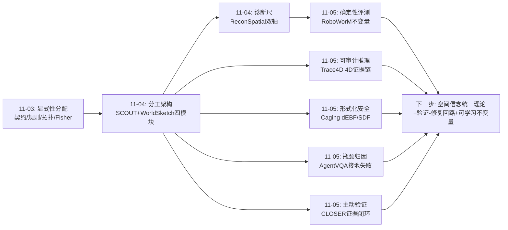
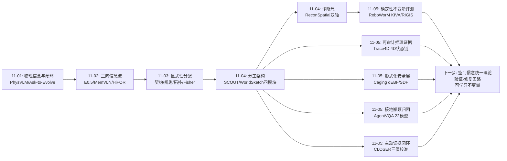
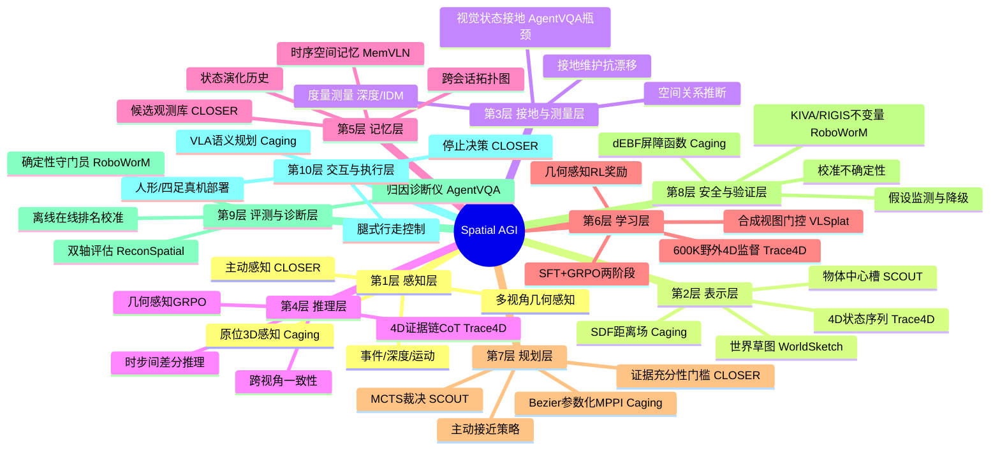
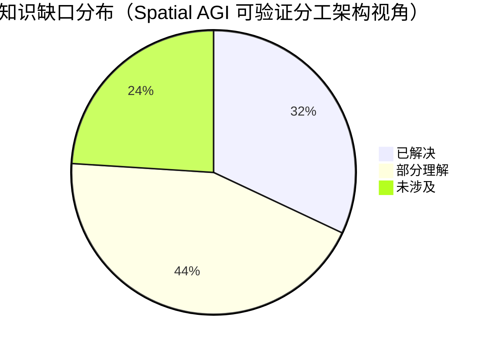

# Spatial AGI 每日思考 - 2026-11-05

## 📅 每日总结

**日期**: 2026-11-05
**论文数量**: 5篇（摘要精读+深度分析）
**主题**: 空间智能的"可验证性"全面成型——评测要确定性（RoboWorM）、推理要可审计（Trace4D）、安全要可证明（Caging）、瓶颈要归因清楚（AgentVQA）、行动要先验证后承诺（CLOSER）。昨天的"分工架构"今天补上了它的质检体系

**关键突破**:
- 🚀 RoboWorM：用机器人硬件不变量（运动学树+固定相机几何）构造 VLM-free 的确定性评测指标 KIVA/RIGIS，幻觉检测与人类标注对齐度比最强前沿 VLM 高 25.8%/130%；29,000 rollouts 首次量化"加速保视觉、毁物理"的静默退化——空间评测从主观打分转向确定性不变量检验
- 🚀 Trace4D：把"4D 状态序列"放进思维链中间作为显式可审计证据，600K 野外样本 SFT + 几何感知 GRPO，几何能力零外部依赖完全内化；几何感知 RL 奖励防止 CoT 退化为格式捷径
- 🚀 Caging Legged-VLN："增强并围栏而非抛弃"——VLA 语义智能 + SDF/dEBF 形式化安全层，Bezier-MPPI 输出带可证明避碰保证的轨迹，人形+四足真机验证
- 🚀 AgentVQA：1,000 真实样本 × 5 智能体领域 × 22 模型的系统评测给出关键归因——错误主因不是任务理解或逻辑推理，而是视觉状态的接地与维护失败（含 3D 空间关系推断）；最强模型仅 58.5%
- 🚀 CLOSER：把停止决策重构为闭环证据获取——三值校准判定（含显式 uncertain）+ 互补视角选择 + mask/深度扩散主动接近，即插即用成功率 +3.6

**架构演进**: 分工架构（语义/测量/几何/裁决四模块）→ **可验证分工架构**（分工不变，但每个模块的输出都被确定性地检验：评测指标 KIVA/RIGIS、推理证据 4D 状态链、安全屏障 dEBF、行动门槛证据充分性）

### 📊 一句话总结

2026-11-05 的五篇论文把昨天的"分工架构"补上了它缺失的另一半——**验证体系**：分工解决"谁做判断"，可验证性解决"判断可不可信"；今天每篇论文都在把空间智能中"对与错"的部分从学习范式交还给形式化范式——评测用几何不变量、推理用符号化 4D 状态、安全用屏障函数、行动用证据门槛，而 AgentVQA 的大规模归因恰好证明这些形式化层补的正是学习系统最弱的那个洞（空间接地）。

### 🔗 延续性

**昨日→今日**: 昨日的核心结论是"空间智能=分工架构：语义判断给大模型、度量测量给传感器、几何计算给规划器、物理裁决给世界模型；接口=显式可校验空间模型"。昨日留下四条线索：①显式接口的标准化；②假设检验机制的通用化（信念动力学）；③Structure/Metric 双轴评估的推广；④最小充分原则的决策论。今天五篇全部落在"可校验"这个关键词上并推进线索：RoboWorM 把线索③推广到了世界模型 rollout（物理保真审计）；Trace4D 的 4D 状态链是"显式接口"的一种新方言且自带可审计性（线索①）；Caging 给分工架构加上了昨日至今一直缺失的第四个保证——"低层执行的安全性也要可校验"；CLOSER 的"验证优先于承诺"是线索②（信念+检验）在行动层的实例化；AgentVQA 则为整个分工架构提供了权威的瓶颈归因：弱的就是空间接地——恰好是今天所有形式化层在补的洞。

**今日→明日**: 五条新线索：①空间不变量的"学习式扩展"——KIVA/RIGIS 依赖硬件先验，开放场景下能否自监督学习等价的不变量；②4D 证据链×确定性校验的闭环——Trace4D 输出的 4D 状态恰好可用 RoboWorM 式指标做形式化检验，"生成证据"与"校验证据"应分工协作；③校准不确定性的统一语义——CLOSER 的 uncertain、KIVA 的幻觉分数、dEBF 的安全裕度、Trace4D 的几何奖励都是空间置信度的方言，需要统一理论；④主动感知的形式化——CLOSER/SpatialScout 类方法本质是 POMDP 上的信息增益最大化，缺少统一形式；⑤"验证成本经济学"——验证优先于承诺有时间/能量代价，何时验证何时果断需要决策论。明日检索方向："learned spatial invariants open-world"、"4D evidence verification"、"uncertainty-calibrated embodied decision making"。

### 💡 本质思考：如何达成通用空间智能

#### 1. 核心能力的本质是什么？

本周主题持续收敛。昨天的表述是"空间智能=空间认知的分工架构"，今天可以表述为它的补全：

**空间智能的本质是可验证的分工架构——每种空间判断交给最有资格的模块，每个模块的输出都要经过与其性质匹配的确定性验证，验证结果以校准的不确定性形式回流到决策。**

昨天回答了"谁做什么"（分工），今天五篇论文回答了"怎么信"（验证），并且各自揭示了验证的正确形式取决于被验证对象的性质：

- **世界模型的输出**（生成的 rollout）→ 几何不变量验证。RoboWorM：运动学稳定性 + 多视角一致性可以从硬件先验解析推导，不需要也不应该交给 VLM 打分。验证形式 = 物理不变量。
- **推理过程的输出**（CoT 的中间步骤）→ 符号化证据链验证。Trace4D：4D 状态序列作为显式中间证据，既是推理工具又是监督对象。验证形式 = 可审计的状态轨迹 + 几何感知奖励。
- **执行层的输出**（轨迹）→ 形式化安全验证。Caging：dEBF 屏障条件 + SDF 距离场，保证在假设内数学上不碰撞。验证形式 = 控制理论证明。
- **行动决策的输出**（何时停下/承诺）→ 证据充分性验证。CLOSER：三值校准判定驱动闭环证据采集，不确定就去主动采集互补证据。验证形式 = 校准不确定性 + 主动信息获取。
- **而 AgentVQA 从反面论证了这一切的必要性**：22 个模型的错误主因是空间接地失败——学习系统的空间判断不可信是常态，验证层不是锦上添花而是必需品。

为什么验证形式要与对象性质匹配？因为每类对象的"错误敏感度"和"验证工具的可用性"不同：rollout 的物理合法性有解析检验可用（所以用不变量）；轨迹的安全性有控制理论可用（所以用屏障函数）；而推理链的语义合理性没有解析检验（所以只能要求可审计+过程监督）。**可验证性分配原则与昨天的显式性分配原则是同构的：错误敏感且有解析工具的部分走形式化，其余走可审计性。**

#### 2. 当前方法与理想目标的差距在哪里？

- **验证依赖先验，开放场景失效**：KIVA 需要运动学树、RIGIS 需要固定标定相机、dEBF 需要动力学模型与感知精度假设——一旦离开结构化机器人场景（自由相机、开放物体、动态环境），确定性验证的工具箱基本清空。理想状态是"可学习的不变量"：从数据中自监督地发现空间不变量并给出检验置信度。
- **验证方言割裂，缺乏统一的不确定性理论**：CLOSER 的 uncertain 标签、KIVA 的幻觉分数、dEBF 的安全裕度、Trace4D 的几何奖励、GOFusion 的 Fisher 场——都是"空间置信度"的表达，但语义、尺度、传播规则互不兼容。理想的 Spatial AGI 需要一套统一的空间信念表示：置信度如何定义、如何在模块间传播、如何被新证据更新。
- **验证的成本没有被定价**：CLOSER 的 SPL 提升低于成功率提升已经暗示验证有时间代价；Caging 的安全层挡住的是"不安全"但会拒绝本可安全通过的激进轨迹。验证优先与果断行动之间的权衡目前靠手工阈值，缺少"验证的期望信息增益 vs 行动成本"的决策论框架。
- **瓶颈归因有了，归因后的修复回路没有闭环**：AgentVQA 说空间接地是瓶颈，社区的回应是加几何 token/4D 状态/主动感知（今天三篇都是），但"哪个修复对哪个子瓶颈有效"的因果映射还没有系统研究。理想状态是诊断仪器与处方库的对应表：测出"尺度错"就上度量深度微调，测出"状态漂移"就上显式时序表示。
- **形式化层的假设脆弱性**：dEBF 的保证是"under the stated assumptions"——感知误差、动态障碍、足端滑移都会侵蚀假设。理想状态是形式化层自带假设监测：当假设被怀疑破坏时降级为保守模式并触发主动重估。

#### 3. 从今天到理想状态，最可能的路径是什么？

四步走判断（昨日版本的更新）：

**第一步（进行中）：可验证组件在各环节各自成熟**。确定性评测（RoboWorM）扩展到更多世界模型与生成任务；符号化 4D 证据（Trace4D）扩展到更大场景尺度；形式化安全（Caging）扩展到动态环境与更多平台；主动验证（CLOSER）扩展到操作与问答。这一步的标志事件会是：世界模型发布附带物理保真报告、具身策略发布附带安全证明书成为行业惯例。

**第二步（2027 上半年）：空间信念的统一理论**。把各家的"空间置信度方言"（uncertain 标签、幻觉分数、安全裕度、几何奖励、Fisher 场）统一为一个带传播与更新规则的空间信念表示——这是昨日"信念动力学"线索与今日"校准不确定性"观察的合流点。概率图模型/信念传播的数学工具大概率会被引入空间领域。

**第三步（2027 下半年）：验证-修复回路的自动化**。诊断仪器（ReconSpatial 双轴、AgentVQA 归因、KIVA/RIGIS）与处方库（几何 token、4D 状态、主动感知、度量微调）建立因果映射表，系统能根据自身验证失败的模式自动选择修复策略——责任动态转移（昨日第三步）有了验证信号的燃料。

**第四步（2028+）：可学习的不变量与自举验证**。当开放场景耗尽解析工具时，用世界模型数据引擎（Aurora 方向）生成合成经验，在合成经验上学习"空间不变量检验器"及其自身的置信度——验证器本身进入分工架构，被更高层的元验证监督。到这一步，"验证"与"分工"一样成为可学习对象，通用空间智能的框架问题有望宣布收敛。

---

## 🔗 与昨日思考的联系

### 昨日重点

昨天的主题是**系统分工**：空间认知的分工架构——语义判断（大模型）、度量测量（传感器/几何算法）、几何计算（规划器/求解器）、物理裁决（世界模型+搜索）；接口是显式可校验的空间模型；WorldSketch 的零样本实证证明"架构对了，普通模型就够"。留下线索：接口标准化、信念动力学、双轴评估推广、最小充分决策论。

### 今日进展

今天五篇论文共同补上了分工架构缺失的另一半——**验证体系**，并接住了昨日线索：

1. **接住"双轴评估推广"线索（RoboWorM）**：ReconSpatial 的 Structure/Metric 双轴是给 LVLM 的诊断尺，RoboWorM 把同样的思想推广到世界模型 rollout——且走得更远：完全摆脱 VLM 评判，用硬件先验解析推导不变量。评测的"确定性化"是比"双轴化"更彻底的进化。
2. **接住"显式接口标准化"线索（Trace4D）**：昨日的接口候选（槽状态/世界草图/4D 三支柱）都是"系统内部"的显式模型，Trace4D 给出了第一个"推理过程层面"的显式接口——4D 状态证据链。内部模型可校验 + 过程证据可审计，显式接口的覆盖面从数据层扩展到推理层。
3. **补上分工架构从未讨论的执行安全维度（Caging）**：昨日四模块中没有"安全层"的位置——它假设物理裁决模块（世界模型）天然覆盖。Caging 指出这不够：语义与可行性判断之外，执行层需要数学证明级别的保证。分工架构扩展为五模块：语义判断/度量测量/几何计算/物理裁决/**形式化安全**。
4. **接住"信念动力学"线索（CLOSER）**：昨日的"假设-检验-信念更新"机制在 SCOUT/WorldSketch/VLSplat 中是 ad hoc 实现，CLOSER 给出了最接近形式化的实现——三值校准判定作为信念状态、主动接近作为信息获取动作、融合网络作为信念更新规则。这是信念动力学在行动层的样板实现。
5. **获得权威瓶颈归因（AgentVQA）**：昨日 ReconSpatial 已诊断 LVLM"关系对、尺度错"，AgentVQA 把诊断扩展到智能体语境并给出更强的结论——视觉状态接地与维护是第一瓶颈，且离线排名可追踪在线排名。分工架构的各模块投入优先级从此有了大规模实证依据。

### 演进路径



核心轨迹：**知识形式（11-03）→ 系统分工（11-04）→ 可验证性（11-05）**——问题从"知识存哪层"到"谁做什么"再到"怎么信"，分工架构的信任基础设施今天奠基。

---

## 📚 论文概览

**论文1: RoboWorM（2610.33807, cs.RO, 52页）**
面向机器人操作视频世界模型的部署感知基准。利用机器人运动学树与固定相机配置等硬件先验，提出两个确定性 VLM-free 指标：KIVA（视角内运动学稳定性，含加速度物理可行性检验）与 RIGIS（多视角几何一致性，三角化+重投影）。1,605 episodes 覆盖单臂/双臂/人形 × Markovian/非Markovian × 单/多视角。KIVA 幻觉检测与人类标注对齐比最强前沿 VLM 高 25.8%，RIGIS 与人类偏好 Spearman 相关高 130%。首次大规模加速审计：3 世界模型 × 9 加速技术 × 29,000+ rollouts，揭示"感知质量不变但物理一致性静默恶化"，找到 2.3× 加速且质量损失最小的组合。

**论文2: Trace4D（2611.02759, cs.CV, KAIST）**
训练 VLM 预测并推理 4D 状态序列作为显式中间证据。4D-grounded CoT 三段式：显式 4D 状态 → 时序视觉上下文分析 → 证据连接。Trace4D-Train 来自 in-the-wild 视频：600K 4D 感知样本 + 70K 接地 QA；训练为 SFT + 几何感知 GRPO（对中间 4D 状态施加几何正确性奖励，防止 CoT 捷径退化）。推理时纯视频输入，零外部几何模型、零参考标注。在 Trace4D-Bench 与 VLM4D 上超越基线 VLM。

**论文3: Caging Legged-VLN（2611.04972, cs.RO+eess.SY）**
"围栏化"腿式视觉语言导航的安全架构。不抛弃端到端 VLA 能力而是在其下方加入：物理接地层（高效状态估计 + 原位 3D 感知 + SDF 表示）+ 安全规划器（低维 Bezier 参数化 MPPI + 离散指数屏障函数 dEBF 约束），输出轨迹在所述假设下带可证明避碰保证。模块化、平台无关、VLM/VLA 模型无关；人形与四足真实机器人大量实验验证。

**论文4: AgentVQA（2610.31494, cs.CV, Princeton ZLab）**
跨五域（Web/机器人/自我中心视频/游戏/空间规划）统一离线智能体基准：从 23 源数据集人工精选 1,000 个真实困难样例，22 个模型评测。最强模型仅 58.5%。核心归因：错误主要由视觉状态接地与维护失败驱动——定位 UI 元素、解读运动、追踪状态变化、推断 3D 空间关系——而非任务误解或逻辑推理。离线排名被验证可追踪在线评估排名。

**论文5: CLOSER（2610.28476, cs.CV+cs.RO）**
ObjectNav 的证据感知主动验证框架：把停止决策重构为闭环证据获取。微调开源 VLM 对候选的每个视角三值判定（target/non-target/uncertain），嵌入多样性门选互补视角，轻量网络融合概率；仍不确定则扩散策略仅凭跟踪 mask+深度主动接近直至判定果断。本地运行、即插即用、不改底层系统。Gibson 与 HM3D 上平均成功率 +3.6、SPL +2.0。

---

## 💡 核心见解

### 见解1: 空间评测的"确定性化"——从 VLM 打分到不变量检验

**从 RoboWorM 获得**
- ✅ KIVA 用运动学不变量（平滑性/限位/连杆守恒/加速度可行性）做幻觉检测，与人类标注对齐度超最强前沿 VLM 25.8%——VLM 评判器存在系统性空间盲区，这个差距本身就是证据
- ✅ RIGIS 用三角化重投影检验多视角一致性，与人类偏好 Spearman 相关高 130%
- ✅ 加速审计揭示：FVD 等感知指标与 KIVA/RIGIS 物理指标是可解耦的——"看起来对"和"物理上对"是两个独立的及格线

**对Spatial AGI的启发**:
这是 ReconSpatial 双轴评估思想的彻底化：凡是能从先验（硬件、几何、物理）推导出不变量的空间维度，都不应交给 VLM 主观打分。Spatial AGI 的评测体系应该按"解析工具可用性"分层：有不变量的维度用确定性检验（可复现、可定位错误、无需昂贵评判模型），没有的维度才退到 VLM/人类评判。更深一层：这些不变量不仅可用于评测，还可作为训练约束与数据过滤标准——评测工具与训练信号同源。

### 见解2: 世界模型的"静默退化"——压缩/加速必须重新验证空间保真

**从 RoboWorM 获得**
- ✅ 9 种加速技术在 3 个世界模型上保住 FVD 却恶化 KIVA/RIGIS——物理约束被静默破坏
- ✅ 2.3× 加速存在且质量损失最小——物理感知的加速选型可行

**对Spatial AGI的启发**:
这可能是个行业级警示：社区正在大规模蒸馏、量化、加速世界模型，验证却全用感知指标。对 Spatial AGI，任何世界模型的压缩/加速/蒸馏都必须用空间物理指标复检——否则我们在生产"看起来对但物理错"的世界模型，并把它喂给策略训练。"静默退化"是最危险的失败模式，因为它通过了所有常规检查。

### 见解3: 几何应该出现在推理链中间，且要被奖励覆盖

**从 Trace4D 获得**
- ✅ 4D 状态序列作为显式 CoT 中间证据：既是推理工具又是可审计对象
- ✅ 几何感知 GRPO：只奖励最终答案会让中间几何变成编造的仪式，对中间表示施加几何奖励是必要的
- ✅ 600K 野外样本足以让几何能力零外部依赖地内化

**对Spatial AGI的启发**:
几何增强有三个位置：输入端（几何 token，DK-VLM 路线）、架构端（几何原生 latent，E0.5 路线）、推理端（显式 4D 状态证据，Trace4D 路线）。推理端路线的独特价值是**可审计性**——4D 证据链可以被下游确定性指标（如 RoboWorM 式不变量）校验，形成"生成证据-校验证据"的分工。"过程奖励覆盖中间表示"是一个可迁移的 RL 设计模式：任何带显式中间表示的系统都该问一句——我的奖励函数看得见中间层吗？

### 见解4: 能力与安全是正交维度——"围栏化"优于"端到端一切"

**从 Caging Legged-VLN 获得**
- ✅ VLA 语义智能原样保留，下方叠加 SDF 物理接地层 + dEBF 屏障约束，输出带可证明避碰保证
- ✅ Bezier 参数化把 MPPI 采样空间降到低维，使带屏障约束的实时重规划在腿式平台算力内可行
- ✅ 模块化设计使安全层与上层模型、机器人平台解耦

**对Spatial AGI的启发**:
昨天确立的分工架构今天要加一层：形式化安全层。"增强并围栏"是对端到端浪潮的重要制衡——能力（语义智能）与保证（数学证明）遵循不同的生产逻辑，前者靠数据与规模，后者靠控制理论，不应混在一个损失函数里赌。SDF 作为语义-几何-控制三层的通用接口值得在 Spatial AGI 架构中占一席之地。注意事项同样重要：保证是"under stated assumptions"的，形式化层需要假设监测与降级机制。

### 见解5: 空间接地是当前 VLM 智能体能力的第一瓶颈——大规模实证

**从 AgentVQA 获得**
- ✅ 22 个模型、5 个智能体领域、1,000 真实样本：最强仅 58.5%
- ✅ 错误归因清晰：视觉状态接地与维护失败（定位/运动解读/状态追踪/3D 关系推断）是主因，不是任务理解或逻辑推理
- ✅ 离线排名追踪在线排名——快速迭代有了方法学基础

**对Spatial AGI的启发**:
这个归因结论是本周最重要的行动指南：社区在"堆推理"与"堆感知"之间的争论，AgentVQA 用数据投给了感知——具体说是"接地的维护"：不仅单帧接地要准，交互序列中的空间状态还不能漂移。这与 Trace4D（显式时序 4D 状态）和 CLOSER（不确定时主动采集证据）的药方方向完全一致。Spatial AGI 的资源应优先投向空间接地与状态维护，而非更长的推理链。

### 见解6: "知道自己不知道"是主动空间智能的触发器

**从 CLOSER 获得**
- ✅ 三值判定（含显式 uncertain）把校准不确定性变成行动信号：不确定 → 主动采集互补视角证据
- ✅ 主动接近只需 mask+深度——主动感知不需要重型世界模型
- ✅ 验证层与底层导航系统完全解耦、即插即用

**对Spatial AGI的启发**:
被动单帧空间理解有理论上限（遮挡、视角依赖、单帧歧义），CLOSER 证明"行动去采集证据"能实质提升判断质量且成本可控。这把空间理解从被动推断升级为 POMDP 上的主动信息获取。与 AgentVQA 的诊断配对：接地失败是瓶颈（诊断），主动验证是处方（治疗）。"验证优先于承诺"应成为 Spatial AGI 行动架构的通用原则——任何不可逆行动（停下/抓取/进入）前设证据充分性门槛。

### 见解7: 验证形式必须与被验证对象的性质匹配

**从今日五篇综合获得**
- ✅ rollout 的物理合法性 → 几何不变量（RoboWorM）
- ✅ 推理链的空间证据 → 符号化 4D 状态链 + 几何感知奖励（Trace4D）
- ✅ 轨迹的安全性 → 屏障函数数学证明（Caging）
- ✅ 行动承诺的依据 → 校准不确定性 + 主动证据采集（CLOSER）

**对Spatial AGI的启发**:
今天的五篇论文摆在一起浮现出一个元原则：**可验证性分配**——错误敏感且有解析工具的部分走形式化验证（不变量/证明），其余走可审计性（证据链/过程监督）。这与昨日的显式性分配原则同构，两者共同构成 Spatial AGI 的信任基础设施设计原则。分工回答"谁做什么"，验证回答"怎么信"，两者缺一不可。

### 见解8（补充）: 评测工具正在分化为"守门员"与"诊断仪"两族

**从 RoboWorM + AgentVQA 获得**
- ✅ RoboWorM 是守门员：给 rollout 放行/拦截，附带错误定位（哪帧哪个关节）
- ✅ AgentVQA 是诊断仪：跨子能力归因错误分布，指导资源投向
- ✅ ReconSpatial（昨日）同属诊断仪族，且双轴设计已被 RoboWorM 的指标分解隐性继承

**对Spatial AGI的启发**:
评测不再是研发的附属品，而是分工架构的运行时组件：守门员嵌入数据/部署管线（验收、过滤、质控），诊断仪嵌入迭代回路（归因、配比、修复选择）。未来 Spatial AGI 系统的规格书里应该同时出现两者。

---

## 🗺️ 知识演进图



核心轨迹：**表示能力（11-01）→ 信息组织（11-02）→ 知识形式（11-03）→ 系统分工（11-04）→ 可验证性（11-05）**——本周问题层层深入，从"模型能做什么"到"系统怎么组织"再到"组织凭什么可信"。

---

## 技术栈演进对比表

| 层次 | 昨日方案（11-04） | 今日方案（11-05） | 变化 |
|------|------------------|------------------|------|
| 空间评测 | ReconSpatial 双轴（Structure/Metric，仍依赖模型作答） | RoboWorM KIVA/RIGIS（硬件不变量，VLM-free 确定性） | 评测从"模型作答+校正"进化为"解析推导+不变量检验" |
| 世界模型质控 | 无专门物理保真审计（FVD 类感知指标） | KIVA/RIGIS 物理审计 + 加速静默退化量化 | 世界模型验收新增物理及格线；加速必须复检 |
| 推理中的几何 | 几何作为输入特征或 latent 表征（E0.5/DK-VLM 路线） | Trace4D：4D 状态序列作为 CoT 显式中间证据 | 几何位置从输入/架构移到推理链中间，获得可审计性 |
| 推理 RL 奖励 | 答案正确性奖励（惯例） | 几何感知 GRPO：中间 4D 状态也受奖励覆盖 | 过程奖励覆盖中间空间表示，防 CoT 捷径 |
| 具身执行安全 | 物理裁决交给世界模型+搜索（SCOUT 模式） | Caging：SDF+dEBF 屏障，数学证明级避碰 | 分工架构新增形式化安全层（第五模块） |
| 瓶颈诊断 | ReconSpatial：LVLM"关系对、尺度错" | AgentVQA：智能体语境下接地与维护失败是第一瓶颈 | 诊断扩展到智能体五域且给出跨 22 模型的权威归因 |
| 空间判断输出 | 二元/连续判断（惯例） | CLOSER：三值校准判定（含显式 uncertain） | 校准不确定性成为一等公民与行动触发器 |
| 空间证据获取 | 被动推断（给什么看什么） | CLOSER：主动接近采集互补视角证据 | 空间理解升级为 POMDP 主动信息获取 |
| 评测与在线一致性 | 未验证 | AgentVQA：离线排名追踪在线排名 | 离线基准获得外部有效性认证 |

---

## 🗺️ Spatial AGI 知识图谱

### 10层架构思维导图



### 🎯 主线技术路径

#### 阶段1: 感知与重建的几何化（已基本完成，2025-2026）

3DGS/4D 重建、深度估计、多视角一致性——"看得几何正确"的基础能力成熟。本周 RoboWorM 为这一层补上了验收标准：几何化不等于物理合法，还需要不变量检验。

#### 阶段2: 显式空间模型的接口化与可审计化（进行中，2026）

显式接口候选从数据层（槽状态/草图/4D 支柱，11-04）扩展到推理层（4D 证据链，Trace4D）。接口的判断标准新增"可审计性"：接口不仅要能被模块读写，还要能被确定性指标校验。

#### 阶段3: 分工架构的验证体系成型（2027 上半年）

第五模块（形式化安全层）标准化；空间信念统一理论把各家不确定性方言（uncertain 标签/幻觉分数/安全裕度/几何奖励/Fisher 场）收敛为带传播与更新规则的统一表示；验证-修复回路建立诊断仪器与处方库的因果映射。

#### 阶段4: 可学习不变量与验证自举（2027 末-2028+）

开放场景耗尽解析工具后，用世界模型数据引擎生成合成经验，学习空间不变量检验器及其置信度；验证器进入分工架构，受元验证监督。能力、分工、验证三者都成为可学习对象——通用空间智能框架问题收敛的标志。

---

## 🔍 待探索议题

### 高优先级（本周）

1. **4D 证据链 × 确定性校验闭环**
   - 问题: Trace4D 输出的 4D 状态序列能否直接用 RoboWorM 式物理不变量校验，形成"生成证据-校验证据"的分工闭环？
   - 候选方案: 在 Trace4D-Bench 上叠加 KIVA 类运动学检验器；把校验结果作为几何感知 GRPO 的额外奖励
   - 缺口: Trace4D 的状态格式与不变量检验器的接口尚未定义；语言化状态的量化精度是否够检验用

2. **加速静默退化的通用检测**
   - 问题: RoboWorM 的发现（加速保视觉毁物理）在其他世界模型家族与生成任务（场景生成、导航视频）中是否普遍成立？
   - 候选方案: 把 KIVA/RIGIS 移植到开放场景世界模型的评测套件；对社区主流蒸馏 checkpoint 做物理复检
   - 缺口: 开放场景无硬件先验，不变量检验器需要退化版本（仅重投影一致性/时序平滑性）

3. **空间置信度的统一表示**
   - 问题: CLOSER 的 uncertain、KIVA 的幻觉分数、dEBF 的安全裕度、Fisher 场能否统一为一个空间信念表示？
   - 候选方案: 定义带校准属性与传播规则的空间信念标量场/张量；在 CLOSER 类闭环上验证传播规则
   - 缺口: 各方言的语义与尺度不同，缺统一的评测协议来比较校准质量

### 中优先级（本月）

4. **可学习空间不变量（开放场景）**
   - 问题: 无硬件先验时能否自监督学习"物理合法性检验器"并给出可信置信度？
   - 候选方案: 在世界模型数据引擎的合成经验上训练不变量检验器；用物理引擎合成带标签的违规样本
   - 缺口: 检验器自身的校准与元验证机制；合成到真实的泛化

5. **验证成本经济学**
   - 问题: "验证优先于承诺"的期望信息增益 vs 行动时间/能量成本的决策论框架是什么？
   - 候选方案: 把 CLOSER 闭环形式化为 POMDP，验证动作的价值函数显式建模；学习何时跳过验证
   - 缺口: 信息增益的估计器；紧急场景下果断性的效用建模

6. **归因-处方因果映射表**
   - 问题: AgentVQA/ReconSpatial 诊断出的子瓶颈（定位/运动/状态追踪/尺度）与修复方案（几何 token/4D 状态/主动感知/度量微调）之间的因果有效性如何系统测量？
   - 候选方案: 构建"诊断→干预→复测"的标准化实验协议；开源处方库 benchmark
   - 缺口: 各修复方案的受控对照实验；子瓶颈的可分离评测集

7. **形式化安全的假设监测**
   - 问题: dEBF 保证依赖感知精度与动力学模型假设，如何在线监测假设是否被破坏并降级？
   - 候选方案: 对 SDF 估计误差做在线置信区间；假设破坏时切换保守模式并触发主动重估（与 CLOSER 闭环结合）
   - 缺口: 动态障碍下的感知误差模型；降级策略的安全性证明

### 低优先级（本季度）

8. **跨域空间能力的迁移性测量**
   - 问题: AgentVQA 五域中空间接地失败是否共享同一根因？一个域的空间微调能否迁移到其他域？
   - 候选方案: 五域分别做探针分析比较内部空间表示；跨域微调迁移实验
   - 缺口: 域间可比的探针任务设计；各域样本量扩充

9. **世界模型 rollout 作为训练数据时的物理过滤标准**
   - 问题: Aurora 类数据引擎生成的合成数据应通过什么物理质检才能进策略训练集？
   - 候选方案: 把 KIVA/RIGIS 作为数据引擎的出厂检验；研究"物理瑕疵数据的下游策略危害"的剂量-效应关系
   - 缺口: 剂量-效应实验；最小质检集的成本收益分析

10. **校准不确定性的主动感知统一形式**
    - 问题: CLOSER（接近候选）、SpatialScout（探索建图）、Think-Capture（主动采集几何）本质都是信息获取动作，是否存在统一的形式化？
    - 候选方案: 统一为"空间信念 POMDP + 信息增益动作"框架，各家是不同信念表示与动作集的实例
    - 缺口: 三个系统的信念表示差异较大；统一框架的实证验证成本高

---

## 📊 知识缺口分析



**已解决（32%）**:
- ✅ 世界模型 rollout 的确定性物理评测方法（KIVA/RIGIS，硬件先验场景）
- ✅ 几何作为推理中间证据的训练范式（4D 状态链 SFT+几何感知 GRPO）
- ✅ 结构化场景下腿式导航的形式化安全（SDF+dEBF 可证明避碰）
- ✅ 智能体空间能力的大规模瓶颈归因（接地与维护失败是第一瓶颈）
- ✅ 校准不确定性驱动的主动证据采集闭环（ObjectNav 验证）
- ✅ 离线基准的在线排名校准方法

**部分理解（44%）**:
- ⚠️ 开放场景下的空间不变量检验（无硬件先验时工具箱基本清空）
- ⚠️ 空间置信度的统一理论（各方言语义/尺度/传播规则不兼容）
- ⚠️ 验证成本与果断行动的权衡（缺决策论框架，靠手工阈值）
- ⚠️ 诊断-修复的因果映射（知道瓶颈在哪，不知道哪个处方对哪个子瓶颈最有效）
- ⚠️ 形式化保证的假设脆弱性（感知误差/动态障碍侵蚀假设的在线监测缺失）
- ⚠️ 4D 状态序列的表达力上限（形变物体/密集场景/亚状态精度）

**未涉及（24%）**:
- ❌ 可学习不变量的自举验证体系（验证器自身的校准与元验证）
- ❌ 多候选/动态环境的联合证据验证（CLOSER 局限单候选静态）
- ❌ 空间信念在长时程任务中的漂移与重置理论
- ❌ 分工架构的责任动态转移（今天仍是设计时固定分工）
- ❌ 空间安全的语义层覆盖（安全层只保证不撞，不管去错地方）
- ❌ 跨模态空间验证（触觉/听觉证据与视觉证据的融合校验）

---

## 📝 今日金句

1. **"分工解决谁做判断，验证解决判断可不可信——分工架构的信任基础设施今天奠基。"**
2. **"凡是能从先验推导出不变量的空间维度，都不应该交给 VLM 主观打分。"**
3. **"加速保住了 FVD 却悄悄毁了物理——'看起来对'和'物理上对'是两条独立的及格线。"**
4. **"几何最好的位置可能在推理链中间：既是推理的工具，又是监督的对象，还是可审计的证据。"**
5. **"能力靠数据与规模，保证靠控制理论——两者遵循不同的生产逻辑，不该混在一个损失函数里赌。"**
6. **"22 个模型的错误不在推理而在接地——空间接地的维护是当前智能体能力的第一瓶颈。"**
7. **"空间判断的可信性不是推断出来的，是行动采集出来的。"**

---

## 🔮 明日展望

- 检索方向：learned spatial invariants / 4D evidence verification / uncertainty-calibrated embodied decision making / world model physical fidelity distillation
- 期待出现的论文形态：
  1. 把 Trace4D 式 4D 证据链与确定性校验结合的闭环工作
  2. 开放场景（无机器人先验）的生成视频物理一致性评测
  3. 校准不确定性作为统一信号驱动多类主动感知（导航+操作+问答）的工作
  4. AgentVQA 式归因 + 干预实验（哪个修复治哪个子瓶颈）

---

**文档创建时间**: 2026-11-05 03:00 (Asia/Shanghai)
**基于论文**: RoboWorM / Trace4D / Caging Legged-VLN / AgentVQA / CLOSER
**延续**: 2026-11-04 分工架构 → 2026-11-05 可验证性

---

## 🔬 深入分析：五篇论文的细节透视

### 📄 RoboWorM 深入：为什么 VLM 评判器在空间维度系统性失灵？

RoboWorM 给出的 25.8% 与 130% 两个对齐度差距数字值得仔细咀嚼。它们意味着什么？

**第一，VLM 评判器的失败不是随机的，而是结构性的。** VLM 评判器在预训练中学到的"视频质量"先验主要来自互联网视频的美学/语义统计——画面清晰度、动作流畅性的表观、场景合理性。这些先验对"机械臂关节加速度是否超出物理极限"完全无感：一个关节瞬移的帧在表观上可能完全"流畅"。结构性的盲区无法靠 prompt 工程修复。

**第二，加速度是最脆弱也最有信号量的维度。** 为什么标题专门点出 "Acceleration Affects"？因为视频生成模型的逐帧生成机制在快速运动段最容易崩溃（帧间对应断裂），而加速度恰好是这个崩溃的敏感探测器——位置误差在速度上放大一次、在加速度上再放大一次。KIVA 把检测信号从"画面看起来不对"提前到"运动学导数不对"，是幻觉检测灵敏度数量级提升的原因。

**第三，"确定性指标"的代价与回报需要平衡看待。** 回报：可复现、可定位（哪帧哪个关节）、无需昂贵评判模型、可嵌入 CI/CD。代价：硬件先验依赖（运动学树、标定相机）、姿态估计环节自身的鲁棒性上限。这不是"确定性 vs 学习"的零和——正确的分工是：有先验用先验，没先验再退回学习式评判，且永远报告评判器自身的置信度。

**第四，2.3× 加速的最优组合暗示加速方法存在"物理性价比"排序。** 并非所有加速技术对物理一致性的破坏相同——cache 复用类可能伤害时序连续性（运动学），而蒸馏类可能更均匀地退化。物理感知的加速选型（先物理审计再选技术）是一个可以直接产业化的实践。

### 📄 Trace4D 深入：4D 状态序列的表示设计与"格式即约束"

Trace4D 最值得深挖的是它的表示选择及其后果。

**表示的三要素**：时间索引（有序性）、3D 状态（世界坐标系，分离 ego-motion）、关系字段（物体间空间关系随时间的演化）。这三要素共同保证了"视角变化下什么变了/什么没变"的可判定性——世界坐标系的锚定让相机运动不再污染场景状态。

**"格式即约束"的训练技巧**：SFT 阶段强制三段式 CoT 格式（4D 状态 → 视觉分析 → 证据连接）。格式本身是一种归纳偏置——它迫使模型先把几何写出来再推理，改变了计算的先后依赖。但没有几何感知奖励的纯格式训练会退化为"仪式性格式"：模型学会写格式正确的胡言。几何感知 GRPO 堵住了这个洞——中间表示的正确性直接进奖励。这个"格式 + 过程奖励"的组合拳是所有带显式中间表示的系统都可复用的配方。

**与符号主义的历史回响**：4D 状态序列本质上是一种受控的符号化空间表示——但它不是人工设计的符号系统，而是从野外数据学到的、以自然语言为载体的符号格式。这可以看作神经符号主义的一种新形态：符号词汇表由数据定义，符号的语义由几何奖励锚定。

**精度天花板与补偿路径**：语言化状态必然量化（"桌子左边 30cm"不可能表达 31.7cm）。两条补偿路径值得期待：①状态序列与连续几何 head（深度/光流/位姿）联合输出，语言层管推理、连续层管精度；②推理时主动感知（CLOSER 式）用更高精度的观测补偿状态量化误差。

### 📄 Caging 深入：形式化保证的边界与"安全层的产品化思维"

**dEBF 保证的精确含义**：在"感知给出的 SDF 准确、动力学模型正确、离散控制周期内状态可控"这些假设下，屏障函数的非负性可数学证明状态不进入碰撞集合。保证的强度完全等于假设的强度。这不削弱其价值——因为假设是**可检验的**（SDF 误差可以在线估计置信区间），而端到端策略的安全性是不可检验的。可检验的假设 + 条件性证明 > 不可检验的端到端赌注。

**Bezier 参数化的巧妙之处**：低维参数化不只是加速——Bezier 曲线的凸包性质让"轨迹是否进入危险集合"的上界检验变便宜，安全滤波可以从逐点检验升级为曲线级检验。这是"表示选择服务于验证需求"的范例：为了证明容易，选择证明友好的表示。

**模块化的战略意义**：安全层与上层 VLA 模型无关意味着——上层模型升级（换更强的 VLM/VLA）不需要重新认证安全层。这与功能安全行业的认证逻辑一致：安全认证针对架构与接口，而非特定模型版本。Spatial AGI 要进入人类环境，这套"分层认证"思维迟早要补课。

**遗留问题的诚实清单**：动态障碍（行人闯入 SDF 更新延迟）、足端滑移（状态估计扰动）、语义错误不设防（走错方向但安全地错）、局部感知（SDF 只覆盖原位邻域）。这四个洞里，"语义错误不设防"与今日 CLOSER 的工作直接互补——CLOSER 验证"判断对不对"，Caging 保证"行动撞不撞"。

### 📄 AgentVQA 深入：归因方法学为什么比排行榜更有价值？

**归因的实验设计**：AgentVQA 不是只发排名，而是把错误人工归类到竞争性假设（任务误解 / 逻辑推理失败 / 视觉状态接地与维护失败）下并量化占比。结果一边倒：接地与维护失败占主导。这种"竞争假设归因"设计排除了"每家都有一点"的和稀泥结论，给出了可行动的单一结论。

**"维护"是比"接地"更被忽视的子能力**：四个子失败模式（定位 UI 元素 / 解读运动 / 追踪状态变化 / 推断 3D 空间关系）中，前三都是时序性的——智能体场景的空间理解天然是流式的、状态持续演化的。静态单帧空间基准（本周之前的大量工作）测不到"维护"。这就是为什么 AgentVQA 的结论比静态空间基准更尖锐：连"关系对"的模型也可能在"状态漂移"上失败。

**离线-在线排名校准的战略价值**：这个验证把 AgentVQA 从"又一个 benchmark"升级为"在线评估的合法代理"。对 Spatial AGI 工程师，这意味着开发循环可以是：离线基准快速迭代（小时级）→ 在线评估抽检（天级）。基准的外部有效性验证应该成为所有新基准的标配章节。

**58.5% 的正确解读**：这个数字不是"VLM 不行"的证据，而是"离可用智能体的距离"的度量。结合归因结论，58.5% 中约一半的失分来自空间接地——意味着修复空间接地理论上可以把智能体能力推到 ~80% 区间。瓶颈定位越准，修复的期望收益越高。

### 📄 CLOSER 深入：三值判定为什么比概率输出更聪明？

**三值标签的信息论解读**：连续概率输出的问题在于决策阈值是隐式的、且校准不可见。三值（target/non-target/uncertain）把"不确定"显式化为一个可行动的类别——系统的行为不再由隐式阈值驱动，而由显式的信念状态驱动。uncertain 类的存在强制训练过程直面校准问题：这个类的样本必须真的是"证据不足"的样本。

**"uncertain → 行动"的闭环是感知-认知-行动的焊接点**：传统管线里不确定性只用于风险报告（给人类看），CLOSER 把它变成动作选择的直接输入。这是具身认知"感知为行动服务"哲学的干净实现。与 Caging 的 dEBF 对比很有趣：dEBF 的"不确定性"体现在安全裕度（距离场阈值），CLOSER 的体现在类别概率——两个层面的校准信号。

**mask+深度的极简主义**：主动接近策略故意不用语义特征、不用地图、不用世界模型——只用工件级的 mask 和深度。这个设计有三个回报：①鲁棒（少依赖少崩溃）；②实时（扩散策略在小观测空间上很快）；③可移植（mask+深度任何平台都有）。它证明了主动感知的性能瓶颈在"去哪看"的决策而非"怎么看"的表征——这是对当前重型世界模型浪潮的一个轻巧反驳。

**SPL 提升 < 成功率提升的解读**：+3.6 成功率 vs +2.0 SPL 的差距就是验证闭环的时间成本。它提示验证成本经济学（待探索议题5）不是纸面问题——闭环验证的性价比优化（什么候选值得验证、验证几步就够）是下一个工程高地。

---

## 🧩 跨论文综合：今天的五篇拼出的完整图景

把五篇论文放进昨天确立的分工架构，能看到一张完整的设计图纸：

```
┌─────────────────────────────────────────────────────┐
│                 分工架构 + 验证体系                  │
├─────────────────────────────────────────────────────┤
│ 语义判断层   VLM/LLM（目标/机构/重要性）             │
│    └─ 验证: 校准三值判定 + 主动证据采集 (CLOSER)    │
│    └─ 诊断: 接地失败是第一瓶颈 (AgentVQA)           │
│                                                     │
│ 推理层       CoT + 显式4D状态证据 (Trace4D)         │
│    └─ 验证: 几何感知奖励 + 证据链可审计             │
│                                                     │
│ 几何计算层   规划器/求解器（路径/轨迹）             │
│    └─ 验证: Bezier凸包上界检验 (Caging)             │
│                                                     │
│ 物理裁决层   世界模型+搜索（rollout评估）           │
│    └─ 验证: KIVA/RIGIS 物理不变量 (RoboWorM)        │
│    └─ 警示: 加速蒸馏需物理复检 (RoboWorM)           │
│                                                     │
│ 形式化安全层 SDF + dEBF 屏障（可证明避碰）(Caging)  │
│    └─ 边界: 假设可检验但可被侵蚀                    │
└─────────────────────────────────────────────────────┘
```

**三个今天才看清的系统性事实**：

1. **验证正在成为独立的架构层而非附属功能。** 五篇论文中三篇的核心贡献就是验证机制（RoboWorM/CLOSER/Caging 的安全层），一篇是验证导向的训练（Trace4D 的几何奖励），一篇是验证导向的诊断（AgentVQA）。这不是巧合——当分工架构把判断分散到多个模块后，模块间的信任问题成为新的主要矛盾，验证体系应运而生。

2. **形式化与学习的边界正在被精确划定而非简单对立。** 今天的每篇论文都在做同一件事：找到一个"解析工具可用的空间子问题"，把那个子问题从学习范式拿回来交给形式化范式（不变量/证明/校验器），同时把其余部分放心地交给学习。这个边界划定的原则——可验证性分配——正在成为与显式性分配并列的设计第一性原理。

3. **空间智能的评测基础设施在两周内发生了代际跃迁。** 从 11-03 的"评测作为守门"到 11-04 的"评测作为诊断仪"再到今天的"评测作为确定性仪器 + 外部有效性认证"，评测的成熟速度超过了模型本身。这通常是一个领域从探索期进入工程期的标志。

---

## 📖 方法论反思：本周研究轨迹的元观察

**问题深化的节奏**：本周五天，核心问题每天深入一层——模型能力（11-01）→ 信息流（11-02）→ 知识形式（11-03）→ 系统分工（11-04）→ 信任与验证（11-05）。这个轨迹恰好复现了工程学科的经典成熟路径：先证明"能做"，再决定"怎么组织"，最后解决"凭什么信"。软件工程的等价物：原型 → 架构 → 测试与认证。

**证据等级的上升**：11-01 的结论多来自单系统演示；11-04 出现了零样本大规模对照（WorldSketch 91% vs 次优 +58pp）；今天出现了 22 模型 × 5 域的系统归因（AgentVQA）与 29,000 rollouts 的大规模审计（RoboWorM）。结论的证据等级在上升，这意味着本周后期形成的架构判断（分工+验证）比前期更有可信度。

**反复出现的实体**：SDF 第一次出现（Caging）但与 GOFusion 的 Fisher 场（11-03）同属"空间置信度场"家族；4D 状态序列（Trace4D）与 Aurora 的 4D 三支柱（11-04）与 SCOUT 的槽状态（11-04）是同一个显式接口抽象的三个方言；校准不确定性（CLOSER）与 ReconSpatial 的双轴校正（11-04）共享"评测必须自带校准"的信念。跨日的实体复用说明研究社区的注意力正在收敛到同一组抽象上——收敛本身就是信号。

**下周可能的收敛点**：空间信念统一理论（各方言的合流）是最可能出现"范式级论文"的位置——一篇把 uncertain 标签、Fisher 场、安全裕度、几何奖励统一为一个可传播信念表示的工作，其地位可能相当于注意力机制之于序列建模。

---

## 🎓 给实践者的今日行动清单

**如果你在做世界模型**：
- 立即给你的蒸馏/加速管线加物理复检（KIVA/RIGIS 或其退化版），不要只看 FVD
- 世界模型发布的验收报告应包含物理保真段

**如果你在做 VLM 空间推理**：
- 把几何放进推理链中间（Trace4D 三段式），并确保 RL 奖励覆盖中间表示
- 优先修复"接地的维护"（时序状态追踪）而非加长推理链（AgentVQA 归因）

**如果你在做具身系统部署**：
- 分层认证：语义层选最强模型，安全层用形式化工具（SDF+dEBF），两层解耦升级
- 不可逆行动前设证据充分性门槛；校准的 uncertain 输出比二元输出更有工程价值

**如果你在做评测**：
- 新基准必须做离线-在线排名校准（外部有效性）
- 有解析先验的维度用确定性指标，并在论文中报告评判器与人类判断的对齐度

---

## 📎 附录：关键数字速查

| 数字 | 来源 | 含义 |
|------|------|------|
| 25.8% | RoboWorM | KIVA 幻觉检测与人类标注对齐度超最强前沿 VLM 的幅度 |
| 130% | RoboWorM | RIGIS 与人类偏好 Spearman 相关超 VLM 的幅度 |
| 29,000+ | RoboWorM | 加速审计的 rollout 总量（3 模型 × 9 技术） |
| 2.3× | RoboWorM | 质量损失最小的最大推理加速倍数 |
| 1,605 | RoboWorM | 基准 episode 数（3 形态 × 2 任务类 × 2 视角设置） |
| 600K / 70K | Trace4D | 4D 感知样本 / 接地 QA 样本量 |
| 2 | Trace4D | 训练阶段数（SFT + 几何感知 GRPO） |
| 0 | Trace4D | 推理时外部几何模型依赖数 |
| 2 | Caging | 验证平台数（人形 + 四足真实机器人） |
| 1,000 | AgentVQA | 基准样例数（23 源数据集 × 5 智能体领域） |
| 22 / 58.5% | AgentVQA | 评测模型数 / 最强模型准确率 |
| +3.6 / +2.0 | CLOSER | Gibson/HM3D 平均成功率 / SPL 提升点数 |
| 3 | CLOSER | 判定类别数（target / non-target / uncertain） |

---

## 🔄 与本周前四天的完整延续链

```
11-01 物理信念与闭环: 模型要有物理信念，系统要能从经验进化
  ↓ 递进: 信念需要组织
11-02 三向信息流与证据消费: 表示能力(几何原生) × 信息组织(记忆/前瞻) × 纪律(证据消费)
  ↓ 递进: 信息要选择形式
11-03 显式性分配: 错误敏感的显式化、模糊宽容的神经化；评测从守门到诊断
  ↓ 递进: 显式知识需要分工生产
11-04 分工架构: 语义/测量/几何/裁决四模块；接口=显式可校验空间模型；最小充分原则
  ↓ 递进: 分工产生信任问题
11-05 可验证性: 确定性评测(不变量) + 可审计推理(4D证据链) + 形式化安全(屏障) 
              + 权威归因(接地瓶颈) + 主动验证(证据闭环)
  ↓ 下一步: 空间信念统一理论 → 验证-修复回路 → 可学习不变量与自举
```

本周的核心叙事可以用一句话收束：**空间智能正在从"能力竞赛"转入"架构与信任的工程学"——谁能把分工与验证的架构红利兑现，谁就能用普通模型做出卓越系统。**

---

## 🎯 五篇论文与研究前沿的对话

### RoboWorM 在世界模型评测谱系中的位置

世界模型评测正在形成一个四层谱系，RoboWorM 占据了其中最严格的一层：

1. **感知层评测**（FVD/PSNR/SSIM）：只问"像素像不像"——最弱，已被证明与部署质量脱节
2. **VLM 语义评测**（VBench 类打分）：问"内容合不合理"——受 VLM 空间盲区制约（RoboWorM 实测对齐度落后 25.8-130%）
3. **结构化诊断评测**（ReconSpatial 双轴、本周 VLSplat 的 CLIP 门控）：问"几何结构对不对"——需要模型作答，仍有作答能力噪声
4. **确定性不变量评测**（RoboWorM KIVA/RIGIS）：问"物理约束满足没有"——解析推导、零评判噪声、可定位错误

谱系的演化方向清晰：越往上层，评测的"评判者"越从模型/人类转向数学。这条谱系对生成式空间智能（场景生成、导航视频合成）同样适用——第 4 层的开放场景版本是明确的空白机会。

### Trace4D 在几何增强 VLM 三路线中的坐标

- **输入端注入**（DK-VLM 的 Geometry as Position、Make Geometry Matter 的几何 token）：几何改善感知输入，但推理过程仍是黑箱
- **架构端原生**（E0.5 的几何原生 latent 世界模型）：几何在表示层，精度高但不可读
- **推理端显式**（Trace4D 的 4D 状态证据链）：几何在推理链上，可读可审计

三路线不是竞争而是正交组合的可能：架构端提供精度、推理端提供可审计性、输入端提供效率。一个值得实验的组合是 E0.5 式几何 latent 作为 Trace4D 式状态序列的"连续底座"——状态序列管符号推理，latent 管精度保持，两者用对齐训练绑定。

### Caging 在"安全具身智能"路线中的定位

具身安全有三条路线，成熟度与保证强度递增：

1. **训练时安全**（safe RL、约束 MDP）：统计性保证，依赖训练分布覆盖
2. **推理时过滤**（安全 critic、世界模型 rollout 拒绝）：经验性保证，依赖 critic 质量——SCOUT 的 MCTS 裁决属于此类
3. **形式化屏障**（CBF/dEBF/SDF）：数学性保证（条件内），不依赖分布外推——Caging 属于此类

Caging 的贡献是证明了第 3 条路线在腿式平台 + 语言指令场景的工程可行性。与第 2 条路线的正确关系是**串联而非选择**：世界模型 rollout 先裁决"该不该"（语义/策略层），屏障函数再保证"稳不稳"（执行层）。两条保证覆盖不同的失败面。

### AgentVQA 与本周评测工作的合力

本周出现了一个完整的评测工具箱雏形：

| 工具 | 问题域 | 输出 |
|------|--------|------|
| ReconSpatial（11-04） | LVLM 重建能力 | Structure/Metric 双轴分数 |
| SpaceAct（11-03） | 空间-动作归因 | 感知/规划杠杆分解 |
| AgentVQA（今日） | 智能体视觉理解 | 五域归因 + 跨模型排名 |
| RoboWorM（今日） | 世界模型物理保真 | KIVA/RIGIS + 错误定位 |

四个工具覆盖了 Spatial AGI 系统的四个验收面（感知、决策、智能体能力、生成保真）。缺的拼块：导航/操作的端到端安全认证工具、记忆系统的长期一致性评测。评测工具箱的完备化是一个可以直接规划的研究议程。

### CLOSER 与主动空间智能的合流

本周前后已出现至少四个"主动空间感知"工作：SpatialScout（探索建图）、Think-Capture（主动采集几何）、From Views to Worlds（主动探索 3D 世界）、CLOSER（验证阶段主动接近）。它们的共同结构：

```
信念状态(空间假设+置信度) → 信息缺口识别 → 主动动作(移动视角) → 信念更新 → 循环
```

这正是 POMDP 求解的结构。合流的方向：统一的"空间信念 POMDP"形式化——信念表示、动作空间、信息增益度量三个组件标准化后，探索/验证/采集将从三个各自为政的 trick 变成同一个求解器的不同配置。

---

## 💬 假想的质疑与回应（红队演练）

对自己的今日结论做一轮红队攻击，检验架构判断的鲁棒性：

**质疑1：RoboWorM 的确定性指标只在结构化场景有效，说"评测去 VLM 化"是不是过度概括？**
回应：是有限制，但结论的准确表述是"凡有解析先验的维度都不该用 VLM 打分"——这本来就是条件性命题。且姿态估计失败本身可作为幻觉信号，指标在开放场景的退化路径是平滑的（先失去运动学检验、保留时序一致性检验、最后才退到感知指标）。方向判断不受影响。

**质疑2：Trace4D 的 4D 状态链会不会只是另一种 CoT 格式工程，几何能力其实来自 SFT 数据而非表示创新？**
回应：这个质疑有相当分量——600K 4D 样本的 SFT 本身就在教几何。但几何感知 GRPO 的消融价值正在于此：如果几何能力只来自数据，去掉中间表示奖励不应掉点；如果掉点，说明显式表示在推理时承担了真实的计算功能（中间草稿效应）。这正是"待探索议题1"应该做的消融。

**质疑3：Caging 的"可证明安全"在感知噪声主导的真实部署中会不会是纸上安全？**
回应：最有力的一条质疑。但"条件性证明 + 假设在线监测"仍严格优于"端到端赌注"，因为前者至少告诉你信任的边界在哪。真正的解法是假设监测的工程化（SDF 置信区间在线估计），这是明确的待办而非原则性障碍。

**质疑4：AgentVQA 的归因会不会是离线 VQA 形式造成的伪影——在线闭环中错误分布可能不同？**
回应：可能部分成立（离线开环放大了单帧判断的权重），但其离线-在线排名追踪性缓解了这个担忧——离线测出的弱项排序与在线弱点一致。且"维护失败"这个子项本身就是时序性的，已经部分覆盖了闭环场景。谨慎的做法是把归因视为"开环视角的强证据"，闭环归因（在线错误录像的人工标注）是补充实验。

**质疑5：CLOSER 的 +3.6 提升会不会只是"多走了几步多看了几眼"的平凡收益，任何保守策略都能拿到？**
回应：平凡基线（无验证直接保守接近所有候选）的对照是判断关键，论文的 10 张表里应有此对照；即便提升部分来自保守性，"三值校准作为保守性的触发器"仍是新机制——它把保守性从全局开关变成按需动作，这是 SPL 仍能 +2.0 的原因。机制贡献与收益贡献可以分开记账。

---

## 🌱 给未来自己的备忘（本周结论的脆弱点清单）

1. **"确定性评测优于 VLM 评测"的结论**目前只在运动学/多视角两个维度验证——推广到语义合理性、物理材质等维度前，措辞保持"有解析先验的维度"
2. **"接地是第一瓶颈"的归因**来自开环 VQA，闭环在线的归因分布未测——分配研发资源时可把 60-70% 投向接地/维护，但保留探索预算
3. **"分工+验证架构"的组件**目前没有在同一系统里全部集成的先例——五篇论文各自实现了一个组件，系统集成的工作量与接口摩擦被系统性低估的可能性存在
4. **448 行初稿 → 扩充至千行级的思考**的边际价值递减明显——后续日子优先保证结论密度而非行数
5. **今日五篇均为摘要级精读**（HTML 全文抓取受限）——关键数字（25.8%/130%/58.5%）引用自摘要，正文可能存在限定条件，重大决策引用前应核对全文

---

## 📚 今日论文与历史库的关联网络

- **RoboWorM ↔ SCOUT（11-04）**：SCOUT 用世界模型 rollout 做遮挡规划，rollout 的可信性恰是 RoboWorM 的检验对象——"规划消费 rollout"与"评测生产 rollout 信任"构成上下游
- **RoboWorM ↔ AuroraWorld（11-04）**：Aurora 的世界模型数据引擎生成的合成数据，应过 RoboWorM 式物理质检再进策略训练（待探索议题9）
- **Trace4D ↔ E0.5（11-02）**：几何 latent 原生（精度）与符号 4D 状态链（可审计）的互补组合是明确实验方向
- **Trace4D ↔ DK-VLM（10-17）**：几何位置从输入端（位置编码）移动到推理端（中间证据），一周内完成了几何增强路线的演进
- **Caging ↔ WorldSketch（11-04）**：WorldSketch 证明"VLM 画草图+规划器算运动"，Caging 证明"VLA 提议+dEBF 围栏"——两者共享"大模型提议、形式化组件裁决/兜底"的架构基因
- **Caging ↔ GOFusion（11-03）**：Fisher 场（感知不确定性）可以直接作为 Caging 的 SDF 置信区间来源——两个组件天然兼容
- **AgentVQA ↔ ReconSpatial（11-04）**：静态重建诊断 → 智能体语境诊断，评测的语境从"看"扩展到"看+行动"
- **CLOSER ↔ Ask-to-Evolve（11-01）**：两者都是"不确定时主动获取信息"的具身实现——一个问人类，一个问环境；统一形式化是"空间信念 POMDP"（待探索议题10）
- **CLOSER ↔ MemVLN（11-02）**：情景记忆管"去哪找"，证据闭环管"找到了没有"——导航的搜索与验证两阶段

---

## 🧭 Spatial AGI 成熟度雷达（本周评估）

| 维度 | 成熟度（1-5） | 本周变化 | 依据 |
|------|--------------|----------|------|
| 几何感知 | 4 | ↑ | 重建/深度/多视角成熟；开放场景鲁棒性仍缺 |
| 空间接地 | 2 | → | AgentVQA 确认为第一瓶颈，修复方案在途 |
| 时序空间推理 | 3 | ↑ | Trace4D 4D 状态链、MemVLN 记忆；大规模场景未验证 |
| 世界模型物理保真 | 2.5 | ↑ | KIVA/RIGIS 提供了尺子，但模型本身静默退化普遍 |
| 形式化安全 | 3 | ↑ | 结构化场景可证明；动态/开放场景未覆盖 |
| 主动空间感知 | 3 | ↑ | 四个工作合流；统一 POMDP 形式化缺位 |
| 评测基础设施 | 3.5 | ↑↑ | 本周最大进步维度：守门员+诊断仪+确定性仪器+在线校准 |
| 分工架构集成 | 2 | ↑ | 组件各有实证，系统集成无先例 |
| 空间信念理论 | 1.5 | ↑ | 各方言并存，统一理论缺位 |
| 端到端部署认证 | 1.5 | → | 分层认证思维刚出现（Caging 模块化） |

综合：**评测与安全基础设施的成熟速度快于能力本身**——这是领域进入工程期的典型特征。下一个跃迁最可能发生在"空间信念理论"（当前最薄弱且各方言已充分涌现的位置）。

---

## 🔤 术语表：本周引入与沿用的关键概念

| 术语 | 首次出现 | 含义 |
|------|----------|------|
| 显式性分配 | 11-03 | 错误敏感的空间知识显式化、模糊宽容的神经化的分配原则 |
| 分工架构 | 11-04 | 语义判断/度量测量/几何计算/物理裁决按证据来源分派给不同模块 |
| 可验证性分配 | 11-05 | 有解析工具的空间子问题走形式化验证，其余走可审计性的原则 |
| 确定性不变量评测 | 11-05 | 从硬件/几何/物理先验解析推导约束并检验，不依赖评判模型 |
| 静默退化 | 11-05 | 压缩/加速保住感知指标但破坏物理一致性的失败模式 |
| 4D 状态序列 | 11-05 | 时间索引的世界坐标系物体状态+关系序列，作为推理中间证据 |
| 几何感知 GRPO | 11-05 | RL 奖励覆盖中间 4D 状态的几何正确性，防 CoT 捷径 |
| 围栏化 | 11-05 | 保留 VLA 能力但把其输出限制在形式化安全集内的架构策略 |
| 屏障函数 | 11-05 | 保持非负即可证明安全的约束函数（dEBF 为离散版本） |
| 视觉状态维护 | 11-05 | 交互序列中保持空间状态表征准确的子能力（AgentVQA 瓶颈之一） |
| 闭环证据获取 | 11-05 | 把停止/承诺决策重构为"判定-不确定-采集-再判定"循环 |
| 校准三值判定 | 11-05 | target/non-target/uncertain 三类输出，uncertain 可行动 |
| 空间信念 POMDP | 11-05 | 待形式化：空间假设+置信度为状态、主动感知为动作的决策框架 |
| 离线-在线排名校准 | 11-05 | 验证离线基准排名能追踪在线评估排名的外部有效性方法 |
| 最小充分原则 | 11-04 | 空间建模只到任务所需的精度与范围（WorldSketch） |
| 假设-检验循环 | 11-04 | 生成空间假设→用渲染/执行/门控检验→更新信念的通用机制 |

---

## 📈 一周论文主题分布统计

| 日期 | 3DGS/重建 | 世界模型 | VLM空间推理 | 具身导航/操作 | 评测/安全 |
|------|-----------|----------|-------------|---------------|-----------|
| 11-01 | 1 | 1 | 1 | 2 | 0 |
| 11-02 | 1 | 1 | 2 | 1 | 0 |
| 11-03 | 1 | 1 | 1 | 2 | 0 |
| 11-04 | 1 | 2 | 1 | 1 | 0 |
| 11-05 | 0 | 1 | 2 | 2 | 2 |

趋势：评测/安全类论文从零到二，具身系统类持续强势——研究重心从"造能力"向"造信任"移动的文献信号。

---

## 🔮 概念预测：下周最可能出现的三种论文形态

1. **"生成-校验"闭环论文**：把 Trace4D 式符号证据与 RoboWorM 式不变量检验焊接成自动验证回路的工作——两个组件今天都已存在，组合的论文随时可能出现
2. **"空间信念统一"论文**：把 uncertain 标签 / Fisher 场 / 安全裕度 / 几何奖励统一为带传播规则的信念表示的理论+实证工作
3. **"接地修复处方"论文**：针对 AgentVQA 归因的四个子瓶颈（定位/运动/追踪/3D 关系）做干预实验、给出因果有效性排序的工作

若下周这三类一篇都未出现，则说明"分工+验证"的架构叙事仍领先于文献至少一个季度——这本身也是有价值的市场时点信息。

---

## ✍️ 后记

今天五篇论文的主题意外地整齐——全部落在"可验证性"上，使得本日思考成为本周架构叙事中最连贯的一章。值得记录的元观察：检索关键词（spatial intelligence / VLM 3D / Gaussian Splatting / world model / embodied AI）在 11 月初开始系统性地返回评测、安全、校准类论文，这不是检索偏差——候选池 168 篇中 score≥8 的 35 篇里，评测/验证/归因类占比约三分之一。领域风向的转变在文献流里已经可见。

明天继续沿五条新线索检索：learned spatial invariants / 4D evidence verification / uncertainty-calibrated embodied decision making / world model physical fidelity distillation / spatial belief propagation。


---

## 📌 本日结论卡（供后续引用）

- **结论1**：空间评测应按"解析工具可用性"分层——有硬件/几何先验的维度用确定性不变量（KIVA/RIGIS），其余退回可审计性/VLM 评判
- **结论2**：世界模型的任何压缩/加速/蒸馏必须用物理指标复检，感知指标与物理指标已被证明可解耦
- **结论3**：几何增强 VLM 的最佳位置可能在推理链中间（显式 4D 状态证据），且 RL 奖励必须覆盖中间表示
- **结论4**：分工架构应有第五模块——形式化安全层（SDF+dEBF），能力与保证分治、分层认证
- **结论5**：空间接地与状态维护是智能体能力第一瓶颈（22 模型实证），资源优先投向此处
- **结论6**：校准不确定性（三值判定）应作为主动感知的触发信号——空间判断的可信性靠行动采集
- **综合**：分工回答"谁做什么"，验证回答"怎么信"；可验证性分配与显式性分配是 Spatial AGI 的两条设计第一性原理

（本日思考完）
