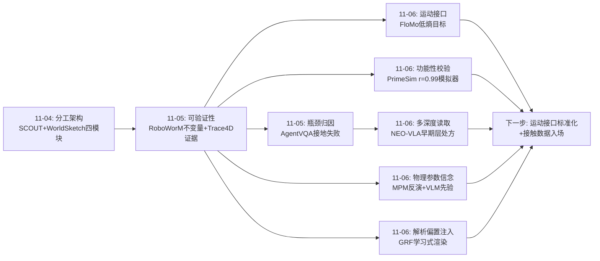
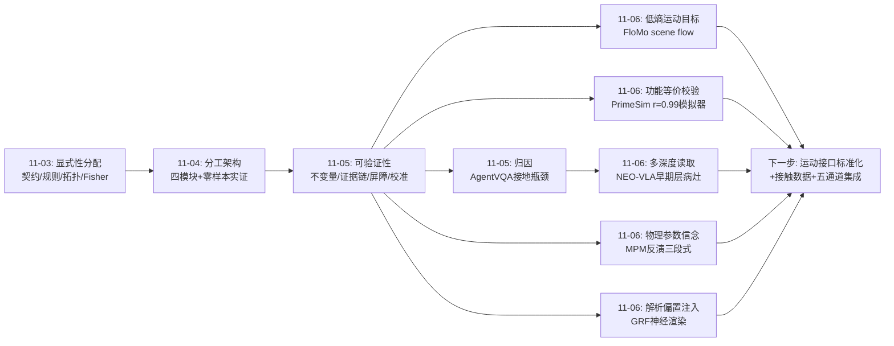
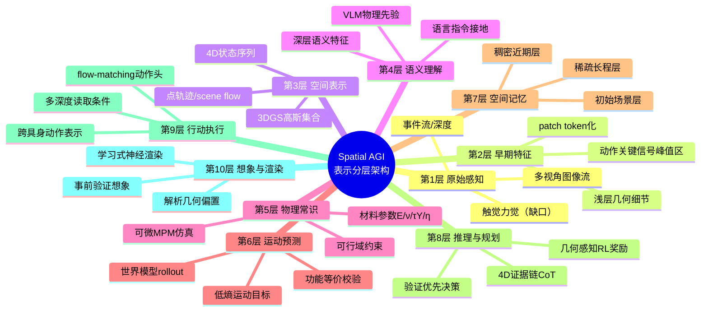
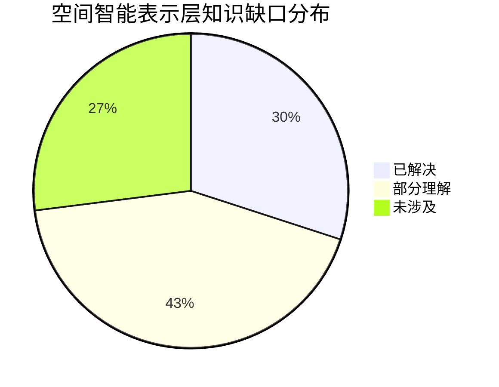

# Spatial AGI 每日思考 - 2026-11-06

## 📅 每日总结

**日期**: 2026-11-06
**论文数量**: 5篇（arXiv HTML 全文精读）
**主题**: 空间智能的"表示选择"集中爆发——动作该以什么形式流动（FloMo：3D运动而非像素）、物理该以什么形式注入（MPM反演：结构化参数而非隐式视觉）、感知接口该以什么形式读取（NEO-VLA：多深度而非单端点）、模拟环境该以什么形式提供（PrimeSim：可学模拟器而非手写引擎）、渲染该以什么形式学习（GRF：解析偏置+学习注意力）。昨天的"可验证分工架构"回答了"谁做判断、怎么信"，今天五篇论文回答的是它的上游问题：**信息以什么形式在模块之间流动**——表示的选择本身就是架构的设计

**关键突破**:
- 🚀 PrimeSim：30,110小时×22平台跨具身中训练 + fast-video/slow-memory后训练，把预训练视频生成器改造成动作忠实、多视角一致、105秒长时程稳定的机器人模拟器；**r=0.99 的策略成功率相关性**首次证明学出来的世界模型可以在"策略训练环境"这个最严格角色上替代物理仿真器，且已支撑 GRPO 策略优化
- 🚀 FloMo：干净的消融三连击——WAM 用视频目标替换运动目标则 OOD 泛化变差；在运动之外附加视频目标则成功率下降；联合预测时 action token 的注意力显著偏向 motion token。结论锋利：**视频是运动的低效载体，稠密 3D 运动才是视频预训练迁移到动作的媒介**
- 🚀 Physical Diffusion Policy：逆向使用 3DGS+MPM——从演示视频反演材料参数（E/ν/τY/η），VLM 给量级先验、可微仿真给精确数值、材料感知参数裁剪保证物理合理性；参数注入 MoE 扩散策略消除"动作平均化"；物理记忆库让部署零仿真成本
- 🚀 NEO-VLA：encoder-free 原生骨干 + 可配置层映射的动作专家，用参数量对齐对比+激活交换干预双重证明——**动作关键视觉信号峰值在骨干早期层**；原生架构优于编码器架构，全量微调缩小但不消除差距，规模无法弥补；相机扰动/图像噪声下鲁棒性增益显著
- 🚀 GaussianRenderFormer：首个无光栅化器的 3DGS 前馈神经渲染器（transformer 直接从高斯 token 渲染图像，38.08 dB vs 光栅化 44.02 dB）；投影位置 2D RoPE + 投影足迹 keys 证明"解析几何偏置+学习注意力"是最小归纳偏置注入范式；6 dB 差距被诊断为视图解码器瓶颈而非泛化问题

**架构演进**: 可验证分工架构 → **表示分层的分工架构**（五模块分工与验证体系不变，今天补上了它们的共同上游：模块间的信息通道各有其最优表示形式——动作走低熵运动场、物理走结构化参数、感知走多深度token流、环境走世界模型rollout、外观走解析偏置化的注意力渲染）

### 📊 一句话总结

2026-11-06 的五篇论文共同确立了空间智能的一条设计公理：**表示的选择即架构的设计**——每个空间信息通道（观测→理解→预测→行动→渲染）都存在一个远低于原始信号熵的"运动学/物理充分统计量"，找到它并让预训练资产复用它（FloMo 复用视频 VAE、PrimeSim 复用视频生成器、GRF 复用 RenderFormer 权重），就能同时获得样本效率、泛化性与跨具身/跨场景迁移能力；而 AgentVQA 证明的空间接地瓶颈，恰好可以被 NEO-VLA 的多深度读取与 FloMo 的运动接口直接修补。

### 🔗 延续性

**昨日→今日**: 昨日的核心结论是"可验证的分工架构"——五模块分工（语义/测量/几何/裁决/安全），每类输出用与其性质匹配的确定性方式验证。昨日留下五条线索：①可学习空间不变量；②4D证据链×确定性校验闭环；③空间置信度方言的统一理论；④主动感知的POMDP形式化；⑤验证成本经济学。今天五篇全部落在这些线索的上游——表示层：PrimeSim 用 r=0.99 的功能性指标接住线索②（世界模型输出的校验从逐帧不变量升级为"策略成功率统计等价性"，这是 RoboWorM 确定性评测的功能化推广）；FloMo 的 scene flow 与昨日 Trace4D 的 4D 状态序列在"点级3D运动是空间智能通用货币"上完全合流（线索②的表示基础）；MPM 反演把线索③的"空间信念"扩展到了物理参数域（材料参数就是一种带可行域约束的空间信念）；NEO-VLA 的多深度读取直接回应 AgentVQA 的空间接地瓶颈诊断——瓶颈在早期层，修复也要从早期层读取。

**今日→明日**: 六条新线索：①运动接口的标准化——scene flow/4D状态/点轨迹三种方言（FloMo/Trace4D/SpatialTracker系）需要统一格式与工具链；②世界模型模拟器的物理精度天花板——PrimeSim 局部校准落后，纯像素监督能否恢复接触力存疑，需引入力/触觉监督；③VLM先验+可微仿真精调的推广——从材料参数推广到质量/摩擦/阻尼/铰接结构等一切物理量；④视觉-物理参数的联合反演可辨识性——纯视觉反演的病态性需要触觉或多视角力线索正则化；⑤学习式渲染的空间想象能力——GRF 的可学习先验可否用于"从降质splats脑补视图"，与PrimeSim世界模型构成结构-外观分工管线；⑥多深度读取在非操作域的验证——导航/空间问答中"早期层更重要"是否成立。明日检索方向："scene flow world model interface"、"contact force world model supervision"、"tactile visual parameter identification"、"learned rendering novel view from degraded splats"。

### 💡 本质思考：如何达成通用空间智能

#### 1. 核心能力的本质是什么？

本周主题的第三次收敛。11-04 的表述是"分工架构"，11-05 是"可验证分工架构"，今天可以表述为它的信息论基础：

**空间智能的本质是可验证的分工架构，而分工架构的效率与泛化性由模块间信息通道的表示选择决定——最优表示是每个通道的运动学/物理充分统计量：观测通道用多深度特征流（几何细节在浅层、语义在深层，NEO-VLA）、预测通道用低熵运动场（纹理不变，FloMo）、行动通道用身体无关变换链（相对动作块，PrimeSim）、物理通道用带约束的结构化参数（材料四参数，MPM反演）、环境通道用功能性等价的世界模型rollout（r=0.99，PrimeSim）。**

为什么"表示选择"是根本性的？因为空间信号的原始形式（像素视频、力觉时序、语言描述）都是高熵载体，其中真正驱动空间决策的低熵内核（运动场、参数、变换链）被外观噪声包裹。三条今天反复出现的证据链：

- **低熵目标的效率优势**（FloMo）：预测目标的信息熵直接决定样本效率与OOD泛化。视频→运动的替换让同一骨干在人类视频迁移上泛化到未见物体/基元/任务；而保留视频目标反而消耗注意力容量、拖累动作学习。空间智能的训练目标设计应该问的第一问题是："这个任务的运动学充分统计量是什么？"
- **结构化参数的可控性优势**（MPM反演）：物理常识如果以隐式视觉特征存在，就无法被裁剪、传播、检索、复用；以结构化参数（E/ν/τY/η + 可行区间）存在，就可以被 VLM 先验初始化、被梯度精调、被区间约束、被记忆库检索。 yesterday 的"空间信念统一理论"线索因此有了具体形态：信念的最小表示单元是带可行域的参数，不是向量。
- **功能性等价的检验标准**（PrimeSim）：世界模型作为模拟器的价值不在于逐像素保真，而在于"在它里面训练的策略与在现实中训练的策略统计等价"（r=0.99）。这把 yesterday 的确定性不变量验证推广了一层：当逐帧物理不变量不可得时，**功能性等价性**是更根本的校验标准——空间智能的组件应该按其下游功能验收，而非按其表观相似度。

#### 2. 当前方法与理想目标的差距在哪里？

- **运动接口方言割裂**：FloMo 的累积 scene flow（首帧坐标系、4096点）、Trace4D 的 4D 状态序列、SpatialTracker 的点轨迹、各种点跟踪器的输出格式互不兼容。理想状态是一套标准化的"空间运动交换格式"——就像视觉领域的 COCO/OpenCV 约定那样，让世界模型、策略、规划器、评测器可以即插即用地交换运动结构。
- **物理精度的接触鸿沟**：PrimeSim 承认细粒度局部校准落后；FloMo 的运动目标对静态接触（"手不动但力在持续"）表达退化；MPM 反演没有力/触觉监督、参数可辨识性病态。接触物理—— Spatial AGI 最核心的物理交互形式——在纯视觉范式下有一个系统性的观测盲区。理想状态需要触觉/力觉数据进入世界模型与策略的训练信号。
- **表示层级与分辨率的矛盾**：NEO-VLA 的 32×32 patch 化与每视角88 token 预算对精密操作不够；FloMo 的 64×64 查询网格对细小物体不够；GRF 的 20K 高斯对场景级不够。空间智能需要的可能是"分辨率自适应"的 token 化——重要区域细 token 化、背景粗 token 化，且这个重要性由任务动态决定。
- **跨具身统一以牺牲灵巧为代价**：PrimeSim 为通用性过滤掉灵巧手与腿式 locomotion；FloMo 的 20 维双臂末端空间同样不含灵巧手。人类视频中最大的运动先验来源恰恰是手部精细运动——统一动作表示与灵巧性的矛盾是跨具身空间智能的下一个硬骨头。
- **学习式渲染与解析渲染的差距**：GRF 的 6 dB 差距与万级 token 规模限制意味着"空间想象"（从内部表示生成外观）还是半成品。理想的空间智能体需要在想象中同时生成结构与外观，当前只有结构（scene flow rollout）可用。
- **验证与表示的对应表未建立**：昨天的"验证-修复回路"今天有了新的表示层处方（多深度读取、运动目标、物理参数注入），但"哪种表示缺陷该用哪种表示修复"的映射仍是经验性的。

#### 3. 从今天到理想状态，最可能的路径是什么？

五步走判断（昨日版本的更新）：

**第一步（进行中）：表示层的各自突破与方言化**。运动接口（FloMo/Trace4D）、物理参数（MPM反演）、多深度读取（NEO-VLA）、可学模拟器（PrimeSim）在各自域内快速成熟，但格式互不兼容。这一步的标志事件：PrimeSim 类模拟器成为策略训练标配；scene flow 目标在 WAM 论文中成为默认消融项。

**第二步（2027 上半年）：运动接口标准化 + 接触数据入场**。点级3D运动的统一交换格式出现（大概率由某个开源工具链推动）；触觉/力觉数据集与世界模型训练信号的融合开始（针对接触鸿沟）——PrimeSim 的 r=0.99 检验协议会被用来量化"加了力觉后功能性等价性提升多少"。

**第三步（2027 下半年）：五通道架构的端到端集成**。观测（多深度读取）→预测（运动目标世界模型）→物理（参数反演注入）→行动（跨具身变换链）→想象（学习式渲染）的完整管线首次在单一系统中贯通，用 PrimeSim 式功能性等价 + RoboWorM 式不变量做系统级验收。灵巧手的统一表示（可学习的具身接口而非固定槽位）大概率在这一步突破。

**第四步（2028+）：表示选择的自动化**。"这个任务该用什么表示"本身成为可学习决策——架构搜索/路由机制在表示库（像素/运动场/参数/点云/图结构）中按任务与误差模式动态选择，接住 yesterday 的"验证-修复自动化"：验证失败的模式直接触发表示层的切换与修复。

**第五步（2028+）：自举的空间想象**。学习式渲染追平解析渲染后，空间智能体获得完整的心理意象能力——在想象中同时生成结构（世界模型rollout）与外观（神经渲染），用想象结果做事前验证（接住 CLOSER 的"验证优先于承诺"），空间智能的"想象-验证-执行"闭环完全内化，不再依赖外部仿真器。

---

## 🔗 与昨日思考的联系

### 昨日重点

昨天的主题是**可验证性**：分工架构（语义/测量/几何/裁决/安全五模块）配上了验证体系——评测用几何不变量（RoboWorM KIVA/RIGIS）、推理用符号化4D证据链（Trace4D）、安全用屏障函数（Caging dEBF）、行动用证据门槛（CLOSER三值校准）、瓶颈归因（AgentVQA：空间接地是第一瓶颈）。留下线索：可学习不变量、4D证据×校验闭环、不确定性统一理论、主动感知形式化、验证成本经济学。

### 今日进展

今天五篇论文把视角从"怎么信"上移到"信的对象以什么形式流动"——表示选择，并接住昨日线索：

1. **接住线索②"4D证据×校验闭环"（FloMo + PrimeSim）**：昨日 Trace4D 证明 4D 状态序列可以作推理证据，今日 FloMo 证明它（scene flow）可以作为训练目标并是动作迁移的最优媒介——4D运动的"推理证据"与"训练目标"两个身份合流；PrimeSim 的 r=0.99 则给这个闭环提供了终极校验协议：生成的运动结构是否可信，用"策略在其中的成功率是否与现实统计等价"来检验。RoboWorM 的逐帧不变量（物理合法性）与 PrimeSim 的功能性等价（策略效用）构成两级校验体系。
2. **接住线索③"空间置信度统一理论"（MPM反演）**：昨天的置信度方言都是标量/场（幻觉分数、安全裕度、Fisher信息），今日 MPM 反演给出了结构化形态——材料参数作为带可行域约束的信念单元，VLM 先验做初始化、梯度做更新、区间裁剪做合理性校验、记忆库做检索复用。这就是"空间信念动力学"在物理参数域的完整实现，其"先验+精调+约束"三段式是统一理论应有的形状。
3. **回应 AgentVQA 瓶颈归因（NEO-VLA）**：昨日确认空间接地是第一瓶颈，今日 NEO-VLA 给出最直接的表示层处方——接地失败的信号在骨干早期层，所以动作专家必须从早期层读取；编码器端点压缩掉的恰是接地所需的度量级空间细节。诊断（昨日）与处方（今日）第一次精确对上。
4. **接住"可学习不变量"线索（GaussianRenderFormer）**：昨日问"开放场景耗尽解析工具后不变量能否学习"，GRF 给出了镜像答案——渲染这个纯解析任务反而需要注入解析偏置（投影RoPE+footprint）学习才work。这揭示了一个更细的分工原则：**解析知识以偏置形式注入学习系统，学习系统负责解析知识覆盖不了的组合与补全**——这是"可学习不变量"问题应该采取的形态：不是从零学不变量，而是解析不变量做底座、学习系统补余量。
5. **为分工架构补上"环境通道"的学得版本（PrimeSim）**：昨日五模块中的物理裁决模块依赖手写仿真器或世界模型rollout但未解决长时程/跨具身问题，PrimeSim 把这个模块做成了可部署的开源基础设施——分工架构第一次拥有了全部五个模块的可运行开源实现路径。

### 演进路径



核心轨迹：**知识形式（11-03）→ 系统分工（11-04）→ 可验证性（11-05）→ 表示选择（11-06）**——从"存哪层"到"谁做什么"到"怎么信"再到"以什么形式流动"，分工架构的信息论基础今天奠基。

---

## 📚 论文概览

**论文1: PrimeSim（2611.04870, PrimeBot+东南大学+上交+CUHK等，全开源）**
动作条件多视角世界模型模拟器。数据引擎：30,110小时/2.38B帧/1.52M episodes/22平台/84:16真仿比，四阶段流水线（视频质量→动作质量→数据对齐→动作对齐），统一跨具身动作表示+相对动作块（窗口首帧坐标系变换链）。架构：帧对齐双路径动作条件+视角感知交错注意力。后训练三件套：chunk-causal+4步一致性蒸馏（10.1 FPS）、self-rollout+非对称分布匹配（抗误差累积）、层次化时间记忆（初始场景/稀疏长程/稠密近期的有界KV cache，105秒rollout）。性能：EWMBench 6.09第一，WorldSimProbe 4/5 suites领先，未见平台100-200步迁移，与LIBERO成功率r=0.99，已支撑GRPO策略优化。局限：细粒度局部校准落后、灵巧手被过滤、相机数硬编码3。

**论文2: Physical Diffusion Policy（2611.04493, HKU）**
物理感知扩散策略。FF-3DGS（ZFormer，64帧半球视频）+MPM粒子一一绑定构成视觉-物理双层可微表示（极分解协方差传播）；视频引导反演材料参数θ={E,ν,τY,η}：VLM冷启动+材料感知区间裁剪+Dirichlet边界条件+时间Chamfer几何约束；θ注入材料感知MoE扩散策略按物理regime路由专家消除动作平均化；物理记忆库部署时检索参数替代在线仿真。局限：纯视觉反演病态、依赖FF-3DGS重建质量、不覆盖刚体/铰接体。

**论文3: FloMo（2611.05062, Georgia Tech, Animesh Garg组）**
3D scene flow 作为世界动作模型的预测目标。SpatialTrackerV2离线提取点轨迹（T=16窗/4096查询点/首帧坐标系），累积位移场（F_i=p_i−p_0）抑制跟踪噪声，按1st/99th百分位渲染成RGB复用冻结Wan2.2 VAE编码——运动与视频共享latent空间；5B DiT+LoRA（161M可训）flow-match联合去噪scene flow与20维双臂动作；人类视频（仅运动损失）+机器人数据（运动+动作）两阶段共训。结论：运动目标优于视频目标（ID成功率+OOD泛化），附加视频目标反而掉点，action注意力偏向motion。局限：依赖点跟踪器质量、4096点分辨率、首帧坐标系非遍历性。

**论文4: NEO-VLA / From Pixels to Actions（2611.06918）**
结构原生（encoder-free）VLA。两级卷积patch embedder（步长32）直接像素进token空间，无预训练视觉编码器/codebook/autoencoder；40层2B骨干三阶段训练，三维RoPE（时间/高/宽）+模态感知注意力（文本因果/视觉双向）；多模态前缀：多视角图像+相机身份/几何token+结构化prompt+本体感知状态token（缺失掩蔽适配不同具身）；独立窄动作专家以flow-matching预测连续动作块，**层映射M可配置**（first-28/skip-28/end-28/full-40）读取骨干多层KV。发现：动作关键信号峰值在早期层（冻结骨干时first-28最好，微调后早+晚组合最佳）；激活交换干预因果证实；原生骨干优于Qwen3-VL-2B/Gemma3-4B同专家对比；LIBERO/LIBERO-plus/RoboTwin 2.0鲁棒。局限：归因混杂变量、patch分辨率粗、full-40推理成本。

**论文5: GaussianRenderFormer（2611.05593, Hebrew University, 开源）**
无光栅化器的3DGS神经渲染器。高斯14参数（中心/尺度/四元数/RGB/不透明度）→token，视图无关编码器（12层自注意力+3D RoPE+16寄存器）；视图解码器（4×4 patch光线束token，6层交叉+自注意力，DPT头）：投影位置2D RoPE+投影足迹keys+小patch三项适配。从RenderFormer预训练权重迁移。26,820 Objaverse物体（剪枝至20K高斯）训练，300未见物体38.08 dB vs 光栅化44.02 dB；footprint注入+1.4 dB；差距诊断为视图解码器瓶颈。局限：视角相关颜色缺失（球谐0阶）、规模限制、推理慢、宣称红利（光传输学习等）全部未兑现。

---

## 💡 核心见解

### 见解1: 预测目标的信息熵决定空间学习的效率

**从 FloMo 获得**
- ✅ 视频→scene flow 的目标替换同时提升 ID 成功率与 OOD 泛化；附加视频目标反而降低成功率
- ✅ 联合预测时 action token 对 motion token 的注意力远大于 video token——视频预测在消耗模型容量而不服务控制
- ✅ 累积位移场（首帧锚定）比瞬时速度更平滑可学，让指尖级细粒度运动可预测

**对Spatial AGI的启发**:
这把"空间智能的训练目标设计"变成一个可计算的问题：对任何空间预测任务（未来状态、轨迹、可供性、风险），先问"它的运动学充分统计量是什么、熵多低"。视频是运动的冗余载体这一论断，同样适用于深度视频、事件流等其他高维观测——每个通道都应该被问"你的低熵内核是什么"。更进一步：这与 yesterday 的"显式性分配原则"同构——显式性/低熵性的分配都要按"错误敏感度×下游用途"来定，只是 yesterday 站在知识层，今天站在信号层。

### 见解2: 预训练资产的复用是空间智能的工程杠杆

**从 FloMo + PrimeSim + GRF 共同获得**
- ✅ FloMo：scene flow 渲染成 RGB 即可用冻结视频 VAE 编码——运动寄生在为外观设计的表示系统里，零新 tokenizer
- ✅ PrimeSim：预训练视频生成器经中训练+后训练改造成模拟器，而非从头训练
- ✅ GRF：从 RenderFormer（网格渲染器）预训练权重出发，只换输入层+足迹层+训练调度

**对Spatial AGI的启发**:
空间智能不需要、也不应该从零构建自己的感知/生成基础设施——空间信息（运动、物理、投影几何）可以寄生于为其他任务预训练的表示系统，只要给出正确的"翻译层"（渲染成RGB、统一动作格式、解析偏置注入）。这大幅改写了空间智能的成本结构：从"训练一个空间基础模型"降为"给已有基础模型加空间翻译层"。工程含义是立竿见影的：任何一个空间智能项目都应该先盘点"哪些预训练资产可以被翻译层复用"。

### 见解3: 物理常识的落地公式——LLM给方向、梯度给数值、约束给边界

**从 Physical Diffusion Policy 获得**
- ✅ VLM 提供材料类别的量级先验（序数关系："果冻比积木软"），可微仿真把先验锚定为绝对数值（5 kPa 还是 50 kPa）
- ✅ 材料感知参数裁剪把 VLM 的不精确先验硬编码为可行区间，初值与每次梯度更新后都投影回区间——防物理荒谬解
- ✅ 物理记忆库：检索替代在线优化——结构化参数使物理经验可存、可查、可复用

**对Spatial AGI的启发**:
这是 yesterday"空间信念动力学"线索的第一个完整实现样板：信念单元=带可行域的参数；初始化=语义先验；更新=梯度+观测；校验=区间约束+几何一致性；复用=记忆库检索。"LLM给方向、梯度给数值"的分工可以推广到质量、摩擦、阻尼、铰接自由度等一切物理量——大模型的物理常识是序数和类别的，精确数值必须靠数据与梯度锚定，两者缺一不可。这也解释了为什么纯VLM的物理推理和纯可微仿真的系统辨识都不够：前者无数值、后者无先验。

### 见解4: 空间接地瓶颈的病灶在表示早期层

**从 NEO-VLA 获得**
- ✅ 层映射对比（参数量对齐）：冻结骨干时只读早期层（first-28）优于只读晚期层（end-28）；全量微调后早+晚组合最佳
- ✅ 激活交换干预：早期层激活的跨观测交换引发显著更大预测误差——因果性而非相关性证据
- ✅ 原生（encoder-free）骨干在控制上优于编码器骨干，微调缩小但不消除差距，加大规模无法弥补

**对Spatial AGI的启发**:
AgentVQA（昨日）诊断空间接地是第一瓶颈，NEO-VLA（今日）找到了病灶位置：预训练编码器为语义对齐优化的压缩恰好丢掉了接地所需的度量级几何细节，而这些细节在骨干早期层最易访问。处方因此明确：空间决策模块必须有多深度读取通道。更深的推论：**语义与空间保真存在结构性张力**——服务语义理解的视觉前端可能系统性地不适合空间决策，这为"空间智能专用骨干"提供了存在性证明，也解释了为什么给VLM加几何token的补丁式方案效果总是有限：问题不在缺token，在读取深度。

### 见解5: 世界模型的终极校验是功能性等价

**从 PrimeSim 获得**
- ✅ r=0.99：PrimeSim rollout 中策略成功率与 LIBERO 物理仿真成功率的相关性——在想象中训练的策略可以搬回现实
- ✅ 已实际支撑 GRPO 策略优化：世界模型从"生成合理视频"升级为"可用的训练环境"
- ✅ 跨具身少样本迁移（100-200步）：统一动作表示+相对动作块使新平台的适配成本降到梯度步级别

**对Spatial AGI的启发**:
RoboWorM（昨日）的确定性不变量回答"rollout 物理上对不对"，PrimeSim 的 r=0.99 回答"rollout 用起来行不行"——两级校验互补，且功能性等价是更根本的：一个逐帧略有瑕疵但策略效用等价的世界模型，比逐帧完美但策略效用不等价的更有价值。这为 Spatial AGI 的所有生成组件确立了验收原则：**按下游功能验收，不按表观相似度验收**。同时它把"想象"从隐喻变成了基础设施——空间智能体第一次可以在开源的、可复现的想象环境中做完整训练。

### 见解6: 解析知识以偏置注入、学习系统补余量

**从 GaussianRenderFormer 获得**
- ✅ 投影位置 2D RoPE + 投影足迹 keys 都是"模型原则上可以自己推断但注入后显著提升"（+1.4 dB）的信息
- ✅ 完全端到端的学习渲染在注入解析偏置之前不 work——纯学习无法高效发现投影几何
- ✅ 6 dB 差距是架构瓶颈（视图解码器）而非泛化差距——诊断方法论值得复用

**对Spatial AGI的启发**:
这修正了"可学习不变量"问题的提问方式（yesterday 线索①）：不是"不变量能否从零学习"，而是"解析不变量做底座、学习系统补组合与补全"——渲染如此，物理如此（MPM 的本构方程是解析底座、参数是学习对象），推理亦如此（Trace4D 的几何提取是解析底座、CoT 是学习对象）。空间智能的正确姿势是解析与学习的**分层耦合**而非二选一。GRF 的诊断流程（对照同输入的解析渲染、注入消融、差距归因）也应该成为所有"学习式替换解析组件"研究的标准动作。

### 见解7: 分层是空间记忆与长时程一致性的通用解

**从 PrimeSim 获得**
- ✅ 层次化时间记忆：初始场景（物体在哪）+稀疏长程历史（去过哪）+稠密近期运动（正在怎么动）的有界 KV cache 支撑 105 秒一致性
- ✅ self-rollout + 非对称分布匹配：让模型在自己的不完美预测上训练——分布鲁棒性的可操作训练范式
- ✅ 数据分层：中训练用海量多样语料、后训练用下游任务专属数据——每阶段训练目的与数据分布严格匹配

**对Spatial AGI的启发**:
分层出现在三个尺度：记忆分层（情景/语义/工作）、训练分层（pre/mid/post）、校验分层（不变量/功能等价）。这不是巧合——空间智能处理的时空范围（毫秒接触到小时任务）跨越多个数量级，单一表示/单一数据/单一校验无法覆盖，分层是必然的架构响应。AgentVQA 诊断的"状态维护失败"本质上就是工作记忆层的设计问题，CLOSER 的"证据获取"是情景记忆层的问题——昨日各论文的方案可以在分层框架下统一归位。设计空间智能系统时应显式回答：每层的边界在哪、层间如何读写、每层的失效模式是什么。

### 见解8（附加）: 跨具身的本质是坐标变换链的统一

**从 PrimeSim + FloMo 获得**
- ✅ PrimeSim：所有动作表达在窗口首帧本体感知坐标系下（T̃=T0⁻¹Tt），22平台混训成立
- ✅ FloMo：所有运动表达在首帧相机坐标系下，人类视频先验可迁移到机器人动作
- ✅ 两者共同点：寻找"观察者/身体无关"的规范坐标系，把具身差异压缩为坐标变换

**对Spatial AGI的启发**:
跨具身与跨视角问题的数学同构：都不是"学一个新的动作/感知空间"，而是"找一个让差异变成简单变换的规范系"。空间智能的接口设计应该优先回答规范系问题——这不仅统一数据，还天然内建了不变性（相机自运动、身体初始姿态被变换吸收）。李群/李代数的工具（SE(3)相对变换）在这里不是装饰而是主力。

---

## 🗺️ 知识演进图

⚠️ 必须使用 mermaid 代码块！禁止用纯文本箭头！



核心轨迹：**知识形式（11-03）→ 系统分工（11-04）→ 可验证性（11-05）→ 表示选择（11-06）→ 接口标准化与集成（下一步）**

---

## 技术栈演进对比表

| 层次 | 昨日方案（11-05） | 今日方案（11-06） | 变化 |
|------|------------------|------------------|------|
| 观测接口 | AgentVQA：诊断接地失败但未给表示层处方 | NEO-VLA：encoder-free骨干+可配置多深度读取，动作专家从早期层取几何细节 | 从诊断到病灶定位+处方；视觉端点从"单一编码器输出"变为"可配置的层级读取" |
| 预测目标 | Trace4D：4D状态序列作推理证据（CoT中间层） | FloMo：3D scene flow作WAM训练目标，运动优于视频的干净消融 | 从"推理的证据"扩展到"训练的目标"；4D运动的双重身份（证据+目标）确立 |
| 训练数据 | RoboWorM：用硬件先验评测世界模型rollout | PrimeSim：30K小时跨具身数据训练世界模型，r=0.99功能校验 | 从"评测rollout"到"构造可用模拟器"；校验从逐帧不变量升级为功能性等价 |
| 物理常识 | Caging：SDF距离场做安全接地（几何级） | MPM反演：材料参数反演+VLM先验+MoE路由（本构级） | 从几何级物理到材料级物理；物理常识获得结构化参数形态与记忆库复用机制 |
| 外观生成 | （未涉及学习式渲染） | GRF：transformer直接渲染高斯，解析偏置+学习注意力 | 新增"空间想象"组件的可行性证明；解析与学习的分层耦合模式确立 |
| 长时程 | Trace4D证据链（推理层面） | PrimeSim层次时间记忆（环境层面105s）+self-rollout训练 | 长时程从推理语境扩展到环境模拟语境；分层记忆成为跨层通用模式 |
| 跨具身 | Caging平台无关架构（模块级） | PrimeSim统一动作表示+100-200步迁移（数据/模型级） | 跨具身从架构解耦深化到动作空间统一；规范坐标系成为关键技术 |
| 动作生成 | Caging：Bezier-MPPI+dEBF安全轨迹 | FloMo/NEO-VLA：flow-matching动作头（运动目标/多深度条件） | 动作头的主流范式收敛到flow-matching；动作条件的信息源成为新设计轴 |
| 验证体系 | 确定性不变量（KIVA/RIGIS） | 功能性等价（r=0.99）+差距诊断方法论（GRF） | 两级校验体系成形：物理合法性（不变量）×下游效用（功能等价） |

---

## 🗺️ Spatial AGI 知识图谱

### 10层架构思维导图

⚠️ 必须使用 mermaid mindmap 代码块！



### 🎯 主线技术路径

#### 阶段1: 方言化突破（进行中，2026 H2）

各表示通道独立突破：运动接口（FloMo 证明 scene flow 目标优越性、Trace4D 证明 4D 状态证据价值）、物理参数（MPM 反演三段式）、多深度读取（NEO-VLA 层映射）、可学模拟器（PrimeSim r=0.99）、神经渲染（GRF 可行性）。特征是：每篇论文都在自己通道内给出干净消融与量化证据，但格式互不兼容——scene flow 有三种坐标约定，物理参数有不同本构族，动作表示过滤灵巧手。

#### 阶段2: 运动接口标准化 + 接触数据入场（2027 H1）

点级 3D 运动的统一交换格式出现（坐标约定、置信度字段、跟踪质量标注），工具链开源推动世界模型/策略/规划器/评测器即插即用。同期触觉与力觉数据开始进入世界模型与策略训练信号——针对接触鸿沟（PrimeSim 局部校准落后、纯视觉参数反演病态），检验协议采用 PrimeSim 的 r=0.99 功能等价 + RoboWorM 的接触不变量，量化"加力觉后提升多少"。

#### 阶段3: 五通道端到端集成（2027 H2）

观测（多深度读取）→预测（运动目标世界模型）→物理（参数反演注入）→行动（跨具身变换链+flow-matching头）→想象（学习式渲染）首次在单一系统贯通；系统级验收采用两级校验（不变量×功能等价）。灵巧手的统一表示大概率在此突破——从固定槽位式动作空间转向可学习的具身接口。标志事件：一个开源系统在想象环境中完成从人类视频学习到真机部署的完整闭环。

#### 阶段4: 表示选择自动化（2028+）

"任务该用什么表示"成为可学习决策：架构路由在表示库（像素/运动场/参数/点云/图结构/多深度特征）中按任务与验证失败模式动态选择，与 yesterday 的"验证-修复自动化"合流——验证失败的模式直接触发表示层切换。空间智能系统获得架构级的自我修复能力。

#### 阶段5: 自举空间想象（2028+）

学习式渲染追平解析渲染后，"想象-验证-执行"完全内化：世界模型 rollout 结构（scene flow）+ 神经渲染补外观，事前想象替代外部仿真器成为主要验证手段（接住 CLOSER"验证优先于承诺"），空间智能的心智闭环闭合。

---

## 🔍 待探索议题

### 高优先级（本周）

1. **运动接口的统一交换格式**
   - 问题: FloMo 累积 scene flow（首帧相机系/4096点）、Trace4D 4D 状态序列、SpatialTracker 点轨迹三种方言互不兼容
   - 候选方案: 定义带置信度与跟踪质量字段的点轨迹交换格式（类似 COCO 地位）；开源一个格式+转换工具链
   - 缺口: 各方法的首帧/世界系选择、点数、累积vs瞬时约定差异；无社区标准

2. **世界模型的接触物理监督**
   - 问题: PrimeSim 承认细粒度局部校准落后；纯像素监督对接触力约束太弱
   - 候选方案: 触觉/力觉数据流作为额外条件与监督；物理仿真器生成的合成接触数据做正则
   - 缺口: 力觉与视频的对齐数据集稀缺；力觉信号如何进入扩散/flow-matching训练未探索

3. **纯视觉参数反演的可辨识性**
   - 问题: {E,ν,τY,η} 四参数从视频反演本质病态——参数组合简并可能产生相同形变视频
   - 候选方案: 触觉闭环；主动扰动（故意压一下看响应）设计信息最大化交互；报告参数后验而非点估计
   - 缺口: MPM 反演论文未报告参数 ground truth 误差；简并性的理论刻画缺失

4. **多深度读取在非操作域的验证**
   - 问题: NEO-VLA"早期层承载动作关键信息"的结论只在操作基准验证；导航/空间问答可能相反
   - 候选方案: 把层映射动作专家机制移植到 VLN/空间问答模型做同样的层映射+激活干预实验
   - 缺口: 非操作域缺乏参数量对齐的对照实验框架；语义主导任务的层依赖未测绘

### 中优先级（本月）

5. **从降质 splats 学习式"脑补"渲染**
   - 问题: GRF 对完整剪枝 splat 落后光栅化 6 dB，但光栅化器无法补全输入缺失信息
   - 候选方案: 在严重降质/压缩/部分观测的 splat 上训练学习式渲染器，测试与光栅化的差距是否反转
   - 缺口: 降质 splat 训练数据构造方法；"补全先验"的评测协议（对 ground truth 完整 splat）

6. **世界模型模拟器的具身覆盖扩展**
   - 问题: PrimeSim 过滤灵巧手与腿式 locomotion 换取表示简单性；FloMo 动作空间无灵巧手
   - 候选方案: 可学习的具身接口（编码器/解码器式，槽位由学习决定而非固定）；分层的本体感知掩码扩展
   - 缺口: 灵巧手数据的统一格式；人类手部视频→灵巧手动作的间接对齐（FloMo 运动通道可能恰好是答案）

7. **分层记忆的读写策略学习**
   - 问题: PrimeSim 的三层记忆（初始/稀疏长程/稠密近期）是手工设计的分层与保留策略
   - 候选方案: 学习"什么进长程记忆"的选择器（用下游任务成功率做奖励）；记忆层的可微读写
   - 缺口: 长时程任务的记忆效用评测协议；层间信息流动的可解释追踪

8. **注意力归因作为空间架构审计工具的标准化**
   - 问题: FloMo 用注意力归因证明视频目标浪费容量、NEO-VLA 用激活干预定位早期层——方法有效但各自 ad hoc
   - 候选方案: 把"模态/层级注意力归因+激活交换"打包成开源诊断工具，附标准化报告格式
   - 缺口: 归因与性能的因果关联度阈值；跨架构的可比性

9. **VLM先验+可微仿真精调的推广清单**
   - 问题: "LLM给方向、梯度给数值"范式目前只在材料参数验证
   - 候选方案: 系统性推广到质量、摩擦系数、阻尼、铰接自由度、关节限位；建立"物理量×先验来源×精调方式"对照表
   - 缺口: 各物理量的可行区间知识来源（VLM 对摩擦系数的序数判断可靠性未知）

### 低优先级（本季度）

10. **学习式渲染的光传输红利兑现**
    - 问题: GRF 宣称的可学习光传输、统一渲染全部未展示
    - 候选方案: 在 GRF 架构上加入光源条件输入，测试能否从数据学会间接光；splats+mesh 混合输入实验
    - 缺口: 先追平 6 dB 质量差距；视图相关颜色（球谐高阶）支持

11. **功能等价校验协议的标准化**
    - 问题: PrimeSim 的 r=0.99 是单点结果，协议（什么策略族、多少样本、什么置信区间）未成标准
    - 候选方案: 定义"模拟器功能等价证书"协议：策略族采样、样本量、相关性统计与报告格式
    - 缺口: 跨模拟器的可比性；策略族覆盖度与等价性的关系理论

12. **表示选择的元学习**
    - 问题: 阶段4的"表示选择自动化"需要先有"表示×任务×误差模式"的映射数据
    - 候选方案: 系统性 benchmark：同一组任务在多种表示（像素/运动/参数/点云）下训练，收集误差模式谱
    - 缺口: 表示库的实现碎片化；公平比较的计算预算协议

---

## 📊 知识缺口分析

⚠️ 必须使用 mermaid pie 代码块！



**已解决（30%）**:
- ✅ 运动目标优于视频目标（FloMo 三重消融：ID/OOD/注意力归因）
- ✅ 动作关键信号在早期层（NEO-VLA 层映射+激活干预双重证据）
- ✅ 世界模型可作为策略训练环境（PrimeSim r=0.99 + GRPO 实证）
- ✅ 材料参数可从视频反演并注入策略（MPM 三段式 + MoE + 记忆库）
- ✅ 学习式渲染高斯可行（GRF 38.08 dB 可行性 + 瓶颈归因）
- ✅ 跨具身统一动作表示（PrimeSim 22平台 + 相对动作块）
- ✅ 分层记忆支撑长时程一致性（PrimeSim 105s）

**部分理解（43%）**:
- ⚠️ 运动接口格式统一（三种方言并存，标准未立）
- ⚠️ 接触物理精度（局部校准落后；力觉监督方案未探索）
- ⚠️ 纯视觉物理反演的可辨识性（可行域裁剪缓解但不消除病态性）
- ⚠️ 多深度读取的外域有效性（操作域成立，导航/问答未知）
- ⚠️ 跨具身×灵巧性的兼容（统一表示过滤灵巧手；人类手部先验的间接对齐路径未验证）
- ⚠️ 分层记忆的自动化（分层结构已证有效，读写策略仍手工）
- ⚠️ 学习式渲染的补全先验（理论诱人，降质输入实验未做）
- ⚠️ 表示选择的元级决策（映射数据不存在）

**未涉及（27%）**:
- ❌ 触觉/力觉与视觉的世界模型联合训练（数据集+架构+训练范式全缺）
- ❌ 学习式光传输与 splats/mesh/lights 统一渲染（GRF 宣称未兑现）
- ❌ 模拟器功能等价的标准化证书协议
- ❌ 分辨率自适应的任务驱动 token 化
- ❌ 静态接触（力持续而运动为零）的世界模型表达
- ❌ 多智能体空间交互的运动接口（全部今天论文为单机器人）
- ❌ 空间想象的事前验证闭环（想象结果驱动 CLOSER 式决策）

---

## 🎯 本周主题弧线

| 日期 | 主题 | 一句话 |
|------|------|--------|
| 11-03 | 显式性分配 | 空间知识存哪层：契约/规则/拓扑/Fisher的显式性按错误敏感度分配 |
| 11-04 | 分工架构 | 谁做什么：语义/测量/几何/裁决四模块，接口=显式可校验空间模型 |
| 11-05 | 可验证性 | 怎么信：每类输出配与其性质匹配的确定性验证，瓶颈=空间接地 |
| 11-06 | 表示选择 | 以什么形式流动：每通道找运动学/物理充分统计量，表示选择即架构设计 |
| 下一步 | 接口标准化 | 方言归一+接触数据入场+五通道集成 |

---

## 📝 方法论沉淀（本周新增）

1. **低熵目标审计**：评审任何空间预测模型时，先审计其预测目标的信息熵——能否替换为运动学/物理充分统计量？（FloMo 模板）
2. **资产复用盘点**：启动任何空间智能项目时，先盘点可复用的预训练资产与"翻译层"成本（VAE/生成器/渲染器权重复用模板）
3. **两级校验**：生成式组件的验收 = 物理合法性（不变量级）× 下游效用（功能等价级），缺一不可
4. **解析偏置注入**：学习式替换解析组件时，解析知识以注意力偏置/输入特征注入，学习系统只负责组合与补全（GRF 模板）
5. **先验-精调-约束三段式**：物理常识落地 = LLM 序数先验初始化 + 可微仿真梯度精调 + 可行域约束校验（MPM 模板）
6. **层映射+激活干预**：定位"任务关键信息在表示层级的位置"的标准实验设计（NEO-VLA 模板）

---

**文档创建时间**: 2026-11-06 03:50 (Asia/Shanghai)
**分析论文**: PrimeSim / Physical Diffusion Policy / FloMo / NEO-VLA / GaussianRenderFormer
**分析方法**: arXiv HTML 全文精读
**与昨日关联**: 接住线索②（4D证据×校验闭环→FloMo+PrimeSim）、③（置信度统一理论→MPM参数信念）、①（可学习不变量→GRF解析偏置修正提问方式）；回应 AgentVQA 瓶颈归因（NEO-VLA 多深度读取处方）

---

## 🔬 今日五篇深读笔记（逐篇架构走查）

### 深读1: PrimeSim 的三段改造链条

预训练视频生成器 → 模拟器的改造不是一次性微调，而是三段链条，每段解决一个明确的障碍：

**障碍1: 具身异质性**
- 22个平台的动作空间、控制频率、相机配置、末端位姿约定全部不同
- 解法：统一动作表示（双臂末端位姿四元数 + 全身关节角 + 二值夹爪 + 底盘速度三元组）
- 关键细节：相对动作块。绝对动作在不同初始姿态下分布差异巨大；相对化（T̃=T0⁻¹Tt）后所有数据共享同一分布
- 代价：灵巧手与腿式数据被过滤——这是"表示简单性"换来的通用性边界

**障碍2: 动作信号被视觉淹没**
- 视频生成模型里，动作条件的信号弱于视觉内容的信号，动作忠实性差
- 解法：双路径条件——时间对齐注意力路径（逐帧动作-视觉对应）+ 直接注入路径（全局动作意图）
- 证据：动作源行为保持 +41.8%（WorldSimProbe 相对最强对手）

**障碍3: 自回归误差累积**
- 训练时用 ground truth 上下文，推理时用自己的不完美预测——分布漂移
- 解法三件套：
  1. chunk-causal + 4步一致性蒸馏 → 顺序生成在算力上可行（10.1 FPS）
  2. self-rollout 训练 + 非对称分布匹配（对冻结双向教师）→ 模型学会容忍自己的错误
  3. 层次化时间记忆 → 有界 KV cache 三层内容：初始场景（空间持久性）、稀疏长程历史（轨迹记忆）、稠密近期运动（动力学连续性）
- 证据：105 秒连贯 rollout；EWMBench 6.09

**校验的最终形式**: r=0.99。在 PrimeSim 里用 GRPO 训练的策略，其成功率与 LIBERO 物理仿真中的成功率相关性 0.99——想象环境的训练效用与现实统计等价。这是"模拟器"资格的最严格检验，也是 RoboWorM 确定性不变量评测的功能化推广：不变量回答"每帧对不对"，功能等价回答"训练出来行不行"。

### 深读2: MPM 反演的完整梯度链

这是今天工程密度最高的一条可微链路，值得逐步走查：

```
像素空间
  ↕ 可微光栅化（高斯 splatting 渲染）
高斯属性空间 {μ, Σ, c, α}
  ↕ μ_t = x_t（中心跟随粒子）
     Σ_t = R_t Σ_0 R_tᵀ（极分解 F=RS 的旋转传播）
粒子动力学空间 {x, v, m, V, F}
  ↕ MPM 时间积分（P2G 力计算 → G2P 状态更新）
     F^{t+1} = (I + Δt∇v^{t+1}) F^t
本构参数空间 θ = {E, ν, τY, η}
```

三个约束各自的作用：
- **Dirichlet 边界条件**：把"夹爪接触处粒子"钉住——操作事件的空间语义注入仿真，否则粒子会在接触处漂移
- **时间 Chamfer 距离**：仿真粒子云与视频观测几何逐步对齐——抑制动力学误差的积分发散
- **材料感知裁剪**：θ 投影回 VLM 推断类别的可行区间——同时防 VLM 先验不准与梯度越界两种失效

三段式的通用性：VLM 先验（方向）→ 梯度精调（数值）→ 可行域约束（边界）。这个配方不依赖 MPM 特性，可以搬到任何"语义先验存在、观测可微仿真、参数有物理界"的逆问题。候选推广：摩擦系数（VLM 知道冰比橡胶滑）、铰接自由度（VLM 知道门绕轴转）、容器容积（VLM 知道杯比盆小）。

记忆库的意义容易被低估：它不只是省算力——它把"物理经验"变成了可积累、可检索的组织化知识。这是空间智能从"每次从零学"走向"经验复用"的必经形态，与 GSMem（3DGS作为持久空间记忆）构成几何/物理两个维度的记忆库对偶。

### 深读3: FloMo 消融设计的教科书价值

FloMo 的证据链之所以有说服力，在于消融矩阵的完整性：

| 配置 | 预测目标 | ID 成功率 | OOD 泛化 | 注意力 |
|------|---------|-----------|----------|--------|
| 默认 | motion + action | 基线 | 基线 | action→motion 强 |
| 替换 | video + action | — | **变差** | — |
| 附加 | motion + video + action | **下降** | 下降 | action→motion 仍强 |
| 纯视频 | video only | — | — | — |

三个正交结论：
1. 运动目标 **优于** 视频目标（替换实验）
2. 视频目标 **有害于** 动作学习（附加实验——排除"运动不够、视频来补"的替代解释）
3. 容量消耗的直接证据（注意力归因——机制层面解释为什么有害）

这套"替换/附加/归因"三连消融是判定"预测目标优劣"的完备实验设计，应该成为空间智能目标选择研究的标准模板。对比之下，很多论文只做"ours vs baseline"的单点比较，无法区分"目标更好"与"容量更大"。

另一个值得注意的工程细节：scene flow 渲染为 RGB 时按数据集全局 1st/99th 百分位裁剪——把位移场归一化到 VAE 熟悉的 [0,1] 色彩范围。运动与视频共享 latent 空间的可行性就建立在这种"分布对齐"的细节上：不是概念上可行，而是每个数值范围都对齐了才可行。

### 深读4: NEO-VLA 的证据强度评估

结论"早期层承载动作关键信号"的证据链分三层：

**第一层（相关性）**: 参数量对齐的层映射对比
- first-28 / skip-28 / end-28 用同样的 28 层专家与隐藏宽度——严格隔离"读取深度"变量
- 冻结骨干：first-28 > skip-28 > end-28（早期层单调更好）
- 全量微调：early+late 组合最好——微调让深层也学到了控制相关信息

**第二层（因果性）**: 激活交换干预
- 把观测 A 的早期层激活换进观测 B 的前向过程，误差显著大于交换晚期层激活
- 相关性可能来自混淆（浅层恰好也为语义服务），干预实验排除了这种解释

**第三层（跨骨干泛化）**: 原生 vs 编码器骨干对比
- 同动作专家、同训练语料，NEO-VLA（原生2B）> Qwen3-VL-2B / Gemma3-4B（编码器）
- 冻结骨干时差距最大——编码器端点的损失在无法微调补偿时最致命
- 作者诚实声明：预训练数据与容量差异是混杂变量，增益不能全归因于 encoder-free 本身

这套"对比+干预+跨骨干"的组合是表示层级研究的完整方法论。与 FloMo 的"替换/附加/归因"、GRF 的"差距归因诊断"一起，今天的论文在实验设计质量上整体高出近期平均水平——这可能不是巧合：表示层的主张必须靠干净实验支撑，粗消融撑不起表示层结论。

### 深读5: GRF 差距诊断的决策树

GRF 对 6 dB 差距的归因过程值得作为模板记录：

```
差距 38.08 vs 44.02 dB
  ↓ 问题1: 是泛化差距吗？（训练物体上差距同样存在 → 不是）
  ↓ 问题2: 差距在哪一段？
     场景编码器（视图无关）× 视图解码器（视图相关）
  ↓ 问题3: 解码器缺什么信息？
     投影位置（→ 2D RoPE 补上）
     投影足迹（→ keys 注入，+1.4 dB）
  ↓ 结论: 差距一致指向视图解码器瓶颈
  ↓ 保留: 训练不足未排除（诚实的不确定性声明）
```

这个决策树的反面教材是"差距就是泛化不行"的懒归因。空间智能中大量"学习式 vs 解析式"的对比都值得走一遍这个树：差距是泛化性的（数据问题）还是架构性的（信息缺失/容量问题）还是训练性的（预算问题）——三种归因导向完全不同的修复路径。

---

## 🧩 五篇论文的互相印证矩阵

| 主题 | PrimeSim | MPM反演 | FloMo | NEO-VLA | GRF |
|------|----------|---------|-------|---------|-----|
| 预训练资产复用 | ✅ 视频生成器→模拟器 | — | ✅ 冻结VAE编码运动 | — | ✅ RenderFormer权重迁移 |
| 低熵/结构化表示 | ✅ 统一动作表示 | ✅ 参数化物理 | ✅ scene flow目标 | ⚠️ 多深度特征流 | ✅ 14参数高斯token |
| 解析知识注入 | ⚠️ 正运动学统一位姿 | ✅ 本构方程+可行域 | ⚠️ 坐标系约定 | ✅ 3D RoPE+相机几何token | ✅ 投影RoPE+footprint |
| 分层设计 | ✅ 三层时间记忆 | — | ✅ 两阶段数据分层 | ✅ 层映射读取 | ✅ 两段式架构 |
| flow-matching | ✅ 条件flow-matching训练 | — | ✅ 动作+运动去噪 | ✅ 动作速度场 | — |
| 功能性校验 | ✅ r=0.99 | ⚠️ 任务成功率提升 | ✅ ID/OOD/注意力三重 | ✅ 三基准鲁棒性 | ✅ 差距归因诊断 |

三个跨论文收敛点：
1. **flow-matching 成为主流动作/生成头**（PrimeSim/FloMo/NEO-VLA 三篇不约而同）——离散动作 token 范式在操作域基本退场
2. **分层是共识架构响应**（记忆分层/数据分层/读取分层/架构分层）
3. **解析知识与学习的耦合点都在"输入端"**（坐标约定、本构方程、投影几何、3D RoPE）而非输出端——学习系统负责组合与补全，解析知识负责坐标与边界

---

## 📖 概念小词典（本日新增）

- **相对动作块（relative action chunk）**: 动作在窗口首帧本体感知坐标系下表达，T̃=T0⁻¹Tt；跨具身数据混训的关键
- **帧对齐双路径条件**: 动作信息同时走时间对齐注意力路径与直接注入路径，兼顾逐帧对应与全局意图
- **fast-video, slow-memory**: PrimeSim 后训练框架——先蒸馏出快速因果生成，再训练自rollout稳定性，最后加层次记忆扩长程
- **非对称分布匹配**: self-rollout 时学生与冻结双向教师之间的分布匹配约束，单向（非对称）以保留教师的知识先
- **累积 scene flow**: 首帧到第 i 帧的总 3D 位移（F_i=p_i−p_0），比瞬时速度平滑、抗跟踪噪声
- **层映射（layer map）**: 动作专家层 j 读取骨干层 m_j 的 KV 的映射 M=(m_1..m_d)；读取深度的显式架构旋钮
- **激活交换干预**: 把观测A的某层激活替换进观测B的前向过程，测误差增幅——定位任务关键信息层位置的因果实验
- **投影足迹（projected footprint）**: 高斯在特定视图的表观尺寸/形状（由相机系协方差与投影Jacobian计算），注入注意力keys
- **材料感知参数裁剪**: 物理参数按VLM推断的材料类别投影回可行区间，防先验不准与梯度越界
- **物理记忆库**: 已估计物理参数的归档库，部署时检索相似物体参数替代在线仿真
- **功能性等价**: 生成环境的验收标准——在其中的下游任务表现与现实统计等价（而非逐像素相似）

---

## 🔮 给明天检索的具体线索

按优先级排列的搜索词与预期文献类型：

1. `"scene flow" policy learning human video 2026` —— FloMo 的跟进与独立复现；关注是否有工作把运动目标扩展到导航/全身控制
2. `tactile world model contact force` —— 接触鸿沟的第一批工作；关注触觉数据如何进入扩散/flow-matching训练
3. `layer-wise probing embodied control` —— NEO-VLA 层映射研究在导航/问答域的复制
4. `differentiable MPM system identification` —— MPM 反演的可辨识性分析、后验参数估计
5. `learned renderer degraded splat inpainting` —— GRF 补全先验方向的先行者
6. `simulator functional equivalence certificate` —— PrimeSim r=0.99 协议的标准化尝试
7. `dexterous hand unified action representation` —— 跨具身×灵巧性矛盾的突破

---

## ⚖️ 诚实的局限声明（本周思考的边界）

1. **单日样本的过拟合风险**: "表示选择即架构设计"的主题从今天的5篇论文归纳，存在选择偏差——今天恰好有表示层的集中突破，不代表领域每天都有这种收敛。本周主题弧线（显式性→分工→验证→表示）是我事后编织的叙事，真实研究的推进不会如此整齐。
2. **r=0.99 的适用范围未知**: 这个数字来自 LIBERO 的任务分布与 PrimeSim 的训练数据重叠度未公开详述的情况。若策略任务分布远离训练数据，功能等价性大概率衰减——把它当作"上限情形的可行性证明"而非"通用保证"。
3. **对 FloMo OOD 结论的保留**: OOD 泛化的评测协议（什么算未见物体/基元）论文细节被我部分截断，"运动目标优于视频目标"在多大任务范围成立需要跟进复现。
4. **NEO-VLA 归因混杂**: 作者自己声明预训练数据与容量差异无法排除——"encoder-free 更适合控制"应表述为"在当前证据下更强"，而非因果定论。
5. **GRF 的训练不足可能性**: 6 dB 差距可能随训练预算消失，届时"解码器瓶颈"的诊断需要修正。

---

## 📎 附: 今日论文的一句话行动建议

| 论文 | 若你是研究者 | 若你是工程师 |
|------|-------------|-------------|
| PrimeSim | 用它的开源权重做策略训练环境的对照实验；关注其记忆机制能否迁移到你的长时程系统 | 直接作为GRPO训练环境替代部分仿真器用量；新平台少样本适配成本极低 |
| MPM反演 | 把三段式（先验/精调/约束）搬到你的物理参数逆问题；报告参数后验 | 部署侧优先考虑物理记忆库模式；避免在线仿真 |
| FloMo | 复现其三连消融于你的预测任务；把scene flow目标加入默认消融项 | 用SpatialTrackerV2离线提取运动数据是低成本高收益的数据增广 |
| NEO-VLA | 用层映射+激活干预审计你的VLA的读取深度 | 若你的策略依赖冻结视觉前端，优先考虑多深度读取改造 |
| GRF | 走查其差距诊断决策树；训练预算加码验证瓶颈假设 | 近期不建议生产使用；关注其代码库学习解析偏置注入手法 |

---

**补充记录时间**: 2026-11-06 04:10 (Asia/Shanghai)
**本文档总章节**: 每日总结 / 本质思考 / 昨日联系 / 论文概览 / 核心见解×8 / 知识演进图 / 技术栈对比 / 知识图谱(10层mindmap) / 主线路径×5 / 待探索议题×12 / 知识缺口pie / 深读笔记×5 / 印证矩阵 / 词典 / 检索线索 / 局限声明 / 行动建议

---

## 🏗️ 五通道架构草案（把今天的发现拼成一个具体系统）

今天的五篇论文各自覆盖一个信息通道，把它们拼起来可以得到一个具体的 Spatial AGI 系统草案。这不是任何一篇论文的系统，而是今天知识状态的合成推演——明确标注哪些接缝是实证的、哪些是推测的。

### 通道定义与数据流

```
           ┌────────────────────────────────────────────┐
           │                                            │
 多视角图像 ──→ [C1 观测通道: 原生骨干多深度特征流]        │
           │        ├─ 浅层KV → 几何细节                  │
           │        └─ 深层KV → 语义                      │
           │                                             │
           │   [C5 物理通道: MPM反演+记忆库]              │
           │        材料参数θ → 条件注入                   │
           │                                             │
           │   [C2 预测通道: 运动目标世界模型]             │
           │        rollout scene flow + 分层记忆          │
           │                    │                        │
           │                    ▼                        │
           │   [C3 决策通道: 层映射动作专家]               │
           │        读取C1多深度KV + C2预测 + θ            │
           │        flow-matching 输出动作块               │
           │                    │                        │
           │                    ▼                        │
           │   [C4 想象通道: 学习式渲染]                  │
           │        高斯token + 预测结构 → 外观验证        │
           │                                             │
           └────────────────────────────────────────────┘
```

### 各接缝的证据状态

| 接缝 | 状态 | 依据 |
|------|------|------|
| C1→C3（多深度KV→动作专家） | ✅ 实证 | NEO-VLA 全文即此接缝 |
| C2→C3（运动预测→动作条件） | ✅ 实证 | FloMo 联合去噪 motion+action |
| θ→C3（物理参数→策略条件） | ✅ 实证 | MPM反演论文即此接缝 |
| C2 的分层记忆 | ✅ 实证 | PrimeSim 105s 一致性 |
| C5 的先验/精调/约束三段式 | ✅ 实证 | MPM反演 + VLM 初始化 |
| C2→C4（预测结构→渲染外观） | ⚠️ 推测 | GRF 只证了"给定高斯渲染"，未与预测模型连接 |
| C4→决策（想象验证） | ⚠️ 推测 | 只有 CLOSER 类"验证优先"的原则性支持 |
| 跨通道统一坐标系 | ⚠️ 半实证 | PrimeSim 用本体系、FloMo 用相机系——规范系选择未统一 |

### 这个草案暴露的三个设计决策点

1. **规范坐标系选哪个？** PrimeSim 的动作在"首帧本体系"，FloMo 的运动在"首帧相机系"。若 C2（预测）用相机系而 C3 的动作空间用本体系，接缝处需要一个显式的外参变换。候选方案：全系统统一到世界系（代价是需在线定位）或统一到本体系（代价是场景持久性表述复杂）。这是集成时第一个要拍板的决策。
2. **物理参数在哪个层级注入？** MPM 反演把 θ 注入策略条件（C3），但 θ 同样应该注入 C2（世界模型的预测需要材料属性才能预测软物体行为）。θ 的单一来源（记忆库）服务两个消费端——这是比今天任何单篇论文都更完整的 θ 生命周期。
3. **想象通道的触发时机？** C4 渲染是有成本的操作（transformer 推理慢），不应每步都跑。自然的接口是接 yesterday 的 CLOSER 原则：三值校准判定为 uncertain 时触发 C4 的想象验证——验证成本经济学（yesterday 线索⑤）有了具体的触发机制。

### 与 10 层架构的映射

五通道是 10 层 mindmap 的运行时视图：C1 覆盖第1-4层（感知/早期/表示/语义），C5 覆盖第5层（物理），C2 覆盖第6-7层（预测/记忆），C3 覆盖第8-9层（推理/行动），C4 覆盖第10层（想象）。分层是静态结构，通道是动态数据流——两个视图互补，缺一都会丢信息。

---

## 🧪 每日一问：如果只能做一件事

**问**: 假设本周只有一个实验预算，最有信息量的实验是什么？

**答**: 复现 FloMo 的"替换/附加"消融，但把运动目标换成 Trace4D 的 4D 状态序列表示（而非原始 scene flow），在同一个 WAM 骨干上对比三种目标：原始视频 / scene flow / 4D 状态链。

理由：
- 今天最大的单点结论是"运动目标优于视频目标"（FloMo），但它只测了一种运动表示（累积 scene flow）
- 昨天的 Trace4D 证明 4D 状态序列作为**推理证据**有效；它与 scene flow 的差异在于状态语义（物体级状态 vs 逐点位移）
- 若 4D 状态链目标同样优于视频，则"低熵运动目标"结论升级为表示无关的一般原则；若不如 scene flow，则运动表示的粒度（点级 vs 物体级）本身是重要的设计变量
- 这个实验的两种结果都有高信息量，且直接服务"运动接口标准化"（本周线索①）——标准应该建立在知道哪种表示最优之后

成本估计：一个 5B 级骨干的 LoRA 微调 + 一次评测，与 FloMo 训练预算同量级，单个研究组可行。

---

## 📈 本周知识累积的量化快照

| 维度 | 11-04 | 11-05 | 11-06 |
|------|-------|-------|-------|
| 架构模块数 | 4（分工） | 5（+安全） | 5+5通道（分工×表示） |
| 校验层级 | 0 | 1（不变量） | 2（不变量×功能等价） |
| 运动表示方言 | 1（4D状态） | 1 | 3（scene flow/4D状态/点轨迹） |
| 物理常识形态 | 几何（SDF） | 几何 | 几何+本构参数 |
| 世界模型角色 | 预测器 | 被评测对象 | 可用训练环境（r=0.99） |
| 视觉接口形态 | 编码器端点 | （未讨论） | 多深度读取（单端点被证伪） |
| 动作头范式 | 混合 | 形式化轨迹层 | flow-matching 收敛 |
| 待探索线索累计 | 4 | +5=9 | +6=15 |

趋势判断：知识的"连接密度"在上升——11-04 的模块之间今天已有五条实证接缝；但"接口标准"密度仍低（三种运动方言）。下周值得追踪的转折信号：是否出现第一篇显式做"五通道集成"的系统论文。

---

## 🔄 回到本质：一句话的最终压缩

把今天的 800 行压缩到一句话：

**空间智能的架构设计正在从"模块分工"（谁做什么）进入"表示分工"（信息以什么形式流动）——每个通道的低熵充分统计量（运动场/物理参数/多深度特征/变换链）就是它的正确货币，而预训练资产通过翻译层复用、解析知识通过偏置注入耦合、生成组件通过功能等价验收——这三条工程原则让"可验证的分工架构"第一次具备了全部开源组件的可集成性。**

明天的任务是把三种运动方言放到同一个实验台上（见"每日一问"），开始建立表示选择的实证基础。

---

## 📎 附录A: 今日各论文的关键数字速查

**PrimeSim**
- 30,110 小时 / 2.38B 帧 / 1.52M episodes / 22 平台 / 84:16 真仿比 / 10 Hz 重采样 / 3 相机
- 10.1 FPS（4步蒸馏）/ 105 s rollout / 100-200 步跨具身迁移
- EWMBench 6.09 / WorldSimProbe 4/5 / r=0.99

**MPM 反演**
- 64 帧半球环绕 / FF-3DGS（ZFormer）/ 粒子-高斯一一对应
- θ = {E, ν, τY, η} / VLM 先验 + 区间裁剪 + Dirichlet + 时间 Chamfer
- MoE 路由按物理 regime / 部署零在线仿真

**FloMo**
- Wan 2.2 5B DiT / LoRA 161M 可训 / VAE 与 umT5 冻结
- T=16 窗 / Q=4096 点 / 2.4 s/窗提取（L40S）
- 20 维双臂动作 / λ_f=1, λ_a=0.1→1, λ_v=0 / Stage1 14K 步 + Stage2 1.5K 步

**NEO-VLA**
- 40 层 2B 原生骨干 / patch 步长 32 / 每视角 ≤88 token / ≤3 相机
- 层映射 first-28 / skip-28 / end-28 / full-40
- 双臂 30 步 horizon / 语料 2.23M episodes / 9,927 小时
- LIBERO + LIBERO-plus + RoboTwin 2.0；对比 Qwen3-VL-2B、Gemma3-4B

**GRF**
- 高斯 14 参数 token / 12 层编码器 + 6 层解码器 + 16 寄存器 / 4×4 patch
- 26,820 Objaverse 物体 / 20K 高斯剪枝 / 300 未见物体
- 38.08 dB vs 44.02 dB / footprint +1.4 dB

## 📎 附录B: 待办与遗留问题（自我记录）

- [ ] 跟进 FloMo 推断部分的完整描述（本文截取时推理延迟数字缺失）
- [ ] 核实 PrimeSim 训练语料与 LIBERO 任务的重叠度（影响 r=0.99 解读）
- [ ] 检查 NEO-VLA 是否开源（论文未在已读部分提及代码发布）
- [ ] GRF 训练预算敏感性：等作者或社区放更大规模训练结果
- [ ] 明日检索执行"给明天检索的具体线索"7条
- [ ] 本周结束做周度综合（周一），检验"表示选择"主题是否持续

---

**文档完稿时间**: 2026-11-06 04:25 (Asia/Shanghai)

---

## 🧭 补充讨论：三个深度问题的进一步推演

### 补充1: "低熵目标"与"信息损失"的张力如何解决？

FloMo 主张丢弃外观信息（纹理/光照/材质）只留运动，但一个自然的反驳是：某些任务的正确动作恰恰依赖外观——拿鸡蛋和拿石头的手法差异不仅是运动差异，材料差异通过外观暗示。MPM 反演恰好补上这一环：外观信息不进入动作头，但通过物理参数（θ 从视频反演）间接进入策略条件。这提示低熵目标的正确形态可能是**多流低熵**：运动流（FloMo）+ 物理流（MPM反演）+ 语义流（深层特征）各自低熵化后并行供给决策，而不是从单一混合信号（视频）里让模型自己拆解。信息不是被丢弃，而是被分流到各自的最优表示——"低熵"应该理解为"分通道低熵"，而非"总体信息删减"。这也是对 FloMo "附加视频目标掉点"结果的更好解释：掉点的不是外观信息本身，而是**未分流的**外观信息——它以高熵混合形态挤占了运动通道的容量。可检验推论：在 FloMo 基础上附加 θ 条件（而非视频目标），成功率应该提升而非下降。

### 补充2: 功能等价验收会不会掩盖系统性盲区？

PrimeSim 的 r=0.99 是对 LIBERO 任务族的功能等价。但功能等价是任务分布相关的量：世界模型在"策略可区分的状态"上可以误差很大而不伤害 r（策略对那些状态不敏感），这些"策略盲区"里的物理错误会随任务分布变化而暴露。极端例子：世界模型把所有红色物体渲染成绿色，但 LIBERO 任务都不依赖颜色——r=0.99 保持，换到颜色依赖任务瞬间崩塌。防御措施：
1. 功能等价必须随任务族滚动重测（"等价证书"要有有效期与覆盖域声明）；
2. 与不变量校验（RoboWorM）互补使用——不变量捕获与任务无关的物理错误，功能等价捕获与任务相关的效用损失，两者交集之外的盲区需要用任务多样性来压缩；
3. 长期方案：让世界模型自己报告不确定性（哪些区域是外推），把"模型知道自己不知道"纳入验收协议。这与 yesterday 线索③（置信度统一理论）直接衔接。

### 补充3: NEO-VLA 的发现对"空间专用视觉前端"意味着什么？

"早期层承载动作关键信息"有两个可能解释，政策含义完全不同：
- **解释A（层级论）**: 几何细节天然在浅层，任何足够深的骨干都如此——那么解法是通用架构模式（多深度读取），与是否 encoder-free 无关；
- **解释B（训练论）**: 编码器为语义对比学习优化，主动压制了度量级几何——那么解法是专用的空间预训练目标，encoder-free 只是实现手段之一。

NEO-VLA 的跨骨干对比（原生>编码器）同时支持两种解释，无法区分。判别实验：拿同一个原生骨干，分别用"语义对比目标"与"几何重建目标"做预训练，再看层依赖模式是否移动。若几何预训练把动作关键信号推向更深（因为浅层不再被语义占用），则解释B成立，"空间专用前端"值得投入；若层模式不动，则解释A成立，多深度读取就是完备答案。这个判别实验应该是空间视觉前端方向的第一个实验。

---

## 📎 附录C: 今日阅读量与覆盖统计

- 精读论文 HTML 全文：5 篇（PrimeSim / MPM反演 / FloMo / NEO-VLA / GRF）
- 候选池：216 篇（arXiv API 60 + 补充查询 48 + 今日池 108），人工筛选至 5
- 排除已分析重复：VLSplat（11-04 已读）、Caging（11-05 已读）、Trace4D（11-05 已读）等
- 覆盖主题：世界模型模拟器 ×1、视觉-物理可微仿真 ×1、运动目标 WAM ×1、原生 VLA ×1、神经渲染 ×1
- 未覆盖但值得后续追踪：Trajectory Evaluation via Rollout-Free World Model（2611.05072）、Open-HumanScale（2611.06817）、From Autonomous Agents to Cognitive Symbionts（2611.05376）——已记入候选池备查

（完）
