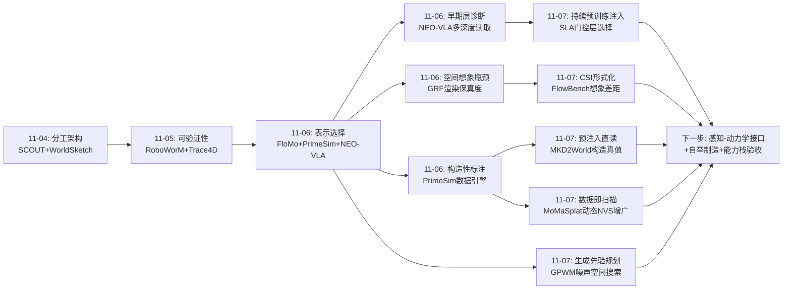
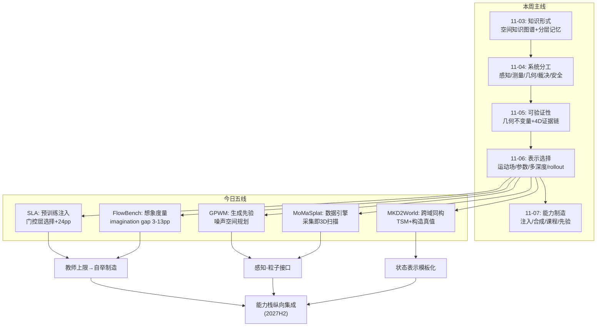
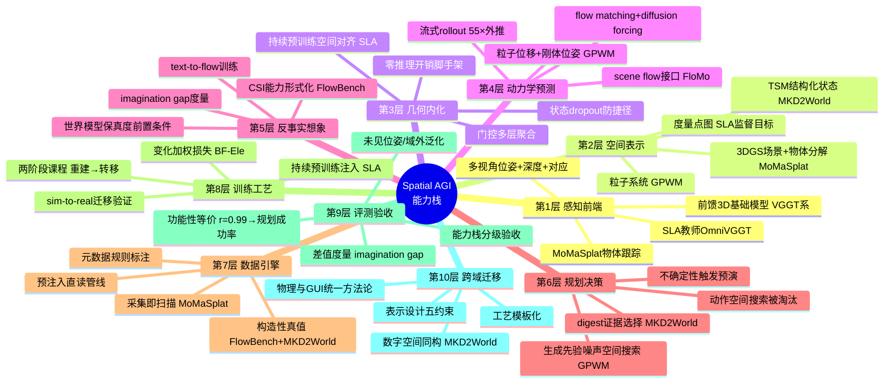
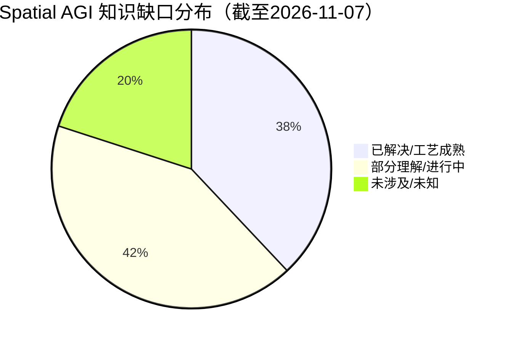

# Spatial AGI 每日思考 - 2026-11-07

## 📅 每日总结

**日期**: 2026-11-07
**论文数量**: 5篇（arXiv HTML 全文精读）
**主题**: 空间能力的制造工艺学。昨天的主题是"表示选择即架构设计"——信息以什么形式在模块间流动；今天五篇论文回答的是它的下游问题：**能力以什么工艺被制造出来**。SLA 展示"预训练注入"（空间对齐作为持续预训练目标）、MoMaSplat 展示"数据合成"（3D重建驱动的演示增广）、MKD2World 展示"课程化训练+构造性标注"（先感知后动力学、预注入真值）、GPWM 展示"生成先验规划"（能力制造的直接目的是可规划的生成分布）、FlowBench 展示"想象能力的训练与度量"（CSI 是空间能力栈的最后一层）。五篇合起来是一张完整的能力制造工艺表：从静态几何内化（SLA）→ 视角不变性（MoMaSplat）→ 动力学预测（GPWM）→ 反事实想象（FlowBench）→ 跨域状态表示方法论（MKD2World）

**关键突破**:
- 🚀 SLA：空间表征对齐从 post-training 前移到 continual pre-training 并贯穿下游——π0.5 在 8 个真实部署条件平均 +24.0pp，RoboCasa-Panda 仅 50 条演示达 68.4%（对手用 300-3000 条）；教师（OmniVGGT）+投影器+门控全是"训练脚手架"，推理架构零改动。**空间理解第一次被当成基础模型的预训练目标而非下游补丁**
- 🚀 FlowBench：形式化并度量"反事实空间想象"（CSI）——专有 VLM 超人类基线但保留 3-5pp 的 imagination gap，开源 VLM 接近随机；模拟器元数据确定性标注的 428K 样本实现 Sim→Real +16.9pp 强迁移；**重要负结果**：世界模型生成的结果帧丢失问题所需细节，"先想象再回答"当前无效——世界模型保真度是 VLM+WM 协同的前置条件
- 🚀 GPWM：统一生成式 3D 粒子世界模型——单一权重覆盖刚/弹/塑/颗粒/布料六域，预测误差平均 -31%，Unified 版在 2 域反超自己的专家模型；diffusion forcing 流式生成外推 55× 训练视界；**噪声空间规划大幅优于动作空间搜索**（picking 上后者直接失败）——"生成先验即规划流形"
- 🚀 MoMaSplat：首个覆盖接触后动态交互的移动操作 NVS 演示增广——分解式重建（静态场景 3DGS + VGGT 跟踪的动态物体 3DGS）+ Sim(3) 配准 + 运动学动作重定向；未见底盘位姿成功率较最强基线翻倍以上。核心洞察：**标准数据采集流程天然携带完整 3D 信息——导航即场景扫描、操作即物体扫描**
- 🚀 MKD2World：TSM（类型化空间 Markdown）作为 GUI 世界模型的状态表示 + 预注入标注管线（类型注入 HTML、渲染后 DOM 直读坐标，零事后推断误差）+ 两阶段课程（状态重建→动作条件转移预测）+ Base-Focus 元素损失（变化元素加权）；域外 EleF1 超 GPT-5.6 达 +11.52 分，agent 成功率 +14.7pp。**空间状态表示设计原则从物理域跨到数字域完全同构**

**架构演进**: 表示分层的分工架构 → **能力分层可制造的分工架构**（五模块分工与表示选择不变，今天补上制造论：每个空间能力都有一个明确的制造工艺与其验收标准——几何能力靠预训练注入+动作成功率验收、想象能力靠CSI基准+imagination gap验收、动力学能力靠预测误差+规划成功率验收、视角鲁棒性靠数据增广+未见位姿成功率验收、状态理解靠EleF1+下游决策增益验收）

### 📊 一句话总结

2026-11-07 的五篇论文确立了空间智能的第二条设计公理：**空间能力是可以逐层制造的，且每层能力都有独立的制造工艺（预训练注入/数据合成/课程训练/生成先验）与独立的验收标准**——SLA 把几何造进基础模型、MoMaSplat 把视角鲁棒性造进数据、GPWM 把动力学造进生成分布、FlowBench 把想象造成可度量的训练目标、MKD2World 证明这套工艺在数字空间同样成立。昨天回答"信息以什么形式流动"，今天回答"能力以什么工艺生产"，空间智能正在从"发现"范式转向"制造"范式。

### 🔗 延续性

**昨日→今日**: 昨日的核心结论是"表示的选择即架构的设计"——每个空间信息通道存在运动学/物理充分统计量。昨日留下六条线索：①运动接口标准化；②世界模型物理精度天花板；③VLM先验+可微仿真精调推广；④视觉-物理联合反演可辨识性；⑤学习式渲染的空间想象能力；⑥多深度读取非操作域验证。今天五篇落在这些线索的"制造端"：SLA 直接接住线索⑥的近亲——π0.5 早期层的空间监督注入与 NEO-VLA"动作关键信号在早期层"的诊断互相印证（空间监督应该打在网络深层结：持续预训练阶段+多层门控聚合）；FlowBench 与线索⑤直接对话——"空间想象"第一次有了独立的训练资源与度量（imagination gap），且其负结果（世界模型生成帧丢细节）精确指出了线索⑤的卡点；GPWM 的噪声空间规划给"想象→行动"闭环提供了新范式；MoMaSplat 的"数据采集即扫描"与昨日 PrimeSim 数据引擎哲学合流（具身数据的 3D 显性化）；MKD2World 的构造性标注（预注入）与 FlowBench 的模拟器元数据标注在方法论上完全同构——本周第二次撞见"构造让真值可读取的环境"这一原理。

**今日→明日**: 六条新线索：①教师上限问题——隐式对齐的空间保真度被锁死在教师（OmniVGGT/VGGT 系）水平，需要自监督几何一致性目标突破；②感知-动力学接口——GPWM 假设粒子对应与物体归属已知，真实感知前端（分割+跟踪+对应）与动力学的误差复合是最大风险，需要可微分的感知-粒子接口；③世界模型保真度—VLM 协同链——FlowBench 证明生成帧细节丢失阻塞"想象辅助回答"，text-to-flow 精度 61.7% 离可靠心理模拟器还远；④增广范式的闭环缺口——MoMaSplat 只解决视角分布覆盖，不提供"感知错误→修正"的闭环交互数据；⑤CSI 的开放生成形式——选择题是弱代理，真正的空间想象是开放式的场景状态预测；⑥TSM 式结构化状态表示向机器人任务迁移——操作状态（物体位姿+关节状态+接触状态）的"机器人 TSM"。明日检索方向："self-supervised geometric consistency distillation"、"perception to particle dynamics interface"、"world model assisted VQA fidelity"、"closed-loop demonstration correction data"、"robot state structured representation"。

### 💡 本质思考：如何达成通用空间智能

#### 1. 核心能力的本质是什么？

本周主题的第四次收敛。11-04"分工架构"、11-05"可验证分工架构"、11-06"表示选择的分工架构"，今天的表述加入制造维度：

**空间智能的本质是可验证、以最优表示流动、且可分层制造的分工架构——空间能力栈的每一层（度量感知→几何内化→视角不变→动力学预测→反事实想象→前瞻规划）都有独立的制造工艺与验收标准，而通用空间智能 = 把这些层的制造从"经验性发现"升级为"标准化工艺"。**

今天的证据链把这个表述撑起来：

- **能力可以被注入而非只能涌现**（SLA）：π0.5 的空间能力不是靠更大规模涌现出来的，而是靠显式的对齐目标 + 精心设计的监督（门控层选择、状态 dropout）"造"进去的，且可量化验收（+24pp）。空间能力的第一性来源不是规模，是监督信号的设计。
- **能力的验收必须独立于制造工艺**（FlowBench 的 imagination gap 设计）：观测 vs 想象的对照评测把"感知性空间能力"与"生成性空间能力"分离——同一个模型可以前者超人类、后者接近随机。没有这个对照，能力的制造进度根本无法度量。**每层能力需要自己的对照组**。
- **制造的最高形态是"造出可规划的生成分布"**（GPWM）：能力制造的终点不是预测精度而是决策效用——GPWM 的生成分布直接作为规划流形，噪声空间搜索的成功率就是动力学能力的功能性验收。这与昨日 PrimeSim 的 r=0.99 "功能性等价"验收一脉相承：空间智能的组件按下游功能验收，不按表观指标。
- **制造工艺跨域同构**（MKD2World）：状态表示设计五约束、构造性真值、先感知后动力学课程、变化加权损失——这套工艺在 2D 数字空间与 3D 物理空间通用。工艺的可迁移性本身就是"空间能力栈分层"假设正确性的证据。

#### 2. 当前方法与理想目标的差距在哪里？

- **教师依赖链**：SLA 的几何保真度被 OmniVGGT 锁死，MoMaSplat 的物体跟踪被 VGGT 锁死，MKD2World 的渲染器被 YOLO26+OCR 锁定——今天的所有制造工艺都是"蒸馏式"的，学生的能力上限永远低于上一代感知系统。理想状态需要自举式制造：自监督几何一致性、闭环想象-验证、self-play 式数据生成。
- **静态与动态的断层**：SLA 监督单帧静态几何，GPWM 预测动力学但不做感知，MoMaSplat 重建动态物体但不预测——今天没有一篇把"感知-动力学"闭环打通。粒子世界模型假设粒子对应已知，感知系统不产出动力学一致的粒子流。这个断层正是"感知-粒子接口"线索的由来。
- **想象能力的度量与制造都不成熟**：FlowBench 的 CSI 是选择题形式（弱代理），imagination gap 在微调后仍未关闭（CoT 收益不一致），世界模型 text-to-flow 只有 61.7%。空间想象的"制造工艺"今天只有数据配方，没有架构方案。
- **开环制造的闭环赤字**：MoMaSplat 的增广、FlowBench 的训练集、SLA 的语料全是开环数据——策略仍然没有"发现自己错了"的能力。昨日讨论的闭环修正数据（rollout+纠错）今天没有任何一篇涉及，制造工艺里缺"交互反馈"这道工序。
- **数字与物理的难度不对称**：MKD2World 在 GUI 域的工艺不能直接平移——GUI 转移是低熵有限状态机，物理转移是高熵多体动力学；试验田里验证的方法论可迁移，难度不可比。
- **验收体系的碎片化**：每篇论文有自己的验收标准（成功率/EleF1/imagination gap/预测误差），层与层之间的验收没有统一框架——"几何能力过关但想象能力不过关"的模型如何被系统性识别？需要能力栈级的评测套件。

#### 3. 从今天到理想状态，最可能的路径是什么？

五步走判断（昨日版本的更新）：

**第一步（进行中）：单层能力的制造工艺各自成熟**。几何内化（SLA/Spatial Forcing 系）、视角鲁棒性（MoMaSplat/增广系）、动力学预测（GPWM/FloMo 系）、状态理解（TSM/AXTree 系）、想象（FlowBench/CSI 系）在各自域内快速工艺化。标志事件：空间对齐成为 VLA 持续预训练的默认消融项；CSI 成为空间 VLM 评测标配。

**第二步（2027 上半年）：感知-动力学接口闭环**。前馈 3D 感知（VGGT 系）与粒子动力学（GPWM 系）的接口被打通——分割+跟踪+对应产出动力学可用的粒子流，误差复合被量化与正则化。SLA 式教师蒸馏开始加入自监督几何一致性目标以突破教师上限。

**第三步（2027 下半年）：能力栈的纵向集成**。度量感知（OmniVGGT）→几何内化（SLA）→动力学（GPWM）→想象（FlowBench 训练的世界模型）→规划（噪声空间搜索）首次在单一系统纵向贯通，每层的验收标准纳入统一的能力栈评测套件。imagination gap 在这一步有望被显著压缩（世界模型保真度达标后"想象辅助回答"链路打通）。

**第四步（2028+）：闭环制造与自举**。开环数据增广升级为闭环交互数据制造（想象-执行-纠错 self-play）；教师依赖链被自举目标替代；能力栈各层的制造从"依赖上一代系统"变为"依赖自身的想象-验证循环"。

**第五步（2028+）：工艺的自动化**。"这个能力缺口该用哪道工艺补"成为可学习决策——制造工艺库（预训练注入/数据合成/课程设计/生成先验/自举）按能力栈诊断自动路由，接住昨日的"验证-修复自动化"线索：验证失败 → 能力层定位 → 工艺选择 → 制造 → 再验证。

---

## 🔗 与昨日思考的联系

### 昨日重点

昨天的主题是**表示选择**：每个空间信息通道（观测→理解→预测→行动→渲染）都存在低熵的运动学/物理充分统计量——动作走 3D 运动场（FloMo）、物理走结构化参数（MPM 反演）、感知走多深度 token 流（NEO-VLA）、环境走功能性等价的世界模型 rollout（PrimeSim）、外观走解析偏置化注意力（GRF）。留下六条线索：运动接口标准化、物理精度天花板、VLM先验+精调推广、反演可辨识性、学习式渲染的空间想象、多深度读取跨域验证。

### 今日进展

今天五篇论文把视角从"信息以什么形式流动"下移到"能力以什么工艺被生产"，并接住昨日多条线索：

1. **接住线索⑤"学习式渲染的空间想象"（FlowBench）**：昨天的 GRF 是"结构→外观"的想象（从高斯渲染视图），今天的 FlowBench 是"构型→构型"的想象（从初始状态推演假想运动后的状态）——空间想象的两种形态被拆分，且 FlowBench 的负结果精确指出了卡点：世界模型生成帧丢失问题所需细节，即"想象的保真度"是想象可用于推理的前置条件。GRF 的渲染保真度问题（6dB 差距）与 FlowBench 的 flow 预测精度问题（61.7%）是同一个瓶颈在两个域的表现。
2. **接住线索⑥"多深度读取跨域验证"（SLA）**：昨日 NEO-VLA 证明动作关键信号在骨干早期层，今日 SLA 用特征依赖门控自适应聚合多层视觉嵌入做空间对齐——两个独立证据收敛到同一结论：**空间信息在网络中的分布是数据/域依赖的，固定单层读取不可行，多层自适应读取是正解**。门控层选择 + 持续预训练把"从哪读"变成了可学习问题。
3. **昨日 PrimeSim 数据引擎哲学的工程化（MoMaSplat）**：昨日 PrimeSim 用 30K 小时跨具身数据训练世界模型模拟器，今日 MoMaSplat 把"数据采集"重新解读为"隐式 3D 扫描"——两者的共同信念：具身数据的每一帧都比它的表面形式（图像+动作）携带更多信息（3D 结构、动力学、多视角几何），表示提取管线决定数据价值。MoMaSplat 是这个信念在操作域的最小可行实现。
4. **昨日"功能性等价验收"的能力层推广（GPWM）**：昨日 PrimeSim 用策略成功率相关性验收世界模型，今日 GPWM 把验收再推进一层——动力学模型的终极验收不是预测误差而是"它的生成分布能否作为规划流形"（噪声空间搜索 vs 动作空间搜索）。功能验收从"环境层"推广到"动力学层"。
5. **构造性真值的第二次出现（MKD2World）**：昨日 FlowBench 用模拟器元数据确定性标注，今日 MKD2World 用预注入 HTML+DOM 直读——两个完全不同域的论文在数据工程上做出同构选择：**与其从复杂现实中推断真值，不如构造让真值可直接读取的环境**。这一原理本周已被独立验证两次，可以确认为空间智能数据工程的第一原理。

### 演进路径



核心轨迹：**知识形式（11-03）→ 系统分工（11-04）→ 可验证性（11-05）→ 表示选择（11-06）→ 能力制造（11-07）**——从"存哪层"到"谁做什么"到"怎么信"到"以什么形式流动"再到"以什么工艺生产"，空间智能的工程学基础今天补上了生产端。

---

## 📚 论文概览

**论文1: SLA（2611.08373, HKUST-GZ + OLA Dimensions + BAAI + 清华）**
空间-语言-动作模型的持续预训练。从 π0.5 初始化，冻结的 OmniVGGT 教师从 RGB（可选深度+标定）提取度量空间表示，特征依赖门控自适应聚合 VLA 多层视觉嵌入做空间对齐；概率状态 dropout 阻断本体状态捷径；统一多数据集语料（EE 表示+坐标约定归一化）；持续预训练与下游 post-training 双阶段保持对齐；教师/投影器/门控仅训练期存在，推理架构零改动。LIBERO-Plus 87.4%、RoboTwin 2.0 C2R 72.3%、RoboCasa-Panda 68.4%（50 演示/任务）、RoboDojo-Real 33.9% vs 12.8%、8 个真实部署条件平均 83.8%（+24.0pp）。局限：教师上限、静态几何无时序、语义-几何权衡未测。

**论文2: FlowBench（2611.03937, Stanford, Yamins 组）**
反事实空间想象（CSI）的训练与评测资源。任务形式化 (I₀, tₘ, t_q, t_a)；FlowBench-Sim：AI2-THOR/ProcTHOR 四阶段自动管线（定位/规划/查询/标注），元数据规则算真值、VLM 只做语言层，420K 题 8 类别，附精确光流/结果帧/深度/分割/三层推理链；FlowBench-Real：5 个机器人数据集重构（SAM3+DA3+AllTracker 感知栈，抗噪余量设计，27% 不变题防捷径）。发现：专有 VLM 超人类但 imagination gap 3-5pp（Qwen3-VL-8B 13pp）；开源近随机；Sim 微调 Sim+29.5pp/Real+16.9pp；世界模型 text-to-flow 全家族提升（最高+25.2pp，Ψ-0.6 达 61.7%）；世界模型辅助回答当前无效（生成帧丢细节）。局限：选择题形式、感知栈噪声、运动类型受限、gap 未关闭。

**论文3: GPWM（2611.08338, CMU, Fragkiadaki 组）**
生成式粒子世界模型。粒子位移+刚体位姿（6D 旋转）统一表示，执行器与场景共享几何表示（条件生成↔联合生成切换）；物体感知多分辨率时空 transformer（FPS anchor+PointNet++ 升降采样+相对 3D 空间注意力+AdaLN-Zero），支持 12K 粒子；flow matching + diffusion forcing（逐帧独立噪声）流式生成，rollout 55× 训练视界；噪声空间规划（LNO 梯度优化/无梯度采样，物体构型稀疏奖励）。ParticleWorlds 25.5M 帧 6 域；预测误差平均 -31%，Unified 在 Dragging/Pick&Place 反超专家模型；picking 上动作空间搜索失败而噪声空间搜索成功。局限：粒子对应/物体归属已知假设、纯仿真训练、开环执行、奖励需构型指定。

**论文4: MoMaSplat（2611.08372, UT Austin, Pavlakos + Martín-Martín 组）**
移动操作的动态新视角演示增广。三组件分解：静态场景（导航轨迹→COLMAP SfM→WildGaussians 鲁棒 3DGS→深度传感器定标；mask 物体/机器人防鬼影）+ 动态物体（VGGT 前馈位姿跟踪→逐帧位姿→Sim(3) 对齐→物体 3DGS）+ 机器人本体（仿真器渲染）；新底盘位姿下三路渲染合成+运动学动作重定向（7 维 EE 动作坐标系变换）；合成演示与源数据并集训练策略。5 真实任务（刚体+铰接）×12 未见位姿×33 rollout：平均成功率翻倍以上，大位移下基线全败仍非平凡成功率。局限：VGGT 遮挡/反光脆弱性、位姿采样范围受限、仿真渲染域差、开环范式。

**论文5: MKD2World（2611.06544, 广州实验室+深大+东南+清华+杭电+GigaAI+港中深）**
GUI 域的类型化空间 Markdown 世界模型。TSM 表示：6 块级+8 原子级类型，bbox 归一化 [0,999]，含控件状态+视觉语义+层级，Markdown 序列化按空间关系排序；AtomBlock-WebUI 9.7k 数据集：预注入 yolo-* 类型到 HTML→Chromium 渲染→DOM 直读坐标（零事后推断误差，类别平衡 Tail 8.56%）；渲染器：YOLO26+PP-OCRv6+Qwen3.5-0.8B；世界模型：Qwen3.5-9B+LoRA 两阶段（当前状态重建→动作条件转移预测，Base-Focus 元素损失 λ=min(3,|N|/|F|) 加权 add/update 元素）；推理：不确定性触发预演+digest 证据提取。域外 EleF1 26.50（GPT-5.6-Sol 14.98），Online-Mind2Web 成功率 22.94%→37.61%。局限：离散元素表示、数据规模小、单步预测、digest 误差复合。

---

## 💡 核心见解

### 见解1: 空间能力的第一性来源是监督信号设计，不是规模

从 SLA 获得
- ✅ π0.5 的空间能力提升（真实部署 +24pp）不来自更大的模型或更多的无标注数据，而来自显式的对齐目标设计：度量点图教师+多层门控聚合+状态 dropout
- ✅ 双阶段对齐（持续预训练+post-training）在每个数据比例下都优于单阶段——监督信号需要贯穿训练全流程，而非只在最后补课

**对Spatial AGI的启发**:
这与 LLM 领域的历史精确平行：代码与数学能力进入预训练目标后，模型的推理能力才真正起飞。空间能力正在经历同样的时刻——从" hoped-for emergence"（期待规模涌现）转向"engineered injection"（工程化注入）。对资源受限的团队，这几乎是战略级的消息：空间能力的获取门槛从"大规模预训练基础设施"降到了"好的教师模型+好的对齐目标"。SLA 用 LoRA 级别的持续预训练预算拿到了 24pp，这个性价比在一个月前不可想象。

### 见解2: 每层空间能力需要自己的对照验收——imagination gap 是新的核心度量

从 FlowBench 获得
- ✅ 同一个模型可以在"观测后判断"上超人类（Claude-Fable-5.1 在 FlowBench-Real 超人类基线）而在"想象后推断"上显著掉分（-5.0pp），开源模型更是接近随机
- ✅ 对照设计（同一问题：看到结果 vs 必须想象结果）把感知性空间智能与生成性空间智能定量分离

**对Spatial AGI的启发**:
过去我们评测空间智能用绝对分数（VSI-Bench 得分多少），FlowBench 引入了差值度量（observed vs counterfactual 的差距）。这个方法论应该推广：空间智能的每一层能力都应该有"上界对照"——感知能力用真实观测对照、想象能力用实际结果对照、规划能力用专家轨迹对照。**能力的深度=与对照的差距**。Spatial AGI 的评测体系应该从分数表转向差距表：一个模型在所有层都"看到后对"没有意义，关键是"不看也能对"的层数。

### 见解3: 生成先验即规划流形——世界模型的决策形态

从 GPWM 获得
- ✅ 同一个世界模型，噪声空间搜索（在学到的交互分布内优化）在 pushing/picking 上大幅优于动作空间搜索，picking 上后者完全失败
- ✅ 动作空间搜索的两个系统性失败模式：复杂接触序列难发现；提出 OOD 动作利用世界模型误差"作弊"

**对Spatial AGI的启发**:
这是决策论层面的洞察：生成式世界模型学到的分布本身就是最好的策略先验。传统规划在无约束动作空间搜索，等于允许规划器提出"物理上不可能但模型会误判为可行"的动作；在生成先验内搜索，搜索空间天然被约束在"模型认为合理的交互"流形上。这与人类"想象几种合理做法再选"的认知模式同构，也与 LLM 推理中"分布内采样优于外部分类器重排"的经验呼应。空间智能系统的行动模块设计应该默认采用"生成-引导"架构而非"搜索-评估"架构。

### 见解4: 具身数据是隐式 3D 扫描——数据格式的升级会解锁多个下游

从 MoMaSplat 获得
- ✅ 导航轨迹提供场景多视角覆盖、操作演示提供动态物体观测——标准采集流程天然包含完整 3D 重建所需信息
- ✅ 分解式重建（场景+物体+自体）+ Sim(3) 配准 + 运动学重定向 = 从既有数据合成几何一致的新视角演示，平均成功率翻倍

**对Spatial AGI的启发**:
MoMaSplat 预示具身数据集格式的演进：从 (图像, 动作) 对升级为 (3D 场景资产, 3D 物体资产, 轨迹, 动作) 的复合结构。这个升级是乘法性的：同一份数据可以喂策略训练（MoMaSplat）、世界模型训练（GPWM 式粒子动力学）、仿真环境构建（PrimeSim 式）、数字孪生。数据基础设施的投资回报率因此被重新定价——采集一条演示的边际成本不变，但衍生价值翻了数倍。反过来，这也会改变数据采集的优先级排序：视角多样性、物体覆盖度这些"重建友好"的属性变得比演示数量更重要。

### 见解5: 构造让真值可读取的环境——数据工程第一原理的确立

从 MKD2World 获得（并与 FlowBench 交叉验证）
- ✅ MKD2World 预注入类型标签到 HTML、渲染后 DOM 直读坐标——标注误差从源头消除；类别平衡结构性优于事后解析（Tail 8.56% vs 0.1-0.7%）
- ✅ FlowBench 用模拟器元数据规则算真值、VLM 只做语言层——同一个哲学在不同域的独立实现

**对Spatial AGI的启发**:
本周两次独立撞见同一原理，可以确认：**空间智能时代的标注问题应该转化为环境构造问题**。传统 ML 的标注是"从数据推断标签"，空间智能的标注应该是"构造标签可直接读取的数据生成过程"。模拟器元数据、预注入 DOM、可微渲染的解析梯度、动作条件下的因果对照——都是这个原理的实例。对任何空间数据管线的评审问题从"标注质量如何保证"变成"真值是否产生于构造而非推断"。

### 见解6: 状态表示设计有跨域不变的五约束

从 MKD2World + GPWM + MoMaSplat 三方对照获得
- ✅ TSM（GUI）：类型+语义+显式位置+控件状态+层级；GPWM（物理）：粒子位移+材料参数+物体归属+相对坐标；MoMaSplat（操作）：场景/物体分解+位姿轨迹+度量尺度
- ✅ 三者共同满足：完整（不丢决策相关信息）、结构化（可分解比较）、显式空间（位置/坐标）、可比较（支持状态 diff）、低重建成本（避免像素级/粒子级全量生成）

**对Spatial AGI的启发**:
"世界模型 = 状态表示 + 转移模型"，而表示设计存在域无关的约束集。这给出了一个新的工程方法：遇到新空间域（AR 空间、地图空间、代码仓库空间、医疗影像空间），先按五约束设计状态表示，再套用两阶段课程（重建→转移预测）+变化加权损失。空间智能的方法论正在从"每域重新发明"走向"域模板化"——MKD2World 的最大价值可能不在 GUI 域本身，而在它把这个模板写成了可复制的文档。

### 见解7: 教师蒸馏是当前制造工艺的统一形态，也是统一的天花板

从 SLA + MoMaSplat + MKD2World 共同获得
- ✅ SLA 蒸馏 OmniVGGT 的度量几何、MoMaSplat 依赖 VGGT 的位姿跟踪、MKD2World 蒸馏 YOLO26+OCR+小 VLM 的检测识别——三篇的"学生"能力上限全部被"教师"锁定
- ✅ 教师依赖的好处是工艺简单、监督精确；代价是能力演化被锁死在上一代感知系统的水平

**对Spatial AGI的启发**:
蒸馏式制造有个隐含的退化风险：如果学生只在教师覆盖好的域内训练，域外误差被无差别蒸馏（SLA 承认 OmniVGGT 在透明/反光/恶劣光照的漂移会被继承）。长期需要自举式制造：自监督几何一致性（多视角重投影一致）、想象-验证闭环（FlowBench 式的"想象 vs 实际"对照本身可以变成训练信号）、self-play 数据生成。**从蒸馏到自举的工艺升级，是空间能力栈摆脱"上一代水平"约束的必经之路**——正如 LLM 从蒸馏小模型到 RLHF 自举的演进。

### 见解8（附加）: 统一模型开始反超专家模型——物理理解的正向迁移证据

从 GPWM 获得
- ✅ Unified GPWM 在 6 域中的 2 域（Dragging、Pick&Place）反超只用该域数据训练的专家模型
- ✅ 刚体/布料/颗粒的异构动力学在一套权重内被统一学习且相互增益

**对Spatial AGI的启发**:
这是"通用物理世界模型"可行性的直接实验证据：物理异构性不是不可通约的——接触、材料、几何的交互规律存在共享的底层结构，数据规模与表示容量到位后统一学习会触发正向迁移。这与 LLM 领域"统一模型反超领域专家"的历史一致。对空间智能的战略含义：不要为每种材料/每种场景训练专家模型，押注统一架构+统一表示（GPWM 的粒子+位移），让规模做迁移的工作。

---

## 🗺️ 知识演进图



关键脉络：本周从"知识怎么存"一路推进到"能力怎么造"，今天五篇论文分别贡献了制造工艺表的五行：注入（SLA）、想象训练（FlowBench）、生成先验（GPWM）、数据合成（MoMaSplat）、跨域模板（MKD2World）。

## 技术栈演进对比表

| 层次 | 昨日方案 | 今日方案 | 变化 |
|------|---------|---------|------|
| 空间感知注入 | NEO-VLA：早期层读取诊断（动作信号在浅层） | SLA：门控多层聚合+持续预训练注入（教师蒸馏式） | 从"诊断在哪读"到"工艺化地造进去"，且从 post-training 前移到预训练 |
| 空间想象 | GRF：结构→外观渲染想象（6dB 差距） | FlowBench：构型→构型反事实想象（imagination gap 度量+428K训练资源） | 想象从"渲染问题"扩展为"独立能力层"，首次有了训练资源与差值度量 |
| 动力学世界模型 | FloMo：scene flow 预测目标（驾驶域） | GPWM：粒子动力学生成模型+噪声空间规划（6物理域） | 从"预测目标选择"到"生成分布即规划流形"，动力学能力第一次直接接入决策 |
| 具身数据引擎 | PrimeSim：30K 小时跨具身采集+四阶段过滤 | MoMaSplat：既有采集数据的 3D 显性化+动态 NVS 合成 | 从"采集更多"到"采集即扫描"——数据价值密度提升，成本不变 |
| 状态表示 | TSM 未出现；GUI 域用自由文本/AXTree/HTML | MKD2World TSM：类型+语义+位置+状态+层级的五约束表示 | 表示设计五约束首次被显式形式化，且跨域同构被证实 |
| 真值构造 | PrimeSim 数据过滤流水线 | MKD2World 预注入 DOM 直读 + FlowBench 元数据规则 | "构造性真值"本周两度独立出现，确认为数据工程第一原理 |
| 规划范式 | SCOUT：世界模型 rollout 前瞻 | GPWM：生成先验内噪声空间搜索 | 搜索空间从动作空间移入生成分布，OOD 剥削问题被结构性消除 |
| 验收标准 | PrimeSim r=0.99 功能性等价（环境层） | GPWM 规划成功率（动力学层）+ FlowBench gap（想象层）+ SLA 部署提升（几何层） | 功能验收从单层推广为能力栈分级验收体系 |

## 🗺️ Spatial AGI 知识图谱

### 10层架构思维导图



### 🎯 主线技术路径

#### 阶段1: 单层工艺成熟期（进行中，2026 H2）

空间能力栈的每一层正在各自工艺化：几何内化有了 SLA 式持续预训练配方；视角鲁棒性有了 MoMaSplat 式增广管线；动力学预测有了 GPWM 式生成模型；想象有了 FlowBench 式训练资源；状态表示有了 MKD2World 式设计模板。标志：各工艺在自己的基准上达到实用水平，但层间接口未打通。

#### 阶段2: 感知-动力学接口期（2027 H1）

前馈 3D 感知（VGGT/OmniVGGT 系）与粒子/动力学模型（GPWM/FloMo 系）的接口被显式建模——分割+跟踪+对应产出动力学可用的结构化输入，感知误差与动力学误差的复合被量化与正则化。同期：教师蒸馏工艺开始加入自监督几何一致性目标，SLA 式对齐成为 VLA 预训练默认组件，CSI 进入空间 VLM 标准评测。

#### 阶段3: 能力栈纵向集成期（2027 H2）

度量感知→几何内化→动力学→想象→规划的完整链路首次在单一系统纵向贯通：SLA 式基础模型做感知与几何，GPWM 式生成模型做动力学与规划，FlowBench 式训练的想象模块做事前推演，统一的能力栈评测套件做分级验收。imagination gap 在世界模型保真度达标后有望被显著压缩，"想象辅助决策"链路打通。

#### 阶段4: 闭环自举制造期（2028+）

开环数据工艺升级为闭环：想象-执行-纠错的 self-play 循环生成交互修正数据（补上 MoMaSplat/FlowBench 的开环赤字）；教师依赖链被自举目标替代（多视角一致性、重投影一致、想象 vs 实际对照作为训练信号）；空间能力栈从"依赖上一代感知系统"变为"依赖自身的想象-验证循环"，制造工艺完成从蒸馏到自举的跃迁。

#### 阶段5: 工艺自动化期（2028+）

"这个能力缺口该用哪道工艺补"本身成为可学习决策：工艺库（注入/合成/课程/先验/自举）按能力栈诊断自动路由——验证失败 → 层定位 → 工艺选择 → 制造 → 再验收。空间智能的生产函数完成自动化，通用空间智能的获得从研究问题变为工程问题。

---

## 🔍 待探索议题

### 高优先级（本周）

1. **感知-粒子动力学接口**
   - 问题: GPWM 假设粒子对应与物体归属已知，真实场景中感知前端（分割+跟踪+对应）的误差如何与动力学误差复合？接口该是可微分的吗？
   - 候选方案: VGGT 系产出带置信度的跟踪点 → 置信度作为动力学注意力的权重；可微分渲染闭环让动力学梯度回传修正感知
   - 缺口: 没有任何工作量化"感知误差×动力学 rollout 长度"的误差增长曲线

2. **教师上限的自举突破**
   - 问题: SLA/OmniVGGT 式蒸馏把学生锁死在教师水平，透明/反光/恶劣光照的教师漂移被无差别继承；如何突破？
   - 候选方案: 多视角重投影一致性作为自监督正则；FlowBench 式"想象 vs 实际"对照作为对齐目标的校准信号
   - 缺口: 蒸馏+自监督混合训练的系统性消融不存在

3. **世界模型保真度—VLM 协同链**
   - 问题: FlowBench 证明生成帧丢细节阻塞"想象辅助回答"，text-to-flow 61.7% 不够；保真度阈值在哪里？
   - 候选方案: 结构化中间表示（TSM 式）代替像素帧做想象——想象状态而非图像；GPWM 式粒子 rollout 的结果比图像更"可读"
   - 缺口: "什么表示形式的想象对下游推理最有用"未被系统比较（像素帧 vs 光流 vs 粒子 vs 结构化状态）

### 中优先级（本月）

4. **机器人版 TSM：操作状态的结构化表示**
   - 问题: MKD2World 证明结构化状态表示在 GUI 有效；机器人操作的状态（物体位姿+关节状态+接触状态+工具状态）能否同样 TSM 化并训练状态转移世界模型？
   - 候选方案: 以 GPWM 的粒子+物体归属为原子，套用 TSM 的类型/状态/层级语法；预注入仿真环境中直读真值
   - 缺口: 操作状态的本体（types taxonomy）没有共识标准

5. **CSI 的开放生成式升级**
   - 问题: FlowBench 的选择题是空间想象的弱代理；开放式想象（预测完整后状态）怎么评测与训练？
   - 候选方案: 让模型预测结构化后状态（TSM 式或粒子式），与真实后状态做结构 diff；用 GPWM 式生成分布做 multiple-future 评测
   - 缺口: 结构化状态 diff 的度量（几何+语义双轴）未定义

6. **闭环交互数据的制造**
   - 问题: MoMaSplat/SLA/FlowBench 全是开环数据；策略缺"感知错误→修正"能力；闭环数据怎么规模化制造？
   - 候选方案: 世界模型 rollout 模拟干扰注入 + 真实 rollout 纠错对采集；PrimeSim 式模拟器中做闭环 self-play
   - 缺口: 闭环纠错数据的成本效益 vs 开环增广的定量比较

7. **空间对齐的语义保留测量**
   - 问题: SLA 强迫视觉 token 携带几何，可能挤压语义容量；几何注入对 VLM 语言/语义能力的副作用从未被测量
   - 候选方案: 在 SLA 式训练前后跑标准 VQA/grounding 套件做纵向对照；门控对齐目标是天然的控制阀
   - 缺口: 所有表征对齐工作（SLA/VEGA/Spatial Forcing）都只报任务提升，不报语义回归

### 低优先级（本季度）

8. **数字-物理难度不对称的量化**
   - 问题: MKD2World 的工艺在 GUI（低熵有限状态机）有效，物理（高熵多体动力学）的转移难度差多少？数字试验田的"试验有效性"边界在哪？
   - 候选方案: 同一表示设计五约束+训练配方在 GUI/桌面操作/可变形物体操作三级难度上做受控实验
   - 缺口: 跨难度等级的方法论迁移实验不存在

9. **统一动力学模型的规模曲线**
   - 问题: GPWM 的 Unified 在 2/6 域反超专家；数据/模型规模继续扩大时，统一 vs 专家的交叉点如何移动？是否存在统一模型全面反超的规模阈值？
   - 候选方案: ParticleWorlds 式语料的规模缩放实验（1×/4×/16×）配统一/专家受控对比
   - 缺口: 物理动力学领域的 scaling law 实验完全空白

10. **能力栈评测套件的设计**
    - 问题: 各层验收标准碎片化（成功率/EleF1/gap/误差），无法系统性识别"哪层弱"；需要统一的能力栈评测框架
    - 候选方案: 以 FlowBench 的对照设计为模板，为每层设计"对照差值"指标；输出雷达图式能力剖面而非单一分数
    - 缺口: 层间依赖关系（想象弱是否因为几何弱？）的因果诊断方法不存在

---

## 📊 知识缺口分析



**已解决（38%）**:
- ✅ 空间几何的基础模型注入工艺（SLA：持续预训练+门控层选择+24pp 实证）
- ✅ 静态场景与动态物体的分解式重建与视角合成（MoMaSplat 全管线）
- ✅ 异构物理动力学的统一生成建模（GPWM 六域统一+专家反超）
- ✅ 结构化空间状态表示的设计模板（TSM 五约束+跨域同构验证）
- ✅ 构造性真值的数据工程原理（FlowBench 元数据+MKD2World 预注入双验证）
- ✅ 生成先验作为规划流形的范式（GPWM 噪声空间搜索的受控对比）

**部分理解（42%）**:
- ⚠️ 空间想象的训练与度量——CSI 有了形式化与资源，但 gap 未关闭、选择题形式弱、开放生成形式缺失
- ⚠️ 世界模型保真度与下游推理的耦合——text-to-flow 61.7% 不够用，阈值与表示形式选择未知
- ⚠️ 感知-动力学接口——假设已识别（粒子对应/物体归属），接口设计与误差复合量化空白
- ⚠️ 蒸馏工艺的天花板——教师依赖被普遍使用，自举突破方案只有方向没有实证
- ⚠️ 几何注入的语义副作用——方向性担忧明确，纵向测量缺失
- ⚠️ sim-to-real 的粒子级迁移——GPWM 全仿真训练，真实材料的参数偏差影响未知
- ⚠️ 闭环交互数据工艺——开环增广成熟，闭环纠错数据的规模化路径未明

**未涉及（20%）**:
- ❌ 触觉/力觉信号进入世界模型与对齐目标（接触物理的观测盲区，昨日遗留）
- ❌ 时序空间动态的对齐监督（SLA 只监督单帧几何，4D 表征注入工艺空白）
- ❌ 物理动力学领域的 scaling law（统一模型的规模曲线实验）
- ❌ 能力栈级评测框架（层间依赖的因果诊断）
- ❌ 灵巧手的统一表示（跨具身统一与灵巧性的矛盾，昨日遗留）
- ❌ 长视界多步预演树（MKD2World 单步、GPWM 开环，多步前瞻的误差控制空白）

---

## 🎯 本周主题弧线

```
11-03  知识形式      —— 空间知识以什么结构存储（图谱/分层记忆/显式3D记忆）
11-04  系统分工      —— 空间智能需要哪些模块、各管什么
11-05  可验证性      —— 模块的输出怎么被信任（不变量/证据链/屏障）
11-06  表示选择      —— 信息在模块间以什么形式流动（充分统计量）
11-07  能力制造      —— 能力以什么工艺被生产（注入/合成/课程/先验/自举）
```

一周的推理链条完整成形：分工架构定义了"系统长什么样"（11-04），验证体系回答"怎么信它"（11-05），表示选择回答"信息怎么流"（11-06），能力制造回答"能力怎么来"（11-07）。剩下一周要回答的问题自然收束为：**这些工艺与架构如何在闭环中自我改进**（自举）与**如何在统一评测下被系统集成**（能力栈验收）。

## 📝 方法论沉淀（本周新增）

1. **构造性真值原理**：标注问题转化为环境构造问题——真值应产生于构造（模拟器元数据/预注入 DOM/解析梯度）而非从复杂现实推断。本周两度独立验证，升级为数据工程第一原理。（FlowBench + MKD2World）
2. **对照差值度量**：每层能力用"有辅助 vs 无辅助"的对照差值验收（观测 vs 想象、看到 vs 推断、真实 vs 增广），能力深度=与对照的差距，而非绝对分数。（FlowBench 的 imagination gap 设计）
3. **训练脚手架模式**：空间增强组件（教师/投影器/门控）全部放在训练期、部署期零保留——增强可以无损叠加在任意已有模型上，工程采纳的摩擦最小化。（SLA）
4. **先感知后动力学的课程结构**：世界模型训练先重建当前状态再预测转移，配合变化加权损失聚焦干预效果。（MKD2World 两阶段 + BF-Ele）
5. **数据采集即隐式扫描**：具身数据的每一帧携带超出表面形式（图像+动作）的 3D/动力学/多视角信息，显性化管线决定数据价值密度。（MoMaSplat，与昨日 PrimeSim 哲学合流）
6. **生成先验即搜索流形**：决策模块默认在生成分布内搜索，而非无约束动作空间——OOD 剥削与接触序列发现问题被结构性消除。（GPWM）

## 🔬 今日五篇深读笔记（逐篇架构走查）

### SLA 走查

数据流：RGB 多视角 → π0.5 视觉编码器 → N 层中间视觉嵌入；并行：RGB（+可选深度/标定）→ OmniVGGT（冻结）→ 度量点图特征。汇聚：特征依赖门控 g(h) 对多层嵌入加权聚合 → 对齐投影器 → L_align（对齐损失）与 L_action（流匹配）联合优化。训练技巧：状态以概率 p 丢弃（阻断本体捷径）；多数据集 EE 表示与坐标约定统一。验收漏斗：LIBERO-Plus（扰动鲁棒）→ RoboTwin（Clean2Random 泛化）→ RoboCasa（数据效率 50 演示）→ RoboDojo-Real（跨本体）→ 8 个部署条件（双臂/动态/指令）。关键消融：双阶段对齐 > 任一单阶段；门控层选择 > 固定层；dropout 贡献部署条件的部分增益。工程亮点：部署时模型与 π0.5 逐字节同构。

### FlowBench 走查

数据流（Sim）：ProcTHOR 场景 → 定位（相机位姿采样+可见性平衡）→ 规划（类别程序提运动，偏答案改变）→ 查询（SIM(S₀,tₘ) 执行）→ 标注（元数据规则算真值，歧义丢弃）→ VLM 语言层（改写/推理链 c_gt→c₁→c₀）→ 打包（问题+光流+帧+深度+分割）。数据流（Real）：5 数据集视频 → SAM3 分割 + DA3 双帧深度 + AllTracker 轨迹 → mask 中心 3D 提升 → 厘米位移+地标尺度 → 抗噪余量判定 → 模板问题。训练：Qwen3-VL-8B SFT；世界模型 4 家族 text-to-flow。评测：选择题（VLM 轨）+ flow 精度/帧质量（WM 轨）+ imagination gap 对照（观测 vs 想象）。关键负结果：WM 生成帧辅助回答无效——细节保真是链路卡点。

### GPWM 走查

表示：可变形物体 = 逐粒子位移 ΔP（平移不变）；刚体 = pose token（Δt+6D Δr）+体坐标固定粒子（随位姿运动，刚性由构造保证）；执行器 = 同一几何表示。编码：粒子 token = MLP([Δp, 几何, 物理参数 φ, 执行器 a]) + 材料 embedding。主干：FPS 每物体选 anchor → PointNet++ max-agg 下采样（相对位置差编码）→ 多层时空 block（时间注意力+3D 相对空间注意力+逐点 FFN，AdaLN-Zero 按 τ 调制）→ 反距离加权上采样 + 门控 MLP 融合 + 长跳跃。邻域按当前噪声轨迹位置逐帧重算；anchor 身份固定。训练：flow matching + diffusion forcing（逐帧独立噪声水平）。推理：流式提交近帧、修订远帧（55× 外推）。规划：任务模型联合生成执行器+物体轨迹 → 物体构型奖励做 LNO 梯度优化或无梯度采样 → 取执行器轨迹开环执行。数据：ParticleWorlds 25.5M 帧。

### MoMaSplat 走查

重建流：D_nav（导航轨迹）→ COLMAP SfM（位姿+稀疏点云）→ 3DGS 光度优化（WildGaussians 降权瞬态）→ mask 物体/机器人像素 → G_scene；深度传感器 vs 渲染深度的中位数比值 → 度量定标。并行：D_src（操作演示）→ VGGT 前馈位姿（无需 CAD/标定）→ 物体逐帧位姿 → 与场景 Sim(3) 对齐（导航期物体静止=配准约束）→ 物体 3DGS G_obj。合成流：采样新底盘位姿 T̃∈SE(2) → 源 EE 轨迹（7 维：Δp/Δo/gripper）经刚体变换重定向 → 仿真器渲染机器人 + 渲染 G_scene/G_obj → 三路合成观测 + 变换动作 = 合成演示。训练：D_src ∪ D_gen 模仿学习。评测：5 任务 × 12 未见位姿 × 33 rollout；仿真中与真值帧对照验证保真度。工程细节：mask 防鬼影、实例级跟踪不依赖已有模型、SE(2) 底盘位姿参数化。

### MKD2World 走查

表示：M_t = (块级 B, 原子级 E, 层级 ρ)；b=(τ^b, p)、e=(u, c, τ^e, p)；p=(x,y,w,h)∈[0,999]⁴；6+8 类型分类；Markdown 序列化按空间排序。数据流：Mind2Web 截图 → Qwen3.6-Plus 参考 layout 生成 HTML（注入 yolo-* 标签）→ CC3M 配图 → Playwright/Chromium 渲染 → DOM 直读 yolo-* 节点坐标 = 标注（零推断）。渲染器：YOLO26（类型+box）+ PP-OCRv6（文本）+ Qwen3.5-0.8B（区域视觉语义）→ 绑定 → 元素树 → 空间排序 → TSM。世界模型：WebChain/MolmoWeb 转移对 → 渲染器转 (I_t, a_t, M_t, M_t+1) → 视觉 diff 分类 noop/changed → focus 元素标注（VLM 诊断+规则细化+人工抽审）→ Qwen3.5-9B+LoRA 两阶段 SFT（重建→转移，BF-Ele Loss）。推理：单候选高置信直行；否则逐候选预测 Ŝ_t+1 → agent digest 提取任务证据 → V_ψ 评分选优。评测：EleF1（域外 26.50）+ Online-Mind2Web 在线成功率（37.61%）。

---

## 🧠 能力栈分层视角下的深度推演

今天五篇论文恰好各占能力栈的一层，把它们并排放在同一张图上可以做几组有价值的推演。

### 推演1: SLA × GPWM——几何内化层与动力学层的接口设计

SLA 把度量几何造进 VLA 表征（静态、单帧、隐式），GPWM 把动力学造成生成分布（动态、多帧、显式）。两个层之间缺一座桥：**如果 SLA 式 VLA 的中间视觉嵌入已经携带度量几何，那么它们能否直接被“读出”为 GPWM 需要的粒子初始化？**

具体设想：SLA 的对齐目标是点图（point map）——每个像素的 3D 位置。这意味着 SLA 模型的中间表征原则上支持“解码出点图”的探针。如果这个探针足够精确，SLA 模型本身就是感知前端，其输出的点云+物体分割可以直接喂给 GPWM，无需独立的 VGGT/OmniVGGT 前端。这样：感知（SLA 骨干）→ 几何解码（探针）→ 动力学（GPWM）→ 规划（噪声空间搜索）形成一条全由预训练资产组成的管线。

这个设想的验证成本很低（在 SLA checkpoint 上训一个点图解码头，测与 OmniVGGT 直出点图的差距），但它指向一个更深的架构问题：**几何内化到什么程度，才能让显式 3D 前端变得多余？** SLA 的推理架构已经不需要 3D 前端（纯 RGB 输入），但那是“模型内部懂几何”；GPWM 需要的是“模型能输出几何”。内部理解与外部输出之间的差距，就是表征蒸馏的“隐式税”——学生学到了教师的判别能力，但没学到教师的生成能力。这个差距的度量与弥合，值得作为独立课题。

### 推演2: FlowBench × MKD2World——想象的表示之争

FlowBench 的负结果（世界模型生成帧丢细节，想象辅助回答无效）与 MKD2World 的正结果（TSM 结构化状态预测，EleF1 超过 GPT-5.6）放在一起，指向一个清晰的假设：**对下游推理而言，结构化状态想象 > 像素帧想象**。

理由：CSI 问题依赖的细节（哪个物体可见、谁离谁近、接触是否发生）本质上是**关系性/命题性**的信息。像素生成天然在“保持命题信息”上困难（纹理/字体/小元素失真），而结构化状态表示天然就是命题的列表——预测“按钮 A 从 enabled 变为 disabled，弹窗出现在 (512, 300)”远比生成一张像素正确的截图容易且可验证。

推论：FlowBench 式 CSI 训练的下一代会把想象目标从“预测结果帧/光流”换成“预测结构化后状态”——比如操作域的“物体位姿+可见性+接触状态”表格，或导航域的“占据拓扑变化”描述。这同时解决了两个问题：生成的可验证性（结构 diff 可精确评分）和细节保持（命题显式列出）。如果这个方向成立，FlowBench 的光流监督更像世界模型保真度的“训练轮”——用它把物理直觉造进生成器，再切换到结构化目标让想象变得可推理。

### 推演3: MoMaSplat × GPWM——数据引擎与世界模型的合流

MoMaSplat 证明“采集即扫描”——每条操作演示附带场景+物体的 3D 资产。GPWM 需要“粒子+物体归属+材料属性”作为输入。这两个管线的交集是一个自然的产品形态：**每一批新的操作数据，自动产出（a）增广的演示（MoMaSplat 用途）、（b）物体级 3D 资产与材料参数候选（GPWM 输入）、（c）世界模型微调样本**。

材料属性如何来？昨日 MPM 反演给出了答案——从演示视频反演 E/ν/τY/η。把 MoMaSplat 的物体重建 + MPM 反演 + GPWM 训练串起来，就是一条从“原始演示”到“可规划动力学模型”的全自动管线。这条管线的每个环节本周都已有独立验证，合流只差工程集成。Spatial AGI 的数据基础设施竞争，正在从“谁有更多数据”转向“谁的每条数据的衍生价值更高”。

### 推演4: 五篇论文的“能力栈雷达图”设想

把今天的验收标准统一成能力栈剖面，可以对当前 SOTA 系统画出雷达图：

- SLA（π0.5+SLA）：几何内化 9/10（部署+24pp），动力学 2/10（单帧静态），想象 1/10，视角鲁棒 5/10（RoboTwin 泛化好但未做位姿增广），状态理解 4/10（隐式，不可读）
- GPWM：几何内化 0/10（不感知），动力学 9/10（六域 -31%），想象 6/10（可 rollout 但保真度有限），规划 8/10（噪声空间搜索），视角鲁棒 N/A（输入已是 3D）
- MKD2World agent：状态理解 8/10（EleF1+决策增益），想象 5/10（单步预演），几何/动力学 N/A（数字域）

没有系统的剖面是“全栈均衡”的。这个空缺就是第三阶段（能力栈纵向集成）的靶子。雷达图还揭示一个反直觉结论：**当前最强的单点能力（GPWM 的动力学+规划）恰恰是最不通向部署的**（依赖已知粒子对应），而剖面最均衡的系统反而是最传统的——这说明能力栈的短板效应（木桶原理）在空间智能领域极其显著，集成优先于单点突破。

## ⚔️ 反方观点与风险清单

刻意为今天的五个“突破”配上反方论点，防止本周笔记变成单向度的乐观叙事：

### 反方1: “+24pp”的含金量需要打折审视（对 SLA）

SLA 的对比基线是 π0.5 本身——一个没有空间监督的同一架构模型。这是最有利于对齐目标的对比设置。公平的对比还应包括：相同持续预训练预算下，用等量普通数据（不加对齐损失）继续训练的 π0.5、以及用等量标注成本做示范增广的 π0.5。论文的数据缩放实验部分回应了前者（同比例下对齐始终更优），但没有回应后者——**24pp 里有几分是“更多数据/更多训练步数”的功劳？** 隐式对齐的边际价值需要在“训练预算对齐”的严格对照下重新估计。

### 反方2: imagination gap 可能部分是格式效应（对 FlowBench）

观测条件与想象条件的差异不仅是“要不要想象”，还有输入 token 数量（多一张结果图）、注意力分配、以及答案线索的显式度。3-5pp 的 gap 里有多少是“推理负担”而非“想象能力缺失”？一个干净的补充实验是：给模型结果图但打乱问题顺序、或给与任务无关的干扰图——如果“无关图”条件下也掉 3pp，则 gap 需要重新归因。CSI 的概念本身坚实，但它的第一个度量实现可能高估了缺陷。

### 反方3: 噪声空间规划的优势可能是任务选择的产物（对 GPWM）

GPWM 选的 pushing/picking 恰是“接触序列复杂但目标构型简单”的任务——生成先验最有信息量的 regime。对“目标构型复杂但动作简单”的任务（如精确放置到密集场景中的特定位姿），动作空间搜索可能反而不弱。生成先验 vs 动作搜索的比较需要一个任务谱系上的系统扫描，而非两个点的胜负。“生成先验即规划流形”作为一个范式陈述仍站得住，但它的适用边界远未划定。

### 反方4: “数据即扫描”的经济性依赖传感器配置（对 MoMaSplat）

MoMaSplat 的度量定标依赖机载深度传感器，位姿跟踪依赖 VGGT 在其训练分布内的物体。对没有深度传感器的低成本平台、或 VGGT 分布外的物体（透明/反光/高动态），管线退化程度未知。“免费副产品”的免费是有传感器前提的。此外，合成的位姿只能围绕已扫描区域采样——增广解决的是位姿泛化，不是场景泛化，两者在营销叙述中容易被混为一谈。

### 反方5: GUI 域的成功可能无法指示物理域（对 MKD2World）

MKD2World 的转移预测学的是“人为设计的低熵规则系统”（点击→弹窗）。这种转移的可预测性天花板很高，EleF1 的提升空间也很大。物理域的转移受守恒律、接触、混沌初始条件敏感性的支配——同样的“结构化状态+转移模型”配方，在物理域的可达精度可能低一个数量级。用 GUI 域的数字外推物理域的前景是危险的；试验田结论的外推必须携带难度折扣。

## 🧪 实践启示清单（可直接执行的工程决策）

从今天的五篇论文中提炼出可立即采纳的工程决策，供任何空间智能项目参考：

1. **若你的 VLA 缺空间能力**：不要换架构，先试 SLA 式持续预训练注入——找/训一个前馈 3D 教师（VGGT 系），对齐损失加进现有训练循环，推理架构不动。预算量级：LoRA 级可训参数即可见效。
2. **若你的策略对视角敏感**：先盘点已有采集数据里是否已含多视角覆盖（导航段/多次采集）——若有，MoMaSplat 式增广的边际成本远低于补采数据；若无，调整采集协议让导航轨迹覆盖场景。
3. **若你要构建世界模型**：第一步不是选生成架构，而是按五约束（完整/结构化/显式空间/可比较/低重建成本）设计状态表示——这决定了后面一切的上限。两阶段课程（重建→转移）+ 变化加权损失是默认配方。
4. **若你要标注空间数据**：问自己“能否改造数据生成过程让真值可直读”（预注入/元数据/解析梯度），而不是“如何保证事后标注的质量”。前者是结构性免费，后者是持续性成本。
5. **若你的规划器在动作空间搜索**：检查失败案例是否属于两类系统病（接触序列难发现/OOD 动作剥削模型误差）——若是，把动作搜索搬进生成先验（噪声空间优化）大概率有免费收益。
6. **若你要评测空间能力**：把“对照差值”（观测 vs 想象、真实 vs 增广、专家 vs 模型）写进评测协议——绝对分数不反映能力深度。
7. **统一动作/动力学表示的选型启发**：GPWM 的“位移+相对坐标+物体归属”与 FloMo 的“首帧坐标系累积位移场”在两篇论文里独立胜出——点级 3D 位移作为空间动力学通用货币的地位本周进一步巩固。

## 📖 与历史研究的关联（纵向回溯）

把今天的五篇放进本仓库四个月的分析史里，几个长期趋势值得记录：

- **3DGS 的角色迁移**：从渲染技术（3-4月大量 GS-SLAM/质量优化）→ 空间记忆（GSMem）→ 驾驶仿真（RealityBridge）→ 今天的数据增广原料（MoMaSplat）。3DGS 已经完成从“研究对象”到“基础组件”的身份转变——就像 transformer 在 2021 年后不再是被研究的对象而是默认地基。
- **教师-学生范式的三代演进**：第一代蒸馏是模型压缩（学生≈教师，更小）；第二代是能力迁移（SLA：学生学教师的空间监督但保留自己的语言能力）；第三代开始出现“跨表示蒸馏”（几何→隐式表征、视频→运动场）。蒸馏正在从压缩技术演化为**表示间的编译器**。
- **世界模型的三个身份**：预测器（12-24H1 主流）、模拟器（PrimeSim，11-06）、策略先验（GPWM 噪声空间规划，11-07）。第三个身份是最新的，也是最接近“落地”的——它把世界模型从评估对象变成了决策组件。
- **标注哲学的范式转换时间点**：本周（11-06 FlowBench 与 11-07 MKD2World）可以被标记为“构造性真值”原理的正式确立点。此前数据工作在事后标注质量上内卷，此后应转向数据生成过程的设计。

---

## 📊 关键数据速查表（今日五篇横向对比）

| 维度 | SLA | FlowBench | GPWM | MoMaSplat | MKD2World |
|------|-----|-----------|------|-----------|----------|
| 领域 | 机器人操作 | 空间想象评测 | 物理动力学 | 移动操作增广 | GUI 世界模型 |
| 核心资产 | π0.5+对齐目标 | 428K CSI 样本+精确光流 | 25.5M 帧语料+统一模型 | 分解式重建管线 | TSM 表示+9.7K 数据集 |
| 基座模型 | π0.5 (VLM+动作专家) | Qwen3-VL-8B / Ψ-0.6 | 自研 DiT (multi-res) | 无（3DGS+VGGT） | Qwen3.5-9B+LoRA |
| 教师依赖 | OmniVGGT（冻结） | 模拟器元数据 | 无（仿真真值） | VGGT 位姿跟踪 | YOLO26+OCR+0.8B VLM |
| 训练工艺 | 持续预训练+双阶段对齐 | SFT / text-to-flow | flow matching+diffusion forcing | 无训练（纯重建合成） | 两阶段 SFT+BF-Ele 损失 |
| 头号指标 | 真实部署 +24.0pp | Sim+29.5/Real+16.9pp | 误差 -31%，55×外推 | 成功率翻倍 | EleF1 +11.52 vs GPT |
| 验收哲学 | 部署成功率 | 对照差值（gap） | 规划成功率（功能验收） | 未见位姿成功率 | 下游决策增益 |
| 最大局限 | 教师上限/静态几何 | 选择题形式/gap未关 | 粒子对应已知假设 | 传感器前提/局部泛化 | 离散表示/单步预测 |
| 开源 | 代码+权重（承诺） | 代码+数据全开源 | 语料（论文期） | 项目页 | 代码开源 |
| 空间栈层级 | 第3层 几何内化 | 第5层 反事实想象 | 第4+6层 动力学+规划 | 第7层 数据引擎 | 第2+10层 表示+跨域 |

## 📈 本周数据点汇总（关键数字的纵向脉络）

以能力栈为轴汇总本周出现的关键数字，便于后续引用：

**几何内化层**
- 11-06 NEO-VLA：动作关键信号峰值在骨干早期层（first-28 优于 end-28，冻结骨干时）
- 11-07 SLA：持续预训练+门控多层聚合 → 真实部署 +24.0pp；50 演示/任务达 68.4%（对手 300-3000）

**动力学层**
- 11-06 FloMo：运动目标 vs 视频目标（OOD 泛化占优）；附加视频目标反而掉点
- 11-07 GPWM：六域误差 -31%；Unified 反超专家 2/6 域；rollout 55× 训练视界；噪声空间搜索在 picking 上胜过动作搜索（后者成功率≈0）

**想象层**
- 11-07 FlowBench：imagination gap——Claude-Fable-5.1 -5.0pp / GPT-6 Astra -3.1pp / Qwen3-VL-8B -13.0pp；人类 64.2% vs 开源 40-48%；text-to-flow 61.7%（基线 52.1%）

**数据引擎层**
- 11-06 PrimeSim：30,110 小时/1.52M episodes/22 平台；策略成功率相关性 r=0.99
- 11-07 MoMaSplat：12 未见位姿×33 rollout/任务，平均成功率翻倍

**状态理解层**
- 11-07 MKD2World：EleF1 26.50 vs GPT-5.6-Sol 14.98；agent 成功率 22.94%→37.61%（+14.7pp）

## 🔑 术语表（本周新增概念）

- **CSI（Counterfactual Spatial Imagination）**：给定场景图像+假想运动+空间问题，不观测结果地推断运动后空间关系的能力（FlowBench 形式化）
- **Imagination gap**：同一空间问题在“观测结果”与“必须想象结果”两种条件下的准确率差值——生成性空间智能的度量（FlowBench）
- **训练脚手架（training scaffold）**：只在训练期存在、部署期丢弃的辅助组件（教师/投影器/门控），使增强以零推理开销叠加（SLA）
- **噪声空间规划（noise-space planning）**：在生成模型学到的交互分布内优化初始噪声以搜索动作，而非在无约束动作空间搜索（GPWM）
- **Diffusion forcing + 流式生成**：对未来的不同帧独立设噪声水平，近帧解析提交、远帧保持可修订，实现超训练视界的 rollout（GPWM）
- **采集即扫描（collection-as-scanning）**：具身数据采集流程天然携带完整 3D 重建所需的多视角观测，数据格式应升级为 3D 资产+轨迹复合结构（MoMaSplat）
- **预注入标注（pre-injection annotation）**：把语义标签注入数据生成过程（HTML/DOM），渲染后直读真值坐标，消除事后推断误差（MKD2World）
- **TSM（Typed Spatial Markdown）**：类型+视觉语义+显式位置+控件状态+层级的结构化 GUI 状态表示（MKD2World）
- **BF-Ele Loss（Base-Focus Element Loss）**：对动作改变的 focus 元素自适应加权（λ=min(3,|N|/|F|)）的转移感知损失（MKD2World）
- **状态dropout**：训练时随机丢弃本体状态输入，阻断模仿学习对本体捷径的依赖、迫使视觉空间推理参与（SLA）
- **构造性真值**：真值产生于数据生成过程的构造（元数据规则/直读坐标）而非事后推断——数据工程第一原理（本周确立）

## 🎲 开放问题脑暴（不设答案，供后续研究选题）

1. 如果 SLA 的点图探针足够准，OmniVGGT 会不会在下一代模型中被“吸收”掉？感知教师与策略主干的融合终局是什么？
2. CSI 训练能否用 self-play 完成——模型自己提出假想运动、自己想象、模拟器裁决、误差回传？
3. 噪声空间规划与扩散策略（action diffusion）的数学关系是什么？前者是在动力学模型的噪声空间搜索，后者是直接在策略的噪声空间采样——两个噪声空间的先验信息量差多少？
4. 增广数据存在一个理论上限吗？MoMaSplat 式合成演示的信息增量随采样位姿数递减，递减曲线的形状由什么决定？
5. TSM 的类型分类（6+8）是任务无关的吗？换到移动端 OS/游戏界面/工业 HMI，类型学需要多大战改？
6. GPWM 的刚体粒子不独立去噪（刚性由构造保证）——准刚性物体（软木板、链环）在这个表示下会系统性失败吗？
7. imagination gap 在多大模型规模下关闭？如果 gap 随规模单调递减，空间想象的“涌现阈值”存在吗？
8. 双阶段对齐（持续预训练+post-training）会不会有第三阶段的必要——部署后在线空间对齐（机器人运行中持续校准几何）？
9. MoMaSplat 的 Sim(3) 配准依赖“导航期物体静止”——对被拿在手里移动过的物体，这个约束被破坏，配准退化到什么程度？
10. 结构化状态想象（推演2 的方向）会不会反过来限制想象——命题化丢失了“未列入状态表的意外”？完整想象是否需要命题+像素双通道？

## 🧭 给三类读者的导读建议

**如果你是 VLA/机器人方向研究者**：按 SLA → MoMaSplat → GPWM 顺序读。SLA 给出空间能力的注入配方（可直接复用），MoMaSplat 给出数据侧的零成本增强（可直接复制管线），GPWM 给出动力学+规划的统一架构（是 SLA 之上的下一层）。重点消融：SLA 的双阶段对比与 GPWM 的 Unified vs 专家对比。

**如果你是 VLM/评测方向研究者**：按 FlowBench → MKD2World 顺序读。FlowBench 的对照差值度量（imagination gap）是评测方法论的贡献，其模拟器标注管线是数据方法论的贡献；MKD2World 是“结构化状态表示+世界模型”的完整工程案例，其五约束可直接迁移到你自己的域。

**如果你是工程/产品决策者**：读每日总结+实践启示清单即可。核心信息三条：空间能力的获取成本本周大幅下降（LoRA 级注入 +24pp）；具身数据的衍生价值本周大幅上升（每条演示可产出增广数据+3D 资产+世界模型样本）；世界模型从研究对象变成了决策组件（噪声空间规划已实证可用）。

---

## ❓ 自问自答：十个深度追问

**Q1: SLA 为什么不用显式 3D 输入而用对齐？显式输入不是更准吗？**

三个工程理由叠加：可靠 3D 传感器数据噪声大且不完整；机器人传感器类型/位姿/标定异构性使显式管道难以统一；大量存量数据集无深度。对齐路线让推理只需 RGB，全部存量 RGB 数据都可用——规模压倒了精度。显式路线的精度优势只有在 3D 数据充足且同构的窄场景才成立。

**Q2: 门控层选择为什么优于固定层？如果空间信息真的集中在某一层呢？**

NEO-VLA 的发现（早期层重要）是操作域特定结论；SLA 面对的是跨本体/任务/场景的混合语料，最优层随域漂移。两个证据合起来的正确表述是：**空间信息所在的层是数据分布的函数**——单域任务可能真的有固定最优层，多域持续预训练必须自适应。这不是矛盾，是条件依赖。

**Q3: FlowBench 的 Sim→Real 迁移（+16.9pp）为什么这么强？模拟数据的常见失败模式去哪了？**

因为监督的真值来源是模拟器元数据（零标注噪声）+ 问题答案基于空间关系的规则计算（不依赖渲染真实感）。迁移的关键是标签正确性而非视觉真实性——这正是 CSI 任务的设计红利：它考的是空间关系推断，不是外观识别。视觉域差距影响的输入分布，但输出标签的语义在 Sim/Real 一致。

**Q4: GPWM 的 Unified 模型为什么只在 2/6 域反超专家？反超的条件是什么？**

推测反超域（Dragging、Pick&Place）是交互模式与其他域共享结构最多的域（拖拽与推动/抓放的接触力学高度重叠），而布料/颗粒等强材料特异性域仍有专家优势。这个模式与多任务学习的经典结论一致：**任务间正迁移发生在共享结构丰富的任务对上**。规模扩大时共享结构被更充分提取，反超域数应单调增加——这是可检验的预测。

**Q5: MoMaSplat 为什么不用一个联合动态 3DGS（如 4DGS）而是分解重建？**

联合动态重建在稀疏视角（操作演示通常 1-2 个相机）下是病态问题：动态区域的多视角约束严重不足。分解后静态场景可以用导航轨迹的丰富视角稳住，动态物体只需要追踪其刚体位姿（6 DoF 而非逐高斯运动）——把无限维的动态重建问题降为有限维的位姿估计问题。这是用任务结构（操作物体是刚体/铰接体）换问题难度。

**Q6: MKD2World 的 EleF1 只有 26.5，为什么 agent 成功率还能涨 14.7pp？**

EleF1 是严格的全状态重建精度（每个元素的类型/位置/文本/状态都要对），而动作选择只需要预测中“与动作后果相关的关键元素”大体正确。世界模型不需要完美复述页面，只需要在候选动作的区分性维度上做出正确排序——预测精度的绝对值与决策效用之间是松弛的耦合。这也提示评测应该报告“决策关键元素准确率”这类任务对齐指标。

**Q7: 五篇论文里哪篇的方法最可能被复现失败？**

风险排序：MKD2World（依赖精确的预注入 HTML 生成质量，Qwen3.6-Plus 的 HTML 生成能力是隐藏依赖）> MoMaSplat（VGGT 在域外物体的位姿精度是隐藏变量）> SLA（OmniVGGT 教师与多数据集统一的工程量大但方法本身稳）> GPWM（仿真语料的生成代码未完全开源则语料难复现）> FlowBench（数据管线文档化程度最高）。

**Q8: 这些方法对算力的要求在一个数量级上吗？**

不是，差三个数量级：MKD2World（9B+LoRA，单卡级）< SLA（π0.5 级持续预训练，8 卡级）< MoMaSplat（无训练但重建管线吃 CPU/GPU 小时，按数据量线性）< GPWM（25M 帧 DiT 训练，集群级）≈ FlowBench 训练（8B SFT，8 卡级；但其数据生成是 CPU 集群级）。能力制造的成本谱系很宽，这是好消息——不同预算的团队可以选不同的层切入。

**Q9: 这五篇有没有共享的失败模式？**

有——**对上游表示质量的依赖**：SLA 依赖教师点图质量，GPWM 依赖粒子对应质量，MoMaSplat 依赖 VGGT 位姿质量，MKD2World 依赖检测器+OCR 质量，FlowBench-Real 依赖 SAM3+DA3+AllTracker 质量感。五篇全部是“感知质量的有界消费者”。这再次确认：前馈 3D 感知（以及 2D 感知栈）的质量提升会同时解锁整条下游管线——感知基础模型是当前空间智能的最高杠杆点。

**Q10: 如果只能资助其中一个团队做后续研究，选谁？**

选 FlowBench。理由：它是唯一做“度量”而非“方法”的工作——度量决定领域的进化方向（想象 gap 被度量之日就是它被关闭的起点）；其数据管线是域无关的基础设施；其负结果（WM 保真度不足）定义了整个“想象辅助推理”子领域的最近目标。方法论文的生命周期以月计，度量论文的生命周期以年计。

## 🕸️ 论文间引用与谱系网络

五篇论文虽非互相引用，但共享多条技术谱系，画出网络便于追踪：

**VGGT 谱系**（前馈 3D 基础模型）：
- OmniVGGT → SLA 的教师
- VGGT → MoMaSplat 的物体位姿跟踪
- （本周之前）GS-PRM、Trace4D 等亦为 VGGT 系消费者
- 结论：VGGT 一家的工作正在支撑至少三条独立管线的感知前端——2026 下半年最具基础设施地位的单一模型族

**Diffusion forcing / 逐帧噪声谱系**：
- Chen et al. 2024 原始论文 → GPWM 的流式生成
- 与 flow matching 组合的用法（逐帧独立噪声+流匹配目标）是 GPWM 的具体化
- 同谱系：11-06 PrimeSim 的 chunk-causal 训练（分块因果+噪声调度）是同一思想在视频域的变体

**元数据真值谱系**：
- AI2-THOR/ProcTHOR 元数据 → FlowBench 真值
- 预注入 DOM → MKD2World 真值
- 仿真器状态 → GPWM 训练信号
- MPM 仿真 → 昨日 Physical Diffusion Policy 的参数反演目标
- 四个域、四条管线、同一个原理

**π/flow-matching 动作头谱系**：
- π0 系 flow-matching 动作专家 → SLA（继承自 π0.5）
- GPWM 的轨迹生成用 flow matching
- FloMo 的联合去噪用 flow matching
- flow matching 已经是空间动力学生成的默认训练目标（替代 DDPM 式扩散）

**对照评测谱系**：
- RoboWorM 不变量（11-05）→ PrimeSim 功能等价（11-06）→ FlowBench 对照差值（11-07）：验收哲学从“逐帧不变量”到“统计等价”到“能力差距”，评测粒度越来越接近“能力”本身

## 📝 写作素材库：可直接引用的论点表述

（以下句子为本周分析产出的自创论点，已去除对特定论文的依赖，可在博客/分享中直接使用）

1. “空间智能正在从发现范式转向制造范式：能力不再是等待规模涌现的副产品，而是可以被设计监督、精确注入、独立验收的工程对象。”

2. “评测空间智能要问的不是‘它答对了吗’，而是‘它不看答案能答对吗’——能力深度等于与对照条件的差距。”

3. “生成模型学到的分布本身就是最好的策略先验：在生成分布内搜索动作，比在无约束动作空间搜索更安全也更高效，因为它天然排除了模型不知道如何评估的离谱动作。”

4. “每采集一条具身演示，机器人就顺便完成了一次局部环境的三维扫描——数据基础设施的竞争正在从谁的数据多，转向谁的每条数据衍生价值高。”

5. “空间数据工程的第二原理：与其提高事后标注的质量，不如改造数据生成过程让真值可以直接读出。”

6. “世界模型的能力上限首先由状态表示决定：完整、结构化、显式空间、可比较、低重建成本——五个约束的交集才是好的表示设计空间，且这个约束集跨物理域与数字域不变。”

7. “蒸馏是把上一代感知系统的能力铸进下一代基座的编译器——但编译器没有生成新信息的能力，突破教师上限需要自举，自举需要想象，想象需要被度量。”

8. “统一模型开始在异构物理域反超专家模型，这提示空间智能的规模化红利不只存在于语言与代码——接触、材料、几何的交互规律存在共享的底层结构，规模能逼出这些结构。”

9. “训练脚手架模式是空间增强的工程化正解：教师、投影器、门控全部留在训练期，部署模型逐字节不变——让增强的采纳成本趋近于零。”

10. “空间能力栈的每一层都有自己的制造工艺与验收标准；通用空间智能不是一个大模型的别名，而是一条每层可检验、可补造的生产线。”

## 📆 时间线视角：这五篇论文出现在领域历史的哪个位置

把今天的五篇放在 2026 下半年的领域时间轴上：

- **2026 Q2-Q3**：空间评测爆发期（VSI-Bench 系、Spatial…Bench 系列）——问题被大量定义；VLA 架构收敛期（π0.5/RDT/GR00T 三足鼎立）；3DGS 工程化收尾
- **2026 Q4（10-11月，本周所处）**：**能力注入期**——空间监督进入预训练（SLA）、想象被形式化（FlowBench）、动力学进入规划（GPWM）、表示设计被模板化（MKD2World）。领域焦点从“定义问题”切换到“生产能力”
- **预计 2027 H1**：接口标准化期——感知-动力学接口、运动交换格式、能力栈评测套件
- **预计 2027 H2**：纵向集成期——首个全栈贯通系统

本周五篇恰好都落在“能力注入期”的开端，且没有一篇是纯架构论文——全部是训练工艺、数据工艺、表示工艺或度量工艺。这个组成结构本身就是领域阶段切换的证据：架构创新的红利期已过，工艺创新的红利期正在打开。

对个人研究/投资的含义：未来 6-12 个月，**做工艺的人跑赢做架构的人**的概率显著上升。选方向时优先问“这是架构问题还是工艺问题”——如果是后者，现在入场的边际回报更高。

---

## ⚠️ 常见陷阱与避坑指南（面向想复现/跟进的读者）

### 陷阱1: 把对齐损失当万能增强剂（复现 SLA 时）

SLA 的对齐目标需要教师输出与任务几何需求匹配——OmniVGGT 的点图对操作域合适，但导航/驱动域的地平面结构、大尺度场景可能需要不同的空间监督形式。直接搬损失形式而不检查教师输出的空间语义，是复现失败的第一大原因。另外，λ 的量级与状态 dropout 概率是敏感超参，论文的默认值不一定适配新语料——先用小规模语料扫一遍再全量。

### 陷阱2: 用生成质量指标评价想象（复现 FlowBench 类工作时）

如果做 CSI 类任务，不要用 FID/PSNR 之类的生成指标验收——FlowBench 的核心教训是**想象的验收标准是问题可答性（问题所需细节是否保留），不是图像质量**。一个 FID 更低但丢失物体可见性信息的生成器，在 CSI 上反而更有害。验收指标必须与下游推理任务绑定。

### 陷阱3: 在动作空间搜索上浪费时间（接手规划模块时）

如果已有的规划模块在动作空间搜索且接触类任务成功率低，先确认失败模式：如果是“提出的动作模型认为可行但实际不可行”（OOD 剥削）或“无法发现长接触序列”，换生成先验内搜索大概率直接解决；如果是“目标构型太复杂导致奖励难以指定”，那问题不在搜索空间而在任务表示，换搜索方法没用。

### 陷阱4: 增广数据量加倍而源数据不变（复现 MoMaSplat 类工作时）

增广的前提是源演示覆盖了行为多样性——增广只扩观测视角分布，不扩行为分布。如果源数据只有 3 种抓取策略，增广一万张视角也不会让策略学会第 4 种。增广与采集是互补而非替代：先用少量数据确定行为覆盖，再用增广扩视角。

### 陷阱5: 把 EleF1 类指标当产品指标（做 GUI agent 时）

状态预测精度与决策效用是松弛耦合（见自问自答 Q6）。产品化时应该直接优化/验收任务成功率与干预风险率（不可逆动作的错误率），状态预测精度只是中间过程指标。尤其对高风险操作（删除/支付/发送），即使预测精度很高也应该保留确认门控——世界模型的置信度不等于真实世界的确定性。

## 🧫 给后续实验的设计建议

如果基于今天的论文设计后续实验，以下四个实验设计要点能显著提升结论强度：

1. **训练预算对齐对照**（针对 SLA 类）：任何“加了对齐损失更好”的结论，必须配一个“同等训练步数/同等数据量但不加对齐”的对照，否则无法区分能力来源是监督信号还是额外计算。

2. **条件无关图对照**（针对 FlowBench 类）：任何“想象能力不足”的结论，必须配一个“给了无关干扰图”的对照，排除输入格式/注意力负担的混淆变量。

3. **任务谱系扫描**（针对 GPWM 类）：任何“新规划范式更优”的结论，必须报告在任务谱系（从动作简单/目标简单到动作复杂/目标复杂）上的完整曲线，而非两个端点的胜负。

4. **层间依赖诊断**（针对能力栈叙事）：任何“某层能力弱导致下游差”的因果主张，需要干预实验——固定其他层、单独增强目标层、测下游变化。本周的能力栈叙事本身是观察性的，它的因果验证是整个子领域缺的关键实验范式。

这四条设计的共同精神是：**空间智能的结论正在从“系统级报告”走向“因果级归因”，实验设计必须跟上这个标准**。昨日 NEO-VLA 的激活交换干预是好榜样，本周五篇里只有 GPWM 的噪声/动作空间同世界模型对比接近这个标准。

---

## 🧩 一句话记住每篇（传播摘要）

- **SLA**：空间理解可以像代码能力一样被“预训练注入”——在 π0.5 上加一个冻结 3D 教师的对齐损失，真实部署成功率提升 24 个百分点，而推理时模型一个字节都没变。
- **FlowBench**：专有 VLM 已经能答对它看到的场景，却答不对它想象出来的场景——这个 3-5 分的“想象差距”是当前空间智能与通用空间智能之间最真实的距离。
- **GPWM**：把世界当成一团会动的粒子，一个模型学会刚体、布料、沙子、橡皮泥的全部运动，而且它学到的“物理直觉分布”本身就是最好的动作搜索空间。
- **MoMaSplat**：机器人每采集一条演示就顺便完成了一次 3D 扫描——用这些免费扫描合成新视角演示，策略对机器人站位偏差的鲁棒性直接翻倍。
- **MKD2World**：网页世界模型的成功始于选对状态表示——把界面写成带类型、坐标、状态、层级的 Markdown，连 GPT 都被 9B 小模型反超 11 分。

## 📌 记忆锚点（一周后你应该还记得的三件事）

1. **能力制造五工艺**：注入（SLA）、想象训练（FlowBench）、生成先验（GPWM）、数据合成（MoMaSplat）、跨域模板（MKD2World）——空间能力的生产函数已经成型。
2. **imagination gap**：观测与想象之间的准确率差值，是感知性空间智能与生成性空间智能的分界线，也是未来一年空间 VLM 训练的核心目标函数。
3. **构造性真值**：标注问题应该转化为环境构造问题——让真值产生于构造而非推断，本周两个不同领域独立验证了这条数据工程第一原理。

---

## 🔮 明日展望

基于本周弧线，明日最值得追踪的方向：

1. **感知-粒子接口**的第一篇工作（检索 "tracking to dynamics differentiable interface"、"segment anything particle dynamics"）——GPWM 的输入假设被满足之日，就是粒子世界模型走出仿真之时；
2. **空间对齐 + 时序**：SLA 的静态几何对齐与 FloMo 的运动目标的结合（"4D 对齐"），检索 "temporal spatial alignment VLA"、"4D representation distillation"；
3. **imagination gap 的关闭进展**：FlowBench 开源后短期内应该出现首批针对 gap 的专门训练工作，检索 "counterfactual spatial imagination training"、"world model fidelity VQA"；
4. **GUI 世界模型的机器人迁移**：MKD2World 式结构化状态表示进入操作域，检索 "structured robot state world model"、"object state markdown"；
5. **噪声空间规划的推广**：GPWM 范式在导航/双臂/可变形物体上的复现，检索 "latent noise optimization planning manipulation"。

---

**文档创建时间**: 2026-11-07
**分析方法**: 5 篇 arXiv HTML 全文精读（GLM WebReader 流程）
**前序文档**: daily_thinking/2026-11-06.md（表示选择）、2026-11-05.md（可验证性）、2026-11-04.md（分工架构）、2026-11-03.md（知识形式）
