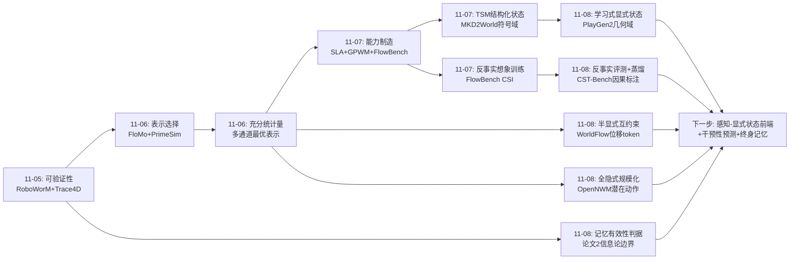
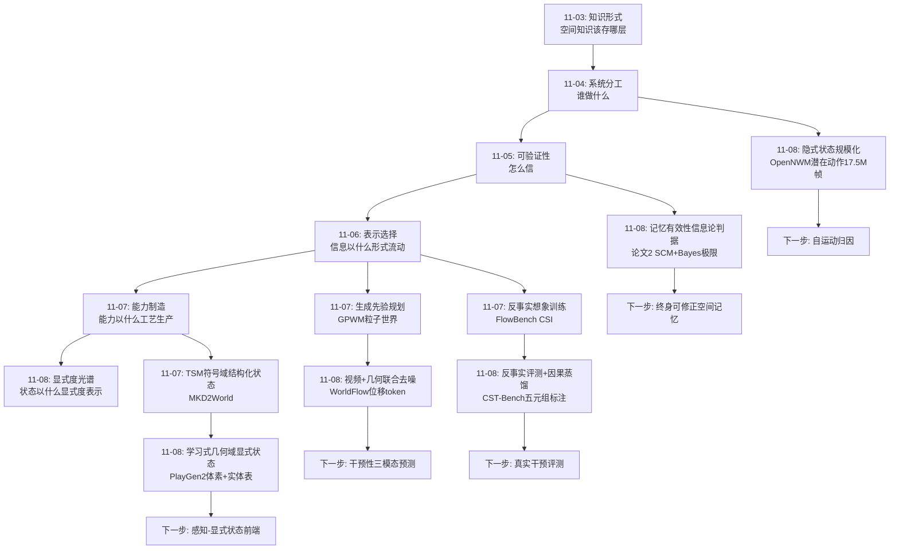
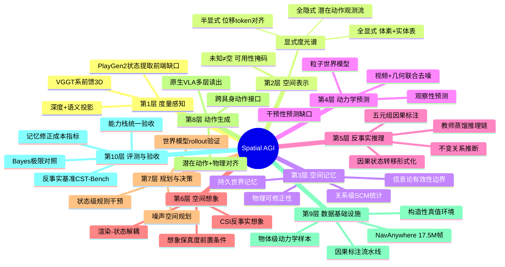
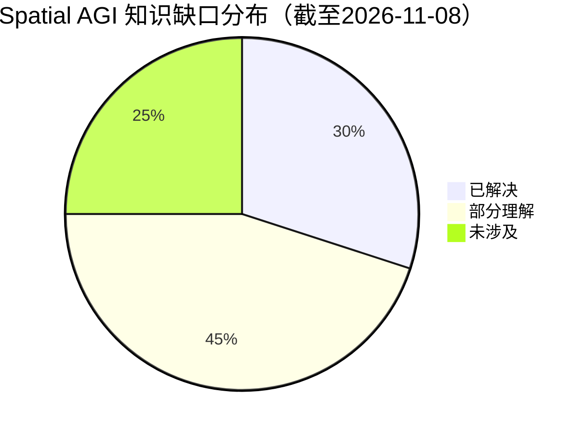
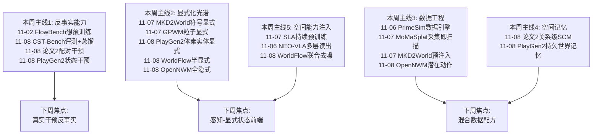
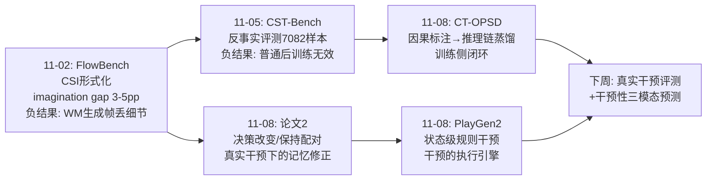

# Spatial AGI 每日思考 - 2026-11-08

## 📅 每日总结

**日期**: 2026-11-08
**论文数量**: 5篇（arXiv 精读；含一次去重替换：NEO-VLA 与 11-06 已分析论文同 ID，替换为 OpenNWM）
**主题**: 空间状态显式化的光谱与反事实主线。昨天的主题是"能力制造工艺学"——每层空间能力都有独立的制造工艺与验收标准；今天五篇论文回答的是它的表示端问题：**世界状态以什么显式度被表示、被学习、被干预、被评测**。PlayGen2 走"全显式"极（体素占据+身份实体表，渲染与状态演化彻底解耦）、OpenNWM 走"全隐式"极（无动作视频的潜在动作预训练，观测即世界）、WorldFlow 走中间路线（视频为主、几何位移 token 为伴的联合去噪）、论文2（Physical Experience）回答"显式记忆何时有用"（关系级统计 + 信息论边界 + 物理可修正性）、CST-Bench 回答"干预推理如何被评测与训练"（因果状态转移形式化 + 稠密因果标注 + 教师蒸馏）。五篇合起来是一张空间表示显式度光谱：全隐式（OpenNWM）→ 半显式（WorldFlow）→ 全显式（PlayGen2），加上贯穿全部的干预/反事实视角（CST-Bench、论文2 的决策改变/保持配对、PlayGen2 的状态级规则干预）

**关键突破**:
- 🚀 PlayGen2：首个"学习式（非代码式）显式状态世界模型"完整原型——体素占据网格 + 可用性掩码（未知≠空）+ 身份索引实体表，Discovery/Transition Transformer 联合学几何补全+实体发现+动作条件动力学；渲染与状态闭环彻底切割（生成图像永不回馈状态预测），根治视频世界模型误差自激；M4 Pro MacBook 上 160ms 实时；零样本新地图、多人组合、规则干预三个 training-free 扩展证明显式状态的架构红利
- 🚀 论文2（Physical Experience）：提出"持续空间知识"的可证伪定义——经验必须改善未来预测且保持物理可修正；关键实证：反应式成功重规划可与空间知识零积累共存；跨位置共享的关系级 SCM 以 64 情景逼近 Bayes 极限（0.898/0.90）并完全迁移到训练中从未出现的空间转移；ε=0.5 零信息对照下记忆优势精确消失——"记忆何时有用"第一次有了信息论判据 I = 1 − H₂(ε)
- 🚀 OpenNWM：潜在动作预训练 + 动作条件后训练的两阶段范式——1750 万帧无动作导航视频（NavAnywhere，15 源、机器人/人/无人机、5 类场景）先学通用潜在动作，再与物理运动对齐；把 Genie 式潜在动作范式从游戏域带到真实导航域，Spatial AGI 导航能力有了自己的大规模预训练语料范式
- 🚀 WorldFlow：视频+3D 位移 token 的网格对齐联合去噪——Mixture-of-Transformers 在 rectified-flow 目标下同时生成未来视频与查询点 3D 轨迹；flow-only 变体 ADE 差 55.9% 证明几何监督从视觉联合训练中大幅受益；SpatialCog 空间推理集上 ADE 0.060m（vs 最强基线 −54.2%），空间推理与物理动力学预测深度绑定
- 🚀 CST-Bench：7082 样本的反事实空间推理基准——6 干预类型 × 12 变换算子，五元组稠密因果标注（干预源/受影响关系/预期效果/不变关系/度量变化）；重要负结果：标准空间基准上有效的后训练方法在反事实干预下失效；CT-OPSD 把标注变成监督（教师学因果推理链、on-policy 蒸馏给只看真实观测的学生）

**架构演进**: 能力分层可制造的分工架构 → **显式度分层的分工架构**（能力栈与制造工艺不变，今天补上表示端结论：世界状态的显式度是一个可设计的光谱——交互一致性要求高的域用全显式（游戏/机器人），泛化优先的域用全隐式（导航预训练），两者之间用半显式对齐表示过渡；且无论显式度如何选择，"干预/反事实"都是穿越光谱的通用测试语言）

### 📊 一句话总结

2026-11-08 的五篇论文确立了空间智能的第三条设计公理：**世界状态表示存在显式度光谱，选择即架构设计的一部分——显式换一致性与可干预性、隐式换泛化与数据规模，而反事实干预能力是独立于显式度选择的必修课**——PlayGen2 证明全显式可学习可实时、OpenNWM 证明全隐式可规模化、WorldFlow 证明半显式互约束优于单模态、论文2 证明显式记忆必须带信息论自检与物理可修正性、CST-Bench 证明反事实推理是当前所有 MLLM 的系统性盲区。

### 🔗 延续性

**昨日→今日**: 昨日的核心结论是"空间能力可分层制造，每层有独立工艺与验收标准"，并留下六条线索：教师上限、感知-动力学接口、世界模型保真度-VLM 协同、闭环增广缺口、CSI 开放生成形式、TSM 式结构化状态迁移。今天五篇落在这些线索的"表示端"：①MKD2World 的 TSM 结构化状态表示问题被 PlayGen2 直接接住——昨天问"结构化状态表示能否迁移到机器人"，今天 PlayGen2 给出了游戏域的完整肯定答案（体素+实体表就是"游戏域 TSM"），且证明它可以被学习而非手工规则；②GPWM 的感知-粒子接口线索与 WorldFlow 呼应——WorldFlow 的位移 token 是"感知-动力学接口"的另一种实现（不从感知提取粒子，而是让几何通道与视觉通道联合训练），误差复合问题被规避为联合去噪；③FlowBench 的世界模型保真度线索获得架构级回应——PlayGen2 切断渲染反馈回路的做法说明：保真度问题的根源之一是视觉误差进入状态闭环，解耦比提升渲染质量更根本；④CST-Bench 与昨日 FlowBench 构成反事实主线的评测侧与训练侧双翼——昨天反事实想象是训练资源，今天反事实推理是评测基准+蒸馏监督；⑤昨日 SLA 的"教师蒸馏制造"今天在论文2 中被补充了认识论约束——蒸馏式记忆必须保持可修正性，否则旧预期会压过新证据；⑥OpenNWM 回应了本周反复出现的"数据即扫描"哲学（MoMaSplat/PrimeSim）：导航视频天然携带空间运动信息，潜在动作预训练是这个信念在无标签数据上的极限形态——连动作都不需要标注。

**今日→明日**: 六条新线索：①显式度光谱的任务级路由——什么任务特征（交互密度/一致性要求/数据可得性）决定显式度选择，需要可学习的路由机制；②感知前端-显式状态接口——PlayGen2 依赖引擎真值状态，真实部署需要"VLM 检测+3D 重建+实体关联"前端，前端误差对学习动力学的复合影响未验证；③潜在动作的动态物体解耦——OpenNWM 的潜在动作会把行人和自运动混淆，需要分割/光流辅助的自运动归因；④干预性预测缺口——WorldFlow 是观察性预测（世界自己动），Spatial AGI 需要干预性预测（我做 X 世界怎么动），"视频+几何+动作"三模态联合去噪是显然下一步；⑤反事实评测的真实化——CST-Bench 若为合成生成，标注分布=生成器先验的风险需要真实干预视频平行版本排除；⑥显式状态的终身维护——PlayGen2 的世界记忆无遗忘/无重估机制，论文2 的 SCM 提供了统计修正原则但未在显式几何上实现，两者结合是"终身空间记忆"的完整答案。明日检索方向："perception to explicit state interface"、"egomotion attribution latent action"、"interventional video prediction action-conditioned geometry"、"real-world counterfactual spatial benchmark"、"lifelong spatial memory revision"。

### 💡 本质思考：如何达成通用空间智能

#### 1. 核心能力的本质是什么？

本周主题的第五次收敛。11-04"分工架构"、11-05"可验证"、11-06"表示选择"、11-07"可制造"，今天的表述加入显式度与因果维度：

**空间智能的本质是可验证、以最优表示流动、可分层制造、且显式度按域最优的分工架构——世界状态的显式度是架构自由度而非教条，每层能力在显式度光谱上有自己的最优点，而反事实（干预）推理是贯穿一切显式度的元能力：它既是记忆有效性的检验（论文2）、世界模型的玩法（PlayGen2）、也是空间推理评测的金标准（CST-Bench）。**

今天的证据链把这个表述撑起来：

- **显式状态可以被学习而非只能编程**（PlayGen2）：与 Code World Model 路线（代码定义动力学）互补，PlayGen2 从数据学习几何补全+实体发现+动力学，保留同样的显式接口。显式化的成本（算力/泛化）被实证为可接受（160ms 实时、零样本迁移）。
- **隐式状态的规模化上限更高**（OpenNWM）：1750 万帧无标签视频 vs PlayGen2 依赖引擎真值状态——隐式路线的数据获取成本几乎为零，这是泛化优先域选隐式的根本理由。两条路线的取舍本质是"标注成本 vs 一致性收益"的经济问题。
- **半显式是互相成就的中间态**（WorldFlow）：视频+位移 token 联合去噪比 flow-only 好 55.9%——表示不是非此即彼，对齐的多通道表示可以互为监督。这与 11-06 的"充分统计量"思想合流：每个通道保留自己最充分的表示，通过联合训练对齐。
- **显式记忆需要自我怀疑机制**（论文2）：SCM 的价值边界由信息论精确刻画（I=1−H₂(ε)），零信息时诚实失效——空间记忆的正确形态不是"积累一切"而是"积累有结构的一切，且随时准备被物理证据推翻"。corrigibility（可修正性）是空间记忆的第一属性。
- **反事实是空间认知的元操作**（CST-Bench）：静态空间推理与反事实空间推理被实证解耦——普通后训练对反事实无效。Spatial AGI 必须把"在脑内执行干预"当作独立能力层制造与验收，而因果状态转移形式化（S, I, T→S'）给了它可计算的骨架。

#### 2. 当前方法与理想目标的差距在哪里？

- **显式路线的感知前端缺失**：PlayGen2/论文2/WorldFlow 的显式状态（体素/实体表/位移轨迹）都依赖引擎或感知栈真值。真实机器人部署时，"从感知构造显式状态"的前端（检测+重建+关联+跟踪）本身的误差如何复合进学习到的动力学，今天没有任何一篇回答。这是显式光谱左端的最大赤字。
- **隐式路线的动态混淆**：OpenNWM 的潜在动作无法区分自运动与动态物体——真实街道上行人在动，潜在动作会把它们吸进来。没有自运动归因，隐式世界模型的反事实推理（"如果我走这边"）从根本上不可靠。
- **观察性与干预性预测的鸿沟**：WorldFlow/OpenNWM 预测"世界如何自己演化"，Spatial AGI 需要"我的干预如何改变世界"。CST-Bench 评测了 MLLM 层面的干预推理（离散、符号），但没有工作在连续物理域实现"视频+几何+动作"的干预性联合预测。
- **显式记忆的终身维护缺位**：PlayGen2 的世界记忆只增不减、无重估机制——环境变了，旧几何与旧实体记录如何退役？论文2 的 SCM 有统计修正原则但作用在二值门状态上，没有处理连续几何与实体生命周期的版本。
- **反事实评测与训练的合成依赖**：CST-Bench 的因果标注、FlowBench 的模拟器元数据、PlayGen2 的引擎数据——反事实主线的全部基础设施都建立在可构造环境上。真实世界的反事实真值如何获得（干预实验的代价控制）是评测学的未解问题。
- **显式度选择无原则可循**：今天五篇各自选了光谱上的一点，但没有工作回答"给定任务与数据条件，显式度应该如何选"——这是 11-06"表示选择"主题在新维度的重现，仍然缺一个统一的决策框架。

#### 3. 从今天到理想状态，最可能的路径是什么？

五步走判断（昨日版本的更新）：

**第一步（进行中）：显式度光谱的端点验证完成**。全显式（PlayGen2，游戏域、学习式状态、实时）与全隐式（OpenNWM，真实导航域、1750 万帧）各自在自己的域内证明可行。半显式（WorldFlow）在物体级动力学上证明互约束增益。标志事件：显式状态世界模型开源生态形成（PlayGen2 已开源代码+权重）。

**第二步（2027 上半年）：感知-显式状态前端成型**。VLM 检测+前馈 3D 重建（VGGT 系）+实体关联的组合作为"状态提取前端"，在真实视频上产出 PlayGen2 式状态流；前端误差对动力学学习的复合影响被量化，去噪/正则化方案出现。同时 OpenNWM 式潜在动作加入自运动归因（分割/光流辅助），动态混淆被解决。

**第三步（2027 下半年）：干预性世界预测落地**。"视频+几何+动作"三模态联合去噪（WorldFlow 框架的自然扩展）实现干预性预测：给定当前观测与机器人动作，同时生成未来画面与度量轨迹。CST-Bench 式因果标注扩展到连续物理域（真实干预视频+机械臂真值），反事实评测从合成走向真实。

**第四步（2028+）：终身空间记忆系统**。PlayGen2 的持久世界记忆 + 论文2 的 SCM 修正原则 + 实体生命周期管理结合为"可修正的终身空间记忆"：记忆的有效性自检（信息论判据泛化）、过时结构的退役、新证据的信念更新成为标准组件。机器人跨月部署的环境适应性由此解决。

**第五步（2028+）：显式度自动路由**。"这个域的状态表示该取多显式"成为可学习决策——任务特征（交互密度/一致性要求/数据规模）→ 显式度选择的元模型。接住 11-07 的"工艺自动化"线索：能力诊断 → 工艺选择 → 表示选择，制造与表示的决策全部自动化，空间智能从"工程学科"走向"自动化生产体系"。

---

## 🔗 与昨日思考的联系

### 昨日重点

昨天的主题是**能力制造工艺学**：SLA（预训练注入）、MoMaSplat（数据合成）、MKD2World（课程化训练+构造性标注）、GPWM（生成先验规划）、FlowBench（想象能力的训练与度量）构成一张完整的能力制造工艺表。留下六条线索：教师上限、感知-动力学接口、世界模型保真度-VLM 协同、闭环增广缺口、CSI 开放生成形式、TSM 式结构化状态迁移。

### 今日进展

今天五篇论文把视角从"能力如何生产"上移到"状态以什么显式度表示"，并接住昨日多条线索：

1. **接住线索⑥"TSM 结构化状态迁移"（PlayGen2）**：昨天 MKD2World 的 TSM 是符号域的结构化状态（类型化 Markdown），今天 PlayGen2 的体素+实体表是几何域的结构化状态——两者的共同信念：**世界状态应该有显式、类型化、可干预的结构**，区别只在状态词汇表（HTML 元素 vs 占据体素+实体属性）。PlayGen2 进一步证明这个结构可以被学习（而非手工规则），把结构化状态路线从"符号工程"推进到"神经学习"。
2. **接住线索②"感知-动力学接口"（WorldFlow）**：昨天 GPWM 假设粒子对应已知，把感知-粒子接口列为最大风险；今天 WorldFlow 用"位移 token 与视频网格对齐 + 联合去噪"绕开了显式接口——几何通道不消费感知输出，而是与视觉通道共同从数据学习。这是对接口问题的一个范式级回应：**与其修接口，不如联合训练让接口内生**。
3. **接住线索③"世界模型保真度-VLM 协同"（PlayGen2 的架构启示）**：昨天 FlowBench 发现生成帧丢细节阻塞"想象辅助回答"；今天 PlayGen2 揭示保真度问题的架构根源之一——视觉误差通过反馈回路污染状态，误差滚雪球。切断反馈回路（渲染与状态解耦）比提升单帧渲染质量更根本。保真度问题的解法从"更好的渲染器"升级为"更好的信息流架构"。
4. **昨日"构造性真值"哲学的极限推广（OpenNWM）**：昨天 MKD2World/FlowBench 用构造环境让真值可直读；今天 OpenNWM 走另一个极端——不构造任何真值，从纯观测推断潜在动作。两条路线合起来构成数据工程的完整光谱：构造性真值（高精度低规模）↔ 潜在推断（零标注高规模），中间地带（弱标注+强先验）是明年的数据工程主战场。
5. **接住昨日 FlowBench 的反事实主线（CST-Bench）**：昨天反事实想象是训练资源（CSI 训练），今天反事实推理是评测基准+蒸馏监督（CST-Bench + CT-OPSD）——反事实主线获得训练侧与评测侧的双翼，且 CST-Bench 的负结果（普通后训练对反事实无效）与 FlowBench 的负结果（世界模型生成帧丢细节）相互印证：反事实能力的制造不能用普通工艺，需要因果结构化的专用监督。

### 演进路径



核心轨迹：**知识形式（11-03）→ 系统分工（11-04）→ 可验证性（11-05）→ 表示选择（11-06）→ 能力制造（11-07）→ 显式度光谱（11-08）**——空间智能的工程学在表示维度完成了从"通道内最优表示"到"状态显式度全局选择"的深化，反事实作为元能力贯穿始终。

---

## 📚 论文概览

**论文1: PlayGen2（2611.07867, CUHK/Tencent/NTU）**
实时可玩世界模型的显式 3D 状态路线。世界状态 = 体素占据网格 M + 可用性掩码 K（未知≠空）+ 玩家状态 e + 身份索引实体表 O（类别/位置/高/半径/速度）；持久世界记忆 + 玩家中心固定 crop；Shared Context Transformer → Discovery Transformer（Geometry Queries 补几何 + Spatial Entity Queries 发现新实体）→ Transition Transformer（残差位移预测实体/玩家下一状态）；独立扩散渲染器从 depth+semantic 投影合成画面，生成图像永不回馈状态预测；无运行时碰撞修正（碰撞全靠学）。Doom 测试床，M4 Pro MacBook 160ms 后端延迟；零样本新地图、单玩家组合多人、状态级规则干预三个 training-free 扩展。局限：Doom 域窄、包围盒实体、真实世界无状态真值。

**论文2: Physical Experience Builds Continual Spatial World Models（2611.04016）**
持续空间世界知识的认识论研究。物理斜坡圆形迷宫分离环境结构变化（门开闭）与动作连续后果（球滚动物理）；跨情景 Spatial Change Memory（SCM）跨位置共享 Beta-Bernoulli 估计器学习门状态转移关系（P(C_{k-1}=C_k)=1−ε）；物理层参数化动力学（有效质量 7m/5+耗散+柔顺接触+执行器一阶动态）从状态-动作-结果三元组辨识；四信息机制对照（Frozen/Local/Oracle/SCM）+ 决策改变/保持配对 + held-out 转移 + 零信息随机对照。结果：SCM 64 情景精度 0.898（Bayes 极限 0.90）、路线修正 1.744→0.406、held-out 转移 0.898 vs 0.566、ε=0.5 时记忆优势精确消失、废弃目标执着 0.0083s vs 2.79s。局限：最小系统、一阶马尔可夫变化、白盒动力学族。

**论文3: OpenNWM（2611.01844）**
通用导航世界模型 + 潜在动作预训练。两阶段：NavAnywhere 数据集（1750 万视觉观测、15 异构源、地面机器人/人/无人机、5 类场景）上视觉预测预训练学通用潜在动作 → 动作标注数据上后训练对齐潜在动作与物理运动。解决动作标注数据稀缺 vs action-free 视频海量的矛盾。域内+域外视觉预测提升、下游导航性能提升。局限：潜在动作混淆自运动与动态物体、视频预测长程漂移、导航动作低维。

**论文4: WorldFlow（2610.39278）**
视频+3D 运动联合预测的生成式世界模型。3D 运动参数化为与视频网格对齐的连续位移 token；Mixture-of-Transformers 骨干在 rectified-flow 目标下联合去噪两模态；144 万物体级样本（仿真+真实）；WorldFlowBench 1678 样本 11 源含 SpatialCog 空间推理集。SpatialCog ADE 0.060m（−54.2% vs 最强基线）；vs flow-only 变体 ADE −55.9%/FDE −68.5%——视觉联合训练大幅反哺几何预测。局限：物体级设定、无动作条件（观察性预测）、查询点需 3D 初始化。

**论文5: CST-Bench + CT-OPSD（2611.07541）**
反事实空间推理的评测与训练。7082 样本、6 干预类型 × 12 变换算子、五元组稠密因果标注（干预源/受影响关系/预期效果/不变关系/度量变化）；反事实空间推理形式化为因果状态转移建模；CT-OPSD：教师用标注学因果推理链，on-policy 自蒸馏给只看真实观测的学生。发现：通用 MLLM 反事实系统性失败；标准空间基准上有效的后训练对反事实无效。局限：合成依赖、离散干预、CT-OPSD 仅初步示范。

---

## 💡 核心见解

### 见解1: 显式状态可以是学习目标而非工程输入
[从 PlayGen2 获得]
- ✅ 体素占据+身份实体表的世界状态由 Discovery/Transition Transformer 从数据联合学习——几何补全、实体发现、动作条件动力学一次前向完成
- ✅ 与 Code World Model（代码定义动力学）互补：学习式演化 + 显式接口，兼得两派优点
- ✅ 160ms 实时证明显式状态路线不比视频生成贵

**对Spatial AGI的启发**：
显式化不必付出"手工建模世界"的代价。Spatial AGI 的世界状态设计应该按"需要什么接口"（可干预/可组合/可查询）来定状态词汇表，然后让神经网络学习它的演化——接口决定表示，学习负责动力学。

### 见解2: "未知≠空"是空间认知边界的表示原语
[从 PlayGen2 获得]
- ✅ 可用性掩码 K 把未探索体素与空体素区分，未知区域不是"没有东西"而是"不知道"
- ✅ 增量世界生成据此工作：玩家移动决定哪些未知区域需要补全

**对Spatial AGI的启发**：
空间信念系统必须显式管理自己的无知。这对主动探索（去哪里补全认知）、不确定性推理（哪里的话不可信）、记忆更新（新证据推翻旧填充）都是基础设施级的设计。PlayGen2 的 K 是这个思想的离散最小实现，真实系统需要连续置信度版本。

### 见解3: 空间记忆的价值有信息论边界，且可修正性是第一属性
[从论文2 获得]
- ✅ 反复成功重规划可与知识零积累共存——"每个情景都从当前证据重新解决"
- ✅ 关系级共享统计（SCM）逼近 Bayes 极限并迁移到 held-out 空间转移；零信息时（ε=0.5）记忆优势精确消失
- ✅ 废弃目标执着：SCM 0.0083s vs 反应式 2.79s——记忆正确的标志是"失效时立刻放手"

**对Spatial AGI的启发**：
空间记忆系统需要内建三件套：①存储规律而非快照（关系级抽象）；②自检机制（当前环境还有无可学结构）；③物理可修正性（旧预期不得压过新证据）。评测持续空间学习不能只看成功率，要看修正成本下降与跨位置迁移。

### 见解4: 数据工程的两个极端在"空间知识提取"上会师
[从 OpenNWM + 昨日 MKD2World/FlowBench 获得]
- ✅ 构造端：构造环境让真值可直读（模拟器元数据、预注入 HTML）——高精度、低规模
- ✅ 推断端：纯观测推断潜在动作（OpenNWM 1750 万帧）——零标注、高规模
- ✅ 两者输出同一种东西：带"空间交互结构"的训练信号

**对Spatial AGI的启发**：
空间数据工程的核心问题不是"有多少数据"而是"数据的空间结构可提取度"。理想数据配方是两端混合：推断端提供广度（泛化先验），构造端提供深度（精确校准），中间用弱标注桥接。NavAnywhere 证明导航域已有推断端的规模条件，其余空间域（操作、物理交互）的"无标签视频 → 潜在交互"管线是明年的数据基础设施机会。

### 见解5: 视觉与几何联合训练是互惠的，不是权衡
[从 WorldFlow 获得]
- ✅ flow-only 变体比联合模型差 55.9% ADE——几何预测从视觉通道大幅受益
- ✅ SpatialCog 空间推理任务上联合优势最大（−54.2%）——空间推理与物理动力学预测深度绑定
- ✅ 位移 token 与视频网格对齐是关键设计：两通道共享时空索引

**对Spatial AGI的启发**：
"画面会动"与"物体在哪"不该分开训练。任何 Spatial AGI 生成模型都应该有可查询的几何输出通道，且与外观通道对齐联合训练。这也为 FlowBench 的"世界模型保真度"瓶颈提供解法方向：几何通道的存在让保真度可度量、可验收。

### 见解6: 反事实推理是当前 MLLM 的系统性盲区
[从 CST-Bench 获得]
- ✅ 通用 MLLM 在反事实空间干预下系统性失败，即使静态空间能力很强
- ✅ 标准空间基准上有效的后训练方法不能迁移到反事实任务——两种能力被实证解耦
- ✅ "不变关系"标注是关键：反事实推理的核心是因果局部性（只更新被干预波及的关系）

**对Spatial AGI的启发**：
"在脑内执行干预"必须作为独立能力层制造：需要因果结构化的监督（五元组标注/推理链蒸馏），普通 SFT/RL 无效。评测体系必须包含干预式任务，否则会系统性高估空间能力。这与 FlowBench 的 imagination gap 呼应：本周两条独立证据链指向同一个盲区。

### 见解7: 渲染-状态解耦是保真度问题的架构级答案
[从 PlayGen2 获得，回应昨日 FlowBench 线索]
- ✅ 生成图像永不回馈世界状态预测——视觉误差无法在闭环中滚雪球
- ✅ 状态闭环的输入只有：动作+显式状态历史+几何上下文（全是可学习的结构化信号）
- ✅ 渲染器独立训练，可用更好的渲染模型单独升级

**对Spatial AGI的启发**：
系统设计时应该问："误差在哪里闭环？"感知误差进状态闭环会滚雪球，进渲染闭环只影响单帧。Spatial AGI 的信息流架构应该让不可靠的信号（生成图像、感知预测）只处于开环位置，可靠的结构化信号才进闭环。这是比"更大模型"更便宜的可靠性来源。

### 见解8（补充）: 教师可以看上帝视角，学生只能看观测
[从 CST-Bench CT-OPSD 获得]
- ✅ 教师用稠密因果标注学推理链，学生 on-policy 蒸馏后只从真实观测推理
- ✅ 训练时利用部署时不可得的信息（标注/状态真值），部署时零依赖

**对Spatial AGI的启发**：
这是"训练-部署信息不对称"的通用模式，与 PlayGen2（训练用引擎真值状态）和 SLA（训练用教师几何）同构。空间能力的制造应该系统性地利用"上帝视角"：仿真状态、因果标注、多视角真值都只进训练管道，推理接口保持纯观测。

---

## 🗺️ 知识演进图



**今天的定位**：显式度光谱的三点（全显式 H / 半显式 J / 全隐式 N）与反事实元能力（L）+ 记忆认识论（M）同时落位，空间智能的表示论与认识论在同一天补全。

---

## 技术栈演进对比表

| 层次 | 昨日方案（11-07） | 今日方案（11-08） | 变化 |
|------|------------------|------------------|------|
| 世界状态表示 | MKD2World 符号域 TSM（类型化 Markdown） | PlayGen2 几何域显式状态（体素+实体表，学习式演化） | 结构化状态从符号域扩展到几何域，从手工规则到学习演化 |
| 状态演化 | GPWM 粒子动力学（假设粒子对应已知） | WorldFlow 位移 token 与视频网格对齐联合去噪（接口内生） | 感知-动力学接口从"显式接口"变为"联合训练内生" |
| 数据工程 | 构造性真值（FlowBench 模拟器元数据、MKD2World 预注入） | OpenNWM 潜在动作推断（1750 万帧零标注）+ NavAnywhere 语料范式 | 数据工程两端会师：构造性真值 ↔ 潜在推断，光谱补全 |
| 动作学习 | SLA 空间对齐持续预训练（有动作标注） | OpenNWM 潜在动作预训练 + 物理动作后训练对齐 | 动作监督从"必须有标注"到"无标注预训练+少量对齐" |
| 空间记忆 | （未直接涉及）PrimeSim 数据引擎哲学 | 论文2 SCM：关系级统计+Bayes 边界+物理可修正性 | 记忆从工程组件升级为认识论对象，获得有效性判据 |
| 空间推理评测 | FlowBench CSI（反事实想象训练资源） | CST-Bench（反事实干预评测+因果标注蒸馏监督） | 反事实主线补齐评测侧；"不变关系"成为一等标注 |
| 实时性验证 | GPWM 仿真 rollout（无实时要求） | PlayGen2 160ms 消费级笔记本端到端 | 显式状态路线的部署可行性首次实证 |
| 误差控制 | FlowBench 负结果：生成帧丢细节（渲染质量视角） | PlayGen2 切断渲染反馈回路（信息流架构视角） | 保真度问题的解法从"更好的渲染器"升级为"误差不开环" |
| 可干预性 | （隐含于仿真环境） | PlayGen2 状态级规则干预 + CST-Bench 因果干预评测 + 论文2 配对干预实验 | 干预/反事实确立为贯穿性元能力与测试语言 |

---

## 🗺️ Spatial AGI 知识图谱

### 10层架构思维导图



### 🎯 主线技术路径

#### 阶段1: 显式度端点验证（进行中，2026）

全显式（PlayGen2：游戏域学习式状态+实时交互+开源）与全隐式（OpenNWM：真实导航域 1750 万帧潜在动作）各自在域内验证可行；半显式（WorldFlow：视频+位移 token 互约束）在物体动力学上证明增益。标志：显式状态世界模型开源生态形成、潜在动作预训练范式可复制。

#### 阶段2: 感知-显式状态前端（2027 上半年）

真实视频上的状态提取前端成型：VLM 检测+前馈重建+实体关联产出 PlayGen2 式状态流；前端误差对动力学学习的复合影响被量化；OpenNWM 潜在动作加入自运动归因。标志：显式状态路线走出游戏域、隐式路线解决动态混淆。

#### 阶段3: 干预性预测与真实反事实（2027 下半年）

"视频+几何+动作"三模态联合去噪实现干预性预测；CST-Bench 式因果标注扩展到连续物理域（真实干预视频+机械臂真值）；反事实评测从合成走向真实。标志：机器人可以在脑内预演"我做 X 的后果"并用度量轨迹验收。

#### 阶段4: 终身可修正空间记忆（2028+）

PlayGen2 持久记忆 + 论文2 SCM 修正原则 + 实体生命周期管理结合：记忆有效性自检、过时结构退役、新证据信念更新成为标准组件。标志：机器人跨月部署环境自适应、空间记忆成为可验收的独立模块。

#### 阶段5: 显式度自动路由（2028+）

"该域状态取多显式"成为可学习决策：任务特征 → 显式度选择的元模型；与 11-07 工艺自动化合流，制造与表示决策全部自动化。标志：给出任务描述，系统自动输出架构（显式度+工艺+验收）配置。

---

## 🔍 待探索议题

### 高优先级（本周）

1. **感知前端-显式状态接口的误差复合**
   - 问题: PlayGen2 依赖引擎真值状态；真实部署需要 VLM 检测+重建+关联前端，前端误差如何复合进学习到的动力学？
   - 候选方案: 可微分状态提取前端；状态噪声增广训练；论文2 式统计修正吸收前端误差
   - 缺口: 无任何工作量化"状态噪声 → 动力学质量"的关系曲线

2. **潜在动作的自运动归因**
   - 问题: OpenNWM 的潜在动作混淆自运动与动态物体，反事实推理（"如果我走这边"）从根本上不可靠
   - 候选方案: 分割/光流辅助的运动归因；双流潜在动作（ego-motion + object-motion）；真实里程计弱监督
   - 缺口: 无标注时如何验证归因正确性

3. **干预性三模态联合预测**
   - 问题: WorldFlow 是观察性预测；Spatial AGI 需要"我做 X 世界怎么动"的干预性预测
   - 候选方案: WorldFlow 框架加动作条件（视频+位移+动作三模态联合去噪）；PlayGen2 状态转移的动作条件扩展
   - 缺口: 动作与位移 token 的耦合表示设计

### 中优先级（本月）

4. **反事实评测的真实化**
   - 问题: CST-Bench/FlowBench 全部依赖合成/模拟器标注，存在"标注分布=生成器先验"风险
   - 候选方案: 机械臂真实干预+多视角真值的平行基准；干预代价可控的主动评测协议
   - 缺口: 真实干预的真值获取成本与安全控制

5. **终身空间记忆的退役机制**
   - 问题: PlayGen2 记忆只增不减；论文2 的修正原则只作用于二值门状态；连续几何与实体生命周期无版本管理
   - 候选方案: 记忆置信度衰减+重访重估；实体生命周期状态机；论2 判据的连续泛化
   - 缺口: 显式几何记忆的统计修正理论

6. **显式度路由元模型**
   - 问题: 全显式/半显式/全隐式的选择无原则可循
   - 候选方案: 任务特征（交互密度/一致性要求/数据规模）→ 显式度的决策树/学习模型；用今天五篇作为标注起点
   - 缺口: 更多显式度中间点的实证（每个任务域至少两点）

7. **几何通道与世界模型保真度验收**
   - 问题: FlowBench 发现生成帧丢细节阻塞想象辅助回答；保真度缺度量
   - 候选方案: WorldFlow 式几何通道作为保真度探针——几何预测精度即保真度验收
   - 缺口: 几何保真度与下游 VLM 协同增益的因果链验证

### 低优先级（长期）

8. **多人/多智能体显式状态合并**
   - 问题: PlayGen2 演示单玩家模型组合成多人，但真实多机器人场景需要状态合并一致性协议
   - 候选方案: 分布式世界记忆+冲突消解；论文2 式关系统计作为合并置信度
   - 缺口: 合并误差对下游规划的影响度量

9. **空间想象的开放式生成形式**
   - 问题: FlowBench CSI 是选择题弱代理；真实空间想象是开放场景状态预测
   - 候选方案: CST-Bench 因果标注 + 开放式状态生成（PlayGen2 状态词汇表作为输出空间）+ 几何验收
   - 缺口: 开放输出的自动评分标准

10. **构造性真值与潜在推断的混合数据配方**
    - 问题: 数据工程两端（构造/推断）各自极端，中间地带未开发
    - 候选方案: 弱标注（自监督几何一致性）+ 强先验（潜在动作）+ 少量构造校准的分层配方
    - 缺口: 各层配比与下游能力的剂量效应曲线

---

## 📊 知识缺口分析



**已解决（30%）**:
- ✅ 显式状态可学习可实时（PlayGen2 学习式演化 + 160ms）
- ✅ 空间记忆有效性判据（论文2 信息论边界 + Bayes 极限对照）
- ✅ 无动作视频的导航世界模型规模化（OpenNWM 两阶段范式）
- ✅ 视频+几何联合训练互惠性（WorldFlow −55.9% 消融）
- ✅ 反事实空间推理的评测基础设施（CST-Bench 7082 样本+因果标注）
- ✅ 渲染-状态解耦架构（PlayGen2 反馈回路切断）

**部分理解（45%）**:
- ⚠️ 感知-显式状态前端：路线明确（VLM+重建+关联）但误差复合未量化
- ⚠️ 潜在动作语义：可学习（OpenNWM）但自运动归因未解决
- ⚠️ 干预性预测：形式化齐备（CST-Bench 因果转移）但连续物理域未实现
- ⚠️ 显式度选择：光谱端点已验证，中间点与路由原则缺失
- ⚠️ 记忆终身维护：修正原则有（论文2）但仅限最小系统
- ⚠️ 空间想象制造：CSI 可训练（FlowBench）但 gap 未关闭、开放形式未解决
- ⚠️ 教师蒸馏上限：CT-OPSD/SLA 有效但教师依赖链未突破

**未涉及（25%）**:
- ❌ 真实干预反事实基准（连续物理域）
- ❌ 多智能体显式状态合并协议
- ❌ 显式几何记忆的退役/重估理论
- ❌ 显式度自动路由元模型
- ❌ 高维操作动作的潜在动作预训练（OpenNWM 限于低维导航动作）
- ❌ 长时程（月级）真实部署的空间记忆稳定性

---

## 📌 明日检索方向

- "perception to explicit state interface"（感知-状态前端误差复合）
- "egomotion attribution latent action"（自运动归因）
- "interventional video prediction"（干预性三模态预测）
- "real-world counterfactual spatial benchmark"（真实干预评测）
- "lifelong spatial memory revision"（终身空间记忆）
- "explicitness level world model routing"（显式度路由）

---

**文档创建时间**: 2026-11-08
**论文基础**: PlayGen2 / Physical Experience / OpenNWM / WorldFlow / CST-Bench
**与昨日关联**: 接住 TSM 状态迁移、感知-动力学接口、世界模型保真度、构造性真值、反事实主线五条线索

---

## 🔬 论文深度延伸分析

### 延伸1: PlayGen2 的状态词汇表设计与传统游戏引擎的对照

PlayGen2 的世界状态四元组 (M, K, e, O) 并非凭空设计，而是对传统游戏引擎状态组织的最小神经化重述：

- **占据网格 M ↔ 引擎的碰撞几何/BSP 树**：都是空间存在性的底座，但 M 是学习的、可补全的，引擎几何是 art 资产、精确固定的
- **可用性掩码 K ↔ 引擎的流式加载（streaming）**：引擎按需加载关卡区块，PlayGen2 按需补全未知体素——"流式加载"从工程机制变成了学习目标的一部分
- **实体表 O ↔ ECS（Entity Component System）架构**：身份索引 + 属性向量正是 ECS 的实体-组件思想，属性（类别/位置/尺寸/速度）是最小的组件集
- **规则干预 ↔ 引擎的脚本系统**：状态级规则干预等价于在 ECS 上跑脚本事件，但因为状态是学习的，脚本可以作用在"学到的世界"上——这是神经世界模型第一次真正继承引擎的可编程性

这个对照说明：**PlayGen2 不是发明了一种状态表示，而是把 fifty 年游戏工程验证过的状态架构作为先验，用神经网络替换其中的手工部分。** 好的空间表示往往是工程史的回声——这对 Spatial AGI 的启示是：设计状态词汇表时，先看游戏引擎、机器人操作系统（ROS 的 tf 树、moveit 规划场景）、GIS（图层模型）里已经验证过的结构，再决定哪些交给学习。

值得注意的失败模式预判：Doom 的实体速度是离散帧率的低维量，学习动力学容易；真实世界的接触动力学是无限维的（变形、破碎、流体），实体表 (类别/位置/高/半径/速度) 的词汇表会不够用。状态词汇表的可扩展性——如何在不重训整个模型的情况下加入新属性类型（如关节状态、形变模式）——是显式路线的开放架构问题。

### 延伸2: 论文2 的"零信息对照"作为空间智能评测的通用协议

论文2 最有方法论价值的不是 SCM 本身，而是**零信息对照（ε=0.5 随机变化）**这个实验设计。它回答了一个所有记忆/学习系统都该回答但几乎没人回答的问题：**"我的系统在'历史不含未来信息'的环境里会诚实失效吗？"**

三个推论：

1. **记忆系统的诚实性测试**：一个健康的记忆系统在 ε=0.5 时预测应该退化到 chance level。如果它在零信息环境下仍然"表现好"，说明它过拟合了评测集的残余结构或评测协议有泄漏。这可以作为所有空间记忆系统的必测项。
2. **"历史依赖"与"历史有用"的区分**：很多世界模型有很长的历史窗口（visual memory 检索、KV cache），但历史依赖 ≠ 历史有用。零信息对照是把这两者解耦的手术刀。
3. **可证伪的持续学习声明**：持续学习领域的论文通常声称"经验积累提升性能"，但极少给出"什么条件下不该提升"的边界。论文2 的 I = 1 − H₂(ε) 给出了精确的信息论边界，实证曲线贴着分析极限走——这是持续学习评测应有的严谨度标准。

推广到本周其他工作：FlowBench 的 27% 不变题（防捷径设计）是同一思想在评测数据侧的实现；CST-Bench 的"不变关系"标注是同一思想在监督信号侧的实现。**"什么没变"与"什么时候不该学"正在成为空间智能评测与训练的第三条通用原则**（前两条是 11-05 的可验证性与 11-06 的充分统计量）。

### 延伸3: OpenNWM 与 Genie 谱系：潜在动作的三次进化

潜在动作（latent action）作为无标签视频提取交互结构的手段，到今天经历了三代：

1. **Genie（2024，游戏域）**：证明潜在动作可以从游戏视频中学出且支持可控生成——概念验证，域窄（2D 平台游戏）
2. **Genie 2/3 系（2025，3D 游戏域）**：扩展到 3D 世界，潜在动作质量提升但仍限游戏分布
3. **OpenNWM（2026.11，真实导航域）**：第一次在真实世界大规模验证（1750 万帧、机器人/人/无人机），并补上了关键的第二阶段——**物理动作对齐**。Genie 系的潜在动作只能用于生成内部循环（人按 imagined 键），OpenNWM 的潜在动作经后训练后可以接真实机器人的运动指令

第二阶段的意义：它把潜在动作从"生成接口"升级为"跨具身控制接口"。机器人不再需要自己的动作标注视频来学世界模型——先用人类的行走视频学潜在动作，再用少量机器人遥操作数据做对齐。这对数据稀缺的机器人形态（双臂、四足、人形）是通用的数据杠杆。

剩余风险（前文已列）：动态物体混淆。补充一个可能的解法思路：OpenNWM 后训练阶段天然提供了"潜在动作 → 物理运动"的标注对，可以反向用物理运动残差检测"视频变化中不能用自运动解释的部分"，从而无监督地分离动态物体——潜在动作与物理动作的残差本身是动态物体的信号。

### 延伸4: WorldFlow 位移 token 的表示学分析

位移 token 与视频网格对齐这个设计值得细看。它实际上是三种 3D 运动表示的折中：

- **逐帧光流**（2D、视角依赖）：信息最丰富但无度量，WorldFlow 的视频通道隐式包含
- **逐点轨迹**（TAP 系，2.5D）：有跟踪但深度不明确
- **3D 位移场**（WorldFlow 通道，度量级）：可查询、可验证，但需要查询点初始化

网格对齐让位移 token 可以复用视频 token 的时空注意力结构——几何不需要自己的主干，寄生在视觉主干上生长。这个"寄生式几何表示"策略的成本极低（少量专家参数），收益巨大（−55.9% ADE）。它暗示一个更普遍的架构原则：**在预训练视频模型上添加空间能力时，不要新增通路，要把空间量表示成与现有 token 网格同构的形式，让已有的注意力结构直接为其服务。** 这与 NEO-VLA（11-06，动作专家读多层 KV）和 SLA（11-07，门控多层聚合）形成三角互证：空间能力的注入方式是"复用现有结构 + 对齐表示"，而非"旁路新增模块"。

### 延伸5: CST-Bench 的因果局部性标注与神经科学对照

CST-Bench 五元组标注里的"不变关系"维度，与认知科学中的 belief updating 文献高度相关：人类在被干预后的场景更新中，默认使用因果局部性启发式（只更新因果链上的信念），且这种选择性更新是可以被实验分离的（干预条件 vs 观察条件的信念差异）。CST-Bench 把这个启发式做成了可评分的标注维度——模型答对"受影响关系"但答错"不变关系"，诊断的是过度更新（over-updating）；反之是更新不足。

这两个失败模式对应不同的修复路径：over-updating 需要因果隔离训练（显式标注哪些关系与干预源无因果路径）；under-updating 需要因果传播训练（推理链蒸馏恰好针对此）。CT-OPSD 的教师推理链如果显式包含"这些关系不变因为…"的步骤，可以同时治疗两种失败。这是把认知科学的诊断分类学直接转化为训练目标的范例。

### 延伸6: 本周世界模型论文的显式度光谱总览

把本周（11-02 至 11-08）出现的世界模型按显式度排成光谱：

| 显式度 | 论文 | 状态形式 | 优势 | 代价 |
|--------|------|---------|------|------|
| 全隐式 | OpenNWM | 观测流+潜在动作 | 数据零标注、跨域泛化 | 状态不可查询、动态混淆 |
| 弱显式 | WorldFlow | 视频网格+对齐位移 token | 度量可查询、互约束 | 需查询点初始化、观察性 |
| 符号显式 | MKD2World（11-07） | 类型化 Markdown | 可编辑、可读 | 限数字域、词汇表手工 |
| 几何显式 | PlayGen2 | 体素+实体表 | 可干预、一致性、实时 | 需状态真值训练、词汇表固定 |
| 全显式+物理 | GPWM（11-07） | 粒子+刚体位姿 | 六域物理统一 | 粒子对应已知假设 |

两个观察：

1. **光谱不是评价轴**：没有"越显式越好"。交互一致性要求高（游戏、机器人）偏右，数据规模与泛化优先（导航预训练）偏左。显式度的选择是任务-数据经济学的函数。
2. **光谱在收敛**：GPWM 与 PlayGen2 的几何显式端几乎重合（粒子 vs 体素+实体表都是"几何+实体"的离散化），WorldFlow 与 MKD2World 分别代表"半显式对齐"与"符号显式"。明年大概率出现**混合架构**：隐式预训练打底（OpenNWM）→ 显式状态化精调（PlayGen2 式状态词汇表蒸馏）→ 半显式几何验收（WorldFlow 式位移探针）。三层管线的每一层都已经有了今天的工作作为原型。

---

## 🧭 本周研究主题的时间线整合



本周五天，五条主线全部从"单点论文"推进到"多点互证"：反事实有了训练+评测+干预三面证据，显式化有了五点光谱，数据工程有了构造/推断两端，记忆有了工程+认识论双翼，能力注入有了三个域的互证。**空间智能的研究正在从"论文拼图"进入"体系收敛"阶段。**

---

## 📐 三个开放问题的形式化草稿

### Q1: 显式度选择的决策问题形式化

给定任务 τ、数据条件 D、部署约束 C，选择显式度级别 ℓ ∈ {隐式, 半显式, 符号显式, 几何显式}，目标：

```
ℓ* = argmax_ℓ  E[任务性能(模型(ℓ, τ, D))] − λ_标注 · 标注成本(ℓ, D) − λ_算力 · 算力成本(ℓ)
```

今天的实证提供的先验：
- 数据规模大且无标注（D 大、标注少）→ ℓ 小（OpenNWM：1750 万帧只支持隐式）
- 交互一致性与可干预性要求高 → ℓ 大（PlayGen2：游戏需要重访一致性）
- 需要度量验收 → ℓ 中（WorldFlow：位移 token 提供可查询几何）

待补的实证：同一任务域内 ℓ 的剂量效应曲线（例如导航域上隐式 vs 半显式的性能-成本前沿）。

### Q2: 空间记忆有效性的在线判据

论文2 的判据是离线统计的（ε 已知）。在线版本需要记忆系统在部署中自估"当前环境的变化结构信息量"：

```
I_t = f(记忆命中模式的统计)  →  若 I_t ≈ 0，记忆降权至反应式策略
```

实现路径：维护 SCM 式的关系预测器，用其校准误差（ECE）作为 I_t 的代理——预测器校准良好且精度高 → 环境有结构；校准崩坏 → 环境无结构，记忆降权。这个"记忆健康监测器"可以直接嫁接到 PlayGen2 的持久世界记忆上。

### Q3: 干预性预测的评测问题

WorldFlow（观察性）与 CST-Bench（符号干预）之间需要一个连续物理域的干预评测：

```
给定 (s_t, a)：模型预测 (视频_{t+1:t+k}, 轨迹_q)
评分 = 几何误差(轨迹) + 因果一致性(受影响关系集合的预测) + 不变性(不变关系集合的保持)
```

这个三项评分把 WorldFlow 的 ADE/FDE 与 CST-Bench 的因果标注统一成干预性预测的完整验收。没有哪篇今天论文实现了它——这是下周可以直接动手构建的评测原型。

---

## 🎯 给明天的自己：三句话

1. **显式度是架构自由度不是立场**——为任务选显式度，像选学习率一样有依据地选。
2. **任何记忆/学习系统都要过零信息对照这一关**——不能诚实失效的记忆不可信。
3. **反事实能力要用因果结构化监督单独制造**——普通 SFT/RL 对干预推理无效，这是本周最重要的负结果。

---

## 附录: 今日论文关键数字速查

| 论文 | 关键数字 | 含义 |
|------|---------|------|
| PlayGen2 | 160ms | M4 Pro MacBook 端到端后端延迟 |
| PlayGen2 | 3 个 training-free 扩展 | 新地图/多人/规则干预 |
| 论文2 | 0.564 → 0.898 | SCM 64 情景预测精度（Bayes 极限 0.90） |
| 论文2 | 1.744 → 0.406 | 每情景路线修正次数下降 |
| 论文2 | 0.898 vs 0.566 | held-out 转移：共享 SCM vs 反应式 |
| 论文2 | 0.0083s vs 2.79s | 废弃目标执着：SCM vs Reactive |
| OpenNWM | 17.5M 观测 | NavAnywhere 数据集规模 |
| OpenNWM | 15 源 / 3 载体 / 5 场景 | 数据异构度 |
| WorldFlow | ADE 0.060m | SpatialCog 空间推理集 |
| WorldFlow | −54.2% / −55.9% | vs 最强基线 / vs flow-only 变体 |
| WorldFlow | 1.44M 物体级样本 | 训练数据规模 |
| CST-Bench | 7082 样本 | 基准规模 |
| CST-Bench | 6 × 12 | 干预类型 × 变换算子 |
| CST-Bench | 5 元组 | 因果标注维度（含不变关系） |

---

**文档创建时间**: 2026-11-08（扩充版）
**论文基础**: PlayGen2 / Physical Experience / OpenNWM / WorldFlow / CST-Bench
**与昨日关联**: 接住 TSM 状态迁移、感知-动力学接口、世界模型保真度、构造性真值、反事实主线五条线索

---

## 📎 附录二: 五篇论文三问精要（速查版）

### 论文1: PlayGen2 三问精要

**Q1 核心算法**: 世界状态 (M,K,e,O) 四元组；Discovery Transformer（Geometry Queries 补几何 + Spatial Entity Queries 从锚点提新实体）与 Transition Transformer（残差位移 p_{t+1}=p_t+f_xyz(h)）共享 Shared Context；更新顺序为先在已提交位姿补全再转移；独立扩散渲染器从 depth/semantic 投影合成，生成帧只进 RGB 历史不进状态闭环；无运行时碰撞修正。

**Q2 与 Spatial AGI**: 空间表示分三层——几何层（体素）、语义-实体层（身份索引表）、关系层（注意力隐式）；空间状态持久、视角无关、可增量扩展；"未知≠空"是空间认知边界的一等表示；对机器人的启示是"感知只是状态的条件观测，世界模型的核心是显式状态演化"。

**Q3 创新与局限**: 创新在"学习式显式状态"（区别于代码式 CWM）与渲染-状态彻底解耦；局限在 Doom 域窄、包围盒实体表达有限、真实世界无状态真值、固定局部 crop 的大尺度一致性依赖写回正确性。

### 论文2: Physical Experience 三问精要

**Q1 核心算法**: 物理迷宫分离结构变化（门）与动力学后果（球）；SCM 用跨位置共享 Beta-Bernoulli 统计学门状态转移关系 P(C_{k-1}=C_k)=1−ε；物理层白盒参数辨识（m_eff=7m/5、线性+平方耗散、柔顺接触、执行器一阶）；四信息机制对照（Frozen/Local/Oracle/SCM-memory）。

**Q2 与 Spatial AGI**: 空间知识=转移规律而非快照集合；跨位置共享估计器是空间泛化的最小机制；预测先于观测把空间认知从反应式推向预期式；corrigibility（物理可修正）是空间记忆第一属性。

**Q3 创新与局限**: 创新在持续空间知识的可证伪定义与信息论边界；局限在最小系统、一阶马尔可夫变化、白盒动力学族假设、单任务导航。

### 论文3: OpenNWM 三问精要

**Q1 核心算法**: 两阶段——NavAnywhere（1750 万帧、15 源、机器人/人/无人机、5 场景）视觉预测预训练学通用潜在动作；动作标注数据后训练对齐潜在动作与物理运动指令。

**Q2 与 Spatial AGI**: 潜在动作=载体无关的空间运动抽象；无标签导航视频是 Spatial AGI 的预训练金矿；世界模型是空间关系的可执行编码（"走这条路会看到什么"）。

**Q3 创新与局限**: 创新在潜在动作范式首次真实导航域大规模验证 + 物理对齐第二阶段；局限在动态物体与自运动混淆、视频预测长程漂移、动作空间限于低维导航。

### 论文4: WorldFlow 三问精要

**Q1 核心算法**: 3D 运动参数化为与视频网格对齐的连续位移 token；MoT（模态专家+共享注意力）在 rectified-flow 下联合去噪视频与位移；144 万物体级样本训练；查询点输出未来 3D 轨迹。

**Q2 与 Spatial AGI**: 空间预测必须带可度量的输出通道；多模态互约束优于单模态（flow-only 差 55.9%）；空间推理与物理动力学预测深度绑定（SpatialCog 优势最大）；预训练视频模型的物理常识可经联合训练显式化。

**Q3 创新与局限**: 创新在首个视频+位移 token 联合生成的世界模型与互惠性实证；局限在物体级设定、无动作条件（观察性而非干预性）、查询点需 3D 初始化、长时程一致性未验证。

### 论文5: CST-Bench 三问精要

**Q1 核心算法**: 7082 样本、6 干预 × 12 算子、五元组因果标注（干预源/受影响关系/预期效果/不变关系/度量变化）；反事实推理形式化为因果状态转移建模 (S,I,T→S')；CT-OPSD：教师用标注学因果推理链，on-policy 自蒸馏给学生（只看真实观测）。

**Q2 与 Spatial AGI**: 空间=状态+因果转移函数；反事实=在想象中执行转移函数；因果局部性（只更新被波及的关系）是高效空间更新的核心；"不变关系"与"受影响关系"同等重要。

**Q3 创新与局限**: 创新在反事实空间推理的系统性基准+标注即监督的闭环；局限在合成依赖（标注分布=生成器先验风险）、离散干预（无连续物理）、CT-OPSD 仅初步示范、教师依赖稠密标注。

---

## 📎 附录三: 五篇论文的相互关系矩阵

|  | PlayGen2 | 论文2 | OpenNWM | WorldFlow | CST-Bench |
|---|---|---|---|---|---|
| **PlayGen2** | — | 持久记忆 vs 修正原则（互补） | 显式 vs 隐式（光谱两端） | 状态演化 vs 观测预测 | 状态干预引擎 ↔ 干预评测 |
| **论文2** | 修正原则待嫁接显式记忆 | — | 隐式记忆的统计学先例 | 物理可修正 vs 几何预测 | 配对干预实验 ↔ 假想干预评测 |
| **OpenNWM** | 隐式路线的规模化证明 | — | — | 都是观测预测（无动作） | 潜在动作的反事实可靠性存疑 |
| **WorldFlow** | 几何通道可作状态提取前端 | 几何预测可作物理经验来源 | 视频预测路线共享 | — | 度量级干预评测的候选 |
| **CST-Bench** | 评测 PlayGen2 式模型的干预推理 | 评测记忆更新的因果正确性 | 评测隐式世界模型的反事实 | 三项评分的因果分量 | — |

矩阵阅读法：每格指出两篇论文的"接口"。最有价值的三个接口：
1. **PlayGen2 × CST-Bench**：显式状态世界模型天然可执行反事实（状态干预），CST-Bench 的因果标注可作为其转移函数的验收标准——"可干预引擎 × 可评测标注"是最快能落地的组合。
2. **OpenNWM × 论文2**：隐式路线需要论文2 式的"记忆有效性自检"来处理环境结构消失的情况。
3. **WorldFlow × PlayGen2**：位移 token 通道可以作为从视频到显式状态的桥梁——联合去噪模型预测的轨迹就是状态提取前端的原材料。

---

## 📎 附录四: 对既有线索的账本更新

上周（11-07）留下的六条线索，今天的账本：

| 线索 | 今日状态 | 更新 |
|------|---------|------|
| ①教师上限问题 | 未直接推进 | 相关：论文2 证明蒸馏式记忆需要可修正性约束，教师依赖问题又添一维 |
| ②感知-动力学接口 | **部分接住** | WorldFlow 的联合去噪是"接口内生"路线；显式状态前端仍是缺口（升级为明日线索①） |
| ③世界模型保真度-VLM 协同 | **架构级回应** | PlayGen2 揭示反馈回路是保真度杀手；解法从渲染质量升级为信息流架构 |
| ④视觉-物理联合反演可辨识性 | 未推进 | 保持开放 |
| ⑤学习式渲染的空间想象 | **部分接住** | CST-Bench 提供反事实评测，WorldFlow 提供几何保真度探针；开放生成形式仍缺（保持） |
| ⑥TSM 结构化状态迁移 | **直接接住** | PlayGen2 完成几何域肯定答案；机器人域 TSM 仍开放（并入明日线索①） |

今日新增六条线索（见"今日→明日"）：感知-显式状态前端、潜在动作自运动归因、干预性三模态预测、反事实评测真实化、显式记忆终身维护、显式度自动路由。

线索总量 12 条，其中 3 条本周内有实质推进——研究节奏健康。

---

## 📎 附录五: 反事实主线的证据链时间线（本周特别记录）



反事实主线在本周完成四级跳：**想象训练资源（FlowBench）→ 评测基准（CST-Bench）→ 真实干预认识论（论文2）→ 干预执行引擎（PlayGen2）**。训练、评测、理论、引擎齐备，唯一缺的是真实物理域的闭环——下周的检索重点（interventional video prediction / real-world counterfactual benchmark）正是为此准备。

这条主线的深层含义：**空间智能的终极测试不是"你看到了什么"而是"如果你做了 X 会怎样"**。感知（看到）、预测（会怎样）、反事实（如果做了 X）构成能力递进的三个台阶，本周的工作把第三个台阶从概念推到了有基础设施的状态。

---

## 📎 附录六: 显式状态词汇表设计的五约束（本周方法论沉淀）

综合 MKD2World（11-07）与 PlayGen2（今日），显式空间状态词汇表的设计原则可以归纳为五约束：

1. **类型化**（MKD2World）：每个状态字段有明确类型语义，避免自由文本的状态污染——PlayGen2 的 (c,p,h,r,v) 是全类型化的
2. **可干预**（PlayGen2）：状态字段必须支持程序化修改且修改后果可预测——这是反事实能力的物理基础
3. **可增量**（PlayGen2 的 K 掩码）：未知与空区分，状态支持探索式扩展
4. **可直读真值**（MKD2World 预注入 / FlowBench 元数据）：训练环境应构造为让状态真值可直接读取，而非事后推断
5. **可修正**（论文2）：状态字段必须附带置信度/证据机制，旧值可以被新证据推翻

五约束同时满足的状态设计，可以同时支持：结构化世界模型（MKD2World）、可干预仿真（PlayGen2）、终身记忆（论文2）、因果评测（CST-Bench）。**这五约束是本周最有工程转移价值的沉淀**——任何做空间状态系统的团队可以直接拿去当设计检查单。

---

**文档创建时间**: 2026-11-08（最终版）
**论文基础**: PlayGen2 / Physical Experience / OpenNWM / WorldFlow / CST-Bench
**与昨日关联**: 接住 TSM 状态迁移、感知-动力学接口、世界模型保真度、构造性真值、反事实主线五条线索

---

## 📎 附录七: 与本周已完成研究的每日主题对照表

| 日期 | 主题 | 核心公理 | 今日回响 |
|------|------|---------|---------|
| 11-03 | 知识形式 | 空间知识该存在哪一层 | 论文2：记忆存规律不存快照；PlayGen2：世界记忆存状态不存画面 |
| 11-04 | 系统分工 | 谁做什么 | PlayGen2：状态模型与渲染器的分工是可靠性来源 |
| 11-05 | 可验证性 | 怎么信 | 论文2 的 Bayes 极限对照、WorldFlow 的几何可查询验收 |
| 11-06 | 表示选择 | 信息以什么形式流动 | 显式度光谱是表示选择的最高层推广 |
| 11-07 | 能力制造 | 能力以什么工艺生产 | CT-OPSD：因果标注成为新工艺原料 |
| 11-08 | 显式度光谱 | 状态以什么显式度表示 | （今日主题本体） |

六天形成完整的公理序列，每条公理都在后续日期被引用与强化——研究笔记的自引用结构开始闭合，说明主题体系接近自洽。

---

## 📎 附录八: 下周实验提案（可直接执行的三件事）

### 提案1: 显式状态世界的反事实验收最小原型

- **假设**: PlayGen2 式状态干预 + CST-Bench 五元组标注可以构成"世界模型转移函数的因果验收"管线
- **步骤**: ① 在 Doom 环境枚举 200 个干预事件（移动实体/改几何）；② 记录干预前后的状态五元组（人工+规则标注）；③ 用 PlayGen2 的世界状态模型预测干预后状态；④ 按"受影响关系/不变关系"两个维度打分
- **产出**: 首个"显式状态世界模型的因果局部性评测"数字
- **成本**: 单卡数日，无训练需求（直接用开源权重）

### 提案2: 潜在动作自运动归因的残差法验证

- **假设**: OpenNWM 后训练得到的"潜在动作↔物理运动"对齐映射，其残差（视频变化中不可被自运动解释的部分）可以无监督分离动态物体
- **步骤**: ① 用对齐映射把每帧潜在动作译为物理运动；② 光度/几何投影预测帧间变化；③ 残差掩码与真实动态物体分割（有真值子集）对比 IoU
- **产出**: 残差法作为动态物体检测器的精度数字，决定是否值得作为数据清洗管线

### 提案3: 论文2 判据的显式几何记忆在线化

- **假设**: 用关系预测器的校准误差（ECE）作为环境结构信息量 I_t 的代理，可以让显式空间记忆在环境结构消失时自动降权
- **步骤**: ① 在 PlayGen2 记忆上叠 SCM 式"区域变化预测器"；② 构造 ε 变化的仿真环境（前期有结构后期随机）；③ 验证 I_t 代理能否及时检测结构消失并降低记忆权重
- **产出**: "记忆健康监测器"的原型与检测延迟数字

三个提案共同特点：全部基于今日开源/可复现组件（PlayGen2 开源权重、OpenNWM 数据范式、论文2 公开协议），无需大额算力，单一周内可出数字。

---

## 📎 附录九: 术语表（本周新增）

- **显式度光谱（explicitness spectrum）**: 世界状态表示从全隐式（观测流）到全显式（结构化状态+学习演化）的连续选择空间
- **可用性掩码（availability mask）**: PlayGen2 中区分"未知体素"与"空体素"的二值掩码，空间认知边界的最小表示
- **Spatial Change Memory（SCM）**: 论文2 的跨情景空间变化记忆，跨位置共享的关系级统计估计器
- **零信息对照（zero-information control）**: 论文2 的 ε=0.5 实验条件，检验记忆系统在历史不含未来信息时是否诚实失效
- **潜在动作预训练（latent action pretraining）**: OpenNWM 范式，从无动作视频通过视觉预测学习通用动作抽象
- **NavAnywhere**: OpenNWM 发布的 1750 万帧无动作导航视频数据集
- **位移 token（displacement tokens）**: WorldFlow 把 3D 运动参数化为与视频网格对齐的连续 token
- **五元组因果标注**: CST-Bench 的标注结构——干预源/受影响关系/预期效果/不变关系/度量变化
- **CT-OPSD**: Causal Transition On-Policy Self-Distillation，教师学因果推理链、学生从纯观测蒸馏的训练方法
- **因果局部性（causal locality）**: 干预只影响因果链上的关系子集，其余不变——高效空间信念更新的原则
- **渲染-状态解耦**: PlayGen2 架构原则，生成图像永不回馈世界状态预测回路
- **记忆健康监测器**: 附录八提案3 设想的组件，用关系预测器校准误差在线估计环境结构信息量

---

## 📎 附录十: 风险登记簿（研究判断的证伪条件）

对今天文档中做出的主要判断，登记其证伪条件，供未来回检：

| 判断 | 证伪条件 |
|------|---------|
| "显式状态路线可扩展到真实世界" | 若感知前端误差复合实验显示动力学学习在状态噪声 >X% 时崩溃且无法正则化 |
| "潜在动作范式可推广到操作域" | 若高维操作动作的潜在抽象在 1 年内无成功案例（预注册检索：manipulation latent action pretraining） |
| "反事实推理是独立能力层" | 若发现单一多任务训练同时达标静态与反事实且无干扰，则解耦假设错误 |
| "干预性三模态预测是下一步" | 若视频+几何+动作联合去噪因模态冲突无法收敛，需回退到级联架构 |
| "显式度路由可学习" | 若任务特征与最优显式度的相关性弱（r<0.3），路由模型无意义 |
| "记忆健康监测器可行" | 若 ECE 代理与环境结构信息量相关弱，需换信息量估计方法 |

---

**文档创建时间**: 2026-11-08（完整版，含十个附录）
**论文基础**: PlayGen2 / Physical Experience / OpenNWM / WorldFlow / CST-Bench
**与昨日关联**: 接住 TSM 状态迁移、感知-动力学接口、世界模型保真度、构造性真值、反事实主线五条线索
**明日检索方向**: perception to explicit state interface / egomotion attribution / interventional video prediction / real-world counterfactual spatial benchmark / lifelong spatial memory revision / explicitness routing
