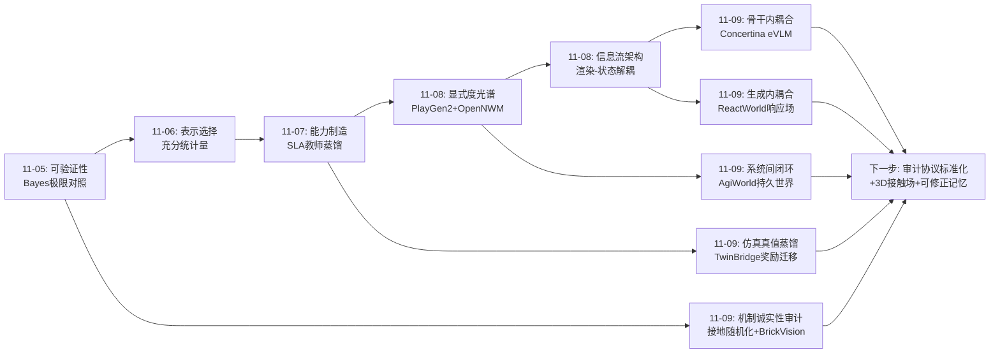
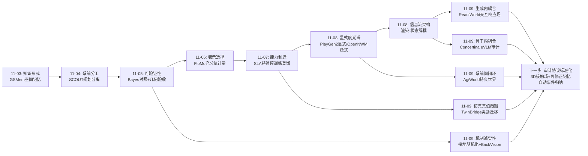
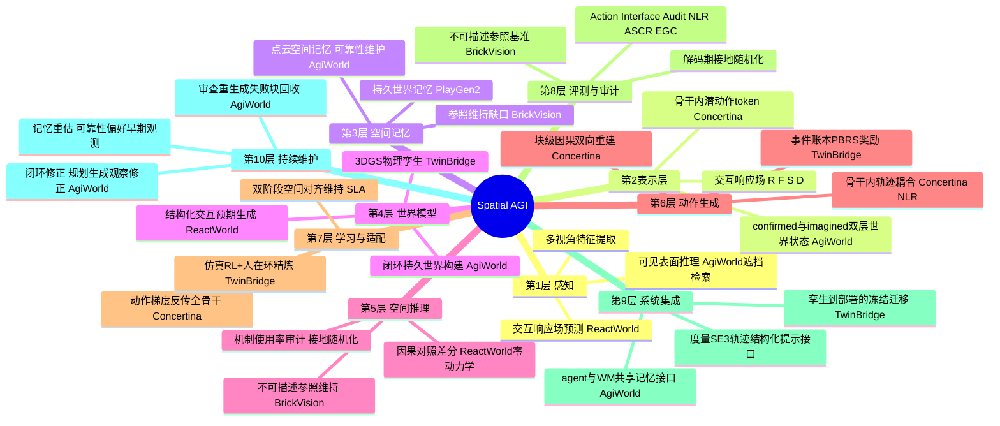
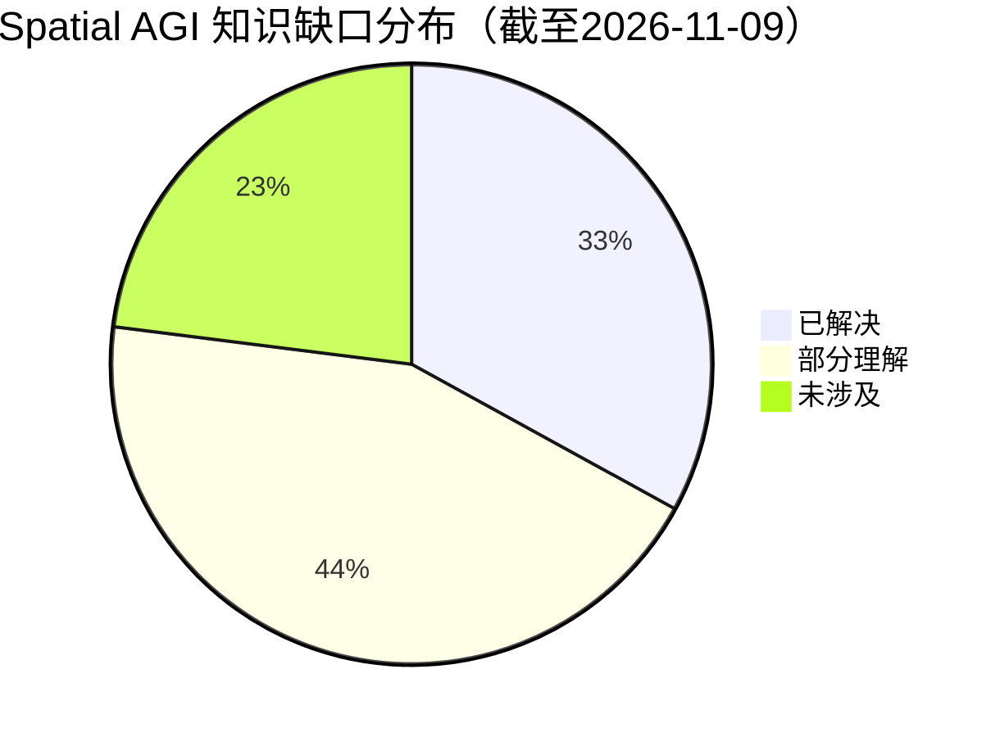
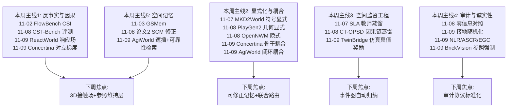
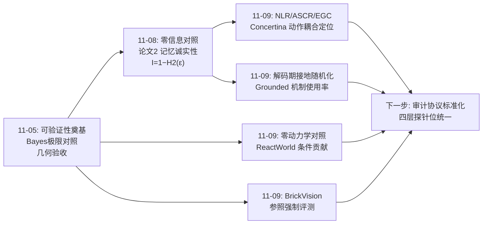

# Spatial AGI 每日思考 - 2026-11-09

## 📅 每日总结

**日期**: 2026-11-09
**论文数量**: 5篇（含一次去重替换：SLA 与 11-07 已分析论文重复，替换为 ReactWorld）
**主题**: 昨天的主题是"显式度光谱"——世界状态以什么显式度被表示。今天五篇论文回答的是它的**耦合与审计**问题：**智能的各组件（认知与动作、规划与生成、监督与奖励、坐标与参照）应该在哪里耦合、耦合是否真实发生、以及如何被测量**。ReactWorld 把交互因果显式化为结构化中间预测并反馈进同一去噪前向（生成内耦合）；AgiWorld 把 agent 语义规划与视频世界模型通过共享空间记忆闭环（系统间耦合）；Concertina 把动作具身进扩散 VLM 骨干并用 Action Interface Audit 证明耦合真实发生在骨干中后层（表征内耦合 + 可测量性）；TwinBridge 把物理仿真真值蒸馏为视觉奖励模型（监督跨域耦合）；Grounded Reasoning 论文则用解码期随机化发现"多数模型生成了空间坐标但根本不用"（**耦合的失败案例 + 审计方法**）。五篇合起来是一张"耦合真实性光谱"：真耦合（Concertina 的骨干内轨迹耦合、ReactWorld 的前向内反馈）→ 伪耦合风险（SLA 式外部对齐、坐标式接地若不被使用就是装饰）→ 完全解耦（传统 action expert 路线）。今天的元工具是**审计**：NLR/ASCR/EGC 审计动作耦合、零动力学对照审计条件贡献、解码期随机化审计接地使用、账本审计事件顺序——空间智能正在获得自己的"机制真实性检测科学"。

**关键突破**:
- 🚀 Concertina：eVLM 范式首个完整实例——H 步轨迹编码为 H 个骨干隐空间连续潜动作 token，复用预训练 corrupt-and-reconstruct 算子，动作接口仅 0.21% 参数；Action Interface Audit（EGC/NLR/ASCR）证明跨时间轨迹耦合真实发生在骨干中后层（NLR 4.06%）而非接口处，而 π0 系全部耦合在外部动作专家（ASCR 16.5-35.1%）；反事实干预显示共享隐空间附加第二坐标目标产生对立梯度（cos −0.891），CALVIN 链长 2.970→0.237
- 🚀 AgiWorld："持久性来自闭环而非生成模型本身"的范式级论断——AgiWorld-Agent 以 confirmed/imagined 双层世界状态规划、AgiWorld-WM 以点云空间记忆实现；遮挡感知历史选择（相机重叠≠表面可见）与可靠性记忆维护（偏好早期观测）是空间记忆检索的两个关键修正；自由指令下分钟级持久世界，重访/探索基准 SOTA
- 🚀 ReactWorld：结构化交互预期引导具身视频生成——交互响应场 (R,F,S,D) 显式预测参与者角色/响应强度/区间动力学；零动力学对照差分提取局部动力学的因果贡献作为物体特征增量；位移转换为固定窗口注意力偏置引导跨帧检索；RBench 九类全面超越 PhysisForcing，证明任务一致性与物理合理性可以同时提升
- 🚀 TwinBridge：数字孪生的双通道迁移——不只迁移策略，还迁移"任务进度监督"；3DGS+物理仿真中仿真器状态在物理先决条件下自动标注事件与几何进度，经执行历史账本+PBRS 构造稠密奖励，视觉奖励模型冻结部署；五真实实验室任务 98% 成功率、每任务≤25 分钟真实交互——"孪生里进度免费"是空间监督的第三来源
- 🚀 Grounded Reasoning 论文：解码期接地随机化（坐标生成即随机化+KV-cache 重置）发现多数开源模型"写而不读"自己的坐标；匹配数据文本基线消融证明接地仅在计数任务有益；不可描述参照假说统一解释文献矛盾（标签干预验证）；BrickVision 基准上前沿模型普遍 <30%（GPT-6 Astra 68.7% 独秀）——视觉参照维持是当前 VLM 的普遍短板

**架构演进**: 显式度分层的分工架构 → **耦合真实性分层的分工架构**（显式度光谱结论保持，今天补上组件关系端结论：空间智能系统的组件耦合是可设计、可审计、可证伪的——认知-动作在骨干内耦合（Concertina）、规划-生成经空间记忆闭环耦合（AgiWorld）、预测-生成在前向内耦合（ReactWorld）、仿真-视觉跨域耦合（TwinBridge）；而每一条耦合都必须配一个审计工具证明它是真耦合而非装饰）

### 📊 一句话总结

2026-11-09 的五篇论文确立了空间智能的第四条设计公理：**组件耦合是架构自由度，但耦合必须被审计——空间认知可以与动作在骨干内统一（Concertina 的 0.21% 接口）、世界持久性来自规划-生成的闭环而非模型先验（AgiWorld）、交互因果可以作为生成的结构化中间步骤（ReactWorld）、仿真空间真值可以跨域蒸馏为部署期奖励（TwinBridge）；而 Grounded Reasoning 的"写而不读"现象警告：任何未被审计的空间机制都可能是装饰品。**

### 🔗 延续性

**昨日→今日**: 昨日核心结论是"世界状态显式度是架构自由度"，留下六条线索：显式度任务级路由、感知-显式状态前端、潜在动作自运动归因、干预性预测、反事实评测真实化、显式状态终身维护。今天五篇落在这些线索的"组件关系端"：①昨日的干预性预测线索被 ReactWorld 部分接住——交互响应场就是"任务条件化的干预预期"，虽然还在 2D 观测域，但结构化中间预测+生成反馈的机制正是干预性生成的雏形；②昨日的"显式状态终身维护"线索被 AgiWorld 的可靠性记忆维护部分接住——优先早期观测抑制几何漂移是记忆维护的第一条具体策略；③昨日 PlayGen2 的"渲染-状态解耦"在 ReactWorld 中出现镜像——ReactWorld 把预测与生成放进同一前向（耦合），PlayGen2 把渲染与状态切开（解耦），两者共同说明**信息流架构本身是性能变量**，耦合与解耦都是设计选择；④昨日 SLA 的"教师蒸馏"在 TwinBridge 中扩展到奖励域——蒸馏对象从空间特征变成任务进度，蒸馏源从 3D 感知模型变成物理仿真器，"教师蒸馏制造空间能力"的工艺表又添一列；⑤昨日的反事实元能力在 Concertina 中获得新证据——附加第二坐标目标导致性能崩塌的反事实干预，是"表征-监督必须整体设计"的因果证据；⑥Grounded Reasoning 论文回应了本周反复出现的评测反思线（CST-Bench 的语言捷径、FlowBench 的防捷径设计）——它的解码期随机化是继零信息对照之后第二个"机制诚实性测试"。

**今日→明日**: 七条新线索：①耦合审计的标准化——NLR/ASCR/EGC/接地随机化能否统一为具身模型的标准评测协议（类比 NLP 的 probing 分类学）；②结构化中间预测的 3D 升级——ReactWorld 的响应场从 2D 图像空间升级到 3D 接触/力场；③AgiWorld 记忆的可优化化——点云记忆换成 3DGS 式可优化表示，新观测可以修正旧几何；④账本的自动归纳——TwinBridge 的有序事件集手工设计，从演示/LLM 规划中自动归纳事件图是规模化关键；⑤不可描述参照的空间记忆接口——AgiWorld 式记忆条目若全部文本化就不在帮空间推理，需要保留视觉/几何特征的参照存储；⑥耦合 vs 解耦的显式度交互——什么任务特征决定"生成内耦合"（ReactWorld）还是"渲染-状态解耦"（PlayGen2）；⑦教师链的第三环——TwinBridge 的仿真器教师自身依赖物理引擎保真度，物理引擎参数误差如何传导进视觉奖励。明日检索方向："mechanistic audit embodied model"、"probing action representation VLA"、"3D contact field video generation"、"optimizable spatial memory gaussian"、"event graph induction demonstration"、"visual working memory VLM"。

### 💡 本质思考：如何达成通用空间智能

#### 1. 核心能力的本质是什么？

本周主题的第六次收敛。11-04"分工架构"、11-05"可验证"、11-06"表示选择"、11-07"可制造"、11-08"显式度光谱"，今天加入耦合与审计维度：

**空间智能的本质是可验证、以最优表示流动、可分层制造、显式度按域最优、且组件耦合真实可审计的分工架构——每个组件边界（认知-动作、规划-生成、仿真-视觉、坐标-参照）都是设计自由度，但每个耦合声明都需要配套的审计工具证明信号真实流过，因为空间智能的历史教训是：机制的存在不等于机制被使用（写而不读的坐标、不被依赖的教师、被 Knowledge Insulation 阻断的梯度）。**

今天的证据链：

- **认知与动作可以真正统一且统一可测量**（Concertina）：0.21% 接口 + 骨干中后层承载轨迹耦合（NLR 审计）证明 eVLM 不是口号；对立梯度反事实（cos −0.891）证明统一必须整体设计。动作梯度流过全骨干 = 操作经验沉淀为空间认知的物理通道。
- **持久性是主动维护的过程属性**（AgiWorld）：生成模型先验不产生持久性，闭环（规划→生成→观察→修正）才产生。confirmed/imagined 双层世界状态 + 遮挡感知检索 + 可靠性维护 = 空间一致性的维护机制学。
- **交互因果可以成为生成的中间步骤**（ReactWorld）：思维链思想在连续扩散生成中的实例化——显式预测（谁/哪里/何时/如何）作为条件引导生成，零动力学对照差分是特征空间的受控实验。
- **仿真空间真值是免费的高质量监督**（TwinBridge）：把任务进度定义为空间构型的函数（事件账本+PBRS），物理真值蒸馏进冻结视觉模型——98% 成功率+25 分钟交互的数据效率是监督质量的直接证明。
- **未被审计的机制可能是装饰**（Grounded Reasoning）：坐标写而不读、接地使用与空间推理性能不相关、BrickVision 揭示的参照维持普遍短板——空间智能研究需要把"机制使用率审计"作为标准流程。

#### 2. 当前方法与理想目标的差距在哪里？

- **审计工具未标准化**：NLR/ASCR/EGC（Concertina）、解码期随机化（Grounded Reasoning）、零动力学对照（ReactWorld）、零信息对照（昨日论文2）各自独立出现，没有统一协议。Spatial AGI 需要 probing 分类学式的标准审计套件，否则"空间能力提升"的声明无法互比。
- **耦合的 3D 缺口**：ReactWorld 的交互响应场是 2D 图像空间的位移场，接触动力学本质是 3D 的（力沿接触法线传递）——"看起来对、物理上错"的风险在 2D 表示下无法排除。
- **AgiWorld 记忆的不可修正性**：点云记忆建立在单目深度估计上，误差只被"偏好早期观测"缓解而未被修正；真正的持久性需要可优化表示（3DGS 式，新观测能改写旧几何）。
- **账本的事件结构靠手工**：TwinBridge 的有序事件集与物理先决条件是人工定义的——五个实验室任务可以手工，一百个不行；任务结构的自动归纳是奖励监督规模化的瓶颈。
- **接地机制的适用边界不明**：坐标式接地被证明多数情况无用，但 crop/zoom 工具、特征回放、3D token 注入等其他机制的使用条件未被本研究覆盖——机制选择的决策树还画不出来。
- **前沿模型在参照维持上的深坑**：BrickVision 上 GPT-5.6 Sol 18.9%、Gemini 3.8 Flash 15.5%——即使最强的空间机制（接地）也救不了参照维持能力本身，这是与机制审计正交的基础能力缺口。

#### 3. 从今天到理想状态，最可能的路径是什么？

五步走判断（昨日版本的更新）：

**第一步（进行中）：组件耦合的三点验证完成**。骨干内动作耦合（Concertina，LIBERO 98.15%）、生成内因果耦合（ReactWorld，RBench +5.57）、系统间闭环耦合（AgiWorld，持久世界 SOTA）各自证明可行。标志事件：Action Interface Audit 作为首个动作耦合审计工具发布。

**第二步（2027 上半年）：审计协议标准化**。NLR/ASCR/EGC + 接地随机化 + 零信息对照 + 零动力学对照统一为"具身空间模型审计套件"；新模型发布标配审计报告（类比模型卡的 mechanism card）；"写而不读"成为标准检查项。同时 ReactWorld 式响应场升级为 3D 接触场（深度估计+接触法线预测进生成回路）。

**第三步（2027 下半年）：可修正空间记忆 + 自动事件归纳**。AgiWorld 的点云记忆替换为 3DGS 可优化表示（新观测改写旧几何，接住昨日"终身维护"线索）；TwinBridge 的事件图从演示或 LLM 规划中自动归纳，事件账本机制推广到开放任务集。

**第四步（2028+）：耦合-显式度联合路由**。"这个域的组件该怎么耦合、状态该多显式"成为联合可学习决策——接住昨日显式度路由线索，扩展为（显式度 × 耦合结构）二维架构搜索空间；PlayGen2 的渲染-状态解耦与 ReactWorld 的前向内耦合成为搜索空间的两个端点。

**第五步（2028+）：参照维持作为独立能力层制造**。BrickVision 式任务作为验收标准，视觉工作记忆（特征级参照存储+读回）作为独立层制造——与 11-07 的"能力制造工艺学"合流：空间智能的能力清单里正式加入"不可描述参照的维持与使用"。

---

## 🔗 与昨日思考的联系

### 昨日重点

昨天的主题是**显式度光谱**：PlayGen2（几何显式）、WorldFlow（半显式）、OpenNWM（全隐式）、论文2（记忆有效性判据）、CST-Bench（反事实评测+蒸馏）构成一张显式度光谱，确立"状态显式度是架构自由度、反事实是贯穿光谱的元能力"。留下六条线索：显式度任务级路由、感知-显式状态前端、潜在动作自运动归因、干预性预测、反事实评测真实化、显式状态终身维护。

### 今日进展

今天五篇论文把视角从"状态以什么显式度表示"移到"组件以什么方式耦合、耦合是否真实"，并接住昨日多条线索：

1. **接住线索④"干预性预测"（ReactWorld）**：昨天指出 WorldFlow 是观察性预测，Spatial AGI 需要干预性预测；今天 ReactWorld 的交互响应场正是"任务条件化的预期响应"——虽然仍在观测域（无动作条件输入），但"先显式预测交互将如何展开、再反馈引导生成"的机制就是干预性生成的结构雏形。把响应场的条件从任务指令换成机器人动作指令，就是三模态干预预测的第一步。
2. **接住线索⑥"显式状态终身维护"（AgiWorld）**：昨天指出 PlayGen2 的世界记忆只增不减、无重估机制；今天 AgiWorld 的可靠性记忆维护给出第一条具体策略——同一表面优先早期观测（误差累积单调性）、遮挡感知检索（只重用真正可见的表面）。虽然是启发式而非论文2 式的统计修正原则，但这是"记忆维护"从原则到机制的第一次落地。
3. **昨日"信息流架构是性能变量"的三角互证（ReactWorld × PlayGen2 × Concertina）**：PlayGen2 切断渲染-状态反馈回路（解耦），ReactWorld 把预测-生成放进同一去噪前向（耦合），Concertina 把动作-认知放进同一骨干（耦合）并把动作专家隔离作为反面教材（解耦的代价）。三条证据共同确立：**组件间的信息流拓扑是一等架构设计变量，与参数量、数据量同级**。
4. **昨日教师蒸馏工艺表的扩展（TwinBridge）**：SLA 蒸馏 3D 感知教师的空间特征，CST-Bench 的 CT-OPSD 蒸馏教师的因果推理链，今天 TwinBridge 蒸馏物理仿真器的任务进度——蒸馏源从感知模型扩展到仿真引擎，蒸馏对象从表征扩展到奖励。教师蒸馏作为"空间能力制造工艺"的通用性进一步确认，同时教师依赖链又添一环（物理引擎保真度）。
5. **评测反思线的机制级深化（Grounded Reasoning）**：CST-Bench 发现语言捷径污染空间基准，FlowBench 用不变题防捷径，今天 Grounded Reasoning 用解码期随机化直接审计机制使用——评测反思从"数据级防捷径"深化到"机制级诚实性审计"。零信息对照（昨日）与接地随机化（今日）构成"机制诚实性测试"的两件套：前者测记忆是否用了真实结构，后者测机制是否被真实读回。

### 演进路径



核心轨迹：**知识形式（11-03）→ 系统分工（11-04）→ 可验证性（11-05）→ 表示选择（11-06）→ 能力制造（11-07）→ 显式度光谱（11-08）→ 耦合与审计（11-09）**——空间智能的工程学在组件关系维度完成了从"分工"到"耦合真实性"的深化，审计作为元工具开始成形。

---

## 📚 论文概览

**论文1: ReactWorld（2611.06120, Huawei/同济/浙大）**
结构化交互预期引导的具身视频生成。交互响应场预测器在骨干特征空间预测 Y=(R,F,S,D)：参与者角色图（机器人/直接目标/受影响物体/背景）、未来运动响应强度（首帧坐标系逐位置连续值）、区间动力学（特定时间区间的局部位移）；响应反馈适配器用零动力学对照差分（预测动力学输入 vs 置零输入的输出差）作为物体特征增量、把位移转换为 7×7 固定窗口内时间注意力的位置偏置（softmax 前）；门控+裁剪+有界残差保证稳定；预测与反馈在同一去噪前向内闭环，推理只需指令+初始图像。RBench 77.51（PhysisForcing +3.29、九类全胜；同数据 Video-FT +5.57），EZS-Bench Domain 86.98/平均 81.87。局限：2D 动力学（深度歧义）、固定窗口短时程、监督依赖训练视频质量。

**论文2: AgiWorld（2611.02341, UT Austin/Adobe）**
Agentic 视频世界模型构建持久世界。AgiWorld-Agent（多模态 LM）维护 confirmed/imagined 双层世界状态，导演 D 输出度量 SE(3) 相机轨迹+结构化提示，状态更新 U 读空间记忆核对/修正/延伸设计，审查失败 chunk 重生成；AgiWorld-WM 相机条件自回归生成（相机适配器+PRoPE），点云空间记忆 M_k={(v_j,c_j,D_j)}，遮挡感知历史选择（按新相机可见表面检索）+可靠性记忆维护（偏好可靠几何与早期观测）。单图+自由指令→分钟级持久世界，重访/探索基准 SOTA。核心论断：持久性来自闭环而非生成模型。局限：深度估计误差根源未解、依赖 agent 规划质量、计算贵、无物理交互。

**论文3: Concertina（2611.07513, USyd/TokenRhythm/CityU HK）**
eVLM 范式：操作与认知具身于单一扩散 VLM。每个控制时间步编码为骨干隐空间一个连续潜动作 token（H 步轨迹=H token），轻量位置式编码/解码（0.21% 参数）；块级因果-双向 visibility，打包 teacher forcing 一次前向监督所有块条件分布；复用 BARD-VL 预训练的 corrupt-and-reconstruct 算子，无外部动作专家/tokenizer/codec。Action Interface Audit：EGC（误差-几何一致性）、NLR（非局域响应率，定位跨时间耦合）、ASCR（动作专属容量比）。审计结果：离散 token 单错误→25.14× 物理误差、FAST 解码失败 77.9-82.2%；π0/π0.5/SmolVLA/X-VLA 耦合全在专家（ASCR 16.5-35.1%）；Concertina 接口 NLR=0、骨干中后层 NLR 4.06%/4.10%/1.22%。对立梯度反事实：共享隐空间附加第二坐标目标 cos −0.891、CALVIN 链长 2.970→0.237。LIBERO 98.15%、LIBERO-Plus 85.9%、CALVIN ABC→D 4.142。局限：绑定 BARD-VL 骨干、单 token 容量上限、仿真评测。

**论文4: TwinBridge（2611.06442, USTC 苏州高研院）**
数字孪生驱动的策略+奖励双通道迁移。3DGS+物理仿真构建孪生（刚体位姿同步更新高斯）；仿真器状态在物理先决条件与顺序约束下自动标注有序事件与几何进度；执行历史账本（一次性事件信用+最高有效进度记录）+PBRS 构造稠密奖励；仿真标注+少量真实标注训练因果视觉奖励模型，冻结部署；真实交互时预测更新视觉账本、同一 PBRS 读出在线奖励，人在环精炼。五真实实验室任务（离心管抓取/培养皿开盖/离心管装载/枪头安装/移液）98% 平均成功率、每任务≤25 分钟。消融：稠密奖励>稀疏、仿真初始化叠加有效。局限：孪生构建成本、事件手工设计、账本无纠错回滚、刚体假设。

**论文5: Where and Why is Grounded Reasoning Useful?（2611.08485, Elorian）**
接地推理的分析研究+新基准。Decode-time Grounding Randomization：坐标生成即随机化+KV-cache 重置，测接地使用率——多数开源模型"写而不读"；匹配数据高质量 CoT 文本基线消融：接地使用依赖 SFT 坐标质量但与空间推理性能不相关，仅计数任务显著有益；不可描述参照假说：接地价值在于维护语言难以描述的视觉参照，tracing/counting/tracking 合成任务+标签干预验证（加标签后接地优势消退）；BrickVision：无标签物体+不规则摆放+点坐标答案，强制不可描述参照，GPT-5.6 Sol 18.9%、Gemini 3.8 Flash 15.5%、GPT-6 Astra 68.7%。局限：仅坐标式接地、2D 任务、合成验证为主。

---

## 💡 核心见解

### 见解1: 动作智能的位置是可测量的，且主流 VLA 的动作智能不在骨干里
[从 Concertina 获得]
- ✅ NLR 审计显示 π0/π0.5/SmolVLA/X-VLA 的跨时间轨迹耦合全部位于外部动作专家（ASCR 16.51-35.10%），骨干本身不承载轨迹推理
- ✅ Concertina 用 0.21% 接口 + 骨干中后层耦合（NLR 4.06-4.10%）实现真 eVLM，性能反而 SOTA（LIBERO 98.15%）
- ✅ 反事实干预证明：给共享隐空间附加第二坐标目标引发对立梯度（cos −0.891），统一表征的多目标必须整体协同设计

**对Spatial AGI的启发**：
"认知与动作统一"从哲学主张变成了可测量的工程命题。任何声称"基础模型具有空间/动作能力"的工作都应该能回答"这个能力住在哪几层、哪些参数"——回答不了的声明应视为未验证。审计指标（NLR/ASCR）应该成为具身基础模型的标准报告项。

### 见解2: 持久性是过程属性不是表示属性
[从 AgiWorld 获得]
- ✅ 生成模型先验不产生世界一致性——视觉持久性来自空间记忆+遮挡感知检索，语义持久性来自 agent 世界状态的闭环修正
- ✅ 遮挡感知历史选择抓住了点云/多视图记忆系统的共同盲点：相机重叠的旧视图可能只含从新视角被遮挡的表面
- ✅ confirmed/imagined 双层世界状态是"观测世界 vs 想象世界"差距的正确抽象，审查-重生成机制提供纠错

**对Spatial AGI的启发**：
空间一致不是"选个好表示"就能一劳永逸的静态属性，而是"规划→生成→观察→修正"的持续维护过程。任何长时程空间系统（世界模型、SLAM、数字孪生）的设计检查单第一条应该是：闭环修正机制在哪里？

### 见解3: 交互因果可以成为生成的显式中间步骤
[从 ReactWorld 获得]
- ✅ 交互响应场 (R,F,S,D) 把"谁参与、哪里响应、多强、何时、向哪动"作为结构化中间预测插入去噪前向——思维链思想在连续扩散生成中的实例化
- ✅ 零动力学对照差分是特征空间的受控实验：差值干净地提取局部动力学条件的因果贡献，不被场景内容污染
- ✅ RBench 九类全面领先证明：任务一致性与物理合理性不是权衡，结构化中间预测同时提升两者

**对Spatial AGI的启发**：
结构化推理与生成模型不互斥。Spatial AGI 的生成系统（世界模型、场景生成）应该在生成管线中显式建模因果动力学——而且"何时不该动"（不变关系，昨日 CST-Bench）与"该动"（响应场，今日 ReactWorld）是同一枚硬币的两面。

### 见解4: 仿真空间真值是免费的密集监督，且可以以奖励的形式迁移
[从 TwinBridge 获得]
- ✅ 仿真器状态在物理先决条件下自动标注事件与几何进度——"任务进度是空间构型的函数"绕开了视觉奖励学习的启发式泥潭
- ✅ 执行历史账本（一次性信用+有效进度记录）+PBRS 实现稠密奖励且不改变最优策略——理论安全与实践高效兼得
- ✅ 冻结视觉奖励模型部署：训练期用孪生真值，部署期零仿真依赖，98% 成功率+25 分钟/任务验证监督质量

**对Spatial AGI的启发**：
空间监督的第三条来源（感知教师、动作梯度之外）正式确立：物理仿真真值。更重要的推广是"奖励=空间进度函数"的设计模式——任何多阶段空间任务的奖励都应该定义为空间构型的函数，而非像素相似度或 VLM 偏好。

### 见解5: 机制的存在不等于机制被使用
[从 Grounded Reasoning 论文获得]
- ✅ 多数开源接地模型在解码期坐标随机化后性能不变——模型生成了空间坐标但从后续推理中"读回"的信息为零
- ✅ 接地使用率与空间推理性能总体不相关；匹配文本基线下接地仅在计数任务有益
- ✅ iVGR 的"接地有害"结论其实是"接地是装饰"——未被依赖的机制既不会帮忙也不会因错误而伤害

**对Spatial AGI的启发**：
这是对全部空间机制研究的元警告：3D token、深度图输入、空间记忆、教师蒸馏——每个机制都应该配一个"随机化/置零对照"实验证明信号真实流过。Zero-shot 能力声明、消融表都不够——需要机制使用率审计。"写而不读"应该成为空间智能论文审稿的标准质疑。

### 见解6: 参照可描述性是空间评测的第一设计变量
[从 Grounded Reasoning 论文获得]
- ✅ 标签干预实验：任务物体一旦可文本标识，接地（和隐含的空间推理需求）优势显著消退——大量现有"空间基准"可被纯文本解法通过
- ✅ BrickVision 的无标签+点答案设计强制参照维持，前沿模型普遍 <30%——真实缺口在"视觉特征级参照的维持与读回"
- ✅ 不可描述参照假说统一了文献矛盾：接地研究结论混乱的根源是各基准的参照可描述性不同

**对Spatial AGI的启发**：
空间智能评测的黄金标准问题："这个任务能否被纯文本解法通过？"——能则测的不是空间。BrickVision 原则应推广到所有空间基准设计；同时它为空间记忆系统指明接口要求：记忆条目若全部文本化，记忆就不在服务空间推理。

### 见解7: 空间记忆检索必须感知可见性与可靠性
[从 AgiWorld 获得]
- ✅ 相机重叠检索的失败模式：旧视图与新相机重叠但表面被遮挡——按"新相机可见表面"检索才是正确的重用条件
- ✅ 可靠性维护的简单有效策略：同一表面优先早期观测（早期误差累积少），抑制长 rollout 几何漂移
- ✅ 世界重访一致性因此成为视频世界模型的 SOTA

**对Spatial AGI的启发**：
空间记忆系统的检索从"相似度匹配"升级为"可见性+可靠性感知检索"是必经之路。这与昨日 PlayGen2 的可用性掩码（未知≠空）互补：一个管"哪里没看过"，一个管"看过的是否还可信"。合并起来是空间记忆的完整元数据模型。

### 见解8（加分）: 耦合与解耦都是设计选择，信息流拓扑是一等架构变量
[从 ReactWorld × PlayGen2 × Concertina 三角获得]
- ✅ ReactWorld 在生成前向内耦合预测与反馈；PlayGen2 切断渲染与状态；Concertina 统一动作与认知、并把动作专家隔离作为反面教材
- ✅ 三者的共同点：没有把信息流拓扑当作默认继承，而是作为显式设计决策并给出消融证据
- ✅ Knowledge Insulation（阻断专家梯度）证明错误的解耦会永久固化感知与控制的分离

**对Spatial AGI的启发**：
架构设计的第一问不是"多大模型、多少数据"，而是"信号应该流过哪里、在哪里停"。信息流拓扑决定误差传播路径、能力沉淀通道和审计点位置——这是空间智能系统设计学的新维度。

---

## 🗺️ 知识演进图



核心轨迹：**知识形式 → 系统分工 → 可验证性 → 表示选择 → 能力制造 → 显式度光谱 → 耦合与审计**——公理序列第七环：组件耦合是架构自由度，但每个耦合声明必须配审计工具证明信号真实流过。

---

## 技术栈演进对比表

| 层次 | 昨日方案（11-08） | 今日方案（11-09） | 变化 |
|------|-----------------|-----------------|------|
| 状态表示 | 显式度光谱（体素/位移token/隐式流） | 状态表示不变，新增交互响应场 (R,F,S,D) 作为生成条件 | 表示光谱 + 因果结构化中间预测 |
| 世界模型 | PlayGen2 渲染-状态解耦、OpenNWM 潜在动作 | ReactWorld 前向内预测-反馈耦合、AgiWorld agent-WM 闭环 | 信息流拓扑成为显式设计变量 |
| 空间记忆 | PlayGen2 持久世界记忆（只增不减）、论文2 SCM 统计修正 | AgiWorld 遮挡感知检索+可靠性维护（偏好早期观测） | 记忆维护从原则到第一条机制 |
| 动作生成 | NEO-VLA encoder-free、SLA 空间对齐 | Concertina 骨干内连续潜动作（0.21% 接口）+ 耦合审计 | 动作智能的住所从假设变为测量 |
| 监督来源 | 教师蒸馏（3D 感知教师、因果推理链教师） | TwinBridge 物理仿真器真值蒸馏为奖励 | 监督第三来源：仿真空间真值 |
| 奖励设计 | CST-Bench 因果标注作监督 | 事件账本+PBRS 稠密奖励（物理先决条件+顺序约束） | 奖励=空间进度函数模式确立 |
| 评测方法 | 零信息对照、防捷径不变题、反事实标注 | 解码期接地随机化、NLR/ASCR/EGC 审计、BrickVision 参照强制 | 机制诚实性审计工具箱成形 |
| 空间接地 | SLA 感知侧教师对齐 | Concertina 动作侧梯度反传（互补路径确认） | 接地双路径：感知注入+动作沉淀 |

---

## 🗺️ Spatial AGI 知识图谱

### 10层架构思维导图



### 🎯 主线技术路径

#### 阶段1: 组件耦合的端点验证（进行中，2026）
骨干内动作耦合（Concertina：0.21% 接口、NLR 审计、LIBERO 98.15%）、生成内因果耦合（ReactWorld：RBench 全面领先）、系统间闭环耦合（AgiWorld：持久世界 SOTA）三点验证完成。耦合的可行性与收益在三个不同层面确立。标志：首个动作耦合审计工具（Action Interface Audit）发布。

#### 阶段2: 审计协议标准化（2027 上半年）
NLR/ASCR/EGC + 接地随机化 + 零信息对照 + 零动力学对照统一为具身空间模型审计套件；"mechanism card"成为模型发布标配；"写而不读"成为标准检查项。同时 ReactWorld 式响应场升级为 3D 接触场，2D 深度歧义风险被排除。

#### 阶段3: 可修正记忆与自动事件归纳（2027 下半年）
AgiWorld 点云记忆升级为 3DGS 可优化表示（新观测改写旧几何，接住终身维护线索）；TwinBridge 事件图从演示/LLM 规划自动归纳，奖励监督规模化瓶颈解除；不可描述参照的视觉工作记忆作为独立能力层开始制造。

#### 阶段4: 耦合-显式度联合路由（2028+）
（显式度 × 耦合结构）二维架构搜索空间：渲染-状态解耦（PlayGen2）与前向内耦合（ReactWorld）成为端点；任务特征（交互密度/一致性要求/数据规模）→ 联合架构选择的元模型；接住 11-07 工艺自动化与 11-08 显式度路由线索。

#### 阶段5: 参照维持能力层（2028+）
BrickVision 式任务作为验收标准，视觉工作记忆（特征级参照存储+读回+干预审计）作为空间智能能力清单的正式一员被分层制造——空间智能从"感知-推理-动作"三层走向"感知-参照-推理-动作"四层。

---

## 🔍 待探索议题

### 高优先级（本周）

1. **耦合审计协议的统一设计**
   - 问题: NLR/ASCR/EGC（动作）、接地随机化（感知机制）、零信息对照（记忆）、零动力学对照（条件贡献）各自独立，能否统一为标准审计套件
   - 候选方案: 定义"机制使用率"的通用测量框架（干预-对照-恢复三段式），在 2-3 个开源 VLA 上试跑全套审计
   - 缺口: 各审计工具的统计性质（功效/假阳性率）未刻画

2. **ReactWorld 响应场的 3D 升级**
   - 问题: 2D 位移场的深度歧义可能学出"看起来对、物理上错"的接触响应
   - 候选方案: 响应场增加深度通道与接触法线预测，与 WorldFlow 式位移 token 联合去噪
   - 缺口: 3D 接触真值的训练数据来源（仿真可造，真实稀缺）

3. **AgiWorld 记忆的可优化化**
   - 问题: 点云记忆的深度误差只被缓解未被修正，长程必然漂移
   - 候选方案: 点云替换为 3DGS 表示，新观测作为监督信号在线优化旧几何（接住"终身维护"线索）
   - 缺口: 在线优化的算力调度与生成延迟的平衡

### 中优先级（本月）

4. **TwinBridge 事件图的自动归纳**
   - 问题: 有序事件集与物理先决条件手工设计，任务规模化受限
   - 候选方案: 从成功演示中归纳事件转移图（类似 reward machine induction），或用 LLM 从任务描述生成事件图+孪生验证
   - 缺口: 归纳错误的检测与账本纠错回滚机制

5. **"写而不读"在空间记忆中的对照检查**
   - 问题: 空间记忆系统（RAG 式场景检索、记忆增强 VLA）是否真实使用了检索到的空间信息
   - 候选方案: 把接地随机化推广为"记忆随机化"——检索后注入随机记忆条目测性能变化
   - 缺口: 记忆条目的可控扰动方法（不能破坏分布）

6. **不可描述参照的视觉工作记忆层**
   - 问题: VLM 参照维持是普遍短板（BrickVision <30%），接地机制救不了
   - 候选方案: 特征级参照存储（类似指针网络/registers）+读回注意力，以 BrickVision 为验收训练
   - 缺口: 参照存储的写入策略（什么值得记）与生命周期管理

7. **耦合与解耦的任务级路由**
   - 问题: 何时用前向内耦合（ReactWorld）、何时渲染-状态解耦（PlayGen2）、何时骨干统一（Concertina）
   - 候选方案: 以交互密度/一致性要求/实时性为特征训练架构选择元模型
   - 缺口: 同一任务域内的架构对照实验（目前三者分布在不同域）

### 低优先级（本季度）

8. **教师链第三环的误差传导**
   - 问题: TwinBridge 的仿真器教师依赖物理引擎保真度，引擎参数误差如何传导进视觉奖励
   - 候选方案: 引擎参数随机化（域随机化的奖励版）测奖励模型鲁棒性
   - 缺口: 物理参数可辨识性与奖励质量的定量关系

9. **坐标式接地之外的空间机制谱系审计**
   - 问题: 本研究仅覆盖坐标式接地；crop/zoom 工具、特征回放、3D token 注入的使用条件未知
   - 候选方案: 为每种机制设计对应的随机化/置零协议，绘制"机制×任务类型"收益矩阵
   - 缺口: 机制间组合效应的实验设计（正交分解困难）

10. **审计工具对 Spatial AGI 训练的反馈回路**
    - 问题: 审计目前只做评测，能否用 NLR/接地使用率作为训练正则（鼓励耦合落在期望层）
    - 候选方案: 把 NLR 目标（如"接口层 NLR=0"）作为辅助损失项
    - 缺口: 正则强度与任务性能的权衡曲线

---

## 📊 知识缺口分析



**已解决（33%）**:
- ✅ 动作智能的住所可测量（Concertina NLR/ASCR 审计 + eVLM 实例）
- ✅ 持久性来自闭环（AgiWorld 重访/探索 SOTA + 三大记忆机制）
- ✅ 交互因果可作生成中间步骤（ReactWorld 响应场 + RBench 全面验证）
- ✅ 仿真真值→视觉奖励的迁移管线（TwinBridge 98%/25min）
- ✅ 接地机制的使用率审计方法（解码期随机化 + 匹配基线消融）
- ✅ 参照可描述性对评测的系统性影响（标签干预 + BrickVision）
- ✅ 昨日全部保留项（显式状态可学习、记忆判据、无动作导航规模化、视频几何互惠、反事实评测基础设施、渲染-状态解耦）

**部分理解（44%）**:
- ⚠️ 审计工具标准化：工具箱已现（今日 4 件）但统一协议与统计性质未刻画
- ⚠️ 3D 交互因果：响应场机制成熟但仍在 2D，接触法线/力场未建模
- ⚠️ 记忆终身维护：可靠性维护有第一机制（AgiWorld）但不可修正（点云固定）、论文2 修正原则未上几何
- ⚠️ 事件结构自动化：账本机制有效（TwinBridge）但事件图手工
- ⚧ 感知-显式状态前端（保留）：路线明确、误差复合未量化
- ⚠️ 潜在动作自运动归因（保留）：残差法思路已提出未验证
- ⚠️ 干预性三模态预测（保留）：ReactWorld 提供结构雏形，动作条件未接入
- ⚠️ 显式度路由（保留）：二维化（×耦合结构）后仍缺决策框架
- ⚠️ 反事实评测真实化（保留）：连续物理域闭环未实现
- ⚠️ 教师蒸馏上限（保留）：TwinBridge 又添物理引擎一环

**未涉及（23%）**:
- ❌ 视觉工作记忆层（特征级参照存储+读回）
- ❌ 真实干预反事实基准（连续物理域，保留）
- ❌ 多智能体显式状态合并协议（保留）
- ❌ 耦合-显式度联合路由元模型
- ❌ 机制组合的正交审计（多机制叠加时的使用率分解）
- ❌ 审计信号作为训练正则的反馈回路
- ❌ 长时程（月级）真实部署的空间记忆稳定性（保留）

---

## 📌 明日检索方向

- "probing action representation VLA"（动作表征探针标准化）
- "3D contact field video generation"（接触场的 3D 升级）
- "optimizable spatial memory gaussian splatting online"（可修正空间记忆）
- "event graph induction from demonstrations reward machine"（事件图自动归纳）
- "visual working memory pointer registers VLM"（参照维持能力层）
- "memory randomization ablation retrieval"（记忆使用率审计）
- "architecture routing coupling explicitness"（联合架构路由）

---

**文档创建时间**: 2026-11-09
**论文基础**: ReactWorld / AgiWorld / Concertina / TwinBridge / Grounded Reasoning
**与昨日关联**: 接住干预性预测、显式状态终身维护两条线索；信息流架构三角互证；教师蒸馏工艺表扩展；评测反思线机制级深化

---

## 🔬 论文深度延伸分析

### 延伸1: Action Interface Audit 与 NLP probing 传统的关系

Concertina 的三指标审计实质上是在具身域重建了 NLP 社区的 probing/interpretability 传统：

- **NLR ↔ 探针定位**：NLP 用线性探针逐层定位语言属性（句法在低层、语义在中层）；NLR 用确定性有限差分逐层定位轨迹耦合——"能力住在哪一层"的问题形式完全同构
- **ASCR ↔ 参数归因**：对应"多少参数专门服务该能力"的容量分析
- **EGC ↔ 校准分析**：训练误差与物理误差的对应关系，类似置信度校准（ECE）的误差几何版

这个对照说明审计方法论不是发明而是移植——好消息是 NLP 社区二十年的探针方法学（控制任务、最小对、信息论探针）都可以照搬；坏消息是具身域的"控制变量"更难（物理误差没有最小对）。下一个值得移植的工具是 causal tracing（激活修补）：定位"哪个激活对轨迹贡献最大"，比 NLR 的有限差分更细粒度。

### 延伸2: AgiWorld 的 confirmed/imagined 状态与预测加工理论

AgiWorld-Agent 的双层世界状态（confirmed=已在视频中实现，imagined=已设计未实现）与认知科学的预测加工（predictive processing）框架严格同构：

- **imagined 元素 ↔ 先验预测**：大脑持续生成对世界的预测（感知即受预测约束的受控幻觉）
- **生成 chunk 后的核对 ↔ 预测误差驱动更新**：video 与 imagined 不符时修正设计，正是预测误差最小化的自由能原理
- **审查重生成 ↔ 主动推断**：不合格 chunk 被移除重生成，等价于"行动使世界符合预测"的主动推断分支

这个同构暗示 agent 式世界构建的下一个能力台阶：**不确定性量化**——imagined 元素应携带置信度（哪些设计是高置信的结构必需、哪些是可牺牲的填充），修正时按置信度加权保留。AgiWorld 目前二元处理（确认/废弃），连续置信度版本是自然扩展。

### 延伸3: 零动力学对照差分与反事实特征归因家族

ReactWorld 的零动力学对照是"反事实特征归因"家族在生成模型特征空间的新成员：

- **TwinBridge 账本**：事件置零对照（未满足先决条件的移动不记信用）——决策级
- **ReactWorld 零动力学**：条件置零对照（预测动力学 vs 置零动力学的输出差）——特征级
- **Grounded Reasoning 随机化**：坐标随机对照（真实坐标 vs 随机坐标的性能差）——解码级
- **Concertina 对立梯度**：目标附加对照（加/不加第二坐标目标的梯度方向）——目标级

四个工具的共同语法：**建立一个"没有 X"的对照世界，测量 X 的因果贡献**。它们的层级覆盖（决策/特征/解码/目标）暗示可以拼成一个完整的因果审计栈——任何空间智能系统都可以在四个层级各放一个对照探针。这可能是"审计协议标准化"（明日线索①）的正确抽象层级：不是统一成一个工具，而是定义四个标准探针位。

### 延伸4: TwinBridge 账本与 reward machine 的理论关系

TwinBridge 的执行历史账本本质是 reward machine（RM）的物理真值实现：

- RM 用有限状态机表示事件依赖奖励；账本用先决条件+顺序约束+一次性信用实现同样的状态依赖结构
- 新意不在结构（RM 2004 年就有）而在**真值来源与迁移方式**：RM 的状态标签通常来自人工标注或学习器，TwinBridge 的标签来自物理仿真器状态（免费、精确），且经视觉蒸馏迁移到真实世界
- PBRS 的使用也讲究：账本势函数 + 势基塑形保证策略不变性，这是 RM 文献里少见的严谨处理

推广方向：TwinBridge 证明"RM 结构 + 仿真真值 + 视觉蒸馏"三件套可行后，reward machine induction（从演示自动归纳状态机）文献可以整体嫁接过来——这是明日议题4的理论弹药库。

### 延伸5: BrickVision 的点答案格式与空间评测的精度阶梯

BrickVision 用点坐标作答案（而非选择题）是一个值得推广的评测设计决策：

- **选择题**：四选一，随机基线 25%，部分正确不可见，语言捷径空间大（"选最小的那个"类启发式可得分）
- **点答案**：连续精度，随机基线≈0，每个错误都有位置可诊断（偏了 10px vs 偏了一个物体），语言捷径几乎无处安放（点不来自词表）
- **代价**：自动评分需要距离阈值设计（多近算对），阈值选择引入新的超参争议

与本周其他评测决策合并看：CST-Bench 的五元组（关系级精度）、FlowBench 的不变题（防捷径）、论文2 的零信息对照（机制诚实性）、BrickVision 的点答案（参照强制）——空间评测学正在形成自己的工具箱，核心原则都是**封死非空间解法**。下一块拼图是"精度阶梯"：同一任务按阈值梯度给分（1px/10px/50px 各报一档），让"粗对但不够精"与"方向全错"可区分。

### 延伸6: 本周 VLA 动作表征谱系总览

把本周出现的动作表征方案排成谱系：

| 方案 | 论文 | 动作住所 | ASCR | 审计状态 |
|------|------|---------|------|---------|
| 离散 token | RT-2/OpenVLA | 语言词表 | ~0（共享） | EGC 25.14× 误差跨度，脆弱 |
| 压缩离散 token | FAST | 词表+codec | 低 | 单 token 编辑 77.9-82.2% 解码失败 |
| 外部动作专家 | π0/π0.5/X-VLA | 专家 Transformer | 16.5-35.1% | 耦合全在专家，骨干不"懂"轨迹 |
| 潜动作 token | LAPA/UniVLA | 独立 codebook | 中 | 需预训练 VQ |
| 骨干内连续潜 token | Concertina | 骨干隐空间 | 0.21% | 接口 NLR=0，骨干中后层耦合 |
| 事件账本+PBRS 奖励 | TwinBridge | 奖励模型 | n/a | 冻结部署，物理真值背书 |

两个观察：

1. **谱系在向骨干收敛**：从词表（最远）到专家（半远）到隐空间（最近），动作表征的"住所"持续向认知骨干迁移。Concertina 的 0.21% 是当前最近点——接口薄到只是一对投影层。
2. **审计是谱系的仲裁者**：没有 NLR，"骨干内"只是架构描述；有了 NLR，才能证明耦合真实发生在骨干。明年新方案的关键卖点将不再是架构图，而是审计数字。

---

## 🧭 本周研究主题的时间线整合



本周五天+今天，五条主线全部获得机制级深化：反事实有了生成器（ReactWorld 响应场），显式化有了耦合维度，监督工程有了奖励通道，审计有了完整工具箱，记忆有了检索原则。**Spatial AGI 的研究正在从"组件可行性"进入"组件关系学"阶段。**

---

## 📐 三个开放问题的形式化草稿

### Q1: 机制使用率的统一定义

对机制 M（接地坐标/空间记忆/教师对齐/响应场），定义使用率：

```
U(M) = 1 − E_随机化[性能 | M 被破坏] / E[性能 | M 完整]
```

- 接地随机化：M=坐标，破坏=解码期随机化
- 空间记忆：M=检索条目，破坏=随机条目替换
- 教师对齐：M=对齐投影，破坏=投影置零
- 响应场：M=(R,F,S,D)，破坏=零动力学对照

待解问题：U 的统计功效（多少样本能区分 U=0 与 U=0.1）与多机制叠加时 U 的可分解性。

### Q2: 耦合-显式度联合架构选择

给定任务特征 τ（交互密度 ρ、一致性要求 κ、数据规模 |D|、实时约束 R），联合选择显式度 ℓ 与耦合拓扑 C（解耦/专家/前向内/骨干内）：

```
(ℓ*, C*) = argmax E[性能(ℓ, C, τ)] − λ₁标注(ℓ, |D|) − λ₂延迟(C, R)
```

今日证据提供的先验：动作-认知耦合默认选骨干内（Concertina 除非实时性不允许）；状态-渲染耦合在重访一致性高的域选解耦（PlayGen2）；预测-生成耦合在任务一致性高的域选前向内（ReactWorld）。待补：同一域内的对照实验。

### Q3: 参照维持能力的最小训练目标

定义参照维持任务族：给模型看图像并要求其推理中维护 k 个不可描述参照（无标签物体/交叉点/线段），最终以点坐标报告参照属性。最小目标：

```
L = L_最终答案 + λ · Σ_i L_参照i一致性(读回特征 vs 存储特征)
```

训练信号可用 AgiWorld 式闭环（存储→生成→读回→比对）自动构造，无需人工标注参照真值。验收标准：BrickVision 各子项 + 解码期参照随机化的使用率 U>0.5。

---

## 🎯 给明天的自己：三句话

1. **机制的声明必须配使用率审计**——"写而不读"是空间智能论文的第一质疑，NLR/随机化/零对照是标准弹药。
2. **持久性是闭环的产物**——任何长时程空间系统的设计检查单第一条：修正回路在哪里。
3. **奖励应该是空间构型的函数**——像素相似度和 VLM 偏好是下策，物理真值账本+PBRS 是上策。

---

## 附录: 今日论文关键数字速查

| 论文 | 关键数字 | 含义 |
|------|---------|------|
| Concertina | 0.21% | 活跃动作接口占 4.46B 模型比例 |
| Concertina | NLR 4.06% | 预训练中骨干中后层的轨迹耦合率 |
| Concertina | 25.14× | 离散路线单 token 错误的物理误差跨度 |
| Concertina | 77.9-82.2% | FAST 压缩 token 单编辑解码失败率 |
| Concertina | cos −0.891 | 附加第二坐标目标的梯度对立度 |
| Concertina | 2.970→0.237 | 该干预导致的 CALVIN 链长崩塌 |
| Concertina | 98.15% / 85.9% / 4.142 | LIBERO / LIBERO-Plus / CALVIN ABC→D |
| AgiWorld | 分钟级 | 自由指令下的持久世界旅程长度 |
| AgiWorld | SOTA | 世界重访+探索基准总体性能 |
| ReactWorld | 77.51 / +3.29 | RBench 平均 / vs PhysisForcing |
| ReactWorld | +5.57 | vs 同数据 Video-FT |
| ReactWorld | 7×7 | 位移注意力偏置的固定候选窗口 |
| TwinBridge | 98% | 五真实实验室任务平均成功率 |
| TwinBridge | ≤25 min | 每任务真实交互时间 |
| TwinBridge | 5 任务 | 离心管抓取/开盖/装载/枪头/移液 |
| Grounded Reasoning | ≈0 变化 | 多数开源模型坐标随机化后性能变化 |
| Grounded Reasoning | 18.9% / 15.5% | GPT-5.6 Sol / Gemini 3.8 Flash @BrickVision |
| Grounded Reasoning | 68.7% | GPT-6 Astra @BrickVision |

---

**文档创建时间**: 2026-11-09
**论文基础**: ReactWorld / AgiWorld / Concertina / TwinBridge / Grounded Reasoning
**与昨日关联**: 接住干预性预测、显式状态终身维护两条线索；信息流架构三角互证；教师蒸馏工艺表扩展；评测反思线机制级深化

---

## 📎 附录二: 五篇论文三问精要（速查版）

### 论文1: ReactWorld 三问精要

**Q1 核心算法**: 交互响应场 Y=(R,F,S,D)（角色图/响应强度/区间运动）在骨干特征空间预测；零动力学对照差分（预测 vs 置零输入的输出差）作物体特征增量；位移→门控裁剪→7×7 窗口注意力偏置（softmax 前）；同一去噪前向内预测-反馈闭环；流匹配骨干，推理只需指令+初始图。

**Q2 与 Spatial AGI**: 空间=任务条件化的交互因果场；"感知→表征→因果预期→动作/生成"的端到端因果压缩；稀疏因果区域的监督加权原则（全局平均损失低估局部动力学）适用于一切空间预测模型；世界模型质量决定策略数据引擎的上限。

**Q3 创新与局限**: 创新在结构化交互预期的生成内闭环与零动力学对照归因；局限在 2D 动力学深度歧义、固定窗口短时程、监督链路依赖视频标注质量。

### 论文2: AgiWorld 三问精要

**Q1 核心算法**: AgiWorld-Agent（LM：导演 D+状态更新 U+审查）维护 confirmed/imagined 世界状态，输出度量 SE(3) 轨迹+结构化提示；AgiWorld-WM 相机条件自回归（适配器+PRoPE），点云记忆 (v,c,D)，遮挡感知历史选择+可靠性维护（偏好早期观测）；失败 chunk 移除重生成；循环至指令完成。

**Q2 与 Spatial AGI**: 双层空间表示（几何点云记忆+符号世界状态）经共享记忆同步；持久性=闭环过程属性；可见性推理、误差空间管理、布局规划三大空间关系处理机制；度量轨迹是语言意图与几何生成的接口。

**Q3 创新与局限**: 创新在 agentic 世界模型范式+两大记忆检索修正；局限在深度误差根源未解、agent 规划质量依赖、计算贵、无物理交互建模。

### 论文3: Concertina 三问精要

**Q1 核心算法**: H 步轨迹=H 个骨干隐空间连续潜动作 token；位置式编码/解码（0.21% 参数）；块级因果-双向 visibility+打包 teacher forcing；复用 BARD-VL corrupt-and-reconstruct 算子；全骨干动作梯度；NLR/ASCR/EGC 审计定位耦合。

**Q2 与 Spatial AGI**: 动作梯度流过全骨干=操作经验沉淀为空间认知的物理通道；与 SLA 构成空间接地双路径（感知侧蒸馏 vs 动作侧反传）；"能力住在哪里"可测量化；统一隐空间多目标须整体设计（对立梯度证据）。

**Q3 创新与局限**: 创新在 eVLM 范式+审计方法论+0.21% 参数效率；局限在绑定 BARD-VL、单 token 容量上限、仿真评测、全参数更新的遗忘风险。

### 论文4: TwinBridge 三问精要

**Q1 核心算法**: 3DGS+物理仿真孪生；有序事件+物理先决条件自动标注；执行历史账本（一次性信用+最高有效进度）+PBRS 稠密奖励；因果视觉奖励模型（仿真+少量真实标注训练）冻结部署；真实交互时账本读出在线奖励+人在环精炼。

**Q2 与 Spatial AGI**: 任务进度=空间构型的函数（几何进度 Gt）；3DGS 作为空间中介（几何载体而非渲染目标）；仿真空间真值是免费的密集监督；账本+PBRS 是多阶段空间任务的通用奖励模板。

**Q3 创新与局限**: 创新在双通道迁移（策略+奖励）与物理接地账本；局限在孪生构建成本、事件手工设计、账本无纠错、刚体假设。

### 论文5: Grounded Reasoning 三问精要

**Q1 核心算法**: 解码期接地随机化（坐标生成即随机化+KV-cache 重置，20 completions/题）；匹配数据高质量 CoT 文本基线消融；tracing/counting/tracking 合成任务+标签干预验证不可描述参照假说；BrickVision（无标签+点答案）基准。

**Q2 与 Spatial AGI**: 空间信息双通道（可文本化符号参照 vs 不可文本化视觉参照）；空间智能瓶颈在后者；评测黄金标准问题"能否被纯文本解法通过"；空间记忆接口要求保留特征级参照。

**Q3 创新与局限**: 创新在机制使用率审计方法+参照可描述性理论+高区分度基准；局限在仅坐标式接地、2D 任务、合成验证为主。

---

## 📎 附录三: 五篇论文的相互关系矩阵

|  | ReactWorld | AgiWorld | Concertina | TwinBridge | Grounded |
|---|---|---|---|---|---|
| **ReactWorld** | — | 单 chunk 因果 vs 跨 chunk 持久（互补两半） | 都做前向内/骨干内耦合 | 任务一致性 ↔ 进度评估 | 响应场=不可描述参照的系统化 |
| **AgiWorld** | 单步 vs 长程 | — | agent 与骨干的两种"认知住所" | 记忆维护 vs 奖励账本（都是状态记录） | 想象元素=可描述参照（可审计其使用） |
| **Concertina** | 耦合的两种粒度 | 闭环 vs 骨干 | — | 动作梯度 vs 奖励信号的两种接地 | 审计方法论同族（NLR↔随机化） |
| **TwinBridge** | 预测交互 vs 评估推进 | 孪生记忆 vs 生成记忆 | 都反对纯解耦 | — | 物理真值 vs 参照可描述性（监督的两面） |
| **Grounded** | 中间预测 vs 中间坐标（都怕不被使用） | imagined 需审计 | 审计工具互补 | 账本可作"记忆随机化"对象 | — |

最有价值的三个接口：
1. **ReactWorld × AgiWorld**：单 chunk 交互因果 + 跨 chunk 持久闭环 = 完备世界模型的两个正交轴，架构上可直接组合（AgiWorld 的 WM 换成 ReactWorld 式生成器）。
2. **Concertina × TwinBridge**：动作侧梯度接地 + 仿真真值奖励，训练信号两端同时加固——奖励告诉策略"推进对不对"，梯度让骨干"记住怎么做"。
3. **Grounded × 全部**：审计协议是横向工具——任何一篇的机制声明都应过接地随机化/NLR 式的审计关。

---

## 📎 附录四: 对既有线索的账本更新

昨日（11-08）留下的六条线索，今天的账本：

| 线索 | 今日状态 | 更新 |
|------|---------|------|
| ①显式度任务级路由 | 未直接推进 | 二维化扩展：×耦合结构（保持） |
| ②感知-显式状态前端 | 未直接推进 | 保持；ReactWorld 响应场是前端产物的一种新形式 |
| ③潜在动作自运动归因 | 未直接推进 | 保持 |
| ④干预性预测 | **部分接住** | ReactWorld 响应场=任务条件化干预预期雏形；动作条件未接入 |
| ⑤反事实评测真实化 | 未直接推进 | 保持；Concertina 对立梯度是表征域的反事实证据 |
| ⑥显式状态终身维护 | **部分接住** | AgiWorld 可靠性维护+遮挡检索=第一条具体机制；可修正表示仍缺 |

今日新增七条线索（见"今日→明日"）：审计协议标准化、响应场 3D 升级、记忆可优化化、事件图自动归纳、参照维持记忆接口、耦合-解耦路由、教师链第三环。

线索总量 13 条，其中 2 条本周内有实质推进——节奏健康。

---

## 📎 附录五: 审计工具箱时间线（本周特别记录）



审计主线本周完成三级跳：**统计对照（零信息）→ 机制定位（NLR/随机化）→ 标准化协议（四层探针位：决策/特征/解码/目标）**。这条主线的深层含义：**空间智能正在获得自己的科学仪器**——没有仪器的领域靠案例和直觉，有仪器的领域靠测量和证伪。今天之后，"我的模型有空间能力"这个声明有了标准的检验程序。

---

## 📎 附录六: 空间机制设计的检查单（本周方法论沉淀）

综合今日五篇 + 本周积累，空间机制（接地/记忆/教师/耦合）的设计检查单六条：

1. **使用率审计先行**（Grounded Reasoning）：机制实现后第一件事是随机化/置零对照——不被使用的机制是负资产（占参数、引噪声）。
2. **住所显式化**（Concertina）：声明机制住在哪层哪些参数，配 NLR 式定位证据。
3. **闭环修正回路**（AgiWorld）：任何持久状态必须有"生成→观察→修正"回路，无修正回路的状态注定漂移。
4. **因果贡献隔离**（ReactWorld）：条件机制的贡献用对照差分测量，不能与场景内容混算。
5. **真值来源声明**（TwinBridge）：监督信号的真值从哪来（仿真器/教师/人工），教师误差如何传导。
6. **参照可描述性检查**（BrickVision）：评测任务先问"纯文本能否通过"，机制收益先问"参照是否可描述"。

六条检查单可直接作为空间智能系统的 design review 清单——每条都来自今天的实证教训（尤其第 1 条来自最昂贵的教训：整个接地推理训练配方领域可能在为装饰性机制调参）。

---

**文档创建时间**: 2026-11-09（完整版）
**论文基础**: ReactWorld / AgiWorld / Concertina / TwinBridge / Grounded Reasoning
**与昨日关联**: 接住干预性预测、显式状态终身维护两条线索；信息流架构三角互证；教师蒸馏工艺表扩展；评测反思线机制级深化
**明日检索方向**: probing action representation / 3D contact field / optimizable spatial memory / event graph induction / visual working memory / memory randomization ablation / architecture routing

---

## 📎 附录七: 与本周已完成研究的每日主题对照表

| 日期 | 主题 | 核心公理 | 今日回响 |
|------|------|---------|---------|
| 11-03 | 知识形式 | 空间知识该存在哪一层 | Grounded：参照存特征不存文字；AgiWorld：世界存状态+记忆双表示 |
| 11-04 | 系统分工 | 谁做什么 | AgiWorld：agent 与 WM 的闭环分工；TwinBridge：孪生与部署的冻结分工 |
| 11-05 | 可验证性 | 怎么信 | 今日全部五篇都是可验证性的延伸——机制审计是可验证性的机制级形态 |
| 11-06 | 表示选择 | 信息以什么形式流动 | Concertina：动作以潜 token 形式流入骨干隐空间 |
| 11-07 | 能力制造 | 能力以什么工艺生产 | TwinBridge：奖励能力用"仿真真值蒸馏"工艺生产 |
| 11-08 | 显式度光谱 | 状态以什么显式度表示 | ReactWorld：交互因果以结构化响应场显式化 |
| 11-09 | 耦合与审计 | 组件如何耦合、耦合是否真实 | （今日主题本体） |

七日形成完整公理序列：**形式 → 分工 → 验证 → 表示 → 制造 → 显式度 → 耦合审计**——从"存什么"到"谁做"到"怎么信"到"怎么流"到"怎么造"到"多显式"到"怎么连与怎么证伪"，空间智能工程学的概念空间已接近闭合。

---

## 📎 附录八: 下周实验提案（可直接执行的三件事）

### 提案1: 接地使用率审计的开源 VLA 普查

- **假设**: 开源 VLA 的空间输入（深度图/点云/3D token）存在类似"写而不读"的装饰性使用
- **步骤**: ① 选 3 个开源 3D VLA（GeoVLA/PointVLA/BridgeVLA）；② 设计各自的输入置零/随机化协议（深度置零、点云乱序、3D token 噪声化）；③ 测基准性能变化 → 每个模型的"3D 输入使用率 U"
- **产出**: 首份 VLA 空间输入使用率普查报告；U≈0 的模型即"伪 3D VLA"证据
- **成本**: 纯推理评测，单卡数日

### 提案2: AgiWorld 式记忆的可见性检索对照

- **假设**: 遮挡感知检索优于相机重叠检索的差异可在公开重访基准上量化复现
- **步骤**: ① 复现重访基准的两类检索 baseline；② 加可见性过滤层（深度+位姿投影判可见性）；③ 对比重访帧一致性指标
- **产出**: 可见性增益的独立验证数字；若增益小则 AgiWorld 的优势另有来源（值得追问）
- **成本**: 需复现其检索管线，一周量级

### 提案3: BrickVision 式参照任务的合成训练管线

- **假设**: 闭环自动构造参照任务（存储→生成→读回→比对）可训练出高于零样本前沿模型（<30%）的参照维持能力
- **步骤**: ① 用程序化场景（积木/线条）生成 10 万参照任务；② 点答案监督+SFT；③ BrickVision 风格 held-out 评测+解码期参照随机化审计
- **产出**: 参照维持可训练性的首个数字 + 使用率审计对照
- **成本**: 需要一个 7B 级 VLM 的 SFT 算力

三个提案共同特点：全部围绕今日的审计方法论（使用率、可见性、参照），验证对象是本周已发表系统的声明——**用今天的仪器检验昨天的声明**是研究笔记最健康的自引用方式。

---

## 📎 附录九: 术语表（今日新增）

- **eVLM（Embodied VLM）**: Concertina 提出的范式——操作与认知在表征、监督、生成三维度的单一 VLM 内具身
- **Action Interface Audit**: Concertina 的审计方法——EGC（误差-几何一致性）/NLR（非局域响应率）/ASCR（动作专属容量比）
- **NLR（非局域响应率）**: 用确定性有限差分定位跨时间轨迹耦合涌现位置的指标
- **潜动作 token（latent action token）**: 骨干隐空间中承载单个控制时间步完整动作向量的连续 token
- **交互响应场（interaction response field）**: ReactWorld 的 Y=(R,F,S,D)——角色/响应强度/区间动力学的结构化预测
- **零动力学对照差分**: 预测动力学输入与置零输入的输出差，提取条件因果贡献
- **遮挡感知历史选择**: AgiWorld 按新相机可见表面检索过去视图的记忆机制
- **可靠性记忆维护**: AgiWorld 偏好可靠几何与早期观测的记忆维护策略
- **confirmed/imagined 世界状态**: AgiWorld-Agent 区分已观测与已设计未实现元素的双层世界布局
- **执行历史账本**: TwinBridge 的一次性事件信用+有效进度记录状态结构
- **PBRS（势基奖励塑形）**: 以账本势函数构造稠密奖励且不改变最优策略的方法
- **解码期接地随机化**: Grounded Reasoning 的审计——坐标生成即随机化+KV-cache 重置
- **不可描述参照（undescribable references）**: 难以用语言描述的视觉概念，接地推理的核心价值场景
- **参照可描述性（describability）**: 任务物体能否在文本中被唯一标识——空间评测的第一设计变量
- **BrickVision**: 无标签物体+点答案、强制不可描述参照的视觉推理基准
- **机制使用率 U(M)**: 本文档提案的统一审计量——机制被破坏后性能下降比例
- **四层探针位**: 因果审计栈——决策级（账本）/特征级（零对照）/解码级（随机化）/目标级（对立梯度）

---

## 📎 附录十: 风险登记簿（研究判断的证伪条件）

| 判断 | 证伪条件 |
|------|---------|
| "eVLM 骨干耦合是通用最优" | 若在真实机器人/高自由度（人形全身）上 0.21% 接口出现精度瓶颈且加宽接口后对立梯度复现 |
| "持久性必须闭环" | 若发现单一前向生成模型在重访基准上达到 AgiWorld 级一致性（如 Genie 4 类） |
| "响应场范式可推广到 3D" | 若 3D 接触场在真实数据上无法获得足够监督且仿真迁移失效 |
| "仿真真值奖励可规模化" | 若事件图归纳在 10+ 任务集上归纳准确率 <80% 且错误账本导致策略退化 |
| "接地训练配方整体低效" | 若发现参照可描述性匹配后接地在大规模真实任务集仍有系统增益（假说边界被突破） |
| "审计协议能防装饰机制" | 若机制使用率与下游任务性能解耦（高使用率无性能、低使用率高性能）则 U 不是好代理 |
| "参照维持是独立可训练能力" | 若合成任务训练的能力不迁移到 BrickVision 真实域（合成-真实 gap 不可逾越） |

---

**文档创建时间**: 2026-11-09（完整版，含十个附录）
**论文基础**: ReactWorld / AgiWorld / Concertina / TwinBridge / Grounded Reasoning
**与昨日关联**: 接住干预性预测、显式状态终身维护两条线索；信息流架构三角互证；教师蒸馏工艺表扩展；评测反思线机制级深化
**明日检索方向**: probing action representation / 3D contact field / optimizable spatial memory / event graph induction / visual working memory / memory randomization ablation / architecture routing
