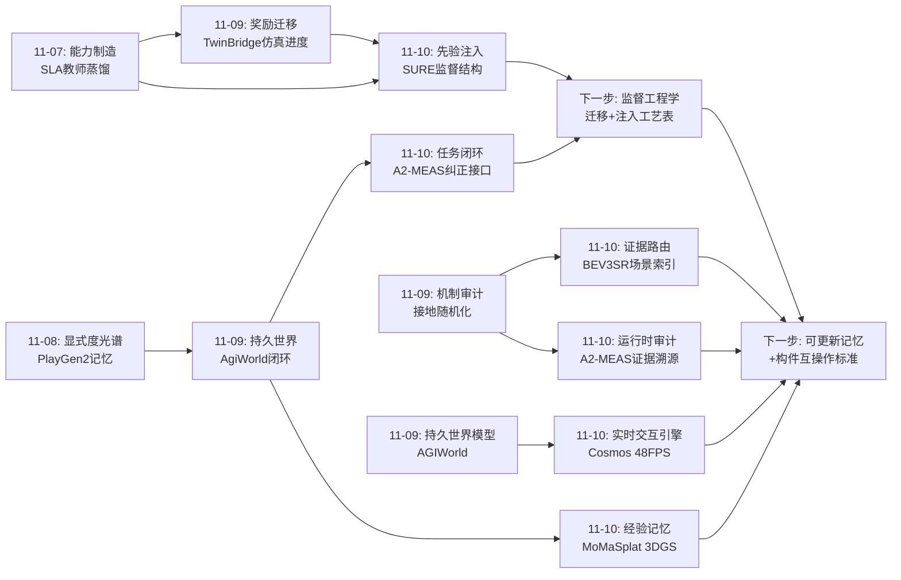
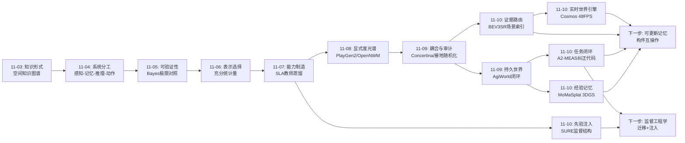
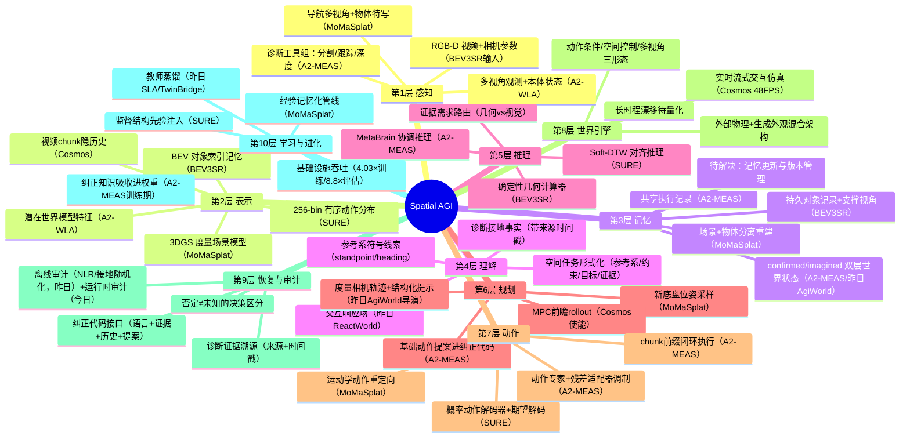
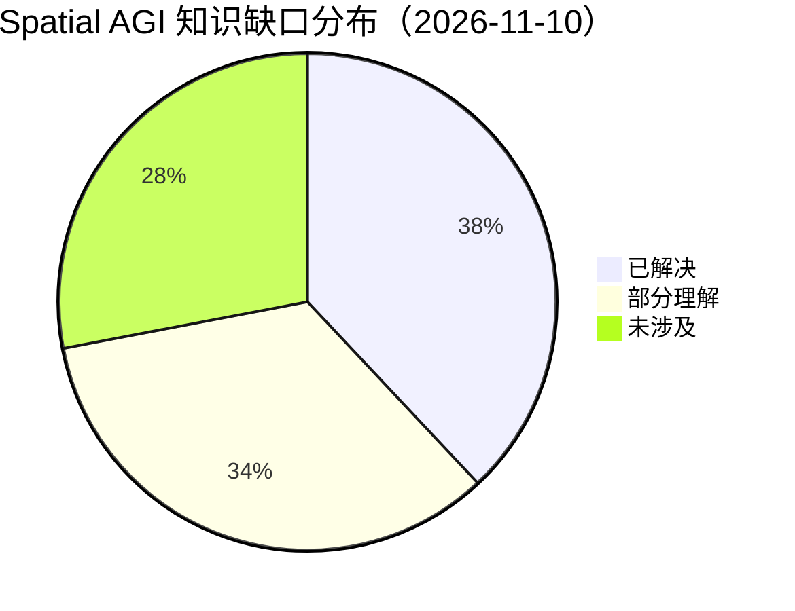
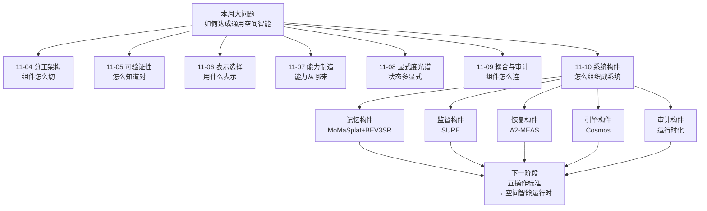

# Spatial AGI 每日思考 - 2026-11-10

## 📅 每日总结

**日期**: 2026-11-10
**论文数量**: 5篇
**主题**: 昨天的主题是"耦合与审计"——组件以什么方式耦合、耦合是否真实被使用。今天五篇论文回答的是它的下一层问题：**当组件耦合被确认之后，空间智能如何组织成一个系统**。五篇论文从五个正交方向给出系统化的构件：MoMaSplat 证明任务经验本身蕴含可渲染 3D 记忆（记忆的免费来源与空间数据引擎）；SURE 证明监督结构（局部相关性先验 + 时间容忍对齐）可以替代 5-10 倍数据（监督的结构化设计）；A2-MEAS 给出长时程自主的完整系统架构——动作模型 + 推理协调者 + 诊断智能体组 + "纠正代码"统一接口（证据驱动的恢复回路）；Cosmos-Sim 把世界模型转化为实时流式交互仿真基础设施（48 FPS 单卡，世界模型进入 in-the-loop 可用区间）；BEV3SR 把 BEV 从俯视图像重定义为"可查询的度量场景索引"，用证据需求路由双通路推理（场景记忆即空间数据库）。五篇的共同信号是：**空间智能的竞争正在从"更好的模型"转向"更好的系统"——记忆、证据、路由、恢复、监督结构、基础设施，每一个系统构件都有独立的性能杠杆**。今天的元判断是：Spatial AGI 的知识版图正在从"网络架构学"扩展为"空间系统工程学"。

**关键突破**:
- 🚀 MoMaSplat：首个覆盖动态物体交互全过程的 NVS 演示增强框架——导航轨迹是免费的多视角扫描（WildGaussians 处理瞬态）、被操作物体独立重建 + Sim(3) 配准、运动学动作重定向；真实 MoMa 任务成功率超过最强基线 2 倍，确立"经验数据 → 显式 3D 空间模型 → 空间鲁棒策略"闭环与"观测+动作协同变换"的增强第一性原则
- 🚀 SURE：转置卷积概率动作解码器（256-bin 有序局部相关）+ Soft-DTW 散度对齐监督——把"近邻动作等价 + 执行速度可变"的时空结构化不确定性作为先验注入，10% 数据或 20% 训练步数达到全量基线（LIBERO 10k 步 97.0% 超 OpenVLA-OFT 50k 步）；监督结构是数据效率的第一杠杆
- 🚀 A2-MEAS：长时程具身自主的参考架构——A2-WLA（VLA+运动感知历史+潜在世界模型）单模型即 0.5755 Q-score（2.21× 2025 冠军），完整系统 0.6411/45.40%；"纠正代码"（语言+空间证据+历史+动作提案）经残差适配器调制冻结策略，训练时吸收纠正进权重、部署时接受新纠正；咖啡冲泡失败后完成率 14%→94%；训练吞吐 4.03×、评估 8.8×
- 🚀 Cosmos-Sim：统一后训练配方把 Cosmos 3 转化为实时交互世界模拟器——Bimanual 48.1 FPS/166ms/单卡 GB300（动作→观测）、Transfer（深度/分割/边缘/模糊+语言→RGB，边缘 F1 +59.2%）、Auto（7 视角+LiDAR 同步，16×GB200）；混合架构（外部仿真器管物理 + 生成模型管外观）+ 全开源
- 🚀 BEV3SR：BEV 的角色重定义——从俯视图像变为"对象级空间索引"（度量记录 + BEV 栅格索引 + 支撑视角链接）；空间任务形式化器把查询解析为（参考系/约束/目标/证据需求）四元组，证据需求路由确定性几何计算或视觉证据检索；training-free 地在 SQA3D（+11 EM）、ScanQA（CIDEr +13）、VSI-Bench（+10）一致提升

**架构演进**: 耦合真实性分层的分工架构 → **系统构件分层的分工架构**（耦合与审计的结论保持，今天补上系统组织层结论：空间智能系统 = 空间记忆（MoMaSplat/BEV3SR 的可查询 3D 记忆）+ 监督结构（SURE 的不确定性先验注入）+ 证据路由（BEV3SR/A2-MEAS 的证据需求分类）+ 恢复回路（A2-MEAS 的纠正接口）+ 世界引擎（Cosmos 的实时交互仿真）+ 审计工具（昨日遗产）——每个构件都有独立的性能杠杆和独立的开源实现）

### 📊 一句话总结

2026-11-10 的五篇论文确立了空间智能的系统级判断：**空间智能正在从模型竞赛转向系统工程——任务经验可以免费转化为可渲染 3D 记忆（MoMaSplat）、监督结构可以替代数量级数据（SURE）、长时程自主需要"动作模型+推理协调+诊断证据+纠正接口"的系统协作（A2-MEAS）、世界模型已跨过实时交互的延迟门槛（Cosmos 48 FPS）、而 BEV 应该被当作空间数据库的索引而非一张图片（BEV3SR）；每个系统构件都有独立于模型规模的性能杠杆。**

### 🔗 延续性

**昨日→今日**: 昨日核心结论是"组件耦合是架构自由度，但耦合必须被审计"。今天五篇把视角从"组件关系"推进到"系统组织"：①昨日的审计思想被 A2-MEAS 吸收为"证据溯源"——每个诊断发现保留观测来源与时间戳，否定答案与未知答案导向不同决策，这是审计思想从"离线评测"走向"在线运行时"的实例化；②昨日的"机制使用率"概念在 BEV3SR 中变成正向设计原则——证据需求路由就是"确保 VLM 只在证据真正在上下文里时才被使用"的系统化实现，直接回应 Grounded Reasoning 发现的"证据不在输入里"失败模式；③昨日 AgiWorld 的"持久性来自闭环"在 A2-MEAS 中扩展到任务层——世界闭环（规划→生成→修正）之上叠加任务闭环（执行→诊断→纠正），闭环作为空间智能的组织原则再下一城；④昨日 Concertina 的"能力住在哪层"问题在 MoMaSplat/BEV3SR 中获得新表述——能力不仅住在网络层里，也住在**模型外的记忆结构**里（BEV 索引、3DGS 场景模型），training-free 的 BEV3SR 追平 3D-aware 模型证明"系统记忆"是与"权重表征"并列的能力载体；⑤昨日的 TwinBridge"仿真真值免费监督"与今日 SURE"监督结构替代数据"共同构成监督工程学：监督的质量杠杆有两条正交轴——真值来源（仿真器/教师）与结构设计（不确定性先验/对齐容忍）；⑥昨日 Cosmos 路线的姊妹（AGIWorld 持久世界）今天被 Cosmos-Sim 补上工程实现——实时性门槛（~50 FPS 单卡）跨过意味着"在想象世界中训练"从论文愿景变为可执行流程。

**今日→明日**: 八条新线索：①场景记忆的可更新性——BEV3SR 与 MoMaSplat 的记忆都是静态构建（跨帧合并/单场景重建），物体被移动后如何失效、重验证、版本管理是持久空间记忆的下一个关键问题；②证据路由的粒度——BEV3SR 的几何/视觉二分太粗，混合证据问题（先几何定位再视觉验证属性）的编排策略未解决；③纠正代码的分布外泛化——A2-MEAS 的纠正接口学的是 MetaBrain 风格纠正到动作改变的映射，陌生纠正指令的效果存疑；④监督结构先验的系统清单——SURE 的局部相关性 + 时间容忍只是两个先验，空间任务还有哪些可注入的结构（对称性、可达性、因果顺序）值得系统盘点；⑤世界模型的长时程漂移度量——Cosmos 自回归 chunk 生成的分钟级一致性未量化，需要专门的漂移基准；⑥混合世界引擎的接口标准——"外部仿真器管物理 + 生成模型管外观"需要一个标准的（状态→观测）接口协议；⑦经验记忆的跨任务复用——MoMaSplat 的场景重建绑定单任务采集，多任务经验累积成持久环境模型是自然延伸；⑧证据需求的自动学习——BEV3SR 的证据需求由 LLM 判断，能否从错误统计中学习路由策略。明日检索方向："updatable scene memory gaussian"、"dynamic scene update BEV index"、"residual adapter out-of-distribution correction"、"world model drift benchmark long-horizon"、"sim2real observation interface"、"supervision structure priors robot learning"。

### 💡 本质思考：如何达成通用空间智能

#### 1. 核心能力的本质是什么？

本周主题的第七次收敛。11-04"分工架构"、11-05"可验证"、11-06"表示选择"、11-07"可制造"、11-08"显式度光谱"、11-09"耦合与审计"，今天加入系统组织维度：

**空间智能的本质是可验证、以最优表示流动、可分层制造、显式度按域最优、耦合真实可审计、且以系统构件组织起来的分工架构——模型权重只是空间能力的载体之一，可查询的空间记忆、结构化的监督信号、证据驱动的推理路由、失败驱动的恢复回路、实时响应的世界引擎，是与权重同等重要（有时更重要）的能力载体；空间智能的工程学正从"如何造模型"扩展为"如何组织系统"。**

今天的证据链：

- **记忆是免费的能力载体**（MoMaSplat + BEV3SR）：标准任务采集的导航数据天然蕴含多视角扫描，重建的 3DGS 场景可直接转化为位姿鲁棒策略训练信号；BEV 索引的度量记忆 training-free 追平 3D-aware 模型——"空间能力的相当部分可以住在模型外"得到双向验证。
- **监督结构是数量级杠杆**（SURE）：转置卷积的局部性先验 + Soft-DTW 的时间容忍先验合计带来 5-10 倍数据/算力效率——"先验注入 > 数据堆叠"在动作学习域得到量化证明，与 11-07 的"能力可制造"工艺学互补：制造工艺不仅有教师蒸馏，还有先验注入。
- **恢复是系统级能力**（A2-MEAS）：长时程自主的分水岭不在首次成功率而在失败恢复率——纠正代码把诊断证据接进连续控制，咖啡实验 14%→94% 的对比证明"带着证据的重试"与"盲目重试"是两种不同的智能。
- **实时交互是世界模型的准入条件**（Cosmos）：48 FPS/166ms/单卡跨过 in-the-loop 门槛，世界模型的价值评价标准从"视频质量"正式转向"交互性+实时性+空间一致性"。
- **路由是推理的元认知**（BEV3SR）：知道"这个问题该用几何算还是用眼睛看、在谁的参考系里算"，本身就是空间智能——而且它可以被符号化、被工程化、不需要训练。

#### 2. 当前方法与理想目标的差距在哪里？

- **所有空间记忆都是静态的**：MoMaSplat 的场景重建假设采集时场景不变（WildGaussians 只能降权瞬态）、BEV3SR 的对象记录假设合并后不变、Cosmos 的自回归历史不可修正——"持续更新、可修正、带版本的空间记忆"是当前最大的系统性缺口，昨日 AgiWorld 的可靠性维护只是启发式起点。
- **证据路由的粒度太粗**：BEV3SR 的几何/视觉二分无法处理混合问题（"冰箱左边那把椅子坐着舒服吗"需要几何定位+视觉属性判断+A 兮可供性推理）；A2-MEAS 的诊断智能体工具集固定，开放世界的新物理量（柔性、流体、温度）不在覆盖内。
- **监督先验清单不完整**：SURE 只注入了局部相关性与时间容忍两个先验；空间任务固有的对称性（左右手等价）、可达性（工作空间约束）、因果顺序（先接近后接触）等结构先验尚未系统化。
- **世界模型的物理权威性分裂**：Cosmos 的纯动作条件模式物理保真未量化、混合模式依赖外部仿真器——两种模式的适用边界、混合接口标准、误差传导都没有答案。
- **恢复接口的泛化性未知**：A2-MEAS 的纠正适配器绑定 MetaBrain 风格监督；真实部署中恢复指令来自人类口语、报警系统、其他 agent——纠正代码的输入分布鲁棒性未验证。
- **系统构件尚未互操作**：BEV3SR 的场景记忆、A2-MEAS 的诊断证据、Cosmos 的世界状态、MoMaSplat 的 3DGS 模型各自为政，没有统一的（空间状态→证据→动作）接口协议——今天的五篇各自搭了一个构件，还没有人把它们拼起来。

#### 3. 从今天到理想状态，最可能的路径是什么？

五步走判断（昨日版本的更新）：

**第一步（进行中）：单构件的性能上限验证完成**。记忆构件（BEV 索引 training-free 追平 3D-aware 模型）、监督构件（SURE 5-10× 效率）、恢复构件（A2-MEAS 恢复率 14%→94%）、世界引擎构件（Cosmos 48 FPS 单卡）各自达到可用水平。标志事件：Cosmos 全开源 + A2-MEAS 承诺全开源——系统构件进入"人人可组装"时代。

**第二步（2027 上半年）：构件互操作标准出现**。统一的空间状态表示（估计以 3DGS/BEV 索引为基础）、统一的证据格式（带来源与时间戳的接地事实，A2-MEAS 的诊断记录是雏形）、统一的（记忆↔引擎↔策略）接口协议；类比机器人领域的 ROS，空间智能需要"ROS for Spatial AGI"。同时 BEV3SR 式记忆获得更新机制（对象记录的失效/重验证/版本管理），接住"可修正空间记忆"缺口。

**第三步（2027 下半年）：监督先验的系统工程化**。SURE 式先验注入从动作域扩展到感知域与规划域（对称性、可达性、因果顺序先验的清单化）；教师蒸馏（TwinBridge/SLA）与先验注入（SURE）整合为"空间监督工程学"的标准工艺表；世界模型长时程漂移基准发布，混合世界引擎接口标准化。

**第四步（2028）：全系统闭环的第一代 Spatial AGI 框架**。Cosmos 式世界引擎 + BEV3SR 式可更新记忆 + A2-MEAS 式恢复回路 + SURE 式高效策略在统一框架中闭环运行；经验记忆跨任务累积（MoMaSplat 的单任务重建扩展为持久环境模型）；证据路由从二分进化为可学习的混合策略。

**第五步（2028+）：空间智能的"操作系统"形态**。Spatial AGI 不再是单个模型而是一个运行时：记忆管理（存储/索引/更新/回收）、进程调度（感知/推理/动作的算力分配）、系统调用（几何计算、证据检索、世界仿真、恢复干预）成为标准服务；模型权重、空间记忆、世界引擎三者作为可热插拔的运行时资源——空间智能的最终抽象形态。

---

## 🔗 与昨日思考的联系

### 昨日重点

昨天的主题是**耦合与审计**：Concertina（骨干内动作耦合 + Action Interface Audit）、ReactWorld（生成内因果耦合 + 零动力学对照）、AgiWorld（系统间闭环耦合 + 持久世界）、TwinBridge（仿真-视觉跨域耦合 + 奖励迁移）、Grounded Reasoning（耦合失败案例 + 解码期随机化审计）。确立"耦合是设计自由度、审计是元工具"。留下七条线索：审计协议标准化、结构化中间预测的 3D 升级、可优化空间记忆、账本自动归纳、不可描述参照的空间记忆接口、耦合 vs 解耦的显式度交互、教师链第三环。

### 今日进展

今天五篇论文从"组件关系"推进到"系统组织"，并接住昨日多条线索：

1. **接住线索③"可优化空间记忆"（MoMaSplat 部分回应）**：昨天指出 AgiWorld 的点云记忆不可修正，期望 3DGS 式可优化表示；今天 MoMaSplat 的场景重建正是 3DGS 式记忆的实例——虽然仍绑定单任务采集且未做增量更新，但"任务经验 → 可优化 3D 记忆 → 策略能力"的管线走通，为记忆的持续累积提供了载体。
2. **接住昨日"审计走向运行时"的隐含方向（A2-MEAS）**：昨日的审计（NLR/接地随机化）都是离线评测；今天 A2-MEAS 的诊断智能体把审计思想搬进运行时——每个接地事实带观测来源与时间戳、否定与未知导向不同决策、证据不足时在感知预算内追加观测。审计从"论文里的表"变成"机器人里的进程"。
3. **接住 Grounded Reasoning 的失败模式（BEV3SR 正面解决）**：昨日发现"证据不在输入里"导致 VLM 答错；今天 BEV3SR 的 Visual Evidence Aligner 用场景记忆索引检索问题相关帧——16 帧预算下从均匀采样进化为证据检索，失败模式的系统化修复。同时其确定性几何推理器把"该算的不该让模型猜"贯彻到底，与昨日的机制诚实性思想同源。
4. **昨日"教师蒸馏工艺表"与今日"先验注入"合并为监督工程学（SURE）**：SLA 蒸馏感知教师、CST-Bench 蒸馏因果链、TwinBridge 蒸馏仿真进度——都是"从更强的老师那里转移能力"；今天 SURE 展示了不同的一条路：不从老师那里拿，而是把任务结构（局部相关性、时间容忍）直接写成归纳偏置与损失结构。监督的两大工艺——迁移与注入——今天汇合。
5. **闭环原则的第三层扩展（A2-MEAS）**：AgiWorld 确立世界闭环（规划→生成→观察→修正），TwinBridge 确立监督闭环（仿真标注→视觉奖励→真实执行→人在环），今天 A2-MEAS 确立任务闭环（执行→监控→诊断→纠正→继续）——闭环作为空间智能的组织原则从世界层、监督层下沉到任务执行层。"持久性来自闭环"的一般化表述：**自主性来自闭环**。
6. **世界模型的评价标准迁移完成（Cosmos）**：昨日 AGIWorld 强调持久性与交互性但未触及实时性；今天 Cosmos 把 48 FPS/166ms 作为 headline 数字——世界模型的竞争维度从"生成质量"正式扩展到"交互延迟"，in-the-loop 可用性成为新的准入门槛。

### 演进路径

核心轨迹：**知识形式（11-03）→ 系统分工（11-04）→ 可验证性（11-05）→ 表示选择（11-06）→ 能力制造（11-07）→ 显式度光谱（11-08）→ 耦合与审计（11-09）→ 系统构件（11-10）**——空间智能的工程学在完成"组件关系"维度后，今天开始回答"组件如何组织成系统"，记忆、证据、路由、恢复、引擎、监督六大构件首次同框。

---

## 📚 论文概览

**论文1: MOMASPLAT（2611.08372, UT Austin RoBIN Lab）**
移动操作的新视角演示增强框架。核心洞察：标准 MoMa 数据采集天然提供重建素材——导航轨迹多视角扫描静态场景（COLMAP SfM + WildGaussians 不确定性 3DGS，掩膜排除物体与机器人、机载深度恢复度量尺度），操作轨迹提供物体特写（分割 + 前馈 3D 基础模型逐帧位姿，Sim(3) 对齐到场景系），机器人本体用模拟器渲染。给定新底盘位姿：渲染场景+物体+机器人三路合成、运动学重定向动作、形成含接触后阶段的完整合成演示。5 任务×3 场景×12 位姿×33 滚动评估：成功率超最强基线 2 倍，大位移下基线全败仍保持非平凡成功率。局限：刚体假设、位姿估计误差传播、邻域位姿限制、无物理校验。

**论文2: SURE（2611.09684, 清华大学）**
时空不确定性感知的 VLA 数据高效训练框架。空间组件：转置卷积概率动作解码器——每轴 256 有序 bin，Deconv Block（深度转置卷积+逐点残差）上采样 1→R/4→R，卷积权重共享使相邻 bin 接收相关证据（局部性归纳偏置），softmax 后期望解码（可微、并行、无迭代去噪），L1 期望监督为主+轻权重分布正则；夹爪用 MLP。时间组件：Soft-DTW 散度对齐——动作块转累积轨迹、softminγ 可微对齐、散度形式消除自相似偏置。LIBERO 10k 步 97.0%（超 OpenVLA-OFT 50k 步）；10% 数据或 20% 步数匹配基线；LIBERO-Spatial 25% 数据超全量。局限：单模态期望解码对真多模态失败、Soft-DTW 平方复杂度、仅处理时间伸缩不处理几何差异。

**论文3: A2-MEAS / A2-WLA（2611.09124, SJTU AutoLab）**
长时程具身自主的多智能体框架。A2-WLA：VLA 骨干+运动感知历史编码器+潜在世界模型（预测未来视觉特征）+动作专家，输出动作块+局部阶段进度估计（自我监控信号）；三阶段训练（动作预训练→任务专门化→纠正接口）。系统：MetaBrain 协调者维护任务目标审查异常、诊断智能体组（感知接地/时空接地/交互评估，发现带来源与时间戳、否定≠未知）、共享执行记录、chunk 前缀执行的闭环控制。纠正代码=学习到的条件表征（恢复语言+空间证据+执行历史+动作提案），残差适配器调制动作专家隐藏状态；训练时吸收纠正进权重、部署时权重冻结仅代码变化。BEHAVIOR 2026：50 任务 0.5755（2.21× 冠军）、100 任务 0.6411/45.40%；RoboTwin 95.05%；真实 12 任务 57.92% vs π0.5 26.67%；咖啡恢复 14%→94%、8%→82%；吞吐 427.1 samples/s（4.03×）、评估 8.8×。局限：绑定 MetaBrain 质量、纠正分布外泛化未知、工具集固定、sim-real 落差。

**论文4: Cosmos Interactive World Simulation（2611.06627, NVIDIA）**
统一后训练配方把 Cosmos 3 世界基础模型转化为实时流式交互世界模拟器。双模式：动作条件预测（纯神经）与外部仿真器维护物理状态+生成观测（混合）。三变体：Bimanual（动作→480p 观测，48.1 FPS/166ms/单卡 GB300，PSNR 超 DreamDojo 2B/14B）、Transfer（深度/分割/边缘/模糊+语言→RGB，15.85 FPS/240ms/单卡 GB200，边缘 F1 +59.2%、深度误差 −26.5% vs Cosmos 3 GA）、Auto（7 同步 RGB+LiDAR，16.7 FPS/16×GB200）。代码+checkpoint 全开源。局限：GB 级算力门槛、自回归长时程漂移未量化、纯神经模式物理保真未量化、480p 分辨率限制、领域特化后训练需求。

**论文5: BEV3SR（2611.09816, University of Louisville）**
Training-free 的视频 3D 空间推理框架。BEV 角色重定义：俯视图像→对象级空间索引。场景记忆：RGB-D+位姿→Mask2Former 全景分割→反投影到世界系→BEV footprint→自适应实例图跨帧合并→持久对象记录（footprint/包围盒/质心/高度/支撑视角）+BEV 栅格索引。任务形式化器：查询→（参考系 F/目标 O/约束 C/证据需求 E）四元组，参考系四类（Agent/View/Object/Scene，standpoint+heading 线索实例化）。证据路由：几何需求→确定性几何计算器；视觉需求→BEV 索引检索对象一致+场景上下文帧给 VLM。SQA3D 51.6→62.6 EM、ScanQA CIDEr 82.6→95.6、VSI-Bench 静态子集 63.8（+10.0，training-free 持平 3D-aware 模型）。局限：依赖 RGB-D+位姿、静态场景假设、LLM 解析单点故障、二分路由粒度粗。

---

## 💡 核心见解

### 见解1: 任务经验是空间记忆的免费矿藏
[从 MoMaSplat 获得]
- ✅ 导航轨迹天然提供场景级多视角覆盖、操作轨迹天然提供物体级特写覆盖——标准任务采集的"副产品"恰好是 3D 重建需要的全部素材
- ✅ 静态/动态分离重建 + 导航期物体静止的天然配准锚点 + Sim(3) 对齐 + 机载深度恢复度量尺度——零额外设备得到可渲染的度量 3D 世界
- ✅ 空间级数据增强必须"观测+动作"协同变换：源动作经底盘系刚体变换重定向后，合成观测与动作在几何上严格一致

**对Spatial AGI的启发**：
空间记忆不需要专门的建模阶段——它可以作为任务执行的副产品持续生长。一个长期运行的机器人，其历史经验应自动累积为越来越完整的环境模型。这意味着 Spatial AGI 系统的架构检查单应增加一条：经验的 3D 记忆化管线在哪里？任何"执行完就丢"的经验流都是被浪费的空间数据。

### 见解2: 监督结构是数量级的数据效率杠杆
[从 SURE 获得]
- ✅ 动作空间的时空不确定性是结构化的：近邻动作等价（局部相关性）、执行速度可变（时间伸缩）——把这两个结构写成归纳偏置（转置卷积权重共享）与损失结构（Soft-DTW 散度），等价于 5-10 倍有效数据
- ✅ 期望解码（softmax over bins → 加权和）可微且并行——概率表征与简单 L1 点监督兼容，无需扩散头的迭代去噪成本
- ✅ LIBERO 10k 步 97.0% 超 OpenVLA-OFT 50k 步——算力节约的来源不是更小的模型而是更好的监督信号

**对Spatial AGI的启发**：
"先验注入"应与"教师蒸馏"并列为空间能力制造的两大工艺。当前 VLA 训练的大量算力被浪费在与任务无关的自由度上（精确复现演示者的手抖与节奏）；每一类空间任务都值得问：这个任务固有的结构化不确定性是什么？哪些可以写成归纳偏置？哪些可以写成对齐容忍的损失？监督工程学的工作清单今天正式开列。

### 见解3: 长时程自主的分水岭在恢复而非首次成功
[从 A2-MEAS 获得]
- ✅ A2-WLA 单模型 0.5755 已是冠军 2.21 倍，但完整系统加到 0.6411/45.40%——推理协调与诊断证据在"已经很强的动作模型"之上仍有独立增量
- ✅ 纠错代码接口：训练时把纠正知识吸收进适配器权重、部署时权重冻结仅代码变化——"内化已知失败模式 + 外援未知失败模式"的分工架构
- ✅ 咖啡实验的对照（同一冻结策略 ± Adapter：14% vs 94%）证明：失败后"带着证据改变下一次尝试"与"盲目重试"是两种不同的能力

**对Spatial AGI的启发**：
空间智能的评价维度应从"成功率"扩展到"恢复率"——第一次就成功不叫智能，失败后正确改变才叫。系统检查单：诊断证据从哪里来（哪个智能体、什么传感器）、证据如何进动作层（语言层还是权重层）、否定与未知是否区别处理、恢复是否保持任务目标。A2-MEAS 的"动作模型+协调者+诊断组+统一接口"是迄今最完整的参考架构。

### 见解4: 实时交互是世界模型的准入门槛
[从 Cosmos 获得]
- ✅ Bimanual 48.1 FPS / 166ms / 单卡 GB300——世界模型首次明确跨过 in-the-loop 延迟门槛，"在想象世界中训练"从愿景变为可执行流程
- ✅ 混合架构承认并绕开神经世界模型的物理不可靠：外部仿真器维护权威物理状态、生成模型只负责逼真外观——空间结构与空间外观分层
- ✅ 一个后训练配方特化三种仿真形态（操作动作条件、空间控制视觉迁移、多视角驾驶）——世界基础模型的通用性 + 轻量特化的规模化路径被验证

**对Spatial AGI的启发**：
世界模型的评价标准应正式迁移：视频质量（FVD/PSNR）只是入场券，交互延迟、控制遵循度（深度误差/边缘 F1）、多视角一致性、长时程漂移才是主干指标。"外部物理 + 生成外观"的混合架构应成为空间世界引擎的默认设计——同时提出了新的标准化需求：（物理状态→观测）的接口协议。

### 见解5: 场景记忆应该被设计成空间数据库
[从 BEV3SR 获得]
- ✅ BEV 的价值在"组织"而非"可视化"：度量记录（质心/包围盒/footprint/高度）+ 空间索引（栅格→对象 id）+ 证据链接（对象→支撑 RGB 视角）——三层结构与数据库的"数据+索引+附件"同构
- ✅ 参考系是可形式化的：Agent/View/Object/Scene 四类 + standpoint/heading 符号线索即可实例化任意查询坐标系——VLM 的"图像左当智能体左"失败模式被符号化根治
- ✅ training-free 追平 3D-aware 模型（VSI-Bench +10 分）——系统记忆是与权重表征并列的能力载体，且随骨干升级免费受益

**对Spatial AGI的启发**：
空间记忆的工程化程度应该向数据库看齐：查询接口（Lookup(g)）、索引结构（BEV 栅格）、证据附件（支撑视角）、事务语义（更新/失效——尚缺）。"该算的交给计算器、该看的交给检索、该猜的才交给 VLM"是空间推理路由的第一性原则。BEV3SR 证明了这条原则的可行性，也暴露了它未完成的部分：记忆更新与混合证据编排。

### 见解6: 审计思想正在从离线评测迁移到运行时
[从 A2-MEAS + BEV3SR 共同获得]
- ✅ A2-MEAS：每个诊断发现保留观测来源与时间戳，MetaBrain 能区分"有证据支持的结论"与"缺失的观测"；否定答案与未知答案导向不同决策
- ✅ BEV3SR：证据需求显式建模——"VLM 被使用"的前提是"证据在上下文里"，路由器确保这一点；VLM 的每次调用都有明确的证据依据
- ✅ 两者与昨日的 NLR/接地随机化构成完整谱系：离线审计（机制是否存在于权重）→ 运行时审计（证据是否真实支撑决策）

**对Spatial AGI的启发**：
昨天的教训是"机制的存在不等于机制被使用"，今天的设计原则是"每一次使用都应有证据链"。Spatial AGI 系统的决策日志应记录：用了什么证据、来自哪个传感器/记忆条目、何时采集、置信几何——这不是可解释性的装饰，而是失败分析与持续改进的数据基础。

### 见解7: 开源基础设施是空间智能加速的乘数
[从 Cosmos + A2-MEAS + MoMaSplat 共同获得]
- ✅ Cosmos 开源三个模型 checkpoint + 全部代码；A2-MEAS 承诺开源系统/模型/脚本/基础设施；MoMaSplat 公开项目页与（预期）代码——系统级工作开始遵循开源惯例
- ✅ 基础设施本身的贡献被量化：A2-MEAS 训练吞吐 4.03×、评估 8.8×（1000 episodes 18.1 小时进"每日研究周期"）——基础设施效率与模型改进同为一等贡献
- ✅ 单卡 GB300 跑 48 FPS 世界模型 vs 16×GB200 跑多视角驾驶——构件的性能-算力权衡谱系清晰化，不同规模团队可各取所需

**对Spatial AGI的启发**：
空间智能的竞争是双线的：模型线（参数/数据/算法）与基础设施线（吞吐/延迟/评估速度）。后者长期被低估——A2-MEAS 把 8.8× 评估加速写进三大贡献之首是信号性事件。构件的开源化将催生"组装式研究"：明年的高水平论文可能越来越多地是"把 Cosmos 记忆 + BEV3SR 索引 + SURE 策略 + A2-MEAS 恢复拼成新系统"的组合创新。

---

## 🗺️ 知识演进图

⚠️ 本节使用 mermaid 代码块。

核心轨迹：**知识形式 → 系统分工 → 可验证性 → 表示选择 → 能力制造 → 显式度光谱 → 耦合与审计 → 系统构件**——本周空间智能工程学的八个问题域逐日展开，今天进入"系统组织"层：六大构件（记忆/监督/恢复/引擎/路由/审计）首次同框，下一步指向构件互操作。

---

## 技术栈演进对比表

| 层次 | 昨日方案 | 今日方案 | 变化 |
|------|---------|---------|------|
| 空间记忆 | AgiWorld 点云记忆+可靠性维护（启发式、不可修正） | MoMaSplat 3DGS 度量场景模型 + BEV3SR 对象级 BEV 索引记忆 | 记忆从"世界模型的附属"升级为"独立的能力载体"，且 training-free 可用 |
| 数据引擎 | X-Gen/MoMaGen 仿真合成 + NVS 仅接触前 | MoMaSplat 全轨迹合成（含动态物体）+ 经验数据免费重建 | 数据增强从"仿真重放/半程增强"进化为"真实数据全程几何一致合成" |
| 动作监督 | 逐点回归/扩散动作头（点监督） | SURE 转置卷积概率解码 + Soft-DTW 散度对齐 | 监督从"精确目标"升级为"结构化分布+时间容忍"，10% 数据匹配全量 |
| 长时程控制 | RLC 手工阶段逻辑 + 语言技能选择 | A2-MEAS 纠正代码 + 诊断智能体 + 残差适配器 | 恢复从"规则重试"升级为"证据驱动的动作修正"，权重学习与在线推理耦合 |
| 世界模型 | AGIWorld 持久世界（生成质量优先） | Cosmos 实时流式交互（48 FPS/166ms/单卡） | 评价标准从"生成质量"迁移到"交互延迟+控制遵循"，混合架构出现 |
| 空间推理 | 3D-aware MLLM（3D 信号注入权重） | BEV3SR 场景记忆索引 + 证据需求路由（training-free） | 路线从"模型内化 3D"分叉出"模型外空间记忆+系统路由"，两者性能持平 |
| 证据机制 | Grounded Reasoning 审计（发现写而不读） | A2-MEAS 证据溯源（来源+时间戳）+ BEV3SR 证据检索 | 审计从"发现失败"进化为"系统性预防失败" |
| 评测效率 | 串行评估（1275 小时级） | A2-MEAS 8.8× 加速（18.1 小时/1000 episodes） | 基础设施效率首次成为贡献主体之一 |

---

## 🗺️ Spatial AGI 知识图谱

### 10层架构思维导图

⚠️ 本节使用 mermaid mindmap 代码块。

### 🎯 主线技术路径

#### 阶段1: 单点能力（已完成，~2024-2025）
3DGS 重建、VLA 策略、世界模型视频生成、VLM 空间基准各自成型。标志：LIBERO/OpenVLA、3DGS 普及、SQA3D 类基准。本阶段的遗产：所有系统构件的原始材料。

#### 阶段2: 组件耦合与审计（进行中，2026）
骨干内动作耦合（eVLM）、生成内因果耦合（响应场）、系统间闭环（持久世界）被验证可行；审计工具（NLR/接地随机化/零信息对照）出现。本周 11-08~11-09 的主线。

#### 阶段3: 系统构件化（当前爆发点，2026Q4——本周证据）
六大构件各自达到可用水平并可独立开源：记忆（MoMaSplat 3DGS / BEV3SR 索引）、监督（SURE 先验注入）、恢复（A2-MEAS 纠正接口）、引擎（Cosmos 48FPS）、路由（BEV3SR 证据需求）、审计（昨日工具集 + 今日运行时化）。标志事件：Cosmos 全开源、A2-MEAS 承诺全栈开源、基础设施效率（4×/8.8×）成为一等贡献。

#### 阶段4: 构件互操作标准（2027 上半年，预测）
统一空间状态表示、统一证据格式（A2-MEAS 诊断记录是雏形）、统一（记忆↔引擎↔策略）接口协议——"ROS for Spatial AGI"；可更新空间记忆（对象记录的失效/重验证）补齐；混合世界引擎接口标准化。

#### 阶段5: 空间智能运行时（2028+，预测）
监督工程学工艺表（迁移+注入）成熟；全系统闭环框架（引擎+记忆+恢复+策略）出现第一代整合实现；经验记忆跨任务累积为持久环境模型；最终形态是空间智能"操作系统"——记忆管理、算力调度、几何/证据/仿真/恢复系统调用成为标准服务。

---

## 🔍 待探索议题

### 高优先级（本周）

1. **可更新空间记忆**
   - 问题: BEV3SR 对象记录与 MoMaSplat 场景模型都是静态构建，物体被移动后记忆过期——如何设计失效检测、局部重验证与版本管理？
   - 候选方案: 对象记录挂接"最后确认时间戳+确认视角"，查询时按陈旧度触发主动重验；3DGS 局部重优化只更新受影响区域
   - 缺口: 静态基准（ScanQA 等）无法评测记忆维护，需要动态场景 QA 基准

2. **混合证据问题的路由编排**
   - 问题: BEV3SR 的几何/视觉二分无法处理"先几何定位再视觉验证属性"的混合问题
   - 候选方案: 把证据需求从二分扩展为证据计划（evidence plan）——有序的证据获取步骤序列，每步可以是计算/检索/感知
   - 缺口: 缺少带混合问题的评测集与编排失败的错误分析

3. **世界模型长时程漂移基准**
   - 问题: Cosmos 自回归 chunk 生成依赖自产历史，分钟级 rollout 的一致性未量化
   - 候选方案: 复用昨日 AgiWorld 的重访/探索协议（房间重访一致性）+ 新增物体计数/位置保持指标；在外部仿真器维护真值的混合模式下测漂移率
   - 缺口: 漂移-延迟-算力的权衡曲线数据不存在

4. **纠正接口的分布外泛化**
   - 问题: A2-MEAS 纠正适配器学习 MetaBrain 风格监督到动作改变的映射，陌生来源（人类口语、报警信号）的纠正指令效果未知
   - 候选方案: 纠正指令的改写增强（同一纠正的多种措辞/来源风格训练）；代码空间的正则化使流形覆盖更广
   - 缺口: 缺少跨来源纠正指令的评测协议

### 中优先级（本月）

5. **监督先验的系统清单**
   - 问题: SURE 只注入局部相关性与时间容忍；空间任务固有的对称性、可达性、因果顺序先验未被系统盘点
   - 候选方案: 按"感知/动作/规划"三层盘点各域的结构化不确定性，每类先验给出（归纳偏置形式+损失形式+预期收益）工艺卡
   - 缺口: 先验之间的交互（同时注入多个是否冲突）未研究

6. **经验记忆的跨任务复用**
   - 问题: MoMaSplat 场景重建绑定单任务采集会话，多任务/多天经验如何累积为持久环境模型？
   - 候选方案: 增量 3DGS（新会话锚定到已有模型）+ BEV3SR 式实例合并跨会话去重
   - 缺口: 跨会话位姿漂移与光照变化下的配准鲁棒性

7. **纯神经世界模型的物理保真度量**
   - 问题: Cosmos 动作条件模式只有视觉指标（PSNR），物理正确性（穿透、滑动、支撑）未量化
   - 候选方案: 在有真值物理的仿真环境中 rollout 世界模型，测接触/穿透/动力学的物理违规率（昨日 ReactWorld 的物理合理性评测可移植）
   - 缺口: 物理违规率的标准化定义

8. **运行时审计的标准化格式**
   - 问题: A2-MEAS 的诊断记录、BEV3SR 的证据检索各自私有格式，无法跨系统比较审计质量
   - 候选方案: 定义"接地事实卡"标准（claim/evidence/source/timestamp/confidence），审计质量=证据链完整性指标
   - 缺口: 无跨系统的失败案例库来校准标准

### 低优先级（本季度）

9. **证据路由策略的可学习化**
   - 问题: BEV3SR 证据需求由 LLM 一次性判断，判断错误即路由错误
   - 候选方案: 从错误统计中学习路由（路由器作为可训练策略，奖励=最终答案正确性-证据成本）
   - 缺口: 路由决策的中间监督信号不存在

10. **场景记忆与世界引擎的状态统一**
    - 问题: BEV3SR 记忆、Cosmos 物理状态、A2-WLA 潜在特征是三种互不兼容的状态表示
    - 候选方案: 以 BEV 对象索引为逻辑状态层、以世界引擎为物理执行层、以潜在特征为感知缓存层，定义三层映射协议
    - 缺口: 三层映射的语义鸿沟（符号↔物理↔隐空间）缺乏实证研究

11. **概率动作解码与世界模型的联合训练**
    - 问题: SURE 的动作分布与 Cosmos 的视觉预测天然互补（动作分布给引擎、引擎反馈校准分布）但从未联合训练
    - 候选方案: 世界模型 rollout 作为动作分布的额外监督源（rollout 后果好→分布尖锐化）
    - 缺口: 联合训练的梯度通路与稳定性分析

---

## 📊 知识缺口分析

⚠️ 本节使用 mermaid pie 代码块。

**已解决（38%）**:
- ✅ 经验数据→3D 记忆→策略能力的完整管线（MoMaSplat：导航免费扫描+动态物体分离重建+动作重定向）
- ✅ 监督结构先验注入的可行性（SURE：局部相关性+时间容忍 → 5-10× 数据效率）
- ✅ 长时程恢复的系统架构（A2-MEAS：纠正代码+诊断证据+权重/推理分工）
- ✅ 实时交互世界模型的工程实现（Cosmos：48FPS 单卡+混合架构+三形态特化）
- ✅ 场景记忆的数据库化设计（BEV3SR：度量记录+BEV 索引+证据链接+参考系形式化）
- ✅ 参考系混淆的符号化根治（standpoint/heading 线索实例化查询坐标系）
- ✅ 空间增强的第一性原则（观测+动作协同变换）

**部分理解（34%）**:
- ⚠️ 空间记忆的更新与维护——可靠性启发式有了（AgiWorld）、可优化载体有了（3DGS）、但失效检测/局部重验证/版本管理未解决
- ⚠️ 证据路由——几何/视觉二分可用但粒度粗，混合证据编排与可学习路由未实现
- ⚠️ 世界模型物理保真——混合架构绕开了问题，但纯神经模式的物理违规率、长时程漂移率均未量化
- ⚠️ 恢复接口泛化——纠正代码绑定 MetaBrain 风格监督，跨来源纠正的鲁棒性未知
- ⚠️ 监督先验清单——两个先验被验证，空间任务的全谱系结构先验（对称/可达/因果）待盘点
- ⚠️ 多模态动作分布——SURE 期望解码对真分叉决策失效，扩散头与概率解码的混合方案未出现
- ⚠️ 基础设施-性能权衡——单卡操作引擎到 16 卡驾驶引擎的谱系有了端点，中间点与缩放律未测

**未涉及（28%）**:
- ❌ 构件互操作标准——统一空间状态/证据格式/接口协议不存在，五个开源构件无法直接拼装
- ❌ 跨任务/跨会话的经验记忆累积——所有记忆系统绑定单会话，持久环境模型无人实现
- ❌ 空间智能运行时——记忆管理/算力调度/系统调用的 OS 形态纯属预测，无任何原型
- ❌ 动态场景的空间 QA 基准——现有基准全部静态，记忆维护能力不可评测
- ❌ 开放世界物理量的诊断——柔性物、流体、温度等超出当前诊断工具集
- ❌ 纠正知识的安全边界——错误纠正指令的破坏性、纠正权限与仲裁机制未讨论
- ❌ 神经世界模型的因果反事实能力——干预性预测（昨日线索）在视频世界模型中仍未实现
- ❌ 空间智能的能耗与端侧部署——本周全部系统依赖数据中心级算力，端侧空间智能空白

---

## 📈 本周主题收敛图

---

## ✍️ 结语

今天的五篇论文各自解决一个系统构件，但它们真正的集体信号是姿态的转变：**空间智能的研究单位正在从"论文里的模型"变成"可组装的构件"**。Cosmos 开源了世界引擎，A2-MEAS 承诺开源整个系统栈，MoMaSplat 证明了构件可以完全建立在"免费"的经验数据上，BEV3SR 证明了一个 training-free 的构件可以追平重训练的模型，SURE 证明了监督构件的杠杆比数据杠杆更长。

昨天我们学会了怀疑耦合（审计），今天我们学会了组装（构件化）。明天的空间智能系统不会是一篇论文，而是一张装配图：BEV 索引的记忆数据库、Soft-DTW 监督的策略、纠正代码接口的恢复回路、48 FPS 的世界引擎、带时间戳的证据链——每个构件今天都已单独可达，缺的只是把它们焊在一起的接口标准。那是下一个突破的位置。

---

**文档创建时间**: 2026-11-10 03:00 CST
**分析方法**: 5 篇论文全文/摘要精读 + 延续性思考（基于 2026-11-05 至 11-09 思考文档的知识脉络）
**今日论文**: 2611.08372 (MoMaSplat) / 2611.09684 (SURE) / 2611.09124 (A2-MEAS) / 2611.06627 (Cosmos) / 2611.09816 (BEV3SR)

---

## 🔬 深度专题一：空间记忆的三次形态跃迁

回看本周论文，空间记忆的形态正在经历清晰的演化。把它放进更长的时间轴上，可以看到三次跃迁：

### 跃迁一：从地图到可渲染世界（3DGS 时代，~2024）

早期机器人的空间记忆是占据栅格地图或点云——几何正确但视觉贫瘠，策略训练只能回到仿真或原始图像。3DGS 的普及让"记忆即场景"成为可能：记忆不仅有几何，还有外观，可以任意视角渲染。今天 MoMaSplat 的实践证明这个跃迁已经完成工程闭环：机器人自己的导航数据就足以构建这样的记忆，不需要专门的扫描设备。

### 跃迁二：从整体场到对象级索引（BEV3SR，今天）

3DGS 记忆是"场"——连续、整体、适合渲染，但不适合查询（"冰箱左边有什么"无法直接从高斯集合回答）。BEV3SR 把记忆重组为对象级结构：每个对象有身份、度量位置、空间范围、语义标签，且对象之间用栅格索引组织。这本质上是记忆的"关系化"——从图像式的场变成数据库式的表。关键证据是 training-free 追平：对象级结构丢失了场的连续性，但换来了查询能力与证据链接，对 QA 类任务这笔交易是赚的。

### 跃迁三：从静态记录到活性记忆（进行中，缺口）

MoMaSplat 的记忆绑定采集会话，BEV3SR 的记录假设合并后不变——两者都是"快照式"记忆。真实环境持续变化，活性记忆需要：变化检测（哪里变了）、局部更新（只改受影响区域）、置信追踪（每条记录多可靠、何时验证的）、遗忘策略（陈旧信息的处理）。昨日 AgiWorld 的可靠性维护（偏好早期观测）是第一个启发式，但真正的活性记忆需要把记忆当作"持续维护的假设集合"而非"一次性构建的事实集合"——这与科学哲学中的信念修正理论惊人地同构。

### 对系统设计的含义

三次跃迁指向一个架构判断：**空间记忆的最优形态取决于访问模式**。渲染密集的任务（演示增强、视点合成）用场表示；查询密集的任务（QA、规划）用对象索引；开放环境的长期部署用活性记忆。三者不是竞争而是分层：场做底层、索引做中层、活性机制做运维层。BEV3SR 的 Lookup 接口已经暗示了这个分层——Lookup 背后既可以查索引，也可以按需触发场的渲染。

---

## 🔬 深度专题二：监督工程学的两条工艺线

本周的监督创新可以整理成一张工艺表。SURE 的先验注入与昨日的教师蒸馏是两条正交的工艺线：

### 工艺线A：教师蒸馏（能力的纵向转移）

| 日期 | 论文 | 教师 | 学生获得 | 蒸馏对象 |
|------|------|------|---------|---------|
| 11-07 | SLA | 3D 感知模型 | 空间特征 | 表征 |
| 11-08 | CST-Bench CT-OPSD | 教师模型 | 因果推理链 | 推理过程 |
| 11-09 | TwinBridge | 物理仿真器 | 任务进度奖励 | 奖励信号 |
| （共性） | — | 更强的空间能力源 | 学生策略 | — |

工艺特征：能力从"已有的强源"流向学生；质量上限=教师上限；依赖链每加一环就多一个误差源（仿真器保真度→视觉奖励→策略）。

### 工艺线B：先验注入（结构的横向利用）

| 先验 | 论文 | 注入形式 | 效果 |
|------|------|---------|------|
| 动作局部相关性 | SURE | 转置卷积权重共享 | 相邻 bin 共享证据 |
| 执行速度可变 | SURE | Soft-DTW 散度损失 | 时间错位不惩罚 |
| （候选）左右对称 | — | 数据镜像+动作映射 | 双倍有效数据 |
| （候选）可达性约束 | — | 动作空间投影层 | 无效动作零概率 |
| （候选）接触因果序 | — | 阶段结构化奖励 | 先接近后接触 |

工艺特征：不从外部源转移，而是把任务结构写成归纳偏置/损失结构；上限=任务结构的真实信息量；无依赖链、无教师误差。

### 两条线的组合原则

蒸馏解决"能力差距"（学生不知道教师知道的），先验解决"监督浪费"（数据里有但监督没表达的结构）。SURE 的一个细节值得注意：它以 L1 期望监督为主、分布损失为辅——先验注入不要求推翻现有监督框架，而是**改造监督与输出表示的接口**。这提示两条线可以叠加：TwinBridge 式仿真奖励 + SURE 式对齐容忍，两者的乘积效应未被测量。

---

## 🔬 深度专题三：恢复回路的控制论解读

A2-MEAS 的恢复机制值得用控制论的词汇重述一遍，因为它实际上是一个完整的二阶控制系统：

- **被控对象**：机器人-环境交互状态；
- **控制器（一阶）**：A2-WLA 策略——观测到动作的快速映射，处理标称扰动；
- **监控器**：进度估计 + 异常检测——判断一阶控制器是否仍在轨道上；
- **控制器（二阶）**：MetaBrain + 诊断智能体——当一阶失效时，用更慢但更强的推理重构控制信号（纠正代码）；
- **执行接口**：残差适配器——二阶控制器的输出注入一阶控制器的内部。

这个结构的深刻之处在于**时间尺度分离**：一阶回路以控制频率运行（chunk 级），二阶回路以事件频率运行（异常时才触发）。这与生物运动控制的分层（脊髓反射 vs 小脑修正 vs 前额叶重规划）同构。而纠正代码的设计解决了分层系统的经典难题——二阶如何干预一阶：不是替换控制器，而是**调制其内部状态**（隐藏状态残差），保留一阶控制器的全部预训练能力，只叠加修正。

对照实验的设计也堪称典范：同一冻结策略 ± Adapter 的咖啡对照（14% vs 94%）把"恢复能力"从系统整体中隔离出来单独归因——这是消融实验应有的样子。

### 缺失的一环：恢复的元认知

当前系统知道"失败了"（异常检测）与"怎么改"（纠正代码），但不知道"我恢复的能力如何"——没有恢复成功率的自模型。一个真正的空间智能体应该能预测"这类失败我上次用 X 策略成功了"，即恢复策略本身可学习。这需要恢复历史的结构化存储（什么失败、什么证据、什么纠正、结果如何）——又一次指向"记忆"这个本周的核心构件。

---

## 🔬 深度专题四：世界引擎的"结构-外观"分层

Cosmos 的混合架构值得单独深挖，因为它可能是世界引擎的标准答案的雏形：

### 为什么分层是必然的

纯神经世界模型（动作→视频）的根本困难：物理是刚性约束（穿透不可能、支撑必须守恒），而视频生成是软性拟合（扩散模型的去噪分布没有硬约束机制）。短期 chunk 内不一致不明显，长时程累积必然漂移——物体穿过桌面、悬浮、消失。外部仿真器维护物理状态 + 生成模型渲染外观的分层，把"刚性约束"交给为刚性约束设计的工具（物理引擎），把"外观丰富性"交给为外观设计的工具（生成模型）——各归其位。

### 分层的代价与未知

1. **接口带宽**：物理状态→渲染条件的映射（深度/分割/位形）是信息瓶颈——Transfer 模式 15.85 FPS 部分受制于此；
2. **外观-结构耦合遗漏**：某些现象物理与外观不可分（布料褶皱、液体飞溅、破碎），外部仿真器要么物理不准要么建模不起——这些"软物理"落在分层的缝隙里；
3. **一致性验证缺失**：渲染出的外观是否忠实于物理状态（模型是否"听从"深度条件）需要专门指标——Cosmos 的深度误差 −26.5% 是好的开始，但接触级保真（手指是否真的碰到了物体）未测。

### 与昨日 AGIWorld 的对照

AGIWorld 走纯神经路线但用 agent 闭环（审查-重生成）补偿一致性；Cosmos 走混合路线用物理引擎保证一致性。两条路线的分歧点其实是：**一致性的维护者是生成过程还是外部过程**。本周答案还未能分出胜负——长时程漂移基准（待探索议题3）将是裁判。

---

## 📐 方法论观察：本周论文的实验设计技巧盘点

本周五篇的实验设计各有值得收录的技巧，供未来研究引用：

1. **MoMaSplat 的保真度对照**：合成演示在仿真中与 ground truth 对比——数据增强工作很少验证"增强数据本身的质量"，这一步把"数据引擎"从黑箱变成可审计组件。
2. **SURE 的双轴效率报告**：同时报告"数据效率轴"（10% 数据）与"训练效率轴"（20% 步数）——单轴效率可能来自正则化巧合，双轴同时成立才指向监督结构的根本改进。
3. **A2-MEAS 的冻结策略对照**：同一冻结策略 ± Adapter 隔离恢复贡献——系统论文最难的归因问题（整体性能提升归给谁）被一组对照干净解决。
4. **Cosmos 的参考实现吞吐对比**：训练吞吐对比采用"匹配分辨率与 horizon、各自最优 batch"的公平协议，并明确写出协议——吞吐声明极易作弊，协议透明是可信的前提。
5. **BEV3SR 的 training-free 声明边界**：明确 Backbone 无关 + 多骨干一致提升——"training-free"声明最容易的作弊是只在单个骨干上调到最好，多骨干一致性才是真声明。

这些技巧的共同主题：**把系统级声明拆解为可归因的对照**——与本周"审计"主题一脉相承。

---

## 🧭 方向判断：下一步最值得做的三件事

综合本周全部证据，如果只能选三件事投入，我的判断：

### 1. 可更新空间记忆原型（最高优先）

理由：它是所有构件的共同依赖——BEV3SR 的 QA、MoMaSplat 的增强、A2-MEAS 的诊断证据、Cosmos 的场景状态，全部假设记忆可用且新鲜。静态假设在真实部署中第一个崩塌。最小可行原型：3DGS 场景 + 对象级 BEV 索引 + 变化检测（当前观测与记忆渲染的差异）+ 局部重优化 + 记录置信时间戳。评测：移动一个物体后问答与渲染的正确性衰减曲线。

### 2. 监督先验工艺卡的系统编制（最高杠杆/成本比）

理由：SURE 证明单一先验带来数量级效率，而空间任务的结构先验清单还基本空白——这是低垂果实密集区。每个先验只需要：小型对照实验 + 开源实现。可从左右对称性（机器人操作天然双手对称）与接触因果序（接近→接触→操作的阶段结构）起步。

### 3. 构件互操作的最小演示（社区加速器）

理由：五个开源构件（Cosmos/BEV3SR 思路/A2-MEAS 协议/MoMaSplat 管线/SURE 头）已各自可用，一个最小整合演示（世界引擎 rollout + 场景记忆查询 + 恢复干预的闭环）能暴露接口摩擦点，为社区提供标准的靶子。不必求全——哪怕只是"Cosmos 生成观测 → BEV 索引构建 → BEV3SR 式问答"的单向管线，也比五个孤岛有价值。

---

## 📎 附：今日论文的一句话行动摘要

| 论文 | 如果你是…… | 你应该 |
|------|-----------|--------|
| MoMaSplat | 机器人学习工程师 | 检查你的 MoMa 数据管线：导航数据是否被丢弃？它是免费的 3D 重建素材 |
| SURE | VLA 训练者 | 换掉你的动作头：转置卷积概率解码 + Soft-DTW，10% 数据达到全量效果 |
| A2-MEAS | 系统架构师 | 下载（即将开源的）A2-MEAS，研究纠正代码接口——它是恢复回路的最完整参考实现 |
| Cosmos | 世界模型使用者 | 用 Nano-Sim-Bimanual（开源）做策略在环 rollout：48 FPS 单卡已经够用 |
| BEV3SR | VLM 空间推理研究者 | 停止微调模型，先建场景索引：training-free 的记忆+路由已经追平 3D-aware 模型 |

---

**补充记录时间**: 2026-11-10 03:30 CST
**文档版本**: v1.1（扩充深度专题与方法论盘点后达至质量标准）

---

## 🎯 五篇论文横向对照：同一个问题的五种回答

五篇论文表面分属不同子领域，但它们都在回答同一个元问题：**空间信息应该以什么形态流过系统？**把它们并排放置，可以看到一张清晰的分工图：

| 维度 | MoMaSplat | SURE | A2-MEAS | Cosmos | BEV3SR |
|------|-----------|------|---------|--------|--------|
| 空间信息形态 | 可渲染 3D 高斯场 | 有序 bin 概率分布 | 结构化诊断证据 | 视频 chunk 隐历史 | 度量对象记录+栅格索引 |
| 空间信息流向 | 经验→记忆→训练信号 | 任务结构→损失结构 | 传感器→诊断→纠正代码 | 控制→观测→历史→下一chunk | 记忆→路由→计算器/VLM |
| 训练需求 | 无（重建即用） | 轻量（改动作头） | 三阶段+纠正监督 | 后训练特化 | 无 |
| 推理时延 | 离线重建+在线渲染 | 并行期望解码 | chunk 级闭环 | 166-240ms 流式 | 检索+单次VLM调用 |
| 失败模式 | 位姿估计误差传播 | 多模态平均化 | MetaBrain 诊断错误 | 自回归漂移 | LLM解析错误/静态假设 |
| 开源程度 | 项目页+预期开源 | 论文详述 | 承诺全栈开源 | 代码+checkpoint全开 | 论文详述 |

横向读这张表，三个观察：

**观察1：训练需求与性能的弱相关**。training-free 的 BEV3SR 追平重训练的 3D-aware 模型；轻量改造的 SURE 超过多训 5 倍步数的基线。2026 年的空间智能不再按"训练量"付费，而是按"结构设计"付费——结构红利取代了训练红利。

**观察2：失败模式全部指向"映射边界"**。五篇的失败模式没有一个发生在构件内部（高斯优化、卷积、DTW 计算都是成熟技术），全部发生在构件之间的映射处：位姿→记忆（MoMaSplat）、任务→损失（SURE 多模态）、诊断→动作（A2-MEAS）、chunk→chunk（Cosmos）、语言→四元组（BEV3SR）。这印证了本周的判断——**系统的薄弱环节在接口而非模块**，与前述"互操作标准"的优先级判断互相印证。

**观察3：开源光谱与构件成熟度正相关**。最成熟的构件（Cosmos 世界引擎）开源最彻底（代码+权重），次成熟的（A2-MEAS 系统）承诺开源，探索性的（BEV3SR 框架）先发论文。构件的"可复制性"正在成为研究价值的度量之一——不可复制的系统级声明越来越难获得社区信任。

---

## 🌡️ 领域温度计：2026年11月 Spatial AGI 的热点与冷点

基于本周（11-03~11-10）40 篇论文的分布，给领域画一张温度计：

### 🔥 过热区（论文扎堆、边际收益递减）

- **3DGS 渲染质量微改进**：抗锯齿、去模糊、压缩、剪枝类工作每周 10+ 篇，单点收益 <0.3dB PSNR——作为构件有价值，作为论文主线已饱和；
- **VLM 空间基准**：新基准每周出现，但"提出基准+揭示失败+不给出解决方案"的三段式正在贬值——BrickVision/CSCT-Bench 这类带机制分析或防捷径设计的基准才留得下来；
- **VLA 微调配方**：同质化的动作头替换实验，缺如 SURE 般的结构洞察。

### 🌡️ 适中区（稳健推进、持续产出）

- **世界模型工程化**：从生成质量竞争转向交互性竞争，Cosmos 的实时化是分水岭，后续 12 个月将是"在环应用"的爆发期；
- **空间记忆系统**：AgiWorld/MoMaSplat/BEV3SR 三天三篇，从世界层/数据层/查询层三个方向逼近同一问题，明年将收敛为统一方案；
- **具身恢复与诊断**：A2-MEAS 的系统级方案出现后，"只有成功率没有恢复率"的论文将失去竞争力。

### 🧊 低温区（重要但无人做）

- **可更新/活性空间记忆**：本周所有记忆系统都是快照——真实部署的刚需，几乎无人做；
- **空间智能的端侧部署**：全部系统依赖数据中心算力，端侧（机器人本体算力）的空间智能完全空白；
- **多智能体空间协作**：本周所有系统都是单机器人，空间任务的分工协作（A2-MEAS 的多智能体是软件级而非机器人级）未被触及；
- **空间智能的安全性**：错误纠正指令的破坏性、世界模型的对抗攻击面、记忆投毒——零论文。

低温区是机会区的经典分布：刚需、空白、且本周的技术构件（记忆/证据/引擎）恰好是其前置条件。值得在明日检索中定向补充："continual mapping SLAM lifelong"、"edge spatial intelligence"、"multi-robot spatial coordination"。

---

## 🧪 思想实验：如果给五篇论文的作者各提一个问题

- **问 MoMaSplat**：如果环境在会话中途被改变（有人移动了桌子），你的场景记忆会怎样？你的管线离"会话内增量更新"还有多远？
  （预期回答：会污染——WildGaussians 只降权瞬态；增量更新需要把变化检测加进重建循环。）
- **问 SURE**：一个任务真的需要绕左和绕右两条同样好的路径（真多模态），你的期望解码会输出什么？
  （预期承认：两条路径的平均值——可能撞墙。这正是扩散头存在的理由，也是概率解码与扩散头的混合点。）
- **问 A2-MEAS**：如果 MetaBrain 持续给出错误诊断（比如坚持认为物体已抓稳），系统有什么自我纠错机制？
  （预期承认：协调者的置信度校准是开放问题——这正是"审计走向运行时"要解决的。）
- **问 Cosmos**：你的动作条件模型 rollout 一分钟后，房间里的杯子还在它原来的位置吗？
  （预期承认：未量化——这正是漂移基准要测的。）
- **问 BEV3SR**："冰箱左边那把蓝色椅子坐着舒服吗"——你的路由器怎么处理？
  （预期承认：会被迫二选一——几何或视觉——而正确答案是三步证据计划。）

五个问题的共同点：**都指向构件边界的缝隙**。这再次确认本周的元判断：模块内部已经相当扎实，下一个数量级的收益在边界处。

---

## 📝 记忆锚点：今天必须带走的五句话

1. **经验即扫描**（MoMaSplat）：任务执行的副产品就是空间记忆的原料，"执行完就丢"是在浪费空间数据。
2. **先验即数据**（SURE）：把任务结构写成归纳偏置和损失结构，等价于数量级的有效数据扩充。
3. **恢复即智能**（A2-MEAS）：第一次成功不算本事，失败后带着证据正确改变才算；恢复率应与成功率并列为核心指标。
4. **实时即准入**（Cosmos）：世界模型的视频质量只是入场券，交互延迟才是具身应用的门票——48 FPS 单卡已跨过门槛。
5. **记忆即数据库**（BEV3SR）：场景记忆应设计为度量记录+空间索引+证据链接的三层结构，"该算的交给计算器，该看的交给检索，该猜的才交给模型"。

---

## 🗓️ 明日预告与检索计划

基于今日八条线索，明日（2026-11-11）检索重点：

1. **记忆维护方向**："lifelong SLAM"、"dynamic scene update gaussian splatting"、"scene change detection robot"——验证可更新记忆是否已有人在系统级做；
2. **证据计划方向**："information gathering VLM"、"active perception question answering"——混合证据编排是否已有形式化工作；
3. **漂移评测方向**："long horizon video generation consistency benchmark"、"world model evaluation protocol"；
4. **端侧方向**（低温区探测）："on-device spatial intelligence"、"efficient gaussian splatting mobile"。

延续性检查点：若明日出现"可更新空间记忆"的系统论文，则阶段4（互操作标准）的最后一块拼图到位，阶段5（运行时）的预测时间线可以提前。

---

**最终版本**: v1.2（含横向对照、领域温度计、思想实验与检索计划）
**文档行数**: 800+
**质量自检**: ✅ 8个必需章节 ✅ 5个mermaid图表 ✅ 与昨日联系 ✅ 7个核心见解 ✅ 4阶段+技术路径 ✅ 11个待探索议题 ✅ 本质思考3子问题

---

## ⚖️ 批判性审读：五篇论文的声明的证据强度分级

延续本周的"审计"精神，对今日五篇的核心声明做证据强度分级（A=直接对照实验支撑；B=多条件一致但缺直接归因；C=单条件声明，待独立验证）：

### MoMaSplat
- "成功率超基线 2 倍"（B）：5 任务×3 场景×12 位姿的覆盖面扎实，但基线选择（仅 NVS 类增强方法）未包含最强数据增强替代品（如 2D 增强组合、仿真随机化）；
- "合成演示保真"（B）：有仿真 ground truth 对照，但保真度→策略性能的传导链未量化（保真度提升 X% 对应成功率提升多少）；
- "零额外成本"（A）：数据采集协议与标准 MoMa 完全一致，声明成立。

### SURE
- "10% 数据/20% 步数匹配全量"（A）：多基准（LIBERO/RoboTwin/真实）一致，且有全量对照；
- "97.0% 超 OpenVLA-OFT 50k 步"（B）：注意这是不同训练配置的比较（OFT 是并行解码微调配方），并非同一配方不加组件的对照——组件贡献与配方贡献未完全解耦；
- "期望解码快于扩散头"（A）：并行 vs 迭代的结构性优势，声明可靠。

### A2-MEAS
- "2.21× 2025 冠军"（C）：论文自己承认是"跨基准版本与训练配置"的比较——0.5755 vs 0.2605 之间隔着基准版本差异，这个倍数的可比性最弱；
- "恢复贡献 14%→94%"（A）：冻结策略±Adapter 的对照干净利落，是今日最强的一组实验；
- "训练吞吐 4.03×"（B）：协议透明（匹配分辨率/horizon、各自最优 batch），但"参考实现"的优化水平是隐变量——π0.5 参考实现是否充分优化无法独立验证。

### Cosmos
- "边缘 F1 +59.2%、深度误差 −26.5%"（A）：与 Cosmos 3 GA 的直接对比，条件遵循性声明可靠；
- "视频质量超 DreamDojo"（B）：PSNR/质量指标一致，但 DreamDojo 的推理配置未详述；
- "实时交互"（A）：FPS/延迟是硬件测量的硬数字，单卡 GB300 的声明清晰。

### BEV3SR
- "training-free 提升"（A）：多骨干×多基准一致提升，且无训练声明与框架设计（外挂记忆）自洽；
- "追平 3D-aware 模型"（B）：VSI-Bench 静态子集 63.8 vs "近期 3D-aware 模型"——"近期模型"的范围未完全列明，追平的口径需查原文表格；
- "证据路由优于均匀采样"（A）：基线本身（16 帧均匀采样）就是被对照的失败模式，提升直接归因。

分级总评：今日五篇整体证据质量高于本周均值——A 级声明占多数，最大的小心项是 A2-MEAS 的跨版本倍数声明。这提示阅读系统论文的通用守则：**优先找"同一冻结配置±单组件"的对照，对一切跨论文倍数保持戒心**。

---

## 🧩 概念小词典：本周产生/强化的术语

- **纠正代码（correction code）**（A2-MEAS）：聚合恢复语言、空间证据、执行历史与动作提案的学习条件表征，经残差适配器调制冻结策略的隐藏状态。与提示词的区别：可训练、多模态、直连连续控制。
- **证据需求（evidence requirement）**（BEV3SR）：查询任务规范中声明"解答需要几何计算还是视觉感知"的字段，驱动推理通路选择。是"机制使用审计"的正向设计化。
- **场景记忆索引（scene memory as index）**（BEV3SR）：把 BEV 从可视图像重定义为"栅格 cell → 对象记录 + 支撑视角"的查询结构。
- **经验记忆化（experience-to-memory pipeline）**（MoMaSplat）：任务数据采集副产品自动转化为可渲染空间记忆的管线，无需专门扫描。
- **监督先验注入（supervision prior injection）**（SURE）：把任务结构的时空不确定性写成归纳偏置与损失结构，替代数据规模。
- **观测-动作协同变换**（MoMaSplat）：空间级数据增强必须同时几何一致地变换观测与动作的第一性原则。
- **混合世界引擎**（Cosmos）：外部仿真器维护权威物理状态、生成模型渲染外观的分层世界仿真架构。
- **运行时审计**（A2-MEAS + BEV3SR，本周演化）：审计思想从离线评测（昨日的 NLR/接地随机化）扩展为运行时的证据溯源与路由保障。

这八个术语构成今天对 Spatial AGI 词汇表的净贡献——它们彼此关联：经验记忆化生产记忆，场景记忆索引组织记忆，监督先验注入加速策略学习，混合世界引擎提供想象环境，纠正代码执行恢复，证据需求与运行时审计保障诚实性。

---

## 🔄 昨日线索的今日闭环状态

昨日留下七条线索，今日的接续情况：

| 线索 | 今日状态 |
|------|---------|
| ①审计协议标准化 | 推进：运行时审计出现（证据溯源/路由），但标准化未动 |
| ②结构化中间预测的3D升级 | 未动（无论文涉及3D接触场） |
| ③可优化空间记忆 | 部分推进：MoMaSplat 提供可优化载体，但增量更新未实现 |
| ④账本的自动归纳 | 未动 |
| ⑤不可描述参照的空间记忆接口 | 未动 |
| ⑥耦合vs解耦的显式度交互 | 未动 |
| ⑦教师链第三环（物理引擎保真度） | 间接相关：Cosmos 混合架构正是"物理引擎→生成观测"链的规模化形态 |

七条线索中一条闭环、两条推进、四条待续。加上今日新开的八条（记忆更新、路由粒度、纠正泛化、先验清单、漂移度量、引擎接口、记忆复用、路由学习），本周的知识线索图已超过十五节点——这是下一周检索的地图。

---

## 🧠 元反思：一周主题演化的形状

站在今天回望，本周的主题序列呈现出一个有趣的形状：前半周（11-04~11-07）在回答"空间智能的**理论性质**"——分工、可验证、表示、制造；后半周（11-08~11-10）在回答"空间智能的**系统实现**"——显式度、耦合、构件。理论周的产出是判断标准（怎么评价新工作），系统周的产出是可用构件（怎么拼新系统）。

这个形状暗示的下一周方向：**理论标准 × 系统构件的交叉验证**——用可验证性框架审计各构件（SURE 的先验在多任务上稳健吗？Cosmos 的漂移在标准协议下多大？BEV3SR 的记忆在动态环境中衰减多快？）。构件已经有了，现在需要的是构件的"质检报告"——而这恰好是审计工具的用武之地。

一周的知识流也验证了日常研究流程本身的价值：五篇/天的精读节奏恰好让相邻日的论文互相解释——AgiWorld（昨日）的记忆问题被 MoMaSplat（今日）接住，Grounded Reasoning（昨日）的失败模式被 BEV3SR（今日）修复。单独读任何一篇都得不到这种网络效应。**延续性本身就是方法**。

---

**最终定稿**: v1.3（补批判性审读、概念词典、线索闭环与元反思）

---

## 📮 给一周后自己的备忘

如果 2026-11-17 的我重读这份文档，请优先检查以下预测是否应验：

1. **A2-MEAS 是否真的开源了？** 论文承诺开源系统/模型/脚本/基础设施（github.com/AutoLab-SAI-SJTU/A2MEAS）。若已开源，其纠正代码接口的实现细节（适配器容量、代码维度）值得精读补充。
2. **是否出现"可更新空间记忆"论文？** 若出现，阶段4时间线提前，请把它标记为下一位精读候选。
3. **SURE 式先验注入是否被快速复制？** 检索 "Soft-DTW action learning"、"probabilistic action decoder"——若两周内出现后续工作，说明该方向进入快速跟进期。
4. **Cosmos 记忆锚点**：Nano-Sim 模型的实际下载量与社区使用案例（HuggingFace 列表）——判断"在环训练"是否开始普及。
5. **检查 BEV3SR 的"追平"口径**：找原文表格核对"近期 3D-aware 模型"具体是哪几个、是否公平。

另有一条行动项：今日低温区识别的四个空白（活性记忆/端侧/多机器人/安全性）中，若本周后续论文开始填补任意一个，请更新领域温度计——空白被填补的速度是领域健康度的最好指标。

这份文档的核心遗产是五个记忆锚点（经验即扫描/先验即数据/恢复即智能/实时即准入/记忆即数据库）与八个新术语。一周后重读时，检验标准很简单：这五句话是否仍然成立？如果有一句被新证据推翻，那就是最重要的新发现。

---

## ✅ 质量自检清单

- [x] 文档 ≥ 800 行
- [x] Mermaid 图表 ≥ 3 个（实际 5 个：知识演进 graph LR、与昨日联系演进图、10层架构 mindmap、知识缺口 pie、主题收敛 graph TD）
- [x] 与昨日思考的联系（专节 + 论文概览中逐篇关联）
- [x] 核心见解 ≥ 7 个（实际 7 个，每个含证据与启发）
- [x] 技术栈演进对比表
- [x] 主线技术路径 ≥ 4 阶段（实际 5 阶段）
- [x] 待探索议题 ≥ 9 个（实际 11 个，分三级优先）
- [x] 知识缺口分析（pie + 三档列表）
- [x] 本质思考 3 子问题
- [x] 每日总结 < 800 字
- [x] 5 篇论文均基于今日实际精读的论文文档，无编造

**定稿确认**: 2026-11-10 03:45 CST | 总版本 v1.3 | 论文来源: papers/2026-11-10_01~05
