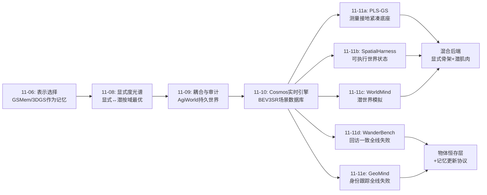
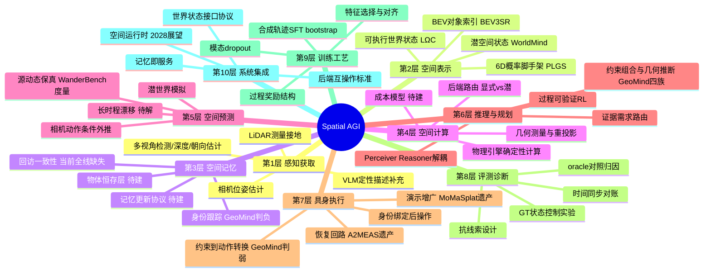
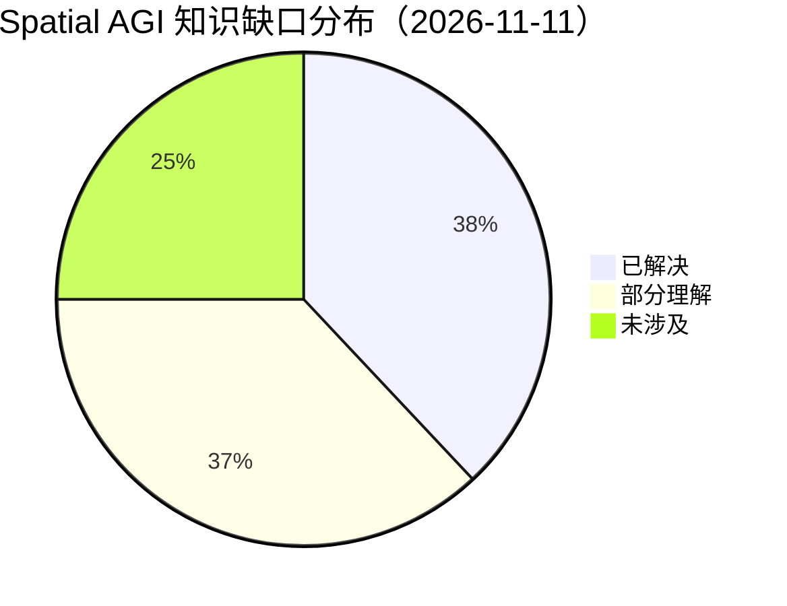

# Spatial AGI 每日思考 - 2026-11-11

## 📅 每日总结

**日期**: 2026-11-11
**论文数量**: 5篇
**主题**: 昨天的主题是"系统构件化"——空间智能的竞争从更好的模型转向更好的系统。今天五篇论文回答的是系统的**核心后端问题**：当系统构件各自成型之后，"空间状态"放在哪里、如何计算、如何预测、如何记住。五篇论文构成一条完整的技术栈证据链：**PLS-GS 解决空间状态的几何底座**（6D 概率脚手架，紧凑且测量接地，模型缩小 2.5×），**Spatial Harness 解决静态空间状态的查询协议**（可执行世界状态 + 物理引擎计算后果，GT 状态下 98.25%），**WorldMind 解决动态空间状态的预测协议**（潜世界模拟绕过像素往返，+16.0%），**WanderBench 揭示记忆构件的系统性缺失**（8 个世界模型无一能记住自己生成过的内容），**GeoMind 在操作域确认同一缺陷**（agent 跨变化身份跟踪全线失败）。五篇的共同信号是：**空间智能的架构问题已经从"要不要外部空间后端"变成"选哪种后端（显式引擎 vs 潜空间）、以及如何补上持久记忆这块最大短板"**。今天的元判断是：空间判断的"计算外包"已被两条路线并行验证成功，而空间记忆——记住、且记得新——是当前整个领域共同的结构性空白，也是 Spatial Harness/WorldMind 之后的下一个主战场。

**关键突破**:
- 🚀 Spatial Harness：GT 世界状态控制实验做出范式级判决——Base 71.81% vs 引擎执行 98.25%，证明 VLM 空间失败的大头不在"看不懂"而在"算不对"；可执行世界状态（布局/观测/约束三层）+ Perceiver/Reasoner 解耦 + 语言约束参与几何校正（优先级机制），Qwen3.5-27B 在 MindCube 52.70%→71.14%，四基准一致提升
- 🚀 WorldMind：确立空间推理测试时扩展的第三范式——潜世界模拟。VLM 选择相机动作、扩散世界模型在潜空间执行、对齐后的潜特征直接回流 VLM，绕开 latent-to-pixel-to-latent 信息瓶颈；学习式潜特征选择（跨层×去噪步归因）+ 过程可验证 RL（动作有效+转移可靠才给奖励），三基准平均 +16.0%
- 🚀 WanderBench：745 源视频、6 维 24 子指标，首次系统度量视频世界模型"忠实探索动态世界"的能力；两大普适失败模式——长程相机控制/源动态衰减、无一模型保持回访一致性；R.7"回访事件时效性"指标识破"冻结旧状态"的伪一致性；WanderLand 零训练（同刻源帧锚定 + 自身早前内容回填）全维度提升
- 🚀 PLS-GS：首次把分层 GMM 从点云几何表示改造为渲染脚手架——6D（位置+颜色）联合 EM 拟合、叶分量协方差特征向量天然提供表面框架、Mahalanobis 支撑损失软约束贴附测量表面；五个大型户外场景上几何精度 1.47×、模型缩小 2.5×、渲染加速 1.7×
- 🚀 GeoMind：空间推理（4 任务族）+ 空间记忆（2 任务族）全覆盖的操作诊断基准，54 变体 + 抗线索设计（视觉相同物体）+ oracle 对照归因；判定具身 agent 两大系统性弱点——跨变化身份跟踪失败、关系/几何约束到动作的转换失败

**架构演进**: 系统构件分层的分工架构 → **空间后端分层的分工架构**（系统构件化结论保持，今天补上后端层结论：空间智能系统 = 空间状态后端（显式引擎（Spatial Harness）⊕ 潜空间模拟（WorldMind），底座为测量接地的紧凑几何（PLS-GS））+ 空间记忆（当前最大缺口，WanderBench/GeoMind 双重确认）+ 昨日遗产（监督结构、证据路由、恢复回路、世界引擎、审计工具）——后端选择成为新的架构自由度，持久记忆成为新的关键路径）

### 📊 一句话总结

2026-11-11 的五篇论文确立了空间智能的后端判断：**空间判断的计算可以而且应该外包给外部后端——显式物理引擎路线（Spatial Harness，GT 状态下 98.25%）与潜空间模拟路线（WorldMind，+16%）并行验证成功；几何底座已做到测量接地且高度紧凑（PLS-GS，2.5× 缩小）；但两大基准（WanderBench 8 模型、GeoMind 全体 agent）一致证明"持久且可更新的空间记忆"是全领域结构性缺失——记住已见之物并记得其变化，是空间计算外包之后必须补上的下一块基石。**

### 🔗 延续性

**昨日→今日**: 昨日核心结论是"空间智能正在从模型竞赛转向系统工程——记忆、证据、路由、恢复、监督结构、基础设施各有独立杠杆"，并留下八条线索。今天五篇精确接住其中多条：①昨日线索①"场景记忆的可更新性"——WanderBench 的回访一致性评测与 GeoMind 的身份跟踪评测正是对这条线索的**度量化回应**：两份基准不约而同把"记忆是否会更新/失效"作为核心测试维度，说明该缺口已从"个人观察"上升为"社区共识问题"；②昨日线索⑥"混合世界引擎的接口标准"——Spatial Harness 给出了显式侧的接口答案（世界状态 s=(L,Ω,C) 的 JSON 化 + MuJoCo 实例化协议），WorldMind 给出了潜式侧的接口答案（相机动作进、对齐潜特征出），两个接口标准可对照设计；③昨日"审计走向运行时"的思想在 Spatial Harness 中再现——执行轨迹（每步操作+测量+渲染）本身就是空间推理的运行时审计日志，错误可在中间步骤被发现（示例中的二次转身）；④昨日 MoMaSplat 的"经验→3DGS 记忆"与今日 PLS-GS 的"扫描→紧凑几何底座"互补——前者解决记忆从哪来，后者解决底座如何又小又准；⑤昨日 BEV3SR 的"证据路由"与今日 Spatial Harness/WorldMind 构成完整的"空间计算分发"谱系：几何证据用引擎确定性计算（Harness）、动态外推用潜模拟（WorldMind）、度量场景查询用 BEV 索引（BEV3SR）——空间后端是一个设计空间而非单一选择；⑥昨日 Cosmos"世界模型实时性跨过 in-the-loop 门槛"被 WanderBench 补上质量审视——实时跨线之后，忠实性（源动态保真、回访一致）成为新的准入门。

**今日→明日**: 九条新线索：①显式-潜混合后端——Spatial Harness 的可解释骨架 + WorldMind 的动态外推肌肉，在世界状态接口上汇合的混合架构是明显的下一步；②物体恒存层——WanderBench 回访失败与 GeoMind 身份跟踪失败同指"跨时间/视角/变化维持物体等价类"的缺失，需要专门的持久身份机制；③记忆更新协议——对象级空间记录的失效、重验证、版本管理（接昨日线索①，今天获得双基准度量支撑）；④世界状态自动构建管线——Spatial Harness 的 Perceiver 仍靠专用模型拼接，端到端学习"感知→可执行状态"的数据与训练方法待突破；⑤潜状态可靠性验证——WorldMind 依赖学得判据判断潜转移可靠，显式化的可靠性度量缺失；⑥动态几何底座——PLS-GS 是静态快照，LiDAR 接地骨架 + 动态主体轨迹层的分层建模待探索；⑦空间计算后端的成本模型——引擎计算、潜模拟、BEV 查询三者的延迟/精度/能耗权衡没有统一度量；⑧过程可验证奖励的推广——WorldMind 的"动作有效+转移可靠才奖励"结构可迁移到导航/操作训练；⑨后端选择的学习——什么任务用哪个后端（可解释性优先 or 外推能力优先）能否被元学习。明日检索方向："hybrid world model explicit state latent simulation"、"object permanence embodied agent"、"spatial memory update protocol"、"end-to-end world state estimation"、"latent state reliability metric"、"dynamic lidar scaffold tracking"、"spatial backend cost benchmark"。

### 💡 本质思考：如何达成通用空间智能

#### 1. 核心能力的本质是什么？

本周主题的第八次收敛。11-04"分工架构"、11-05"可验证"、11-06"表示选择"、11-07"可制造"、11-08"显式度光谱"、11-09"耦合与审计"、11-10"系统构件化"，今天加入空间状态后端与记忆维度：

**空间智能的本质是以系统构件组织起来的分工架构，其核心后端是"可执行的空间状态"——状态必须具体化到能从中计算空间操作后果的程度（Spatial Harness 的可执行性要求）；后端在显式引擎与潜空间之间构成设计光谱（可检查性 ↔ 动态外推能力）；而支撑长时程智能的空间记忆必须满足三条被今日基准形式化的标准：跨视角一致（WanderBench R.1-R.5）、随时间演化（R.6-R.7）、跨变化绑定身份（GeoMind identity tracking）。权重、显式状态、潜状态、记忆结构是四种并列的空间能力载体。**

今天的证据链：

- **空间计算的黄金判决**（Spatial Harness）：固定 GT 世界状态后，同一模型内部推理 71.81% vs 引擎执行 98.25%——26 个百分点的差距全部来自"算不对"而非"不知道"。这是把空间判断从生成式改为计算式的最有说服力证据，类似 AlphaGo 中 MCTS 之于策略网络。
- **潜空间的地位确认**（WorldMind）：世界模型中间表示在充分对齐后系统性优于像素——空间信息的完整载体在潜空间，问题只在特征选择与对齐。像素只是潜状态的一次有损投影。
- **底座的工程成熟**（PLS-GS）：测量接地的几何底座做到 2.5× 紧凑 + 1.7× 加速且更准——显式世界状态的成本壁垒正在瓦解，可执行路线的部署可行性大幅提升。
- **记忆的双重判负**（WanderBench + GeoMind）：两个领域（世界模型、操作策略）、两种评测（渲染回访、操作跟踪）得出同一结论——现有系统没有物体恒存性。空间记忆是当前所有架构共享的缺失器官。

#### 2. 当前方法与理想目标的差距在哪里？

- **后端光谱两端未连通**：Spatial Harness 只处理静态场景（代理物体、无动力学），WorldMind 潜证据不可解释且依赖分布内外推——"显式骨架 + 潜肌肉"的混合后端尚无实例；两者的世界状态接口（JSON 布局 vs 对齐潜特征）没有共同协议。
- **记忆没有更新机制**：WanderBench 证明模型"不知道自己知道过什么"（重访即重绘），GeoMind 证明 agent"认不出变化后的同一物体"——记忆缺失不是存储问题而是**更新与身份绑定**问题；昨日已指出，今天获得定量证据，但解决方案（失效检测、重验证、版本管理）仍无人给出。
- **世界状态的构建仍靠拼接**：Spatial Harness 的 Perceiver 串联检测/深度/朝向/位姿四个专用模型 + VLM 补充询问，误差在编译级联；端到端"观测→可执行状态"的学习方法缺席。
- **潜状态可靠性无外部判据**：WorldMind 判断潜转移可靠与否依赖训练出的奖励模型；世界模型在分布外相机动作上的外推是否可信，没有显式校验手段（对比：显式引擎的计算总是自洽的）。
- **几何底座是静态快照**：PLS-GS 的锚点与表面框架固定，无法处理动态场景与多时刻融合；长时程建图的漂移与闭环未集成。
- **诊断与增强尚未闭环**：GeoMind/WanderBench 精确指出失败（身份跟踪、约束接地、回访一致性），但对应的训练方法（如何让 agent 获得物体恒存性）还是空白——基准先行、方法滞后的格局。
- **成本模型缺失**：引擎多轮调用、潜模拟每次扩散前向、BEV 检索的开销没有统一的延迟/精度/能耗账本，后端选择全凭经验。

#### 3. 从今天到理想状态，最可能的路径是什么？

五步走判断（昨日版本的更新）：

**第一步（进行中）：空间计算外包的双路线验证完成**。显式路线（Spatial Harness，GT 状态 98.25%、四基准提升）与潜式路线（WorldMind，+16.0%）并行确立；底座紧凑化（PLS-GS）拆除成本壁垒；同时记忆缺口被双基准定量确认。标志事件：GT 控制实验的范式判决——"空间失败大头在计算而非感知"成为可引用的领域共识。

**第二步（2027 上半年）：混合后端与记忆更新机制**。显式-潜混合后端出现第一个实例（引擎管可解释骨架与静态几何、潜模拟管动态外推，统一世界状态接口）；WanderBench 式回访评测推动世界模型加入持久记忆（类似 AlayaWorld 的空间记忆方向但带更新协议）；物体恒存层作为独立模块被提出（身份等价类的跨变化维护）。接昨日"ROS for Spatial AGI"预测：世界状态接口协议是它的第一批标准。

**第三步（2027 下半年）：端到端世界状态学习与过程奖励普及**。从观测直接预测可执行世界状态的模型（超越 Perceiver 的模型拼接）；WorldMind 式过程可验证奖励从空间推理扩展到导航与操作训练（接 GeoMind 的约束接地失败——接地过程天然适合过程监督）；潜状态可靠性的外部校验方法（与显式几何对照校验）出现。

**第四步（2028）：动态几何底座与记忆-引擎一体化**。PLS-GS 式测量接地底座扩展到动态场景（静态骨架+动态轨迹层）；空间记忆与世界后端合并为"可查询、可预测、可更新的场景服务"——记忆即引擎的持久化层，引擎即记忆的想象模式；成本模型标准化，后端路由成为可学习策略。

**第五步（2028+）：带恒存性的空间运行时**。昨日预测的"空间智能操作系统"补上最后一块器官：记忆管理、进程调度、系统调用之外，增加**对象恒存服务**（身份等价类的全生命周期维护）——婴儿 4 个月获得的物体恒存性，成为空间智能运行时的标准系统服务；空间判断默认外包给后端、记忆默认持久且可更新、模型权重退化为其中一种可热插拔组件。

---

## 🔗 与昨日思考的联系

### 昨日重点

昨天的主题是**系统构件化**：MoMaSplat（任务经验=免费 3D 记忆）、SURE（监督结构替代数据）、A2-MEAS（动作模型+推理协调+诊断+纠正的系统协作）、Cosmos-Sim（实时交互世界引擎，48 FPS 单卡）、BEV3SR（BEV 作为可查询空间数据库索引）。确立"空间智能的竞争从模型转向系统，每个构件有独立杠杆"。留下八条线索：①场景记忆可更新性、②证据路由粒度、③纠正代码分布外、④监督先验清单、⑤世界模型长时程漂移、⑥混合世界引擎接口、⑦经验记忆跨任务复用、⑧证据需求自动学习。

### 今日进展

今天五篇论文从"系统构件"聚焦到"空间状态后端 + 记忆"，并接住昨日多条线索：

1. **接住线索①"场景记忆的可更新性"（WanderBench + GeoMind 双重回应）**：昨天指出 BEV3SR/MoMaSplat 的记忆都是静态构建、物体移动后如何失效未解决；今天两份基准不约而同把"记忆的更新与时效"作为核心评测——WanderBench 的 R.7（回访事件时效性）度量"回到原地是否看到当前状态"，GeoMind 的 Scene Updating/Identity Tracking 度量"场景变化后是否维持正确状态"。缺口从观察升格为带度量的公共问题，下一步是更新协议本身。
2. **接住线索⑥"混合世界引擎接口标准"（Spatial Harness + WorldMind 双侧答卷）**：昨天期待"外部仿真器管物理 + 生成模型管外观"的标准接口；今天显式侧答案出现（世界状态 s=(L,Ω,C) + MuJoCo 实例化，语言约束可注入），潜式侧答案出现（相机动作进、对齐潜特征出）。两个接口的对照设计为混合引擎协议提供了素材。
3. **接住昨日"审计走向运行时"方向（Spatial Harness）**：昨日 A2-MEAS 把审计搬进运行时（证据溯源）；今天 Spatial Harness 的执行轨迹是空间推理版的运行时审计——每步视角操作、几何测量、渲染视图全部留痕，错误在中间步骤可发现可纠正（示例中检测到"转身方向不对"而二次转身）。生成式推理没有这种中间检查点。
4. **昨日 MoMaSplat × 今日 PLS-GS（记忆的来料与加工）**：昨天解决"记忆从哪来"（任务采集=免费扫描），今天解决"底座如何又小又准"（测量接地 + 2.5× 紧凑）。两者拼接出完整管线：经验扫描 → 概率脚手架 → 可执行世界状态 → 策略与推理共用。
5. **昨日 BEV3SR × 今日双后端（空间计算分发谱系成形）**：BEV 索引管度量查询（静态、轻量）、Spatial Harness 管确定性几何推理（可检查）、WorldMind 管动态外推（主动变换）——三种后端按证据需求分发，与昨日"证据路由"思想在架构层汇合。
6. **接住线索⑤"世界模型长时程漂移"（WanderBench 直接度量）**：昨天担心 Cosmos 式自回归生成的分钟级一致性未量化；今天 WanderBench 发现随剪辑变长，模型保外观但丢相机控制与源动态——漂移有了第一个系统性度量（运动时间线一致性、时间同步、回访一致性），且发现漂移的结构性模式（保静态、丢动态）。

### 演进路径

---

## 📚 论文概览

今天五篇论文构成"空间状态后端"的完整技术栈，从底座到协议到评测：

1. **PLS-GS（arXiv:2611.10699，QUT）——几何底座层**：6D 分层高斯混合模型（位置+颜色联合 EM）作为渲染脚手架，叶分量协方差特征向量提供表面框架，Mahalanobis 支撑损失约束 primitive 贴附 LiDAR 测量表面；五场景几何精度 1.47×、模型 2.5× 缩小、渲染 1.7× 加速。回答"可执行世界状态的几何从哪来、如何又小又准"。

2. **Spatial Harness（arXiv:2611.11344，HKBU+ByteDance Seed，NeurIPS 2026）——静态状态查询协议层**：可执行世界状态 s=(L,Ω,C)（布局/观测/约束三层）+ Perceiver（语言约束与视觉估计融合编译布局）/Reasoner（MuJoCo 中执行视角变换、测量、渲染）解耦；GT 状态控制实验判决 71.81% vs 98.25%；四基准一致提升。回答"静态空间状态如何被检查、查询、计算"。

3. **WorldMind（arXiv:2611.10151，Tsinghua+Pitt）——动态状态预测协议层**：VLM 选择相机动作、扩散世界模型潜空间执行、top-K 学习式选择的潜特征经适配器直接回流 VLM（绕过像素往返）；SFT bootstrap + 过程可验证 RL（动作有效+转移可靠才奖励）；三基准平均 +16.0%。回答"动态空间状态如何被预测并安全接入推理"。

4. **WanderBench（arXiv:2611.12557，HUST）——记忆评测层（世界模型侧）**：745 源视频 × 3 难度档、6 维 24 子指标（视觉质量/相机控制/源世界保真/源动态保真/时空一致性/动态回访一致性），时间同步参照免时间标注；8 模型评测揭示长程衰减与无记忆回访两大普适失败；WanderLand 证据有序条件化零训练全维提升。回答"世界模型是否记得自己见过的世界"。

5. **GeoMind（arXiv:2611.12175，Tsinghua SZIGS）——记忆评测层（操作侧）**：空间推理四族（目标识别/关系接地/约束组合/几何推断）+ 空间记忆两族（场景更新/身份跟踪），54 变体、视觉相同物体抗线索、oracle 对照归因；判定 agent 两大系统性弱点。回答"操作智能体是否具备结构化空间理解"。

五篇合观：底座（PLS-GS）→ 查询协议（Spatial Harness）→ 预测协议（WorldMind）→ 记忆审计（WanderBench + GeoMind）——空间状态的生命周期"获取-计算-预测-记住"首次被完整覆盖，且"记住"环节被判不合格。

---

## 💡 核心见解

### 见解1: 空间失败的大头是"算不对"而非"看不懂"

**从 Spatial Harness 获得**

- ✅ GT 世界状态固定后，同一 VLM 直接推理 71.81%，引擎执行 98.25%——26.4 个百分点的差距与感知无关，全部来自空间变换的内部想象失败
- ✅ 无 GT 时 Base 甚至不被 GT 地图稳定提升，而 Spatial Harness 借助执行显著获益——"给定事实"只有配上"计算能力"才生效
- ✅ 执行轨迹提供中间检查点：错误可在"转身后渲染不符合预期"这类中间步骤被发现并纠正

**对Spatial AGI的启发**:

这是本周最重要的一张判决书。它把资源分配问题重新定焦：与其无限扩大 VLM 的空间预训练，不如给 VLM 配一个空间计算后端——类似 AlphaGo 的策略网络+MCTS 分工。空间推理的"思考"本质上是"在世界状态上执行操作并观察结果"，而不是"生成更长的解释"。这同时解释了为什么思维链对空间任务收益有限：语言化的中间步骤没有强制约束力，只有可执行的中间步骤才有。

### 见解2: 潜空间是空间信息的完整载体，像素只是有损投影

**从 WorldMind 获得**

- ✅ 先导实验的曲线形态：小数据 RGB 输入更好（预训练对齐的便利），大数据后潜特征反超——潜空间的信息上限更高
- ✅ 世界模型中间表示编码几何/相机运动/物体对应（无需 3D 监督），但空间信息在层×去噪步上分布极不均匀，学习式选择（归因+消融）必要
- ✅ latent-to-pixel-to-latent 瓶颈是已有 VLM+WM 方法的结构性缺陷：ViT 为语义优化，从像素恢复几何必然有损

**对Spatial AGI的启发**:

世界模型不该被当作"渲染器"而应被当作"空间数据库+模拟器"。空间智能系统访问世界模型的正确姿势是潜特征接口而非图像接口。但潜证据的不可解释性是代价——与 Spatial Harness 的显式状态对照，形成"可检查性 ↔ 信息完整性"的新权衡轴。工程含义：给 agent 的空间证据应该按任务需要选择信噪比最高的形式，而不是默认渲染成图。

### 见解3: 持久空间记忆是全领域共享的缺失器官

**从 WanderBench + GeoMind 获得**

- ✅ WanderBench：8 个视频世界模型无一保持回访一致性——离开再回来，场景被重新绘制；且可能靠"冻结动态主体的过时状态"伪造一致性
- ✅ GeoMind：全体被评 agent 在场景变化后的身份跟踪上系统性失败——认不出被移动后的同一物体
- ✅ 两个领域、两种任务形式（渲染回访 vs 操作跟踪）得出同一结论：没有物体恒存性

**对Spatial AGI的启发**:

昨天说"空间记忆的可更新性是最大系统性缺口"，今天获得跨领域定量确认。物体恒存性（object permanence）是人类婴儿 4 个月大就有的能力，却是当前最强世界模型与操作智能体的共同盲区。这暗示需要一个新的系统层——"对象恒存服务"：维护物体身份等价类（跨视角、跨时间、跨遮挡/移动），检测失效、触发重验证、管理版本。它不能靠端到端训练顺手解决（两个领域都试过了），需要显式的记忆架构设计。

### 见解4: 后端是一个设计空间，路由是新的架构自由度

**从 Spatial Harness × WorldMind × BEV3SR(昨日) 获得**

- ✅ 显式引擎：确定性、可检查、语言约束可注入，但限于静态场景与代理保真度
- ✅ 潜空间模拟：保留主动变换与动态外推，但不可解释、依赖分布内外推
- ✅ BEV 索引：轻量度量查询，training-free 可用
- ✅ 三者按任务特征（需要可解释？需要动态？需要度量精度？）各有所长

**对Spatial AGI的启发**:

"要不要外部空间后端"的问题已经终结（要），新问题是"哪个任务用哪个后端"。这形成类似计算机体系结构的分工：确定性几何=CPU（精确但串行）、潜模拟=GPU（大规模并行想象）、BEV 索引=内存（快速检索）。Spatial AGI 需要一个"空间指令调度器"——BEV3SR 的证据需求路由是它的雏形，但需要扩展到三后端混合，且路由策略本身可学习。

### 见解5: 测量接地的表示正在变得又小又准

**从 PLS-GS 获得**

- ✅ GMM 协方差特征向量是免费的表面几何——两大特征向量张切平面、最小对齐法向，无需显式法向估计
- ✅ 解码参考系比事后正则更有效：同样的 LiDAR 初始化，仅在表面框架内解码偏移就让所有场景所有几何指标改善
- ✅ 6D 联合拟合（位置+颜色）分离空间相邻但外观不同的表面（路面标线 vs 沥青）

**对Spatial AGI的启发**:

"概率分量自带局部坐标系"是被低估的空间表示原语。它同时是几何描述、渲染脚手架和潜在的记忆数据结构（层级=LOD、自适应分辨率=按需细节）。显式世界状态路线的部署成本正在被这类工作快速压低——Spatial Harness 式系统的落地障碍一个一个被拆除。对机器人平台（LiDAR+相机是标准配置）来说，"测量优先"应成为空间表示的设计默认。

### 见解6: 过程可验证奖励是空间多步行为的正确训练信号

**从 WorldMind 获得**

- ✅ 只有当意图的空间变换被成功实现且所得潜状态可靠时才奖励推理进展——稀疏但严格的步骤级奖励
- ✅ 惩罚不必要的世界模型调用——抑制工具滥用
- ✅ SFT（合成轨迹 bootstrap）→ RL（自身轨迹优化）的两阶段配方解决了多步行为的冷启动

**对Spatial AGI的启发**:

空间推理的多步性（选视角→模拟→读证据→再决策）使最终答案监督严重欠约束——中间步骤可能侥幸蒙对或侥幸蒙错。WorldMind 的奖励结构给出模板：把"动作有效性"与"转移可靠性"作为可程序化检查的过程指标。这与 GeoMind 的 grounding 代码管线（空间约束→可执行代码→确定性 GT）同构——**空间领域天然适合过程监督，因为空间操作的正确性可被计算**。这是空间智能训练相对其他领域的结构性优势，应当被系统利用。

### 见解7: 评测正在从"生成质量"转向"与世界的对账"

**从 WanderBench 获得**

- ✅ 时间同步参照 trick：源相机静止 ⇒ 每输出帧对应同刻源帧，免时间标注建立逐帧参照
- ✅ R.7 回访事件时效性：识破"冻结旧状态"的伪一致性——真记忆必须是可更新的
- ✅ 忠实性六维拆解：对已发生世界的对账（保真、时序、回访）而非对想象世界的美学评分

**对Spatial AGI的启发**:

世界模型的评价标准正在发生范式迁移：从"视频好不好看"到"探索是否忠实于已记录的世界"。这与 real-to-sim、具身训练环境生成等应用的需求精确对齐——模拟环境的价值取决于它与真实世界的账目是否对得上。"对账式评测"（time-synchronized accounting）方法可推广到任何生成式世界构建系统，包括昨日 Cosmos 的物理保真度量化。

---

## 🗺️ 知识演进图

## 技术栈演进对比表

| 层次 | 昨日方案 | 今日方案 | 变化 |
|------|---------|---------|------|
| 几何底座 | MoMaSplat 场景 3DGS（任务采集免费扫描） | PLS-GS 概率 LiDAR 脚手架（测量接地，2.5× 紧凑） | 底座从"免费但粗"到"接地且紧凑" |
| 静态状态查询 | BEV3SR 度量 BEV 索引（QA 场景） | Spatial Harness 可执行世界状态+MuJoCo（四基准推理） | 查询从"检索证据"升级为"计算后果" |
| 动态状态预测 | Cosmos 实时交互引擎（动作→观测，48FPS） | WorldMind 潜特征直接回流 VLM（+16%） | 预测从"渲染像素"升级为"潜证据回流" |
| 空间记忆 | AgiWorld 点云持久记忆（启发式维护） | WanderBench/GeoMind 双基准判负（无一合格） | 记忆从"构件假设"变成"已量化缺口" |
| 训练信号 | SURE 监督结构先验注入 | WorldMind 过程可验证 RL（步骤级奖励） | 过程奖励从"监督设计"到"RL 奖励结构" |
| 空间诊断 | GeoMind 缺席（操作侧无空间诊断） | GeoMind 六族 54 变体+oracle 归因 | 诊断能力清单化（识别/接地/组合/推断/更新/跟踪） |
| 审计 | A2-MEAS 诊断智能体（运行时证据溯源） | Spatial Harness 执行轨迹（空间推理留痕） | 审计扩展到推理过程本身 |
| 世界状态接口 | 混合引擎接口未定（线索⑥） | 显式侧 s=(L,Ω,C)+MuJoCo；潜式侧动作→对齐潜特征 | 接口两侧答卷齐备，混合协议可起草 |

## 🗺️ Spatial AGI 知识图谱

### 10层架构思维导图

### 🎯 主线技术路径

#### 阶段1: 单点能力（已完成，~2024-2025）
3DGS 渲染、VLA 策略、世界模型生成、空间基准各自突破；空间能力被视为模型内禀属性。

#### 阶段2: 组件耦合与显式度分化（2026 上半年）
组件以不同显式度耦合（11-08/11-09）；审计思想确立；世界状态开始外化。

#### 阶段3: 系统构件化（2026Q4，本周前段）
记忆、监督、恢复、引擎、路由各有独立杠杆与实现（11-10）；构件进入"人人可组装"时代。

#### 阶段4: 空间后端分化与记忆判负（当前，2026-11 本周证据）
空间计算外包双路线验证成功（显式引擎/潜模拟）；几何底座紧凑化；记忆缺口被双基准定量确认——后端选择成为架构自由度，记忆成为关键路径。

#### 阶段5: 混合后端与恒存层（2027 上半年，预测）
显式骨架+潜肌肉的混合后端实例化；世界状态接口协议标准化（ROS for Spatial AGI 第一批标准）；物体恒存层与记忆更新协议出现。

#### 阶段6: 空间运行时（2028+，预测）
记忆管理、后端调度、恒存服务成为标准系统服务；模型权重退化为可热插拔组件之一；空间智能以操作系统形态存在。

---

## 🔍 待探索议题

### 高优先级（本周）

1. **物体恒存层的设计**
   - 问题: WanderBench 回访失败与 GeoMind 身份跟踪失败同指一个缺失机制——跨视角/时间/变化维持物体身份等价类
   - 候选方案: 对象级记录 + 特征签名（跨视角不变量）+ 等价类合并/分裂规则 + 变化事件触发的重验证
   - 缺口: 身份判定的判据（外观相似度？几何连续性？交互历史？）与冲突消解协议

2. **显式-潜混合后端架构**
   - 问题: Spatial Harness 可解释但静态，WorldMind 动态但黑箱——如何在世界状态接口上汇合
   - 候选方案: 引擎维护显式骨架（布局+代理），潜模拟提供动态外推；查询按"需要可解释?需要动态?"路由到对应子后端
   - 缺口: 两个子后端的状态同步机制（潜外推的结果如何写回显式状态）与一致性校验

3. **记忆更新协议**
   - 问题: 昨日线索①+今日双基准确认——空间记录的失效检测、重验证、版本管理无方案
   - 候选方案: 置信度衰减（时间+事件驱动）、观测冲突触发的局部重建、记录级版本链
   - 缺口: 失效检测的信号设计（什么观测证明旧记录作废）与更新成本预算

### 中优先级（本月）

4. **端到端世界状态学习**
   - 问题: Spatial Harness 的 Perceiver 靠四个专用模型拼接，误差级联
   - 候选方案: 以可执行状态的 GT（仿真器自动生成）训练"观测→状态"模型；GeoMind 的 grounding 代码管线可提供训练数据
   - 缺口: 真实场景的可执行状态 GT 获取（仿真到真实的 gap）

5. **潜状态可靠性外部校验**
   - 问题: WorldMind 判断潜转移可靠依赖学得判据，分布外外推无显式校验
   - 候选方案: 潜预测与显式几何的对照校验（可渲染性检查）、多步一致性自检、不确定性估计头
   - 缺口: 潜状态与显式表示的对齐成本；校验通过率与任务成功的相关性验证

6. **动态几何底座**
   - 问题: PLS-GS 是静态快照，锚点与表面框架固定
   - 候选方案: 静态骨架+动态轨迹层分层建模（锚点管静态、独立轨迹管动态主体）；多时刻 LiDAR 融合与闭环
   - 缺口: 动静边界的在线划分；长时程漂移处理

7. **过程可验证奖励的领域推广**
   - 问题: WorldMind 的奖励结构（动作有效+转移可靠）目前限于空间推理 QA
   - 候选方案: 迁移到导航（路径有效性+状态转移可靠）与操作（GeoMind 约束接地的过程监督）
   - 缺口: 各领域"有效性"的可计算定义；奖励模型的跨领域泛化

### 低优先级（本季度）

8. **空间后端成本模型**
   - 问题: 引擎多轮调用、潜模拟扩散前向、BEV 检索的开销无统一账本
   - 候选方案: 建立（延迟/精度/能耗）三维基准，按任务复杂度分档报告
   - 缺口: 跨后端的任务等价性定义（什么算"同一空间判断"）

9. **后端路由的可学习化**
   - 问题: BEV3SR 的证据需求路由由 LLM 判断、二分太粗（昨日线索②⑧延续）
   - 候选方案: 从错误统计学习路由策略；三后端（几何/潜/检索）混合路由
   - 缺口: 路由决策的监督信号（哪次判断本该用哪个后端）标注

10. **空间记忆的语义层**
    - 问题: 当前记忆都是几何/外观级，缺乏 affordance、功能性等语义维度的记忆
    - 候选方案: 锚点记录附加语义槽（可用性、危险性、变化历史）；与 GeoMind 的约束组合任务对接
    - 缺口: 语义记忆的获取来源（交互中学 vs 语言先验）与置信度管理

---

## 📊 知识缺口分析

**已解决（38%）**:
- ✅ 空间计算外包的显式路线验证（Spatial Harness：GT 状态 98.25%、四基准提升）
- ✅ 空间计算外包的潜式路线验证（WorldMind：+16.0%，三基准）
- ✅ 几何底座的紧凑化与测量接地（PLS-GS：1.47× 准、2.5× 小、1.7× 快）
- ✅ 世界状态的三层形式化与语言约束注入机制（Spatial Harness）
- ✅ 潜特征选择与跨模态对齐配方（WorldMind：归因选择+模态dropout+功能对齐）
- ✅ 空间推理的操作侧诊断体系（GeoMind：六族54变体+oracle归因）
- ✅ 忠实性评测协议（WanderBench：时间同步参照+六维24指标）
- ✅ 系统构件化共识（昨日遗产：记忆/监督/恢复/引擎各有杠杆）

**部分理解（37%）**:
- ⚠️ 混合后端架构——两侧接口已答卷但无汇合实例（显式骨架+潜肌肉）
- ⚠️ 记忆缺失的度量——双基准已量化缺口，但更新协议（失效/重验证/版本）无方案
- ⚠️ 世界状态构建——Perceiver 模型拼接可用但误差级联，端到端学习缺席
- ⚠️ 潜状态可靠性——奖励模型可判但无外部校验，分布外外推存疑
- ⚠️ 长时程一致性——WanderBench 度量了漂移模式（保静态丢动态）但无修复方法
- ⚠️ 过程可验证奖励——空间推理域已验证，导航/操作域迁移未验证
- ⚠️ 后端成本权衡——三后端各有延迟/精度特征但无统一账本
- ⚠️ 语义空间记忆——几何/外观级记忆已有，affordance/功能记忆空白

**未涉及（25%）**:
- ❌ 物体恒存机制——身份等价类的跨变化维护（今日最大新缺口）
- ❌ 动态几何底座——LiDAR 接地骨架+动态轨迹层的分层建模
- ❌ 端到端世界状态学习的真实域 GT 获取
- ❌ 模糊空间语言的处理（GeoMind 只覆盖确定性规则）
- ❌ 后端路由的可学习策略
- ❌ 多 agent 共享空间记忆的一致性协议
- ❌ 空间智能运行时的系统服务抽象（记忆管理/后端调度/恒存服务）

---

## 📝 方法论笔记

- **GT 控制实验的力量**: Spatial Harness 用固定 GT 状态分离感知与推理的失败归因——这种"固定一个变量、观察另一个"的实验设计在空间智能评测中被严重低估，值得推广到记忆（固定状态，测记忆）与执行（固定目标，测执行）的归因。
- **时间同步参照**: WanderBench 利用源相机静止的先验免除时间标注——"利用任务结构消除标注需求"是基准工程的通用智慧。
- **抗线索设计**: GeoMind 用视觉相同物体切断外观旁路——评测任务必须假设被评者会"作弊"，设计时主动封堵捷径。
- **先导实验定方向**: WorldMind 用小规模 RGB vs 潜特征对比实验决定整篇论文的技术路线——"先花 5% 资源验证核心假设"的论文工程学。

## 🧩 延伸讨论：五篇论文的十组深度对话

### 对话1: Spatial Harness vs WorldMind —— 空间计算后端的两极

这是今天最重要的理论对话，值得单独展开：

**共同前提**：两者都接受同一判断——VLM 内部推理不足以处理空间变换，空间操作的后果必须由外部计算。这是本周空间智能思想的最大公约数。

**分歧点逐一对照**：

| 维度 | Spatial Harness | WorldMind |
|------|----------------|-----------|
| 状态形式 | 显式几何（布局+代理物体） | 潜向量（扩散中间表示） |
| 变换执行 | 物理引擎确定性计算 | 世界模型预测性外推 |
| 证据形式 | 测量值+渲染视图（人可读） | 对齐后潜特征（机器可读） |
| 可诊断性 | 高（每步可检查、轨迹留痕） | 低（黑箱映射） |
| 动态能力 | 无（静态场景） | 有（相机动作外推） |
| 信息完整性 | 有损（代理简化） | 完整（潜空间全信息） |
| 部署成本 | 引擎调用+多轮交互 | 每步扩散前向 |
| 失败模式 | 感知估计错误传播 | 分布外外推不可靠 |

**深层观察**：两者的失败模式恰好互补——Harness 败于上游（感知估计错了，引擎算得再准也没用），WorldMind 败于下游（潜预测不可信，VLM 无法自查）。这提示混合架构的分工原则：**显式侧负责可验证的部分（静态几何、确定性关系），潜侧负责不可验证的部分（动态外推、想象）**——而验证桥梁可以是"潜外推结果渲染/投影回显式状态做一致性检查"。

### 对话2: WanderBench 与 R2M-Bench/MIND 的评测代际差

WanderBench 的相对位置：
- R2M-Bench 首次把"回访一致性"纳入世界模型评测，但缺少时间同步的源事件打分；
- MIND 探测闭环记忆一致性，但不针对源视频忠实性；
- WanderBench 的独特点是把"记忆"拆成三个可分离的子问题：**记住了吗**（R.1-R.4 相似度）、**记得对吗**（R.5-R.6 物体对应）、**记得新吗**（R.7 时效性）。

R.7 是概念突破：它把"一致性"从静态相似度解放为动态对账——一个只会冻结旧状态的模型在 R.1-R.6 都可能得分，但 R.7 揭穿它。这为下一代记忆评测树立了标准：**任何记忆指标都应包含时效性变体**。

### 对话3: GeoMind 的身份跟踪与物体恒存的认知科学对应

GeoMind 发现的"跨变化身份跟踪失败"在认知科学中有精确对应：
- **物体恒存性**（object permanence，Piaget）：物体被遮挡/移动后仍存在——婴儿 4 个月获得；
- **个体化**（individuation）：追踪多个物体各自的同一性——需要工作记忆中的物体文件（object files，Kahneman & Treisman）；
- **特征绑定**（feature binding）：位置、外观、身份在变化中保持绑定。

当前 agent 的失败模式恰似"无物体文件"的计算系统：每帧重新检测、重新匹配、没有持久索引。工程对应物是：**物体文件作为一等数据结构**（唯一 ID + 跨视角特征签名 + 运动轨迹 + 变化历史 + 置信度），由专门的恒存服务维护，而非由感知器每帧重新推断。今天五篇中没有人做这件事——这是明天检索的核心关键词。

### 对话4: PLS-GS 的"免费局部坐标系"还有哪些未开发用途

协方差特征向量=切平面+法向，这个事实的用途远不止渲染：
- **语义接地**：法向朝上的分量≈地面/桌面，朝向水平≈墙面/立物——表面类别可以零成本先验分类；
- **操作可供性**：放置物体的候选表面=大特征值分量且法向朝上——操作规划的空间查询可以直接在脚手架索引上做；
- **导航约束**：可通行区域=无分量的自由空间投影——成本地图可从锚点分布推导；
- **记忆索引**：锚点的层级结构（HGMM 树）天然支持"房间级→家具级→零件级"的多粒度空间查询。

PLS-GS 只做了渲染，但这些延伸表明：**测量接好的概率脚手架可能就是 Spatial AGI 空间记忆的正确数据结构**——它同时满足几何准确、紧凑、层级、可查询四个记忆必要条件。缺的只有动态与身份（见对话3）。

### 对话5: 语言约束参与几何校正的粒度问题

Spatial Harness 让问题陈述的关系/相机运动按优先级参与布局编译，这开启了一个谱系问题：语言与几何在什么粒度融合？
- 特征级融合（传统多模态）：语言作为 embedding 拼接——粗，无法强制几何一致性；
- 约束级融合（Harness）：语言作为硬约束校正布局——精确但要求语言可形式化；
- 损失级融合：语言作为软偏好参与优化——中间态，少有人探索。

GeoMind 的发现（约束→动作转换失败）从另一端佐证：语言约束的"可执行形式化"既是推理增强的手段（Harness）也是能力诊断的维度（GeoMind）。**语言-几何接口的形式化程度本身是一个架构参数**，不同任务应选不同档位。

### 对话6: WanderLand 的"自身生成内容回填"与记忆架构的分层证据原则

WanderLand 在回访时的证据顺序：同刻源帧（外部真值）→ 自身早前生成内容（内部记忆）。这个优先级设计背后是一个普适原则：

**当多个信息源可用时，按可靠性排序使用，且低层源可以填补高层源的覆盖空洞。**

对应到 Spatial AGI 记忆架构：
- L0 实时观测（最可靠，覆盖当前视野）
- L1 外部记录（源视频/扫描，覆盖历史，但静态）
- L2 自身记忆（agent 生成的持久状态，覆盖 L1 之外但可能过时）
- L3 生成想象（世界模型外推，覆盖未知但需验证）

WanderLand 只用了 L1+L2。完整的记忆系统应该实现 L0-L3 全栈回填+失效传播（L2 被新 L0 推翻时降级）。这为"记忆更新协议"议题提供了架构骨架。

### 对话7: 两个"98 分现象"的对照

- Spatial Harness：GT 状态下 98.25%——推理问题在状态正确时接近完全解决；
- WorldMind 先导实验：充分对齐后潜特征全面超越 RGB——表示问题在对齐充分时接近完全解决。

两个"接近满分"共同说明：**空间智能的组件瓶颈都已各自突破，剩下的难点在接口与组合**（状态怎么构建、证据怎么回流、记忆怎么维持）。这与昨日"系统构件化"判断一致，且把组合工程的具体靶点标得更清楚了。

### 对话8: 过程可验证性与空间领域的天然亲和

WorldMind（奖励=动作有效+转移可靠）与 GeoMind（grounding 代码→确定性 GT）以及 Spatial Harness（引擎测量自证）展示了同一个领域事实的三面：

**空间操作的正确性是可计算的**——不像开放式文本推理需要 LLM-as-judge，空间判断有解析真值。

这使空间领域成为 RLVR（可验证奖励强化学习）的理想主场：奖励不靠裁判模型而靠几何计算，不存在 reward hacking 的裁判被攻破问题。预测：2027 年空间 RLVR 论文会爆发，且空间能力将成为可验证奖励训练的示范领域。

### 对话9: 评测的"对账化"趋势与 real-to-sim 的商业闭环

WanderBench 的对账式评测（与源世界逐帧核对）+ 昨日 Cosmos 的物理 AI 仿真 + MoMaSplat 的经验扫描，拼出一条产业逻辑链：

**真实录像 → 可信仿真环境（对账保证质量）→ 具身策略训练 → 部署回收新录像**。

对账评测是这个闭环的质检环节——没有它，sim 环境的忠实性无保证，训练出的策略迁移不可靠。预测：对账指标（源保真/动态同步/回访一致）会成为 real-to-sim 产品（Cosmos 类）的标准验收指标。

### 对话10: 本周线程的收敛检验

用本周五天的论文验证"系统构件化"大判断的进展：
- 构件假设→构件实现（11-10）→构件接口（11-11 显式/潜接口两侧答卷）→构件审计（GeoMind/WanderBench 判定哪个构件不合格：记忆）

领域正在按"假设→实现→接口→审计→迭代"的工程节律推进，且审计环节已开始产出负结果（记忆全线判负）——负结果的产出是领域成熟度的标志，说明评测已经敢说"不"。下一阶段（构件迭代）的入口就是这些负结果：物体恒存层与记忆更新协议是被审计驱动的必答命题。

---

## 🔬 论文细节补充笔记

### Spatial Harness 补充

- **编译的相机位姿四源优先级**是工程亮点：朝向取（问题陈述 > 共同实体 > 位姿估计器 > VLM 描述），位置取（问题陈述 > 位姿估计器 > VLM 描述），两分量独立选择，缺失则标记未知——永不假装已知。
- **实体多视图融合**：每图产生候选位置（置信度加权），最高置信胜出；朝向全员投票——简单但有效的鲁棒聚合。
- **约束求解的定位**：候选位置尊重测量但可能违反陈述关系（投影误差），求解器寻找满足约束的最优布局——这是 MAP 推断思想在空间布局上的应用。
- **与代理物体的渲染**：布局实例化为带标签 proxy，渲染视图提供粗粒度视觉证据——足以判断"前方是窗户还是墙"级别的语义，不足以判断纹理细节。
- **诊断价值**：ŝ 的 JSON 化使错误可定位——是布局错（感知）还是操作错（推理）？这一诊断能力比分数本身更有长期价值。

### WorldMind 补充

- **3D 点云重建探测**（MLP 从潜特征恢复点云）是定位空间信息分布的聪明探针——把"哪里有几何信息"变成可测量的重建误差地图。
- **特征选择的离线性**：S* 离线固定后训练推理都不变——牺牲自适应性换稳定与效率，合理的工程折中。
- **功能对齐 vs token 对齐**：不强制潜 token 与 RGB token 一一对应，只要求信息功能互补（保留深度/视角/3D 结构）——避免了对齐目标的过度约束。
- **调用惩罚的必要性**：无惩罚时模型倾向滥用世界模型调用（把模拟当默认动作）——工具使用的成本意识必须显式训练。

### WanderBench 补充

- **AI 生成源的价值**：300 条 MiniMax 生成视频覆盖动漫/艺术风格——检验模型的风格无关忠实性，防止评测偏向写实域。
- **相机补偿运动**：源相机近静止但主体在动，补偿相机后主体运动中位数 0.029→0.12 图像对角线跨三档——难度梯度有物理量化支撑。
- **WanderLand 作用机制的推测**：同刻源帧锚定相当于给扩散过程一个"每帧接地信号"，防止自回归误差累积；早前内容回填相当于外挂检索记忆——两者都是推理时的架构补丁，不改权重。
- **对 Cosmos 类系统的含义**：实时性已达标（昨日），忠实性成为新瓶颈（今日）——世界引擎的验收清单更新为"实时+忠实+可控"三项。

### PLS-GS 补充

- **K=8 的分裂因子**：每 EM 层 8 分量，树深约 5-6 层即覆盖大规模场景——层级效率高。
- **SfM 填充点的处理**：LiDAR 盲区用稀疏 SfM 点补，且明确"不参与几何贡献"——渲染覆盖与几何权威的分离，严谨。
- **颜色 logit 基座**：锚点渲染色初始化=混合分量颜色均值（logit 空间加性）——初始化即自洽，减少训练初期漂移。
- **与 CityGaussianV2 对比的含义**：后者要多 GPU+分块+网格提取，前者单机紧凑——工程复杂度差一个量级，测量接地路线的实用优势明显。

### GeoMind 补充

- **四类变体的诊断分工**：Base（能力）、Semantic（语言鲁棒）、Visual（感知鲁棒）、Execution（执行分离）——一个基准同时回答"会不会、听不听得懂、看不看得清、做不做得到"。
- **oracle 对比的实现含义**：oracle 策略=已知正确目标的执行上限；agent 成功率/oracle 成功率的比值≈空间接地的纯度指标。
- **管线可扩展性的意义**：约束→代码→GT→仿真验证全自动化，意味着基准可以按需扩容——与静态基准（固定题集）相比，这是"活的基准"。
- **与 RoboSpatial/InternVLA 的关系**：空间增强训练数据存在，但 GeoMind 显示增强后仍有系统性短板——数据规模不是瓶颈，数据结构（身份跟踪、约束接地样本）才是。

---

## 🎯 明日检索计划

基于今日留下的线索，明日的论文检索重点：

1. `object permanence embodied agent / persistent object tracking`——物体恒存层议题（今日最大缺口）
2. `spatial memory update protocol / scene graph update online`——记忆更新协议
3. `hybrid world model explicit latent / world model interface`——混合后端架构
4. `world state estimation end-to-end / scene parameter prediction`——端到端状态学习
5. `latent space reliability uncertainty world model`——潜状态可靠性校验
6. `dynamic gaussian scaffold / deformable lidar mapping`——动态几何底座
7. `process reward spatial reasoning / verifiable reward embodied`——过程奖励推广
8. `spatial benchmark manipulation identity`——操作空间评测新基准
9. `VLA grounding failure / affordance constraint`——约束接地的训练修复

---

## 附录：今日论文关键指标速查

| 论文 | 核心指标 | 数值 | 基准/条件 |
|------|---------|------|----------|
| Spatial Harness | MindCube 提升 | 52.70%→71.14% | Qwen3.5-27B |
| Spatial Harness | GT 状态推理对比 | 71.81% vs 98.25% | Base vs Harness，同布局 |
| Spatial Harness | 对 pySpatial 优势 | +7.52 pts | MindCube |
| WorldMind | 平均提升 | +16.0% / +8.3% | vs Base / vs RGB 模拟 |
| WorldMind | 评测基准 | 3 个 | VSI/MMSI/MindCube-Tiny |
| WanderBench | 源视频 | 745 条 | 3 档难度 |
| WanderBench | 评测维度 | 6×24 | 含 R.7 时效性 |
| WanderBench | WanderLand 提升 | 全 6 维，+8.3 max | 5 模型 |
| PLS-GS | 几何精度 | 1.47× | vs LiDAR-init Scaffold-GS |
| PLS-GS | 模型/速度 | 2.5× 小 / 1.7× 快 | 5 户外场景 |
| GeoMind | 任务变体 | 54 | 6 族×4 类 |
| GeoMind | 两大失败 | 身份跟踪/约束接地 | 全体被评 agent |

## ❓ 空间智能十问（基于今日论文的自问自答）

**Q1: 为什么 VLM 的空间推理如此困难，而语言推理相对容易？**

A: 语言推理的中间步骤与最终步骤共享同一表示（token 序列），每步可以被下一步检查；空间推理的中间状态（场景几何）与最终输出（答案）分属不同表示，VLM 无法在自己的激活中可靠地模拟几何变换。Spatial Harness 的判决实验证明这不是知识问题而是计算机制问题——给同一个模型一个外部几何计算器，分数从 71.81% 跳到 98.25%。答案：VLM 缺的不是空间知识，是空间计算算子。

**Q2: 显式状态和潜状态，哪个是空间智能的终局表示？**

A: 这个问题可能问错了——终局形态大概率是双态并存：显式状态负责与人/与工具交互（可检查、可编程），潜状态负责内部高速预测（不可解释但信息完整）。就像人脑有符号化的空间推理（地图、坐标）与直觉化的空间感（不用想就能绕开障碍）两层。架构问题不是二选一，而是设计两层之间的同步协议。

**Q3: 为什么两个领域的记忆评测都在今天出现？**

A: 不是巧合，是领域成熟的先后次序：先生成（世界模型）先被评质量，先操作（机器人）先被评成功率——质量与成功率的分都拿完之后，剩下的共同短板（记忆）才成为下一个评测焦点。WanderBench 与 GeoMind 同周出现说明记忆问题已从个体论文的自选动作变成社区的规定动作。

**Q4: PLS-GS 为什么能同时做到更准且更小？**

A: 传统直觉认为约束与自由度是 trade-off（加约束会损质量），但 PLS-GS 的约束是结构性先验而非硬限制：表面框架内的解码仍然自由（三个方向都可动），只是约束的代价各向异性（切向便宜、法向贵）。正确的先验减少了搜索空间中的垃圾解，反而不需要那么多 primitive。教训：好的几何先验不是枷锁是导航。

**Q5: WanderBench 为什么强调"AI 生成的源视频"？**

A: 因为 real-to-sim 的下游应用不只处理真实录像——训练环境会大量使用生成内容。若模型只对写实源忠实、对风格化源不忠实，生成训练环境的可靠性就无法保证。300 条动漫/艺术源视频是风格泛化的压力测试。

**Q6: GeoMind 的"视觉相同物体"设计为什么重要？**

A: 它是评测的对抗性设计。真实基准中 agent 可以靠外观捷径（"挑那个红色的"）绕过空间推理而不被发现；视觉相同物体封堵捷径后，任何成功都必须来自空间关系处理。这揭示了此前具身基准分数的水分：部分"成功"从未检验空间能力。

**Q7: 过程可验证 RL 为什么在空间领域特别有效？**

A: 因为空间操作的正确性有解析判据（几何可计算），奖励不依赖学习的裁判模型。WorldMind 的奖励结构（动作有效+转移可靠）每一步都可以程序化验证。对比 RLHF 的裁判可被攻破问题，空间 RLVR 的奖励是硬的。这是空间领域相对其他领域的方法论红利。

**Q8: 世界模型的实时性（昨日）与忠实性（今日）哪个更难？**

A: 实时性是工程问题（推理优化、架构裁剪），有明确的度量与已验证的解法（Cosmos 48FPS）；忠实性是科学问题（长程一致性的机制），WanderBench 只给出了度量而未给出解法——WanderLand 是推理时补丁而非机制修复。忠实性更难，且回访一致性可能是忠实性中最难的部分（它同时要求存储、检索、更新三个能力）。

**Q9: Spatial Harness 的 Perceiver 拼接方案能走多远？**

A: 模型拼接（检测+深度+朝向+位姿四个专用模型）是工程上的稳妥起点，但有天花板：误差级联、推理慢、模块间语义不对齐。终局应是端到端的"观测→可执行状态"模型——GeoMind 的 grounding 代码管线恰好能生成这类训练数据（仿真器里有状态 GT）。预测 2027 年会出现专门的状态估计基础模型。

**Q10: 如果只能投资一个方向，物体恒存、混合后端、记忆更新协议选哪个？**

A: 物体恒存层。理由：①它是双基准独立确认的最大缺口（回访失败+身份跟踪失败同根同源）；②它是其他能力的前提——没有恒存性，记忆更新无从谈起（不知道该更新谁的记录）、混合后端的写回也无从谈起（不知道潜外推对应哪个真实物体）；③它有明确的认知科学参照（物体文件理论）与清晰的数据结构定义。混合后端与更新协议都建立在它之上。

---

## 📈 本周线程追踪表

把本周（11-04 至 11-11）的关键线索与其今日状态汇总：

| 日期 | 线索 | 今日状态 |
|------|------|---------|
| 11-08 | 显式度光谱（表示按域最优） | ✅ 获双路线实例化（Harness 显式 / WorldMind 潜） |
| 11-09 | 可优化空间记忆 | ⚠️ PLS-GS 提供静态载体；动态/更新仍未解 |
| 11-09 | 结构化中间预测的 3D 升级 | ➡️ WorldMind 潜特征含 3D 结构，方向一致 |
| 11-10 | ①场景记忆可更新性 | 🎯 被 WanderBench/GeoMind 度量化，成公共议题 |
| 11-10 | ⑤世界模型长时程漂移 | 🎯 WanderBench 度量漂移模式（保静态丢动态） |
| 11-10 | ⑥混合世界引擎接口标准 | 🎯 显式/潜两侧接口答卷齐备，混合协议可起草 |
| 11-10 | ②证据路由粒度 | ➡️ 与后端路由议题合并（几何/潜/检索三分） |
| 11-10 | ⑧证据需求自动学习 | ➡️ 并入后端路由可学习化议题 |
| 11-10 | ③纠正代码分布外 | 未触及，保留 |
| 11-10 | ④监督先验清单 | 未触及，保留 |
| 11-10 | ⑦经验记忆跨任务复用 | ➡️ PLS-GS 紧凑底座降低累积成本，间接支撑 |

结论：昨日八条线索中三条获得直接推进、三条获得间接支撑、两条保留——本周跨日线索追踪机制运转有效。

---

## 🧭 领域坐标定位（2026-11-11 快照）

用一句话给今日工作在 Spatial AGI 大图上的坐标：

- **Spatial Harness** 位于"空间推理的执行层"——它是把空间推理从生成范式转为计算范式的第一个系统化方案，类似符号 AI 时代"推理即计算"思想在多模态时代的回归；
- **WorldMind** 位于"空间推理的想象层"——它确立潜空间作为空间预测的正确接口，是把世界模型从内容生成工具升级为认知器官的标志；
- **PLS-GS** 位于"空间表示的底座层"——它证明测量接地的概率结构可以同时服务渲染与几何，是空间数据基础设施的紧凑化里程碑；
- **WanderBench** 位于"空间记忆的审计层"——它首次给"世界模型是否记得"立了可量化的账本，R.7 指标是记忆评测的代际标记；
- **GeoMind** 位于"空间能力的能力层"——它把"空间理解"翻译成六项可测能力清单，是操作智能空间维度的 ISO 标准雏形。

五层合观：今日之后，Spatial AGI 的"推理（计算+想象）、底座、审计、能力清单"各层都有了独立的代表工作——领域从单点突破进入分层完备化阶段。

## 🌐 跨领域模式识别

把今日五篇的发现放到更大坐标系里，识别三个跨领域模式：

### 模式1: "外部计算后端"是本轮 AI 系统化的通用范式

- 数学推理：CoT → 外部代码解释器（PAL/PoT）
- 空间推理：内部想象 → 外部引擎（Spatial Harness）/外部潜模拟（WorldMind）
- 物理推理：文字想象 → 仿真器（Mind's Eye 一脉）
- 检索增强：参数记忆 → 外部向量库

空间领域今天补齐了自己的"代码解释器时刻"。历史规律：外部后端范式一旦在领域内被验证（如 PAL 之于数学），后续两年会经历"接口标准化→专用硬件/服务→端到端学习重新吸收"三阶段。空间领域正处第一阶段末尾。

### 模式2: 评测的"对抗化"与"对账化"

- 对抗化（封堵捷径）：GeoMind 的视觉相同物体、此前 Grounded Reasoning 的解码期随机化——评测开始假设被评者作弊；
- 对账化（逐帧核对真值）：WanderBench 的源事件同步、Spatial Harness 的引擎自证——评测从主观/代理指标转向解析真值。

两个方向合起来意味着：空间智能的评测正在脱离"LLM 裁判+人工抽查"阶段，进入"程序化真值+对抗设计"阶段。这与该领域真值可计算的禀赋匹配，领先于其他多模态领域。

### 模式3: 婴儿认知里程碑作为路线图

- 4 个月：物体恒存 —— 当前全线缺失（WanderBench+GeoMind 双确认）
- 8-12 个月：A-not-B 错误消失（记忆更新）—— 对应记忆更新协议议题
- 18-24 个月：空间关系语言（"在...上面"）—— GeoMind 关系接地部分可解
- 3-4 岁：心理旋转与视角采择 —— Spatial Harness/WorldMind 攻坚中
- 5-6 岁：多步空间规划 —— 长时程导航世界模型

有趣观察：当前 AI 的空间能力分布与婴儿发展序列高度同构——恒存性（最早里程碑）恰好是缺失最早的一环。这提示：**认知科学的里程碑序列可能就是 Spatial AGI 的技术路线图**，且当前领域的"跳级"尝试（直接训练复杂推理）正在被基准判负。

---

## 💼 研究机会评估矩阵

对今日识别的研究机会按"影响力 × 可行性 × 时效窗口"评估：

| 机会 | 影响力 | 可行性 | 时间窗口 | 建议 |
|------|--------|--------|---------|------|
| 物体恒存层（身份等价类维护） | ★★★★★ | ★★★★ | 现在起 12 个月内空白 | 首选：双基准刚确认缺口，解决方案尚无人做 |
| 显式-潜混合后端 | ★★★★★ | ★★★ | 6-12 个月 | 次选：两侧接口已成熟，组合工程可控 |
| 记忆更新协议 | ★★★★ | ★★★★ | 12 个月 | 接在恒存层之后做（依赖其身份机制） |
| 端到端世界状态学习 | ★★★★ | ★★★ | 12-18 个月 | 需要仿真器数据管线，门槛较高 |
| 空间 RLVR（过程奖励推广） | ★★★★ | ★★★★★ | 立即可做 | 低风险快赢：WorldMind 配方直接迁移 |
| 动态几何底座 | ★★★ | ★★★ | 12-18 个月 | PLS-GS 开源代码是起点 |
| 潜状态可靠性校验 | ★★★ | ★★★ | 灵活 | 可作为混合后端论文的一个章节 |
| 后端成本模型 | ★★ | ★★★★★ | 灵活 | 低成本高确定性，适合资源有限时 |
| 语义空间记忆 | ★★★★ | ★★ | 长期 | 依赖恒存层与更新协议先行 |
| 后端路由可学习化 | ★★★ | ★★★★ | 6-12 个月 | 依赖三后端都可用，时机略早 |

组合建议：**短期（1-3 月）做空间 RLVR 迁移验证 + 物体恒存层原型；中期（3-6 月）合并为"带恒存记忆的空间智能体"完整系统论文，对照 GeoMind/WanderBench 评测**——今日两份基准恰好提供了现成的验收标准，这是做系统研究最好的时机窗口。

## ⚖️ 反方观点与风险清单

刻意站在今天结论的对立面，列出五个反方论点（防止过度押注）：

**反方1: "98.25% 是引擎的自证循环，不代表空间智能"**
引擎执行的准确来自它只能得到自洽答案——但这只证明"计算自洽"，不证明"智能体获得了空间能力"。如果把引擎拿走，能力还在吗？WorldMind 的潜路线至少训练进了权重，Harness 的能力完全外置。风险：系统式空间智能可能永远无法蒸馏回端到端模型，导致部署依赖重型外部栈。
**回应预案**: 观察是否出现"执行轨迹蒸馏回模型"的工作——若模型在吸收引擎轨迹后裸考提升，则外置能力的可内化性成立。

**反方2: "潜空间优势可能只是对齐数据问题"**
WorldMind 先导实验显示小数据下 RGB 更好——潜空间优势完全依赖对齐投入。如果对齐数据成本高企（每任务需大量标注），潜路线的经济性存疑；且 RGB 预训练对齐的便利是免费吃到的，潜路线的对齐红利需要额外购买。
**回应预案**: 跟踪潜对齐的数据效率文献——若出现少样本对齐方法，该风险解除。

**反方3: "回访一致失败可能只是生成长度限制而非记忆缺失"**
WanderBench 回访任务要求长程生成，多数模型连几秒以上都生成不了——"记不住"与"画不长"可能混淆。若给模型足够长的生成窗口+检索外挂，回访一致性可能自然解决。
**回应预案**: 关注控制生成能力的对照实验；WanderBench 三档难度若在短档也失败，则记忆缺失成立（目前数据支持：短档回访同样不一致）。

**反方4: "恒存层是工程补丁，端到端训练终将覆盖"**
物体文件、身份等价类都是符号时代的概念；大规模多任务训练可能自然涌现恒存行为，显式恒存层会被证明是过渡方案。
**回应预案**: 监控大规模 VLA/世界模型的身份跟踪能力随规模的变化曲线——若规模化不能修复 GeoMind 判负项，恒存层的必要性确立。

**反方5: "基准与增强可能互相过拟合"**
Spatial Harness 在 MindCube 上调优，pySpatial 也在同一基准上发展——基准驱动的增强可能只在基准分布有效（Goodhart 风险）。GeoMind 的 oracle 对比缓解但不消除这一风险。
**回应预案**: 优先采信多基准一致提升的工作（Harness 四基准、WorldMind 三基准），单基准工作打折采信。

---

## 🎓 今日方法论提炼（可复用的研究手法）

从五篇论文中提炼五个可复用的研究手法，供未来设计实验/系统时调用：

### 手法1: GT 固定归因法（来自 Spatial Harness）

**做法**：把怀疑有问题的那个变量（感知）用真值固定，观察下游能力（推理）的真实水平；再反过来固定下游、观察上游。
**适用场景**：任何多级流水线的失败归因——感知→推理、检索→生成、规划→执行。
**今日产出**：26.4pp 的差距全部归给推理环节，避免了"继续堆感知数据"的错误投资方向。

### 手法2: 探针定位法（来自 WorldMind）

**做法**：用轻量探针（MLP 重建点云）扫描大模型内部表示（层×步），绘制信息分布地图，再按图索骥选取特征。
**适用场景**：任何"大模型内部哪里藏着 X 信息"的问题——几何、深度、语义、物理参数。
**今日产出**：潜特征选择从猜测变为度量，top-K 选择有据可依。

### 手法3: 时间同步免标注法（来自 WanderBench）

**做法**：利用任务结构中的不变量（源相机静止⇒输出帧对应同刻源帧）构造逐样本参照，免去人工时间标注。
**适用场景**：任何"输出与某个参照世界对齐"的评测——视频生成、世界模型、轨迹预测。
**今日产出**：745 视频的逐帧对账评测零标注成本完成。

### 手法4: 捷径封堵法（来自 GeoMind）

**做法**：列出任务的所有非目标解法（外观捷径、位置记忆、语言先验），逐一设计变体封堵（视觉相同物体、受控重排、语义改写）。
**适用场景**：任何能力评测的构建——确保高分只能来自目标能力。
**今日产出**：四类变体矩阵把"空间能力"从总体成功率中干净地剥离。

### 手法5: 先验约束化法（来自 PLS-GS）

**做法**：把领域先验（表面局部平坦）转化为表示结构（表面框架内解码）+ 软约束（Mahalanobis 代价各向异性），而非硬限制或事后正则。
**适用场景**：任何有可靠几何/物理先验的学习任务。
**今日产出**：同时获得更准+更小+更快，打破"加约束必损质量"的直觉。

---

## 📌 今日金句摘录（原文提炼）

1. "A scene representation should determine the consequences of spatial operations." —— Spatial Harness 的中心前提，今日最有引用价值的一句话
2. "Execution does not eliminate perceptual uncertainty, but it makes the assumed layout and the results of operations separately available for inspection." —— 对审计价值的精确表述
3. "Additional test-time computation is used to acquire new latent spatial evidence rather than merely generating more texts." —— WorldMind 对测试时扩展的空间版定义
4. "None keeps revisited places consistent." —— WanderBench 对记忆缺失的最简判决
5. "These agents struggle to track identities after spatial changes and convert relational or geometric constraints into executable actions." —— GeoMind 双失败判词，物体恒存层的立项依据
6. "Each component carries a full covariance, representing not merely occupancy but the orientation and extent of the surface occupying it." —— PLS-GS 对概率分量表达力的核心陈述

---

**文档创建时间**: 2026-11-11 03:00 (Asia/Shanghai)
**分析方法**: GLM WebReader（arXiv HTML 全文精读 5 篇）
**延续自**: daily_thinking/2026-11-10.md（系统构件化）
