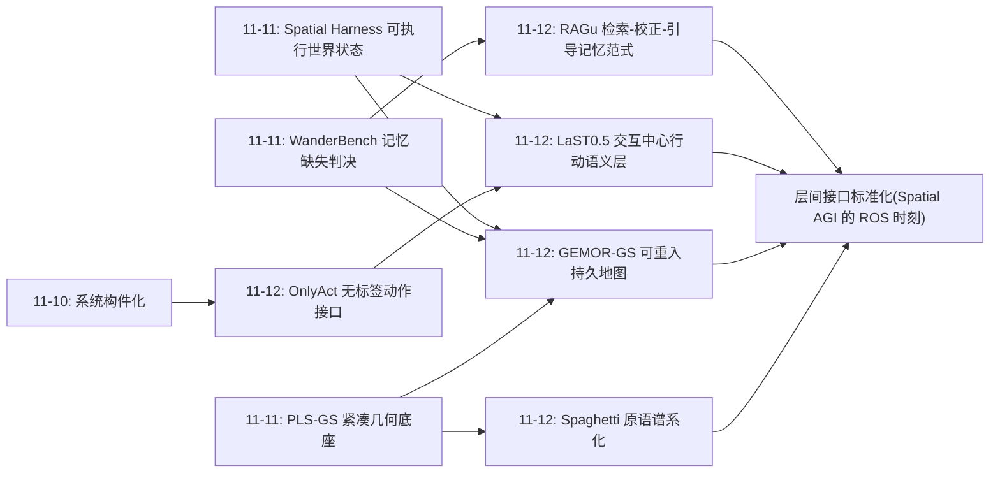
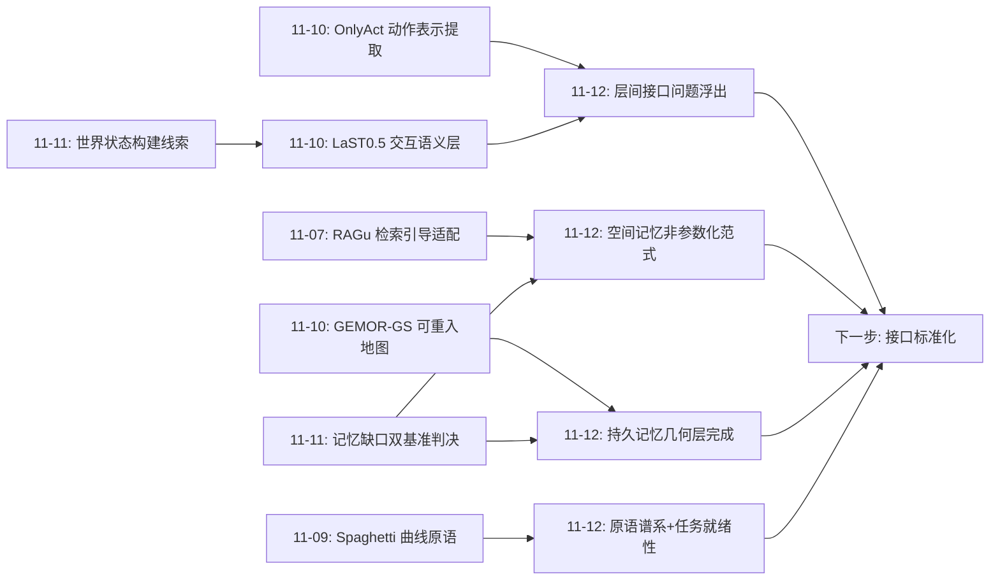
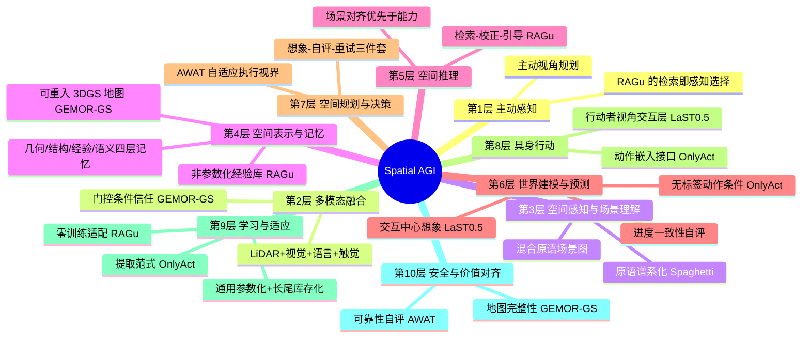
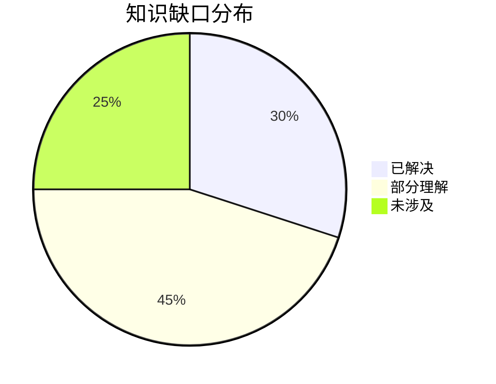
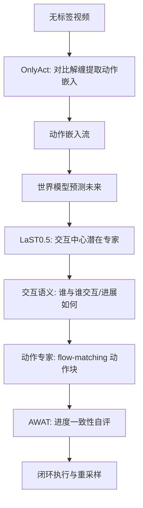
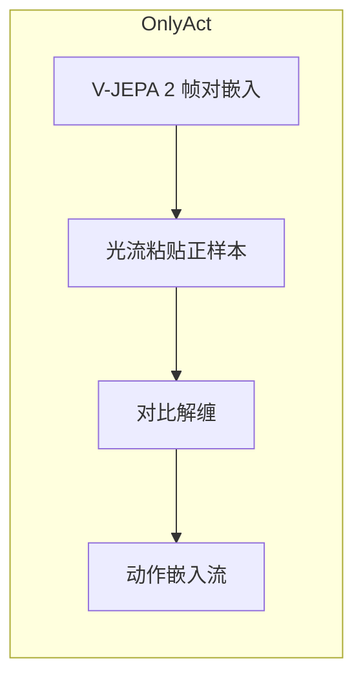
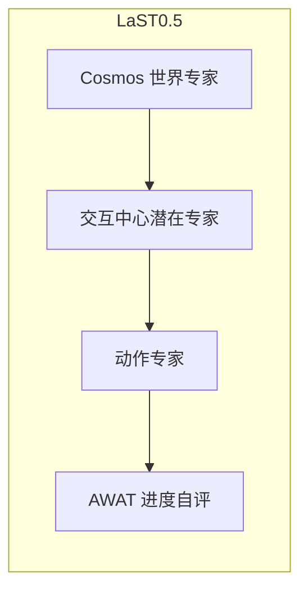
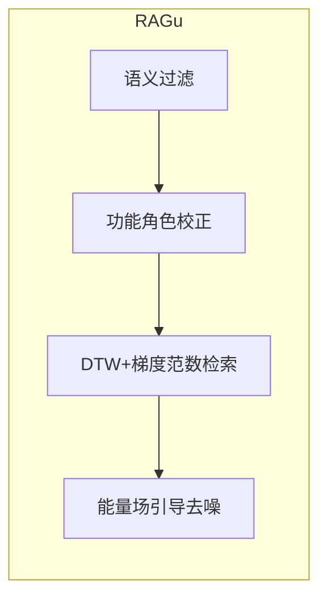

# Spatial AGI 每日思考 - 2026-11-12

## 📅 每日总结

**日期**: 2026-11-12
**论文数量**: 5篇
**主题**: 昨天的主题是"空间后端与记忆缺口"——空间计算外包被双路线验证、持久记忆被双基准判为结构性缺失。今天五篇论文恰好构成对昨天三条核心线索的**正面回应**：**OnlyAct 回应"动作接口"**（从 V-JEPA 2 表示中无标签提取动作嵌入，动作条件不再需要标签），**LaST0.5 回应"行动语义层"**（在世界模型与动作专家之间显式插入交互中心潜在推理层），**RAGu 回应"空间记忆"**（检索-校正-引导：把空间经验做成可检索、可校正、可注入推理的非参数化库），**Spaghetti Splatting 回应"几何底座"**（原语谱系补上一维曲线，连通长条直接进物理仿真），**GEMOR-GS 回应"持久记忆的几何底座"**（可重入 3DGS 地图 = 空间记忆的生命周期完备实现）。五篇合起来的元判断是：**Spatial AGI 的三层栈（感知/表示层、记忆/适配层、动力学/动作层）本周各自出现了标志性工作——空间智能不再是单一模型的竞赛，而是一个可以开始分层拼装的系统；层间接口（动作嵌入格式、地图查询协议、经验检索标准）正在取代模型本身成为新的竞争焦点。**

**关键突破**:
- 🚀 OnlyAct：证明"动作信息已经躺在预训练视频基础模型的嵌入里"（冻结 V-JEPA 2 帧对嵌入线性探针超过从头训练的潜在动作模型），用光流引导跨场景粘贴的正样本+同视频异动作的难负样本做对比解缠，无重建瓶颈同时拿到表达力与场景不变性，13 数据集（10 个未见）上动作迁移全面领先
- 🚀 LaST0.5：诊断 WAM 的"全局表示→动作"表征失配，在世界专家（Cosmos）与动作专家之间插入交互中心潜在专家（运动+affordance 视觉线索自动监督），KV detach 保护预训练先验，AWAT 用进度一致性做执行视界自适应——LIBERO 99.5%、RLBench 88.0% SOTA + 真机双臂
- 🚀 RAGu：把 RAG 完整移植到 VLA——语义过滤→功能角色跨域校正→DTW 粗检索+策略感知细检索（引导代价梯度范数最小）→能量场引导 flow-matching 去噪；零训练、零上下文占用，真实世界成功率 20%→80%（4 倍），覆盖 Real/Sim/人形四迁移设置
- 🚀 Spaghetti Splatting：把可微体积渲染的"核×原语"配方推到曲线——折线卷积逼近有收敛保证、连通段复合不重复计数、3DGS 是零长度曲线特例（严格超集）；通用场景持平、线状结构超越专门方法、天然抗锯齿、输出直接进物理仿真
- 🚀 GEMOR-GS：3DGS-SLAM 的生命周期完备实现——离线外参直接法精炼打底、门控渲染+LiDAR 联合目标交替精炼位姿与高斯、约束解除后全局重建（+14.3–19.9 dB vs 在线地图，+9 dB vs SOTA）、XFeat→PnP→渲染 warp 三级重定位（86–100% 成功率）确立"可重入"为地图核心属性

**架构演进**: 空间后端分层架构 → **三层栈分明的系统架构**（感知/表示层：混合原语+生命周期地图；记忆/适配层：检索-校正-引导的 RAG 化空间记忆；动力学/动作层：无标签动作接口+交互语义中间层；新竞争焦点=层间接口协议）

### 📊 一句话总结

2026-11-12 的五篇论文把 Spatial AGI 从"概念拼图"推进到"可拼装的分层系统"：感知层有了匹配结构本质的原语（Spaghetti）与可重入的持久地图（GEMOR-GS），记忆层有了"检索-校正-引导"的完整范式（RAGu，4 倍成功率），动作层有了无标签接口（OnlyAct）与交互语义中间层（LaST0.5）——**层间接口标准正在成为 Spatial AGI 的下一个"ROS 时刻"**。

### 🔗 延续性

**昨日→今日**: 昨日留下九条线索，今天接住三条最重的：①线索②"物体恒存层/持久身份"——GEMOR-GS 的可重入地图是几何层面的"回到同一空间"，与 WanderBench 的回访一致性评测同属"持久性"主线，只是 GEMOR-GS 用工程手段先做到了；②线索④"世界状态自动构建"——LaST0.5 的交互中心潜在表示是"世界状态的行动者视角切片"，与 Spatial Harness 的"观察者视角布局"构成世界状态的两个视角，拼接是下一步；③记忆缺口——RAGu 直接给出了空间记忆的第一个完整实现（检索-校正-引导），虽然它记的是"经验"而非"场景"，但范式完全可迁移。此外昨日"后端选择"思想在 RAGu 中再现：检索候选是空间计算的外包后端（外包给演示库而非引擎/潜空间），空间计算的"外包对象"谱系今天又多了一个成员。

**今日→明日**: 十条新线索：①动作嵌入标准化——OnlyAct 式动作嵌入若成为世界模型的标准条件接口，需要类似 ONNX 的格式协议；②检索库的内容扩展——RAGu 记轨迹，何时把力/接触/事件语义纳入"空间经验单元"；③交互线索管线的自动化——LaST0.5 的运动+affordance 监督线索由什么模型生成、误差如何自举；④进度单调性的泛化——AWAT 的进度一致性对含回退任务误判，需要不确定性化的进度分布；⑤动作嵌入的空间化——全局池化丢失空间定位，token 级动作图是明显下一步；⑥混合原语场景图——Spaghetti（线）+ 3DGS（点/体）+ 2DGS（面）的联合表示与统一渲染接口；⑦地图增量更新——GEMOR-GS 的静态地图如何做变更检测与局部重建；⑧检索-微调的切换策略——RAGu 冷启动后积累本地数据何时转参数化；⑨动作表示与交互表示的统一——OnlyAct 的"动作语义"与 LaST0.5 的"交互语义"是否同一连续谱的两端；⑩层间接口基准——三层栈各自成熟后，跨层接口（地图→检索、检索→策略、动作→世界模型）需要专门的评测。明日检索方向："spatially-grounded action tokens"、"tactile trajectory retrieval"、"affordance cue generation pipeline"、"progress uncertainty truncation"、"token-level action map"、"hybrid primitive scene representation"、"map change detection incremental gaussian"、"retrieval fine-tune switching"、"interface benchmark world model policy"。

### 💡 本质思考：如何达成通用空间智能

#### 1. 核心能力的本质是什么？

本周主题的第九次收敛。11-04"分工架构"、11-05"可验证"、11-06"表示选择"、11-07"可制造"、11-08"显式度光谱"、11-09"耦合与审计"、11-10"系统构件化"、11-11"空间后端与记忆"，今天加入**接口与分层**维度：

**空间智能的本质是一个分层的表征分工系统：每一层回答一个不同的空间问题——"世界长什么样"（感知/表示：原语匹配结构的几何+可重入地图）、"在这个世界里该怎么做"（记忆/适配：可检索可校正的经验库+交互语义）、"世界会怎么变"（动力学/动作：可提取的动作因子+世界模型预测）。层内的表示可以千差万别（显式/隐式、参数/非参数），但层间的信息流必须标准化——因为空间智能的通用性不来自任何一个万能层，而来自各层的可替换性与组合性。今天的五篇论文每篇都在回答"我这一层怎么做"，而层间如何对话已经成为下一个问题。**

今天的证据链：

- **动作信息的涌现性**（OnlyAct）：冻结基础模型嵌入的动作信息超过专门训练的潜在动作模型——空间动力学因子是视频预训练的涌现属性，"提取"范式比"学习"范式更高效。这暗示空间智能的很多成分可能已经"免费"存在于基础模型中。
- **表示的分工必要性**（LaST0.5）：全局世界表示与动作生成所需的交互表示存在系统性失配——"观察者视角"与"行动者视角"是空间智能必须同时携带的两种视角，缺一不可。
- **记忆的非参数化形态**（RAGu）：空间经验可以留在库外（检索+校正+推理时引导）而不用训练进参数，且适配效率碾压微调（4 倍 vs 逐域训练）——空间知识的经济学：通用模式参数化、长尾经验库存化。
- **表示与任务的结构对齐**（Spaghetti）：一维结构用一维原语，连通性内嵌于表示——好的空间表示应该"天生可执行"，任务就绪性是新的评价维度。
- **持久性的工程可达**（GEMOR-GS）：可重入、可精炼、可恢复的地图已可工程实现（86–100% 重定位）——昨天被判为结构性缺失的持久记忆，几何层面其实已经有答案。

#### 2. 当前方法与理想目标的差距在哪里？

- **层间接口缺失**：动作嵌入（OnlyAct）、交互潜空间（LaST0.5）、地图查询（GEMOR-GS）、经验检索（RAGu）各有内部协议，跨层对话（地图坐标系下的动作检索？交互表示引导的想象？）全部靠 ad-hoc 适配，无标准；
- **动作表示无空间结构**：OnlyAct 的全局池化嵌入丢掉"在哪做动作"，LaST0.5 的 query token 无显式空间编码——动作与位置的关系在两层都是黑洞；
- **经验单元太贫乏**：RAGu 只存笛卡尔轨迹骨架，力、接触、事件语义、失败教训都不在"空间经验"的存储格式里；检索到相似失败案例时也无法主动规避；
- **交互线索监督的生成依赖**：LaST0.5 的中间层监督靠外部管线生成线索（轨迹标注、affordance 检测），线索误差系统性传入表示，且管线本身是系统的最脆弱一环；
- **地图是静态快照**：GEMOR-GS 生命周期覆盖"建-精-入"但不覆盖"变"——长期运行的真实环境天天在变，无更新机制的持久地图终将过期；
- **进度模型的单调假设**：AWAT 把进度下降一律判为异常，而真实操作充满合法回退（重试、绕过、探索）——可靠性与鲁棒性之间的判据设计还很粗糙；
- **跨层评测空白**：每层都有各自基准（渲染、SLAM、操作成功率、检索精度），但"地图质量对检索效率的影响""动作接口质量对世界模型可控性的影响"这类跨层敏感度无人测量。

#### 3. 从今天到理想状态，最可能的路径是什么？

五步走判断（昨日版本的更新）：

**第一步（完成）：空间计算外包双路线验证 + 记忆缺口确认**（昨日）。
**第二步（进行中）：各层标志性实现就位**。今天完成：动作层无标签接口（OnlyAct）、交互语义层（LaST0.5）、经验记忆层（RAGu）、几何底座（Spaghetti/GEMOR-GS）。标志事件：三层栈每层都有了可拼装的候选实现。
**第三步（2027 上半年）：接口标准化与混合拼装**。动作嵌入格式、地图查询协议、经验单元 schema 成为竞争焦点（"Spatial AGI 的 ONNX/ROS 时刻"）；显式-潜混合后端（昨日线索①）与检索引导的组合实例出现；首个跨层系统（地图+检索+动作接口的端到端机器人）发布。
**第四步（2027 下半年）：动态化与自维护**。地图增量更新（GEMOR-GS→动态版）、动作表示空间化（token 级动作图）、经验单元多模态化（力/接触/事件）、交互线索管线自举——各层从"静态可用"进化到"动态自维护"。
**第五步（2028+）：空间认知架构收敛**。四层记忆（几何/结构/经验/语义）+ 双视角世界状态（观察者/行动者）+ 统一动作接口的分层认知架构成为事实标准；研究重心从"造层"转向"跨层推理"——在想象中检索、在记忆中规划、在动作中学习，空间智能进入认知循环时代。

---

## 🔗 与昨日思考的联系

### 昨日重点

昨日确立空间后端判断：显式引擎（Spatial Harness）与潜空间模拟（WorldMind）并行验证空间计算外包；PLS-GS 把几何底座做到紧凑接地；WanderBench 与 GeoMind 双基准确认"持久且可更新的空间记忆"是全领域结构性缺失。留下九条线索，最重的三条：物体恒存层、世界状态自动构建、记忆更新协议。

### 今日进展

今天五篇对昨日线索的覆盖：

- **记忆缺口（昨日最大判断）→ RAGu 正面回应**：空间记忆的第一个完整工程实现。RAGu 的"检索-校正-引导"三步恰好对应记忆的三种操作：存（可检索的经验库）、译（功能角色校正到当前场景）、用（推理时能量场引导）。它证明了空间记忆可以是非参数化的——不训练进权重，留在库里随取随用，这直接回应了昨日"记忆更新协议"的线索：库的更新远比权重的更新便宜。
- **物体恒存/持久性 → GEMOR-GS 部分回应**：可重入地图实现了"回到同一空间"（几何持久性），与 WanderBench 要求的"记住见过什么"（语义持久性）尚差一层，但工程路径已经清晰：语义层可以建在 GEMOR-GS 地图之上。
- **世界状态构建 → LaST0.5 从另一端切入**：Spatial Harness 构建观察者视角的布局状态，LaST0.5 构建行动者视角的交互状态——两个视角的世界状态切片互补，拼接是"世界状态自动构建"的下一个具体方向。
- **几何底座 → Spaghetti + GEMOR-GS 双补**：原语谱系补线状一维，地图生命周期补时间维度。昨日 PLS-GS 的"紧凑接地底座"今天扩展为"谱系化+可维护"。

### 演进路径

---

## 📚 论文概览

今天五篇按 Spatial AGI 三层栈分布：

1. **OnlyAct**（Oxford, Vedaldi/Jakab 组）——动作层。从 V-JEPA 2 表示空间无标签提取动作嵌入：光流跨场景粘贴正样本 + 同视频异动作难负样本的对比解缠，无重建瓶颈，动作表达力与场景不变性兼得，为世界模型提供跨域动作条件。
2. **LaST0.5**（北大/港中文/Simplexity Robotics）——动作/架构层。诊断 WAM 全局表示-动作生成失配，插入交互中心潜在专家（运动+affordance 线索监督），MoT 三专家+KV detach+AWAT 进度自适应执行，14k 小时预训练，LIBERO 99.5%/RLBench 88.0% SOTA。
3. **RAGu**（UPenn, Jayaraman 组）——记忆/适配层。VLA 的 RAG：语义过滤→功能角色跨域校正→DTW+策略感知两级检索→能量场引导去噪，零训练零上下文，真实世界 20%→80%。
4. **Spaghetti Splatting**（Toronto/Vector, Tagliasacchi/Lindell 组）——感知/表示层。曲线原语的可微体积渲染：折线卷积+关节不重复复合，3DGS 严格超集，线状结构专精，连通长条直接进物理仿真。
5. **GEMOR-GS**（上交）——感知/表示层。3DGS-SLAM 生命周期：外参离线精炼、门控联合目标交替精炼、全局重建、三级重定位，确立"可重入"地图属性。

---

## 💡 核心见解

### 见解1: 动作是基础模型的涌现因子，不是需要专门学习的表示

从 OnlyAct 获得

- ✅ 冻结 V-JEPA 2 帧对嵌入的线性探针动作信息 > 从头训练的潜在动作模型（同数据）
- ✅ 对比解缠（不压缩）同时获得表达力与场景不变性，打破瓶颈两难

**对Spatial AGI的启发**: 空间智能的很多成分（动作、动力学、可能还有接触与因果）可能已经是基础模型的涌现属性。研究范式应从"从头构建空间表示"转向"设计解缠/提取协议"。对比解缠的"变量控制式正负样本"（换场景保动作/同场景换动作）是通用工具，可提取深度、接触、意图等其他空间因子。

### 见解2: 全局世界表示 ≠ 动作表示——行动者视角需要专门的中间层

从 LaST0.5 获得

- ✅ 世界模型预测被广域特征主导，交互细节（接触、可供性）被系统性淹没
- ✅ 视觉交互线索（运动+affordance）可以自动构造中间表示的监督目标；KV detach 保护预训练先验是架构级必需品

**对Spatial AGI的启发**: 空间智能必须同时携带两种视角——观察者视角（世界长什么样）与行动者视角（我能对世界做什么）。两者不可互相替代，中间需要显式的表示转换层。"交互"（谁在与谁交互、进展如何）是行动者视角的核心语义单元，且可用视觉线索规模化监督。

### 见解3: 空间知识的正确经济学——通用参数化、长尾库存化

从 RAGu 获得

- ✅ 非参数化适配（检索+校正+引导）零训练拿到 4 倍成功率提升，碾压逐域微调
- ✅ 策略感知检索（引导代价梯度范数）：检索结果必须对下游消费者友好，相关性要重新定义为可用性

**对Spatial AGI的启发**: 空间记忆的正确形态是"可检索、可校正、可注入推理"的非参数化库 + 参数化的闭环执行能力。适配新环境的成本可以趋近于零——这对 Spatial AGI 的部署经济学是决定性的。检索系统设计要内建消费者兼容性评估。

### 见解4: 原语匹配结构——空间表示的谱系化

从 Spaghetti Splatting 获得

- ✅ "核×原语"配方可推广到曲线，折线卷积逼近有收敛保证；3DGS 是零长度曲线的严格特例
- ✅ 连通性可内嵌于表示的复合规则（关节不重复计数），表示直接进物理仿真

**对Spatial AGI的启发**: 空间感知的终局是混合原语场景图——点/线/面/体各司其职，由统一可微接口对外服务。表示评价应增加"任务就绪性"维度（不经转换即可被下游消费：可仿真、可查询、可操作）。跨领域的结构性信号：本周 PLS-GS（LiDAR 脚手架对齐高斯）与 Spaghetti（曲线原语贴附线结构）同现，"原语-结构对齐"成为趋势。

### 见解5: 可重入性是空间记忆的核心属性

从 GEMOR-GS 获得

- ✅ 三级重定位（特征检索→PnP→渲染 warp 对齐）把"回到同一空间"做到 86–100% 成功率；3DGS 可渲染性直接转化为定位精度
- ✅ 外参等系统性误差必须离线前置解决，在线优化才能良定

**对Spatial AGI的启发**: 空间智能体与世界的关系应是"居民"而非"游客"——记忆必须可返回、可精炼、可持续。昨天被判缺失的持久记忆，几何层面已有工程答案；语义层（"上次在这看到什么"）建在地图之上是下一个层次。实时层/精炼层分离是空间系统的通用架构模式。

### 见解6: 可靠性自评应内建于空间执行循环

从 LaST0.5（AWAT）获得

- ✅ 联合预测未来表示与进度值，用进度一致性检测想象失真，动态截断执行并触发重采样
- ✅ 世界模型的想象不可全信——执行视界应由预测可靠性动态决定而非固定

**对Spatial AGI的启发**: "知道自己不知道"必须机制化。空间执行系统的标配三件套：想象（世界模型）、自评（一致性检验）、重试（重采样/重规划）。进度一致性是最廉价的内建检测器，但其单调假设需升级为不确定性度量。

### 见解7: 空间失败可能主要是"认不出"而非"不会做"

从 RAGu 的 20%→80% 获得

- ✅ 冻结 π0.5 在域偏移下只剩 20%，但给它一条校正后的空间骨架引导就回到 80%——策略内部的操作能力是完整的
- ✅ 跨域对应按功能角色（任务槽位）而非外观定义，"毛巾→盘子"也能迁移

**对Spatial AGI的启发**: 空间智能的瓶颈分布可能被误判——场景对齐/检索层（把新场景映射回熟悉结构）可能比能力层（学会怎么做）缺口更大、且更容易补（免训练）。诊断空间智能系统时应先测"对齐"再测"能力"。

---

## 🗺️ 知识演进图

---

## 技术栈演进对比表

| 层次 | 昨日方案 | 今日方案 | 变化 |
|------|---------|---------|------|
| 动作接口 | 需动作标注或从头学潜在动作 | OnlyAct: 无标签提取基础模型动作嵌入 | 动作监督瓶颈解除 |
| 动作语义 | 全局世界表示直接迁移 | LaST0.5: 交互中心中间层+AWAT 自适应执行 | 表征失配被显式建模 |
| 空间适配 | 逐域微调/域内检索 | RAGu: 跨域检索+功能角色校正+能量场引导 | 零训练 4 倍提升，范式级 |
| 几何原语 | 点/面（3DGS/2DGS/脚手架） | Spaghetti: 补上曲线一维原语（3DGS 超集） | 原语谱系完整化 |
| 持久地图 | 静态重建，无生命周期 | GEMOR-GS: 外参精炼+全局精炼+三级重定位 | "可重入"成为地图属性 |
| 竞争焦点 | 各层内部能力 | 层间接口协议 | 架构问题取代模型问题 |
| 记忆形态 | 结构性缺失（昨日判决） | 几何层（GEMOR-GS）+经验层（RAGu）双实现 | 缺口开始被填补 |

---

## 🗺️ Spatial AGI 知识图谱

### 10层架构思维导图

### 🎯 主线技术路径

#### 阶段1: 空间计算外包与记忆判决（已完成，11-04 ~ 11-11）

显式引擎与潜空间模拟并行验证空间计算外包；几何底座紧凑化；记忆缺口被双基准定量确认。空间智能从"要不要外部空间后端"进入"选哪种后端"阶段。

#### 阶段2: 各层标志性实现就位（进行中，11-08 ~ 11-12）

经验→3DGS 记忆（MoMaSplat）、证据路由（BEV3SR）、行动语义层（LaST0.5）、无标签动作接口（OnlyAct）、检索式空间记忆（RAGu）、原语谱系（Spaghetti）、可重入地图（GEMOR-GS）。三层栈每层有了可拼装候选。

#### 阶段3: 接口标准化与混合拼装（2027 上半年预期）

动作嵌入格式、地图查询协议、经验单元 schema 的标准化竞争（Spatial AGI 的 ROS/ONNX 时刻）；显式-潜混合后端 × 检索引导的组合实例；首个跨层端到端系统（地图+检索+动作接口的完整机器人栈）。

#### 阶段4: 动态化与自维护（2027 下半年预期）

地图增量更新与变更检测；动作表示空间化（token 级动作图）；经验单元多模态化（力/接触/事件/失败教训）；交互线索管线自举——各层从静态可用进化到动态自维护。

#### 阶段5: 空间认知循环（2028+ 预期）

四层记忆+双视角世界状态+统一动作接口的分层认知架构收敛为事实标准；研究重心转向跨层推理——在想象中检索、在记忆中规划、在动作中学习。空间智能进入认知循环时代。

---

## 🔍 待探索议题

### 高优先级（本周）

1. **动作嵌入的空间化**
   - 问题: OnlyAct 全局池化丢失"在哪做动作"，复合动作与局部动作无法表达
   - 候选方案: 保留 16×16 patch token 不池化，构造 token 级动作图；世界模型按空间区域条件化
   - 缺口: 动作 token 与世界模型时空 token 的对齐机制

2. **空间经验单元的多模态扩展**
   - 问题: RAGu 只存笛卡尔轨迹骨架，力/接触/事件/失败教训缺失
   - 候选方案: 定义"多模态经验片段"schema（轨迹+力序列+接触图+事件语义+结果标签），扩展能量场到多模态一致性
   - 缺口: 多模态经验的时间对齐与检索索引

3. **地图增量更新与变更检测**
   - 问题: GEMOR-GS 地图静态，长期运行必过期；变更检测本身需要定位（鸡蛋问题）
   - 候选方案: 渲染-观测残差的区域统计作为变更信号，置信度门控的局部重建
   - 缺口: 变更检测的误报/漏报权衡与增量重建的拓扑维护

4. **交互线索监督管线的自动化**
   - 问题: LaST0.5 的运动+affordance 线索由外部模型生成，误差系统性传入表示
   - 候选方案: 用训练后的潜在专家反向生成线索自举；线索置信度加权损失
   - 缺口: 线索质量的自动评估标准

### 中优先级（本月）

5. **进度一致性的不确定化**
   - 问题: AWAT 单调假设对合法回退（重试/绕过）误判
   - 候选方案: 学习进度分布而非点值，用不确定性截断替代单调性判据
   - 缺口: 含回退任务上的进度真值获取

6. **动作语义与交互语义的统一**
   - 问题: OnlyAct 动作嵌入与 LaST0.5 交互潜空间是否同一连续谱
   - 候选方案: 在共享视频集上联合嵌入对齐实验，测两空间的互信息
   - 缺口: 统一后接口如何同时服务世界模型与策略

7. **混合原语场景表示**
   - 问题: 真实场景同时含点/线/面结构，单一原语表示各有盲区
   - 候选方案: 结构自适应原语分配（分区分派+统一渲染接口）；以 3DGS 为外层兼容层
   - 缺口: 跨原语可见性/遮挡的合成规则与联合优化协议

8. **检索-微调切换策略**
   - 问题: RAGu 冷启动后本地数据积累，何时从检索切换到参数化
   - 候选方案: 检索命中率与本地数据量驱动的自动切换；混合期蒸馏
   - 缺口: 两种知识源的冲突消解机制

### 低优先级（长期）

9. **跨层接口基准**
   - 问题: 地图质量对检索效率、动作接口质量对世界模型可控性的跨层敏感度无人测量
   - 候选方案: 受控降质实验（逐层降低表示质量，测下游任务退化曲线）
   - 缺口: 跨层评测协议的设计社区共识

10. **空间记忆的语义重入**
    - 问题: GEMOR-GS 解决几何重入，语义重入（"上次在这看到什么"）缺失
    - 候选方案: 地图坐标索引的情景记忆（渲染视图+VLM 事件描述），查询接口接入 VLA 上下文
    - 缺口: 情景记忆的写入时机与检索粒度

---

## 📊 知识缺口分析

**已解决（30%）**:
- ✅ 无标签动作监督路径（OnlyAct：基础模型提取范式打通）
- ✅ 全局表示与动作表示的失配诊断与解法（LaST0.5 交互中间层）
- ✅ 跨域空间适配的免训练方案（RAGu 检索-校正-引导，4 倍提升）
- ✅ 一维结构的可微表示与仿真接口（Spaghetti）
- ✅ 地图的生命周期完备性（GEMOR-GS：建-精-入闭环）

**部分理解（45%）**:
- ⚠️ 动作表示的空间结构（全局嵌入无定位，token 化方向明确但未实现）
- ⚠️ 交互线索监督的生成依赖（管线自动化与自举方向明确）
- ⚠️ 执行可靠性判据（进度一致性可用但单调假设过强）
- ⚠️ 持久地图的动态维护（更新机制未实现，静态快照）
- ⚠️ 空间经验的内容边界（轨迹之外多模态经验的 schema 未定）
- ⚠️ 各层能力的跨层敏感度（单层基准齐备、跨层评测空白）

**未涉及（25%）**:
- ❌ 层间接口标准（动作嵌入格式、地图查询协议、经验 schema 的统一规范）
- ❌ 混合原语场景的联合表示与渲染（跨原语合成规则）
- ❌ 空间记忆的语义重入（情景记忆与地图的融合）
- ❌ 多机器人/多智能体的空间记忆共享与信任
- ❌ 空间智能的系统性安全设计（地图完整性、检索库治理、经验隐私）

---

## 📝 附录：今日五篇的层间对话草案

把今天五篇拼成一个假想的完整系统，各层间需要的接口恰好暴露了明天的研究缺口：

| 上层↓下层 | 几何地图（GEMOR-GS） | 经验库（RAGu） | 动作接口（OnlyAct） | 交互层（LaST0.5） |
|---|---|---|---|---|
| 几何地图 | — | warping 的航点查询 | 动作的空间定位验证 | 交互区域的空间索引 |
| 经验库 | 轨迹坐标参照 | — | 动作语义检索索引 | 相似交互案例检索 |
| 动作接口 | — | 示范来源 | — | 动作→交互演化预测 |
| 交互层 | 交互状态的空间接地 | 经验校验 | 消费动作嵌入 | — |

每个非空格都是一个待定义的接口协议——这张表就是 Spatial AGI 接口标准化的路线图草图。

---

---

## 深入分析一：动作接口的两次范式转移（OnlyAct + LaST0.5 联合阅读）

### 转移一：动作表示的来源——从学习到提取（OnlyAct）

潜在动作模型的历史是一条清晰的演化链：

1. **2024 Genie**: 确立"无标签视频→潜在动作→交互世界模型"范式，动作空间从零学习；
2. **2025 LAPA/VA-VAE**: 潜在动作作为 VLA 预训练的代理动作，瓶颈-表达力矛盾开始显现；
3. **2026 上半年**: WAM 规模化，各家用不同瓶颈设计（离散码本、低维 latent）与场景泄漏搏斗；
4. **2026-11 OnlyAct**: 范式修正——动作不是要从视频中学的新东西，而是预训练表示中已有的因子，需要的是解缠协议。

这条链与 NLP 的演化惊人同构：词向量→预训练语言模型→探针/蒸馏/解缠时代。空间动作领域正处在"BERT 时刻"：表示已经就位，提取协议刚刚出现。

### 转移二：动作表示的消费——从全局向量到分层语义（LaST0.5）

LaST0.5 的交互中心层揭示的是另一个维度：动作/交互表示不应是单一扁平空间，而应有层次结构。与 OnlyAct 拼起来看：

这个组合管线中每一段都有今日工作支撑，唯一缺的是接口协议（B→D 的动作嵌入格式、D→E 的预测表示格式）——这正是待探索议题 #10 的跨层接口基准。

### 两种表示的时间粒度对照

| 维度 | OnlyAct 动作嵌入 | LaST0.5 交互潜空间 |
|---|---|---|
| 时间粒度 | 单帧对（原子动作） | M 段时间对齐（技能片段） |
| 空间结构 | 全局池化（无定位） | query token（无显式编码） |
| 监督来源 | 无标签对比 | 视觉交互线索自动生成 |
| 主要消费者 | 视频世界模型条件 | 动作专家条件 |
| 共同缺陷 | 空间定位缺失 | 空间定位缺失 |

两篇独立工作收敛到同一个缺陷（空间定位），这本身就是强烈的社区信号：**空间化动作/交互表示是 2027 年的第一个必争之地**。

---

## 深入分析二：空间记忆的完整拼图（RAGu + GEMOR-GS 联合阅读）

### 记忆的四层分类在今日工作中的对应

| 记忆类型 | 内容 | 今日载体 | 检索方式 | 更新机制 |
|---|---|---|---|---|
| 几何记忆 | 场景长什么样 | GEMOR-GS 3DGS 地图 | 重定位（渲染对齐） | 缺失（静态） |
| 结构记忆 | 场景的结构组织 | 混合原语表示（Spaghetti 等） | 空间查询 | 随重建更新 |
| 经验记忆 | 在这怎么做过 | RAGu 校正轨迹库 | 语义过滤+DTW+策略感知 | 库追加（便宜） |
| 语义记忆 | 这是什么/什么功能 | 未完成（开放词汇场景图） | 语言查询 | 未实现 |

四层中只有经验记忆有便宜且成熟的更新机制——这解释了为什么 RAGu 的方案特别有生命力：**非参数化记忆的更新成本远低于参数化或重建式记忆**。长期看，几何与语义记忆的增量更新是必须攻克的问题，但短期组合方案可以是"几何地图定期重建 + 经验库持续追加"的不对称策略。

### RAGu 与 WanderBench 判决的和解

昨日 WanderBench 判决"无一世界模型能记住自己生成过的内容"，今天 RAGu 展示"记住怎么做"可以靠外部库解决。两者不矛盾：RAGu 记的是**人类经验的轨迹**（非模型自己生成），而 WanderBench 要求的是**模型自身想象的持久性**。但 RAGu 提供了一个架构启示：世界模型的持久性或许也不该靠模型内部记忆，而应该靠外部世界状态存储（Spatial Harness 的可执行世界状态正是这个方向）——**记忆外置**可能是比"给世界模型加记忆模块"更正确的架构方向。这与 LLM 领域"外挂向量库优于扩上下文"的经验同构。

---

## 深入分析三：本周 15 篇论文的系统级综合

### 三天的主题演进

| 日期 | 主题 | 核心问题 | 代表结论 |
|---|---|---|---|
| 11-10 | 系统构件化 | 各构件的独立杠杆 | 监督结构/证据路由/恢复回路/世界引擎各有抓手 |
| 11-11 | 空间后端与记忆 | 状态放哪/怎么算/怎么记 | 计算外包双路线验证；记忆是结构性缺失 |
| 11-12 | 分层拼装与接口 | 层怎么连 | 三层栈标志实现就位；接口成为新焦点 |

### 15 篇论文按栈层完全分布

- **感知/表示层** (5): PLS-GS（脚手架底座）、BEV3SR（证据路由）、Spaghetti（曲线原语）、GEMOR-GS（生命周期地图）、GeoMind（诊断基准）
- **记忆/适配层** (3): WanderBench（记忆判决）、MoMaSplat（经验→记忆）、RAGu（检索引导）
- **动力学/动作层** (4): Cosmos（实时世界引擎）、WorldMind（潜空间模拟）、OnlyAct（动作提取）、LaST0.5（交互语义）
- **跨层/系统层** (3): Spatial Harness（可执行状态）、A2-MEAS（agent 构件）、SURE（不确定性表示）

三天内每层都积累了 2-5 个候选实现——分层拼装的条件已经具备，缺的是接口与集成验证。

### 跨论文的重复出现信号（强趋势指标）

同一思想在一周内被多篇独立工作采用，是最可靠的趋势指标：

1. **原语/结构对齐**（3 次）: PLS-GS 脚手架、Spaghetti 曲线、MoMaSplat 经验记忆——表示应匹配被表示物的结构本质；
2. **测试时/推理时计算**（3 次）: WorldMind 潜空间缩放、RAGu 推理时引导、BEV3SR 训练自由证据路由——test-time intelligence 成为空间领域共识；
3. **可靠性自评**（2 次）: AWAT 进度一致性、SURE 时空不确定性表示——"知道自己不知道"从可选项变标配；
4. **先验保护**（2 次）: LaST0.5 KV detach、RAGu 冻结 VLA——预训练资产需要架构级防护；
5. **功能角色抽象**（2 次）: RAGu 功能角色对应、LaST0.5 affordance 监督——空间对应按任务功能而非外观定义。

---

## 深入分析四：接口标准化的具体形态预测

### Spatial AGI 需要哪些"ONNX 时刻"

| 接口 | 当前状态 | 标准化形态预测 | 类比 |
|---|---|---|---|
| 动作嵌入 | 各家私有空间（OnlyAct 640d、各家码本） | 统一动作嵌入空间+跨模型映射协议 | CLIP 文本嵌入 |
| 世界状态 | JSON 布局（Harness）/潜特征（WorldMind） | 双形态协议：显式 schema + 潜空间锚点 | ROS 消息类型 |
| 地图查询 | 各 SLAM 系统私有 API | 渲染/查询/重定位三原语的标准接口 | 文件系统 syscall |
| 经验单元 | DROID 式原始轨迹 | 多模态经验 schema（轨迹+力+事件+结果） | 数据集格式 (COCO) |
| 交互语义 | LaST0.5 潜空间 | 交互三元组结构化表示（主体/客体/关系+进展） | 场景图标准 |

### 为什么标准化会自然发生

三个经济动力会推动标准化：

1. **组件可替换性**: 研究者希望只改进一层而复用其他层——接口不标准则每篇论文都要重建全栈；
2. **评测可比性**: 跨层敏感度测量（待探索议题 #9）需要固定其他层才能隔离变量；
3. **产业集成成本**: 机器人公司不可能为每篇论文重写集成代码——第一个提供稳定接口的项目会虹吸生态。

预测：2027 上半年会出现第一个"Spatial AGI 中间件"项目，封装地图查询+经验检索+动作接口三件套。它的成败将决定标准由社区约定还是由单一项目垄断。

---

## 风险清单：分层拼装路线的系统性风险

1. **接口过早固化**: 在各层技术快速迭代时过早定标准，会把次优设计焊死（参考过早的机器人中间件失败史）；
2. **层间误差级联**: 感知→记忆→检索→动作的链条中，每层 95% 的正确率在 5 层后只剩 77%——跨层可靠性工程（置信度传播、逐层校验）是隐藏的关键技术；
3. **基准碎片化**: 每层各有基准但互不兼容，跨层系统无法被公平评测，劣币驱逐良币；
4. **组件冗余**: 各层都有世界模型类组件（预测 vs 交互层 vs 经验库的模式补全），功能重叠需要架构层面的消解而非堆叠；
5. **人才分层**: 社区按层分裂后，跨层人才稀缺，集成创新放缓——跨层 workshop 与联合基准项目是对冲手段。

---

## 每日金句摘录

1. "动作信息已经躺在预训练表示里，缺的只是把它挑出来的那把对比镊子。"（OnlyAct 的启示）
2. "世界模型看得见整个世界，但操作机器人只需要看准一次接触。"（LaST0.5 的核心）
3. "VLA 在新场景的失败多半不是不会做，而是认不出。"（RAGu 的 20%→80% 判决）
4. "空间智能的终点是行动而非图像——表示的任务就绪性比渲染指标更重要。"（Spaghetti 的意义）
5. "好的地图不是一次性工程，而是能被反复进入、持续精炼、世代使用的空间基础设施。"（GEMOR-GS 的定位）

---

## 明日检索计划

优先检索词（按议题对应）：

1. `spatially grounded action tokens` → 议题1
2. `multimodal demonstration retrieval force contact` → 议题2
3. `map change detection gaussian splatting incremental` → 议题3
4. `affordance cue generation pipeline robot learning` → 议题4
5. `task progress uncertainty model robotics` → 议题5
6. `action interaction joint embedding manipulation` → 议题6
7. `hybrid primitive scene representation rendering` → 议题7
8. `retrieval augmented policy fine-tuning transition` → 议题8
9. `cross layer benchmark spatial intelligence system` → 议题9
10. `episodic memory scene graph re-entry robot` → 议题10

---

---

## 逐篇要点回顾（供 NotebookLM 与快速复习）

### Paper 01: OnlyAct（动作提取）

**背": 牛津 Vedaldi/Jakab 组，11-10 发布。

**一句话**: 从 V-JEPA 2 帧对嵌入中用无标签对比学习提取动作表示——换场景保动作的正样本（光流粘贴）+ 同场景换动作的难负样本，无需重建瓶颈。

**必记数字**: 13 数据集（10 未见）、640d 嵌入、LoRA 适配、四域验证（机器人/导航/游戏/驾驶）。

**必记三问**:
- Q1（原理）: 动作是预训练表示的既有因子，对比目标重塑几何而非压缩信息
- Q2（Spatial AGI）: 动作=空间状态的时间导数，通用动作接口即通用空间变化接口
- Q3（优劣）: 优在泛化/表达力/成本，劣在无空间定位与粘贴启发式脆弱

**反向追问**: 为什么不用光流直接当动作？（答：像素级运动无语义抽象与意图区分）

### Paper 02: LaST0.5（交互语义层）

**背**: 北大/港中文/Simplexity，11-10 发布，14k 小时预训练。

**一句话**: 在世界专家（Cosmos）与动作专家间插入交互中心潜在专家（运动+affordance 线索监督），MoT 分块因果+KV detach+AWAT 进度一致性执行。

**必记数字**: LIBERO 99.5%、RLBench 88.0%、M=3 段（12 步动作块）、256×256 想象分辨率。

**必记三问**:
- Q1: p(a,Z,V̂|c)=p(V̂|c)p(Z|V̂,c)p(a|Z,V̂,c) 三段式分解，交互语义从想象的未来中提取
- Q2: 观察者视角与行动者视角是空间智能必须同时携带的两种表示
- Q3: 优在层次清晰+可靠性机制独有，劣在进度单调假设与线索管线依赖

**反向追问**: KV detach 为什么必要？（答：阻断动作梯度破坏预训练物理先验，防表示层 reward hacking）

### Paper 03: RAGu（检索引导适配）

**背**: UPenn Jayaraman 组，11-07 发布，raguvla.github.io。

**一句话**: 检索-校正-引导：语义过滤→功能角色跨域 warping→DTW+梯度范数两级检索→能量场引导 flow-matching 去噪，零训练零上下文。

**必记数字**: 20%→80%（4 倍）、候选池 100 条、四迁移设置（Real→Real/Sim→Real→Sim/人形）。

**必记三问**:
- Q1: 三大挑战（跨域/策略感知/上下文受限）各有对应组件
- Q2: 空间记忆的正确形态是可检索可校正可注入的非参数化库
- Q3: 优在零成本适配幅度，劣在结构化任务假设与力/接触缺失

**反向追问**: 为什么 warp 后不直接执行？（答：跨域校正轨迹的动力学不可信，骨架当先验闭环交还策略）

### Paper 04: Spaghetti Splatting（曲线原语）

**背**: Toronto/Vector，Tagliasacchi/Lindell 组，11-09 发布。

**一句话**: 可微体积渲染推广到曲缘原语：折线卷积逼近（有收敛保证）+关节不重复复合，3DGS 是零长度曲线特例（严格超集）。

**必记数字**: 通用场景持平 SOTA、线状结构超越专门方法、天然抗锯齿、连通长条直进物理仿真。

**必记三问**:
- Q1: 核×原语配方沿原语轴推广，卷积弥合 Dirac 奇异性
- Q2: 原语匹配结构本质（线/面/点各司其职），表示携带连通性天生可执行
- Q3: 优在理论完备+超集关系+仿真接口，劣在拓扑管理与渲染成本

**反向追问**: 为什么线状结构值得专章？（答：操作难度天花板+环境常见度+拓扑推理试金石三重理由）

### Paper 05: GEMOR-GS（生命周期地图）

**背**: 上交，11-10 发布，LiDAR-惯性-视觉 3DGS SLAM。

**一句话**: 外参离线直接法精炼打底→门控渲染+LiDAR 联合目标交替精炼→约束解除全局重建→XFeat/PnP/渲染 warp 三级重定位，确立可重入地图属性。

**必记数字**: 离线地图 +14.3–19.9 dB（vs 在线）、+9 dB（vs Gaussian-LIC2）、重定位 86–100%。

**必记三问**:
- Q1: 系统性误差（外参）前置解决，在线优化才能良定
- Q2: 可重入=空间智能体与世界的居民关系，地图即持久世界模型
- Q3: 优在生命周期完整+诚实量化，劣在静态假设与标定段依赖

**反向追问**: 为什么不在线联合学外参？（答：外参/位姿/地图三者联合欠约束，外参误差伪装成位姿误差）

---

## 每篇一图的记忆卡片

---

## 与前八天思考的本质判断对照表

| 日期 | 本质判断 | 今日是否延续 |
|---|---|---|
| 11-04 | 分工架构 | ✅ 三层栈即分工的细化 |
| 11-05 | 可验证性 | ✅ AWAT 进度自评、GEMOR-GS 逐组件量化 |
| 11-06 | 表示选择 | ✅ 原语谱系化+超集关系 |
| 11-07 | 可制造性 | ✅ Spaghetti 仿真就绪、RAGu 即插即用 |
| 11-08 | 显式度光谱 | ✅ 记忆的非参数化形态加入光谱 |
| 11-09 | 耦合与审计 | ✅ KV detach/门控=耦合管理 |
| 11-10 | 系统构件化 | ✅ 各层标志实现就位 |
| 11-11 | 空间后端与记忆 | ✅ 记忆双实现回应缺口判决 |
| 11-12 | 分层拼装与接口 | 🆕 本日新判断 |

九天判断的收敛轨迹：分工→验证→表示→制造→光谱→耦合→构件→后端→接口。空间智能的本质认识正在从抽象原则收敛到具体架构。

---

## 给不同读者的三分钟版本

### 给研究者

今天五篇的共性是"层内深化、层间留白"。最值得跟进的两个空白：动作/交互表示的空间化（两篇独立收敛到同一缺陷）与跨层评测协议。若做世界模型，OnlyAct 的动作接口值得直接接入测试；若做 VLA，RAGu 是最低成本的域适应方案。

### 给工程师

短期最可落地的是 RAGu：免训练、用公开数据集和 checkpoint、适配新环境只需分钟级检索校正——部署新场景的 ROI 最高。GEMOR-GS 适合需要长期自主定位的场景，但标定段与工程复杂度要有心理准备。OnlyAct/LaST0.5 属于跟踪级技术，建议等开源栈成熟。

### 给投资人/决策者

本周信号：空间智能的竞争已从模型转向系统与接口。类比移动云：模型是芯片，今天的工作是操作系统与驱动。接口标准出现前是碎片化创新期，出现后将进入平台整合期——现在布局跨层集成能力的团队会在平台期占据身位。

---

## 今日五篇的失败模式预防清单

若要复现或应用这五篇工作，各自的头号失败模式与预防手段：

| 论文 | 头号失败模式 | 预防手段 |
|---|---|---|
| OnlyAct | 光流粘贴正样本质量差（接触关系破坏） | 可视化抽检粘贴样本；接触比例监控；退化为光度增强 |
| LaST0.5 | 交互线索生成误差传入表示 | 线索多样性增强+置信度加权；抽检线索渲染质量 |
| LaST0.5 | AWAT 对合法回退误截断 | 真机调试时先关闭 AWAT 收集进度分布统计 |
| RAGu | 检索池无目标任务覆盖 | 部署前先验证检索命中率；无覆盖时回退自主模式 |
| Spaghetti | 拓扑优化不稳定（段连接错乱） | 固定拓扑先验证渲染质量，再逐步引入拓扑操作 |
| GEMOR-GS | 外参漂移导致地图系统性弯曲 | 定期外参监测；漂移超阈值触发局部重标定 |

---

## 计算成本速算（部署参考）

| 系统 | 训练成本 | 推理成本 | 部署门槛 |
|---|---|---|---|
| OnlyAct | LoRA 适配（低） | 单编码器前向（低） | 中（需 V-JEPA 2 + 视频池） |
| LaST0.5 | 14k 小时预训练+微调（极高） | 扩散去噪+三专家（高） | 高（多模型栈+机器人） |
| RAGu | 零（免训练） | 检索+引导（低-中） | 低（公开 ckpt+数据集即可） |
| Spaghetti | 单场景优化（中） | 段级渲染（中，慢于 3DGS） | 中（需多视角采集） |
| GEMOR-GS | 在线运行+离线精炼（中高） | SLAM 实时流（中） | 高（多传感器平台+标定段） |

按部署 ROI 排序：RAGu > OnlyAct > Spaghetti ≈ GEMOR-GS > LaST0.5。研究价值排序则相反——LaST0.5 揭示的架构问题最深。

---

## 开放数据的快速启动包

若想本周复现某篇的最小实验：

1. **OnlyAct 最小复现**: V-JEPA 2 开源权重 + Ego4D/DROID 子集 + LoRA 适配 → 线性探针验证动作信息量（一天可完成）；
2. **RAGu 最小复现**: π0.5-DROID 开源 ckpt + DROID 检索池 + 仿真能力（RoboLab）→ 真机部分需硬件，仿真部分本周可验证；
3. **Spaghetti 最小复现**: 等代码开源（Tagliasacchi 组惯例）→ 先用合成线状场景（参数化曲线渲染）验证收敛性；
4. **LaST0.5/GEMOR-GS**: 复现门槛高（14k 小时数据/多传感器平台），建议先读附录超参并跟踪社区复现报告。

---

## 未解之问（本周累积）

从九天的思考中累积下来、尚未被任何论文回答的问题清单（按重要性排序）：

1. 空间智能体的物体恒存性到底应该在哪里实现——模型内部记忆、外部世界状态、还是检索式经验库？（WanderBench 判决+RAGu 启示的组合问题）
2. 动作/交互表示的空间化是否必然牺牲表达力？（两篇收敛到的缺陷，尚无定量权衡分析）
3. 跨层系统的误差级联能否被理论上界化？（每层 95% × 5 层 = 77% 的估算是否成立）
4. 空间经验库的最小充分 schema 是什么？（轨迹之外还有哪些必须字段）
5. 显式引擎与潜空间的混合后端在什么任务分布上最优？（后端选择的元学习）
6. 地图/记忆的隐私与完整性的技术方案何时出现？（当前完全空白）

---

---

## 今日论文的方法论启示（写给做研究的人）

### 启示1：问题重定义的力量

五篇中影响力最大的两篇（OnlyAct、RAGu）都不是靠更强的模型，而是靠**重新定义问题**取胜：OnlyAct 把“学习动作表示”重定义为“从预训练表示中提取动作”；RAGu 把“适配新域”重定义为“检索+校正+引导”。问题重定义的信号是：当某个方向的改进开始边际递减（潜在动作模型的瓶颈调了两年），往往说明问题定义本身需要检查。

### 启示2：控制变量式的数据构造

OnlyAct 的正样本（换场景保动作）和 RAGu 的功能角色对应，本质都是把因果推断的“控制变量”思想做成数据构造：一次只动一个因素，让模型被迫学到目标因素。这个模式可以推广到空间表示的任何因子（视角不变、光照不变、材质不变…）——设计不变性时先问“我能构造唯一变量不同的样本对吗”。

### 启示3：诚实的组件级消融

GEMOR-GS 把每个组件的贡献量化到 dB 级（外参贡献、门控贡献、全局重建贡献分开报告），这种诚实程度在 SLAM 论文中罕见，也是它可信度高的原因。组件级消融不仅服务审稿人，更服务后续研究者判断“值得复用哪个组件”。

### 启示4：表示设计要带上下游消费者

Spaghetti 的连通长条直接进仿真、RAGu 的检索准则内建策略兼容性——两篇都在表示设计时就考虑了“谁会消费这个表示”。表示论文的新标准：不仅要报渲染/精度指标，还要演示至少一个下游任务的消费路径。

### 启示5：小实验判决大范式

Spatial Harness 昨天的 GT 控制实验、OnlyAct 今天的线性探针，都是成本极低的小实验，却给出了范式级判决。领域的关键问题往往可以用“受控小实验+诚实解读”提前回答，不必等大系统建成。研究中优先做这类“杠杆实验”。

---

## 下周观察清单

结合本周趋势，下周 arXiv 值得重点扫捕的关键词组合：

1. `action tokens spatial` / `spatially-aware action representation` —— OnlyAct 缺陷的补位工作可能很快出现
2. `retrieval augmented VLA / demonstration retrieval` —— RAGu 引发的跟风潮
3. `curve / filament / hair gaussian splatting` —— Spaghetti 的原语谱系扩展
4. `SLAM relocalization gaussian map` —— GEMOR-GS 的重定位竞品
5. `world action model latent reasoning` —— LaST0.5 的交互层跟进
6. `map update change detection 3D` —— 记忆更新协议的实现候选
7. `interface standard world model robot` —— 接口标准化的早期迹象

---

---

## 备忘：今日流程执行记录（Step 0-7 全程）

- arXiv API 限流严重（仅 2/7 查询成功），降级 web_fetch 抓取 API 完成搜索
- 候选约 80 篇，去重排除 11-11 已分析 5 篇（含 PLS-GS 重复候选）
- 精选 5 篇覆盖三层栈：动作层（OnlyAct/LaST0.5）、记忆层（RAGu）、感知层（Spaghetti/GEMOR-GS）
- 五篇均按 3 核心问题模板完成深度分析，含跨日关联与层间对话
- 本日新判断：分层拼装条件就位，接口标准化是下一主战场

---

**文档创建时间**: 2026-11-12 03:00 CST
**分析论文**: OnlyAct / LaST0.5 / RAGu / Spaghetti Splatting / GEMOR-GS
**与前日关联**: 承接 2026-11-11 "空间后端与记忆缺口" 判断，三条主线线索获得正面回应

<!-- end of document -->
