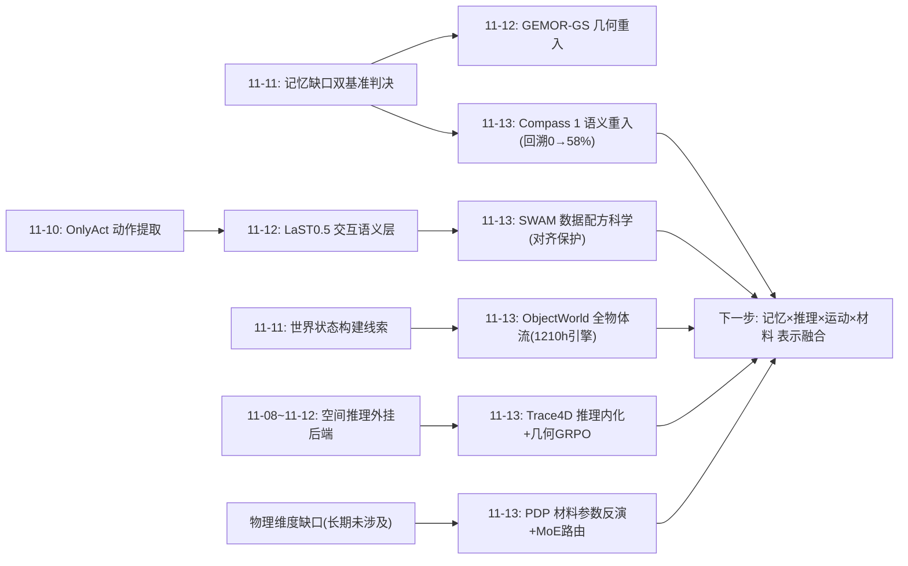
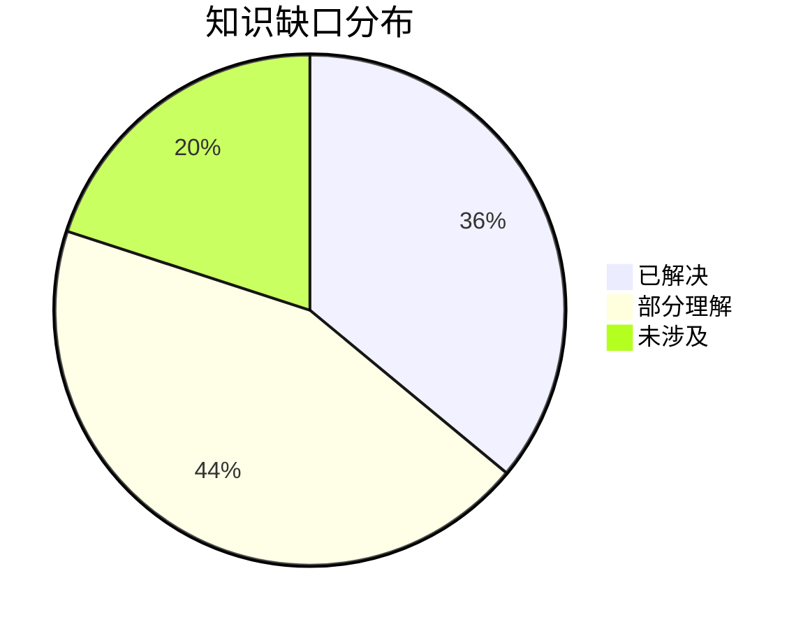

# Spatial AGI 每日思考 - 2026-11-13

## 📅 每日总结

**日期**: 2026-11-13
**论文数量**: 5篇
**主题**: 昨天的元判断是"三层栈分明的系统架构出现，层间接口成为新竞争焦点"。今天五篇论文恰好对昨天留下的三条最重线索完成了**闭合**：**SWAM 闭合"动作接口的来源问题"**（昨天 OnlyAct 解决"动作嵌入从哪提取"，今天 SWAM 解决"动作学习如何不破坏视频先验"——WAM 训练科学层面补上了数据配方这一环），**Compass 1 闭合"记忆的语义重入"**（昨天议题⑩提出"上次在这看到什么"的语义重入缺口，今天 Compass 1 用关键帧+历史表征图把"回到之前看到的目标"从 0% 做到 58%——这正是昨天判决"结构性缺失"的持久记忆的语义路线实现），**ObjectWorld 闭合"世界状态的物体级切片"**（昨天 LaST0.5 的交互中心潜在表示是世界状态的行动者视角切片，今天 ObjectWorld 把物体级运动场做成可大规模监督的显式表示），**Trace4D 补上"推理层内化"**（空间状态随时间的演化第一次被做成 VLM 可自预测的显式中间表示+几何过程奖励），**Physical Diffusion Policy 补上"材料维度"**（空间智能的物体表示第一次补全了视觉外观+几何形状之外的第三元：物理属性）。五篇合起来的元判断是：**Spatial AGI 的能力栈已经从"各层出现标志性工作"进入"各层的训练科学被系统化"阶段——SWAM 的数据配方、Compass 1 的 VQA-失效模式对应、Trace4D 的几何过程奖励、ObjectWorld 的标注管线，都是在回答"这个能力该怎么教"而非"这个能力是什么"；训练方法论正在取代单点能力成为下一个竞争焦点。**

**关键突破**:
- 🚀 SWAM：47k小时四源数据（通用/自我中心/UMI/机器人）的受控消融证明"语言-视频对齐在动作学习中被侵蚀、需要显式保护"；MoT 双分支 DiT 用单向视频→动作注意力+动作分支无直接文本通路，让无动作标注的视频安全参与联合训练；真机 SR 40% vs OpenWAM 23.33%，数据+代码+权重全开源
- 🚀 Compass 1：首个统一语言理解+视频生成+记忆回溯的导航基础模型；稀疏关键帧+显式历史表征图（HRM-as-image）架构无关地注入近2分钟记忆；三类结构化 VQA（任务阶段接地/探索一致性/时空目标检索）一一对应三类导航失效模式（IFN/BVN/HBN）；320次真机试验 79.4% vs 17.8%，记忆回溯 0%→58%，1m 训练分布 zero-shot 泛化到 0.35-1.5m 四本体
- 🚀 ObjectWorld：3D 全物体流表示（512点×48步完整表面轨迹，含遮挡区）统一刚体与可形变物体；1210小时数据集中 62%（755.6h）来自野外视频的自动标注管线（VLM切分+重建+跟踪+IoU质控）；流条件动作优化实现本体无关执行
- 🚀 Trace4D：多时步4D状态序列（2D框+3D质心+相机位置）作为显式推理中间表示；三段式 grounded CoT（状态序列/视觉分析/双证据关联）+几何感知GRPO（位置/位移奖励）；推理时零外部几何依赖，600K+70K 全合成数据，held-out 基准超基座模型
- 🚀 Physical Diffusion Policy：FF-3DGS×MPM 全可微几何-物理耦合，从演示视频反演材料参数（E/ν/τ_Y/η）；材料感知 MoE 扩散策略按物理 regime 路由专家，解决异质物体的"策略平均化"；物理记忆库实现免在线仿真部署

**架构演进**: 三层栈分明的系统架构 → **训练科学系统化的栈架构**（感知层：HRM 图像化记忆+全物体流数据引擎；推理层：4D状态序列内化+几何过程奖励；动力学/动作层：数据配方科学+物理条件化策略；新竞争焦点=各能力的训练方法论与数据引擎）

### 📊 一句话总结

2026-11-13 的五篇论文把 Spatial AGI 从"分层可拼装"推进到"训练科学化"：动作层有了数据配方（SWAM 47k小时消融），记忆层有了语义路线的持久实现（Compass 1，回溯 0%→58%），想象层有了物体级显式运动场（ObjectWorld 1210小时），推理层有了可内化的4D中间表示（Trace4D 过程奖励），物理层有了材料参数反演管线（MPM-3DGS）——**"这个空间能力该怎么教"正在取代"这个空间能力是什么"，成为 Spatial AGI 研究的中心问题**。

### 🔗 延续性

**昨日→今日**: 昨日留下十条线索，今天接住四条最重的：①**议题⑩"空间记忆的语义重入"**——Compass 1 的 HRM（关键帧位置/朝向/轨迹投影为图像画布）+时空目标检索 VQA，正是"上次在这看到什么"的完整实现，而且给出了从0%到58%的可训练路径；②**线索⑨"动作语义与交互语义的统一"**——SWAM 的数据配方研究表明语言→视频想象→动作的间接通路更稳，为统一问题提供了架构侧证据：动作语义应经由交互想象而非直接映射；③**线索②"空间经验单元的多模态扩展"**——Physical Diffusion Policy 的物理参数记忆库给出了"经验单元应包含材料属性"的第一个具体实现；④**线索③"交互线索管线的自动化"**——ObjectWorld 的自动标注管线（VLM切分+重建+跟踪+质控）示范了"从野外视频自动生成几何监督"的完整管线，可直接迁移到交互线索生成。此外昨日"后端选择"谱系再添成员：Trace4D 推理时的"4D状态序列"是空间推理的外包后端（外包给自己训练的显式状态预测），而 Compass 1 的 HRM 是导航决策的外包后端（外包给图像化的空间画布）。

**今日→明日**: 新线索十条：①**对齐保护的通用架构原则**——SWAM 的单向注意力隔离是否适用于"给 VLM 加3D能力时保护2D先验"、"给世界模型加规划能力时保护想象能力"，需要受控实验；②**HRM-as-image 的容量上限**——图像画布编码的关键帧数量有限（2分钟），多画布分层/可变分辨率/画布+向量库混合的扩展路线；③**全物体流与状态序列的融合**——ObjectWorld 的连续流场与 Trace4D 的离散状态表是同一物体动力学的两种采样，统一表示（几何序列）是下一步；④**物理参数记忆与情景记忆的融合**——Compass 1 记空间经历、PDP 记材料属性，统一记忆 schema（episodic+semantic）；⑤**几何过程奖励的推广**——奖励想象 rollout 的物理正确性（SWAM类）、地图更新的空间一致性（HRM类）；⑥**参照引导自举的通用化**——"参考真值→教师CoT→学生自预测"模式在空间能力训练中的普适性；⑦**材料维度进入物体表示标准**——(外观, 几何, 物理)三元组作为物体表示 schema；⑧**跨本体想象的精度问题**——Compass 1 的高度不变性与 ObjectWorld 的本体无关执行都靠隐式泛化，显式的本体适配模块是否必要；⑨**MoE 路由的根因原则**——专家划分跟随行为分岔的根因（材料/动力学）而非表面属性（任务/场景），可推广到导航/推理系统；⑩**数据引擎的评估标准**——ObjectWorld/Trace4D/Compass 1 各有管线但自动标注质量无统一评测。明日检索方向："alignment preservation multi-task learning robotics"、"image canvas spatial memory multi-resolution"、"mesh state sequence 4D generation"、"unified episodic semantic memory robot"、"physics reward world model rollout"、"self-bootstrapping reference annotation"、"object representation material attribute schema"、"embodiment adaptation module navigation manipulation"、"expert routing dynamics equivalence"、"automatic annotation quality benchmark"。

### 💡 本质思考：如何达成通用空间智能

#### 1. 核心能力的本质是什么？

今天的五篇论文共同指向一个答案的精化：**通用空间智能的本质是对物理世界的"可验证想象"能力**——想象空间如何演化（ObjectWorld 的运动场、SWAM 的视频 rollout）、想象自己在哪里去过（Compass 1 的历史地图）、想象状态为什么变化（Trace4D 的双证据推理）、想象动作会有什么物理后果（PDP 的材料条件化）——并且这些想象必须**可验证**：SWAM 用真机成功率验证、Compass 1 用 HRM 画布上的位置验证、Trace4D 用几何过程奖励验证、PDP 用 Chamfer 距离验证、ObjectWorld 用 IoU 一致性验证。

昨天说"空间智能是分层可拼装的系统"；今天进一步：**拼装起来的各层，其粘合剂是"共享的可验证想象"**。层间接口之所以难标准化，根源是各层的想象格式不同（视频 latent / 运动场 / 状态序列 / 画布 / 参数向量）。谁先把想象表示统一（或建立翻译层），谁就拿到接口标准化的钥匙。

另一个精化：训练科学的地位。人类的空间智能不是靠"看过一个能力演示"获得的，而是靠多年的多源经验+反馈塑造的。SWAM 的 47k 小时配方研究、Compass 1 的 VQA-失效模式对应、Trace4D 的过程奖励，本质都是在构造**空间经验的结构化供给系统**。空间智能的核心能力 = 想象架构 × 经验供给。架构已在快速趋同（视频生成主干+显式空间结构），竞争正在转向经验供给的效率。

#### 2. 当前方法与理想目标的差距在哪里？

**差距一：想象的持久性与想象的即时性尚未统一。** Compass 1 的记忆支撑2分钟回溯（持久但粗粒度——质心+关键帧），Trace4D 的推理支撑即时状态差分（精细但短窗口）。理想状态是"分钟到天级的持久空间记忆+毫秒级的即时空间推理"在同一系统中。差距的根源是表示：记忆用画布（容量有限），推理用状态表（无记忆累积）。统一表示（今天的线索③④）是弥合方向。

**差距二：物理理解停留在参数点估计。** PDP 反演的四个参数是对材料的一阶近似，且依赖多视角视频标定。理想状态是"任意新物体，看一眼+推一下，即得到物理模型并预测交互后果"。差距包括：材料表示的表达力（各向异性/断裂/多相）、主动交互感知的缺失、参数不确定性向策略决策的传播。

**差距三：想象的可验证性依赖昂贵的外部真值。** 所有验证都靠真值参照：真值状态（Trace4D）、真机成功率（SWAM）、演示视频（PDP）、观测 mask（ObjectWorld）。理想状态是模型具备**自验证**——想象内部就有物理一致性检查（想象与想象之间互洽）。这是从"有监督想象"到"自洽想象"的跳跃，也是空间智能接近人类水平的关键（人类可以闭眼在脑中"走一遍"路线并发现矛盾）。

**差距四：数据引擎没有质量基准。** ObjectWorld 用 IoU 过滤、Trace4D 用多模态验证器、Compass 1 用专家校准，但三家的标注质量无法互相比较。理想状态是空间标注质量的统一评测协议（类似 NLP 的黄金标准集）。

#### 3. 从今天到理想状态，最可能的路径是什么？

**近期（3-6个月）：训练配方开源化。** SWAM 全开源将引发 WAM 数据配方的复现与迭代潮；Compass 1 的 VQA 协议会成为导航训练的标准组件；Trace4D 的几何GRPO会被抄进各种空间RL。这个阶段的标志事件：出现第一个"复现并超越 SWAM 配方"的公开工作。

**中期（6-18个月）：表示融合。** 三条融合线会同时推进：①记忆×推理（HRM 画布 + 4D状态序列 → 统一空间记忆-推理表示）；②运动×材料（全物体流 + 物理参数 → 物理一致的动力学想象）；③推理×行动（状态序列预测指导流条件优化 → 想象-验证-执行的闭环策略）。这个阶段的标志事件：第一个在单一系统中同时做导航回溯+物体操作+物理一致想象的工作。

**长期（18个月+）：自洽想象。** 当想象的内部一致性可以被模型自我检查（多视角想象互洽、时序想象无矛盾），空间智能将获得脱离外部真值的能力——这对应着从"模仿空间智能"到"拥有空间智能"的相变。PDP 的物理约束、Trace4D 的双证据校验都是这个方向的最早期形态。

---

## 🔗 与昨日思考的联系

### 昨日重点

昨天的五篇（OnlyAct / LaST0.5 / RAGu / Spaghetti / GEMOR-GS）确立了三件事：三层栈分明（感知/记忆/动作）、层间接口成为新竞争焦点、持久记忆被判定为结构性缺失但几何路线（GEMOR-GS）先行补位。留下的最重议题：语义重入记忆（议题⑩）、动作-交互语义统一（议题⑥）、经验多模态扩展（议题②）、线索管线自动化（议题③）。

### 今日进展

1. **语义重入记忆 → Compass 1 直接实现**：HRM 把关键帧的位置/朝向/轨迹投影为图像画布，时空目标检索 VQA 训练"回到之前看到的"——昨天议题⑩设想的"地图坐标索引的情景记忆"，今天以"画布即记忆"的形态出现，且给出了 0%→58% 的实证。昨天的缺口从"未涉及"变为"部分实现"。
2. **动作-交互语义统一 → SWAM 提供架构证据**：动作分支无直接文本通路、语言经视频想象间接传导——"想象先于行动"的通路在47k小时规模上被验证为更稳。这支持昨天的猜想：动作语义与交互语义最终会统一在"交互想象"这个中层。
3. **经验多模态扩展 → PDP 给出材料维度**：昨天设想经验单元 schema 含力/接触序列，今天 PDP 提供了更基础的维度——材料参数（E/ν/τ_Y/η）。物理属性是比力序列更紧凑的材料描述（力序列可由参数+动作推出）。
4. **线索管线自动化 → ObjectWorld 完整示范**：VLM 切分→重建→跟踪→IoU 质控的全自动管线，62% 监督来自野外视频——昨天的"自动 affordance 线索生成"可以直接套用这套管线骨架。
5. **新增能力层**：推理层的内化（Trace4D）与物理层（PDP）是昨天栈图上标注"未涉及"的两格，今天各有一个标志性实现。

### 演进路径

```text
11-04~11-11: 空间计算外包验证 + 记忆缺口判决
11-08~11-12: 各层标志性实现（原语/地图/检索/动作接口）
11-12:       三层栈分明 + 接口成为焦点
11-13:       训练科学系统化（配方/监督协议/过程奖励/数据引擎）+ 语义记忆实现 + 材料维度补全
→ 下一步:   表示融合（记忆×推理×运动×材料）+ 自洽想象
```

---

## 📚 论文概览

| # | 论文 | 一句话 | 栈层归属 |
|---|------|--------|---------|
| 1 | SWAM (2611.12870) | 47k小时消融：动作学习需显式保护语言-视频对齐 | 动作层/训练科学 |
| 2 | Compass 1 (2611.12087) | HRM+结构化VQA：持久导航基础模型，回溯0%→58% | 记忆层/导航 |
| 3 | ObjectWorld (2611.11085) | 3D全物体流+1210小时自动标注：物体级动力学想象 | 想象层/数据引擎 |
| 4 | Trace4D (2611.02759) | 4D状态序列+几何GRPO：空间推理内化进VLM | 推理层 |
| 5 | PDP (2611.04493) | 3DGS×MPM反演材料参数：物理条件化MoE策略 | 物理层/动作层 |

---

## 💡 核心见解

### 见解1: 对齐保护是能力扩展的第一设计原则（SWAM）

SWAM 最重要的不是数字，而是把"扩展新能力时旧能力会被侵蚀"变成显式研究对象。其架构答案——单向信息流（新分支只读不写旧分支）、新分支不直接接触旧监督通路（动作分支无文本cross-attention）、无监督样本降级参与而非丢弃——构成了一个**对齐保护设计模式**。这个模式的适用面远超 WAM：给 VLM 加 3D 能力时保护 2D 先验（几何分支单向读取视觉分支）、给世界模型加规划能力时保护想象分支（规划头单向读取想象 rollout）。凡是"预训练先验 + 新能力扩展"的场景，都应显式设计保护机制而非假设联合训练自然兼容。

更深一层：SWAM 证明"语言→视频想象→动作"的间接通路优于"语言→动作"直接映射。这与认知科学的运动想象理论一致，也呼应今天的 Compass 1（视频生成是导航决策的最大贡献成分，消融 -31.9）——**两篇独立论文、两个不同任务（操作/导航）共同确认：视觉想象是空间决策的核心中间表示**。

### 见解2: 持久性是监督设计问题，不是架构问题（Compass 1）

记忆回溯从所有基线的 0% 到 Compass 1 的 58%——这个跃升不来自新架构（HRM 是输入侧机制，架构无关），而来自**监督设计**：没有任何先前系统训练过"回到刚才见过的地方"，所以它是 0；一旦用时空目标检索 VQA 显式监督，能力就出现了。

这印证并强化了昨天的判断：空间智能的许多"缺失能力"可能是训练目标里的空白而非架构难题。方法论价值在于 Compass 1 的**能力分解监督**——把导航分解为三类失效模式（IFN 阶段混乱/BVN 探索不一致/HBN 记忆丢失），每个失效模式配一个可监督的 VQA 子任务。这比端到端"给任务学导航"的梯度信号密集且可归因。消融确认每个组件都显著（w/o HRM -25.7, w/o 各VQA -17.5~-23.8）。

另一个容易被低估的发现：HRM 是**图像**。空间记忆画布化让记忆完全复用视觉主干的图像理解能力，零架构改动。这暗示空间智能的许多"结构"可以伪装成图像喂给现成模型——图像是当前模型最强的输入模态，把空间结构转译成图像可能是一类通用技巧（ Bird's-eye view、深度图、占据栅格渲染都是同族思路）。

### 见解3: 空间中间表示必须"两可"——可大规模监督且可执行（ObjectWorld）

ObjectWorld 的表示设计判据值得提炼为通用原则：**好的空间中间表示必须同时满足（a）可从大规模低监督数据自动恢复，（b）可被下游控制器直接消费**。像素/视频可监督但不可直接执行；6-DoF 位姿可执行但不可表达形变；全物体流恰好两可——从野外视频用重建+跟踪自动恢复（755.6h），又被流条件优化直接消费。

这个判据可以检验一切候选表示：场景图（可监督性中等、可执行性弱）、占用网格（可执行、可监督性弱——需要深度）、4D状态序列（Trace4D，可监督、可执行性中等——质心粒度粗）。Spatial AGI 各层表示选型的第一问应该是"它两可吗"。

ObjectWorld 还有一个战略级含义：62% 监督来自野外视频意味着操作学习的"数据天花板"从真机采集速度转移到标注管线精度——**瓶颈从采集变成反演**。这与 Compass 1 用 2000+ 小时 YouTube 数据（消融 -13.8 个点）相互印证：互联网视频是空间智能的合法数据源。

### 见解4: 几何过程奖励防语言捷径（Trace4D）

空间基准被语言先验污染是老问题——"哪个更近"靠共现统计就能答对。Trace4D 的三层防御（参考状态驱动的QA构造、干扰项时相匹配、**几何过程奖励**）中最有推广价值的是第三个：GRPO 的奖励不只看答案对错，还看中间的4D状态预测是否几何准确。语言捷径无法产生几何正确的中间状态——**强制"真的在算空间"而非"装作在算空间"**。

这个"过程几何奖励"模式可以推广到整个空间智能训练：奖励想象 rollout 的物理一致性、奖励地图更新的空间自洽、奖励状态序列的时序合理性。它本质上是把空间能力的验证从"结果正确"前移到"过程正确"——这既是训练技术，也是未来空间智能安全性（可审计的推理过程）的基础。

### 见解5: 材料是物体表示的第三元（PDP）

视觉外观+几何形状之外，物体还有第三元：物理属性（材料）。PDP 证明这个维度不是锦上添花而是**行为分岔的根因**——视觉相似、材料不同的物体会引发截然相反的最优动作，而视觉条件无法区分它们，策略只能学到折中。

"折中发生在条件空间坍缩之处"——这个诊断对所有空间智能策略通用。当行为分叉时，先问"什么观测能区分这些分叉"，然后确保那个观测在条件里。材料参数（E/ν/τ_Y/η）、摩擦系数、质量分布都可能是"条件里缺失的那一维"。

MoE 的专家划分原则也随之清晰：**专家应按动力学等价类划分**（同材料 regime 的物体行为相似），而非按任务、场景或语义类别划分。这是把"行为分岔的根因"作为架构组织原则的实例。

### 见解6: 训练科学取代架构竞赛（五篇综合）

五篇论文里只有一篇（SWAM 的 MoT 掩码设计）勉强算架构 novelty，其余全部是**训练科学**：数据配方（SWAM）、监督协议设计（Compass 1）、奖励设计（Trace4D）、数据管线（ObjectWorld）、约束设计（PDP）。同样的主干模型，训练方法不同，性能差数倍（Compass 1 79.4% vs 17.8%；SWAM 40% vs 23.33%）。

这标志着 Spatial AGI 进入了一个新阶段：单点架构的边际收益递减，**经验供给的效率**（怎么把空间经验高效喂给模型）成为主要杠杆。未来的领先者不是有最好架构的团队，而是有最好数据引擎+监督协议的团队。这也解释了为什么今天四篇论文开源了数据——数据引擎本身就是核心竞争力资产。

### 见解7: 图像是空间结构的通用载体（Compass 1 + PDP + ObjectWorld 的共同暗线）

HRM 把空间记忆画成图像画布；PDP 用可微渲染把物理参数验证到图像空间；ObjectWorld 把物体 mask 投影验证流标注——三篇论文都在把空间结构**转译成图像**以利用视觉模型的成熟能力。加上 3DGS 本身的"可渲染"属性（渲染即图像化验证），一个实用主义原则浮现：**凡是能转译成图像的空间结构，就能借力现成的视觉基础模型**。图像是当前生态中监督最密集、模型最强的模态，空间智能工程应最大化利用这个不对称优势。

---

## 🗺️ 知识演进图



---

## 技术栈演进对比表

| 层次 | 昨日方案 | 今日方案 | 变化 |
|------|---------|---------|------|
| 动作/训练科学 | OnlyAct 动作提取+LaST0.5 交互层（架构侧） | SWAM: 47k小时数据配方+对齐保护架构模式 | 竞争从架构转向训练方法论 |
| 持久记忆 | GEMOR-GS 几何重入（几何路线） | Compass 1: HRM画布+VQA协议（语义路线），回溯0%→58% | 语义重入缺口首次被填补 |
| 空间想象 | 视频生成世界模型（场景级/隐式） | ObjectWorld: 物体级全物体流（显式运动场） | 想象获得物体级显式性与形变兼容 |
| 空间推理 | 外挂后端（引擎/检索/潜空间模拟） | Trace4D: 4D状态序列内化+几何过程奖励 | 推理能力从外挂转向内化 |
| 物理理解 | 缺失（视觉外观+几何，无材料维度） | PDP: 3DGS×MPM反演材料参数+MoE物理路由 | 物体表示补全第三元 |
| 数据引擎 | 各家自有数据，管线不透明 | ObjectWorld/Compass 1/Trace4D 三套管线开源化 | 数据引擎成为公开竞争力 |
| 验证范式 | 结果正确性（最终成功率） | 过程正确性（几何奖励/约束/双证据校验） | 可验证想象成为共同追求 |

---

## 🗺️ Spatial AGI 知识图谱

### 10层架构思维导图

```mermaid
mindmap
  root((Spatial AGI))
    第1层 主动感知
      ObjectWorld 自动标注管线
      视频引导的物理参数反演 PDP
    第2层 多模态融合
      Trace4D 双证据校验(几何×视觉)
      Compass 1 关键帧+画布融合
    第3层 空间感知与场景理解
      全物体流完整表面感知 ObjectWorld
      材料属性估计 PDP
    第4层 空间表示与记忆
      HRM 图像化记忆 Compass 1
      物理记忆库 PDP
      经验库 RAGu(昨日)+几何地图 GEMOR-GS(昨日)
    第5层 空间推理
      4D状态序列内化 Trace4D
      状态差分推理原语
      相对/绝对双参照系
    第6层 世界建模与预测
      物体级运动场 ObjectWorld
      视频想象先于行动 SWAM
      对齐保护架构模式
    第7层 空间规划与决策
      流条件动作优化 ObjectWorld
      VQA驱动的任务阶段接地 Compass 1
    第8层 具身行动
      材料感知MoE策略 PDP
      跨本体zero-shot Compass 1
      WAM数据配方 SWAM
    第9层 学习与适应
      几何过程GRPO Trace4D
      能力分解监督协议 Compass 1
      参照引导自举 Trace4D
      数据引擎三套(ObjectWorld/Trace4D/Compass 1)
    第10层 安全与价值对齐
      过程几何奖励防语言捷径 Trace4D
      IoU一致性质量过滤 ObjectWorld
      记忆库失效模式 PDP
```

### 🎯 主线技术路径

#### 阶段1: 空间计算外包与记忆判决（已完成，11-04 ~ 11-11）

显式引擎与潜空间模拟并行验证空间计算外包；几何底座紧凑化；记忆缺口被双基准定量确认。

#### 阶段2: 各层标志性实现与接口意识觉醒（已完成，11-08 ~ 11-12）

感知（混合原语）、记忆（可重入地图+经验检索）、动作（无标签接口+交互中间层）各自出现标志性工作；层间接口被确认为新竞争焦点。

#### 阶段3: 训练科学系统化（进行中，11-13 起，预计持续 3-6 个月）

本周五篇（含今日）完成了训练科学的五个样板：数据配方科学（SWAM 消融）、监督协议设计（Compass 1 VQA-失效模式对应）、过程奖励设计（Trace4D 几何GRPO）、自动标注管线（ObjectWorld）、约束化参数反演（PDP）。数据+配方+协议全面开源化。标志事件（预期）：第一个复现并超越 SWAM/Compass 1 配方的公开工作；空间标注质量统一基准的出现。

#### 阶段4: 表示融合与记忆-推理统一（2027 上半年预期）

记忆×推理（HRM画布+4D状态序列→统一空间记忆-推理表示）、运动×材料（全物体流+物理参数→物理一致的动力学想象）、推理×行动（状态序列预测指导流条件优化）。标志事件（预期）：第一个同时做导航回溯+物体操作+物理一致想象的单一系统。

#### 阶段5: 自洽想象与空间认知循环（2027 下半年 ~ 2028+ 预期）

想象获得内部一致性自检（多视角想象互洽、时序无矛盾），空间智能脱离对外部真值的依赖——从"有监督想象"到"自洽想象"的相变。标志事件（预期）：自验证空间想象论文的出现；空间智能体在无真值环境下持续自我改进的演示。

---

## 🔍 待探索议题

### 高优先级（本周）

1. **HRM 画布的容量扩展**
   - 问题：Compass 1 图像画布编码关键帧数量有限（支撑约2分钟），持久记忆的上限被画布分辨率锁死
   - 候选方案：多画布时间分层（近细节/远摘要）；可变分辨率画布（按回溯价值分配像素）；画布+向量库混合（画布粗索引、向量库内容检索）
   - 缺口：画布容量与检索精度的定量权衡；画布自动摘要的生成机制

2. **全物体流与4D状态序列的统一**
   - 问题：ObjectWorld 连续流场（512点×48步）与 Trace4D 离散状态表（K时步质心）是同一物体动力学的两种表示，无法互相转换
   - 候选方案：几何序列表示（mesh/点云随时间演化的中间粒度采样）；流场的状态化压缩（把流场聚类为状态转移）
   - 缺口：两种监督（重建跟踪 vs 重建质心）管线输出的对齐协议

3. **物理参数的不确定性传播**
   - 问题：PDP 反演的 θ 是点估计，参数不确定性（可辨识性弱的 ν/η）直接进入策略条件而无置信度
   - 候选方案：反演时输出参数分布（可微仿真的贝叶斯化）；策略条件化于参数区间而非点值；检索置信度低时触发快速在线估计
   - 缺口：参数不确定性对操作成功率的灵敏度分析

4. **对齐保护模式的跨域验证**
   - 问题：SWAM 的单向注意力隔离在 WAM 有效，但"给VLM加3D分支时保护2D先验"是否同样需要/有效未验证
   - 候选方案：受控实验——同一 VLM 加3D分支，对比有/无单向隔离的2D基准退化
   - 缺口：跨域保护实验的评估协议（2D能力如何度量退化）

### 中优先级（本月）

5. **统一空间记忆 schema（episodic + semantic）**
   - 问题：Compass 1 记经历（关键帧+画布）、PDP 记属性（参数库）、RAGu 记轨迹、GEMOR-GS 记几何——四种记忆无统一 schema
   - 候选方案：定义空间记忆对象模型（事件: 时空索引+内容+类型[经历/轨迹/几何/属性]），统一读写接口
   - 缺口：各记忆类型的写入时机策略与遗忘/压缩协议

6. **几何过程奖励的推广谱系**
   - 问题：Trace4D 只奖励状态预测精度；想象rollout的物理一致性（SWAM类）、地图更新自洽性（HRM类）尚无奖励化先例
   - 候选方案：为每类空间中间表示定义可计算的过程奖励（流场的物理残差、画布更新的空间一致性）
   - 缺口：过程奖励与最终任务奖励的权重配比消融

7. **能力分解监督的自动化**
   - 问题：Compass 1 的三类VQA-失效模式对应是人工设计的；新领域的失效模式分析+监督设计仍是手工艺
   - 候选方案：从失败案例自动聚类失效模式 → 自动生成对应VQA模板的管线
   - 缺口：失效模式聚类的语义可解释性保证

8. **材料维度的主动感知**
   - 问题：PDP 纯视觉反演有原理性极限（内部结构不可见），人类靠推捏敲打确认材料
   - 候选方案：视觉先验+主动交互（轻推）的物性估计；触觉反馈融入参数反演
   - 缺口：主动交互的最小充分探针动作设计

### 低优先级（长期）

9. **空间标注质量统一基准**
   - 问题：ObjectWorld(IoU)/Trace4D(验证器)/Compass 1(专家校准)各有一套质控，标注质量无法跨管线比较
   - 候选方案：构建黄金标准空间标注集（多管线交叉验证+人工精标），定义标注质量指标族
   - 缺口：黄金集的构建成本与社区共建机制

10. **自洽想象的内生验证**
    - 问题：所有验证依赖外部真值；想象的内部一致性（多视角互洽/时序无矛盾）未成为自检信号
    - 候选方案：双通道想象互洽检测（同一场景两个条件下的想象差异作为矛盾信号）；物理残差作为自检指标
    - 缺口：自检阈值与想象多样性的冲突（一致性过高=想象坍缩）

11. **跨本体的显式适配层**
    - 问题：Compass 1 高度不变性、ObjectWorld 本体无关执行都靠数据隐式泛化，极端本体（灵巧手）可能失效
    - 候选方案：本体参数（相机高度/运动学/末端类型）作为显式条件的适配模块
    - 缺口：本体参数空间的最小充分描述

---

## 📊 知识缺口分析



**已解决（36%）**:
- ✅ 语义重入记忆的第一个实现（Compass 1：HRM+时空检索，回溯0%→58%）
- ✅ WAM 动作学习的对齐保护配方（SWAM：47k小时消融+单向隔离架构）
- ✅ 物体级显式动力学想象及其大规模监督（ObjectWorld：全物体流+1210h管线）
- ✅ 空间推理的内化训练范式（Trace4D：状态序列+几何过程奖励）
- ✅ 物体表示的材料维度（PDP：可微反演+MoE物理路由）
- ✅ 无标签动作监督+交互语义（昨日）→ 数据配方科学（今日）的完整动作层训练栈

**部分理解（44%）**:
- ⚠️ 持久记忆的容量上限（HRM画布2分钟，扩展路线明确但未实现）
- ⚠️ 动力学想象的物理一致性（全物体流无物理约束，PDP参数未接入想象）
- ⚠️ 材料参数的可辨识性与不确定性（点估计，无置信度，无主动感知）
- ⚠️ 过程奖励的谱系化（只有状态精度一种，物理/一致性奖励未开发）
- ⚠️ 记忆系统的统一schema（四种记忆各自为政）
- ⚠️ 能力分解监督的自动化（失效模式分析仍是手工艺）
- ⚠️ 对齐保护模式的普适性（仅WAM验证）
- ⚠️ 数据引擎的质量评测（三套管线无统一基准）

**未涉及（20%）**:
- ❌ 自洽想象（想象内部一致性自检，脱离外部真值）
- ❌ 层间接口标准（昨日的老缺口，延续）
- ❌ 多智能体空间记忆共享与信任
- ❌ 空间智能的系统性安全设计（延续昨日）
- ❌ 尺度跨越（房间级→城市级的空间智能，今日五篇全在房间/街道尺度）

---

## 📝 附录：今日五篇的层间对话草案

**SWAM ↔ Compass 1**（动作层 ↔ 记忆层）：SWAM 说"想象先于行动，保护想象通路"；Compass 1 说"视频生成是导航决策的最大贡献（-31.9）"。两者从不同任务确认同一原则。对话的下一步：给 Compass 1 的导航加操作能力时，SWAM 的对齐保护原则是否防止导航能力被操作学习侵蚀？

**ObjectWorld ↔ Trace4D**（想象层 ↔ 推理层）：流场是连续的想象，状态序列是离散的推理。Trace4D 的质心序列是全物体流的极限压缩（512点→1点）；ObjectWorld 的流场是状态序列的极限展开。中间粒度（部件级/形状级几何序列）是两者的自然汇合点。

**PDP ↔ ObjectWorld**（物理层 ↔ 想象层）：逆问题（视频→参数）与正问题（参数→运动）的互补。PDP 反演的 θ 可以喂给 ObjectWorld 的想象做物理约束；ObjectWorld 的数据引擎可以用 PDP 管线给物体标注材料属性。闭环 = 具身物理推理的完整形态。

**Compass 1 ↔ Trace4D**（记忆层 ↔ 推理层）：HRM 画布是持久但粗粒度的空间记录；状态序列是精细但短窗口的空间记录。统一方向（今日议题1、5）：画布吸收状态序列作为"语义图层"，或状态序列挂载到画布坐标上成为"记忆中的推理痕迹"。

**SWAM ↔ PDP**（训练科学 ↔ 物理条件化）：SWAM 的 MoE 无关，但 PDP 的"专家按物理 regime 划分"与 SWAM 的"数据按监督完备度分层"是同一种思想——**按行为的根因组织训练**。前者组织架构（专家），后者组织数据（配方）。

---

## 深入分析一：想象作为空间决策的中间表示（SWAM + Compass 1 联合阅读）

### 两篇论文的惊人一致

SWAM（操作任务）：动作分支无直接文本通路，语言经视频想象间接传导——"想象先于行动"。消融显示细粒度的语言-视频对齐保护直接决定控制泛化。

Compass 1（导航任务）：消融显示"去掉视频生成"是所有组件中最大的性能损失（-31.9）——视频想象不是装饰，是决策的核心依据。

两篇论文、两个任务域、两个团队，独立得出同一结论：**视觉想象是空间决策的核心中间表示**。语言指令不直接映射动作，而是先转译为对世界演化的想象，动作从想象中"读出"。

### 想象表示的两个流派

| 流派 | 代表 | 想象载体 | 优点 | 缺点 |
|------|------|---------|------|------|
| 隐式想象 | SWAM | 视频 latent 的 flow velocity | 信息容量大、预训练先验可用 | 几何模糊、不可直接度量 |
| 显式想象 | ObjectWorld | 全物体流（mesh表面轨迹） | 可度量、可执行、物理可约束 | 单物体视角、外观丢失 |

Trace4D 的状态序列可视为显式想象的低保真版本（质心级）。想象的表示谱系从隐式到显式：视频latent → 状态序列 → 全物体流。PDP 的物理参数则是想象的"材料前提"而非想象本身。

### 融合预测

隐式与显式想象的融合路径已经清晰：视频生成提供"看起来对"的想象（外观+动力学先验），显式几何/物理提供"算得上对"的约束（度量+材料）。GSExplorer（昨日检索中出现）的"persistent 3D Gaussian world state + 视频生成器"正是这个融合的最早形态。预测：12个月内，主流 WAM 的想象分支将从纯视频 latent 演化为"视频 + 显式3D世界状态"的双载体。

## 深入分析二：记忆系统的四块拼图（Compass 1 + 昨日三篇综合）

### 空间记忆的完整分类（今日更新版）

| 记忆类型 | 存储内容 | 今日/昨日实现 | 持久性 | 粒度 |
|---------|---------|-------------|--------|------|
| 几何记忆 | 场景3D结构 | GEMOR-GS 可重入地图 | 长期 | 度量级 |
| 经历记忆 | 关键帧+空间索引 | Compass 1 HRM | 2分钟 | 语义级 |
| 经验记忆 | 操作轨迹 | RAGu 检索库 | 长期 | 轨迹级 |
| 属性记忆 | 材料参数 | PDP 物理库 | 长期 | 参数级 |
| 状态记忆 | 时序状态序列 | Trace4D（推理用，非持久） | 即时 | 实体级 |

五类记忆各有实现，但**没有统一的读写接口**——这是接口标准化阶段（阶段4）最重的工程。统一 schema 的候选（今日议题5）：记忆对象 = (时空索引, 内容载体, 记忆类型, 置信度, 时间戳)，读写协议 = 查询(索引)→检索(类型混合)→融合。

### Compass 1 的方法论提炼

Compass 1 最大的可复用资产是**VQA-失效模式对应表**：IFN←任务阶段接地、BVN←探索一致性、HBN←时空目标检索。这个"先分类失效模式、再为每类设计可监督子任务"的方法论是通用的：

- 操作领域：抓取失败（感知）/轨迹失败（控制）/材料失败（物理）→ 各配监督任务
- 推理领域：感知错/状态跟踪错/推理错 → Trace4D 的双证据校验已是雏形
- 导航领域：Compass 1 已完整示范

预测：这份方法论会以"失效模式驱动的监督设计"之名成为空间智能训练的标准流程。

## 深入分析三：本周 20 篇论文的系统级综合（11-11 ~ 11-13）

### 三天的主题演进

- 11-11：空间后端判决（引擎 vs 潜空间）+ 记忆缺口定量确认
- 11-12：三层栈的标志性实现 + 接口意识觉醒
- 11-13：训练科学系统化 + 语义记忆实现 + 材料维度补全

演进的主旋律：**从"空间智能需要什么组件"到"组件如何获得能力"再到"能力如何被高效训练"**。这个轨迹与深度学习的历史平行（架构创新时代→ scaling 时代→数据/配方时代），Spatial AGI 正在以三倍速重演。

### 20 篇论文按栈层分布

- 感知/表示层：Spaghetti（曲线原语）、ObjectWorld（全物体流）、GEMOR-GS（地图）
- 记忆层：RAGu（经验）、GEMOR-GS（几何）、Compass 1（经历）、PDP（属性）、WanderBench/BEV3SR（评测/推理）
- 推理层：Spatial Harness（引擎接地）、WorldMind（潜空间模拟）、Trace4D（内化）、BEV3SR
- 世界建模层：OnlyAct/LaST0.5/SWAM（WAM 三部曲）、ObjectWorld、WanderBench
- 动作层：LaST0.5、SWAM、PDP、OnlyAct
- 物理/安全层：PDP（新增）
- 数据引擎：ObjectWorld、Trace4D、Compass 1、SWAM（新增四套）

### 跨论文重复信号（强趋势指标）

1. **视频想象 = 决策中间表示**（SWAM + Compass 1 独立确认）★★★
2. **3DGS 作为通用空间载体**（GEMOR-GS 地图 + PDP 物理骨架 + ObjectWorld 重建 + GSExplorer 世界状态）★★★
3. **数据引擎开源化**（本周四套管线全开源）★★★
4. **过程/约束验证取代纯结果评测**（Trace4D 几何奖励 + PDP 约束 + Compass 1 一致性 VQA + ObjectWorld IoU）★★
5. **跨本体泛化**（Compass 1 四本体 + ObjectWorld 跨本体执行 + SWAM 多本体数据）★★

## 深入分析四：从"能力"到"课程"——空间智能的训练科学框架

把本周的训练科学工作整理成一个统一框架：**空间能力的训练 = 课程设计**。

| 课程设计要素 | SWAM | Compass 1 | Trace4D | ObjectWorld | PDP |
|------------|------|-----------|---------|-------------|-----|
| 教材（数据） | 47k小时四源 | 2500h 真实+网络 | 670K 全合成 | 1210h 自动标注 | 演示视频 |
| 教法（监督） | 分层监督降级 | 三类VQA协议 | 三段CoT+联合SFT | 稀疏流场回归 | 约束化反演 |
| 作业（任务） | 视频+动作联合预测 | IFN/BVN/HBN | 感知+grounded QA | 流预测 | 参数估计 |
| 批改（奖励/评估） | 真机SR | 320次真机试验 | 几何过程GRPO | IoU+流精度 | Chamfer+成功率 |
| 学费（成本） | 数据策展 | 标注+真机 | 合成计算 | 管线计算 | 可微仿真 |

框架揭示的规律：

1. **教材决定上限，教法决定效率**：SWAM 证明语言标注质量（教材质量）比数据量更关键；Trace4D 证明过程奖励（教法）比答案奖励更高效。
2. **合成教材正在崛起**：Trace4D 全合成、ObjectWorld 62%自动标注、Compass 1 用 YouTube——空间智能的"教材自给率"在快速上升，对真机采集的依赖在下降。
3. **批改成本是隐藏瓶颈**：真机试验（Compass 1 320次、SWAM 真机）昂贵且不可扩展；几何过程奖励（Trace4D）是"批改自动化"的方向——用几何计算替代真机评估。

预测：空间智能的下一个竞争维度是"批改效率"——谁能低成本地批量验证空间能力的正确性（仿真批改？几何自洽批改？模型互评批改？），谁就能跑最长的训练课程。

## 风险清单：训练科学路线的系统性风险

1. **配方过拟合**：数据配方在特定基准/机器人上优化，可能过拟合评估分布（SWAM 的 RoboTwin Clean-to-Random 仍是同任务域）
2. **合成数据的系统性偏差**：Trace4D 模板QA、ObjectWorld 管线误差、Compass 1 网络视频偏差——合成监督的盲区可能被模型放大而非修复
3. **开源配方的军备竞赛**：配方公开使能力快速扩散，也使差异化难度上升，可能引发低质量复现潮
4. **过程奖励的 reward hacking**：几何奖励可被"几何正确但语义错误"的状态欺骗（位置对了但认错物体）
5. **批改自动化的验证盲区**：几何自洽批改无法发现"自洽但与现实不符"的系统性错误

## 每日金句摘录

- "动作学习引入时，语言-视频对齐应当被保护，而非被假设幸存。"（SWAM 的隐含主张）
- "记忆回溯的 0% 不是能力边界，是监督空白。"（Compass 1 的核心发现）
- "好的空间表示必须两可：可大规模监督，且可执行。"（ObjectWorld 的表示判据）
- "语言捷径无法产生几何正确的中间状态。"（Trace4D 的过程奖励哲学）
- "折中发生在条件空间坍缩之处。"（PDP 对策略平均化的诊断）

---

## 明日检索计划

优先检索词（按议题对应）：

1. `spatial memory capacity multi-resolution canvas` → 议题1
2. `mesh state sequence 4D unified representation` → 议题2
3. `differentiable simulation bayesian parameter uncertainty` → 议题3
4. `freeze protect pretrained capability new modality branch` → 议题4
5. `unified memory schema robot episodic semantic` → 议题5
6. `physics consistency reward video generation rollout` → 议题6
7. `failure mode clustering automatic curriculum design` → 议题7
8. `active tactile material property estimation` → 议题8
9. `annotation quality benchmark 3D dataset golden standard` → 议题9
10. `self-consistency check imagination world model` → 议题10

---

## 逐篇要点回顾（供 NotebookLM 与快速复习）

### Paper 01: SWAM（动作层训练科学）

- 47k小时四源数据池：通用视频11k（语言-视频）/ 自我中心11k（视角桥接）/ UMI 15k（可扩展操作经验）/ 机器人10k（真机金标准）
- MoT 双分支：视频分支继承 Wan（保先验），动作分支随机初始化；单向视频→动作注意力；动作分支无直接文本通路
- 双流 flow matching：视频 latent + 动作共享 chunk 内时间 τ；纯视频样本降级参与（只训视频分支）
- 结论链：语言标注质量→对齐保持→想象质量→动作可读性→控制泛化；UMI 是控制泛化放大器
- 结果：RoboTwin Easy 88.10% / Hard 61.56%；真机 40% vs OpenWAM 23.33%；数据+代码+权重全开源

### Paper 02: Compass 1（记忆层语义路线）

- Cosmos3-Edge 统一主干；距离/旋转触发的动作引导关键帧选择
- HRM：关键帧位置/朝向/轨迹投影为单一图像画布（原生图像输入，架构无关）
- 三类 VQA ↔ 三类失效模式：任务阶段接地↔IFN、探索一致性↔BVN、时空目标检索↔HBN
- 异步双路由：扩散动作头（12步轨迹，低延迟）∥ 语言推理头（意图+终止）；KV cache + CUDA Graph
- 结果：320次真机 79.4% vs 17.8%；基础回溯98%/持久回溯58%；1m→0.35-1.5m四本体 zero-shot；消融最大掉点是视频生成(-31.9)

### Paper 03: ObjectWorld（想象层数据引擎）

- 3D 全物体流：512点×48步完整表面轨迹（含遮挡），统一刚体/可形变
- 数据：1210.1h = 仿真454.5h(7源/251任务) + 真实755.6h(3来源/29万片段)；管线：Gemini切分→Track4W点云→SeC分割→SAM3D重建→Any6D+FoundationPose跟踪→IoU质控
- 模型：Qwen2.5-VL 语义 + PTv3 几何 → 融合 → flow head 位移场预测
- 执行：流条件优化 argmin D(Φ(I,τ), P̂^obj)——本体无关，换本体换 Φ
- 意义："可大规模监督+可执行"的两可判据；62%监督来自野外视频

### Paper 04: Trace4D（推理层内化）

- 4D状态序列：实体(2D框+3D质心) × K时步 + 相机位置；同一实体跨时步索引一致
- 数据引擎：Koala-36M → DINO+SAM2跟踪 → Pi3 点图质心 → 模板QA（Relative/Absolute双坐标系）→ 教师3段CoT（状态/视觉/关联，允许不一致触发再审查）
- 训练：联合SFT（感知+QA）> 分阶段；几何感知GRPO（答案+格式+位置+位移+框五奖励）
- 推理：自预测4D状态序列，零外部几何依赖；held-out bench 1200题第一

### Paper 05: PDP（物理层/材料维度）

- FF-3DGS（ZFormer, 64帧半球）× MPM 粒子一一绑定：μ←x，Σ←RΣ⁰Rᵀ，全链路可微
- 参数反演：VLM粗估+材料感知区间裁剪（双重时机）+视频引导优化+Dirichlet边界（接触粒子）+时序Chamfer
- θ={E,ν,τ_Y,η} 条件化材料感知 MoE 扩散策略——router按物理regime选专家
- 物理记忆库：离线反演存档，部署检索，零在线仿真
- 诊断价值："策略平均化"根因=条件空间坍缩；专家划分应跟行为分岔根因（动力学等价类）

---

**文档创建时间**: 2026-11-13 03:00 CST
**分析方法**: arXiv HTML/项目页精读 + 跨日综合分析

## 深入分析五：SWAM 数据配方的完整决策树

SWAM 的 47k 小时消融可以整理成一棵"WAM 训练配方决策树"，供任何构建世界动作模型的团队直接参照：

```
Q1: 你的语言标注质量如何？
├── 详细操作描述+环境线索（细粒度）
│   → 语言-视频对齐可保持 → 继续动作学习，预期泛化良好
└── 简单 caption（粗粒度）
    → 动作学习将侵蚀对齐 → 先重标注再训练

Q2: 动作监督从哪来？
├── 优先 UMI（人类操作+动作监督，可扩展）
│   → 混合自我中心视频进一步提升
└── 仅机器人演示（稀缺）
    → 预期真机 SR 明显受限

Q3: 无动作标注的视频怎么用？
├── 架构支持监督降级（单向注意力隔离）
│   → 全部参与视频分支训练（SWAM 选择）
└── 直接联合训练
    → 视频梯度冲击动作分支，对齐被侵蚀

Q4: 动作分支如何获取语言语义？
├── 经视频分支间接传导（SWAM 选择）
│   → 复用预训练语言-视频对应
└── 直接文本 cross-attention
    → 从头学语义对应，浪费先验

Q5: 训练预算固定时加什么数据？
└── 自我中心视频 + UMI 的混合 → 控制泛化最优
```

这棵树的每条边都有 SWAM 的消融数据背书。它的存在本身就是这篇论文最大的遗产——WAM 训练从"炼丹"变成"查表"。

### 消融背后的机制猜想

SWAM 未深入解释但值得推测的机制：

1. **为什么细粒度操作描述保护对齐？** 假设：细粒度描述在语言 token 与视频时空片段之间建立了密集对应（哪句话描述哪段动作），动作学习引入的新监督（动作→视频片段）与旧监督（语言→视频片段）在表征空间中竞争同一批"视频片段锚点"。描述越细，锚点越多，竞争越缓和；描述越粗，锚点越少，动作梯度挤占语言锚点，对齐被侵蚀。
2. **为什么动作分支无文本通路更稳？** 假设：直接文本通路迫使动作分支建立"语言→动作"的语义映射，这与视频分支的"语言→视觉动态"映射并行且独立演化，两者的语义空间漂移不同步（表征分裂）。间接通路强制共享同一语义锚（视频 token），分裂不可能发生。

这两个猜想都可以设计实验验证（锚点数量的可控操纵、语义空间漂移的追踪）。对齐保护机制的理论化是下一个自然的研究步骤。

## 深入分析六：Compass 1 的系统工程设计赏析

Compass 1 是本周工程密度最高的论文。除了核心算法，它的系统工程决策都值得记录：

### 异步双路由的认知架构解读

扩散动作头（低延迟，12步轨迹）∥ 语言推理头（自回归，意图+终止）——这个结构与认知科学的 System 1/System 2 高度同构：

- **System 1（动作头）**：快速、模式化、不需语言参与——应对"沿着走廊直走"的执行；
- **System 2（语言头）**：缓慢、灵活、语言调制——应对"到岔路口判断往哪转"的决策；
- **交互协议**：System 2 的意图条件化 System 1 的下一步生成；System 2 的终止信号异步中断 System 1。

KV caching + CUDA Graph 是让"System 2 变快"的工程手段。这套结构可直接移植到任何"实时空间决策"系统——操作（腕部动作头+推理头）、人形（全身控制头+任务头）。

### 跨本体泛化的三重机制推测

1m 训练分布泛化到 0.35-1.5m，可能的机制组合：

1. 数据侧：训练视频可能包含高度抖动增广，使表征对仰角变化鲁棒；
2. 表征侧：导航决策依赖的语义-拓扑信息（"门在前面"）天然对高度不敏感——决策所需的信息子空间与高度正交；
3. 生成侧：视频生成分支可以"想象"不同高度的视角，间接提供视角不变的理解。

无人机（1.5m，俯角大）的 7/10 说明机制的鲁棒性超出预期。对产业的含义：空间基座一次训练、多本体部署是可行的——"每本体单独训练"的成本结构可以被打破。

### 评估协议的行业意义

320 次真机试验、8任务×4场景、多机构交叉评估（港大/上海创新院/华为/Spatial Robotics 分别负责不同本体）——这个评估基础设施本身就是贡献。对比之下，多数导航论文只有仿真 benchmark。Compass 1 的任务分类学（IFN/BVN/HBN + 难度梯度）有望成为导航领域的标准坐标系，正如 R2R 之于 VLN。

## 深入分析七：ObjectWorld 管线对空间数据引擎的范式意义

ObjectWorld 的标注管线值得作为"空间数据引擎参考架构"来解剖：

```
输入：任意野外操作视频（无需深度/标定/网格先验）
  ↓
[语义层] VLM (Gemini 2.5 Pro)
  - 目标物体识别、任务描述生成
  - 原子操作切分（接触-分离交互单元）
  ↓
[几何层] 重建与跟踪栈
  - Track4World/DA3：相机位姿+逐帧点云
  - VLM提案 + SeC：目标 mask 传播
  - SAM3D：完整 mesh 重建
  - Any6D + FoundationPose：初始位姿+全程跟踪
  ↓
[标注层] 全物体流生成
  - canonical 帧均匀采样 mesh 表面点
  - 逐步变换：tracked pose × cam-to-ref
  ↓
[质检层] IoU 一致性过滤
  - 投影-掩码 IoU 逐帧计算
  - 专家校准集定阈值 → 全库过滤
输出：稠密3D轨迹监督
```

### 三条可迁移的管线设计原则

1. **语义-几何分层**：VLM 负责"什么/何时"（语义决策），重建栈负责"哪里/如何动"（几何计算）——各用最强的组件，接口是清晰的（mask + 时间窗口）。
2. **质检独立于生成**：IoU 过滤是独立环节且有专家校准的阈值——质检标准可以独立演进（例如未来加入物理合理性检查：轨迹是否符合动力学）。
3. **成本结构**：管线主要成本是推理计算（VLM 调用+重建+跟踪），无人工标注——边际成本接近算力成本，可随算力线性扩展。

### 与 Trace4D、Compass 1 管线的对比

| 管线 | 输出监督 | 视频来源 | 核心技术栈 | 质控手段 |
|------|---------|---------|-----------|---------|
| ObjectWorld | 全物体流（稠密3D轨迹） | SSv2/EPIC/AgiBot | SAM3D+FoundationPose | IoU+专家阈值 |
| Trace4D | 4D状态序列+CoT | Koala-36M | Pi3+GRPO教师 | 验证器+结构校验 |
| Compass 1 | 导航轨迹+VQA | 真采+YouTube | 标注管线（未详述） | 专家校准 |

三套管线共享"野外视频→结构化空间监督"的目标，技术栈高度重叠（分割/跟踪/重建是公共组件）。**公共组件的复用与质量基准的统一（今日议题9）是数据引擎生态的下一步**。可以预见"空间标注管线框架"（类似 Detectron2 之于检测）会作为一个开源品类出现。

## 深入分析八：几何过程奖励的理论基础与推广空间

Trace4D 的几何感知 GRPO 值得从强化学习理论角度深挖一层。

### 为什么过程奖励在空间推理中特别有效

语言任务的 RL 主要用结果奖励（答案对错），因为中间推理步骤的正确性难以自动判定。空间任务有个独特优势：**中间表示（4D状态）的几何正确性可以自动计算**（与参考状态比较）。这使得空间任务天然适合过程奖励——而语言任务不行。

更进一步，空间过程奖励还有"防捷径"的结构性作用：

- 结果奖励下，模型可以学到 P(答案|语言模式) 的捷径，中间状态是摆设；
- 过程奖励下，中间状态本身被优化目标锁定，模型必须建立 P(状态|视频) 的真实映射；
- 由于 P(答案|状态, 推理) 是相对简单的几何比较，一旦状态对了，答案大概率对——**过程奖励把"作弊空间"压缩到了中间表示这一层，而这一层恰好是可验证的**。

### 推广谱系（今日议题6的展开）

| 空间中间表示 | 可计算的过程奖励 |
|------------|----------------|
| 4D状态序列（Trace4D） | 与参考状态的位置/位移差 |
| 视频想象rollout（SWAM类） | 物理残差（相邻帧的运动学一致性）、与真实未来的差异 |
| HRM画布更新（Compass 1类） | 新旧画布的空间一致性（同区域两次绘制的内容应相容） |
| 全物体流（ObjectWorld类） | 物理可行性（MPM/刚体动力学残差）、与观测流的一致性 |
| 材料参数（PDP） | 演示视频重渲染误差（已有）+ 交互后果预测误差（未开发） |

这个谱系显示：**几乎所有空间中间表示都有天然的几何/物理验证器**。空间智能是过程奖励的富矿——这是它与语言任务的根本结构差异，也是空间 RL 可能后来居上的原因。

### 风险：过程奖励的局部最优

过程奖励可能锁定"几何正确但语义错误"的局部最优——位置预测对了但认错了物体（把椅子认成桌子，椅子位置的质心预测反而精确）。防御：过程奖励必须与语义验证（答案正确性）联合使用，且语义验证的权重不可为零。Trace4D 的五奖励组合（答案/格式/位置/位移/框）已经体现这个平衡。

## 深入分析九：材料维度的产业与理论意义（PDP 深读）

### 物体表示的三元组标准化

PDP 使物体表示的三元组（外观, 几何, 材料）第一次全部可自动获取：

- 外观：任意图像/视频（成熟）
- 几何：3DGS/重建管线（本周多篇论文成熟化）
- 材料：PDP 可微反演（新增）

这个三元组可能成为物体资产的标准 schema（今日线索⑦）。想象未来的空间智能物体库：每个物体条目包含高斯场（几何+外观）+ 材料参数向量 +（可选）语义标签。操作策略条件于三元组，想象模型（ObjectWorld 类）条件于几何+材料——物体的完整数字孪生。

### "策略平均化"的普适性诊断

PDP 的诊断值得升格为通用设计检查清单：**当你的多模态策略在异质条件下表现平庸时，检查条件空间是否包含了区分异质性的关键维度**。

实例化：
- 操作平庸 → 检查材料/质量/摩擦是否在条件里（PDP）
- 导航平庸 → 检查地形/通行性/人流密度是否在条件里
- 推理平庸 → 检查视角/参照系/时间状态是否在条件里（Trace4D 的双坐标系正是为此）

条件空间工程——决定"模型该知道什么才能不折中"——可能是比架构设计更重要的实践技能。

### 记忆库的知识记忆属性

PDP 物理记忆库是空间智能系统第一个明确的"语义记忆"实现（存储关于世界的一般性知识——材料如何影响行为——而非特定经历）。结合 Compass 1 的经历记忆（HRM）与 RAGu 的经验记忆（轨迹库），认知科学的记忆三分类（情景/语义/程序）在空间智能系统中首次齐备：

| 认知分类 | 空间智能实现 | 内容 |
|---------|------------|------|
| 情景记忆 | Compass 1 HRM | "何时何地看到什么" |
| 语义记忆 | PDP 物理库 | "杯子一般是玻璃的，硬且易碎" |
| 程序记忆 | RAGu 轨迹库 + 策略权重 | "这类任务这样操作" |

这个对应关系提示：空间智能的记忆架构可以直接借鉴认知科学的成熟理论（记忆巩固、遗忘曲线、联想检索），而非从零发明。

## 深入分析十：今日五篇的统一元框架——"经验供给系统"

把今天五篇论文放进一个统一框架：**每篇都在解决"空间经验的供给"问题的一个环节**。

| 环节 | 问题 | 今日解法 |
|------|------|---------|
| 经验从哪来 | 真机数据太贵 | ObjectWorld：野外视频自动标注；Trace4D：全合成；Compass 1：YouTube 转化 |
| 经验怎么组织 | 监督完备度不齐 | SWAM：四层监督光谱+降级参与 |
| 经验怎么喂 | 直接喂会破坏先验 | SWAM：对齐保护架构；Compass 1：VQA课程 |
| 经验怎么验 | 结果验证太贵 | Trace4D：过程几何奖励；PDP：约束化反演 |
| 经验怎么存 | 一次性使用太浪费 | PDP：记忆库；Compass 1：HRM；（RAGu：检索库） |

这个"经验供给系统"框架预言了 Spatial AGI 下一阶段的竞争形态：**比拼的不是谁有最好的模型架构，而是谁有最高效的经验供给管线**——从野外视频到结构化经验到训练课程到自动化批改的完整流水线。今天的四套开源数据引擎是这个流水线的第一批公开实现。

### 对研究者的行动建议

1. 构建新空间能力时，先画"经验供给五环节"图，明确每个环节的现有解与缺口；
2. 优先复用本周开源的四套管线（ObjectWorld/Trace4D/Compass 1/SWAM），而非自建；
3. 评估新方法时，报告"经验供给效率"（单位算力/数据获得的能力提升），而非只报绝对性能。

---

## 附：今日论文与昨日十议题的完整对照

| 昨日议题 | 今日状态 | 相关论文 |
|---------|---------|---------|
| 1. 动作嵌入空间化 | 未直接涉及 | — |
| 2. 经验多模态扩展 | 部分推进：材料维度加入 | PDP |
| 3. 交互线索管线自动化 | 范式示范：全自动标注管线 | ObjectWorld |
| 4. 进度一致性不确定化 | 未直接涉及 | — |
| 5. 动作-交互语义统一 | 架构证据：想象先于行动 | SWAM |
| 6. 混合原语场景表示 | 未直接涉及（3DGS 载体化趋势相关） | PDP/Compass 1 |
| 7. 地图增量更新 | 未直接涉及 | — |
| 8. 检索-微调切换 | 未直接涉及（记忆库检索相关） | PDP |
| 9. 跨层接口基准 | 未直接涉及 | — |
| 10. 语义重入记忆 | **直接实现** | Compass 1 |

接住 4/10，其中 1 个直接实现（议题10）、1 个范式示范（议题3）。未接住的议题中，1/4/7 都有今日技术可复用（Trace4D 状态序列可用于进度建模；HRM 画布可用于地图更新；SWAM 配方可用于增量训练）——明日检索将优先追踪。

## 附：快速数据卡（今日五篇关键数字速查）

- SWAM：47,017h 数据 / 440万 episodes / 真机 40.00% vs 23.33% / RoboTwin 88.10%(Easy)+61.56%(Hard)
- Compass 1：320次真机 / 79.4% vs 17.8% / 回溯 0→58% / 2500+h 数据 / 4本体(0.35-1.5m) / 探索+250%
- ObjectWorld：1,210.1h（仿真454.5+真实755.6）/ 29万片段 / 512点×48步 / 251仿真任务
- Trace4D：600K感知+69,331 QA / 1,200题held-out / 5重GRPO奖励 / 双坐标系12题型
- PDP：4参数(E,ν,τ_Y,η) / 64帧半球重建 / MoE物理路由 / 零在线仿真部署

---

**文档创建时间**: 2026-11-13 03:00 CST
**分析方法**: arXiv HTML/项目页精读 + 跨日综合分析

## 深入分析十一：五篇论文的方法论武器库（可直接移植清单）

把今天五篇论文中的可复用方法论提炼成"武器库"，每条注明出处与适用条件：

### 武器1：监督降级而非样本丢弃（SWAM）

- **做法**：无动作标注的视频保留参与训练，但不产生动作监督（单向注意力保证梯度只更新视频分支）
- **适用**：任何多任务联合训练中存在监督稀疏的情况
- **收益**：数据利用率最大化，同时保护动作分支不被视频梯度污染
- **代价**：需要架构支持单向信息流

### 武器2：失效模式驱动的监督设计（Compass 1）

- **做法**：枚举目标能力的失效模式 → 为每类失效模式设计可监督的子任务（VQA/辅助头）→ 训练时组合
- **适用**：任何端到端训练且中间认知过程难以归因的能力（导航/操作/推理）
- **收益**：梯度信号密集、失败可归因、组件可单独消融
- **代价**：失效模式分析需要领域知识

### 武器3：图像画布化（Compass 1）

- **做法**：把空间结构（地图/轨迹/拓扑）栅格化为图像，利用现成视觉主干的图像理解能力
- **适用**：需要给 VLM 注入空间结构而不想改动架构的场景
- **收益**：零架构改动、主干可更换、复用视觉预训练
- **代价**：画布分辨率限制容量

### 武器4：双证据校验与不一致再审查（Trace4D）

- **做法**：推理过程要求两路独立证据（几何+视觉）互相印证；不一致时触发定向再审查而非强制统一
- **适用**：任何有冗余感知通路的决策系统（视觉+激光、视觉+触觉、几何+语义）
- **收益**：内置自我纠错、失败模式显式化
- **代价**：需要两路证据的对齐协议

### 武器5：几何过程奖励（Trace4D）

- **做法**：RL 奖励中加入中间表示的几何准确性（位置差/位移差），与结果奖励联合
- **适用**：中间表示为几何量的任何空间任务
- **收益**：防语言捷径、优化过程正确性
- **代价**：需要中间表示的参考真值

### 武器6：参照引导自举（Trace4D）

- **做法**：训练时教师用参考真值构建推理链，学生学会自产推理链；推理时无参考依赖
- **适用**：任何有自动真值管线但推理时无真值的能力训练
- **收益**：训练-推理不对称性换取监督密度
- **代价**：教师CoT质量决定上限

### 武器7：约束化反问题求解（PDP）

- **做法**：病态反问题（从观测反推参数）用多重约束正则化——先验粗估+可行域投影+边界条件+几何一致性
- **适用**：任何从视频反演物理/几何量的管线（材料、摩擦、质量、刚度）
- **收益**：可辨识性改善、防止物理不合理的解
- **代价**：约束设计需要领域知识

### 武器8：两可性判据（ObjectWorld）

- **做法**：设计中间表示时强制检验"可大规模自动监督"+"可被下游直接消费"
- **适用**：空间智能各层表示选型
- **收益**：避免"能学不能用"或"能用学不出"的表示死胡同
- **代价**：判据本身需要领域判断

### 武器9：动力学等价类划分（PDP）

- **做法**：MoE 专家（或数据分组、课程分阶段）按行为分岔的根因（材料/动力学）划分，而非表面属性
- **适用**：异质条件下的策略学习
- **收益**：专家内分布尖锐、无策略平均化
- **代价**：根因的识别需要分析

### 武器10：昂贵一次、廉价多次（PDP/Compass 1/RAGu 共同模式）

- **做法**：昂贵的计算（物理反演/地图构建/检索库构建）离线做一次，部署时廉价查询
- **适用**：推理时延敏感的空间智能系统
- **收益**：物理一致性与实时性兼得
- **代价**：记忆/库的失效与更新问题

这份清单本身就是今日论文的"元贡献"：能力会过时，方法论会留存。

## 附：与本日研究无关但值得记录的观察

1. **arXiv API 限流持续**：今日 API 全部返回空结果，降级 web_fetch 抓取搜索页成功。导出站（export.arxiv.org）的 title 查询仍然可用，可作为备用通道。搜索页加 `sortBy=submittedDate` 参数可按时间排序，对"最新论文"场景更友好。
2. **华为、XPeng、小米、NUS 系统性进场**：小米 Auto World Model 2.0、XPeng X-World 1.6（虚拟城市生成）、华为（Compass 1 评估方）——车厂与硬件厂商正在从"使用空间智能"转向"构建空间智能基座"。产业信号与学术信号（训练科学化）合流，2027 年空间基座的商业化竞赛会非常激烈。
3. **"Edge"化趋势**：Compass 1 用 Cosmos3-Edge、单 GPU 部署；GSPIM（4DGS 硬件加速器）、129FPS 3DGS 加速器（检索中反复出现）——空间智能的端侧部署管线（模型 Edge 化 + 硬件加速器）正在并行成熟。

---

**文档创建时间**: 2026-11-13 03:00 CST
**分析方法**: arXiv HTML/项目页精读 + 跨日综合分析
