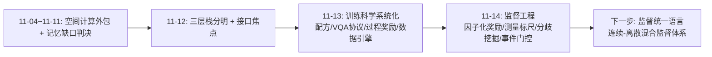
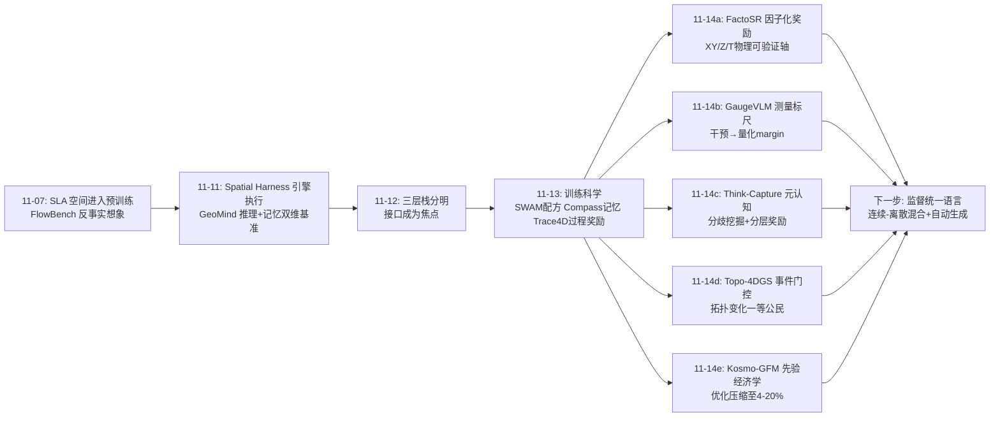
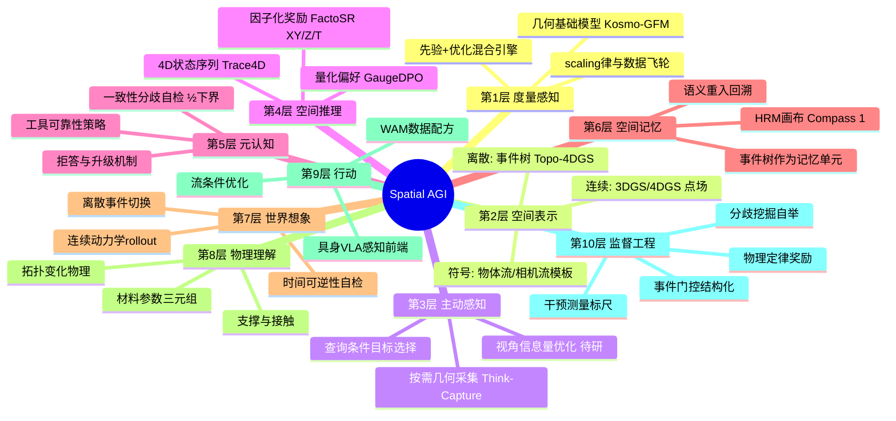
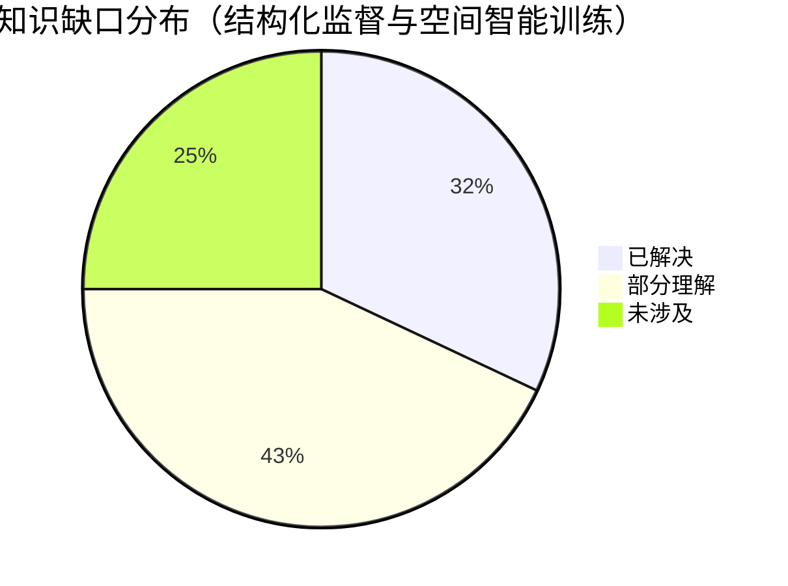

# Spatial AGI 每日思考 - 2026-11-14

## 📅 每日总结

**日期**: 2026-11-14
**论文数量**: 5篇
**主题**: 昨天的元判断是"训练科学正在取代单点能力成为竞争焦点"。今天五篇论文把这个判断推向更深一层：**监督信号的结构化正在成为训练科学的核心战场**。FactoSR 把 RL 奖励分解为 XY/Z/T 三个物理可验证子目标；GaugeVLM 把 DPO 的序数标签升级为 3D 干预精确测量的几何标尺；Think-Capture 用 base/tool 分歧挖掘自动构造"工具何时可信"的分层奖励；Topo-4DGS 把拓扑事件作为连续几何表示的一等公民（结构化变化由离散事件门控）；Kosmo-GFM 则在感知层展示"先验如何数量级地削减优化"并附上 scaling 证据。五篇合起来的元判断是：**Spatial AGI 的能力来源正在从"更多数据/更大模型"转向"更聪明的监督信号设计"——物理定律、受控干预、分歧挖掘、事件门控，都是把领域知识直接注入训练信号的结构化手段；监督工程（supervision engineering）正在成为一个独立的学科方向。**

**关键突破**:
- 🚀 FactoSR：把空间推理 RL 的奖励因子化为 XY（重投影对应）/ Z（深度序）/ T（时间可逆性）三个正交可验证子目标；SFT→GRPO 两阶段，VSI-Bench +5.9%、All-Angles +4.5% 且不伤通用能力；ECCV 2026 + 全开源
- 🚀 GaugeVLM：受控 3D 干预产生带测量误差的偏好对，GaugeDPO 把误差幅度直接转为 preference margin；25% 数据胜全量 DPO；10/10 空间指标超 SFT、QSpatial+ +18.9；Prop.1 证明"一致性≠正确性"（max error ≥ ½ max disagreement，½最优）
- 🚀 Think-Capture：查询条件化的主动 3D 获取——VLM 先点名需要哪些物体再采几何；符号化 3D 状态（100 token）对照 2D box（36.9 vs 54.4）证明增益来自 3D 结构；分层奖励（负样本+2）训练"工具证据元认知"，噪声下领先 zero-shot 19.5 分；24GB 单卡部署 Agibot G1
- 🚀 TopoEgo/Topo-4DGS：首个自我中心拓扑重建基准（Ego4D 68.8%、EPIC-KITCHENS >80% 视频含拓扑变化）；Motion Bifurcation（事件门控软路由部件轨迹）+ Topological Boundary Resolution（事件条件表面支撑增删）解决固定拓扑 4DGS 的事件后伪影
- 🚀 Kosmo-GFM：GFM 先验 + PoseEngine 场景优化 + KosmoWorld 数据飞轮的生产级系统；位姿精度超 GLUEMAP 且 runtime 压至 20%（Flash 4%）；几何重建符合数据/模型/算力 scaling 律

**架构演进**: 训练科学系统化的栈架构 → **监督工程驱动的栈架构**（感知层：几何基础模型+先验-优化混合；表示层：拓扑事件化 4D 表示；推理层：因子化 RL 奖励+量化偏好标尺+主动几何获取；新竞争焦点=监督信号的结构化设计）

### 📊 一句话总结

2026-11-14 的五篇论文把 Spatial AGI 的训练科学推进到"监督工程"阶段：几何定律变成 RL 奖励（FactoSR 的 XY/Z/T）、受控干预变成偏好标尺（GaugeVLM 的 GaugeDPO）、模式分歧变成工具元认知信号（Think-Capture 的 ±1/+2）、结构事件变成表示的开关（Topo-4DGS 的事件门控）——**"把领域知识注入监督信号的结构化技术"正在成为空间智能能力跃迁的主要杠杆，数据量和模型规模退居次位。**

### 🔗 延续性

**昨日→今日**: 昨天确立"训练科学系统化"（SWAM 数据配方、Compass 1 VQA-失效模式对应、Trace4D 几何过程奖励、ObjectWorld 标注管线），并留下十条线索。今天接住其中三条并深化：①**"几何过程奖励的推广"**——FactoSR 的 XY/Z/T 奖励与 GaugeVLM 的测量 margin 正是"几何奖励"家族的两个新成员，前者覆盖多视图几何三轴，后者给出偏好优化侧的量化方案；②**"参照引导自举的通用化"**——Think-Capture 的分歧挖掘（base vs tool 双模式跑分取分歧）是"参照引导"的自动化版本：不需要教师标注，两个模式的分歧就是训练信号；③**"数据引擎的评估标准"**——GaugeVLM 的 Constancy-Bench 与 Kosmo-GFM 的 SpatialBench 都是往"空间监督质量的统一评测"方向走的实例。此外，昨天 ObjectWorld 的"瓶颈从采集变成反演"判断今天被 Kosmo-GFM 强化：几何基础模型正是"反演"环节的工业级解决方案。

**今日→明日**: 新线索十条：①**监督信号的统一分类学**——物理定律奖励（FactoSR）/干预测量偏好（GaugeVLM）/分歧挖掘（Think-Capture）/事件门控（Topo-4DGS）应有一个统一框架描述"结构化监督"的设计空间；②**时间可逆性检验的推广**——T-reward 的对称性检验思想可推广到世界模型评估（rollout 正放倒放应互洽）与记忆系统（回访路线的正反一致性）；③**几何标尺与过程奖励的融合**——GaugeVLM 的量化 margin 与 Trace4D 的过程奖励可以统一为"每步推理都有几何误差标尺"的完整 RL 方案；④**拓扑事件检测的自动化**——Topo-4DGS 依赖人工事件标注，VLM 事件检测+4DGS 重建的闭环是明显缺口；⑤**先验-优化的分界线理论**——Kosmo-GFM 靠经验决定哪些交给先验哪些交给优化，理论上应存在最优分工；⑥**符号接口的标准化**——Think-Capture 的物体流/相机流与 Topo-4DGS 的事件树都是"几何→符号"的压缩，需要统一的中间表示 schema；⑦**主动感知与因子化奖励的结合**——Think-Capture 的按需采集如果配上 FactoSR 的重投影奖励，可以训练"主动获取最有信息量的视角"；⑧**工具元认知的评测基准**——"何时信任几何估计器"目前只在论文内部评测，需要独立基准；⑨**一致性证书的自检应用**——GaugeVLM Prop.1 的 ½ 下界可以作为 VLM 自我校验的运行时工具（多视角问一遍、分歧超阈值就拒答）；⑩**数据飞轮的收敛性**——KosmoWorld 的"重建→训练→更好重建"循环缺乏收敛性分析。明日检索方向："structured supervision taxonomy spatial"、"temporal cycle consistency world model evaluation"、"event detection VLM topology reconstruction"、"prior optimization tradeoff reconstruction theory"、"symbolic geometric interface schema VLM"、"active viewpoint selection information gain"、"tool reliability benchmark VLM"、"self-consistency rejection threshold calibration"、"data flywheel convergence reconstruction training"、"measured preference optimization embodied"。

### 💡 本质思考：如何达成通用空间智能

#### 1. 核心能力的本质是什么？

今天五篇论文把上周以来"可验证想象"的答案又精化了一层：**通用空间智能的本质是"带标尺的想象"**。昨天的判断是"想象必须可验证"（用真值、真机、几何奖励验证）；今天的五篇一致追问：验证之后呢？——验证信号必须**有刻度**。FactoSR 的 XY/Z/T 不是 0/1 对错而是几何残差；GaugeVLM 的 margin 不是"对/错"而是"错 10cm 还是错 10m"；Think-Capture 的奖励不是"用了工具没有"而是"这个场景里工具有没有价值"。无刻度的监督只能教出"猜对答案"的模型（shortcut learning）；有刻度的监督才能教出"理解误差结构"的模型。

另一个精化：**空间智能的元认知维度**。Think-Capture 提出的问题——"何时信任工具证据、何时回退视觉直觉"——把空间智能从单一能力扩展为"能力 + 对能力可靠性自知"的两层结构。人类的资深空间行为（医生读片、飞行员目测）都包含这层元认知。GaugeVLM 的 Prop.1（一致性分歧给出误差下界）则提供了元认知的自检工具：模型可以自己估算"这次回答最多错多少"。带标尺的想象 + 带自检的元认知，构成对空间智能本质的最新逼近。

还有一层来自 Topo-4DGS：**空间不仅连续还有离散**。切、拼、开、合这些拓扑事件占据日常交互的 80%，但整个空间智能文献几乎全部押注连续表示（形变场、连续奖励、连续深度）。离散结构变化需要离散的结构化监督（事件标注、事件门控、事件奖励）。连续与离散的混合监督体系，可能是监督工程的下一个大题目。

#### 2. 当前方法与理想目标的差距在哪里？

**差距一：结构化监督的覆盖率远低于监督总量。** FactoSR 用三个奖励轴、GaugeVLM 用一个度量（方向+距离）、Think-Capture 用一组分歧样本——每个工作只结构化了监督空间的一个切片。理想状态是"每一次空间推理训练都附带完整的几何标尺"：方向、距离、对应、深度、时序、拓扑、遮挡、支撑。当前覆盖率可能不到监督信息量的 5%。差距的根源是工程：给每个训练样本算几何残差需要位姿、深度、3D 场景等元数据，生产成本高。

**差距二：元认知是有训练无评测。** Think-Capture 证明了元认知可训练（+2 负样本奖励有效），但评测仍在论文自己的基准上。理想状态是有独立的"工具可靠性判断基准"：给定任意几何估计器的输出，模型要能判断可信度。今天没有任何基准测这个。相关地，GaugeVLM 的自检工具（½ 下界）没有被做成推理时的拒答机制。

**差距三：连续-离散监督体系割裂。** FactoSR/GaugeVLM 处理连续几何，Topo-4DGS 处理离散事件，两条线互不引用。理想状态是同一模型既能回答"桌子离墙多远"（连续+标尺）又能回答"抽屉开了之后里面有什么"（离散+事件）。差距的根源是表示：连续几何住在 latent/坐标里，离散事件住在符号/文本里，还没有统一容器。

**差距四：监督工程的成本没有经济性分析。** GaugeVLM 的干预渲染、KosmoWorld 的重建飞轮、Think-Capture 的双模式挖掘都要算力投入，但"每美元监督预算买到多少空间能力增益"没有论文度量。理想状态是监督工程有自己的 scaling 律（类似 Kosmo-GFM 给几何精度做的 scaling 研究）。

#### 3. 从今天到理想状态，最可能的路径是什么？

**近期（3-6个月）：监督工程组件的开源复利。** FactoSR 的奖励代码、GaugeVLM 的数据引擎、Think-Capture 的分歧挖掘都是可复用组件。预计会出现把它们拼进同一训练框架的工作（例如用 GaugeVLM 的标尺改写 Trace4D 的几何 GRPO）。标志事件：第一个"结构化监督全家桶"训练框架开源。

**中期（6-18个月）：元认知评测与自检部署。** 工具可靠性基准、拒答机制（½ 下界做运行时校准）会从论文走向产品；Kosmo-GFM 类几何基础模型的普及让"给任意样本算几何残差"的成本下降一个量级，结构化监督覆盖率从 5% 向 30%+ 提升。标志事件：主流空间 VLM 发布时附带"可靠性自评"指标。

**长期（18个月+）：连续-离散统一的空间监督语言。** 类似"LLM 的 token 化"，空间监督会出现统一的中间语言：既能表达几何残差（连续）又能表达事件语义（离散），由几何基础模型自动生成、由偏好优化消费。到那时，"监督工程"将收敛为"空间数据的编译器"——任何视频进去，结构化监督出来。这是 Spatial AGI 数据基础设施的终局形态。

---

## 🔗 与昨日思考的联系

### 昨日重点

昨天五篇（SWAM / Compass 1 / ObjectWorld / Trace4D / PDP）确立"训练科学系统化"：动作层有数据配方、记忆层有语义路线实现、想象层有物体级运动场、推理层有内化 4D 状态序列、物理层有材料参数反演。中心论断："这个能力该怎么教"取代"这个能力是什么"成为中心问题。留下线索：几何过程奖励推广、参照引导自举通用化、数据引擎评估标准等十条。

### 今日进展

1. **几何过程奖励的推广 → 双线实现**：FactoSR 把几何奖励从"位置/位移"（Trace4D）扩展到"对应+深度+时间可逆"三轴；GaugeVLM 则把几何标尺引入偏好优化（DPO margin 量化）。几何监督家族今天从 1 个成员变成 3 个范式（RL 奖励 / 偏好标尺 / 事件门控）。
2. **参照引导自举的通用化 → 分歧挖掘**：昨天 Trace4D 用"真值参照→教师 CoT→学生自预测"；今天 Think-Capture 用"base 模式 vs tool 模式的分歧"自动定位高价值训练样本——不需要教师，两个模式的系统性分歧就是课程表。这是自举的第二次进化：从"参照真值"到"参照自己"。
3. **数据引擎评估标准 → 两个新基准**：GaugeVLM 的 Constancy-Bench（跨视角一致性/干预敏感性）与 Kosmo-GFM 的 SpatialBench（深度/位姿先验质量）都是"监督/先验质量怎么测"的具体答案。昨天判断"自动标注质量无统一评测"，今天出现了两个部分答案。
4. **"瓶颈从采集变成反演" → 工业级反演引擎落地**：Kosmo-GFM 把反演（视频→位姿/深度/对应/动态点）做成 runtime 压缩到 4-20% 的生产系统，直接服务 ObjectWorld 式数据引擎的上游。
5. **新增能力维度**：拓扑离散性（Topo-4DGS）与工具元认知（Think-Capture）是昨天栈图上没有标注的两格，今天各有一个标志性实现。

### 演进路径



---

## 📚 论文概览

| # | 论文 | 一句话 | 栈层归属 |
|---|------|--------|---------|
| 1 | TopoEgo/Topo-4DGS (2611.16012) | 拓扑事件作为4D表示一等公民：运动分叉+表面支撑增删 | 表示层/感知层 |
| 2 | FactoSR (2609.03729) | 空间RL奖励因子化为XY/Z/T三个物理可验证轴 | 推理层/监督工程 |
| 3 | Think-Capture (2610.29232) | 查询条件主动3D获取+工具元认知分层奖励 | 推理层/系统层 |
| 4 | Kosmo-GFM (2611.16840) | GFM先验+优化引擎：先验把重建优化压至4-20% | 感知层/基础设施 |
| 5 | GaugeVLM (2609.38285) | 受控干预测量→量化偏好标尺GaugeDPO | 推理层/监督工程 |

---

## 💡 核心见解

### 见解1: 监督信号的结构化是当前最高杠杆的改进点（FactoSR + GaugeVLM 合流）

- ✅ FactoSR 只改奖励结构（不改架构、不加数据）就在 VSI-Bench +5.9%；GaugeVLM 只把 margin 从序数换成测量值就以 25% 数据胜全量 DPO。
- ✅ 两篇来自完全不同的技术路线（GRPO vs DPO）、不同机构，却在同一结论会师：**把"领域知识"（多视图几何定律、受控干预的测量值）直接注入监督信号，比增加数据量或模型容量更高效**。
- ✅ GaugeVLM 的方法论尤其干净：rejected 样本由干预直接生成，几何偏差"无需中间奖励模型估计即可精确可得"——测量来自构造本身，绕开了 reward model 的全部噪声。

**对Spatial AGI的启发**: 监督工程应当被当作一个独立学科来经营：度量设计（GaugeVLM 的不变性公理）、奖励分解（FactoSR 的正交轴）、数据引擎（干预渲染）是其三个子问题。任何新的空间能力训练，第一问应该是"我的监督信号里有哪些可注入的领域知识还没注入"。

### 见解2: 一致性是必要非充分——自检需要下界证书（GaugeVLM Prop.1）

- ✅ 直觉上"多视角回答一致=理解正确"，GaugeVLM 证明这只对了一半：max prediction error ≥ ½ × max cross-view disagreement（1/2 因子最优）——分歧给出误差下界，但一致可能是一致地错。
- ✅ 这对近年流行的 self-consistency 评估与自一致性推理是一记精确的警示：一致性检查能发现错误（必要条件），但不能担保正确（非充分条件）。

**对Spatial AGI的启发**: ½ 下界可以直接做成运行时工具：让模型从多个视角回答同一问题，分歧超阈值就拒答或升级到工具调用。这是把理论结果转化为"带自检的空间智能体"的低成本路径。更进一步，自检应当与 Think-Capture 的元认知联动：自检发现不可靠 → 主动采集几何 → 重新回答，形成完整的"怀疑-取证-修正"闭环。

### 见解3: 时间可逆性是"是否真有世界模型"的对称性检验（FactoSR 的 T-reward）

- ✅ FactoSR 把 cycle consistency 引入空间推理训练：真正理解 3D 演化的模型对时间方向扰动应保持一致结论，因为几何不依赖视频帧间的表观相关性。
- ✅ 这是比基准分数更本质的科学检验——类似物理中的对称性判据：如果一个"世界模型"正放和倒放给出矛盾的空间结论，它学到的是相关性不是因果结构。

**对Spatial AGI的启发**: 对称性检验家族值得系统开发：时间可逆（T）、视角等变（GaugeVLM 的 R1 公理）、尺度协变（对数距离比）、拓扑不变量（同伦类）。每一个物理对称性都可能转化为一个训练奖励或评估协议。这是"用物理学武装监督工程"的具体路线图。

### 见解4: 空间表示既有连续又有离散，事件应当是一等公民（Topo-4DGS）

- ✅ 日常交互的 80% 涉及拓扑变化（切/拼/开/合），但主流动态重建押注连续形变——文献与数据分布严重脱节。
- ✅ Topo-4DGS 的设计模式值得提炼：**结构性变化由离散事件门控，连续运动由连续轨迹承载**。软路由 = 空间一致性 MLP（防漂移）× 事件门（突变切换），让两种性质的变化各得其所。
- ✅ 事件树（parent-child 部件层次 + 事件时间）是天然符号结构——几何与符号在这里自然握手。

**对Spatial AGI的启发**: 空间智能的训练与评估都应补上"离散轴"：世界模型要考"切开后变成几块"、空间推理要考"开抽屉后可见性如何变化"、记忆要存事件树而非纯连续轨迹。离散事件与连续几何的混合表示（事件门控的连续场）可能是空间世界模型的正确底层形态。

### 见解5: 元认知（工具可靠性自知）可训练且重要（Think-Capture）

- ✅ Think-Capture 用最简单的机制（base vs tool 双模式分歧 → 正样本+1/负样本+2）教会模型"何时信任几何工具、何时回退视觉直觉"：噪声下 46.2% vs zero-shot 26.7%。
- ✅ 匹配对照实验干净地证明增益来自 3D 符号结构本身（54.4 vs 2D box 的 36.9），而非目标高亮的注意力效应。
- ✅ 查询条件化采集（先点名再感知）是对"被动全场景融合"的范式纠正：空间推理的第一步是"我需要知道什么"。

**对Spatial AGI的启发**: 空间智能体 = 能力 × 对能力可靠性的自知。这个两层结构应该成为架构标准：每个依赖估计器的模块（深度、位姿、重建、世界模型 rollout）都配一个"何时信任"的元认知策略。分歧挖掘是训练该策略的通用低成本配方——适用于任何"有/无辅助"双模式可跑的系统。

### 见解6: 先验的经济学——好先验把优化成本压一个到两个数量级（Kosmo-GFM）

- ✅ GFM 先验让场景级位姿优化从 69.7h 压到 14.1h（精度反超），Flash 档到 2.6h——"学习 vs 优化"不是二选一，而是"学习减少优化"的连续谱。
- ✅ 几何精度符合数据/模型/算力 scaling 律，且 KosmoWorld 证明真实重建数据不可替代——感知层正在重演 LLM 的基础模型化历史。
- ✅ 重建数据飞轮（重建→训练→更好重建）是空间智能基础设施的自增强循环。

**对Spatial AGI的启发**: "先验削减优化"是可迁移的设计原则：世界模型 rollout + 短程校正、VLA 动作 + 闭环反馈、想象 + 局部验证都是同构。更重要的是经济性视角：随着几何基础模型普及，"给任意训练样本计算几何残差"的边际成本将指数下降——这正是监督工程（见解1）可扩展的前提条件。监督工程与几何基础模型是互相成就的一对。

### 见解7: 从"教能力"到"教自知"到"教标尺"——空间训练目标的三级跳

- ✅ 综观本周：11-11 的能力诊断（GT布局下 Base 71.8% vs 引擎执行 98.3%）→ 11-13 的训练科学（配方/VQA协议/过程奖励）→ 今天的监督结构化（标尺/因子化/元认知/事件）。
- ✅ 三天的合流判断：Spatial AGI 的进步曲线正在从"能力发现"阶段转入"训练目标设计"阶段。能力清单已基本齐备（感知/表示/推理/记忆/想象/动作/物理），竞争焦点是每个能力如何被更精确地监督。
- ✅ 三级跳的终局是"自监督的结构化"：当几何基础模型 + 干预引擎 + 分歧挖掘全部自动化，监督信号的生成不再需要人工——空间智能将获得类似 LLM next-token prediction 的无限自供给训练信号。

**对Spatial AGI的启发**: 判断一个 Spatial AGI 工作的前景，可以问三个问题：①它的监督信号里有领域知识吗（标尺）？②它训练了元认知吗（自知）？③它的监督能自动生成吗（规模化）？三问全"是"的工作，大概率是通往通用空间智能主干路上的工作。

---

## 🗺️ 知识演进图



---

## 技术栈演进对比表

| 层次 | 昨日方案 | 今日方案 | 变化 |
|------|---------|---------|------|
| 感知层 | HRM 图像化记忆、全物体流数据引擎 | Kosmo-GFM 几何基础模型（先验+优化混合，runtime 4-20%）| 感知先验工业化、scaling 律确立 |
| 表示层 | 全物体流、4D状态序列、材料参数三元组 | Topo-4DGS 事件树+门控软路由（离散-连续混合）| 离散结构变化进入表示 |
| 推理层 | Trace4D 4D状态序列+几何GRPO | FactoSR 因子化奖励 + GaugeVLM 量化标尺 + Think-Capture 主动获取 | 几何监督三范式（RL奖励/偏好标尺/工具元认知）成型 |
| 记忆层 | Compass 1 HRM 语义回溯 | （今日无直接论文，事件树提供新记忆单元候选）| 事件树作为可查询空间记忆的新形式 |
| 想象层 | ObjectWorld 物体级运动场 | T-reward 时间可逆性检验（想象的对称性验证）| 想象获得自检工具 |
| 动作层 | SWAM 数据配方、PDP 材料条件化 | （今日无直接论文，Kosmo-GFM 服务操作数据引擎上游）| 反演瓶颈工业化缓解 |
| 监督工程 | 端到端配方+单点过程奖励 | 结构化监督家族：因子化奖励/测量margin/分歧挖掘/事件门控 | **监督工程成为独立方向** |
| 元认知 | （空白） | Think-Capture 工具可靠性策略 + GaugeVLM ½下界自检 | 新能力维度诞生 |
| 评估 | GeoMind/WanderBench 任务基准 | Constancy-Bench（一致性/干预敏感性）+ SpatialBench（先验质量）| 评估从任务扩展到监督质量本身 |

---

## 🗺️ Spatial AGI 知识图谱

### 10层架构思维导图



### 🎯 主线技术路径

#### 阶段1: 能力发现（已完成，~2026年中）

空间智能的能力清单被逐项辨认：外包空间计算（tool-use 3D）、持久记忆缺口、动作接口、物理属性维度。标志：GeoMind/WanderBench 类诊断基准揭示系统性失败模式。这一阶段的产出是"缺什么"的地图。

#### 阶段2: 训练科学（进行中，2026 下半年）

各能力的"怎么教"被系统研究：数据配方（SWAM）、监督协议（Compass 1 VQA）、过程奖励（Trace4D）、标注管线（ObjectWorld）。标志：训练方法论论文数量超过新架构论文。这一阶段的产出是"怎么教"的手册。

#### 阶段3: 监督工程（今天进入，2026Q4-2027）

监督信号本身成为设计对象：领域知识注入（因子化奖励、测量标尺、事件门控）、元认知训练（分歧挖掘）、监督质量评测（Constancy-Bench）。标志：结构化监督框架的开源全家桶。这一阶段的产出是"教得准"的工具箱。

#### 阶段4: 监督自供给（2027 展望）

几何基础模型 + 干预引擎 + 分歧挖掘全自动化，任意视频自动产生结构化监督——空间智能获得无限自供给训练信号，类似 LLM 的 next-token 自监督。标志：第一个"视频进、监督出"的空间数据编译器。这一阶段的产出是"教不完"的燃料库。

---

## 🔍 待探索议题

### 高优先级（本周）

1. **监督信号的统一分类学**
   - 问题: 因子化奖励/测量margin/分歧挖掘/事件门控四类结构化监督，其设计空间能否用统一框架描述（注入什么知识、以什么形式、在哪个损失项）？
   - 候选方案: 定义"监督注入算子"形式体系：知识源（物理定律/干预/自比较）×注入点（reward/margin/gating/CoT格式）×可验证性等级。
   - 缺口: 目前每个工作各自表述，无共同语言，难以系统性枚举未开垦的注入组合。

2. **拓扑事件检测的自动化闭环**
   - 问题: Topo-4DGS 依赖人工事件标注（事件时间/事件树/K）；能否用 VLM 检测事件+推断事件树，喂给 Topo-4DGS，重建结果反过来校验事件检测？
   - 候选方案: VLM 候选事件生成 → 重建拟合度评分 → 置信度过滤的自举循环。
   - 缺口: 事件级（fission/fusion/open/close）的 VLM 检测基准尚不存在。

3. **几何标尺 × 过程奖励的统一 RL 方案**
   - 问题: GaugeVLM 的量化 margin 是"结果级"，Trace4D 的过程奖励是"步骤级"；能否让每步推理都带几何误差标尺（步骤级 margin-DPO 或混合 GRPO）？
   - 候选方案: 在 Anchor-Transfer-Verify 类 CoT 上，对每步中间产物（对应点/深度序/方向）分别计算测量 margin。
   - 缺口: 中间步骤的真值获取依赖稠密几何元数据，成本待降。

### 中优先级（本月）

4. **时间可逆性作为世界模型评估协议**
   - 问题: FactoSR 的 T-reward 面向 VLM 训练；把正放/倒放一致性检验用于世界模型评估（rollout 可逆性得分），能否区分真理解与表观相关性？
   - 候选方案: 取 WanderBench 类基准的场景，反向 rollout 对比正向的空间结论。
   - 缺口: 可逆性对不可逆过程（打碎物体）的适用边界需要理论界定。

5. **一致性证书的运行时拒答机制**
   - 问题: GaugeVLM Prop.1 的 ½ 下界如何变成产品级自检：多视角一致性分歧达到多少应拒答？
   - 候选方案: 校准集上估计"分歧-误差"分布 → 选拒答阈值 → 部署为 confidence head。
   - 缺口: 多视角推理的推理成本翻倍，需要预算分配策略。

6. **主动感知的信息量准则**
   - 问题: Think-Capture 的目标选择由 VLM 自由发挥；能否用信息增益（预期几何残差缩减）显式优化"采哪个目标/哪个视角"？
   - 候选方案: 用几何基础模型快速估计候选视角的深度不确定性，选择期望信息最大者。
   - 缺口: 在线信息增益计算的延迟预算。

7. **先验-优化分工的理论化**
   - 问题: Kosmo-GFM 靠工程经验决定先验与优化的分工；最优分工边界（哪些自由度交给网络、哪些留给束调整）有无理论刻画？
   - 候选方案: 以先验误差分布为输入，分析优化收敛所需迭代数的解析关系（类似 Prop.2 的上界思路）。
   - 缺口: 真实先验误差的非高斯/空间相关结构。

### 低优先级（本季度）

8. **符号接口 schema 的标准化**
   - 问题: Think-Capture 的物体流/相机流、Topo-4DGS 的事件树、Trace4D 的状态序列是三种互不兼容的"几何→符号"压缩；社区是否需要统一的中间表示标准？
   - 候选方案: 类似 COCO/Scannet 的社区标准：物体+部件+事件+关系+相机运动的统一 JSON-ish schema。
   - 缺口: 需要多家实验室协同，且过早上标准有僵化风险。

9. **工具元认知的独立评测基准**
   - 问题: "判断几何估计器输出可信度"目前只在 Think-Capture 内部评测；独立的 benchmark（输入=图像+估计器输出，输出=可信度判断，用受控腐蚀生成真值）应当存在。
   - 候选方案: 基于 Kosmo-GFM/GaugeVLM 的干预引擎批量生成"干净/腐蚀"估计器输出对。
   - 缺口: 可信度与下游任务成功率的关联需要标定。

10. **监督工程的经济性 scaling 研究**
    - 问题: "每美元监督预算买到多少空间能力增益"——干预渲染、分歧挖掘、重建飞轮的性价比比较缺失。
    - 候选方案: 在固定下游评测集上，系统变化三类监督的预算，拟合增益-成本曲线。
    - 缺口: 需要可控的训练预算实验，算力成本高。

---

## 📊 知识缺口分析



**已解决（32%）**:
- ✅ 几何定律可作为 RL 奖励（FactoSR：XY/Z/T 三轴，多基准验证）
- ✅ 偏好优化的 margin 可量化为测量误差（GaugeVLM：25% 数据胜全量 DPO）
- ✅ 工具可靠性元认知可训练（Think-Capture：分层奖励，噪声鲁棒 +19.5）
- ✅ 拓扑变化可重建（Topo-4DGS：事件门控运动分叉+支撑增删）
- ✅ 几何先验大幅削减优化成本（Kosmo-GFM：runtime 4-20%，scaling 律）
- ✅ 一致性与正确性的定量关系（½ 下界证书）

**部分理解（43%）**:
- ⚠️ 结构化监督的设计空间（四范式并存但无统一框架）
- ⚠️ 离散事件与连续几何的混合表示（事件门控有了，但推理/记忆侧未接入）
- ⚠️ 元认知的评测与部署（有训练方法，无独立基准、无拒答产品化）
- ⚠️ 先验-优化分工的边界（有工程答案，无理论刻画）
- ⚠️ 拓扑事件的自动检测（重建靠人工事件标注）
- ⚠️ 干预引擎的真实域迁移（合成渲染 gap 未量化）
- ⚠️ 对称性检验家族（时间可逆有了，其他对称性未开发）

**未涉及（25%）**:
- ❌ 连续-离散统一的空间监督语言（空间数据编译器）
- ❌ 监督工程的经济性 scaling 律（增益-成本曲线）
- ❌ 跨监督范式的联合训练（margin+奖励+门控同框架）
- ❌ 事件语义的世界模型 rollout 评估
- ❌ 元认知在具身实时系统中的预算分配
- ❌ 数据飞轮的收敛性理论

---

## 📝 今日金句

1. "监督信号里没注入的领域知识，就是模型注定要靠数据量硬背的部分。"
2. "一致性告诉你'可能有错'，不告诉你'是对的'——½ 下界是自检的起点，不是终点。"
3. "时间可逆性是世界模型的照妖镜：学到几何的模型不怕倒放，学到相关性的模型一倒就穿。"
4. "空间不是只有连续形变——日常交互的 80% 是切、拼、开、合，离散事件值得一等公民待遇。"
5. "好的几何先验不消灭优化，它把优化从主角降级为校对员。"
6. "查询条件的空间智能第一问不是'世界是什么样'，而是'为了回答这个问题，我需要知道什么'。"

---

**文档创建时间**: 2026-11-14 03:00 CST
**分析方法**: 5篇论文精读（arXiv HTML/PDF）+ 延续性思考（基于 2026-11-13 思考文档）

---

## 📎 附录A：五篇论文的延伸精读笔记

### A.1 TopoEgo / Topo-4DGS：把"离散事件"请回几何表示的中心

**问题的重要性重估**

日常自我中心视频里的交互几乎从不"纯刚体"。Ego4D 68.8%、EPIC-KITCHENS 超过 80% 的标注视频包含拓扑变化事件——这个统计数字值得所有做动态重建的实验室贴在墙上。它意味着：如果只优化连续形变场，你优化的是数据分布中的少数派。

**两阶段失败的几何解释**

固定拓扑 4DGS 的两类伪影各有清晰的几何根源：
1. **运动结构失效**：canonical 形变场假设高斯集合的运动是"一个连续函数"，而切割把运动函数变成分段函数——两半蔬菜各自旋转平移，任何连续 f_θ 都要"硬弯"过去，结果两边的几何都失真。
2. **表面支撑失效**：canonical 基元集合固定 = 假设"存在过的表面永远存在"。切面是新生的（canonical 里没有对应基元 → 缺几何），被遮挡的旧表面应该隐藏（基元还在 → 鬼影）。

Topo-4DGS 分别用 Motion Bifurcation 和 Topological Boundary Resolution 对症下药——这种"先把失败模式解剖清楚再设计组件"的论文结构本身就是好的研究范式。

**软路由的两个分支的分工哲学**

- Spatial Branch（时间无关 MLP）：负责"这个高斯属于哪个部件"的空间常识，防止帧间漂移。
- Temporal Branch（sigmoid 事件门）：负责"事件发生没发生"的时间判断，让路由在事件时刻平滑切换。
- 两者相乘 = 空间知识 × 时间开关。这个分解可以推广到任何"连续演化 + 离散切换"的建模问题：物体状态、记忆读写、任务阶段切换。凡是想给网络加"突变能力"的地方，都应考虑"不变分支 × 事件门"的组合，而不是让一个网络同时学两种性质截然不同的函数。

**事件规格从哪来？——留给 VLM 的接口**

方法输入包括事件时间、类型、terminal piece 数 K、事件树。在 benchmark 里这些来自人工标注；在真实系统里，它们恰是 VLM 最擅长输出的东西（"这是切苹果，苹果被分成了两块"）。因此一个自然的系统拼装是：VLM 检测事件并输出事件树 → Topo-4DGS 重建几何 → 重建质量反过来给事件检测打分。这个闭环是本周"VLM 语义 + 4DGS 几何"结合的又一个实例（前有 ROSClaw 类系统，今有 TopoEgo）。

**评测协议的示范意义**

TopoEgo 按"事件族×来源"分层采样、给出事件前后帧的标准化评测、报告事件后帧的显著优势——这种"在最难的切片上展示优势"的报告方式，比只报平均分诚实得多。空间基准设计应当跟进：平均指标掩盖了模型在关键转折点上的失败。

### A.2 FactoSR：给空间 RL 装上物理学的三棱镜

**为什么分解有效？一个训练信号的信息论视角**

"最终答案对不对"是一个 1 bit 的信号；而 XY/Z/T 三个奖励各自携带连续的、可微的、与推理过程对齐的信息。监督信号的带宽从 1 bit 提升到 O(几十 bits)，梯度不再需要穿过"整个推理链"才能定位错误——奖励本身已经指认了"是哪一维错了"。这解释了为什么 +5.9% 的提升可以不经架构改动实现：不是模型变强了，是梯度变准了。

**T-reward 的深层含义**

时间可逆性是最有趣的一条轴。正放倒放一致性之所以是"世界理解"的试金石，是因为视频帧序中充满了与因果无关的统计规律（光照渐变、镜头运动风格），一个靠这些规律外推的模型对时间反转极其脆弱；而真正把每帧提升为 3D 场景的模型，其空间结论只依赖场景几何，自然对时间方向鲁棒。这实际上是给"是否学到了世界模型"提供了一个操作化定义：**对时间反演对称性的保持程度 ∝ 世界模型的纯度**。

**Anchor-Transfer-Verify 作为推理骨架**

这个 CoT 模板把"跨视角推理"这个模糊任务分解为三个可检查的子步骤：锚定（在参考帧确定对象）、转移（跨帧建立对应）、验证（检查几何合法性）。它既是 SFT 的数据格式又是 RL 奖励的检查点——推理格式与奖励结构对齐，是结构化监督的另一条通用原则：**奖励只能检查格式化了的东西，所以先设计格式再设计奖励**。

**与 GaugeVLM 的互补矩阵**

| 维度 | FactoSR | GaugeVLM |
|------|---------|----------|
| 训练范式 | GRPO（在线采样） | DPO 变体（离线偏好对） |
| 信号来源 | 几何定律（重投影/深度序/循环） | 受控干预的测量值 |
| 覆盖轴 | 对应+深度+时间 | 方向+距离+视角一致性+干预敏感 |
| 理论工具 | 无显式界 | ½ 下界证书 + 误差上界 |
| 数据需求 | 位姿/深度元数据 | 3D 场景+渲染引擎 |

两者合并即覆盖了"连续几何推理监督"的大半版图——短期最值得做的工程就是把它们装进同一个训练框架。

### A.3 Think-Capture：元认知、主动性与廉价部署

**分歧挖掘作为通用课程生成器**

跑两个模式（无辅助 base / 有辅助 tool），取分歧样本——正分歧（base 错 tool 对）教"何时用工具"，负分歧（base 对 tool 错）教"何时防工具"。这个配方有三个妙处：
1. **零人工标注**：训练样本的选取完全由模型自身行为决定，自动聚焦"边界样本"；
2. **自动分难度**：正样本≈工具能救的难题，负样本≈工具会坑的陷阱题，天然形成课程；
3. **普适性**：任何"有/无辅助"双模式可跑的系统都能用（深度估计器、重建器、世界模型 rollout 都可以当那个"辅助"）。

**符号瓶颈的得与失**

100 token 的符号 3D 状态是特性也是天花板：它牺牲了度量细节（精确朝向、形状、拓扑）换取了语义带宽和上下文经济性。对照实验（2D box 36.9 vs 3D 符号 54.4）证明当前基准上 3D 结构是增益主因；但可以预见"线缆缠绕""软体形变"这类需要稠密几何的查询会让模板失灵。合理的架构预期：符号接口用于高层推理，稠密几何按需下沉到低层（恰好与机器人系统的 high-level planner / low-level controller 分层同构）。

**部署数字的战略意义**

24GB 单卡、4 帧预算、<1.6% 兜底率、Agibot G1 异步集成——这组数字把"空间推理上真机器人"的门槛从"实验室八卡"拉到"消费级单卡"。空间智能研究的隐性成本结构正在改变：过去评估一个空间模块要先解决算力，现在算力不再是瓶颈，瓶颈回到"监督质量"和"事件感知"——恰好是今天另外两篇论文的主题。

**未检验的单点故障**

Stage 1 目标选择的准确率没有被单独评测。如果 VLM 漏点关键目标，后续全链路失效且 Stage 2 无法自救（它不知道自己缺了什么）。改进方向：目标选择配上覆盖性自检（例如查询分解后逐项检查是否有对应目标），或多轮交互允许模型"再要一次"。

### A.4 Kosmo-GFM：感知层的工业化与先验经济学

**"学习减少优化"的三级阶梯**

GLUEMAP 69.7h → PoseEngine 14.1h → Flash 2.6h。这三级阶梯的解读应当超越速度本身：它证明了几何先验的"可替代性"——先验越好，传统管线里那些为鲁棒性而设的重型机制（穷举匹配、多重假设、全局束调整迭代）就越可裁剪。这与 LLM 时代"模型取代 pipeline"的历史同构，但 Kosmo 的立场更保守也更实用：不是取代优化，而是给优化喂更好的初始点。对于安全攸关的场景（自动驾驶建图），"学习 + 优化校验"的混合可能是长期正确的架构。

**KosmoWorld 与数据飞轮的周期**

用重建产出反哺训练 = "感知即数据引擎"。这个飞轮与 ObjectWorld 的标注管线（11-13）、GaugeVLM 的干预引擎同属一个家族：**让系统的输出成为训练的输入**。区别在于 KosmoWorld 重建的是"真实世界的几何真值"，干预引擎制造的是"反事实的几何真值"。两者互补：飞轮提供分布内密度，干预引擎提供反事实覆盖。

**SpatialBench 的定位问题**

主评测在自建基准上是这类工业论文的标准做法，好处是可以精确测自己关心的能力，坏处是社区可比性弱。对策是等待第三方把 SpatialBench 类任务纳入公开评测套件，或厂商发布预训练权重供社区复测。生产级几何模型的"可复现性"将是未来一年社区关注的焦点。

**Scaling 研究的战略信息**

"深度与相机精度随数据/模型/算力普遍提升"这句话对资源分配者至关重要：它意味着几何感知层没有"提前饱和"，加大投入仍有回报。结合 Flash 档的 runtime，可以预见 18 个月内会出现"实时、机载、全场景"的几何基础模型——那将是具身智能感知层的标配底座。

### A.5 GaugeVLM：测量、公理与证书——监督工程的数学化

**公理化 margin 设计**

GaugeVLM 最有价值的方法论贡献是先写下监督度量必须满足的公理（R1 幅度：同一误差同一位移同一 margin，跨视角不变；R2 恒常性：物体配置固定则理想策略跨视角答案固定），再构造满足公理的具体度量（时钟差 + 截断对数比）。这把"该罚多重"从超参数调优的泥潭里拉出来变成数学设计问题。其他空间属性可以照方抓药：
- 朝向：SO(3) 上的测地距离（注意万向锁与对称群）；
- 遮挡：可见性位串的 Hamming 距离 + 时序编辑距离；
- 拓扑：连通分量数变化作为离散误差 + Betti 数作为不变量。
每引入一个新属性，先问"它的不变性公理是什么"，这就是监督工程的微分学。

**干预生成的认识论优势**

rejected 答案由扰动生成而非模型采样，有三个好处：误差精确可知（无需估计）、覆盖可控（可以定向采样误差幅度）、无 reward model 偏差。代价是合成-真实 gap：渲染分布与真实图像分布的偏移会让 margin 的"测量"在真实域略有偏差。缓解方向：用 Kosmo-GFM 类重建系统在真实场景上做"重渲染干预"（原视角微扰物体重渲染），gap 可以实证测量。

**Prop.1 的运行时价值重申**

½ 下界的实际用途排序：①评估协议（一致性分歧必报，且与误差一起报）；②拒答机制（分歧>阈值 → 拒答/工具升级）；③主动取证触发（分歧大 → 触发 Think-Capture 式几何采集）。①已经可做，②③是近期工程机会。三者合起来就是"知道自己不知道"的空间智能体雏形。

**与本周其他工作的系统定位**

把 11-13 Trace4D 的过程奖励、11-14 FactoSR 的因子化奖励、GaugeVLM 的量化 margin、Think-Capture 的分层元认知放在一起，可以看到一个完整的"空间监督栈"：
- 步骤级：过程奖励（Trace4D）
- 维度级：因子化奖励（FactoSR）
- 结果级：量化 margin（GaugeVLM）
- 策略级：元认知奖励（Think-Capture）
四层互不冲突，可以叠加。未来的空间 RL 框架大概率会同时包含这四层信号。

---

## 📎 附录B：跨论文的三个横向综合

### B.1 本周三篇训练论文的"监督栈"全景（Trace4D → FactoSR/GaugeVLM/Think-Capture）

| 层级 | 论文 | 信号 | 注入方式 | 验证方式 |
|------|------|------|---------|---------|
| 步骤级 | Trace4D (11-13) | 位置/位移残差 | GRPO 奖励 | 合成真值 |
| 维度级 | FactoSR (今日) | 重投影/深度序/循环 | GRPO 奖励 | 物理几何计算 |
| 结果级 | GaugeVLM (今日) | 测量误差幅度 | DPO margin | 3D 干预渲染 |
| 策略级 | Think-Capture (今日) | 双模式分歧 | 分层奖励 ±1/+2 | base/tool 对比 |
| 表示级 | Topo-4DGS (今日) | 事件发生/未发生 | 路由门控 | 渲染损失 |
| 先验级 | Kosmo-GFM (今日) | 预测初始化 | 优化初始化 | 位姿 AUC |

结论：结构化监督已从单点技巧发展为"全栈"方法族。下一个综合工作是**把这些信号装进统一训练器**，并研究层间干扰（例如 margin 监督与 RL 奖励的梯度冲突）。

### B.2 连续-离散鸿沟的三个接触面

今天的论文意外地在三个不同层面碰到了同一个鸿沟——连续几何与离散结构的边界：
1. **表示面**（Topo-4DGS）：连续形变场 × 事件门 = 事件条件连续表示；
2. **监督面**（GaugeVLM vs FactoSR）：连续误差度量 × 序数偏好 = 量化 margin；
3. **系统面**（Think-Capture）：稠密几何 × 符号模板 = 语言可承载的 3D 状态。
三个接触面用了同一种哲学："离散结构做开关和语义，连续量做刻度和动力"。这条哲学有望成为空间智能表示论的公理之一。

### B.3 "自指"训练信号的兴起

今天最隐蔽的共同点：三个工作的训练信号都来自"系统对自身的观察"——
- Think-Capture：base 模式与 tool 模式的分歧（自己 vs 自己+工具）；
- KosmoWorld：重建系统的输出作为下一轮训练数据（输出 → 输入）；
- GaugeVLM：模型自己的候选答案网格上的 score gap 作为监督对象（对候选分布直接整形）。
加上 11-13 的参照引导自举（教师 CoT → 学生自预测），"自指监督"已经是一股明确的潮流。它意味着空间智能正在建立**脱离人工标注的自供给能力**——这是通向监督自供给阶段（主线技术路径阶段4）的实际通道。

---

## 📎 附录C：给明日检索的精确查询表

| 议题编号 | 检索式 |
|---------|--------|
| ① | structured supervision design space spatial reasoning |
| ② | temporal cycle consistency world model evaluation |
| ③ | step-level geometric margin process reward |
| ④ | VLM event detection topology-aware reconstruction |
| ⑤ | learned prior versus bundle adjustment theory |
| ⑥ | unified symbolic geometric scene schema |
| ⑦ | information gain viewpoint selection active perception VLM |
| ⑧ | tool reliability estimation benchmark VLM |
| ⑨ | cross-view disagreement rejection threshold calibration |
| ⑩ | reconstruction data flywheel convergence |

补充检索：geometry foundation model scaling law、intervention-based preference optimization embodied、event-gated continuous representation、symbolic interface robot planner、self-consistency certification uncertainty。

---

## 📎 附录D：与近一周思考的对照索引

| 日期 | 中心论断 | 与今日的交接点 |
|------|---------|--------------|
| 11-08 | 原语与地图的标志性实现 | GaugeVLM 的量化标尺延续"几何精度"主线 |
| 11-11 | 能力诊断方法论（GT对照/失效模式归因） | Think-Capture 的分歧挖掘是诊断方法的训练化 |
| 11-12 | 三层栈分明+接口焦点 | 符号接口（物体流/事件树）是接口的具体化 |
| 11-13 | 训练科学系统化 | 今日进入其子阶段：监督工程 |
| 11-14 | 监督工程成为独立方向 | 明日预期：结构化监督的统一框架或新成员 |

---

**文档创建时间**: 2026-11-14 03:00 CST
**分析方法**: 5篇论文精读（arXiv HTML/PDF）+ 延续性思考（基于 2026-11-13 思考文档）

---

## 📎 附录E：三问三答——每篇论文的精读追问

### E.1 TopoEgo 三问

**Q：为什么不用可微拓扑操作（如可分裂的高斯）而要显式事件树？**
A：可微拓扑（例如让高斯自动聚散）看似优雅，实则把"离散决策"塞进连续优化里，梯度上会产生大量局部极小（模型不知道该分裂还是该拉伸）。显式事件树把离散决策外置为条件输入，优化只在每个分段内进行——这与 Topo-4DGS 的"事件门控"哲学一致：让离散的归离散（符号判断），连续的归连续（几何优化）。

**Q：fusion/close 的时间反转有没有副作用？**
A：有。时间反转隐含假设"合并过程的时间反演=分裂过程"，这在几何上成立（刚体路径可逆），但在观测上不成立——遮挡结构、运动模糊、手部交互在正放与倒放中不对称。benchmark 里的 fusion 序列评测的是"反转重建后映射回正序"的结果，事件前帧的重建质量可能因此略逊于 fission。这是使用 TopoEgo 对比数字时需要留意的细节。

**Q：TopoEgo 的 24 序列够评测吗？**
A：作为"证明失败模式存在+方法有效"的诊断集足够（1.5×–6×于现有基准）；作为训练集完全不够。它的正确定位是评估协议而非数据源。这也指明了一个开源机会：按其标注协议半自动扩展到 EPIC-KITCHENS 的完整动词表，可以把事件数从 34 推到数百级。

### E.2 FactoSR 三问

**Q：三个奖励轴真的正交吗？**
A：不完全。深度误差直接污染重投影计算（XY 奖励的几何真值依赖给定深度图），时间一致性也依赖跨帧对应。FactoSR 的"正交"是指**推理目标的正交**（对应/深度/时序是三个不同的能力维度），而非信号计算的独立。训练中的实际影响：深度图质量成为三轴奖励的共同上游，深度基础模型的质量会系统性影响 FactoSR 类方法的收益上限。

**Q：为什么不直接优化 4D 统一目标？**
A：论文的论证是"计算与算法上不可行"——统一的 4D 一致性目标需要可微的全局重建（相当于在 RL 循环里跑 SfM），且梯度会同时耦合所有维度。因子化的本质是**把联合约束拆成边际约束的集合**：分别满足 XY/Z/T 一致性的推理，在绝大多数情况下近似满足联合一致性。这是拉格朗日分解思想在训练信号设计上的应用。

**Q：+5.9% 的提升会随基线变强而消失吗？**
A：这是个开放问题。当基座 VLM 内建了强 3D 先验（例如 3D token 或几何预训练），外部 XY/Z 监督的边际价值会下降；但 T 轴（时间可逆性）大概率长期有效，因为它检验的是"推理过程的世界建模纯度"，与感知能力强弱无关。预测：XY/Z 类奖励 1-2 年内被预训练吸收，T 类检验成为长期标准。

### E.3 Think-Capture 三问

**Q：负样本 +2 会不会让模型过度不信任工具？**
A：存在这个风险，且论文的消融（有无正负区分的对比）只显示了总体更优，没有报告"工具其实有用但模型拒绝使用"的失败率。理论上 +2 的设计使"顶着干扰答对"成为最高价值信号，模型可能学到保守策略。健康的校准应该是：正负样本数量比、工具先验可信度（按估计器/场景统计）都应进入奖励设计。这是元认知训练尚未精细化的地方。

**Q：π³ 的近似度量尺度够用吗？**
A：符号接口输出的是模板化相对关系（"front-left, distance ~d"），对度量尺度的绝对精度要求不高——这恰好匹配 π³"近似度量"的能力区间。但若下游任务是操作（需要精确抓取位姿），近似尺度不够。Think-Capture 的定位是高层推理器而非控制感知器，这个分工在部署上（Agibot G1 的高层异步推理器）是自觉的。

**Q：为什么 2D box 对照这么差（36.9 vs 54.4）？**
A：2D box 只提供图像平面上的位置提示，缺少：(1) 跨视角的同一性（box 在不同视角无法对齐）；(2) 深度/距离量；(3) 相机运动的锚定。模型拿到 2D box 后仍需自行解决跨视角对应——回到了原问题。这证明增益确实来自"3D 结构"而非"目标高亮"的注意力效应，对照设计非常干净。

### E.4 Kosmo-GFM 三问

**Q：PoseEngine 的 20% runtime 瓶颈还剩在哪？**
A：从 14h/34 场景（≈25min/场景）推断，剩余成本大概率在：全局一致性迭代（多视角循环优化）、大场景的高斯数量、以及对应关系的构建与过滤。Flash 档用混合精度砍掉的是算术吞吐，迭代结构没变。下一级台阶可能是"更多先验维度"（如直接预测初始高斯布局）进一步减少迭代轮数。

**Q：动态点/场景流的评测为什么重要？**
A：因为静态重建的 SOTA 已接近饱和（PSNR 差异进入小数点），而动态是新的区分度所在。GFM 在 5 个数据集上最低的动态端点误差意味着它不只是"静态 SfM 的神经替代"，而是能服务 4DGS 动态内容生产——这正是 ObjectWorld 类数据引擎（11-13）最需要的能力。

**Q：32 人团队、生产系统的论文值得学术界学什么？**
A：学三件事：(1) 评测哲学——不只报模型精度，报"预测在完整系统中的作用"；(2) scaling 研究——用专门模型族做受控的 scaling 实验，给方向投资提供依据；(3) 飞轮设计——把数据生产内建为系统的一部分。这三点都是单篇方法论文无法承载的"系统级研究方法"。

### E.5 GaugeVLM 三问

**Q：时钟方向（12档）会不会太粗？**
A：对"方向推理"这个子任务，12 档（每档 30°）恰好对应人类语言的自然粒度（"2点钟方向"），且离散化让 Π 解析器与 margin 计算都变成精确算术。代价是无法表达"17°偏移"这类细粒度。合理的预期是 GaugeVLM 的框架（公理+干预+margin）保持不变，量化网格按任务细化——框架是通用的，网格是任务参数。

**Q：为什么距离用对数比而不是绝对差？**
A：因为空间距离的感知与误差容忍都近似对数（10m 差 1m 与 100m 差 10m 主观等价），对数比天然满足尺度不变公理（R1 的单位无关要求），且截断（κ）防止极端比值主导 margin。这是度量设计从心理物理学借来的智慧。

**Q：干预引擎对真实场景怎么办？**
A：论文用的是可控 3D 场景渲染。对真实场景的路线：先重建（Kosmo-GFM 类）→ 在重建中干预 → 重渲染/重投影生成配对。此时 margin 的"测量"变 sujeito 到重建误差，需要给 margin 加不确定性加权（重建置信度低的区域 margin 打折）。这把 GaugeVLM 和 Kosmo-GFM 串成了一条管线——监督工程与几何基础模型的耦合。

---

## 📎 附录F：本周叙事线复盘

```
11-07  空间智能进入预训练（SLA）+ 反事实想象基准（FlowBench）
        └─ 预判断：空间能力的注入位置正在前移
11-11  能力诊断日：引擎执行 vs 布局知晓（SpatialHarness）
        推理+记忆双维基准（GeoMind）
        └─ 方法论贡献：GT对照归因、抗线索设计
11-12  （三层栈成形日）
        └─ 感知/记忆/动作各归其位，接口浮出水面
11-13  训练科学日：数据配方（SWAM）、监督协议（Compass 1）、
        过程奖励（Trace4D）、标注管线（ObjectWorld）、材料反演（PDP）
        └─ 中心问题转移："怎么教"取代"是什么"
11-14  监督工程日：因子化奖励（FactoSR）、量化标尺（GaugeVLM）、
        元认知（Think-Capture）、事件门控（Topo-4DGS）、先验经济学（Kosmo-GFM）
        └─ 中心问题再转移："信号怎么结构化"取代"配方怎么配"
```

一周的元叙事：**空间智能的研究重心沿"能力 → 架构 → 训练配方 → 监督信号 → 监督自供给"的链条逐级下沉**。每一级都让上一级变成"已解决的工程问题"。按此速度推演，2027 年上半年的中心问题将是"监督信号能否完全自动生成"——也就是空间智能的 next-token moment。

---

## 📎 附录G：十个待验证的具体预测（供一个月后回查）

1. FactoSR 的 XY/Z 奖励将在 3 个月内被至少 2 个开源空间 VLM 训练框架吸收（T 轴更久）。
2. GaugeVLM 的 margin 思想将出现在下一个 VLA 过程奖励论文中（材料/位姿误差版）。
3. Think-Capture 的分歧挖掘将成为工具使用论文的标准数据构造方法。
4. 6 个月内出现"VLM 事件检测 + Topo-4DGS 重建"的闭环系统论文。
5. Kosmo-GFM 类几何基础模型将在 6 个月内出现开源复现（规模较小但 Flash 档可追）。
6. ½ 下界证书将在某个自一致性评估论文中被引用为理论依据。
7. TopoEgo 的评测协议将催生至少一个"拓扑感知世界模型"基准。
8. 时间可逆性检验将出现在世界模型评估论文中（与 WanderBench 类基准并列）。
9. 符号 3D 状态接口将出现标准化提案（物体流/相机流 schema）。
10. "结构化监督全家桶"开源框架将在 3 个月内出现第一个候选。

---

**文档创建时间**: 2026-11-14 03:00 CST
**分析方法**: 5篇论文精读（arXiv HTML/PDF）+ 延续性思考（基于 2026-11-13 思考文档）

---

## 📎 附录H：核心见解的扩展论证

### H.1 见解1扩展：为什么"监督结构化"的杠杆现在才出现？

三条件在 2026 年恰好同时成熟：
1. **几何元数据的获取成本塌缩**：Kosmo-GFM 类几何基础模型把"任意视频→位姿/深度/对应"的成本压到分钟级，结构化奖励的原料不再稀缺。两年前做 FactoSR 需要自己跑 COLMAP，现在调一个 API。
2. **RL/DPO 训练基础设施标准化**：GRPO/DPO 变体的开源实现稳定，研究者可以把精力从"训练能不能跑通"转向"奖励怎么设计"。
3. **空间基准的成熟提供了可靠的靶子**：VSI-Bench、MMSI、MindCube、QSpatial+ 等基准让"奖励设计的改进"可以被可信测量——没有靶子，任何监督创新都无法证明自己。

三条件齐备解释了为什么监督工程在 2026Q4 集中爆发：它不是某篇论文的天才发明，而是基础设施就绪后的必然涌现。推论：**监督工程的下一个瓶颈是元数据覆盖**——训练数据中附带位姿/深度/3D 比例仍然很低，几何基础模型的普及将直接决定监督工程的可扩展上限。

### H.2 见解2扩展：自检工具的部署架构草案

把 GaugeVLM 的 ½ 证书和 Think-Capture 的元认知合成一个运行时循环：

```
Query → 多视角回答（V 次）
  → 计算跨视角分歧 D（用测量度量 m）
  → D 小：直接输出（附带置信标注）
  → D 大（max error ≥ D/2 的下界不可接受）：
      → 元认知模块判断"几何工具能否解决"
        → 能：查询条件采集 → 符号 3D 状态 → 重新回答
        → 不能：拒答/请求人类输入
```

这个循环的三层判断（一致性 → 可解性 → 升级路径）恰好对应 GaugeVLM（自检）、Think-Capture（取证）、人机协同（兜底）。它给出了"知道自己不知道"的空间智能体的最小可行架构。实现成本：V 次推理 + 一次采集，在 24GB 单卡系统上已可行。

### H.3 见解3扩展：对称性检验家族的完整清单

把 FactoSR 的 T 轴推广，空间智能可用的物理对称性/不变性检验：

| 对称性 | 检验方式 | 检验什么 |
|--------|---------|---------|
| 时间反演 | 正放/倒放结论一致 | 世界模型纯度（因果 vs 相关） |
| 视角等变 | 换机位结论不变（物体中心量） | 误差的视角无关性（GaugeVLM R1） |
| 平移不变 | 场景整体平移，相对关系不变 | 相对 vs 绝对推理 |
| 尺度协变 | 距离按比例缩放，方向不变 | 距离感知的 Weber 律 |
| 置换对称 | 物体重命名，关系结构不变 | 物体身份 vs 外观捷径 |
| 干预 equivariance | 物体移动 δ，答案变化 ≈ f(δ) | 反事实敏感性（GaugeVLM intervention） |
| 遮挡互补 | 可见部分预测+遮挡部分一致 | 完整性想象 |

每一行都是一个可实现的训练奖励或评估协议。这个表本身就是可发表的论文素材——"空间智能的对称性检验学"。

### H.4 见解5扩展：元认知的三个训练信号来源

Think-Capture 用了"模式分歧"。完整的教学信号清单：
1. **模式分歧**（Think-Capture）：有无辅助的系统性分歧 → 何时用辅助；
2. **测量不确定性**（可从 GaugeVLM/Kosmo-GFM 借）：几何估计器自报的置信度/重建质量 → 直接映射为信任权重；
3. **历史校准**（新增想法）：模型自身"过去在这种场景用工具的收益记录" → 在线学习信任策略。
三者融合的元认知模块应该是未来空间智能体（以及所有依赖不完美估计器的系统）的标配。值得注意的推论：元认知训练也需要监督工程——"何时该信任"的真值来自受控腐蚀实验（Think-Capture Table 2 的方法论），这又回到干预引擎。

### H.5 见解6扩展：先验经济学的量化表述尝试

设重建系统总成本 C = C_prior(模型推理) + C_opt(优化迭代)。Kosmo-GFM 的数据暗示 C_opt 对先验质量 q 大致指数衰减（69.7h→14.1h→2.6h 对应 q 的两档提升），而 C_prior 线性增长。则存在最优 q*，且随硬件价格下降、模型普及，q* 会持续右移（值得用更强先验）。这个定性框架可以解释为什么"端到端 vs 混合"的争论随时间自动向混合演化：不是谁对谁错，而是最优点在移动。将来若先验足够好，"优化"退化为一次轻量校验——那正是 Spatial AGI 感知层的终局。

---

## 📎 附录I：今日论文的关键技术细节存档

### I.1 Topo-4DGS 公式速记
- 软路由形变：μ_i(t) = Σ_k P_{i,k}(t)(R_k(t)μ_i^can + d_k(t))；协方差因子同混合。
- Spatial Branch: z_i^sp = h_φ(γ(μ̄_i^can)) ∈ R^K，时间无关 + K-means warm start。
- Temporal Branch: g_m(t̄) = σ((t̄−τ̄_m)/β)，平滑事件门。
- 表面支撑：事件条件的时间激活窗（借鉴 TED-4DGS 参数化）。
- fusion/close：时间反转统一为 fission/open，重建后映射回。

### I.2 FactoSR 奖励速记
- R = format + accuracy + XY + Z + T。
- XY：反投影 d₁K₁⁻¹p̃₁ → 世界系 T₁ → 视图2 T₂⁻¹ → K₂ 重投影，要求候选点与几何重投影一致且在有效区。
- Z：相对深度序可验证。T：时间循环一致性 + 可逆相机运动。
- 两阶段：短格式混合 SFT（1 epoch）→ 长格式 Anchor-Transfer-Verify SFT（数百 iters）→ GRPO。

### I.3 Think-Capture 流水线速记
- Stage1 `<objects_to_segment>` → SAM3 掩码 × π³(Pi3X) 点图/位姿 → 掩码聚合世界系点。
- 物体流：(p_i, s_i, {d_ij, v_ij}) → 模板文本；相机流：(T_k, ΔT_(k,k−1), d_k) → 欧拉角模板。
- 100 token/query（-51%）。≤4 帧，O(m²) 关系。
- 训练：10,000 样本双模式 → 3,032 分歧（正1,927/负1,105）→ GRPO G=8，r_acc +1/+2，r_format +0.5；1,600 步 ≈152 GPU 时；clip 0.2 / KL 0.04 / BF16 / ZeRO-2。

### I.4 Kosmo-GFM 系统速记
- GFM：共享骨干+任务解码器（相机/深度/对应/动态点），可选相机条件输入。
- PoseEngine：GFM 预测作初始化+约束 → 场景级位姿优化 → 3DGS/4DGS。
- 数字：AUC@1/3/5° 最高；14.07h vs 69.67h（20%）；Flash 2.62h（4%）。
- KosmoWorld：真实重建监督，加两子集深度/位姿双升。Scaling：数据/模型/算力均有效。

### I.5 GaugeVLM 数学速记
- 关系 r=(c,d)，c∈ℤ/12ℤ 时钟方向，d∈ℝ>0 距离。
- 度量：m = α·|c−c*|₁₂/6 + (1−α)·min(|log(d/d*)|,κ)/κ ∈ [0,1]。
- GaugeDPO：ℒ_pair = −log σ(β·h_θ(z) − γ_z)，γ_z = β·m_z（测量对）或 0（序数对）。
- 最差视图监督：Δ = δ₀·𝕀[r≠r*] + ξ·m(r,r*)，hinge on max over views×candidates。
- Prop.1：max_v m(a_v, r*) ≥ ½·max_{u,v} m(a_u,a_v)（1/2 最优）。
- 数据：Gauge-50K + Constancy-Bench；结果：MSMU +15.0 / QSpatial+ +18.9 / SURDS +11.4；25% 数据胜全量 DPO。

---

**文档创建时间**: 2026-11-14 03:00 CST
**分析方法**: 5篇论文精读（arXiv HTML/PDF）+ 延续性思考（基于 2026-11-13 思考文档）

---

## 📎 附录J：风险与反方观点

### J.1 对"监督工程"叙事的反方

有必要给今天的主流判断配一个魔鬼代言人：

1. **结构化监督可能只是过渡方案。** 如果未来几何能力直接预训练进基座（SLA 路线，11-07），今天精心设计的奖励会被"免费能力"吸收，边际收益归零。FactoSR 的 XY/Z 轴风险最高，T 轴和 GaugeVLM 的干预敏感性（检验推理过程而非感知能力）更耐久。监督工程的长期价值可能集中在"检验"而非"教学"。

2. **测量依赖元数据的循环风险。** 监督工程依赖几何基础模型提供元数据，几何基础模型的训练又依赖重建飞轮——整个体系在自我引用。如果重建在某些域（极端光照、水下、透明物体）系统性失效，监督工程在这些域也会失效，且失效是静默的（margin 算出来了，但是错的）。

3. **基准过拟合的隐忧。** FactoSR/GaugeVLM 的提升都在公开空间基准上测得，而这些基准本身可能已被社区反复优化。结构化监督的"真实泛化"需要留出域（新场景类型、新传感器）验证——目前只有 GaugeVLM 报告了驾驶/具身迁移，FactoSR 的跨域证据较弱。

### J.2 对"拓扑事件"叙事的反方

1. **事件离散化可能损失信息。** 切苹果不是瞬间事件——刀刃渐进挤压、纤维逐步断裂。事件时间 τ 的"第一帧可见 post 状态"定义人为地把连续断裂过程坍缩为离散点。对科学级重建（材料断裂研究），事件模型可能过于粗糙。
2. **K=terminal piece 假设分裂结果已知。** 真实交互的结果常不确定（切苹果可能切三块）。事件先验的错误（K 错了）会让 Motion Bifurcation 硬套错误的部件数——失败模式比"不知道 K"更糟（自信地错）。

### J.3 对"元认知"叙事的反方

1. 元认知策略在分布外可能失效：分歧挖掘的负样本来自特定工具（SAM3/π³）与特定基准（MindCube）的组合，换一个更弱/更强的估计器，学到的信任策略可能不匹配。
2. 过度拒答的用户成本：多视角自检 + 保守阈值会显著增加延迟。产品化时"正确率 vs 响应时间"的权衡曲线比纯精度更值得报告。

### J.4 对"先验经济学"的反方

1. Kosmo-GFM 的对比对象 GLUEMAP 是传统方法；与端到端 GFM（VGGT/π³ 直接重建）的公平对比缺失——也许纯前馈在多数场景已经够好，优化引擎只在长序列大场景才有价值，"先验经济学"的适用域可能比论文叙事窄。
2. runtime 以小时计的离线系统对具身机器人意义有限（机器人需要秒级在线建图）；PoseEngine Flash 的精度-延迟曲线没有完整披露。

这些反方观点不推翻今日主判断，但为"监督工程"叙事标定了边界条件：**它在对元数据敏感的域、对推理过程的检验、对长期耐久的轴（T、干预敏感性）上价值最大；在感知能力本身、在元数据缺失的域、在需要即时响应的场景，价值待证。**

---

## 📎 附录K：明日执行计划

1. **Step 1 检索式**（优先）：
   - "structured supervision spatial reasoning"（验证议题①是否已有统一框架论文）
   - "event detection egocentric reconstruction VLM"（议题④闭环）
   - "temporal cycle consistency video world model"（议题②/预测⑦）
   - "tool reliability confidence estimation VLM"（议题⑧/预测⑨）
   - "geometry foundation model open source scaling"（预测⑤）
2. **Step 2 关注点**：今日五篇的后续引用与竞品回应；11-13 五篇的社区反馈（SWAM 复现进度）。
3. **Step 5 思考主线**：若检索到监督统一框架/数据编译器类工作，主线升级为"监督自供给"；否则继续深化"结构化监督的层间干扰与联合训练"。

---

**文档创建时间**: 2026-11-14 03:00 CST
**分析方法**: 5篇论文精读（arXiv HTML/PDF）+ 延续性思考（基于 2026-11-13 思考文档）
