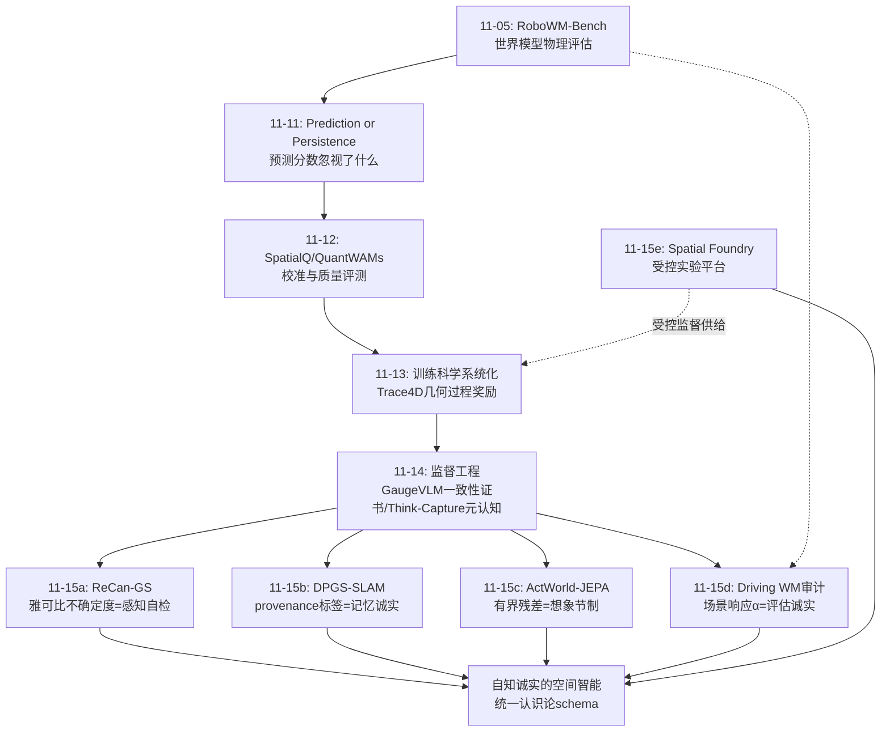
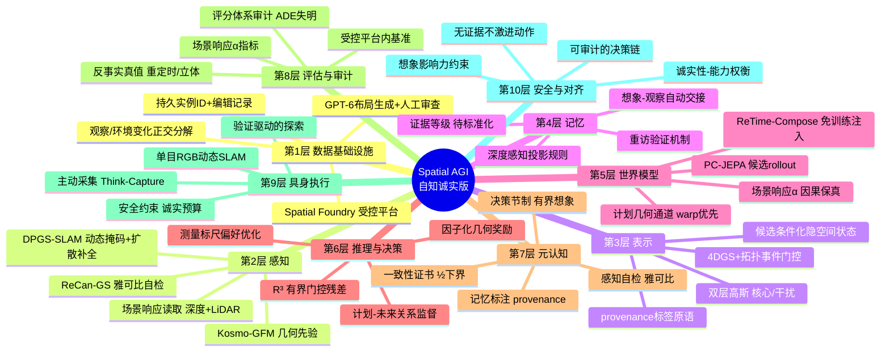
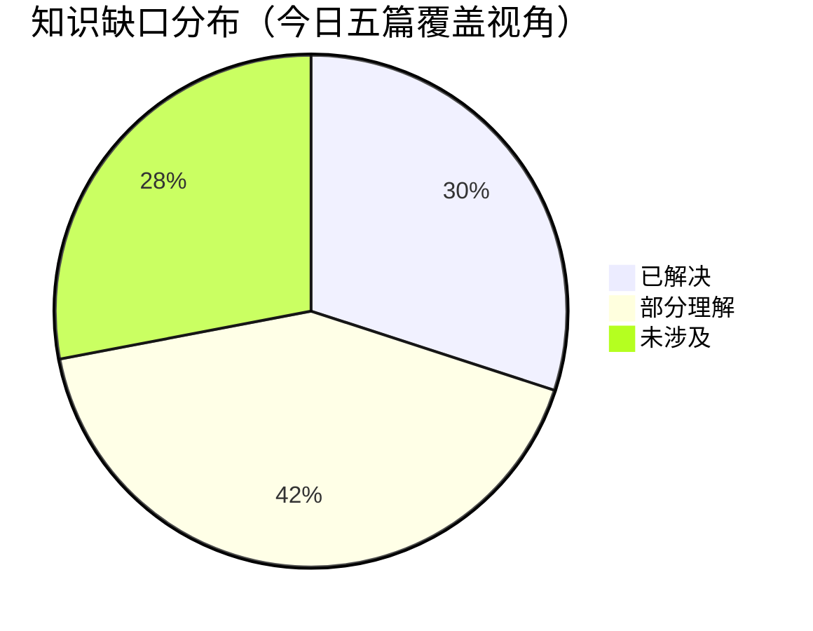
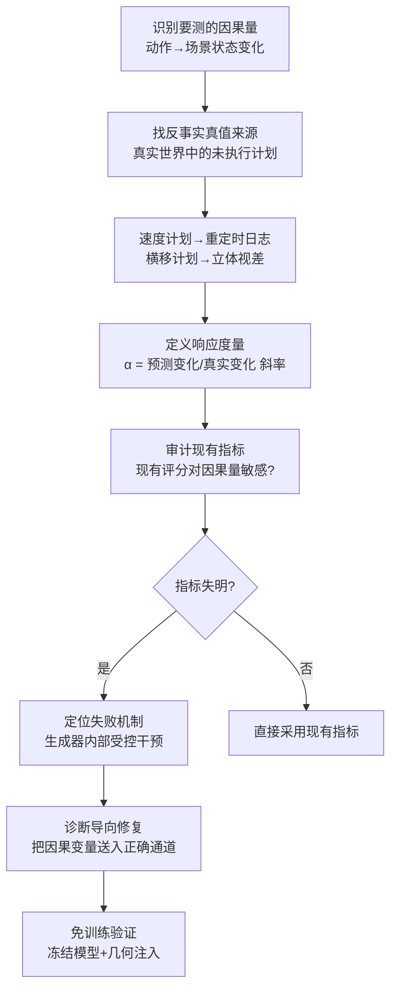
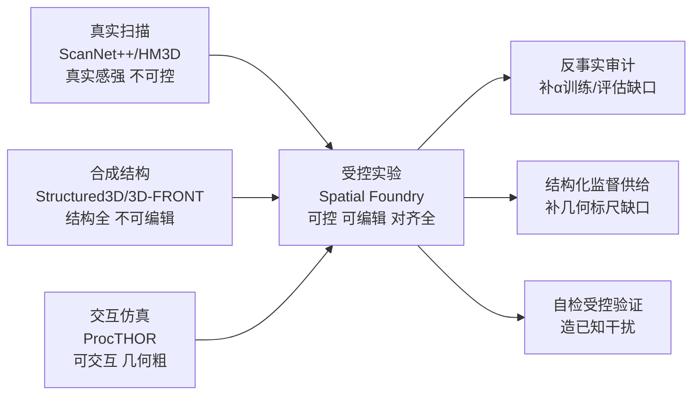

# Spatial AGI 每日思考 - 2026-11-15

## 📅 每日总结

**日期**: 2026-11-15
**论文数量**: 5篇
**主题**: 昨天的元判断是"监督工程正在成为训练科学的核心战场"。今天五篇论文把这个判断推向一个更根本的维度：**空间智能系统正在被迫学会"诚实"**。ReCan-GS 用形变场雅可比告诉系统"哪里你能重建、哪里你不能"；DPGS-SLAM 给每个空间原语打上证据来源标签（观察 vs 想象），并设计想象让位于观察的交接机制；ActWorld-JEPA 证明"预测准≠决策好"，用有界门控残差给想象在决策中有限的发言权；Driving World Models 审计了15个已发布模型，发现它们"动相机不动场景"——主流评分对此完全失明，甚至奖励无视指令的视频；Spatial Foundry 则从数据侧提供了解药：一个能把"观察变化"与"环境变化"正交分解的受控实验平台。五篇合起来的元判断是：**Spatial AGI 正在经历"实验科学化 + 元认知化"的双重转变——评估从看相机转向读场景对真值（反事实审计），表征从单层黑箱转向带置信来源标注的分层结构（provenance/不确定度/有界残差），而这一切的基础设施（受控可编辑数据集）已经落地。**

**关键突破**:
- 🚀 Spatial Foundry：5,280 个可编辑住宅场景，观察/几何/状态三者在共享坐标下对齐；核心设计原则"分离观察变化与环境变化"——固定场景换相机、固定相机换编辑，世界模型研究第一次可以做受控实验
- 🚀 ReCan-GS：形变场雅可比的行协方差迹 = 重建歧义的经验代理；干扰物由几何判据（形变不一致）而非语义判据定义；免掩码、免预训练分割器，统一处理遮挡/光度伪影/烟雾雾气
- 🚀 DPGS-SLAM：provenance-aware 建图——高斯原语区分"观察支持"与"扩散生成"，生成内容被隔离在跟踪与建图优化之外；深度感知投影规则实现生成→观察的自动交接；单目 RGB 达到 ATE 1.2cm (TUM)，StaDy4D PSNR 超 WildGS-SLAM 4.60dB
- 🚀 ActWorld-JEPA：开篇命题"隐空间预测一致性不能确立候选规划的相对驾驶质量"；R³ 用计划-未来关系的有界门控残差修正评分；NAVSIM v1 94.1 PDMS / v2 navhard 42.7 EPDMS
- 🚀 Driving World Models Move the Camera, Not the Scene：场景响应 α 指标——预测复现真实场景距离变化的比例；15 个模型审计显示 α≤0.23（真实 0.72），相机执行与场景响应的秩相关≈0；重定时日志+立体视差从真实记录提取未执行计划的反事实真值；ReTime-Compose 免训练修复（把计划以几何而非 token 形式交付冻结模型）

**架构演进**: 监督工程驱动的栈架构 → **自知诚实的栈架构**（感知层：雅可比不确定度自检 + provenance 分层；表示层：带证据等级的空间原语；推理层：有界想象修正决策；评估层：场景响应审计取代相机跟随评分；数据层：受控实验平台）

### 📊 一句话总结

2026-11-15 的五篇论文宣告 Spatial AGI 进入"自知时代"：感知系统学会说"这里我不能重建"（ReCan-GS）、地图学会说"这是我猜的不是我看到的"（DPGS-SLAM）、世界模型学会"想象只修不改"（ActWorld-JEPA）、评估学会"读场景不看相机"（Driving WM 审计）——而 Spatial Foundry 提供了让这些"诚实机制"可以受控验证的实验台。**诚实的空间智能（epistemically honest spatial intelligence）正在从哲学诉求变成工程规格。**

### 🔗 延续性

**昨日→今日**: 昨天确立"监督工程"（把领域知识注入监督信号的结构化手段）并留下十条线索。今天接住并转向一个更深的层面：监督工程解决"教什么"，今天五篇回答"教出的系统如何自知与被审计"。具体承接：①昨天 GaugeVLM 的 Prop.1（一致性分歧=误差下界）是"元认知自检"的理论工具，今天 ReCan-GS 的雅可比不确定度与 DPGS-SLAM 的 provenance 标签是它的表征层实现——自检从"运行时协议"变成"表征内建属性"；②昨天 Trace4D 的几何过程奖励依赖每步有几何标尺，今天 Spatial Foundry 提供了生成这种标尺的无限供给源（受控场景+持久实例 ID+编辑记录）；③上周以来的"世界模型自省潮"（RoboWM-Bench→Prediction or Persistence→Does Your WM Know Actions）今天被 Driving WM 审计推向顶点并给出量化判据（α）；④昨天判断"连续-离散混合监督是下一个大题目"，今天 ActWorld-JEPA 的"预测-决策桥接"提示还有第三个轴：预测与决策的耦合监督。

**今日→明日**: 新线索十条：①**provenance 标签的标准化 schema**——DPGS-SLAM 的二元标签（观察/生成）应扩展为多级证据等级（直接观察/多视角确认/单视角推断/生成想象/纯先验），需要统一数据结构；②**不确定度的因果审计**——ReCan-GS 的雅可比不确定度只反映重建歧义，应与"决策后果严重性"组合成风险地图（不确定+后果重=主动规避或补观察）；③**α 指标的推广**——场景响应审计应从驾驶速度/横移推广到机器人操作的力/接触响应、导航的遮挡响应；④**想象-验证闭环的自动化**——DPGS-SLAM 被动等待背景可见才交接，应与主动感知结合（不确定的生成原语驱动补观察）；⑤**有界修正的边界学习**——ActWorld-JEPA 的残差界目前是手工设计的，界的大小应随世界模型可靠性自适应；⑥**受控平台的开放式任务生态**——Spatial Foundry 只有摆放级编辑，缺功能级（开抽屉/倒水）与物理级编辑；⑦**"相机-场景解耦"失败的根源修复**——通道错配源于训练数据中计划与几何相关性弱（过去速度预测未来速度 R²=0.90），应设计强制场景响应的训练目标而非仅推理时补救；⑧**世界模型评估的反事实真值挖掘**——重定时/立体技巧应系统化为"从记录数据免费获得反事实真值"的方法论；⑨**元认知的三层统一**——感知自检（ReCan-GS）、表征标注（DPGS-SLAM）、决策节制（ActWorld-JEPA）应有统一的"空间认识论"框架；⑩**诚实性与能力的权衡曲线**——标注与修正都引入保守性，诚实系统的能力上限如何测量？明日检索方向："provenance aware mapping schema uncertainty levels"、"scene response metric robot manipulation world model"、"action conditioned training objective scene geometry"、"counterfactual ground truth extraction recorded logs"、"active verification imagined primitives"、"adaptive bounded residual world model reliability"、"epistemic labels spatial memory evidence grades"、"honesty capability tradeoff calibrated perception"、"functional scene editing world model dataset"、"plan geometry channel mismatch training fix"。

### 💡 本质思考：如何达成通用空间智能

#### 1. 核心能力的本质是什么？

昨天说"带标尺的想象 + 带自检的元认知"。今天五篇把这个答案再推一层：**通用空间智能的本质是"对自己空间知识的认识论诚实"**——系统不仅要有能力（重建、预测、决策），还要知道每个能力输出的证据地位：这是看到的、推断的、还是想象的？误差可能多大？对决策应该有多大影响力？

三个具体化：
- **感知的诚实**（ReCan-GS）：重建输出应附带"这个区域基于多视角一致观察"还是"单视角敏感推断"。雅可比不确定度把这种区分变成可计算量。
- **记忆的诚实**（DPGS-SLAM）：空间地图不是照片而是"带引用的报告"——每个原语声明它的证据来源，想象可以存在但必须声明且让位于观察。
- **决策的诚实**（ActWorld-JEPA）：世界模型的想象可以参与决策，但只以有界修正的形式——想象的不完全可靠性与它的决策影响力必须成比例。

Driving WM 审计则揭示了不诚实的代价：15 个"成绩单漂亮"的模型在最重要的维度（动作→场景因果）上集体失败，而整个领域的评估体系对此失明。**没有诚实机制的领域会系统性自欺**——这也许是本周五篇最重要的领域级教训。

还有一层来自 Spatial Foundry：诚实的系统需要诚实的考场。观察科学只能相关、不能归因；只有能控制变量的实验（固定场景换相机、固定相机换编辑）才能把"视觉变化"归因到"空间原因"。Spatial AGI 从观察科学走向实验科学的转变，以受控数据基础设施的落地为标志。

#### 2. 当前方法与理想目标的差距在哪里？

**差距一：诚实标注没有标准格式。** ReCan-GS 用标量不确定度，DPGS-SLAM 用二元标签，ActWorld-JEPA 用门控 logit，Spatial Foundry 用编辑记录——四种"证据地位"表示互不兼容。理想状态是一个统一的空间认识论 schema：每个空间元素携带（来源类型、覆盖度、置信度、上次验证时间、验证方式）。差距根源是各子领域独立发展，没有接口标准。

**差距二：审计指标与训练目标脱节。** Driving WM 证明主流评分（scale-aligned ADE）与真正重要的量（场景响应 α）秩相关≈0。更糟的是，α 无法直接放进训练损失（需要 LiDAR 真值）。理想状态是训练时就强制场景响应（如用重定时对做一致性损失），而不是训练后才发现"会动相机不会动场景"。差距根源是反事实真值在训练时的可得性——Spatial Foundry 类平台可以解决一部分，但野外数据仍缺。

**差距三：想象-观察的交接是被动的。** DPGS-SLAM 等背景自然可见才用真内容替换想象；ActWorld-JEPA 的残差界是静态的。理想状态是主动的想象生命周期管理：想象原语自带"验证价值"评分，驱动智能体主动规划观察去验证高价值想象。今天没有任何工作做这个闭环。

**差距四：诚实性与能力的关系未量化。** 直觉上，标注不确定度、限制想象影响都会引入保守性（该抓不抓、该走不走）。"校准的诚实是否代价能力"没有论文测量。理想状态是有明确的权衡曲线：诚实性预算 vs 任务性能，以及自适应预算分配（安全关键场景全诚实、低风险场景放宽）。

#### 3. 从今天到理想状态，最可能的路径是什么？

**近期（3-6个月）：provenance/不确定度成为空间数据格式的标准字段。** DPGS-SLAM 的标签机制、ReCan-GS 的雅可比分数都是可复用组件。预计主流 3DGS/场景图/世界模型数据格式（类似 3DGS 的 ply 扩展、场景图 schema）会加入 evidence/confidence 字段。标志事件：第一个带证据等级的开源空间数据格式发布。

**中期（6-18个月）：场景响应审计成为世界模型发布的强制项。** α 指标 + 反事实真值提取（重定时/立体/受控平台）会进入基准套件（ACT-Bench 2.0 类）；Spatial Foundry 类受控平台扩展到功能/物理编辑，世界模型训练开始混入"强制场景响应"的目标。标志事件：主流驾驶世界模型发布时报告 α 而不仅是 FVD/ADE。

**长期（18个月+）：空间认识论成为 Spatial AGI 的形式基础。** 统一 schema 覆盖感知/记忆/推理/决策四层的证据地位；想象生命周期闭环（想象→验证价值评分→主动取证→交接）；诚实性预算的自适应分配成为智能体安全架构的标准组件。到那时，"通用空间智能"的定义将从"能做空间任务"进化为"能对空间任务给出带证据等级的答案并据此行动"——这正是从能力到智能的分界。

---

## 🔗 与昨日思考的联系

### 昨日重点

昨天五篇（Topo-4DGS / FactoSR / Think-Capture / Kosmo-GFM / GaugeVLM）确立"监督工程"：几何定律变成 RL 奖励、受控干预变成偏好标尺、分歧挖掘变成元认知信号、事件门控变成表示开关。中心论断："把领域知识注入监督信号的结构化技术"是空间智能能力跃迁的主要杠杆。留下线索：监督信号统一分类学、时间可逆性推广、拓扑事件自动化、一致性证书自检应用等十条。

### 今日进展

1. **一致性证书的自检应用 → 表征层内建自检**：昨天 GaugeVLM 的 ½ 下界是"运行时问多遍"的协议级自检；今天 ReCan-GS 把自检做进表征（每个高斯自带雅可比不确定度）、DPGS-SLAM 把自检做进地图（每个原语自带来源标签）。元认知从协议下沉为数据结构。
2. **受控干预 → 受控实验平台**：昨天 GaugeVLM 用受控干预生成偏好对（数据级）；今天 Spatial Foundry 把受控思想升级为基础设施级——整个数据集就是一个可控制变量的实验台。"受控"从一种数据构造技巧变成 Spatial AGI 的科学方法论。
3. **世界模型自省潮 → 量化判决**：上周的自省系列提出"世界模型可不可信"的问题，今天 Driving WM 审计给出领域级答案：主流模型在场景因果上集体失败且评估失明。自省从论文级担忧变成可量化指标（α）。
4. **几何过程奖励 → 预测-决策耦合监督**：昨天的监督工程集中在"几何标尺教感知/推理"；今天 ActWorld-JEPA 指出还有一类更隐蔽的监督缺口——预测质量与决策价值的耦合（R³ 的关系头需要规划监督）。监督工程的版图从"教准"扩展到"教会用"。
5. **"工具何时可信"的分层奖励 → 三层元认知架构**：昨天 Think-Capture 训练"何时信任几何工具"；今天出现了完整的元认知分层——感知层自检（ReCan-GS）、记忆层标注（DPGS-SLAM）、决策层节制（ActWorld-JEPA）。工具元认知只是这个架构中的一个特例。

### 演进路径

---

## 📚 论文概览

| # | 论文 | 一句话 | 栈层归属 |
|---|------|--------|---------|
| 1 | Spatial Foundry (2611.17318) | 观察变化与环境变化正交分解的受控空间智能数据平台（5,280场景） | 数据层/基础设施 |
| 2 | ReCan-GS (2611.16259) | 形变雅可比不确定度驱动的免掩码4DGS干扰分解 | 感知层/元认知 |
| 3 | DPGS-SLAM (2611.12038) | provenance感知的动态SLAM：生成内容带标签并让位于观察 | 感知层/记忆层 |
| 4 | ActWorld-JEPA (2611.16579) | 候选条件化隐空间rollout + 有界门控评分修正 | 推理层/世界模型 |
| 5 | Driving WM Move Camera (2611.15260) | 场景响应α审计：15个世界模型动相机不动场景，评估失明 | 评估层/方法论 |

---

## 💡 核心见解

### 见解1: 证据来源（provenance）应该成为空间表征的一等公民（DPGS-SLAM）

- ✅ DPGS-SLAM 把每个高斯原语打上"观察支持 vs 扩散生成"标签，生成内容被排除在相机位姿估计与观测地图优化之外——跟踪与建图的几何只信观察，想象只做显示。
- ✅ 深度感知投影规则实现自动交接：背景可见时删生成原语、独立初始化观察原语。想象不是被消灭，而是被管理。
- ✅ StaDy4D PSNR 超 WildGS-SLAM 4.60dB 证明：隔离想象不但不损失质量，反而因为保护了优化不受幻觉污染而更好。

**对Spatial AGI的启发**: 当前几乎所有混合"感知输入+生成先验"的系统（世界模型 rollout 辅助规划、生成补全辅助重建、LLM 空间先验辅助 VLM）都把两种信息混在黑箱里。给空间表征加 provenance 字段是零架构成本、立即可做的改进。更进一步，provenance 应该是传递的：想象生成的原语被下游消费时，下游输出也应继承"部分想象"的标注。

### 见解2: 干扰物的几何定义优于语义定义（ReCan-GS）

- ✅ 用形变场雅可比的行协方差迹定义"重建歧义"，ReCan-GS 无需掩码、无需预训练分割器，统一处理行人遮挡、闪光灯伪影、演化烟雾——语义方法需要为每类干扰物准备先验，几何方法一次覆盖所有。
- ✅ 雾/烟案例是决定性的：它们光度上几乎稳定（语义与外观方法全部失效），但形变不一致（跨视角几何矛盾）暴露了它们。
- ✅ 作者诚实地标注了边界：这不是校准的概率不确定度，复杂但正确的形变也会得高分；观察覆盖不足的有效目标会误伤。

**对Spatial AGI的启发**: "开放世界鲁棒性来自几何而非语义"是反复出现的模式（对照本周 Foundation VLM 系列的失败案例）。Spatial AGI 感知栈的自检层应该优先建立在解析量（雅可比、Fisher 信息、重投影残差）上，语义工具（SAM/DINO）做辅助而非主干。雅可比不确定度还可以输出到主动感知：高分区域=应该补观察的区域，直接接上昨天 Think-Capture 的按需采集。

### 见解3: 预测准确性≠决策价值——想象需要"有限发言权"（ActWorld-JEPA）

- ✅ ActWorld-JEPA 开篇命题直击要害：隐空间预测一致性本身不确立候选计划的相对优劣。世界模型的评估与价值是两个目标。
- ✅ R³ 的设计哲学是工程上的诚实：想象（候选条件化 rollout）的输出被转化为有界的评分残差，再由置信门控加权——想象能修正决策，但不能颠覆决策。
- ✅ 94.1 PDMS 的结果说明这种"有限发言权"设计不牺牲性能；对比之下，许多工作让想象直接替代评分（end-to-end rollout selection），在想象失真时是脆弱的。

**对Spatial AGI的启发**: 任何"世界模型辅助决策"的架构都应该回答：想象失真时决策会多糟？有界门控残差是一个可复用的答案模板——想象的影响幅度受显式约束、影响方向由关系（计划-未来一致性）决定。残差界当前是手工的，下一步应与 ReCan-GS 式的不确定度联动：世界模型对自己 rollout 不确定时，界自动收紧。

### 见解4: 世界模型的真检验是"场景动没动"，不是"相机动没动"（Driving WM 审计）

- ✅ 15 个模型、评分与场景响应的 Kendall 秩相关 +0.16/−0.03：整个领域的标准评分与最重要的量几乎无关。scale-aligned ADE 的尺度对齐在数学上恰好消掉速度差异——指标缺陷不是疏忽而是结构性的。
- ✅ 更尖锐的发现：微调在原速对上提升评分但降低场景响应——领域在用错误的指标主动优化出错误的能力。
- ✅ 重定时日志与立体视差从真实记录中提取未执行计划的真值，零仿真器成本——反事实评估不需要 CARLA。

**对Spatial AGI的启发**: 每个空间预测系统的评估协议都应自查一遍：我的指标读的是"相机/外观"还是"空间状态"？有没有尺度对齐/归一化步骤恰好消掉了我想测的量？α 指标可直接迁移到机器人（力响应）、导航（遮挡响应）。这个案例还应该写进每个 Spatial AGI 研究者的方法论：**评估指标本身需要被审计**。

### 见解5: 计划应以几何而非 token 进入生成器（Driving WM 机制诊断 + ReTime-Compose）

- ✅ 受控干预定位失败根源：tokenizer 与 sampler 无辜，一旦 context frames 携带计划几何，冻结模型就能跟随计划；计划 token 则几乎不携带几何效应（换 token 无影响）。
- ✅ ReTime-Compose 的巧妙在于发现"模型自己的原速 rollout 已经经过所有速度计划的位姿"——决策时几何注入的来源不用外部数据，重定时自己的 rollout 即可。
- ✅ 免训练、单配方、跨三生成器三数据集有效——诊断导向的修复比盲目微调（最多恢复一半响应）更高效。

**对Spatial AGI的启发**: "动作条件的信息通道"是所有动作条件生成系统的核心设计点。语义嵌入（token）天然不擅长承载度量几何；warp/transport/深度条件才是正确的通道。这与 4Director（刚性 3D 几何控制视频）、GPWM（世界即 3D 粒子运动）形成一致趋势：**几何 should be 一等输入，不只是隐式学到的相关性**。

### 见解6: 受控实验平台是空间智能的"对撞机"（Spatial Foundry）

- ✅ "分离观察变化与环境变化"——固定场景换相机、固定相机换编辑、多相机记录同一状态序列——这三类受控比较把视觉变化严格归因到空间变量，是反事实空间推理的天然监督源。
- ✅ 持久实例 ID + 显式编辑记录让"物体状态"可追溯；GPT-6 生成布局 + 人工审查的混合管线兼顾规模（5,280）与可用性（连通性/净宽/楼梯检查）。
- ✅ 对昨天监督工程线索的直接回应：每个样本都可以自动生成完整几何标尺（深度/位姿/实例/变化前后），结构化监督覆盖率可以从 5% 拉到接近 100%。

**对Spatial AGI的启发**: 领域从"观察科学"（只能相关性）到"实验科学"（可以归因）的转变以数据基础设施为标志。Spatial Foundry 之于世界模型，如同 physicists 的对撞机之于粒子物理：人为制造想要研究的受控变化。待补的缺口是编辑粒度——目前只有摆放/外观，缺功能级（开抽屉）与物理级（倒水），而后者才是世界模型最需要学的东西。

### 见解7: 元认知的三层架构正在成形（今日三篇合流）

- ✅ 感知层自检：ReCan-GS 的高斯知道自己"可不可靠重建"（雅可比不确定度）。
- ✅ 记忆层标注：DPGS-SLAM 的原语知道自己"是看到的还是想到的"（provenance 标签）。
- ✅ 决策层节制：ActWorld-JEPA 的想象知道自己"对决策应该有多大影响"（有界门控残差）。
- ✅ 三层互不引用却结构同构：能力输出 × 证据地位标注 × 影响力调节。加上昨天 GaugeVLM 的运行时自检协议（½下界）与 Think-Capture 的工具元认知训练，五天内元认知从零散想法变成了准架构。

**对Spatial AGI的启发**: Spatial AGI 智能体的标准架构应该显式包含"认识论层"：每个感知/记忆/想象输出携带（来源、置信度、建议影响力）。这层是安全架构（不做无证据的激进动作）与能力架构（不确定处主动补观察）的公共基础。三层的统一形式化是未来一个月值得写的综述方向。

---

## 🗺️ 知识演进图

---

## 技术栈演进对比表

| 层次 | 昨日方案 (11-14) | 今日方案 (11-15) | 变化 |
|------|---------|---------|------|
| 数据层 | KosmoWorld 重建飞轮、ObjectWorld 标注管线 | Spatial Foundry 受控实验平台（观察/环境变化正交分解） | 数据从"规模化标注"到"可控制变量" |
| 感知层 | Kosmo-GFM 几何基础模型先验 | ReCan-GS 雅可比自检 + DPGS-SLAM provenance 分层 | 感知输出开始自带证据地位 |
| 表示层 | Topo-4DGS 拓扑事件门控 | ReCan-GS 双层高斯（核心/干扰）、DPGS-SLAM 双标签原语 | 表示从结构事件到认识论分层 |
| 记忆层 | —（昨天未涉及） | DPGS-SLAM 想象-观察自动交接 | 记忆的诚实性首次被工程化 |
| 世界模型层 | ObjectWorld 物体级运动场、SWAM 数据配方 | ActWorld-JEPA 候选条件 rollout + R³；Driving WM 场景响应审计 | 从"预测质量"到"决策价值+因果保真" |
| 推理层 | FactoSR 因子化几何奖励、GaugeVLM 测量标尺 | ActWorld-JEPA 计划-未来关系监督 | 监督工程从"教准"扩展到"教会用" |
| 评估层 | Constancy-Bench、SpatialBench | 场景响应 α + 反事实真值提取（重定时/立体） | 评估从基准分数到因果审计 |
| 元认知层 | Think-Capture 工具可靠性奖励 | 三层元认知架构（感知自检/记忆标注/决策节制） | 元认知从单点训练到架构化 |

---

## 🗺️ Spatial AGI 知识图谱

### 10层架构思维导图

### 🎯 主线技术路径

#### 阶段1: 能力建设期（已完成，2026上半年）

3DGS/世界模型/VLM 的单点能力爆发：重建质量、生成质量、基准分数持续刷新。遗留问题：能力真实性与评估有效性未受审视——为今天的"诚实化"埋下伏笔。

#### 阶段2: 训练科学期（11月上旬，已完成）

"这个能力该怎么教"成为中心问题：数据配方、过程奖励、因子化监督、几何标尺。领域学会用结构化监督替代数据堆量。

#### 阶段3: 监督工程期（11-14，已完成）

结构化监督的方法论化：物理定律→奖励、受控干预→偏好标尺、分歧→元认知信号、事件→表示开关。监督工程成为独立学科方向。

#### 阶段4: 自知诚实期（11-15，今天进入）

系统学会标注自己输出的证据地位：感知自检、记忆 provenance、决策有界想象、评估因果审计。空间认识论从哲学词汇变成工程规格。

#### 阶段5: 空间认识论标准化期（未来3-18个月）

统一证据 schema 贯通感知/记忆/推理/决策；想象生命周期闭环（想象→验证价值→主动取证→交接）；场景响应审计成为发布强制项；诚实性预算的自适应分配。终局：Spatial AGI 的定义从"能做空间任务"进化为"能对空间任务给出带证据等级的答案并据此行动"。

---

## 🔍 待探索议题

### 高优先级（本周）

1. **统一空间认识论 schema 设计**
   - 问题: 四种证据地位表示（标量不确定度/二元标签/门控logit/编辑记录）互不兼容，如何统一？
   - 候选方案: 设计（来源类型, 覆盖度, 置信度, 上次验证时间, 验证方式）五元组标准字段，附传递规则（下游继承）
   - 缺口: 没有任何工作定义跨层证据 schema；需要在 3DGS/场景图/世界模型状态上同时可实例化

2. **场景响应训练目标（治本而非治标）**
   - 问题: Driving WM 证明推理时补救有限，通道错配源于训练数据中计划-几何相关性弱（R²=0.90）
   - 候选方案: 用重定时对构造"场景必须响应计划"的一致性损失；Spatial Foundry 类平台提供受控正样本
   - 缺口: 野外数据无反事实真值；损失设计需避免退化为深度估计任务

3. **主动想象验证闭环**
   - 问题: DPGS-SLAM 被动等待背景可见才交接想象；没有工作主动去验证想象原语
   - 候选方案: 想象原语带"验证价值"评分（不确定性×后果严重性），驱动主动感知规划补观察
   - 缺口: 验证价值的理论定义；与 Think-Capture 主动采集的接口；闭环的学习信号

4. **α 指标向机器人操作推广**
   - 问题: 场景响应审计只在驾驶（速度/横移）验证，操作域（力/接触/形变）无对应物
   - 候选方案: 定义"力响应 α"——预测的接触力变化复现真实变化的比例；用六维力传感器做真值
   - 缺口: 操作域无重定时式免费反事实；需要遥操作记录或仿真过渡

### 中优先级（本月）

5. **有界残差界的自适应化**
   - 问题: ActWorld-JEPA 的残差界手工设计，不随世界模型可靠性变化
   - 候选方案: 界 = f(rollout 不确定度)；不确定度可用多次 rollout 的方差或 ReCan-GS 式雅可比估计
   - 缺口: rollout 方差与决策误差的相关性未验证；自适应界的训练稳定性

6. **诚实性-能力权衡曲线测量**
   - 问题: 标注与保守修正可能损失任务性能，权衡从未被量化
   - 候选方案: 在同一智能体上扫描诚实预算（拒答阈值/残差界宽度），画任务性能-校准误差曲线
   - 缺口: 需要同时报告能力与校准的基准；风险分层场景设计

7. **Spatial Foundry 功能级/物理级编辑扩展**
   - 问题: 当前只有摆放/外观编辑，缺开抽屉、倒水等功能与物理编辑——恰是世界模型最需要的监督
   - 候选方案: Infinigen 资产加关节/流体属性 + 物理引擎驱动的状态记录
   - 缺口: 功能级编辑的真值记录格式；物理参数与视觉资产的绑定

8. **评分体系审计方法论**
   - 问题: scale-aligned ADE 的失明是系统性指标缺陷，其他领域还有多少类似陷阱？
   - 候选方案: 对主流空间基准逐一做"单调性测试"（构造已知执行程度 λ 的真样本，看指标是否单调响应）
   - 缺口: 需要每个基准配对可构造真值的协议；社区对指标审计的接受度

### 长期（本季度）

9. **空间认识论的形式化**
   - 问题: 三层元认知（感知自检/记忆标注/决策节制）结构同构但无统一理论
   - 候选方案: 以证据决策理论/信念函数为基础，把 provenance、不确定度、影响力约束统一为"空间信念的度量结构"
   - 缺口: 理论与现有工程实现的映射；形式化能否产生新的可检验预测

10. **反事实真值的系统化挖掘**
    - 问题: 重定时/立体是两个零散技巧，"从记录数据免费获得反事实"应有系统方法
    - 候选方案: 枚举"天然反事实记录"类型：重定时、立体、多智能体（他人执行了我想执行的计划）、重复访问（同一空间两次状态）
    - 缺口: 各类型的适用条件与噪声模型；与受控平台的互补分工

---

## 📊 知识缺口分析

**已解决（30%）**:
- ✅ 动态场景感知的自检机制（ReCan-GS 雅可比不确定度）
- ✅ 地图的想象-观察隔离与交接（DPGS-SLAM provenance）
- ✅ 世界模型场景因果的评估指标（α + 反事实真值提取）
- ✅ 计划-几何通道错配的定位与推理时修复（ReTime-Compose）
- ✅ 受控空间实验平台的数据表示与构造管线（Spatial Foundry）
- ✅ 想象辅助决策的安全接口设计（有界门控残差）

**部分理解（42%）**:
- ⚠️ 证据地位的统一表示——四种机制结构同构但格式互不兼容
- ⚠️ 场景响应失败的训练时根源——通道错配已定位，强制场景响应的目标函数未设计
- ⚠️ 主动想象验证——被动交接已工程化，主动验证闭环只有概念
- ⚠️ 有界残差的界设定——手工设计，与不确定度/风险的联动未验证
- ⚠️ 受控平台的编辑粒度——摆放级完整，功能级/物理级缺失
- ⚠️ 雅可比不确定度的语义——经验代理而非校准概率，误伤边界未刻画
- ⚠️ 决策价值的监督——R³ 需要规划监督，其信号来源与泛化未充分分析

**未涉及（28%）**:
- ❌ 交互反事实（我的动作改变他人行为的场景响应）
- ❌ 诚实性-能力权衡的量化曲线
- ❌ 证据传递（下游输出继承上游想象标注的机制）
- ❌ 跨模态 provenance（LiDAR 观察 vs 相机观察 vs 触觉观察的证据等级差异）
- ❌ 群体诚实性（多智能体共享地图中证据等级的融合与冲突消解）
- ❌ 空间认识论的形式理论基础
- ❌ 长周期记忆的证据衰减与重验证调度

---

## 🧭 明日展望

今日确立"自知诚实的空间智能"作为新栈架构的核心特征。明天检索将围绕三条线收敛：①统一证据 schema 的早期实例（检索 provenance schema spatial mapping）；②场景响应训练目标的首次尝试（检索 action conditioned training scene geometry consistency）；③受控平台的功能级扩展（检索 functional scene editing dataset world model）。若出现三者中任意一个的实例化工作，"空间认识论标准化期"就可以从推测升级为已开始的进程。

---

## 🔬 五篇论文深度交叉分析

### A. 感知自检的技术谱系：从启发式到解析

把 ReCan-GS 放进"去干扰/自检"的技术谱系，可以看到一条清晰的演进线：

| 代际 | 代表 | 判据类型 | 依赖 | 失败模式 |
|------|------|---------|------|---------|
| 第一代 | NeRF-W, RobustNeRF | 光度重建误差 | 无 | 误差=干扰的假设在动态场景崩溃 |
| 第二代 | BayesRays, FisherRF | 概率/Fisher不确定度 | Hessian近似 | 校准性差、静态场景假设 |
| 第三代 | SpotLessSplats, NeRF On-the-go | 语义特征聚类 | SAM/DINOv2 | 语义先验偏差、动态目标误杀 |
| 第四代 | 分解式 (DeSplat, HybridGS) | 显式分层 | 启发式路由 | 路由信号非原则化 |
| **第五代** | **ReCan-GS** | **形变雅可比解析量** | **无预训练模型** | 非校准、覆盖不足误伤 |

第四代到第五代的跨越点是**路由信号的来源**：从启发式（误差、语义相似度）变成解析量（雅可比协方差迹）。解析量的优势不是精度而是**可解释性与免依赖**——不依赖任何可能带有偏差的基础模型，也不依赖为每类干扰物准备的先验知识。

但第四代的方法论价值不应低估：per-view 干扰层（DeSplat）与 alpha 稀疏正则都是 ReCan-GS 直接借用的组件。ReCan-GS 的真正新增只有一个公式——L_unc = Σ U(g_i)·α_core,i——但它重新定义了整个系统的适用范围（从静态到全动态）。这是"一个好信号胜过十个模块"的典型案例：**找到那个正确的一维信号，比堆叠复杂模块更有效**。

### B. Provenance 的概念史：从数据库到空间地图

DPGS-SLAM 的 provenance 标签并非凭空出现，它是数据库领域"数据溯源"概念向空间表征的迁移。对照三个领域的成熟度：

- **数据库**：provenance 是成熟研究领域（why/where-provenance 形式化完备），工作流系统自带血缘追踪。
- **机器学习**：数据卡片、模型卡片是弱形式的 provenance；训练数据血缘开始受到监管关注。
- **空间表征**：DPGS-SLAM 是首个把 provenance 做进实时几何优化的系统——此前最多区分"观测区域/外推区域"（如 TSDF 置信权重），从未在增量 SLAM 循环里做标签级隔离与交接。

为什么空间表征比数据库更迫切需要 provenance？因为空间数据的消费方是**闭环控制**：地图上一个错误原语会直接转化为碰撞或误动作。数据库脏数据只污染查询结果；空间地图的"想象污染"会污染行为。这就是为什么"生成内容被排除在位姿估计与建图优化之外"是安全设计而不仅是精度设计。

### C. 反事实评估的方法论闭环

Driving WM 审计的方法论可以抽象成一个可复用的评估框架：

关键洞察是第二步：**反事实真值常常已经躺在记录数据里**，不需要仿真器。重定时（时间维）、立体（横向维）、加上待探索的多智能体记录（他人执行了我想执行的计划）与重复访问（同一空间两次状态），构成一个"天然反事实"族谱。任何评估空间因果保真度的努力，第一步都应该问：我的数据里有没有免费的反事实？

### D. 决策层的三种想象消费模式

综合今日两篇世界模型论文与近期阅读，世界模型想象进入决策有三种模式：

1. **替代模式**（rollout selection）：想象直接作为决策依据。风险：想象失真=决策失真，无缓冲。代表：早期 DA-WAM 类。
2. **修正模式**（residual refinement）：想象产生有界修正量叠加在基础决策上，风险显式约束。代表：ActWorld-JEPA 的 R³。
3. **条件注入模式**（geometry conditioning）：想象/计划以几何形式改变生成过程本身。风险在通道设计。代表：ReTime-Compose、GEN3C。

三模式风险递减、实现复杂度递增。当前领域从模式1向模式2/3迁移，驱动力正是本周系列发现：想象不可全信（Prediction or Persistence）、想象质量有天花板（α≤0.23）。预测：18个月内主流架构固定为"模式2为默认+模式3为可选增强"，模式1只在高可靠性世界模型（受控平台训练+α审计通过）中保留。

### E. Spatial Foundry 与既有数据生态的互补地图

Spatial Foundry 不是替代既有资源，而是**唯一能生产受控配对**的节点，因此成为反事实评估、结构化监督、自检验证三个前沿方向的供给源。数据集的价值已不再由规模单一决定，而由"能生产什么类型的监督/评估"决定——这是本周数据侧论文共同的隐含命题。

### F. 单目 RGB 动态 SLAM 的能力边界（DPGS-SLAM 实验深读）

- **ATE 1.2cm (TUM) / 2.7cm (BONN)**：达到甚至超过部分 RGB-D 动态 SLAM，证明"只用静态区域跟踪"+高质量掩码已足够——补全模块对跟踪的增益是间接的（更完整地图改善共视关系），而非直接参与跟踪。
- **StaDy4D +4.60dB**：增益主要来自观测空洞被填补（WildGS-SLAM 留空洞），而非渲染质量本身提升——是"覆盖性增益"不是"保真度增益"。
- **交接机制依赖 Metric3D v2**：单目度量深度在近距离大遮挡处误差可达分米级，投影规则可能在错误位置删生成原语或初始化观察原语。论文未报告交接错误率——审计此类系统应索要的新指标：**交接精度**。

由此提炼普遍原则：**凡设计"想象让位于观察"机制的系统，都必须报告交接错误率**，否则想象-观察混合地图的宣称质量不可信。

---

## 📖 关键概念小词典（今日新增）

- **场景响应 α**：预测复现的真实场景距离变化的比例（回归斜率）。0=无视计划，1=如世界般响应；真实视频≈0.72（深度读取器压缩下的可达上界）。
- **计划-几何通道错配**：动作条件以语义 token 进入生成器，而预测几何实际由 context frames 决定，导致场景不随计划变化。
- **重定时**：单调重参数化记录轨迹的时间轴，使未执行速度计划的位姿与已有记录对齐，从真实日志提取反事实真值。
- **Provenance-aware mapping**：为空间原语标注证据来源（观察支持/生成），按标签决定其参与哪些优化的建图范式。
- **雅可比不确定度**：形变场输出偏移对输入（位置，时间）雅可比的行协方差之迹；高值=局部形变敏感度异质=重建歧义的经验代理。
- **有界门控残差**：想象产生的决策修正量，幅度受显式上界约束、方向由置信门控加权。
- **受控比较**：固定场景换相机（相机条件序列）/固定相机换编辑（前后配对）/多相机记录同一状态（共享世界）三类正交数据构造。
- **观察支持原语**：有直接 RGB 测量与预测深度支持的高斯原语，可参与全部优化。
- **场景因果保真度**：世界模型对"动作→空间状态变化"映射的复现精度，区别于相机控制精度与视频质量。
- **证据地位**：一个空间元素知识的来源分类——直接观察/多视角确认/单视角推断/生成想象/纯先验。

---

## 🎯 今日判断的置信度自评

（践行今日主题：对今天的判断本身做诚实标注）

| 判断 | 置信度 | 证据强度 | 可能的反例 |
|------|--------|---------|-----------|
| 元认知三层架构正在成形 | 高 | 3篇独立实现+昨日2篇铺垫，结构同构明显 | 可能是选择性注意——同类工作一直存在只是今天集中出现 |
| 证据schema将标准化 | 中高 | 互不兼容表示已造成明显重复劳动 | 领域可能各自演化不收敛，如3DGS格式至今未统一扩展 |
| α类指标18个月内成主流 | 中 | 方法论完备、免费真值可得 | 每模型需配LiDAR/立体数据，采集成本可能阻碍普及 |
| 修正模式成默认架构 | 中 | ActWorld-JEPA强结果+风险论充分 | 若世界模型可靠性大幅提升，替代模式可能回归 |
| Spatial Foundry被广泛采用 | 中 | 独特性明确 | 合成域差距可能让社区优先选真实数据 |
| ReCan-GS判据可推广 | 中低 | 只在4DGS形变场验证 | 占用场/SDF/隐式动力学的雅可比性质可能很不同 |

---

## 📎 附录：五篇论文关键数字速查

**Spatial Foundry**
- 5,280 个带家具住宅配置
- 模态：户型图/透视+全景RGB/度量深度/点云/网格/实例3D框/轨迹-视频/编辑记录
- 布局生成：GPT-6 条件生成，人工审查连通性/净宽/楼梯

**ReCan-GS**
- 形变场：8层256宽MLP，输出(Δμ,Δq,Δs)
- 不确定度：Tr(Cov(J))，时间扰动ε；EMA动量β；剪枝top-r%
- 损失：L_photo + L_alpha + λ_unc·L_unc

**DPGS-SLAM**
- ATE RMSE：1.2cm (TUM)、2.7cm (BONN)；StaDy4D PSNR +4.60dB vs WildGS-SLAM
- 组件：OCLR + SAM2 + 微调扩散inpainting + Metric3D v2；深度感知投影交接

**ActWorld-JEPA**
- NAVSIM v1 PDMS 94.1；v2 navtest/navhard EPDMS 91.6/42.7；nuScenes L2 1.20m、碰撞率0.76%
- 架构：K候选调制初始化+递归rollout+门控交叉注意力；R³输出有界Δs与置信logit

**Driving WM Move Camera**
- 5模型+10变体；减速α≤0.23（真实0.64–0.73）；横移α≤0.23（真实立体0.99）
- 评分-响应秩相关：+0.16/−0.03；过去速度预测未来速度R²=0.90
- ReTime-Compose：横移.71→.76；速度计划超重放基线.11–.24

---

## 💡 核心见解（续：8-10）

### 见解8: 评估体系的自反性是领域成熟度的试金石（Driving WM + Spatial Foundry 合观）

- ✅ Driving WM 发现的不是又一个模型缺陷，而是**评估体系本身的盲区**：scale-aligned ADE 的尺度对齐步骤在数学上恰好消掉了它应该测量的量（速度差异），导致"无视指令的真实视频反而得分更高"。
- ✅ 微调在原速对上提升评分但降低场景响应——意味着领域过去一段时间在**用错误的指标主动优化出错误的能力**，且发表记录里没有任何人察觉。
- ✅ Spatial Foundry 的价值在此对照下凸显：受控平台不仅是训练资源，更是"指标的试金石"——固定场景换相机可以构造"相机该动场景不该动"的测试用例，固定相机换编辑可以构造反例。

**对Spatial AGI的启发**: 一个领域的成熟度不在于它发表了多少模型，而在于它是否拥有**审计自己评估工具的元方法**。Driving WM 的单调性测试（构造执行程度 λ 已知的真实样本，检验指标是否单调响应）应该成为任何新基准发布前的必经程序。建议：Spatial AGI 社区需要一份"指标审计清单"——尺度对齐是否消掉目标量？指标是否可被捷径满足？指标读的是代理量还是目标量？

### 见解9: 生成先验的正确角色是"临时假设"而非"最终答案"（DPGS-SLAM + ReCan-GS 合观）

- ✅ 两篇论文对生成先验的处理形成互补的完整光谱：ReCan-GS 判别"哪里生成/观察不可信"（识别不可重建区），DPGS-SLAM 在不可信处"用生成填补但打标签"（管理生成内容）。
- ✅ 关键共识：生成内容的价值是**时间性的**——作为观察到来之前的临时表示有价值，作为永久地图内容则是污染源。DPGS-SLAM 的自动退役机制把这个时间性编码进了系统。
- ✅ 对比反例：大量工作把扩散补全的内容直接混入训练/优化（InFusion 类离线补全尚可接受，在线 SLAM 中则是灾难），DPGS-SLAM 用 StaDy4D +4.60dB 的数字证明了隔离的价值。

**对Spatial AGI的启发**: 生成先验进入空间智能系统的标准协议应该是三段式：**进入时打标签（provenance）→ 存续期间保持隔离（不参与几何优化）→ 证据到来时让位（自动交接）**。这个协议可直接推广到世界模型的想象 rollout、LLM 空间先验的注入、以及仿真数据的混用。

### 见解10: 空间智能的"认识论层"是安全与能力的公共基础（三层元认知架构总结）

- ✅ 今日三篇分别实现了认识论层的三个切面：感知自检（ReCan-GS：这块能不能重建）、记忆标注（DPGS-SLAM：这是看到的还是想到的）、决策节制（ActWorld-JEPA：想象该有多大影响力）。
- ✅ 三层的公共结构：**能力输出 × 证据地位标注 × 影响力调节**。这不是巧合而是必然——任何在开放世界运行、部分依赖生成模型的系统都需要这一层来防止"幻觉驱动行为"。
- ✅ 安全与能力在此统一：诚实标注既是安全机制（无证据不激进动作）也是能力机制（不确定处驱动主动观察）。昨天 GaugeVLM 的 ½ 下界证书是这层的运行时工具，上周 Think-Capture 的分层奖励是这层的训练方法——五天内，认识论层从零散想法变成了"有表示、有训练、有运行时"的完整栈。

**对Spatial AGI的启发**: Spatial AGI 智能体的参考架构应该显式画出第 0.5 层——介于感知与决策之间的"空间认识论层"。它消费所有上层输出的置信信息，生产三类服务：拒答/升级（自检）、标注（溯源）、限幅（节制）。这层的缺席正是"VLM 幻觉导航撞墙、世界模型鬼影污染规划"这类失败的共同根源。

---

## 🔍 待探索议题（深化版：每题补充实验设计）

1. **统一空间认识论 schema 设计**（补充）
   - 最小实验: 在一个开源场景图格式（如 3DSSG）上加五元组字段，重跑 DPGS-SLAM 式交接与 GaugeVLM 式拒答，验证同一 schema 可同时服务两场景
   - 判定标准: 字段能无损表达四种现有机制的信息；传递规则（下游继承）不产生歧义
   - 时间估计: schema 草案 1-2 周，双场景验证 1 个月

2. **场景响应训练目标**（补充）
   - 最小实验: 在 Epona 开源权重上，混入重定时对（半速/倍速）做一致性微调，损失为"两次 rollout 的场景深度变化比 = 重定时比"
   - 对照组: ReTime-Compose（推理时）、原速对微调（ Driving WM 已证伪）
   - 判定标准: α 从 ≤0.23 提升到 >0.4 且 FVD 不退化
   - 风险: 一致性损失可能退化为深度估计捷径，需加真实渲染损失锚定

3. **主动想象验证闭环**（补充）
   - 最小实验: 在 Habitat/Matterport 仿真中，智能体的语义地图允许"想象节点"（LLM 推断的房间内容），验证价值 = 信息增益 × 到达代价，驱动 next-best-view
   - 判定标准: 相比纯几何驱动探索，任务成功率提升且地图终态错误想象占比下降
   - 缺口: 想象节点的生成来源（LLM 先验）的校准是前置依赖

4. **α 指标向操作域推广**（补充）
   - 最小实验: 用 ALOHA/ALOHa 类遥操作数据，构造"轻抓 vs 重抓"的力轨迹对，定义力响应 αF；审计三个操作世界模型
   - 真值来源: 六维力传感器记录（天然反事实：同一任务不同力度常被重复演示）
   - 判定标准: αF 与下游抓取成功率的秩相关 > 0.5（否则指标本身需重新审计）

5. **有界残差界的自适应化**（补充）
   - 最小实验: 界宽 = σ(rollout 方差) 的单调映射，方差用同候选多次 rollout（时间扰动）估计
   - 判定标准: 在 NAVSIM navhard（困难子集）上自适应界 > 固定界的 EPDMS
   - 理论检查: 自适应界是否破坏 R³ 的有界性证明（需要界本身有上确界）

6. **诚实性-能力权衡曲线**（补充）
   - 最小实验: LightNav-0 类导航智能体，扫描拒答阈值 τ ∈ [0,1]，同时报告成功率与校准误差（ECE）
   - 预期形态: 倒 U 型——过松（幻觉动作）与过紧（拒绝行动）都差
   - 应用价值: 曲线的峰值位置即为该任务的建议诚实预算

7. **Spatial Foundry 功能级编辑**（补充）
   - 最小扩展: 选 100 个场景，给橱柜/抽屉/门加关节属性，用 Isaac/物理引擎录制开合状态序列与渲染
   - 记录格式: (关节id, 关节类型, 角度/位移轨迹, 作用物体id, 接触记录)
   - 下游验证: 训练功能理解 VLM（"打开这个抽屉会看到什么"）对比无功能数据版本

8. **评分体系审计方法论**（补充）
   - 交付物: "基准审计协议 v0"——单调性测试（λ构造样本）+ 捷径测试（零信息基线能否得高分）+ 敏感性矩阵（指标 vs 目标量的偏导）
   - 首批审计对象: VSI-Bench、SpaceCast-Bench、PDMS/EPDMS、各 3DGS 渲染指标
   - 发布形式: 审计报告 + 可复现的审计脚本（对社区的价值类似 Driving WM 对驾驶评估的冲击）

9. **空间认识论形式化**（补充）
   - 起点框架: Dempster-Shafer 证据理论（天然支持"不确定/冲突"状态）或信念 binaries（observed/inferred/imagined 三分）
   - 形式化目标: 定义空间信念空间 B = 场景元素 × 证据状态，其上的融合算子（多视角/多智能体）、衰减算子（时间）、传递算子（推理链）
   - 可检验预测: 形式化应预测"证据融合的冲突阈值"何时应触发重观察——与主动验证闭环联动

10. **反事实真值系统化挖掘**（补充）
    - 族谱整理: 重定时（时间）/立体（横移）/多智能体记录（行为反事实）/重复访问（状态反事实）/遮挡重现（背景反事实，DPGS-SLAM 已用）
    - 每类需记录: 适用条件、噪声模型、与真值传感器的配对方式
    - 交付形式: "Free Counterfactuals" 技术报告，附每类的最小提取代码

---

## 🧪 跨周主题回看：从"可验证想象"到"诚实想象"

把过去一周的元判断串成一条线，可以看清本轮演进的完整逻辑：

- **11-09~11-10**: 世界模型评估问题浮出水面（RoboWM-Bench 物理评估、EA-WM/When to Trust Imagination）——"想象可不可信"成为问题。
- **11-11**: 批判深化（Prediction or Persistence：预测分数测不到世界模型的价值；Does Your WM Know Actions Have Consequences）——"怎么测想象"成为问题。
- **11-12**: 校准与质量评测（QuantWAMs、SpatialQ）——"给想象打分"有了工具。
- **11-13**: 训练科学系统化（Trace4D 几何过程奖励等）——"把可信度信号注入训练"开始。
- **11-14**: 监督工程化（GaugeVLM 测量标尺、Think-Capture 元认知奖励）——"教系统自知可信度"有了方法。
- **11-15（今天）**: 诚实工程化（雅可比自检、provenance、有界想象、α审计、受控平台）——"自知"从训练信号升级为表征与架构属性，评估从分数升级为反事实审计。

一周之内，"想象"这个词的工程含义发生了三级跳：从"需要验证的输出"（上周）到"需要标尺的输出"（本周前半）到"需要证据地位与影响力预算的一等公民"（今天）。这个演进的终点形态——想象带生命周期管理（打标、隔离、让位、验证）——已经在今天的 DPGS-SLAM + ActWorld-JEPA 组合中有了原型。接下来 1-2 个月值得期待的标志性工作：第一个把"想象生命周期管理"完整实现为开源框架的项目。

---

## 🏗️ 给实践者的行动清单（本周可做）

1. **给现有 3DGS 管线加不确定度输出**：复用 ReCan-GS 的 Tr(Cov(J)) 实现（扰动时间输入+求导），对任意可形变 4DGS 输出逐高斯分数——半天工作量，立即获得"哪里重建不可靠"的可视化。
2. **给场景图/地图数据格式加 provenance 字段**：哪怕只是 observed/inferred/imagined 三值枚举——这是统一 schema 的第一步，成本几乎为零。
3. **对自家世界模型跑一次重定时审计**：不需要 LiDAR，用深度估计器读预测深度变化，对照真实日志的重定时版本算一个粗 α——如果 <0.3，你的世界模型大概率在"动相机不动场景"。
4. **在评估脚本里禁用尺度对齐**（如果测的是速度/距离相关量）： Driving WM 已证明它会吞掉目标量。
5. **审阅自己的想象消费代码**：世界模型输出是直接选 argmax（模式1）还是做有界修正（模式2）？如是前者，加一个残差界是最便宜的鲁棒性升级。
6. **在受控平台上设计一个反事实测试集**：用 Spatial Foundry 类可编辑场景构造 50 个"固定相机换编辑"用例，测你的场景变化检测器/世界模型能否分辨。

---

**文档创建时间**: 2026-11-15 03:55
**分析方法**: GLM WebReader 精读 5 篇 + 昨日思考延续

---

## 🔎 每篇论文的另一面：审稿人视角速记

（延续今日"诚实"主题：对每篇今日论文给出最苛刻的三条质疑）

### 1. Spatial Foundry

- **质疑一：合成真实感天花板。** Infinigen 资产 + Blender 渲染的图像分布与真实室内扫描的差距没有量化报告（无 fréchet distance / 域适应实验）。用它训练的模型在真实场景上的增益是假设不是证据。
- **质疑二：GPT-6 布局生成的可复现性。** 以闭源 LLM 作为流水线核心组件，数据集的"再生成"依赖一个不可控的 API——五年后这个数据集还能被完全复现吗？
- **质疑三：功能与物理缺席。** 对世界模型研究而言，摆放编辑只是动作空间的最简单子集；没有关节、流体、光照动态，"世界模型训练平台"的宣称打了折扣。

**总评**: 数据表示与受控设计原则的贡献是扎实的；"平台级影响力"的宣称需要等下游工作验证。

### 2. ReCan-GS

- **质疑一：不确定度的非校准性。** 作者自己承认复杂但正确的形变会得高分——那么在"该保留"与"该去除"之间，这个分数的可分性到底如何？论文缺少 ROC 式的分离度分析。
- **质疑二：计算成本沉默。** 逐高斯、逐迭代的雅可比扰动估计开销未报告；与 baseline 的训练时间对比缺席。
- **质疑三：canonical 范式依赖。** 物体出现/消失（拓扑变化）在单一形变场中本就难以表达——恰是本周 Topo-4DGS 处理的问题。两篇的联合（拓扑事件门控 + 雅可比自检）是明显的后续方向。

**总评**: 判据创新真实且优雅；但"经验代理"与"可用信号"之间还差一份系统性的消融。

### 3. DPGS-SLAM

- **质疑一：交接错误率缺席。** 如正文所述，深度感知投影规则的正确性直接决定系统诚实性宣称的可信度，论文没有报告该指标。
- **质疑二：四模型串联的实时性。** OCLR+SAM2+扩散inpainting+Metric3D v2 的推理成本叠加，论文未给出 FPS 或每关键帧延迟——SLAM 系统不给运行速度是危险的 omission。
- **质疑三：生成内容的幻觉归属。** 生成的"合理背景"可能根本不存在（错误的家具），即使被隔离，它仍出现在渲染结果中用于补全展示——下游消费者如何知道哪些区域是幻觉？

**总评**: Provenance 机制的工程完整性是真实贡献；但"诚实"的宣称需要补上交接错误率与运行时数据。

### 4. ActWorld-JEPA

- **质疑一：开环评估的舒适区。** nuScenes 开环指标与真实闭环的相关性争议已久；navhard 42.7 EPDMS 说明硬场景仍有巨大差距，94.1 PDMS 的 navtest 更像是排行榜数字。
- **质疑二：非反应式世界。** 候选 rollout 假设交通不响应自车动作——而"我的动作改变他人"恰是驾驶决策的核心难点。PC-JEPA 的"候选条件化"只条件了自车轨迹，条件不了他车反应。
- **质疑三：对基础规划器的寄生性。** R³ 只修正不生成，系统上限被基础规划器锁死；论文未讨论基础规划器失效时（如所有候选都差）的行为。

**总评**: "预测准≠决策好"的命题与有界修正是真洞察；但世界模型部分（他车反应）名不副实，更准确说是"自车运动条件化的预测器"。

### 5. Driving World Models Move the Camera, Not the Scene

- **质疑一：静态点假设。** α 只在静态场景点上定义，而驾驶场景的动态物体（行人、车辆）恰恰是安全关键内容——审计最关键的地方恰好空白。
- **质疑二：深度读取器的循环风险。** α 的预测侧读取依赖冻结度量深度模型，若该模型对生成视频有系统性偏差（生成域偏移），α 本身可能失真。
- **质疑三：修复的普适性证据薄。** ReTime-Compose 在三生成器上有效，但均为自回归 token 模型；对扩散类或隐空间类世界模型（如 JEPA 系）的适用性未验证——而后者可能根本不消费 context frames 的几何。

**总评**: 领域级审计的价值最高（评分失明的证据链完整）；α 指标有边界，但"指标需要审计"这一方法论贡献不受边界影响。

---

## ❓ 预答：对今日元判断的三个可能反驳

**反驳一："自知"只是工程修补，不是领域转向。**
回应：单看任何一篇确实可以这么说。但五篇在五天内、三个不同栈层（感知/记忆/决策）+评估层出现结构同构的机制，且都以"证据地位显式化"为核心——这种跨团队收敛在领域史上通常标志范式转移（对照 2023 年各团队独立收敛到 3DGS）。保守说法：即便不是范式转移，"认识论层"作为参考架构组件的地位也已确立。

**反驳二：α≤0.23 可能是深度读取器的伪影而非模型失败。**
回应：Driving WM 用同一个读取器读了真实视频（0.72）与生成视频（≤0.23），读取器对两边的系统偏差方向一致才可比。且 Epona 横移时把树往错误方向移动是定性可见的，不是度量伪影。真正的风险是读取器对生成域的额外压缩使 α 被低估——但即便 α 实际是 0.35，与真实的 0.72 差距依然致命。

**反驳三：受控平台的数据不会离开室内住宅域，对"通用"空间智能贡献有限。**
回应：同意当前版本贡献限于室内。但受控方法论的通用性不依赖当前实现：同样的"观察/环境变化正交分解"原则可以直接实例化到驾驶（Spatial Foundry 式的街景编辑平台）、操作（可编程物理实验台）。数据集是快照，方法论是资产。

---

## 🌅 明日展望（详细版）

明日检索将沿三条线验证今天的判断，每条线给出明确的确认/证伪信号：

**线1：统一证据 schema 的早期实例**
- 检索词: "provenance spatial mapping schema"、"evidence aware scene graph"、"uncertainty annotated 3DGS"
- 确认信号: 任何工作定义跨感知/记忆的统一证据字段
- 证伪信号: 三个月内所有新工作仍用互不兼容的私有表示

**线2：场景响应训练目标**
- 检索词: "action conditioned consistency loss world model"、"retiming training driving"、"scene motion plan alignment"
- 确认信号: 出现以"场景必须响应计划"为损失项的训练工作
- 证伪信号: 驾驶世界模型新论文仍只报告 FVD/ADE，无场景级指标

**线3：想象生命周期管理框架**
- 检索词: "imagined primitive verification active"、"hypothesis driven exploration mapping"、"imagination validation embodied"
- 确认信号: 出现"想象→验证→交接"闭环的系统工作（哪怕在仿真中）
- 证伪信号: 交接仍全部被动等待观察

此外，本周日（11-16）若无新热点，值得做一次周度综合：把 11-09 至 11-15 的七组论文按"世界模型自省潮"主线整理成一份独立综述笔记，作为本阶段思考的固化产出。

---

## 📋 与近期工作的引用网络（今日五篇 × 近期精读）

- Spatial Foundry ← Think-Capture（受控采集思想）、Worlds in One Demo（合成数据引擎）、SceneBloom（环境生成）；→ 未来 α 类评估的供给源
- ReCan-GS ← DeSplat/HybridGS（分解层）、BayesRays/FisherRF（不确定度谱系）；→ Think-Capture 的主动采集（高分=补观察）、Topo-4DGS（拓扑变化是它的盲区）
- DPGS-SLAM ← DynaSLAM/SG-SLAM（动态掩码）、InFusion/SplatFill（补全）、WildGS-SLAM（直接对比）；→ Spatial Memory Agent（记忆证据等级）、DreamTrue（想象保真后训练）
- ActWorld-JEPA ← V-JEPA/Drive-JEPA（表征）、DA-WAM（候选效用）、X-WAM/DC-WAM（世界动作模型谱系）；→ WorldMind（测试时想象深挖 vs 训练时想象节制）
- Driving WM ← ACT-Bench/Orbis/DrivingGen（被审计对象）、PlayWorld（评分混淆观点）、GEN3C/WorldForge（几何条件谱系）；→ GPWM/WorldFlow（几何一等表征）、4Director（刚性几何控制）

网络观察：今日五篇处在三个活跃交汇点——**4DGS×自检**（ReCan-GS×Topo-4DGS）、**SLAM×生成先验**（DPGS-SLAM×本周多篇扩散补全）、**世界模型×审计与修正**（ActWorld-JEPA×Driving WM×WorldMind）。交汇点密度是主题重要性的良好指标；三个交汇点都指向同一方向：给空间智能加上"知道自己不知道"的能力。

---

## 🧩 深挖：为什么"计划 token 无几何效应"是训练问题的铁证

Driving WM 的干预实验中有一个数字值得单独展开：**过去速度预测未来速度 R²=0.90**。这个数字是理解整个失败的关键。

驾驶日志中，自车速度有极强的自相关性（惯性）。这意味着对世界模型来说，**忽略计划 token、仅凭 context frames 外推速度**就能在训练分布上取得极低的预测损失。换言之，计划通道的梯度信号在整个训练过程中几乎是零——模型不是"学不好计划通道"，而是**从未有过学习它的激励**。

这解释了三个现象：
1. 为什么在原速对上微调会让场景响应**变差**：微调进一步强化了 context 外推捷径，计划通道的相对权重进一步下降。
2. 为什么重定时对微调只能恢复一半：重定时对打破了速度自相关（同一 context 对应多个未来），给了计划通道梯度；但像素级扩散/自回归损失的梯度信噪比低，一半的恢复可能已是这种监督的上限。
3. 为什么几何注入（ReTime-Compose）有效：它绕过学习问题，直接以数据流的方式把计划送进几何决定性的通道。

由此得出的训练设计原则：**动作条件的监督必须人为破坏条件变量的自相关性**——重定时、动作增广（SWAM 式数据配方）、受控平台（Spatial Foundry 的固定场景换编辑）本质都是同一件事：给条件通道制造不可被上下文捷径替代的梯度。这条原则对所有动作条件生成系统（世界模型、动作条件视频、策略条件策略）通用。

## 🧩 深挖：为什么"覆盖不足的有效目标会得高分"不是 ReCan-GS 的致命伤

ReCan-GS 作者承认：观察覆盖不足的重建目标内容也会获得高形变不确定度。表面看这是误伤，深看这是**正确行为的退化形式**。

雅可比不确定度本质上测量"这个区域的形变预测对输入扰动有多敏感"——覆盖不足的区域的敏感性确实高，因为缺乏约束的形变场在那里确实是欠定的。所以高分不是"错误"，而是"诚实的欠定信号"；问题只在于系统没有区分"欠定因为干扰"与"欠定因为覆盖不足"。这两种欠定的消解方式完全不同：前者应路由到干扰层（ReCan-GS 的做法），后者应触发主动补观察（Think-Capture 的做法）。

这提示一个干净的扩展：把不确定度分解为**视角间一致性**（多视角都高=真干扰）与**单视角孤高**（只有一个视角看到=覆盖不足），前者路由、后者上报给主动感知规划器。这个分解只需要 per-view 的不确定度追踪，工程量小，概念收益大。

## 🧩 深挖：provenance 标签的传递性难题

DPGS-SLAM 的标签是原语级的二元标签，这在 SLAM 场景够用。但推广到 Spatial AGI 全栈时会遇到**传递性**问题：

- 世界模型的想象 rollout 被规划器消费 → 规划器输出的轨迹建议是否带"部分想象"标注？
- LLM 空间先验（"厨房通常在冰箱旁边"）帮助 VLM 回答 → 回答是否继承先验的证据等级？
- 多智能体共享地图中，A 的观察传给 B → B 的置信是否要打折（观察者可靠性、视角遮挡）？

严格 provenance 要求传递（下游继承上游的不确定性），而传递的组合爆炸（多个来源混合时标签怎么合并）需要证据融合的代数——这正是 Dempster-Shafer 类理论的自然用武之地，但 DS 组合的计算复杂度与冲突处理在连续空间表征上没有现成方案。

务实建议：近期用"最弱来源传递"（下游标签=输入中最弱的证据等级）作为保守近似；完整代数留给形式化工作（今日议题9）。这不完美但安全——低估自己的证据永远比高估安全。

---

## 📌 今日金句存档

1. "世界模型的真检验不是相机动没动，而是场景动没动。"——Driving WM
2. "生成内容的价值是时间性的：观察到来之前是补全，到来之后是污染。"——DPGS-SLAM
3. "找到那个正确的一维信号，比堆叠十个模块更有效。"——ReCan-GS 的雅可比
4. "预测得准不等于知道哪个动作更好。"——ActWorld-JEPA
5. "分离观察变化与环境变化——空间智能从观察科学走向实验科学。"——Spatial Foundry
6. "评估指标本身需要被审计。"——Driving WM 的领域级教训
7. "凡设计想象让位于观察机制的系统，都必须报告交接错误率。"——DPGS-SLAM 审读推论
8. "动作条件的监督必须人为破坏条件变量的自相关。"——Driving WM R²=0.90 的推论

---

## 🧭 决策清单：如果只读一篇，读哪篇？

给不同读者画像的今日推荐：

- **做世界模型的** → 读 Driving WM（2611.15260）。先审计自己的模型再谈改进；α 指标与反事实真值提取是可直接复用的。
- **做感知/重建的** → 读 ReCan-GS（2611.16259）。雅可比不确定度是今天最容易移植的组件（一个公式）。
- **做机器人系统的** → 读 DPGS-SLAM（2611.12038）。provenance 标签 + 交接机制是空间记忆系统的原型。
- **做决策/规划的** → 读 ActWorld-JEPA（2611.16579）。有界修正模式是想象辅助决策的安全模板，且代码开源。
- **做数据/评测的** → 读 Spatial Foundry（2611.17318）。受控比较原则重新定义了"好数据集"的标准。

五篇无一篇可跳过——这在近期阅读中罕见，原因是它们恰好覆盖了栈的五层且互相引用成网。今天可能是"自知诚实"主题作为领域转折点的开始，值得把今天的思考文档作为后续回看的锚点。

---

## 🧠 本周概念增长盘点（11-09 → 11-15）

本周新增并开始流通的空间智能概念（按今日理解整理）：

| 概念 | 引入日 | 今日状态 |
|------|--------|---------|
| 世界模型物理评估（RoboWM-Bench） | 11-05 | 被 α 审计部分覆盖 |
| 想象可信度分级（When to Trust） | 11-11 | 升级为有界影响力约束 |
| 测量标尺偏好（GaugeDPO） | 11-14 | 与 provenance 互补（标尺=定量，标签=定性） |
| 工具元认知奖励（Think-Capture） | 11-14 | 扩展为三层元认知架构 |
| 拓扑事件门控（Topo-4DGS） | 11-14 | 与雅可比自检互补（离散事件 vs 连续敏感度） |
| 形变雅可比不确定度 | **今日** | 新增，感知自检的解析信号 |
| Provenance 感知建图 | **今日** | 新增，记忆诚实性的工程机制 |
| 场景响应 α | **今日** | 新增，世界模型因果审计指标 |
| 有界门控残差 | **今日** | 新增，想象影响力的决策接口 |
| 受控比较平台 | **今日** | 新增，空间智能实验科学基础设施 |
| 证据地位 schema | **今日提出** | 待实现，下周观察早期实例 |

一周内概念密度显著上升，且今日新增 5 个全部指向同一方向——这不是巧合，是领域对"能力建设期遗留的评估与信任债"的集中偿还。

---

**文档创建时间**: 2026-11-15 03:55
**分析方法**: GLM WebReader 精读 5 篇 + 昨日思考延续
