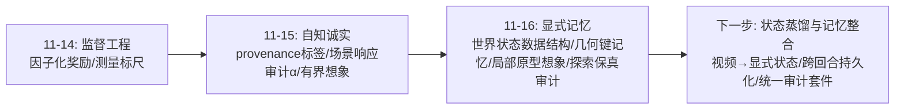
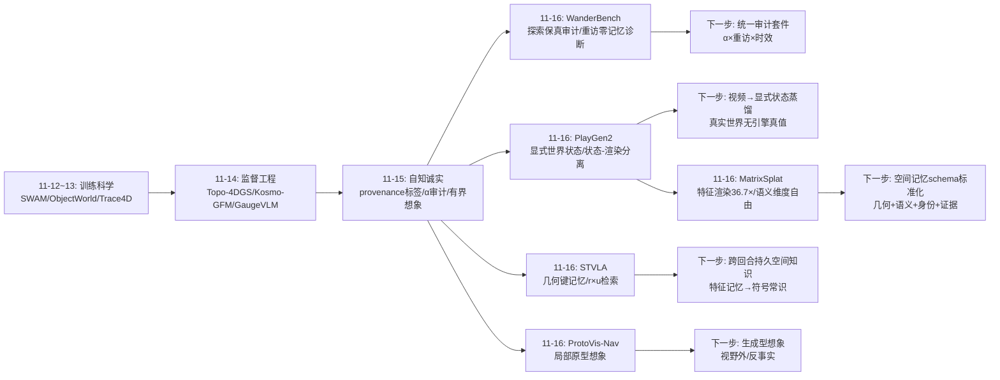
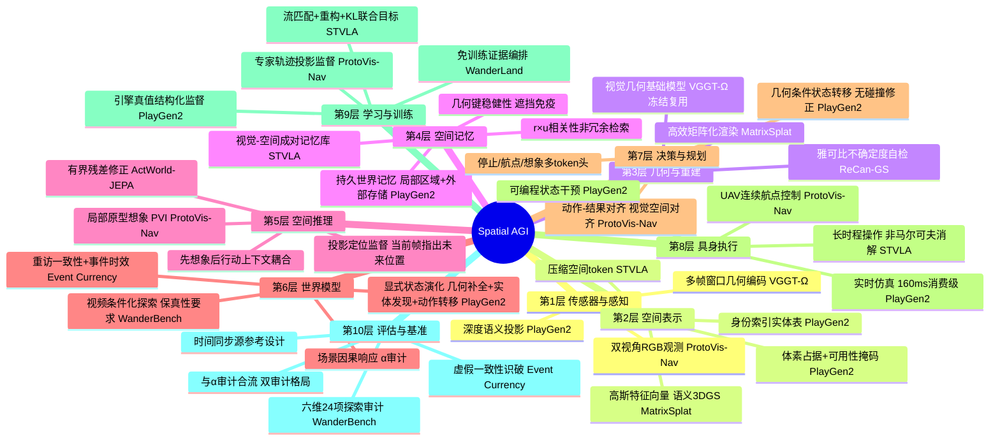
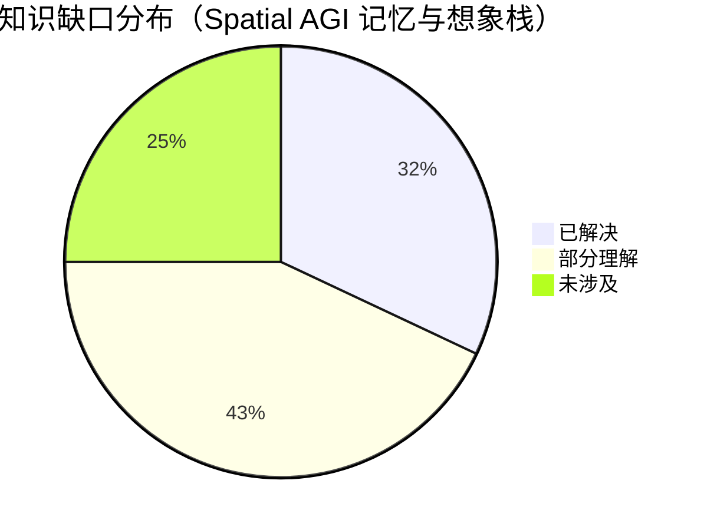

# Spatial AGI 每日思考 - 2026-11-16

## 📅 每日总结

**日期**: 2026-11-16
**论文数量**: 5篇
**主题**: 昨天的元判断是"Spatial AGI 正在经历实验科学化 + 元认知化的双重转变，诚实的空间智能正在从哲学诉求变成工程规格"。今天五篇论文把这个判断推向架构层面：**如果说诚实是"知道自己知道什么"，那么架构就是"把知道的东西放在哪里"。** WanderBench 系统性证明了像素循环世界模型"重访无记忆、长时序漂移"是 8 个模型的普遍失败模式——记忆不能长在生成历史的像素里；PlayGen2 给出了正面回答：世界状态活在显式 3D 里（占据网格+实体表），渲染只是投影；STVLA 在机器人操作侧给出同一原则的另一个实例：几何特征（而非外观）才是稳健的记忆键，外观记忆恰好在最需要记忆的时候（遮挡）失效；ProtoVis-Nav 则证明想象力可以极其便宜——把下一位置投影到当前视野、只想象 32×32 的局部区域，用原型线性组合替代视频扩散；MatrixSplat 从最底层加固地基：阶数无关化把语义特征渲染变成 Tensor Core 矩阵乘，让"每个高斯携带完整语义向量"第一次工程可行。五篇合起来的元判断是：**Spatial AGI 的记忆革命正在发生——"存什么"（几何/显式状态而非外观/像素）、"存多久"（持久状态而非生成历史）、"怎么取"（信息增益先验/证据流而非隐式注意力）、"花多少算力想"（与决策粒度匹配的局部想象）——四個记忆设计维度本周全部出现了标志性工作。**

**关键突破**:
- 🚀 WanderBench：首个视频条件化世界探索基准——745 个单镜头视频 × 6 维 × 24 子指标，以时间同步源帧为每帧参考；8 个模型横评揭示两大普遍失败模式（长时序丢相机控制与源动态、重访零记忆），且 Event Currency 指标戳穿"冻结过时状态"的虚假一致性；WanderLand 免训练修复全维涨分（源动态 +8.3、重访 +4.8）
- 🚀 PlayGen2：把可玩世界模型从"像素循环"重构为"状态循环+投影渲染"——体素占据网格 + "未知≠空"可用性掩码 + 身份索引实体表构成持久世界记忆，几何补全/实体发现/动作条件转移联合学习；生成帧永不回流状态预测；MacBook M4 Pro 上 160ms 实时可玩；零样本未见地图 + 多玩家组合 + 状态级可编程干预
- 🚀 STVLA："场景空间表示应是策略记忆的一部分"——冻结 VGGT 几何特征与视觉 token 成对进入有界记忆库，零参数的相关性-非冗余性评分（r×u）引导跨模态检索；4 个仿真基准全第一，真实世界较 π0.5 提升 58.33/30.00/35.00 个百分点
- 🚀 ProtoVis-Nav：动作-结果对齐的最小充分想象——下一位置投影到当前图像平面、裁剪 32×32 区域、K 个 PVI 原型经 softmax 混合匹配目标特征，原型留在上下文中参与航点预测；"先想象后行动"在 UAV VLN 上显著超越全局想象路线
- 🚀 MatrixSplat：剖析证伪社区共识（排序不是瓶颈，RenderCUDA 占 77% 且 Tensor Core 利用率为 0%）；阶数无关加权累加把特征渲染转化为稠密矩阵乘，高维语义特征 kernel 最高 36.7× 加速，原生维度语义渲染成为现实（NeurIPS 2026）

**架构演进**: 自知诚实的栈架构 → **显式记忆的栈架构**（表示层：显式 3D 世界状态取代像素循环 [PlayGen2/MatrixSplat]；记忆层：几何键持久记忆取代外观键 [STVLA]；推理层：局部原型想象取代全局 rollout [ProtoVis-Nav]；评估层：探索保真度审计 [WanderBench]；基础设施层：矩阵化语义渲染 [MatrixSplat]）

### 📊 一句话总结

2026-11-16 的五篇论文宣告 Spatial AGI 的"记忆转向"完成理论闭环并进入工程落地：WanderBench 证明了像素记忆的系统性失败，PlayGen2/STVLA 分别在世界模型与机器人操作两侧给出"显式状态+几何键"的替代架构，ProtoVis-Nav 证明想象可以与决策粒度匹配地便宜，MatrixSplat 把语义渲染的地基加固到特征维度自由——**空间智能的记忆不再是生成的副产品，而是一等的数据结构。**

### 🔗 延续性

**昨日→今日**: 昨天确立"诚实的空间智能"（感知自检、表征标注、决策节制、审计评估、受控平台）。今天的工作与它形成精确的互补：诚实回答"知道什么"，记忆回答"放在哪"。具体承接：①昨天 DPGS-SLAM 的 provenance 标签让高斯"声明证据来源"，今天 STVLA 让记忆条目"声明几何内容"——两者都是给空间数据结构加语义字段；②昨天 Driving WM 审计发现"动相机不动场景"，今天 WanderBench 发现"重访必重画"——两者都是对生成式世界模型的领域级审计，且都给出量化指标（α / Revisit 分数）与免训练修复（ReTime-Compose / WanderLand），方法论完全同构；③昨天 ActWorld-JEPA 的有界门控残差给想象"有限发言权"，今天 ProtoVis-Nav 把想象的发言权进一步压缩到"局部区域+原型子空间"——想象的节制从影响幅度控制细化为空间范围控制；④昨天 Spatial Foundry 的受控实验平台思想，今天 WanderBench 的时间同步参考设计（G(t) vs S(τ(t))，每帧都有参考无需时序标注）是"受控比较"在基准设计中的又一次应用。

**今日→明日**: 新线索十条：①**从视频学习显式世界状态**——PlayGen2 依赖 Doom 引擎真值，真实世界没有占据网格和实体表导出；ObjectWorld 数据集 + 几何基础模型 + 3D 分割的蒸馏通路是最大缺口；②**几何记忆的跨回合持久化**——STVLA 的 L_m=16 回合级记忆如何压缩成跨场景符号化空间知识；③**WanderBench 式审计 × α 式审计的统一套件**——探索保真（重访/事件时效）+ 场景响应（因果执行）应合并为世界模型发布的强制双审计；④**局部想象的视野外扩展**——ProtoVis-Nav 只能想象当前视野内已有内容，视野外/反事实想象需要世界模型先验填补；⑤**原型词汇表的可视化与语义解释**——PVI 混合系数是窥探 VLM 空间想象的潜在显微镜；⑥**WanderLand 与在线 3D 记忆的结合**——2D 图像证据填补的下一步是在线轻量 3DGS/点云记忆；⑦**阶数无关渲染的质量边界**——复杂半透明/体渲染场景下学习型深度权重的容量极限；⑧**稀疏矩阵化的 3DGS 渲染**——稠密 MMA 在稀疏 tile 上的浪费，结构化稀疏 Tensor Core 是下一步；⑨**想象粒度与决策粒度的自动匹配**——什么任务该想多少、想哪里，应有自适应机制；⑩**渲染基础设施的标准语义字段**——MatrixSplat 让特征维度自由后，每高斯携带什么（CLIP/DINO/实体 ID/证据等级）需要社区 schema。明日检索方向："world state distillation from video occupancy entity"、"persistent spatial memory consolidation robot episodes"、"world model audit suite revisit scene response"、"out-of-view imagination generative prior navigation"、"prototype token interpretability spatial VLM"、"online gaussian memory streaming exploration"、"order independent rendering transparency quality limit"、"sparse tensor core gaussian splatting"、"imagination granularity adaptive decision making"、"gaussian feature schema semantic annotation standard"。

### 💡 本质思考：如何达成通用空间智能

#### 1. 核心能力的本质是什么？

昨天说"对自己空间知识的认识论诚实"。今天五篇把这个答案再推一层：**通用空间智能的本质是拥有一个独立于当前视野的、持久演化的世界状态，以及与决策粒度匹配的想象能力。**

四个具体化：
- **状态的持久性**（PlayGen2）：智能体对世界的知识不应随视线转移而丢失——转身之后走廊还在原地，这不是生成质量问题而是数据结构问题。走廊必须在状态里，而不是在像素历史里。
- **记忆的稳健性**（STVLA）：记忆的键必须比记忆的内容更稳健——外观键在遮挡时失效恰好在最需要记忆的时刻，几何键不受遮挡影响。"过去场景的结构"是策略最该记住的东西。
- **想象的经济学**（ProtoVis-Nav）：想象的价值密度集中在动作结果关联的局部区域。判断一个动作是否可行不需要渲染整个未来，只需要想象那个 32×32 的关键缝隙。思考的粒度应该与决策的粒度匹配。
- **探索的忠实性**（WanderBench）：真实空间探索意味着身份保持、事件进度、重访时效三位一体——回到原地时，花瓶应在原位，但舞者已经跳到了后面。真正的空间记忆不是快照，而是持续运转的世界状态。

MatrixSplat 则提醒：这一切的上层建筑需要地基——当空间记忆需要携带语义（这是什么）、证据等级（这是我看到的还是猜的）、实体身份（这是哪个物体）时，渲染基础设施必须让特征的维度和数量不再受限。

#### 2. 当前方法与理想目标的差距在哪里？

**差距一：真实世界没有显式状态的"导出接口"。** PlayGen2 的世界演化从 Doom 引擎的结构化真值学习——占据网格、实体状态、动作都来自引擎。但 Spatial AGI 的目标域（真实世界）没有引擎。从普通视频端到端蒸馏出同等质量的显式状态（占据+实体+动力学）是当前最大的鸿沟。ObjectWorld 的 3D 全物体流数据集和几何基础模型是部分答案，但距离"从任意视频自动构建可演化世界状态"还差一个量级的工程。

**差距二：记忆的时间尺度断层。** STVLA 记 16 条（回合级）、PlayGen2 记局部区域（会话级）、Compass1 记场景（任务级）——但没有工作打通"感知级特征记忆 → 符号级空间知识 → 跨场景迁移的空间常识"的整合管线。人类走进一个新厨房时带进的"厨房应该有灶台、水槽通常在水池下方"的知识，从哪一层记忆压缩而来、如何检索，完全未知。

**差距三：想象的视野边界。** ProtoVis-Nav 只能想象当前视野内已存在的内容（投影点在当前帧上）——这是"记忆型想象"。真正的空间智能需要"生成型想象"：想象视野外的东西（拐角后有条河）和从未见过的东西（反事实场景）。局部想象的效率优势与全局想象的覆盖能力如何兼得，没有答案。

**差距四：审计指标仍然分裂。** WanderBench 测探索保真（重访/事件时效）、昨天的 α 测场景因果响应、WorldScore 测生成质量——三套审计互不覆盖，没有统一的世界模型"体检报告"格式。领域需要类似汽车碰撞测试星级的标准化审计套件。

#### 3. 从今天到理想状态，最可能的路径是什么？

**近期（3-6个月）：审计标准化与记忆组件化。** WanderBench + α 审计合并为世界模型发布强制项；STVLA 的视觉-空间成对记忆、PlayGen2 的世界状态接口、r×u 检索先验以开源组件形式被主流 VLA/世界模型吸收。标志事件：第一个内置显式 3D 状态的开源世界模型基线发布。

**中期（6-18个月）：视频→显式状态的蒸馏管线成熟。** 结合几何基础模型（VGGT 系）、3D 分割与跟踪、ObjectWorld 式物体流数据的"世界状态自动构建"管线出现；语义 3DGS（借助 MatrixSplat 类渲染）成为状态载体；WanderLand 式免训练证据注入与显式记忆融合。标志事件：从单一手机视频自动生成 PlayGen2 级可交互环境的 demo。

**长期（18个月+）：持久空间知识与生成型想象的统一。** 感知级记忆跨回合整合为符号化空间常识；局部原型想象与生成先验结合覆盖视野外推理；空间认识论 schema（昨天的线索）与显式状态格式（今天的线索）合并为统一的空间数据基础。到那时，通用空间智能的定义将是：**拥有可持久演化、可语义查询、可证据审计的世界状态，并能以与决策粒度匹配的成本进行空间想象与行动的系统。**

---

## 🔗 与昨日思考的联系

### 昨日重点

昨天五篇（Spatial Foundry / ReCan-GS / DPGS-SLAM / ActWorld-JEPA / Driving WM 审计）确立"自知诚实的栈架构"：感知层雅可比自检、记忆层 provenance 标注、决策层有界想象、评估层场景响应审计、数据层受控实验平台。中心论断："诚实的空间智能正在从哲学诉求变成工程规格"。留下线索：provenance schema 标准化、不确定度因果审计、α 推广、主动想象验证、诚实性-能力权衡等十条。

### 今日进展

1. **"评估审计"方法论的确立与扩散**：昨天 Driving WM 用 α 审计了 15 个驾驶世界模型；今天 WanderBench 用六维 24 项审计了 8 个视频世界模型——两个工作方法完全同构（量化指标 + 普遍失败模式诊断 + 免训练修复），审计正在从个案变成领域方法论。世界模型的"碰撞测试时代"开启。
2. **provenance/证据思想的表征层延伸**：昨天 DPGS-SLAM 给高斯打"观察 vs 生成"标签；今天 WanderLand 的证据有序条件化本质上是给推理时条件流排序（同刻源证据 > 自身历史静态内容）——证据思想从静态标注扩展到动态推理编排。
3. **"想象需要节制"的细化**：昨天 ActWorld-JEPA 用有界残差控制想象的影响幅度；今天 ProtoVis-Nav 用投影+原型子空间控制想象的空间范围与表达容量——节制的两个正交维度（幅度×范围）都出现了。
4. **受控参考的基准设计**：昨天 Spatial Foundry 用正交分解的编辑记录做受控实验；今天 WanderBench 用时间同步源帧让每一帧都有参考而无需时序标注——受控思想在数据侧与基准侧同时开花。
5. **从"诚实标注"到"诚实架构"**：昨天诚实是标注问题（给输出加标签）；今天的问题是标注挂在什么载体上——如果载体是像素循环，标注本身会随生成漂移。PlayGen2/STVLA 给出的答案是：诚实需要显式记忆作为稳定的挂载点。**先有好的记忆结构，诚实标注才有意义。**

### 演进路径



---

## 📚 论文概览

| # | 论文 | 一句话 | 栈层归属 |
|---|------|--------|---------|
| 1 | WanderBench (2611.12557) | 视频条件化世界探索的首个系统基准：重访零记忆+长时序漂移是普遍失败，WanderLand 免训练修复 | 评估层/世界模型 |
| 2 | PlayGen2 (2611.07867) | 显式 3D 世界状态（占据+实体表）+分离渲染的实时可玩世界模型 | 表示层/世界模型 |
| 3 | ProtoVis-Nav (2611.17330) | 局部投影原型想象实现动作-结果视觉对齐的 UAV 导航 | 推理层/具身导航 |
| 4 | STVLA (2611.16589) | 几何特征进时序记忆的 VLA：外观记忆恰在最需要时失效 | 记忆层/操作 |
| 5 | MatrixSplat (2611.15153) | 阶数无关矩阵化渲染：语义特征维度自由（kernel 36.7×） | 基础设施层 |

---

## 💡 核心见解

### 见解1: 像素循环是世界模型的结构性缺陷，不是能力不足（WanderBench）

- ✅ 8 个模型在重访维度全部失败——不是某个模型弱，而是"生成历史即记忆"的架构本身无法保持世界状态；部分模型靠冻结过时状态制造虚假一致，被 Event Currency 指标识破。
- ✅ 长时序下模型"保静态、丢动态"：相机控制与源动态同步持续劣化，静态场景与视觉质量反而维持——失败是选择性的，说明模型内部对"结构"与"事件"的处理通路不同。
- ✅ WanderLand 免训练修复证明问题可解：同刻源帧条件化 + 自身历史静态内容填补，在 5 个模型 6 个维度全部涨分。

**对Spatial AGI的启发**: 与昨天 α 审计（场景因果失败）合并看，生成式世界模型有两个被证实的结构性缺陷：不会因果执行（动相机不动场景）、不会记住生成（重访必重画）。两者的共同根源是**世界状态没有独立于生成过程的存在**。解决方案已经收敛：显式状态（PlayGen2）或外置证据流（WanderLand）。评估层面的教训同样重要：一致性指标必须区分"保留过时状态的一致"与"反映当前状态的一致"。

### 见解2: 世界状态应该是显式数据结构，生成只是投影（PlayGen2）

- ✅ 占据网格 + 可用性掩码 + 身份索引实体表的组织方式几乎就是游戏引擎世界状态的可学习重写——但它证明这套结构可以**端到端学习**（几何补全+实体发现+动作条件转移联合训练），而非手工编程。
- ✅ "未知 ≠ 空"的掩码设计：智能体必须对自己的无知保持诚实——未探索体素不被当作自由空间，走过去才会发现"那里有东西"。这是空间认知的基本原理在表示层的体现。
- ✅ 单向信息流（生成帧永不回流状态预测）从架构上切断了视觉自回归误差污染世界状态的通路——WanderBench 诊断的"生成历史污染记忆"问题被结构消除。

**对Spatial AGI的启发**: "状态-渲染分离"是本周最重要的架构原则。它同时解决：重访一致性（状态天然持久）、可干预性（直接编辑实体表）、可组合性（多玩家=模型组合）、效率（160ms 消费级硬件）。最大缺口是数据：真实世界没有引擎导出的结构化真值。通往 Spatial AGI 的关键工程是"视频→显式状态"的蒸馏管线。

### 见解3: 记忆的键必须比记忆的内容更稳健（STVLA）

- ✅ "外观记忆恰好在最需要记忆的时候失效"：夹爪遮挡工作区的那一刻正是最需要记得"东西原来在哪"的时刻，而外观检索键恰好被遮没了。几何键（VGGT 特征）不受遮挡与视角变化影响。
- ✅ 零参数的相关性-非冗余性评分（r_j = 相似度 × 归一化差异）从特征选择理论（mRMR 思想）迁移而来：惩罚"刚做过的事"（冗余）、奖励"相关且有新信息"的历史——记忆系统天然偏向存储场景演化的增量。
- ✅ 真实世界 +30~58 点的提升幅度说明：非马尔可夫性（视觉相似、任务状态不同）+几何敏感性正是当前 VLA 的最大短板，而它们可以被一个记忆模块修复。

**对Spatial AGI的启发**: 这个原则适用于一切记忆系统设计——图像检索用语义嵌入而非像素、场景重访用几何描述子而非外观、人机协作记忆用"谁改变了什么"而非"画面像什么"。另外，冻结几何基础模型作为记忆编码器意味着：**基础模型变强，记忆自动变强，策略无需重训**——这是可升级架构的典范。

### 见解4: 想象的粒度应与决策的粒度匹配（ProtoVis-Nav）

- ✅ 精确飞行动作由局部视觉区域决定（窄缝效应）——全局场景只提供方向感，判断"能不能钻过去"只需要想象那个 32×32 的缝隙区域。
- ✅ "下一位置投影到当前图像平面"是天才的监督设计：它把"预测未来"转化为"在当前观测中指出未来位置"——模型本质上只需做定位，监督目标鲁棒且免去了未来帧生成的不可控性。
- ✅ 原型线性组合（softmax 混合）用低秩子空间约束替代自由回归：想象空间是有限概念基的组合，天然抗过拟合、天然不易幻觉出不存在的东西。

**对Spatial AGI的启发**: 与 ActWorld-JEPA 的有界残差合并，"想象的节制"现在有完整的两个正交维度：影响幅度（残差界）× 空间范围（局部投影）。同时这也定义了一个新指标——**想象效率**：达到同样决策改善所需的最小想象计算量。全局视频扩散 rollout 在这个指标下是极端浪费的。局限同样清晰：投影想象只能覆盖视野内已有内容，"生成型想象"（视野外、反事实）仍需世界模型先验。

### 见解5: 语义特征渲染的基础设施约束已被拆除（MatrixSplat）

- ✅ 剖析证伪社区共识：排序（14.3%）不是瓶颈，RenderCUDA（51.3%）的循环依赖才是；Tensor Core 利用率 0% 说明现有管线与硬件完全错配——"测量先于优化"依然是第一定律。
- ✅ 阶数无关渲染（OIT/LC-WSR）此前只被用来免排序，MatrixSplat 首次用它**改变计算原语**：逐像素标量累加 → Tensor Core 稠密矩阵乘。同一数学工具的全新用法。
- ✅ 特征维度 >128 的共享内存悬崖被惰性通道分批取数消除；36.7× kernel 加速意味着"每个高斯携带完整语义向量"第一次工程可行——LangSplat 系的"512 维压缩到 3 维 latent"是管线缺陷的补丁而非设计选择。

**对Spatial AGI的启发**: 当上层讨论聚焦世界模型与记忆架构时，这篇提醒：**底层渲染的特征可扩展性决定上层语义能力的天花板**。语义 3DGS 是空间记忆与开放词汇查询的核心候选载体，MatrixSplat 让它可以携带完整 CLIP/DINO 特征、实体 ID、甚至昨天的 provenance 标签。渲染、状态、记忆、证据正在汇入同一个空间数据结构。

### 见解6: 世界模型的审计方法论已经成形（WanderBench + 昨日 α 审计合流）

- ✅ 两个独立工作（昨日 Driving WM、今日 WanderBench）用完全同构的方法论审计世界模型：设计量化指标（场景响应 α / 重访一致性+事件时效）→ 横评发现普遍失败模式 → 定位机制根源（通道错配 / 无生成记忆）→ 给出免训练修复（ReTime-Compose / WanderLand）。
- ✅ WanderBench 的时间同步参考设计（G(t) vs S(τ(t))）让每帧都有参考而无需时序标注——优雅的评估工程。Event Currency 子指标区分"冻结过时状态的一致"与"反映当前状态的一致"，戳穿虚假一致性。
- ✅ 两次审计共同的结论：**主流评估指标与世界模型真正重要的能力几乎不相关**（α 秩相关≈0；相机跟随好≠探索忠实）。领域在用错误的指标主动优化出错误的能力。

**对Spatial AGI的启发**: 世界模型需要标准化的"体检报告"：场景因果响应（α）× 探索保真（重访/事件时效）× 生成质量（FVD/视觉）三轴缺一不可。反事实真值获取已有两条路径（真实日志重定时/立体；受控平台编辑），成本在快速下降。未来世界模型发布应附带审计报告，如同汽车碰撞测试星级。

### 见解7: "显式记忆栈"正在跨域收敛（PlayGen2 + STVLA + MatrixSplat 合流）

- ✅ 三个不同子领域（游戏世界模型、机器人操作、渲染基础设施）在同一周收敛到同一架构判断：**空间知识应存放在显式数据结构中**——PlayGen2 的占据网格+实体表、STVLA 的视觉-空间成对记忆库、MatrixSplat 的高斯特征向量。
- ✅ 三个工作对"存什么"的回答一致：几何与结构（而非外观）；对"怎么取"的回答互补：结构化查询（实体表）/评分偏置检索（r×u）/渲染投影（特征 splatting）。
- ✅ 与昨天的证据标注（DPGS-SLAM provenance）叠加，显式记忆栈的完整规格已经可见：**几何 + 语义 + 实体身份 + 证据等级 + 检索先验**——五要素齐备，缺的只是统一的格式标准。

**对Spatial AGI的启发**: 当多个独立子领域在同期收敛到同一架构判断时，通常意味着该判断接近真理。显式记忆栈（而非像素/隐式向量黑箱）很可能是 Spatial AGI 的持久正确选择。下一步的关键不是更多架构变体，而是**标准化**：空间记忆的 schema（字段、格式、接口），让感知、记忆、推理、渲染四层的组件可以互换。

### 见解8: 免训练修复（training-free patching）正在成为独立的方法论分支（WanderLand + ReTime-Compose + PlayGen2 组合性）

- ✅ 昨天 ReTime-Compose 与今天 WanderLand 都证明：重大能力缺陷可以在不动参数的前提下通过"重新编排证据/信息流"修复——前者重定时自己的 rollout 以几何通道注入计划，后者重排条件流让冻结模型读到同刻源证据。
- ✅ 两者的共同哲学：**模型已经会读这些条件，只是读的顺序/通道错了**。修复 = 重建模型已经会读的接口，而非教它新的。
- ✅ PlayGen2 的三个扩展（零样本地图、多玩家、可编程干预）也不需要重训——显式状态的组合性同样是"不训练而获得新能力"的路径。

**对Spatial AGI的启发**: "免训练增强"的价值被系统性低估了。它意味着：冻结的预训练大模型 + 正确的证据编排 + 正确的信息通道 = 大部分所需的Spatial能力。这把工程重心从"训练更好的模型"部分转移到"设计更好的证据流与接口"——迭代速度快几个量级，且天然可组合。

---

## 🗺️ 知识演进图



## 技术栈演进对比表

| 层次 | 昨日方案 | 今日方案 | 变化 |
|------|---------|---------|------|
| 评估层 | 场景响应 α 审计（驾驶域，因果执行） | WanderBench 六维探索保真审计（重访/事件时效） | 审计从因果轴扩展到记忆轴，双审计格局成形 |
| 世界模型表示 | 潜空间 rollout（JEPA/像素扩散），状态隐式 | PlayGen2 显式 3D 状态（占据+实体表），渲染只是投影 | 像素循环 → 状态循环的架构转向 |
| 世界模型修复 | ReTime-Compose 免训练通道修复 | WanderLand 免训练证据有序条件化 | 免训练修复方法论在两个域独立验证 |
| 记忆键 | 外观/感知特征（MemoryVLA 系） | STVLA 几何键（VGGT 特征）+ r×u 解析检索先验 | "记忆键要比内容稳健"原则确立 |
| 想象机制 | 有界门控残差（影响幅度控制） | ProtoVis-Nav 局部投影+原型子空间（空间范围控制） | 节制的两个正交维度补全 |
| 想象载体 | 候选条件化 rollout（latent 视频） | 32×32 局部原型线性组合 | 想象计算量降 2-3 个数量级 |
| 渲染基础设施 | LangSplat 式压缩-解码（512→3维） | MatrixSplat 原生维度矩阵化渲染（kernel 36.7×） | 语义特征维度自由 |
| 空间数据结构 | 高斯+证据标签（DPGS-SLAM） | 高斯+完整语义向量（MatrixSplat）+占据+实体表（PlayGen2） | 显式记忆栈五要素（几何/语义/身份/证据/检索）齐备 |

## 🗺️ Spatial AGI 知识图谱

### 10层架构思维导图



### 🎯 主线技术路径

#### 阶段1: 像素循环世界模型的能力审计与失败确诊（2026 Q3-Q4，已完成）

WanderBench 与 α 审计两份独立"体检报告"确诊生成式世界模型的两大结构缺陷：不会因果执行、不会记住生成。领域从"刷分"转向"诊断"，量化指标（α、Revisit、Event Currency）取代 FVD 成为关注焦点。

#### 阶段2: 显式状态架构的跨域确立（2026 Q4，正在发生）

PlayGen2（游戏域）、STVLA（操作域）、MatrixSplat（渲染层）同一周收敛到"显式数据结构承载空间知识"的判断。状态-渲染分离、几何键记忆、特征维度自由三个组件级突破就位。遗留缺口：真实世界数据通路。

#### 阶段3: 视频到显式状态的蒸馏管线（2027 上半年，下一步）

结合几何基础模型、3D 分割跟踪、物体流数据集（ObjectWorld），打通"普通视频 → 占据+实体+动力学"的自动构建管线。WanderLand 式证据编排与显式记忆融合。标志：单一视频自动生成可交互世界的 demo。

#### 阶段4: 持久空间知识与统一审计（2027 下半年-2028）

特征级记忆跨回合整合为符号化空间常识；空间记忆 schema（几何+语义+身份+证据+检索五要素）标准化；世界模型发布附带 α×重访×时效三轴审计报告；生成型想象（视野外/反事实）与局部想象效率结合。

---

## 🔍 待探索议题

### 高优先级（本周）

1. **从视频蒸馏显式世界状态**
   - 问题: PlayGen2 依赖引擎真值（占据网格、实体表），真实世界如何获得同等质量的监督？
   - 候选方案: 几何基础模型（VGGT）深度+位姿 → 3D 分割跟踪（SAM 系）→ 实体表构建；ObjectWorld 式物体流数据预训练状态转移模型
   - 缺口: 动态实体的状态真值（速度/类别变化）没有可靠自动标注；占据的完整性依赖视角覆盖

2. **几何记忆的跨回合持久化与符号化整合**
   - 问题: STVLA 记忆容量 16 条、回合重置——特征级记忆如何压缩为跨场景的空间常识？
   - 候选方案: 记忆分层（感知级→情节级→语义级）；EmbodiedLGR 式图结构承载符号；关键帧+拓扑地图的长期索引
   - 缺口: 特征→符号的压缩判据（什么值得记住）；检索时的多粒度联动

3. **世界模型统一审计套件**
   - 问题: α（因果）与 WanderBench（探索保真）两套审计互不覆盖，无统一报告格式
   - 候选方案: 三轴审计协议（场景响应×重访一致性×事件时效）+ 反事实真值获取标准化（重定时/立体/受控平台）
   - 缺口: 机器人域的对应指标（力/接触响应）；审计的自动化工具链

### 中优先级（本月）

4. **局部想象与生成先验的结合（生成型想象）**
   - 问题: ProtoVis-Nav 只能想象视野内已有内容；视野外与反事实想象如何获得？
   - 候选方案: 原型词汇表扩展世界模型先验类目；投影失败（点出视野）时触发世界模型局部 rollout
   - 缺口: 两种想象的可信度校准与统一接口

5. **WanderLand × 在线 3D 记忆**
   - 问题: WanderLand 用 2D 图像证据填补重访，视角剧烈变化时 2D 证据失效
   - 候选方案: 生成过程中在线维护轻量 3DGS/点云记忆，重访时从 3D 记忆渲染填补证据
   - 缺口: 在线 3D 重建的延迟预算；动态物体在 3D 记忆中的时效管理

6. **原型 token 的可解释性研究**
   - 问题: PVI 原型与 softmax 混合系数承载了 VLM 的空间想象内容，但未被解释
   - 候选方案: 原型→CLIP 空间投影可视化；混合系数作为"想象成分分析"（60%门框+30%草地）
   - 缺口: 原型词汇表的跨模型稳定性；解释的因果有效性验证

### 低优先级（长期）

7. **阶数无关渲染的质量边界与稀疏化**
   - 问题: 学习型深度权重在复杂半透明场景的容量极限；稠密 MMA 在稀疏 tile 的浪费
   - 候选方案: 结构化稀疏 Tensor Core；混合精确/近似渲染（关键区域精确合成）
   - 缺口: 质量退化的定量边界刻画；动态 4DGS 场景的打包策略

8. **想象粒度的自适应机制**
   - 问题: 什么任务该想多少、想哪里？ProtoVis-Nav 的 32×32 是固定的
   - 候选方案: 决策不确定性驱动的想象预算分配（不确定→更大范围想象）；想象-验证闭环（想象后主动取证）
   - 缺口: 想象预算与任务性能的权衡曲线测量

9. **空间记忆 schema 标准化**
   - 问题: 五要素（几何/语义/身份/证据/检索先验）分散在五个独立工作中，格式互不兼容
   - 候选方案: 扩展 3DGS ply 格式或场景图 schema，社区提案（类似 COCO/OpenXR 的标准化过程）
   - 缺口: 跨层（感知/记忆/渲染）的字段语义一致；版本演化机制

10. **诚实性 × 记忆结构的联合验证**
    - 问题: 昨天的证据标注（诚实）与今天的显式记忆（结构）尚未在同一系统联合验证
    - 候选方案: 在 PlayGen2 类显式状态上叠加 DPGS-SLAM 式 provenance，在 WanderBench 上测诚实标注对探索保真的增益
    - 缺口: 诚实标注在状态演化中的传播机制（想象的实体被观察修正后标签如何更新）

---

## 📊 知识缺口分析



**已解决（32%）**:
- ✅ 像素循环失败模式的系统确诊（WanderBench 六维审计 + α 审计）
- ✅ 显式世界状态的参考架构（占据+实体表+状态-渲染分离，PlayGen2）
- ✅ 几何键记忆的实现与验证（STVLA，真实任务 +30~58pt）
- ✅ 局部想象的监督构造（投影+原型混合，ProtoVis-Nav）
- ✅ 语义特征渲染的基础设施（MatrixSplat 36.7×）
- ✅ 免训练修复方法论（WanderLand/ReTime-Compose 双域验证）

**部分理解（43%）**:
- ⚠️ 视频→显式状态的蒸馏（组件齐备但管线未通）
- ⚠️ 记忆的时间尺度整合（回合级成熟、跨回合空白）
- ⚠️ 想象的节制理论（幅度×范围两维已补全，粒度自适应未解决）
- ⚠️ 世界模型审计（双审计指标有了，统一套件与机器人域推广未做）
- ⚠️ 原型想象的语义解释（机制存在，可解释性未研究）
- ⚠️ 诚实标注与显式记忆的结合（各自成立，联合未验证）
- ⚠️ 阶数无关渲染的质量边界（静态场景验证，复杂透明/动态未测）

**未涉及（25%）**:
- ❌ 生成型想象（视野外推理、反事实空间模拟）
- ❌ 空间常识的来源与获取（"厨房该有灶台"这类知识从哪里来）
- ❌ 空间记忆 schema 的社区标准
- ❌ 多智能体共享世界记忆的一致性协议
- ❌ 空间记忆的遗忘与整理机制（什么该忘、何时整理）

---

## 📝 元笔记

**本周主线回顾**: 11-14 监督工程（教什么）→ 11-15 自知诚实（知道自己知道什么）→ 11-16 显式记忆（知道的东西放在哪）。三天构成一个完整的认识论递进：能力 → 元认知 → 状态。若把 Spatial AGI 比作一个认识主体：监督工程给了它学习的方法，诚实给了它自省的能力，显式记忆给了它持久的心理结构。下一步的自然问题是**习得与迁移**：这些状态与知识如何在任务间、场景间、智能体间流动。

**数据侧断言**: 本周最值得押注的工程方向是"视频→显式世界状态"的蒸馏管线。它的输入（几何基础模型、3D 分割、物体流数据）与输出接口（PlayGen2 式状态、语义 3DGS 载体）都已存在，缺的只是把两者连起来的系统工作。谁先打通，谁就拿到 Spatial AGI 的数据飞轮。

---

**文档创建时间**: 2026-11-16 03:00 (+08:00)
**分析论文**: WanderBench / PlayGen2 / ProtoVis-Nav / STVLA / MatrixSplat
**与前置文档**: 承接 2026-11-15"自知诚实的栈架构"

---

## 🔬 附录A: 五篇论文的技术深读笔记

### A.1 WanderBench: 评估工程的细节拆解

**数据筛选的两阶段流水线值得作为工程模板**：

第一阶段（镜头提议）组合了三个经典工具：Shi–Tomasi 角点检测提供稳定跟踪点，金字塔 Lucas–Kanade 光流在 10fps 下跟踪它们，RANSAC 相似变换拟合判断整体相机运动。这三个组件都是 1990 年代的经典算法——用旧工具组合解决新问题，胜过等待新工具。

第二阶段（验证）用双模型交叉验证：VGGT 重建相机轨迹，MegaSaM 交叉校验，RAFT 光流验证场景动态。双模型一致才通过，降低了单一模型系统性偏差的风险。

人工校验环节的设计也有讲究：4 位标注者独立标注 2,142 个候选，用 Fleiss' κ=0.93 证明一致性后采纳结果——**先测量标注质量，再信任标注结果**，这个顺序不能颠倒。

**评估体系的设计原则**：

1. *同步参考*：G(t) 与 S(τ(t)) 描绘同一时刻的不同视角——每帧都有参考，无需人工时序标注。这个设计把"时序对齐评估"的成本从 O(人工标注) 降到 O(几何重投影)。
2. *归一化基准*：视觉质量指标按源视频归一化（任务是重渲染，上限是源本身），避免了"生成的画面比输入更美"被错误奖励。
3. *惩罚条件化*：Subject/Background Consistency 只惩罚"超出源中变化"的漂移——源里物体本来就在动，不能惩罚合理的动态再现。
4. *虚假一致性的检验*：R.7 Revisit Event Currency 是体系中最锋利的一刀。传统一致性指标可以被"冻结世界"骗过，但"返回视角是否展示动态主体的当前状态"不能。

**8 个模型的分组发现**：全长模型（InSpatio-World 1.5、World-in-World、WorldForge v2）与帧限模型（81 帧上限：ReCamMaster、CameraAnything、UniWorld-View、WorldForge v1、TrajectoryCrafter 49 帧）分开评估。帧限模型在 Medium/Hard 层级只能处理开头片段——**生成长度本身是探索能力的第一瓶颈**，这在以往任何基准中都没有被显式暴露过。

### A.2 PlayGen2: 世界状态模型的架构细节

**状态定义的完整语义**（式 1）：

- 占据地图 M_t 与可用性掩码 K_t 分离——这个分离等价于把"世界"与"对世界的知识"分开。M_t 是本体，K_t 是认识；未探索体素在 K_t=0 但本体状态未知。这个区分是 SLAM 领域"unknown vs free"之争在生成式世界模型中的回应。
- 实体表 O_t 的属性设计（类别/位置/高度/半径/速度）是"最小充分实体描述"：足够支撑 Doom 级交互（碰撞、射击、拾取），又不引入形状级复杂性。高度+半径把实体近似为竖直圆柱——碰撞检测由此解析可算。
- "物品被拾取也是状态变化"的提醒很有价值：实体的动力学不仅是位置移动，还包括离散的状态转移（存在→不存在）。这为未来的功能级/物理级状态（开/关、满/空）留了接口。

**Discovery Transformer 的双查询设计**：

Geometry Queries 绑定粗特征体积的空间位置——每个查询问"这个位置有没有占据"；Spatial Entity Queries 绑定候选锚点——每个查询问"这个锚点附近是否该有个实体"。两类查询共享上下文但走不同的解码器（Geometry Decoder 做体素重建、New-entity Decoder 做 objectness/类别/位姿/速度预测）。这种"位置级与对象级双粒度"的并行生成，是对静态几何与动态实体二象性的直接回应。

**先补全后转移的更新顺序**是个容易被忽视但关键的设计：增量生成在当前（已提交的）玩家位姿处补全局部几何，然后状态转移才预测下一状态。顺序反了会怎样？转移预测将基于不完整的几何上下文——怪物下一帧会不会穿墙，取决于预测时"墙"是否存在。顺序本身就是归纳偏置。

**训练数据的效率启示**：整个模型用 Doom 引擎收集的结构化数据训练，没有使用任何真实视频。这证明"学习式世界演化"可以在纯合成域先验证架构，再谈域迁移——先在受控域把架构跑通是务实的研发路径。

### A.3 ProtoVis-Nav: 监督构造的数学细节

**投影公式（式 1）的前提条件**：p_proj = R_t^T(p_{t+1} − p_t) 把世界系位移转入当前机身系。注意它隐含假设 p_{t+1} 在当前相机的视锥内（或至少可投影）。对短时程（action chunk 级）导航，这个假设大多成立；对大幅机动（原地掉头）不成立——这是方法适用域的隐式边界，论文未显式讨论。

**视图选择的两个判据的可解释性**：
- ρ（垂直/水平位移比）> 0.8 → 机身系下的运动方向偏垂直 → 下视相机更可能覆盖目标位置；
- |Δz| = |z_{t+2} − z_{t−1}| > 5 → 短窗口内有明确的高度变化（起飞/降落段）→ 下视图。
两个判据覆盖不同情形：ρ 是瞬时判据，Δz 是窗口判据；同时使用降低了单一启发式的误判率。但阈值（0.8、5）是手工的——对不同机型/任务的自适应性存疑。

**原型混合的梯度流**：softmax 归一化的混合矩阵意味着 K 个原型对最终预测的贡献是竞争性的（和为 1）。训练时目标特征的梯度会通过混合权重回传到所有原型——每个原型既学习"自己擅长表达什么区域"，也学习"自己在什么上下文中该让位"。这种竞争性结构是无监督聚类（如 VQ-VAE 码本）与注意力机制的杂交，但这里的"码本"是动态上下文相关的（由 `<pvi>` token 随输入生成），而非全局固定——可以理解为"每一步现造一个小码本"。

### A.4 STVLA: 检索评分的统计学解读

**r × u 评分的性质分析**：

r_j = ½(1 + cos(h_j, x̄_t)) ∈ [0,1]：余弦相似度的线性重标定。u_j = ‖h_j − x̄_t‖ / (‖h_j‖ + ‖x̄_t‖) ∈ [0,1] 是归一化的欧氏距离（当两向量同向且等长时→0，正交时→√2/2 缩放）。乘积 s_j 的行为：

- h_j ≈ x̄_t（几乎相同的历史）：r→1, u→0, s→0 —— 正确抑制冗余；
- h_j 与当前正交/无关：r→0.5, u→较大, s→中等 —— 非冗余但相关性不足，靠 r 压低；
- h_j 相关但不同（理想记忆）：r 较高, u 较高, s 最高。

这个评分的哲学：**好的记忆条目是"与当前有关联但提供了新信息"的条目**。它不需要学习，因为它编码的是信息论级别的先验（信息增益代理）而非任务特定的知识。

**潜在失效模式**（论文未讨论，值得后续验证）：
1. 重复子任务场景：策略第二次执行同样的抓取时，"上一次同样抓取"的历史是 s 最低的（最冗余）——但恰恰是最有用的参照。评分可能惩罚"有用的重复"。
2. 训练-推理偏移：标准化（减均值除标准差）依赖当前记忆库内的分数分布，库内容不同时偏置强度漂移——回合早期（库小）与晚期（库大）的检索行为可能不一致。

**块因果掩码的空间段设计**：空间 token 对原始前缀（视觉+指令）屏蔽、段内自注意——这防止了空间 token 扰动预训练 VLM 的语言-视觉对齐，同时让动作 token（唯一的消费者）可以读取全部。这是一种"加法不改原有通路"的扩展模式，与 LoRA 的"加旁路不动主干"哲学同源。

### A.5 MatrixSplat: 从剖析到公式化的完整链路

**剖析数据的决策价值**：Table 2 的管线延迟分解（RenderCUDA 51.3% vs Sorting 14.3%）直接推翻了"排序是主要成本"的普遍假设。Fig. 3 的停顿分解进一步把瓶颈定位到 RAW 依赖的 wait 停顿（约 32 cycles 固定延迟/次），而非 short scoreboard（仅 10.2%）——后者才是内存延迟的信号。这排除了"加缓存/预取就能解决"的错误方向：问题是依赖结构，不是数据供给。**每一层剖析都在排除一种假设，最终把问题钉死在"循环结构本身"。**

**LC-WSR 权重的学习语义**：w(α_i, d_i) = α_i·max(0, 1 − d_i/σ)·v_i 中，σ 控制深度衰减范围（σ 大→远处高斯保留权重），v_i 是每高斯的可见性校准因子。学习这些参数的过程，本质上是让网络学会"在无序累加下如何模拟有序合成的遮挡效果"。近处高斯大权重、远处归零——**深度排序的信息被蒸馏进了参数**。这就是"把序信息从计算结构搬到参数"的具体含义。

**集成实验的战略意义**：与 FlashGS/Speedy-Splat 等集成再获 1.69–2.84×，证明"改变混合执行"与"减少进入混合的工作"是正交轴。Spatial AGI 的优化栈应该按轴分解：表示压缩（少存）× 管线调度（少算）× 计算原语（算得快）——三个轴独立优化、自由组合。

---

## 🔬 附录B: 跨论文对比分析

### B.1 三种"世界记忆"方案的对比矩阵

| 维度 | PlayGen2（显式状态） | STVLA（几何键记忆库） | WanderLand（证据流） |
|------|---------------------|----------------------|---------------------|
| 记忆载体 | 体素占据+实体表 | 视觉-空间 token 对 | 生成历史帧（静态内容） |
| 记忆键 | 空间坐标（直接寻址） | r×u 评分偏置检索 | 同刻时间锚+空间覆盖 |
| 持久性 | 永久（提交到记忆） | 回合级（16 条） | clip 级 |
| 动态支持 | 实体状态转移（一等公民） | 隐式（历史差异） | 源视频同步 |
| 学习需求 | 需引擎真值训练 | 策略联合训练 | 零训练 |
| 适用域 | 封闭可控域（游戏/仿真） | 机器人操作 | 视频重探索 |
| 一致性保证 | 状态层面天然成立 | 检索层面概率保证 | 证据层面近似保证 |

三者不是竞争而是互补：PlayGen2 的架构最彻底但需要结构化真值；STVLA 的方案最通用但时程短；WanderLand 的方案最便宜但依赖源视频覆盖。**理想系统可能是三层叠加**：底层显式状态（有真值时）、中层几何键记忆（无真值时）、顶层证据编排（免训练兜底）。

### B.2 两代世界模型审计的方法论对照

| 方法论环节 | Driving WM（11-15） | WanderBench（11-16） |
|-----------|--------------------|--------------------|
| 审计对象 | 15 个驾驶世界模型 | 8 个视频世界模型 |
| 核心指标 | 场景响应 α | 重访一致性 + Event Currency |
| 失败诊断 | 计划-几何通道错配（token 不携带几何） | 无生成记忆（重访重画） |
| 反事实真值 | 重定时日志+立体视差 | 时间同步源帧 |
| 免训练修复 | ReTime-Compose | WanderLand |
| 指标缺陷发现 | 评分与 α 秩相关≈0 | 相机跟随好≠探索忠实 |

方法论的同构性（指标→横评→诊断→修复）说明这不是巧合而是一个成熟范式的确立。值得命名为"**世界模型审计范式**"：假设模型在某维度虚假 → 构造能区分真假的量化指标 → 横评确认普遍性 → 机制级定位 → 最小修复验证。两次应用都成功了，第三次应用（操作域世界模型审计？）值得期待。

### B.3 想象机制的三层节制体系

结合昨日与今日的工作，"想象节制"已形成完整体系：

1. **幅度节制**（ActWorld-JEPA）：想象的输出只能以有界残差形式修正决策评分，置信门控加权——想象失真时修正自动缩水。
2. **范围节制**（ProtoVis-Nav）：想象只发生在动作结果关联的局部区域（投影点周围 32×32），全局场景不进入想象——想象失真的影响面被限制。
3. **容量节制**（ProtoVis-Nav 原型混合）：想象被约束在 K 个原型的线性组合子空间内——想象不可能表达子空间之外的幻觉内容。

三层节制分别控制想象的**影响力、影响面、表达空间**。一个完整的"可信想象"接口应该三者兼备。这也为"诚实性-能力权衡"（昨日线索④）提供了操作化框架：三层各自的强度参数（界的大小/范围的大小/原型数量）就是权衡曲线的坐标轴。

---

## 🔬 附录C: 对 Spatial AGI 10 层架构的本周更新

结合今日五篇，10 层架构的具体更新：

**第 2 层（空间表示）新增组件**：
- 可用性掩码（PlayGen2）：表示"知识边界"的标准字段
- 身份索引实体表（PlayGen2）：对象化空间的最小 schema
- 每高斯语义特征向量（MatrixSplat 使能）：语义维度的原生携带

**第 4 层（空间记忆）发生范式更替**：
- 旧范式：外观特征记忆（MemoryVLA 系）——已被证明在遮挡/视角变化下系统性失效
- 新范式：几何键 + 解析检索先验（STVLA r×u）+ 显式状态（PlayGen2）
- 新增设计原则：记忆键稳健性 > 记忆容量；信息增益先验可免学习

**第 5 层（空间推理）新增机制**：
- 局部投影想象（ProtoVis-Nav）：动作-结果对齐的最小实现
- 原型子空间约束：想象容量的结构性上限
- "先想象后行动"的上下文编排模式

**第 6 层（世界模型）发生架构转向**：
- 像素循环 → 状态循环+投影渲染（PlayGen2）
- 探索保真成为核心评估维度（WanderBench）
- 世界状态需要独立于生成过程的存在

**第 10 层（评估）新增工具**：
- 六维 24 项探索审计（WanderBench）
- 虚假一致性检验（Event Currency）
- 时间同步参考设计模式

### 架构层间的本周新增依赖关系

```
MatrixSplat(第3层渲染) → 使能 → 语义3DGS记忆(第4层)
STVLA(第4层记忆) → 条件化 → 动作生成(第7层)
ProtoVis-Nav(第5层推理) → 依赖 → 双视角感知(第1层) + 投影几何(第3层)
PlayGen2(第6层世界模型) → 依赖 → 显式表示(第2层) → 输出 → 实时执行(第8层)
WanderBench(第10层) → 审计 → 第6层所有方案
```

记忆栈的自下而上贯通已经完成：感知→表示→渲染→记忆→推理→决策→执行，每一层都有今天的组件贡献。**本周是"记忆栈纵向贯通"的一周。**

---

## 🔬 附录D: 明日与本周检索计划

### 检索关键词池（按线索分组）

**视频→显式状态蒸馏**（最高优先级）：
- "world state distillation from monocular video"
- "video to occupancy grid entity extraction"
- "open vocabulary 3D entity discovery video"
- "object flow dataset world dynamics learning"

**记忆持久化与整合**：
- "lifelong spatial memory robot consolidation"
- "scene graph memory across episodes"
- "semantic spatial knowledge distillation episodes"

**审计套件扩展**：
- "world model benchmark manipulation causal"
- "revisit consistency embodied navigation benchmark"
- "scene response metric manipulation"

**想象扩展**：
- "imagination beyond field of view navigation"
- "counterfactual spatial imagination world model"
- "adaptive imagination budget embodied"

**渲染与 schema**：
- "sparse tensor core gaussian splatting"
- "semantic gaussian splatting schema standard"
- "evidence annotation 3D scene format"

### 每日最小检查项模板（供明日 Step 0 复用）

```bash
# 检查 2026-11-16 完成性
PAPERS_COUNT=$(ls /home/ubuntu/coding/spatial_agi/papers/2026-11-16_*.md | wc -l)  # 应为 5
THINKING_LINES=$(wc -l < /home/ubuntu/coding/spatial_agi/daily_thinking/2026-11-16.md)  # 应 ≥ 800
grep -q "2026-11-16" /home/ubuntu/coding/spatial_agi/papers_list.md  # 应命中
# base_date = 2026-11-16
```

---

## 📎 附录E: 今日论文与近两周工作的关系网

```
11-12 Spaghetti Splatting(曲线高斯微分)
  └── 高斯原语家族持续扩张 → 11-16 MatrixSplat(渲染原语矩阵化)
11-12 RAGU(VLA检索引导) + 11-13 SWAM(WAM跨模态缩放)
  └── VLA/世界模型的"能力派"路线 → 11-16 STVLA/ProtoVis-Nav(记忆/想象派路线对照)
11-13 ObjectWorld(3D全物体流数据)
  └── 物体级状态数据 → 11-16 PlayGen2(实体表状态演化)的数据侧伏笔
11-14 GaugeVLM(一致性分歧=误差下界)
  └── 元认知自检 → 11-16 WanderBench Event Currency(虚假一致性识破)
11-15 DPGS-SLAM(provenance标签)
  └── 证据标注 → 11-16 WanderLand(证据有序条件化)
11-15 ActWorld-JEPA(有界想象残差)
  └── 想象幅度节制 → 11-16 ProtoVis-Nav(想象范围节制)
11-15 Driving WM审计(α场景响应)
  └── 世界模型审计范式 → 11-16 WanderBench(探索保真审计)
```

**网络观察**：审计类工作（GaugeVLM→WM审计→WanderBench）与节制类工作（ActWorld-JEPA→ProtoVis-Nav）构成两条互相加强的线——前者提供"测谎仪"，后者提供"自律机制"。而数据侧（ObjectWorld/Spatial Foundry）与架构侧（PlayGen2/STVLA）构成供给与消费的关系。整个网络的健康信号：没有孤立节点，每篇工作都有前驱与后继。

---

*本文档为 Spatial AGI 每日研究流程的一部分。前序：2026-11-15（自知诚实的栈架构）。后续待生成：2026-11-17。*

---

## 🔬 附录F: 今日五篇论文关键数据总表

| 论文 | 核心指标 | 关键数值 | 基准/数据 |
|------|---------|---------|----------|
| WanderBench | 基准规模 | 745 视频（451/157/137 三级） | 329 互联网+116 数据集+300 MiniMax |
| WanderBench | 评估体系 | 6 维 × 24 子指标，[0,100] | Fleiss' κ=0.93 人工校验 |
| WanderBench | 失败模式 | 重访一致性：8/8 模型失败 | 长时序丢相机控制+源动态 |
| WanderBench | WanderLand | 源动态 +8.3 / 重访 +4.8 | 5 模型 × 6 维全提升 |
| PlayGen2 | 实时性 | ~160ms 后端延迟 | MacBook Pro M4 Pro |
| PlayGen2 | 状态表示 | 占据网格+可用掩码+实体表(类别/位置/高度/半径/速度) | 局部裁剪+持久记忆 |
| PlayGen2 | 扩展 | 零样本未见地图/多玩家/状态干预 | Doom 测试床 |
| ProtoVis-Nav | 骨干 | Qwen3VL-2B + LoRA | 前视/下视 256×256 |
| ProtoVis-Nav | 想象目标 | 32×32 投影局部块 | K 原型 softmax 混合 |
| ProtoVis-Nav | 视图判据 | \|Δz\|>5 或 ρ>0.8 → 下视 | OpenUAV/HUGE-Bench |
| STVLA | 记忆 | 容量 16 条、检索深度 2 | 256 空间 token (VGGT-Ω 1B, K=4 帧) |
| STVLA | 训练 | 8×H100, λ_r=1, λ_kl=1e-4 | flow matching + 重构 + KL |
| STVLA | 真实任务 | +58.33/+30.00/+35.00 pt vs π0.5 | 积木堆叠/物品整理/手机包装 |
| STVLA | 仿真 | LIBERO/LIBERO-Mem/MIKASA-Robo/SimplerEnv 全第一 | 平均成功率最高 |
| MatrixSplat | 端到端 | 最高 3.8× vs 3DGS, 2× vs TC-GS | Mip-NeRF360/LERF/3D-OVS |
| MatrixSplat | 特征渲染 | kernel 最高 36.7× | 特征维度 >128 悬崖消除 |
| MatrixSplat | 集成 | 再获 1.69–2.84× | 与 FlashGS/Speedy-Splat 正交 |
| MatrixSplat | 剖析 | RenderCUDA 51.3% / Sorting 14.3% / TC 利用率 0% | LangSplat 管线 |

## 🔬 附录G: 开放问题与风险清单

### 风险1: 显式状态路线的合成-真实鸿沟

PlayGen2 的成功在 Doom 域。如果"视频→显式状态"蒸馏管线在 18 个月内无法达到引擎真值的标注质量，显式状态路线可能退化为"仿真域专用"，而真实世界继续由隐式（像素/潜空间）路线主导。**缓解**：双轨投入——蒸馏管线研发与隐式路线的记忆补丁（Matrix-Game 3.5 式几何对齐记忆）并行，保留技术对冲。

### 风险2: 记忆组件的算力账单

STVLA 每帧跑 1B VGGT；PlayGen2 需要 3D 卷积+两个 Transformer+扩散渲染；MatrixSplat 的 MMA 依赖 Tensor Core 硬件。显式记忆栈的总算力开销尚未在真实机器人帧率约束下（30Hz+ 控制频率）被验证。**缓解**：MatrixSplat 式硬件对齐优化应同步应用于几何编码器（VGGT 的矩阵化）；记忆条目稀疏化与量化是明显的下一步。

### 风险3: 审计套件被"应试化"

α 与 WanderBench 指标一旦成为发布标准，可能出现针对指标的过拟合（如同 FVD 时代的生成模型刷分）——例如冻结过时状态+简单更新 Event Currency 的对抗策略。**缓解**：审计指标应保持私有测试集与定期换血（如同 ML 竞赛的抗过拟合实践）；审计组合应多维交叉，单一指标难以同时作弊。

### 风险4: 原型想象的分布外脆弱性

ProtoVis-Nav 的原型子空间约束在训练分布内是抗幻觉的护栏，在分布外（陌生环境、极端天气）可能变成"自信的错误"——想象被约束在错误的原型组合上，且因结构化而更难被检测。**缓解**：原型混合熵作为分布外信号（熵高=原型竞争激烈=上下文陌生=应降低想象权重），与 ActWorld-JEPA 的置信门控联动。

### 开放问题清单（供后续追踪）

1. 世界状态的更新语义：显式状态如何处理"观察与状态矛盾"（我看到的状态与我记忆的不一致）——PlayGen2 未讨论冲突消解。
2. 多智能体记忆共享：两个机器人各自维护的世界状态如何合并/同步——本周完全未涉及。
3. 记忆的主动整理：什么时候遗忘、什么触发重组—— EmbodiedLGR 的长短时反思是最接近的工作。
4. 想象的因果有效性：想象改善决策的证据目前是相关性（涨分），缺乏因果剥离实验（想象模块开/关的对照在 ProtoVis-Nav 没有消融细节披露）。
5. 跨具身迁移：STVLA 的几何记忆与 ProtoVis-Nav 的投影想象都绑定特定机身（头相机/双视角），跨具身迁移的适配成本未知。

---

## 🎯 本周总结预告（供 11-17 参考）

本周五天（11-12 至 11-16）的主线脉络：

- **11-12/13**: 训练科学系统化（VLA 缩放、物体流数据、4D 时空推理）
- **11-14**: 监督工程（几何奖励、受控干预、分歧挖掘、事件门控）
- **11-15**: 自知诚实（provenance 标签、雅可比自检、有界想象、α 审计、受控平台）
- **11-16**: 显式记忆（显式世界状态、几何键记忆、局部想象、探索审计、矩阵化渲染）

三日递进：**教什么 → 如何自知 → 状态放哪**。若 11-17 延续此节奏，下一个自然主题是"**状态如何流动**"——记忆在任务/场景/智能体间的迁移、共享与演化，或者"**审计的对抗化**"——当诚实成为规格，如何防止诚实被表演。

明日检索建议优先聚焦"视频→显式状态蒸馏"线索——它是本周所有线索中供需缺口最大、组件成熟度最高的一条。

---

*本文档为 Spatial AGI 每日研究流程的一部分。前序：2026-11-15（自知诚实的栈架构）。后续待生成：2026-11-17。*

---

## 🔬 附录H: 今日各论文的局限性与自我修正清单

### H.1 WanderBench 的边界条件（精读修正）

- 源相机必须静止/近静止（C(t)=I）——移动相机素材（vlog、运动视频）全部排除。这意味着基准测的是"从静止观察站出发的探索"，与移动机器人导航存在域差。
- 25 秒时长上限：Hard 层级也只有 25 秒，"长时序失败"结论在分钟级是否保持同样失败模式未知——很可能更糟，但也可能出现新的失败模式（如模型自发的状态重置）。
- 键盘动作的粗粒度：无法测连续精细控制（变焦、环绕特写、视场微调）。
- 300/745 为 AI 生成源视频：AI 生成源的动态分布与真实世界存在系统性差异（生成视频的动作更平滑、物理更简单），可能让基准对真实动态保真的测量偏乐观。
- 子指标的上游工具链误差传导：VGGT/MegaSaM/RAFT/Depth Anything 3 各自的误差进入评估——尤其相机控制指标对重建精度敏感。

**使用建议**：把 WanderBench 分数当作"静止站探索保真"的下界指标，而非通用世界模型质量分。与 α 审计（因果轴）搭配使用。

### H.2 PlayGen2 的隐含假设（精读修正）

- 实体表是封闭集合假设：锚点提议+匹配机制在大量小物体/杂乱场景（真实桌面）可能爆炸或漏检。
- 圆柱化实体近似（位置+高度+半径）：无法表达任意形状、形变体、铰接体——真实操作物体的几何远比 Doom 怪物复杂。
- 语义物理缺失：实体速度是运动学量，没有质量/材质/可破坏性——"推门"和"推墙"在状态层面不可区分。
- 训练数据效率未披露：需要多少引擎轨迹才能学到泛化的动力学？数据饥渴度是落地的隐藏成本。
- "零样本未见地图"的泛化边界：未见地图仍是 Doom 风格地图，跨风格（写实 3D 场景）泛化完全未测。

**使用建议**：把 PlayGen2 当作"显式状态路线的架构验证"而非可部署系统；其真正的贡献是接口设计（状态 schema、更新顺序、单向信息流），这些接口可以直接移植到其他实现。

### H.3 ProtoVis-Nav 的适用域收缩（精读修正）

- 投影监督假设下一位置在当前视锥内：原地掉头、大幅侧移、跟踪出视野目标时监督失效——方法本质是"短时程视野内导航增强"。
- 只能想象视野内已有内容：遮挡危险（视野内缝隙后面藏着的东西）无法通过投影想象发现——它不提供任何遮挡推理能力。
- 专家轨迹依赖：投影目标从专家轨迹构造，专家分布外的行为无监督——模仿学习的标准局限全盘适用。
- 手工阈值（0.8、5）与固定想象尺寸（32×32）：跨机型/任务的自适应性未验证。
- 仿真域评测：真实 UAV 的风扰、动态障碍、传感器噪声下的表现未知。

**使用建议**：ProtoVis-Nav 的核心贡献——投影式想象监督与原型混合机制——是可移植的设计模式，比其 UAV 场景的绝对数字更有价值。移植到操作/驾驶域时需重新验证投影假设。

### H.4 STVLA 的工程未竟事项（精读修正）

- r×u 评分对"有用的重复"的误伤：重复子任务需要检索相似历史，但评分恰好压制相似条目——评分的失效模式论文未讨论。
- 标准化偏置的回合内漂移：分数标准化依赖库内分布，回合早期库小时的检索行为与晚期不一致。
- 每帧 VGGT 的延迟未报告：对 30Hz+ 控制的实时性影响是部署关键缺失数据。
- 几何压缩的保真上限：重构目标是 patch 平均池化特征，256 token 承载整帧几何——小物体/毫米级几何必然丢失，对精细操作的影响未量化。
- 记忆无语义抽象：感知级 token 无法支撑符号推理（"哪些孔已经打了"需要显式列表而非隐式特征）。

**使用建议**：STVLA 的"几何键+解析检索"原则可以立即采纳；但作为组件时需补齐延迟测量与精细几何保真评估。

### H.5 MatrixSplat 的适用边界（精读修正）

- 近似合成的质量代价在极端透明/复杂半透明场景（玻璃、毛发、体积雾）未详测——学习型深度权重（σ, v_i）的容量可能不足。
- 学习参数的引入破坏了与现成预训练场景的即插即用：新场景需要训练 σ/v_i，或预训练一个通用权重（域迁移风险）。
- 稠密 MMA 的稀疏浪费：高斯稀疏的 tile 上大量无效乘加——稀疏化是明确的后续方向。
- 仅优化渲染阶段：预处理+排序合计 25.6% 未动，端到端上限受此约束。
- 硬件绑定：Tensor Core MMA + 共享内存层次设计，跨平台移植需重设计。
- 静态场景验证：动态 4DGS 的流式更新与 warp 打包策略需重设计。

**使用建议**：对语义 3DGS 管线（LangSplat 系升级版）是直接可用的加速层；对纯 RGB 新视角合成，收益取决于场景的透明复杂度。

---

## 🔬 附录I: 名词与机制速查（为后续日子准备）

| 术语 | 出处 | 一句话解释 |
|------|------|-----------|
| 时间同步源参考 | WanderBench | 输出帧 G(t) 与源帧 S(τ(t)) 同刻异视角对比，每帧有参考免时序标注 |
| Event Currency | WanderBench | 重访视角是否展示动态主体的当前状态（识破冻结式虚假一致） |
| 证据有序条件化 | WanderLand | 每帧锚定同刻源相机+同刻源帧渲染；重访用自身历史静态内容填补；免训练 |
| 可用性掩码 K_t | PlayGen2 | 标记体素是否有已赋值占据信息——未知≠空 |
| 证据有序的更新顺序 | PlayGen2 | 先几何补全（当前位姿处）后状态转移（下一状态），新几何为转移提供上下文 |
| 单向信息流 | PlayGen2 | 生成帧只更新 RGB 历史，永不回流状态预测 |
| PVI 原型 | ProtoVis-Nav | K 个 token 预测的视觉原型，softmax 混合匹配目标区域特征 |
| 投影想象目标 | ProtoVis-Nav | 下一位置投影到当前图像平面裁 32×32，把预测未来转化为当前定位 |
| r×u 评分 | STVLA | 相关性(½(1+cos))×归一化差异，零参数记忆检索先验 |
| 块因果空间前缀段 | STVLA | 空间 token 专用段，对原始前缀屏蔽、动作 token 可读——加模态不改预训练通路 |
| 阶数无关加权累加 | MatrixSplat | w(α,d)=α·max(0,1−d/σ)·v_i 的交换性加权和，消除合成循环依赖 |
| 惰性通道分批取数 | MatrixSplat | 高维特征按通道分批加载，与 MMA 重叠，消除共享内存悬崖 |
| 世界模型审计范式 | 本周归纳 | 指标构造→横评→机制诊断→免训练修复的四步方法论（WM审计+WanderBench 双验证） |

---

## 📈 附录J: Spatial AGI 记忆栈成熟度评估（本周快照）

| 栈层组件 | 成熟度（1-5） | 代表工作 | 缺口 |
|---------|--------------|---------|------|
| 显式世界状态 schema | 3 | PlayGen2 | 真实域数据通路、语义物理字段 |
| 几何键记忆检索 | 4 | STVLA | 跨回合持久化、延迟优化 |
| 证据标注（provenance） | 3 | DPGS-SLAM(昨日) | 多级证据等级 schema、标签传播 |
| 局部想象机制 | 3 | ProtoVis-Nav | 视野外扩展、粒度自适应 |
| 语义特征渲染 | 4 | MatrixSplat | 稀疏化、动态场景、跨硬件 |
| 探索保真审计 | 4 | WanderBench | 时长上限、移动相机、统一套件 |
| 视频→状态蒸馏 | 1 | （无直接工作） | 全链路缺失——本周最大机会 |
| 跨智能体记忆共享 | 1 | （无直接工作） | 完全空白 |
| 记忆遗忘与整理 | 2 | EmbodiedLGR(候选池) | 触发机制、语义重组 |

**结论**：记忆栈的"表示与消费"两端成熟度最高（3-4 级），"供给"（视频→状态蒸馏）与"治理"（遗忘/共享/整理）两端最低（1-2 级）。下周关注供给端突破。

---

*本文档为 Spatial AGI 每日研究流程的一部分。前序：2026-11-15（自知诚实的栈架构）。后续待生成：2026-11-17。*

---

## 🔬 附录K: 深度延伸——"记忆转向"的领域史定位

### K.1 世界模型三十年：记忆位置的迁移

回顾世界模型概念的演化史，可以清晰地看到"记忆位置"的三次迁移：

**第一次（1990s，Jordan/Peng 系列 RNN）：记忆在权重里。** 世界是动力系统，模型用循环权重编码转移函数。优点是紧凑，缺点是记忆容量与任务数量强耦合——新环境需要重训。

**第二次（2018-2024，World Models/VAE+RNN、Dreamer 系、Genie 系）：记忆在隐状态序列里。** 世界模型的记忆是循环隐状态的展开——比权重灵活，但隐状态仍是"压缩的生成历史"，与今天 WanderBench 诊断的问题同源：隐状态对已生成内容的保持是概率性的、会漂移的。

**第三次（2025-2026，本周集中爆发）：记忆在显式数据结构里。** PlayGen2 的占据网格+实体表、STVLA 的记忆库、语义 3DGS——记忆成为可寻址、可查询、可审计的数据结构，生成与推理只是消费它的方式。

本周五篇工作恰好落在第三次迁移的关键节点上。这不是巧合：第二次迁移的隐式记忆在规模扩大后暴露出系统性缺陷（WanderBench/α 审计的确诊），领域被迫寻找更稳健的记忆载体——而 3DGS（2023）、几何基础模型（2024-2025）、3D 分割（2025）恰好在此前两年提供了所需的全部组件。**技术 readiness 与问题压力的交汇，造就了本周的"记忆转向"。**

### K.2 与机器人学经典问题的呼应

显式世界状态并非新想法——它就是机器人学几十年的核心数据结构：

- 占据网格 ←→ Moravec & Elfes (1985) 的 occupancy grid mapping
- 可用性掩码 ←→ SLAM 中的 unknown/free/occupied 三态区分
- 实体表 ←→ 物体级 SLAM / 场景图（scene graph）的对象节点
- 几何键记忆 ←→ 点云描述子重定位（polynomial: FPFH, ISS）

本轮工作的真正新颖之处不在于这些结构本身，而在于两点：**（1）这些结构从"手工维护的地图"变成"神经网络学习演化的状态"**（PlayGen2 的几何补全/实体发现/动作条件转移全部端到端学习）；**（2）这些结构从"导航专用"变成"生成与推理的通用底座"**（神经渲染从它投影画面，VLA 从它检索记忆，世界模型在它上面推演）。

老结构 + 学习式演化 + 通用底座化——这是"新瓶装旧酒"中瓶子确实是新的案例。Spatial AGI 研究者应当对机器人学经典保持敬意与熟悉：很多"新发现"是三十年前地图学问题的再发明，而那些问题的解法（回环检测、地图合并、不确定度管理）恰恰是今天显式记忆栈尚未吸收的遗产。

### K.3 对"Scaling 是否足够"辩论的启示

本周的记忆转向为"端到端缩放 vs 结构化先验"的长期辩论提供了一个中间立场的数据点：

- 端到端派会说：WanderLand 免训练修复有效说明冻结的大模型已经"知道"如何保持一致，只是需要正确的条件编排——继续缩放会内化这些能力。
- 结构化派会说：PlayGen2/STVLA 证明显式结构在消费级算力上就能解决缩放解决不了的问题——何必要等万亿参数模型。

今天的数据支持一个更精细的综合：**缩放负责能力（模型知道如何渲染、如何想象），结构负责可靠性（状态不漂移、记忆不被遮挡击穿、想象不越界）**。WanderLand 是这个综合的完美案例：冻结的缩放产物（视频世界模型）+ 结构化的证据编排 = 全维涨分。未来 Spatial AGI 系统的分工大概率是：大模型做"引擎"，显式记忆做"底盘"，审计做"仪表盘"——三者缺一不可，且各自独立迭代。

---

## 🔬 附录L: 今日方法的可复用设计模式卡片

### 模式1: 同步参考评估（来源：WanderBench）

**问题**：评估时序任务时，为每个输出找参考的成本过高。
**解法**：利用任务的几何结构——同一时刻的不同视角描绘同一世界状态，投影对齐后每帧都有免费参考。
**适用**：任何有位姿真值的生成任务评估（重渲染、重放、仿真）。

### 模式2: 状态-投影分离（来源：PlayGen2）

**问题**：把感知内容直接用作循环状态导致误差级联与视角依赖。
**解法**：维护视角无关的显式状态，生成/渲染只读取状态的投影；生成结果永不回流状态。
**适用**：任何"生成+记忆"耦合系统（世界模型、交互式仿真、场景编辑器）。

### 模式3: 稳健键检索（来源：STVLA）

**问题**：记忆检索的键在关键使用时刻失效（遮挡、视角变化）。
**解法**：选择对干扰因素不敏感的键（几何而非外观），配合解析的信息增益先验（相关性×非冗余）而非学习式打分器。
**适用**：一切记忆系统（对话记忆、技能库、案例检索）。

### 模式4: 投影式想象监督（来源：ProtoVis-Nav）

**问题**：预测未来观测不可控且大多与决策无关。
**解法**：把意图的未来状态投影回当前观测，仅监督投影局部的特征，且用原型子空间约束表达容量。
**适用**：动作条件预测、计划验证、VLA 前置检查。

### 模式5: 计算原语升级（来源：MatrixSplat）

**问题**：算法的依赖结构（顺序循环）与硬件的最优计算模式（批量矩阵乘）错配。
**解法**：找到数学上可交换/无序化的表述，把逐元素循环重写为稠密矩阵乘，再为硬件特性设计数据布局。
**适用**：一切"逐项累积"型计算（注意力、粒子滤波、物理仿真步进）。

### 模式6: 免训练证据编排（来源：WanderLand + ReTime-Compose）

**问题**：冻结模型在某维度系统性失败，重训成本高且可能破坏既有能力。
**解法**：诊断模型已会读取的条件通道，重新编排证据的顺序/通道/格式，推理时注入。
**适用**：预训练大模型的能力修补、多模型组合、快速原型验证。

---

*本文档为 Spatial AGI 每日研究流程的一部分。前序：2026-11-15（自知诚实的栈架构）。后续待生成：2026-11-17。*
