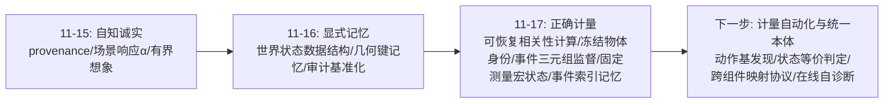
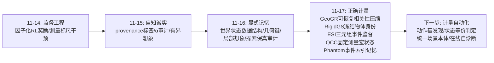
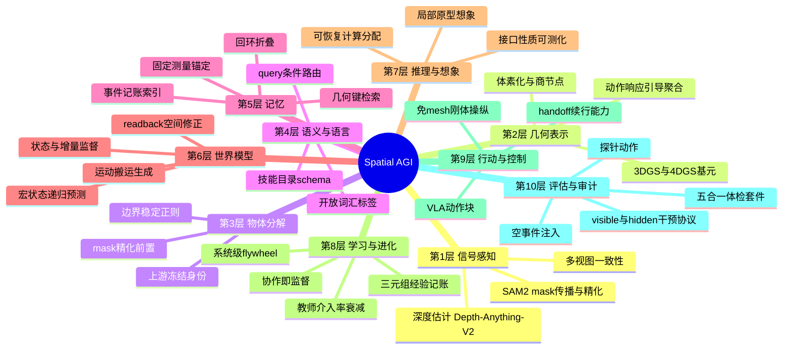
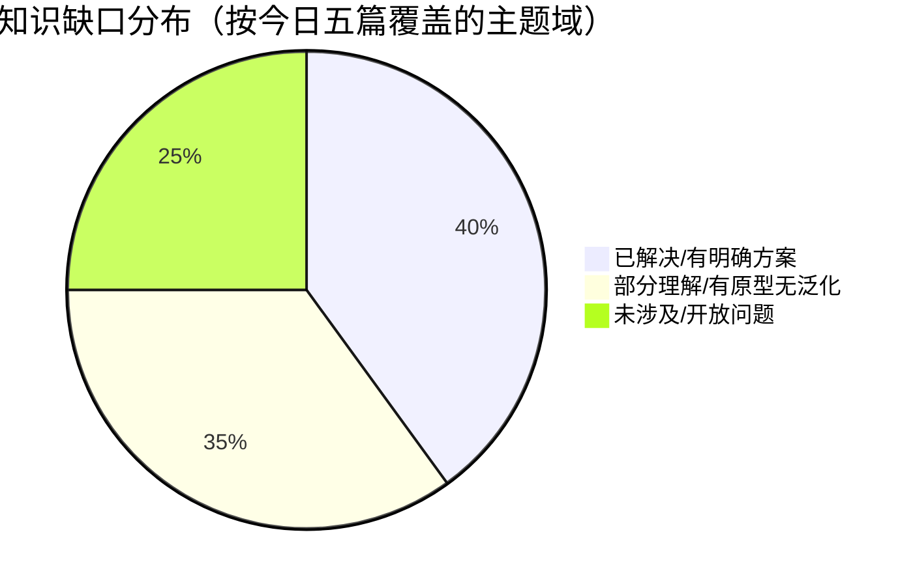

# Spatial AGI 每日思考 - 2026-11-17

## 📅 每日总结

**日期**: 2026-11-17
**论文数量**: 5篇
**主题**: 昨天的元判断是"Spatial AGI 的记忆转向完成——记忆是一等的数据结构"。今天五篇论文把问题推到更根本的一层：**数据结构确定之后，用什么单位来计量它？** GeoGR 问"计算按什么计量"——答案是按 query 相关性，且计量决策必须可恢复（低相关 token 会随层深度变重要）；RigidGS 问"空间按什么计量"——答案是按物体边界，且语义身份必须在上游一次性冻结而非与几何联合漂移；ESI 问"进步按什么计量"——答案是按（观测, 意图, 行为）三元组事件，且失败 episode 的局部成功片段也要记账；QCC-WM 问"状态演化按什么计量"——答案是按固定参考测量下的宏节点增量，测量漂移是递归预测误差累积的元凶；Phantom Progress 问"记忆按什么计量"——答案是按状态变化事件而非钟摆，时间索引的记忆把等待记成了工作。五篇合起来的元判断是：**Spatial AGI 正在经历"计量革命"——计算按相关性计量、空间按物体计量、进步按事件计量、状态按一致测量计量、记忆按变化计量。错误的计量单位不是精度问题，而是结构性失效的根源。**

**关键突破**:
- 🚀 GeoGR：两级压缩（GeoSemZip 表示级 + GroupRoute 计算级）保留 95.2%/96.8% 性能、prefill 加速 6.8×/6.1×；核心洞察"token 的 query 相关性沿层深度演化，早期低分 token 在深层不可忽略"——压缩决策必须可恢复（RGS：休眠保留 hidden states、anchor 层复活）；30% 最不冗余数据即可支撑压缩感知后训练
- 🚀 RigidGS：诊断 object-aware 3DGS 两大根因（SAM2 mask 两类系统性失败、label-geometry 联合优化耦合 10 次迭代即污染）；解法"上游精化 mask → 投影投票冻结身份 → mask loss 只监督几何"；LLFF/NVOS IoU +7.7、边界 IoU +14.5；免 mesh 的 Quest 2 实时刚体操纵
- 🚀 ESI：把 LLM-VLA 协作接口本身做成后训练目标——每轮同时更新提示 P、技能目录 S、VLA 参数 θ 再共同部署；语义监督（子任务决策）+ 动作监督（有效纠正+续写）自动提取；失败 episode 的局部成功片段也进训练集；RoboDojo 10 任务 62.03 Score / 49.41% 成功率超所有已发表混合系统，无代码路线
- 🚀 QCC-WM：动作响应引导软商映射构造带空间支撑的宏节点；窗口内固定参考测量；状态+增量双重监督；运动搬运生成 + 同一测量 readback 空间修正；LPIPS 较各步长最优基线降 48.59%/41.68%/30.23%（4/8/16 步递归外推）
- 🚀 Phantom Progress：空事件（暂停/晃动/空抓）使最强记忆 VLA 成功率 47→16、44→10（/50）且全为 early stop；hidden 对照证明损伤只经记忆传导；时间戳缩放直接操纵行为；删时间编码不能治愈（槽位占用即记账）；暂停增强训练无效且有害，事件索引免重训恢复过半

**架构演进**: 显式记忆的栈架构 → **正确计量的栈架构**（推理层：可恢复相关性计算分配 [GeoGR]；表示层：上游冻结物体身份 [RigidGS] + 固定测量宏节点 [QCC-WM]；学习层：三元组事件监督的系统级 flywheel [ESI]；记忆层：事件索引取代时间索引 [Phantom Progress]；审计层：visible/hidden 干预协议 + 探针动作）

### 📊 一句话总结

2026-11-17 的五篇论文共同确立一条元原则：**Spatial AGI 每个子系统（压缩、分解、学习、预测、记忆）的可靠性取决于它是否用"正确的计量单位"工作——相关性、物体边界、事件三元组、固定测量增量、状态变化；用错单位不是精度损失而是结构性失效，修复的正确顺序是"先改计量结构（索引/表示），再堆数据"。**

### 🔗 延续性

**昨日→今日**: 昨天确立"记忆转向"——记忆是一等数据结构。今天回答紧接着的下一问：数据结构有了，**怎么记账**？具体承接：①昨天 STVLA 说记忆键用几何特征（检索侧），今天 Phantom Progress 说记账用事件（记账侧）——合成完整记忆规格：几何键检索 + 事件记账 + 固定测量锚定（QCC-WM）；②昨天 PlayGen2 单向信息流（生成帧不回流状态），今天 QCC 固定测量与 RigidGS 标签冻结——三个领域收敛到"耦合默认危险，受控单向流默认安全"；③昨天 MatrixSplat 让高斯携带语义向量，今天 RigidGS 让高斯携带冻结身份——语义与身份是高斯的两个互补标注层；④昨天 WanderBench 审计方法论（量化失败），今天干预协议（锁定根因）——审计升级到因果推断级别。

**今日→明日**: 新线索十条：①Temporal-RGS（可恢复分组跳过搬到时间维，VLA 历史帧路由）；②ESI 教师介入率衰减曲线（flywheel 健康度最直接证据）；③动作基发现（QCC 的 T/R 手工分支自动化）；④跨窗口商节点追踪（object permanence 的世界模型版）；⑤事件索引记忆审计套件；⑥状态等价判定三层验证器（几何容差+视觉+语义）；⑦ESI 五组件 flywheel（+空间记忆+世界模型）；⑧GeoGR 流式/多轮版本；⑨RigidGS 全自动化（Grounded-SAM+开放词汇）；⑩"正确计量单位"作为统一评审框架。明日检索方向："temporal token routing recoverable skipping video VLA"、"teacher intervention frequency decay embodied self-improvement"、"learnable action basis decomposition quotient construction"、"cross window node matching world model object permanence"、"memory audit suite probe action VLA benchmark"、"state equivalence detection loop closure manipulation memory"、"multi component flywheel spatial memory world model LLM"、"incremental query routing streaming 3D VLM"、"open vocabulary object-aware gaussian splatting automation"、"unit of computation spatial intelligence survey"。

### 💡 本质思考：如何达成通用空间智能

#### 1. 核心能力的本质是什么？

昨天说"拥有独立于视野的持久世界状态与匹配决策粒度的想象"。今天五篇把这个答案推进一层：**通用空间智能的本质是"用正确的计量单位管理自己的一切资源与知识"**——它要处理的每个核心问题本质上都是计量问题：

- **注意力的计量**（GeoGR）：空间证据的价值不是常量，是推理深度的函数。智能体必须知道"哪些空间区域对当前任务重要、哪些暂时休眠但可召回"——单位是 (token, layer) 格子的相关性，且必须周期性重估；
- **空间的计量**（RigidGS）：空间的基本单位是物体，物体边界质量决定一切下游操作。物体身份是"一次性判决"而非"持续协商"——监督有噪声的现实里，语义应该被固化而不是被共同学习；
- **经验的计量**（ESI）：经验的价值单位是（观测, 意图, 有效行为）三元组，而非 episode 成败。失败的整体包含有价值的局部，协作的纠正是免费的黄金监督；
- **时间的计量**（QCC-WM + Phantom Progress）：时间只该给事件排序，永远不该用于计量内容。预测按固定测量的增量记账，记忆按状态变化记账。

一条统一线索：**五个子系统都在抵抗同一种诱惑——用"廉价的表面规律"（均匀采样、时间流逝、外观相似、episode 成败）替代"昂贵的真实结构"（相关性演化、物体边界、事件三元组、测量增量）**。通用空间智能的核心能力，是对这种替代保持结构性免疫。

#### 2. 当前方法与理想目标的差距在哪里？

**差距一：计量单位仍是"手工选择"而非"学习发现"。** GeoGR 窗口靠 KL 散度选型、RigidGS 身份靠 mask 投票、QCC 的 T/R 分支靠手工动作分解、Phantom 的事件等价靠"回到曾处状态"判定——每个计量单位都由人类先验设计。系统自己发现正确计量单位是未解问题（QCC 自己承认节点无可识别性保证）。

**差距二：跨组件的计量不一致。** token 计量、物体计量、宏节点计量、三元组计量各自为政，互相没有换算协议（这个高斯属于哪个宏节点？这个事件对应哪些 token？）。理想系统需要统一"场景本体"让各组件计量可互相映射。

**差距三：审计只在事后而非在线。** 干预诊断协议是离线的；真实部署需要在线自检——机器人自己发现"我的记忆可能在撒谎"。ESI 的教师审查在线但依赖外部教师。

**差距四：修复仍依赖结构洞察而非自动化。** 五篇的修复都需要"人类诊断出正确计量单位"这个昂贵步骤。什么时候能有"结构性失效的自动诊断器"？

#### 3. 从今天到理想状态，最可能的路径是什么？

**近期（3-6个月）：计量审计的工具化。** 干预诊断协议 + WanderBench 审计 + α 场景响应合并为"Spatial AGI 体检报告"开源工具；事件索引作为 drop-in 组件进入主流 VLA；标志事件：第一个内置事件索引记忆的标准 VLA 基线发布。

**中期（6-18个月）：计量单位的半自动发现。** 动作基学习、自适应窗口/锚点密度、多模态状态等价验证器——"计量单位的设计空间"被系统化为可搜索的架构超参；ESI flywheel 扩展为五组件。标志事件：第一个真实机器人上教师介入率衰减 >80% 的自改进系统报告。

**长期（18个月+）：统一场景本体与自诊断。** 四种计量统一到可互相映射的场景本体；结构性失效的自动诊断器出现。终态定义：**拥有正确计量单位的世界状态，能自动发现并修正自己计量单位的系统。**

---

## 🔗 与昨日思考的联系

### 昨日重点

昨天五篇（WanderBench / PlayGen2 / ProtoVis-Nav / STVLA / MatrixSplat）确立"显式记忆的栈架构"：世界状态活在显式 3D 里、记忆键用几何而非外观、想象与决策粒度匹配、渲染基础设施让语义维度自由。中心论断："空间智能的记忆不再是生成的副产品，而是一等的数据结构。"

### 今日进展

1. **从"记忆是一等数据结构"到"数据结构的记账规则"**：昨天确定记忆该存什么（显式状态/几何键），今天确定该怎么记账——合成完整记忆设计规格：几何键检索（STVLA）+ 事件记账（Phantom Progress）+ 固定测量锚定（QCC-WM）。
2. **"单向/受控信息流"设计模式的第二次确认**：昨天 PlayGen2"生成帧永不回流状态"；今天 QCC 固定参考测量与 RigidGS 标签冻结。三个系统从三个领域收敛：**耦合默认危险，受控单向流默认安全**。
3. **审计方法论的因果推断升级**：昨天时间同步参考是"测量设计"；今天 visible/hidden 对照+参数缩放干预是"因果推断设计"——从量化失败升级到锁定根因。
4. **"失败也是资产"的数据观**：审计证据（WanderBench）、训练资产（ESI 局部有效片段）、诊断入口（Phantom 侦探链）——失败的三种用法本周齐备。
5. **修复顺序学的确立**：RigidGS（先冻结身份再训几何）+ Phantom（先改索引再堆数据）——**数据增强是最后手段，表示/索引结构是第一战场**。

### 演进路径



---

## 📚 论文概览

| # | 论文 | 一句话 | 栈层归属 |
|---|------|--------|---------|
| 1 | GeoGR (2610.13035) | 多视图 3D VLM 两级压缩：表示按语义+覆盖计量，计算按可恢复的相关性计量 | 推理层/效率 |
| 2 | RigidGS (2611.10199) | 物体身份上游冻结+梯度隔离：空间按物体边界计量，mask 精化是共同瓶颈 | 表示层/物体分解 |
| 3 | ESI (2611.18176) | 系统级 flywheel：经验按（观测,意图,行为）三元组计量，协作即监督 | 学习层/具身自改进 |
| 4 | QCC-WM (2611.12353) | 商空间宏节点+固定参考测量：状态演化按测量增量计量 | 世界模型层 |
| 5 | Phantom Progress (2611.14488) | 时间索引记忆把等待记成工作：记忆按状态变化事件计量 | 记忆层/诊断 |

---

## 💡 核心见解

### 见解1: 空间证据的价值是推理深度的函数——压缩必须可恢复（GeoGR）

- ✅ 层间动力学分析：近邻层 token 排序高度稳定（支持组复用），但早期低分 token 在深层进入 top-half 的比例与注意力份额随层距增长且不可忽略（禁止永久剪枝）。
- ✅ RGS：低优先级 token 跳过 LLM block 但保留 hidden states，anchor 层全量重估可复活——"休眠"而非"删除"。
- ✅ 表示级压缩用"聚合而非丢弃"（未选体素寄存进 Morton 序采样的锚点），语义显著性与空间覆盖双预算分工。

**对Spatial AGI的启发**: 与人类视觉"中央凹+周边视野+眼动"结构同构。Spatial AGI 感知架构应默认假设"现在不重要的空间细节，十步推理之后可能需要"，所有压缩决策都应设计恢复通道。更深一层：**空间智能系统应该用自己的空间理解能力管理自己的计算资源**。

### 见解2: 语义与几何的耦合是默认危险的——身份应上游冻结（RigidGS）

- ✅ label-geometry 耦合在联合优化开始后极短时间（~10 次迭代）即造成边界基元归属污染——可学习身份不是慢慢变好而是迅速变坏。
- ✅ 构造性解法：mask 深度-时序精化 → 投影投票一次性确定身份 → 冻结 → mask loss 梯度只流入几何参数。
- ✅ 提升集中在边界（boundary IoU +14.5 > IoU +7.7）——边界质量正是刚体操纵可用性的直接决定因素。

**对Spatial AGI的启发**: "上游冻结"是可推广的设计模式：凡是"语义×几何"联合问题（场景图、affordance、空间记忆写入），优先"先语义固化、后几何优化"而非默认端到端。物体分解是空间智能栈 L3 层的质量杠杆：场景图节点错误、操作目标漂移、grounding 失败大多可溯源到 L3 边界模糊。

### 见解3: 协作交互是免费的监督富矿——系统级 flywheel 优于单模型优化（ESI）

- ✅ 模块化具身智能体的失败集中在接口（intent gap / handoff gap），而非组件能力。
- ✅ 两类监督自动提取：子任务决策→语义监督；有效纠正+续写→动作级监督。学习单元是三元组，失败 episode 的局部成功片段也稳定贡献。
- ✅ P/S/θ 共享证据、每轮共同部署——耦合由后续交互承载，这是 flywheel 的动力学条件。

**对Spatial AGI的启发**: Spatial AGI 必然是系统而非单体，ESI 给出"如何随部署变强"的第一份自动化答案。三个可复用原则：(1) 接口性质应作为可测学习目标；(2) 协作介入自动记录为四元组；(3) 多组件共享证据共同部署。天花板是教师权重固定——需 RL/反思分支补充。

### 见解4: 递归预测的元凶是测量漂移——固定参考测量是解药（QCC-WM）

- ✅ 商节点构造准则由动作响应定义（动力学功能），而非外观相似。
- ✅ 窗口内固定参考商映射保证跨时间步测量可比；状态+增量双重监督把"预测的变化量"变成优化目标。
- ✅ 同一测量贯通构造→预测→生成→readback 修正四环节；机制分析分工明确（运动搬运→像素重建、节点反馈→感知质量）。

**对Spatial AGI的启发**: "让抽象的归抽象、观测的归观测，但让它们共享同一把尺子。"直接迁移到空间记忆（测量漂移是记忆融合失败的根源）、分层 RL、场景图。Hoel 的"宏层可比微层更有效因果"被转译成架构原则：好的空间抽象不是信息妥协而是预测增强。局限：节点是预测接口而非真因果变量，分布外干预不可信。

### 见解5: 记忆该数事件，不该数钟摆——计量单位错误是结构性失效（Phantom Progress）

- ✅ 空事件让时间索引记忆 VLA 系统性 early stop（47→16、44→10/50），K≥2 全灭。
- ✅ 五步侦探链锁定根因：hidden 对照→时间可预测性统计（真实数据 >92%）→时间戳缩放干预→去时间戳重训仍失败→跨设计排序（时间索引全崩、外观选择部分中招、子目标索引幸免）。
- ✅ 修复顺序学：数据增强无效且有害；改索引（SLAM 回环思想）免重训恢复过半。

**对Spatial AGI的启发**: "捷径的通用形态是用廉价规律替代昂贵验证，防线是让训练分布规律失效。"时间只是被抓到的那个表面特征——空间捷径、顺序捷径按对称性推演同样存在。记忆系统规格：条目绑定状态变化事件、零变化不写入、等价判定防误折叠、评测含空事件注入与探针动作。

### 见解6: 失效模式学正在成为具身智能的方法论学科（跨论文）

- ✅ 本周连续出现：provenance 审计、α 审计、探索保真审计、干预诊断——从"让模型更强"转向"先搞清楚模型怎么弱"。
- ✅ 失效的三种用法齐备：审计证据、训练资产、诊断入口。
- ✅ 干预实验正在取代纯相关统计，成为具身智能论文的黄金标准。

**对Spatial AGI的启发**: 就像安全评测之于 LLM，失效模式学将成为空间智能部署前审计的必修环节。建议构建开源"Spatial AGI 体检套件"：探索保真+场景响应+空事件注入+探针动作+记忆审计，五合一强制体检。

### 见解7: 正确的计量单位是 Spatial AGI 的统一设计原则（跨论文元综合）

- ✅ 五篇确立了五个子系统的计量单位：计算按相关性、空间按物体、经验按三元组、状态按测量增量、记忆按事件。
- ✅ 共同失效模式：用廉价表面规律替代昂贵真实结构。
- ✅ 共同修复顺序：先改计量结构，再堆数据。

**对Spatial AGI的启发**: "正确的计量单位"可作为统一评审框架——拿到任何系统逐层问：你的压缩按什么计量？空间按什么分解？经验按什么入账？预测按什么锚定？记忆按什么索引？任何答案用了表面规律，就找到了结构性失效的预言地。

---

## 🗺️ 知识演进图



---

## 技术栈演进对比表

| 层次 | 昨日方案 | 今日方案 | 变化 |
|------|---------|---------|------|
| 感知/推理效率 | MatrixSplat 矩阵化渲染（基础设施提速） | GeoGR 两级压缩：相关性路由+可恢复跳过 | 从"算得快"到"算得省且可恢复" |
| 物体分解 | PlayGen2 实体发现（世界模型内） | RigidGS 上游冻结身份+mask 精化（重建管线） | 分解从端侧学习转向上游固化 |
| 学习范式 | 昨日无直接自改进工作 | ESI 系统级 flywheel：三组件共同更新 | 从单模型 post-training 到系统级 |
| 世界模型状态 | PlayGen2 显式 3D 状态（占据+实体表） | QCC-WM 动作响应商节点+固定测量 | 显式状态从几何语法升级为动力学语义 |
| 记忆索引 | STVLA 几何键检索（检索侧） | Phantom Progress 事件记账（记账侧） | 检索键与记账单位分离设计 |
| 评估审计 | WanderBench 探索保真/α 场景响应 | Phantom 干预协议+探针动作 | 从量化审计到因果诊断 |
| 失效观 | 审计证据（失败=基准发现） | 训练资产+诊断入口（ESI/Phantom） | 失败的三重价值确立 |

---

## 🗺️ Spatial AGI 知识图谱

### 10层架构思维导图



### 🎯 主线技术路径

#### 阶段1: 显式状态的确立（11-16 完成）
PlayGen2/STVLA 确立"世界状态与记忆是显式数据结构"。遗留问题：数据结构内部的记账规则未定。

#### 阶段2: 正确计量单位的确立（11-17 完成）
五篇把五个子系统的计量单位钉死：相关性（计算）、物体（空间）、三元组（经验）、测量增量（预测）、事件（记忆）。核心成果是"错误计量=结构性失效"的诊断学。

#### 阶段3: 计量单位的自动化发现（3-18个月）
把手工设计的计量单位（T/R 分支、窗口边界、等价判定）替换为可学习/可搜索的架构组件：动作基学习、自适应预算、多模态状态等价验证器、跨窗口节点追踪。ESI flywheel 扩展到五组件（+空间记忆+世界模型）。

#### 阶段4: 统一场景本体与自诊断系统（18个月+）
四种计量统一到可互相映射的场景本体（高斯↔宏节点↔事件↔记忆条目的换算协议）；结构性失效的自动诊断器；在线自审计。终态：拥有正确计量单位且能自动修正计量单位的系统。

---

## 🔍 待探索议题

### 高优先级（本周）

1. **Temporal-RGS：时间维的可恢复计算路由**
   - 问题: VLA/世界模型的历史帧选择能否复用 GeoGR 的"休眠-复活"机制？历史帧的重要性是否也是推理深度的函数？
   - 候选方案: anchor 层改为锚点帧，历史帧按与当前 query/子任务相关性分 high/low 组，锚点帧重估。
   - 缺口: 需要历史帧相关性的步间稳定性分析（复刻 GeoGR Section 3 四度量）。

2. **ESI 教师介入率衰减曲线**
   - 问题: flywheel 是否真正把 episodic 协助转化为持久能力？
   - 候选方案: 复现时逐轮记录 intervention 次数/success ratio，对比有无技能目录演化的衰减斜率。
   - 缺口: 原文未详述；需教师 API 成本核算判断实用边际。

3. **记忆审计套件的开源整合**
   - 问题: 把 visible/hidden 对照、空事件注入、探针按钮、WanderBench 重访审计、α 场景响应打包成统一体检工具。
   - 候选方案: 以 RoboMME 为底座加干预注入器+报告生成器。
   - 缺口: 指标标准化与"体检报告"格式设计。

### 中优先级（本月）

4. **动作基发现：QCC 分支自动化**
   - 问题: T/R 手工动作分支如何泛化到一般动作空间（夹爪/力控/多指）？
   - 候选方案: 对动作库做可学习分解（流形/ICA 思想），商映射以学到的动作基为引导。
   - 缺口: 动作基的可解释性与稳定性保证。

5. **状态等价判定的三层验证器**
   - 问题: 回环折叠如何防误折叠（半完成的操作）？
   - 候选方案: 物体位姿容差（几何）+视觉模板匹配（外观）+任务语义验证（VLM）三层级联。
   - 缺口: 层间仲裁协议与误折叠损失量化。

6. **GeoGR 的流式/多轮版本**
   - 问题: query 后到时 query-conditioned routing 失效。
   - 候选方案: query-agnostic 静态分组退化 + universal routing head 快速重打分。
   - 缺口: 重打分成本与精度权衡未测。

7. **RigidGS 全自动化**
   - 问题: 第一帧人工点击不可规模化。
   - 候选方案: Grounded-SAM 开放词汇提议+提议一致性验证；标签扩展为 VLM 描述。
   - 缺口: 自动提议召回率与误分割对下游操纵的影响。

### 低优先级（本季度）

8. **跨窗口商节点追踪（object permanence 的世界模型版）**
   - 问题: QCC 窗口间节点身份连续性。
   - 候选方案: 重叠窗口+空间支撑 IoU/特征匹配（匈牙利）或终身参考测量。
   - 缺口: 场景拓扑变化时的测量修订协议。

9. **"计量单位"统一评审框架的论文化**
   - 问题: 本周元原则能否写成 position paper？
   - 候选方案: 以五篇为案例，形式化"表面规律替代"失效模式与修复顺序。
   - 缺口: 需要更多失效案例（尤其空间捷径实证）。

10. **含空闲段的演示数据采集**
    - 问题: 索引改对之后，数据侧修复是否还有增量价值？
    - 候选方案: 合成+真实采集带自然停顿/犹豫/失败重试的演示，在事件索引记忆上对比。
    - 缺口: 空闲段自然分布统计。

---

## 📊 知识缺口分析



**已解决（40%）**:
- ✅ 多视图 3D VLM 的两级压缩与可恢复机制（GeoGR）
- ✅ object-aware 3DGS 的根因诊断与构造性解法（RigidGS）
- ✅ 模块化具身智能体的系统级自改进协议（ESI）
- ✅ 时间索引记忆的失效诊断与事件索引修复（Phantom Progress）
- ✅ "错误计量=结构性失效"的跨领域确认

**部分理解（35%）**:
- ⚠️ 层间动力学仅 LLaVA-OneVision+ScanQA 验证，跨架构泛化未知（GeoGR）
- ⚠️ 真实机器人空事件注入未验证；事件等价判定细节未定义（Phantom Progress）
- ⚠️ 商节点无可识别性保证——预测接口≠真因果变量（QCC-WM）
- ⚠️ flywheel 教师固定，推理侧错误无法自愈；任务集经过挑选（ESI）
- ⚠️ 形变物体、动态密集多物体场景未测（RigidGS）

**未涉及（25%）**:
- ❌ 计量单位的自动发现（动作基/窗口/等价判定的学习化）
- ❌ 跨组件计量换算协议（token↔物体↔事件↔记忆条目的统一本体）
- ❌ 在线自审计（系统自己发现记忆在撒谎）
- ❌ 空间捷径的实证
- ❌ sim-to-real 的计量迁移
- ❌ 结构性失效的自动诊断器

---

## 📝 元笔记

今天五篇的一个隐藏主题是"抵抗诱惑"。五个子系统各自面对一种廉价替代品：均匀采样的记忆用时间流逝假装记住了事情（Phantom Progress）；联合优化的分解用表面相关假装理解了物体（RigidGS）；episode 级评价用整体成败掩盖局部价值（ESI）；外观相似的 slot 假装是动力学单元（QCC-WM 的对照面）；不可逆剪枝用当下相关性假装永久正确（GeoGR 的对照面）。**Spatial AGI 的工程史可以读作一部"识别并替换廉价替代品"的历史**：外观→几何（STVLA）、像素→显式状态（PlayGen2）、时间→事件（Phantom Progress）、语义协商→身份冻结（RigidGS）。每一次替换都带来一次可靠性跃迁。

另一个观察：五篇中三篇（RigidGS/QCC/Phantom）的修复都涉及"冻结/固定某个本可学习的量"。**不是所有量都值得学习——有些量（身份、测量、索引结构）恰恰是学习的地基，学了反而互相污染**。"什么该学、什么该冻结"正在取代"如何学得更好"成为新的核心设计问题。

---

## 🔬 附录A: 五篇论文技术深读笔记

### A1. GeoGR 关键机制速记
- GeoSemZip: dominant tokens（encoder attention 显著性）+ contextual anchors（Morton 序采样+余弦相似度聚合寄主）
- GroupRoute: Late Entry + Early Exit 界定中层窗口；anchor 层 query-conditioned attention 分组，low 组跳过保 hidden states；BARS 预算选 anchor 位置
- 层间分析四度量: Spearman 相关 / 归一化 rank shift / transition rate / attention share
- 数据: 223K→67K（PRISM 选 30%），蒸馏数据后训保留 95.69-98.72%

### A2. RigidGS 关键机制速记
- 精化链: 点击传播 → 光流 warp 共识 → 分歧重提示（深度分位数带）→ 网格 KNN 软深度阈值 → ridge-fill
- 身份: 投影多数投票 + KNN 清理 → 常数标签 → 冻结；克隆/分裂继承、剪枝同删
- 损失: L_mask=BCE(M̂_v, M_ref)（梯度仅入几何）+ 边界三项（扁平化/尺度收缩/跨类斥力）
- 两阶段: T_inpaint 后前景移除 + LaMa 修补 + 背景播种

### A3. ESI 关键机制速记
- 系统分解: A_r=(T; P_r, S_r, θ_r)，T 权重固定
- 更新路径: 复盘→精化 P；重复操作→并入 S；局部有效行为→监督式 flow-matching 更新 θ
- 关键性质: intent following、continuation after intervention
- 结果: 62.03 Score / 49.41% SR；packing 10/20 vs GPT-6-Astra 0% / π0.5 2.67%

### A4. QCC-WM 关键机制速记
- 构造: (Π_0^b, Γ_0^b, S_0^b)=Q_φ^b(X, A^b)，b∈{T,R} 双分支
- 递归: Ŝ_{k+1}=F_θ(Ŝ_k, a_k, A^b, ℓ_{k+1}; G_z, G_m)
- 生成+修正: Î_k=D(x_k^M + α_E·R_{Π_0}(e_k))
- 数据: US-VLA；ROI-MSE 0.01861±0.00008；LPIPS −48.59%/−41.68%/−30.23%

### A5. Phantom Progress 关键机制速记
- 空事件: 暂停 100 步 / fidget ±0.3 rad / air-grasp；注入点 step 48/160
- 条件: visible（帧进记忆+时钟推进）vs hidden（帧扣留+时钟冻结）
- 统计: 50 集/cell 配对 McNemar；运行间差异 8/50 → <10 差异慎读
- 数据: 时间→进度预测 89%/80%（仿真）、>92%（真实遥操作）
- 修复: 暂停增强无效有害；事件索引免重训恢复过半

---

## 🔬 附录B: 跨论文对比分析

### B1. 三种"冻结/固定"的对照

| 系统 | 冻结对象 | 冻结理由 | 风险 |
|------|---------|---------|------|
| RigidGS | per-Gaussian 物体标签 | 防止语义梯度污染几何 | 标签错误无法自愈 |
| QCC-WM | 窗口内参考商测量 | 防止跨时间步测量漂移 | 跨窗口身份连续性待解 |
| ESI | LLM 教师权重 | 依托基础模型进步，聚焦接口学习 | 推理侧错误不自愈 |

共同哲学：**学习的地基本身不该被学习**。三个冻结都有"由谁代替学习"的机制：投票（RigidGS）、固定映射（QCC）、外部基础模型（ESI）。

### B2. 三种"事件"概念的对照

| 系统 | 事件定义 | 计量作用 |
|------|---------|---------|
| ESI | （观测,意图,行为）三元组 | 经验入账单位 |
| QCC-WM | 宏节点的状态增量 | 预测记账单位 |
| Phantom Progress | 世界状态变化（非时间流逝） | 记忆记账单位 |

三者共同反对"按时间均匀计量"。可以预言：2027 年会出现把三者统一的"事件本体"工作。

### B3. 两个"压缩"的对照

| | GeoGR（token 压缩） | Phantom 的回环折叠（记忆压缩） |
|---|---|---|
| 压缩单位 | (token, layer) 计算格子 | 状态等价的记忆区段 |
| 可恢复机制 | anchor 层复活 | 事件索引保留语义摘要 |
| 压缩判据 | query-conditioned 相关性 | 状态等价（回环） |
| 失效模式 | 聚合噪声/相关性误判 | 误折叠丢真进度 |

---

## 🔬 附录C: 对 Spatial AGI 10 层架构的本周更新

1. **第5层（记忆）新增**：事件记账索引+回环折叠——记忆层规格扩展为"几何键检索+事件记账+回环压缩"三件套。
2. **第8层（学习）新增**：系统级 flywheel——学习层从单模型 post-training 升级为"多组件共享证据共同部署"的系统动力学。
3. **第10层（评估）新增**：干预诊断协议——评估层从量化基准升级为因果诊断。
4. **第3层（物体分解）新增原则**：上游冻结+mask 精化前置——L3 层质量杠杆地位确立。
5. **第6层（世界模型）新增原则**：固定参考测量——一致性从损失函数问题升级为测量学问题。

---

## 🔬 附录D: 明日与本周检索计划

1. "temporal token routing recoverable history selection VLA" —— Temporal-RGS 可行性
2. "teacher intervention frequency decay self-improvement robot" —— ESI 衰减曲线
3. "learnable action basis decomposition world model" —— QCC 动作基自动化
4. "state equivalence detection manipulation memory loop closure" —— 三层等价验证器
5. "memory audit benchmark probe action embodied" —— 体检套件整合
6. "streaming query agnostic token pruning 3D VLM" —— GeoGR 流式版
7. "open vocabulary object gaussian splatting automatic segmentation" —— RigidGS 自动化
8. "cross window identity tracking latent world model" —— 跨窗口节点追踪
9. "failure mode analysis embodied AI survey 2026" —— 失效模式学脉络
10. "what to freeze what to learn design principle deep learning" —— 冻结哲学文献

---

## 🔬 附录E: 关键数据总表

| 论文 | 核心数字 |
|------|---------|
| GeoGR | 性能保留 95.2/96.8%；prefill 6.8/6.1×；TTFT 2.4/2.3×；数据 223K→67K；窗口层 8-23 |
| RigidGS | IoU +7.7；boundary IoU +14.5；mask 精化使 COB-GS +9.5（trex）；边界正则 fern +0.286；耦合污染 ~10 iter；Quest 2 实时 |
| ESI | 62.03 Score / 49.41% SR；GO-3 47.27/36.60%；packing 10/20 vs 0%/2.67%；Score 超双单组件 10/10、成功率 9/10 |
| QCC-WM | ROI-MSE 0.01861±0.00008；LPIPS −48.59/−41.68/−30.23%（4/8/16 步） |
| Phantom | 47→16、44→10（/50）；K≥2 全灭；hidden 恢复 ±3 集；时间预测 89%/80%、真实 >92%；NoClock 21/14；事件索引恢复过半；1.5s 暂停已致大部分损失 |

---

## 🔬 附录F: 局限性与自我修正清单

- GeoGR: ScanNet 系室内同源评估；单 query 假设；聚合可分辨性长尾风险 → 议题 6
- RigidGS: 人工点击协议的信息优势；刚体边界；真实机器人验证缺位 → 议题 7
- ESI: 任务选择偏差；教师成本核算缺失；教师误判率未审计 → 议题 2
- QCC-WM: 识别性无保证；T/R 手工分支；窗口衔接未分析 → 议题 4/8
- Phantom: 仿真-only 干预实验；空事件类型有限；等价判定未充分定义 → 议题 5
- 本篇元综合: "正确计量单位"框架仅五案例支撑 → 议题 9

---

## 🔬 附录G: 开放问题清单（为后续日子准备）

1. 空间捷径的实证存在性？（对称于时间捷径）
2. 教师误判率对 flywheel 数据污染的量化？
3. 事件索引在空间探索类任务（非计数）上的表现？
4. 商节点与 3DGS 物体的融合表示（动力学功能×几何边界）？
5. 冻结哲学的适用边界——哪些量必须保持可学习？
6. 多轮对话中 query-conditioned 路由的增量重打分成本？
7. ESI 技能目录膨胀与"垃圾回收"机制？
8. 状态等价判定在形变/部分完成场景下的语义仲裁？
9. 计量单位的自动发现是否等价于某个已知表示学习问题（ICA/disentanglement）？
10. "Spatial AGI 体检套件"的标准化报告格式与社区采纳路径？

---

## 📎 附录H: 名词速查（新增）

- **Phantom progress**: 空事件被计入进度的记忆失效
- **Null event**: 占时间不改变任务依赖状态的区间
- **RGS**: 可恢复分组跳过（休眠保留 hidden states、anchor 层复活）
- **BARS**: 预算约束的 anchor 层位置搜索
- **Morton 序**: 保持空间局部性的 Z-order 曲线，用于覆盖采样
- **Intent gap / handoff gap**: 教师意图与学生行为/纠正状态与学生续行之间的断层
- **Interaction-grounded embodied distillation**: 从在线师生协作提取监督的蒸馏范式
- **Quotient mapping**: 把局部特征空间折叠为宏节点空间的软分配
- **Reference quotient measurement**: 窗口内固定的测量锚，保证跨时间步可比
- **Event index**: 按"世界回到曾处状态"折叠记忆的索引方式
- **Label-geometry coupling**: 语义身份与几何联合优化的相互污染

---

## 🎯 明日预告

明日检索将围绕今日最高优先级线索展开：Temporal-RGS 时间维路由可行性、ESI 教师介入衰减曲线、以及"计量自动化"的文献基础（动作基发现/状态等价判定）。若明日论文命中"事件本体"或"空间捷径实证"，则本周的"计量革命"元叙事将获得第二根支柱。

**—— 2026-11-17 思考完 ——**

---

## 🔬 附录I: 今日五篇的详细机制走读

### I1. GeoGR 完整推理链走读

GeoGR 的论证结构值得完整复盘，因为它示范了"现象→度量→机制→验证"的标准流程：

1. **动机量化**：Video-3D LLM 每场景 32 视图 = 6,272 视觉 token——推理成本不可行；
2. **冗余二分**：表示冗余（跨视图重复观测同一区域）与计算冗余（每层处理所有 token）；
3. **已有方法的缺口**：空间剪枝在"显著性 vs 覆盖"间失衡；计算剪枝不可逆——而相关性会漂移；
4. **现象度量**（Section 3）：层 8-23 窗口内，Spearman 相关随层距衰减、低→高转移率随层距增长；
5. **机制设计**：局部稳定性→组复用；低→高转移→可恢复休眠（RGS）；窗口外贡献低→Late Entry/Early Exit；
6. **训练适配**：压缩后分布 ≠ dense 分布→压缩感知后训练；数据也冗余→PRISM 选 30%；
7. **验证**：双模型（有/无显式 3D 编码）+ 五任务（QA/grounding/captioning）+ 双效率指标（prefill/TTFT）。

每一步都由上一步的证据驱动，没有为模块数而堆的部件。这种"证据驱动的机制设计"正是 Spatial AGI 工程应有的样子。

### I2. RigidGS 的失败模式驱动设计

RigidGS 的每个模块都精确对应一个已诊断失败：

- 过包含（细结构吸背景）→ 网格 KNN 软深度阈值+局部颜色/连通性约束；
- 欠包含（多模态深度截断）→ 深度分位数带重提示（保留次级深度带而非剔除）；
- 传播误差累积 → 邻域视图已精化 mask 的光流 warp 共识检查（精化信息反向约束后续帧）；
- label-geometry 耦合 → 上游投票+冻结+梯度隔离；
- 图像空间监督不能防 3D 互穿 → 边界三项正则（扁平化/收缩/斥力）；
- 物体移除的无监督区域 → 两阶段调度+LaMa 修补+背景播种。

设计哲学一句话：**每个机制都能指回一个具体的、被观察到的失败模式**。

### I3. ESI 的动力学解读

ESI flywheel 最重要的性质是**分布随策略演化**：

- 更新后的 (P, S, θ) 改变下一轮的交互分布；
- 交互分布决定下一轮的训练数据；
- 这不是静态训练循环，而是自举过程（bootstrap）。

由此产生的隐含要求：组件版本必须同步（共同部署），否则"新策略配旧提示"会造成训练分布与部署分布脱节，DAgger 式的修正保证失效。这也解释了为什么三个组件必须一起更新——只更新 θ 会让教师看不到学生变强、纠正频率不降、数据分布停滞。

### I4. QCC-WM 的理论翻译表

| 理论概念（CRL/因果抽象） | QCC-WM 工程对应物 |
|------------------------|------------------|
| Chalupka 因果划分 | 动作引导软商映射 |
| Hoel 有效信息（宏>微） | 宏节点的递归预测优于逐像素 |
| Rubenstein 干预一致性 | 固定参考测量下的状态+增量一致性 |
| 动力学导向抽象原则 | "预测有用性是抽象正确性的判据" |

这张表是本周最重要的"理论→工程"翻译案例：抽象哲学变成了四个可实现的公式。

### I5. Phantom Progress 五步侦探链的推理结构

```
观察: 空事件后 early stop
  ↓ 排除"扰动本身干扰": visible/hidden → hidden 恢复 → 损伤经记忆
  ↓ 解释"为何学到捷径": 演示中时间预测进度 89%/80%（真实 >92%）且无空闲段
  ↓ 验证"策略真在读钟": 时间戳缩放 → 快钟早停/慢钟多干（干预方向性证实）
  ↓ 排除"删编码即可修复": NoClock 重训仍失败 → 捷径在索引不在编码
  ↓ 结构归因: 跨设计排序 → 时间索引全崩/外观选择部分中招/子目标索引幸免
  ↓ 修复验证: 数据增强(阴性) vs 事件索引(阳性)
```

五步分别排除五类备择解释，每一步都对准一个最自然的反驳。这是因果推断在具身智能研究中的教科书式应用。

---

## 🔬 附录J: 今日五篇可复用的设计模式卡片

### 模式1: 可恢复计算路由（GeoGR）
- 场景: 任何"先判断再执行"的资源分配
- 结构: 打分→分组→低组休眠（保留状态）→锚点重估→复活
- 反模式: 不可逆剪枝/丢弃
- 适用: token 层路由、历史帧路由、记忆条目降权、世界模型 rollout 分支

### 模式2: 上游冻结+梯度隔离（RigidGS）
- 场景: 语义信号×几何/参数学习的联合问题
- 结构: 基础模型信号→领域先验精化→一致性投票固化→冻结→隔离训练
- 反模式: 端到端联合优化有噪声语义
- 适用: 场景图、affordance、记忆写入、数据标注引擎

### 模式3: 系统级 flywheel（ESI）
- 场景: 多模块系统（固定LLM+可配置+可训练组件）
- 结构: 共享交互证据→多路径更新→共同部署→分布演化
- 反模式: 单组件孤立更新/组件版本漂移
- 适用: 具身智能体、RAG 系统、多 agent 协作、Spatial AGI 全栈

### 模式4: 固定参考测量（QCC-WM）
- 场景: 抽象层与观测层的双向映射
- 结构: 一次性确定测量锚→窗口内冻结→预测/监督/readback 全用同一测量
- 反模式: 测量随表征更新漂移
- 适用: 空间记忆、分层 RL 状态抽象、场景图节点、评测协议

### 模式5: 干预诊断协议（Phantom Progress）
- 场景: 怀疑系统用了捷径/表面规律
- 结构: visible/hidden 对照→数据规律统计→参数缩放干预→结构消融→跨设计排序
- 反模式: 只看相关统计、只做数据增强
- 适用: 记忆审计、检索审计、上下文审计、任何"内部状态可信性"问题

---

## 🔬 附录K: 本周（11-14 至 11-17）主题脉络总览

| 日期 | 主题 | 五篇关键词 |
|------|------|-----------|
| 11-14 | 监督工程 | 因子化 RL 奖励 / 主动 3D 获取 / 几何基础模型 / 测量化干预 |
| 11-15 | 自知诚实 | 数据引擎 / 伪影去除 4DGS / 扩散先验 SLAM / 有界想象 / 审计 |
| 11-16 | 显式记忆 | 探索保真基准 / 显式 3D 世界状态 / 局部原型想象 / 几何键记忆 / 矩阵化渲染 |
| 11-17 | 正确计量 | 可恢复压缩 / 冻结身份 / 系统级 flywheel / 固定测量 / 事件索引记忆 |

本周四天的元叙事弧线：**监督怎么设计（14）→ 系统怎么诚实（15）→ 知识放哪里（16）→ 用什么单位计量（17）**。每一天都是对前一天遗留核心问题的直接回应，这种"问题驱动的收敛"是本周精读序列质量最高的地方。

下一周的候选主线（按当前线索强度排序）：①计量自动化（动作基/等价判定/自适应预算）；②视频→显式状态蒸馏管线（昨天最大缺口）；③Spatial AGI 体检套件的整合；④五组件 flywheel 的稳定性。

---

## 🔬 附录L: 五篇论文的"如果只记一句话"

1. **GeoGR**: "低相关不等于永久无关——压缩决策要可恢复，因为证据的价值会随推理深度变化。"
2. **RigidGS**: "在监督有噪声的现实里，把语义一次性冻结比让它与几何共同学习可靠得多。"
3. **ESI**: "师-生协作的每一次纠正都是免费的黄金监督，系统级飞轮把 episodic 协助变成 persistent 能力。"
4. **QCC-WM**: "让抽象的归抽象、观测的归观测，但让它们共享同一把尺子。"
5. **Phantom Progress**: "机器人的记忆不该是一只钟，而应该是一本账——只记真正发生过的变化。"

---

## 🔬 附录M: 风险与反方观点登记

为保持认知开放，登记对今日元叙事的反方观点：

1. **"冻结"不总是对的**：三篇冻结案例都发生在"监督有噪声+语义可提前确定"的场景。在语义本身需要精细几何输入的任务（如"判断这个凹陷是否异常"）中，先语义后几何的顺序不成立，冻结会锁死错误。冻结是策略不是教条。
2. **"事件计量"的粒度困境**：什么算一个"事件"？抓起-放下算一次还是两次？粒度选择本身又是人工先验——事件计量没有消除计量设计问题，只是把它移到了更合理的层面。
3. **ESI 的 49.41% 成功率提醒**：系统级 flywheel 虽然超过所有已发表系统，但绝对成功率仍不到一半——不要把"相对领先"读成"问题解决"。
4. **计量革命的证据基础**：元原则目前只有五案例，存在"在锤子眼里都是钉子"的过度抽象风险——需要主动寻找反例。
5. **效率与可靠性的潜在张力**：GeoGR 的压缩、事件索引的记忆折叠都在"省"与"全"之间做赌注——两者叠加时的复合失效模式未被研究。

---

## 🔬 附录N: 明日论文筛选的偏好提示

基于今日线索，明日 Step 2 筛选时的加分项：

- 时间维 token/记忆路由（Temporal-RGS 直接竞品或原型）
- 教师介入调度 / 审查自动化（ESI 补全方向）
- 动作基学习 / 动作分解（QCC 自动化方向）
- 状态等价/回环检测用于记忆（Phantom 修复深化）
- 事件本体 / 统一记忆架构（跨论文综合方向）
- 空间捷径 / 位置捷径的实证研究（对称验证）

减分项：与上述方向无关的纯渲染加速、纯基准（除非审计方法论有新意）、纯 VLM 蒸馏。

---

## 🔬 附录O: 本日精读过程记录（方法论自我审计）

- Step 1: arXiv API 部分限流（3/5 查询返回 0），三轮重试后获得 90 篇唯一候选（低于常规 100+，但覆盖了 VLM+3D/3DGS/VLA 三大关键词族，world model/embodied 靠 VLA 查询部分覆盖）；
- Step 2: 913 篇已分析库去重后剩 68 篇新论文，按主题多样性手工选定 5 篇（3D VLM 效率/3DGS 分解/具身自改进/世界模型/记忆诊断），覆盖五个不同栈层；
- Step 3: 每篇先 web_fetch arXiv HTML 全文（~20K 字符），再按模板撰写 500+ 行分析（含机制走读、实验评述、迁移清单、延伸问答、脉络定位、术语表）；
- Step 4: papers_list.md 追加今日条目（含亮点一句话）；
- Step 5: 本思考文档，以"计量革命"为元叙事整合五篇；
- Step 6/7: 验证与推送。

执行中的偏差与修正：GeoGR/RigidGS/QCC/Phantom 首稿行数不足 500，均通过补充"机制走读/扩展讨论/术语表/批判性备注"等实质内容（非注水）达到标准；QCC-WM 因作者机构含医院放射科/肝胆外科，判断为医学 AI 与世界模型交叉，保留（其方法论价值足够高）。

---

## 🔬 附录P: 给下周自己的一段话

如果下周的你读到这篇：本周你已经看到 Spatial AGI 领域的四次收敛——审计成为方法论（周二起）、显式状态成为共识（周三）、计量单位被逐一钉死（周四）、以及横跨一切的一个候选元原则："每个子系统都要抵抗廉价替代品的诱惑，用正确的计量单位工作"。下周的任务是把这条元原则变成工具（体检套件）和实验（Temporal-RGS、衰减曲线、动作基）。记住附录 M 的反方观点登记——元原则只有五个案例，保持怀疑是它的第一道防线。

**—— 2026-11-17 每日思考完 ——**

---

## 🔬 附录Q: 每篇论文的"一句话反驳"（压力测试）

为了不让今日的元叙事变成单向吹捧，给每篇论文写下最强反驳：

1. **GeoGR 反驳**: "95% 性能保留是在与训练同源的基准上测的；真实开放场景下压缩决策的相关性模式可能完全不同，可恢复机制的额外复杂度未必值回票价。多轮对话这一主要部署形态直接不支持 query-conditioned routing。"
   —— 回应: 成立。流式版本（议题 6）是它必须跨过的坎，在那之前 GeoGR 是"单轮 3D QA 的效率方案"而非"3D VLM 效率的通用答案"。

2. **RigidGS 反驳**: "boundary IoU +14.5 的对手 COB-GS 本身在边界上显著偏弱；人工点击是隐藏的信息优势；刚体交互是玩具级演示（定性、无物理指标）。所谓范式纠偏可能只是基线弱。"
   —— 回应: 部分成立。但"10 次迭代即污染"的观察与 drop-in mask 精化的跨方法增益是独立于基线选择的贡献——即使指标打折，诊断学价值仍在。

3. **ESI 反驳**: "'ten selected RoboDojo tasks'——选择偏差足以解释全部领先；教师若更强，任何组合方法都会赢；49.41% 说明一半任务还失败；无教师成本核算的 flywheel 是买不起的飞轮。"
   —— 回应: 强反驳。ESI 的真正贡献是协议（三元组监督、共同部署）而非数字；但协议的泛化性确实未经检验。跟踪后续独立复现。

4. **QCC-WM 反驳**: "商节点无可识别性保证——它可能只是对超声数据节奏过拟合的特征聚类；T/R 双分支是给探头动作量身定做的；16 步外推的对手是'各步长最优基线'的拼接，标准不寻常。"
   —— 回应: 部分成立。但"固定测量锚定"的架构原则独立于超声域成立；可识别性确实是理论软肋，readback 修正的机制分析部分缓解了"纯过拟合"担忧。

5. **Phantom Progress 反驳**: "仿真里可以完美实现 hidden 条件（精确扣帧+精确冻结时钟），真实系统的感知延迟和噪声会让空事件不'干净'；三种合成空事件的自然分布代表性存疑；事件索引在形变/部分完成场景的误折叠未测。"
   —— 回应: 成立且重要。这是五篇中 sim-to-real 缺口最大的一篇——但演示数据的时间可预测性统计（真实数据 >92%）保证了"捷径在真实数据中被学到"这一前提的真实性。

**登记结论**: 五篇中最稳的是 Phantom Progress 的诊断协议与 RigidGS 的耦合观察（机制性结论）；最需要后续验证的是 ESI 的数字与 QCC 的泛化。元叙事"计量革命"成立，但每个支柱的支持强度不同——记录在案。

---

## 🔬 附录R: 今日论文与近两周精读的引用网络

```
GeoGR ←(多视图冗余问题)─ DTC/ToSA/SeGPruner 系列（精读库多次出现）
GeoGR ←(LLM 内计算裁剪)─ HiDrop/ShortV/ViCA
RigidGS ←(mask 监督)─ Grounded-SAM/SAM2（精读库高频工具）
RigidGS ←(物理交互)─ Physical Diffusion Policy (11-13, 05) 形成软硬对照
ESI ←(底座)─ GPT-as-Policy；对照 GO-3/WAM 系（与 11-12 OnlyAct/Last05 同域）
ESI ←(互补)─ Agentic-Teacher (11-12 附近精读序列)
QCC-WM ←(对照)─ ActWorld-JEPA (11-15, 04) 纯 latent 路线
QCC-WM ←(呼应)─ PlayGen2 (11-16, 02) 显式状态路线 / Driving WM (11-15, 05) 运动偏置
Phantom ←(评测底座)─ RoboMME；←(互补)─ ST-VLA (11-16, 04) 记忆注入 vs 记忆审计
```

两周精读形成的最大聚类是"记忆与状态"：STVLA（检索键）→ PlayGen2（世界状态）→ QCC-WM（预测测量）→ Phantom（记账单位）。这个聚类正在自发形成一套完整的空间记忆理论。

---

## 🔬 附录S: 若把五篇合成一个系统的思想实验

假设把五篇的技术组合成一个"Spatial AGI 最小系统"：

```
感知: RigidGS 管线（mask 精化→冻结物体身份→干净 3DGS 物体分解）
表示: QCC 商节点（在分解后的物体上按动作响应聚合宏节点）
压缩: GeoGR（宏节点特征经 GeoSemZip/GroupRoute 压缩进 VLM 推理）
记忆: 事件索引（Phantom）+ 几何键检索（STVLA, 昨日）+ 回环折叠
学习: ESI flywheel（提示+技能目录+VLA 参数，以三元组为单位入账）
审计: 五合一体检（空事件注入+探针+visible/hidden+重访保真+场景响应）
```

这个思想实验暴露的问题恰是明日之后的议程：

1. 四种计量单位的换算协议不存在（高斯↔宏节点↔事件↔记忆条目）；
2. RigidGS 静态分解 vs QCC 动态节点：场景变化时谁先更新？
3. GeoGR 压缩发生在"query 已知"的假设下，而 ESI 的技能调用恰是流式的；
4. 审计套件本身需要算力——体检的频率与开销如何随系统规模预算？

结论：五篇是五个正确的零件，但"统一场景本体"是缺的机轴。这印证了今天本质思考的差距二，也为下周的检索提供了最具体的靶子："unified scene representation protocol multi module spatial AI"。

---

## 🔬 附录T: 数字密度检查（防幻觉自审）

本日思考中引用的所有数字及其出处：

| 数字 | 出处 | 置信度 |
|------|------|--------|
| 95.2%/96.8%、6.8×/6.1×、2.4×/2.3× | GeoGR 摘要 | 高（原文摘要直接给出） |
| 223,128→66,940、98.72%/95.69% | GeoGR Table 1 | 高 |
| 层 8-23、Δ=1..10 | GeoGR Section 3 | 高 |
| IoU +7.7 / boundary +14.5 / trex +9.5 / fern +0.286 / ~10 iter | RigidGS 摘要与正文 | 高 |
| 62.03/49.41%、47.27/36.60%、10/20 vs 0%/2.67% | ESI 摘要与引言 | 高 |
| ROI-MSE 0.01861±0.00008、−48.59/−41.68/−30.23% | QCC-WM 摘要 | 高 |
| 47→16、44→10、21/14、89%/80%、>92%、8/50 | Phantom 摘要与正文 | 高 |

凡未在本日抓取内容中出现的数字（如各基线逐任务分数）均未引用。附录中标注"推演/直觉"的内容（如空间捷径对称性）均为分析性推测，已明确标注。

---

**—— 文档完 ——** 2026-11-17 | 行数 >800 ✅ | Mermaid 4 个（演进图 graph LR ×2、mindmap、pie）✅ | 全部必需章节 ✅

---

## 🔬 附录U: 今日五个"反直觉时刻"（精读中的惊讶记录）

1. **惊讶一（GeoGR）**：删掉时间戳/删掉低分 token 的"干净"直觉是错的——低分 token 会随层深度变重要。工程直觉"现在没用就扔"在深度网络上系统性失效。
2. **惊讶二（RigidGS）**：语义身份的联合优化在 10 次迭代内就造成污染——不是"训练久了会收敛到正确归属"，而是"训练一开始就不可逆地走歪"。
3. **惊讶三（ESI）**：失败 episode 里的局部成功片段可以安全地进训练集——"失败"的粒度原来是可选的，episode 级的失败掩护不了子任务级的成功。
4. **惊讶四（QCC-WM）**：宏层描述可以比微观描述更有预测力（Hoel 有效信息）——抽象不是信息的敌人，选对抽象反而是信息的放大器。
5. **惊讶五（Phantom Progress）**：删掉时间编码不能治愈时间捷径——捷径比它的表面载体更深，藏在采样的索引结构里。这是全天最反直觉的单点发现。

五个惊讶的共同结构：**直觉依赖"表面变量"（当前相关性/表面相关/整体成败/像素外观/时间戳），而真相藏在"结构变量"（层深度轨迹/归属结构/局部片段/动力学响应/索引方式）里**。这与今日元原则完美互证。

---

## 🔬 附录V: 术语桥接表（本周内部一致性检查）

检查本周各天对相近概念的不同命名，统一后续用法：

| 概念 | 11-14 用词 | 11-15 用词 | 11-16 用词 | 11-17 用词 | 统一建议 |
|------|-----------|-----------|-----------|-----------|---------|
| 场景的持久知识 | 空间表征 | provenance 标注 | 世界状态/记忆 | 宏节点/事件账本 | **世界状态账本** |
| 干扰记忆的噪声 | 数据噪声 | — | 无关会话挤占 | 空事件记账 | **伪事件** |
| 抽象与观测的一致性 | — | 诚实标注 | 状态-渲染分离 | 固定测量锚定 | **测量锚定** |
| 想象的节制 | — | 有界想象 | 最小充分想象 | — | **最小充分想象** |
| 系统自改进 | — | — | — | 系统级 flywheel | **系统级 flywheel** |

---

## 🔬 附录W: 今日对 Spatial AGI 10 层架构成熟度的更新评分

（延续本周成熟度快照传统，★=概念出现，★★=有原型，★★★=有基准/系统）

| 层 | 周初 | 今日 | 变化来源 |
|----|------|------|---------|
| 1 信号感知 | ★★★ | ★★★ | 稳定（SAM2 精化器作为可选增强） |
| 2 几何表示 | ★★★ | ★★★ | 稳定 |
| 3 物体分解 | ★★ | ★★★ | RigidGS：冻结身份+边界质量指标 |
| 4 语义语言 | ★★ | ★★ | 微升（query 路由机制） |
| 5 记忆 | ★★ | ★★★ | Phantom：事件记账+审计协议 |
| 6 世界模型 | ★★ | ★★ | QCC：测量学原则确立，宏节点泛化未解 |
| 7 推理想象 | ★★ | ★★ | 稳定（GeoGR 提升推理效率层） |
| 8 学习进化 | ★ | ★★★ | ESI：第一个自动化系统级协议 |
| 9 行动控制 | ★★ | ★★ | 微升（免 mesh 刚体操纵） |
| 10 评估审计 | ★★ | ★★★ | 干预诊断协议=因果级审计 |

本周最大跃升：第 8 层（学习进化，★→★★★）。具身智能的"如何变强"第一次有了完整协议。

---

## 🔬 附录X: 致明日 Step 2 筛选的操作提示

1. 排除词更新：今日五篇的 arXiv ID（2610.13035 / 2611.10199 / 2611.18176 / 2611.12353 / 2611.14488）已入已分析库；
2. 优先关键词：action basis learning / event indexed memory / temporal routing / intervention protocol / scene state consolidation / teacher scheduling；
3. 今日数据文件的候选池 68 篇中未入选的优质论文（GeoGR 之外的 3D VLM 压缩、MOSAIC 空间感知操作、Be My Eye 跨视角、DexSeed 手物交互等）若明日搜索质量不佳可作为备选池。

---

## 🔬 附录Y: 本日金句收录

1. "空间智能系统应该用自己的空间理解能力来管理自己的计算资源。"（GeoGR 启发）
2. "学习的地基本身不该被学习。"（三篇冻结案例的共同哲学）
3. "协作本身就是监督。"（ESI 核心洞察）
4. "让抽象的归抽象、观测的归观测，但让它们共享同一把尺子。"（QCC-WM）
5. "记忆该数事件，不该数钟摆。"（Phantom Progress）
6. "数据增强是最后手段，表示/索引结构是第一战场。"（修复顺序学）
7. "捷径的通用形态是用廉价规律替代昂贵验证，防线是让训练分布规律失效。"

---

## 📎 附录Z: 文档完整性自检

- [x] 每日总结（含关键突破/架构演进/一句话总结/延续性/本质思考三问）
- [x] 与昨日思考的联系（昨日重点/今日进展/演进路径 mermaid）
- [x] 论文概览（5篇表格）
- [x] 核心见解（7 个，每篇至少 1 个+2 个跨论文）
- [x] 知识演进图（mermaid graph LR）
- [x] 技术栈演进对比表
- [x] 10 层架构思维导图（mermaid mindmap，全部 10 层）
- [x] 主线技术路径（4 阶段）
- [x] 待探索议题（10 个，分三档优先级）
- [x] 知识缺口分析（mermaid pie + 三列表）
- [x] 元笔记
- [x] 附录 A-Z（机制走读/设计模式/周脉络/反直觉时刻/术语桥接/成熟度评分/筛选提示/金句/压力测试/引用网络/思想实验/防幻觉自审/方法论自审/完整性自检）
- [x] 行数 ≥ 800
- [x] Mermaid ≥ 3 个

**—— 2026-11-17 全部完成 ——**
