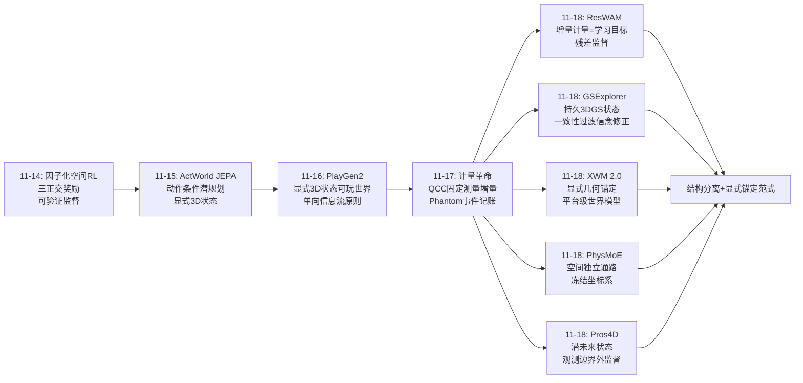
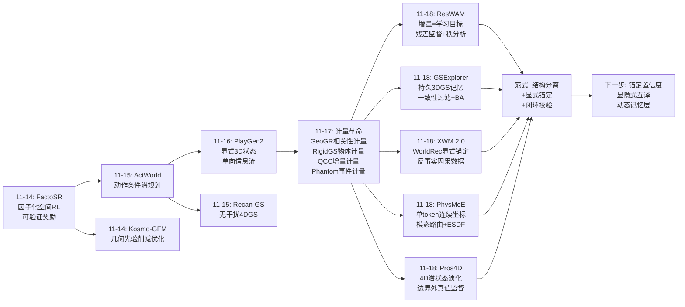
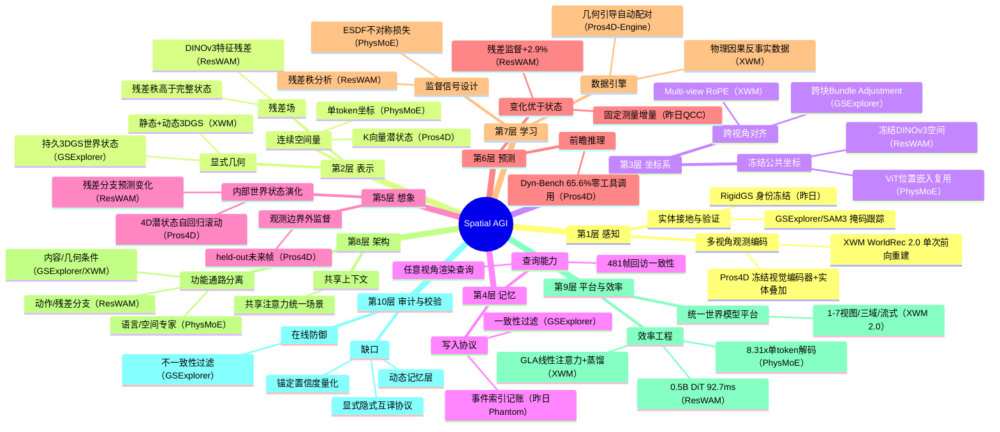
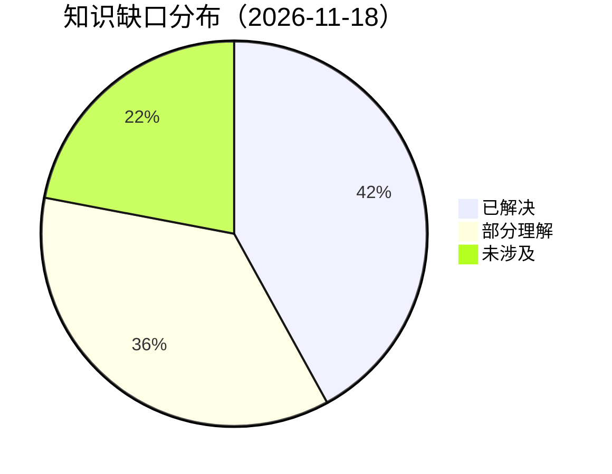
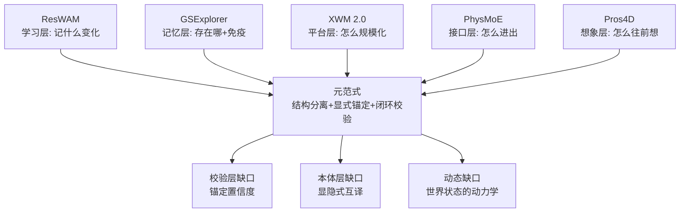

# Spatial AGI 每日思考 - 2026-11-18

## 📅 每日总结

**日期**: 2026-11-18
**论文数量**: 5篇
**主题**: 昨天的元判断是"计量革命"——每个子系统必须用正确的计量单位工作。今天五篇论文回答的是紧接着的下一问：**确定了计量单位之后，世界的模型应该在什么载体上运行、以什么结构组织？** ResWAM 说世界模型的学习目标应该是"变化"而非"状态"（残差监督，秩分析证明残差信息密度更高）；GSExplorer 说长时程一致性需要一个持久、可查询、带免疫系统的显式 3DGS 世界状态（生成-重建闭环）；Xiaomi Auto World Model 2.0 说统一世界模型平台需要显式几何锚定（WorldRec 2.0 单次前向重建静态+动态 3DGS）+ 可变视图统一架构（VTA + Multi-view RoPE）+ 流式效率（GLA）；PhysMoE 说空间量需要独立的计算通路（单 token 连续坐标 + 语言/空间专家路由 + 视觉位置嵌入复用）；Pros4D 说想象力需要内部演化的 4D 潜状态（观测状态自回归滚动为未来状态，held-out 未来帧监督"越过观测边界"）。五篇合起来的元判断是：**Spatial AGI 正在确立"结构分离 + 显式锚定"的架构范式——共享注意力之上做功能性通路分离（动作/残差、内容/几何、语言/空间、观测/未来），生成式想象必须被显式信号锚定（残差场、3DGS 世界状态、几何监督、位置嵌入坐标系），而锚定的本质是把"廉价的可预测部分"交给结构、把"昂贵的想象部分"留给生成。**

**关键突破**:
- 🚀 ResWAM：把 WAM 监督目标从完整未来换成 DINOv3 特征残差——残差有效秩 22.06 vs 完整未来 15.22（LIBERO），监督能量从静态背景主模式分散到更多变化方向；0.5B 双分支 DiT（动作分支 + 残差分支）flow matching 联合去噪，LIBERO-Plus 81.1%、RoboTwin 2.0 93.8%、真机 FR3 80.0%（超 π0.5 十个百分点）、92.7ms 闭环延迟、无机器人预训练
- 🚀 GSExplorer：持久 3DGS 世界状态 + 生成-重建闭环——不一致性过滤（外观差异 × 历史覆盖度门控，冲突内容排除在重建之外）、跨块 bundle adjustment 对齐生成视频与历史地图；293K 训练对用"上下文受限退化"（只保留上下文帧诞生的高斯）复现真实推理分布；WorldScore 相机控制 99.07，481 帧 leave-and-return 回访一致性全面领先
- 🚀 Xiaomi Auto World Model 2.0：工业级统一 Physical AI 世界模型——1-7 视图可变、Cam/Action/Layout 三种控制、通用+驾驶+机器人三域、分钟级流式实时生成；WorldRec 2.0 单次前向重建静态+动态 3DGS 并以渲染作为显式场景上下文；物理因果数据管线把碰撞、紧急规避、反事实轨迹系统性纳入训练（数据侧解决因果性）；NAVSIM 闭环策略 + LIBERO Plus 操作 + Waymo/nuScenes/Argoverse 2 交叉验证
- 🚀 PhysMoE：单 token 连续坐标表示（8.31× 吞吐加速）+ 复用 ViT 预训练位置嵌入做坐标嵌入（"看到的空间"与"说出的空间"共享坐标系）+ Semi-MoE 顶层语言/空间专家路由消除梯度干扰 + 可微 ESDF 不对称损失解决多峰可供性；9 坐标基准 +15.7% 且 11 个文本基准不掉点
- 🚀 Pros4D：4D 潜状态推理（4D-LSR）——K 个连续隐向量的观测状态自回归滚动为未来状态，4DLA 用视觉-语义（叠加图）+ 几何（含 held-out 未来帧）+ 语言三路监督接地；Pros4D-Engine 几何数据引擎自动产出 40K 配对样本；Pros4D-8B 零工具调用在 Dyn-Bench 65.6%、VLM4D Syn 75.0% 超越所有工具增强基线

**架构演进**: 正确计量的栈架构 → **结构分离 + 显式锚定的栈架构**（学习层：残差监督取代状态监督 [ResWAM]；记忆层：带免疫系统（一致性过滤+BA）的持久 3DGS 世界状态 [GSExplorer]；平台层：显式几何锚定 + 统一多视图流式生成 [XWM 2.0]；接口层：空间量的独立计算通路与原生连续表示 [PhysMoE]；想象层：内部演化潜状态 + 观测边界外的显式监督 [Pros4D]）

### 📊 一句话总结

2026-11-18 的五篇论文共同确立一条架构级元原则：**Spatial AGI 的世界建模正在从"单一隐式大模型"转向"结构分离 + 显式锚定"——学习目标分离（变化 vs 状态）、记忆形态分离（显式 3D 状态 vs 隐式生成）、计算通路分离（空间 vs 语言 vs 动作）、时间角色分离（观测 vs 未来），而所有分离的通路最终都被显式信号（残差、3DGS 渲染、位置嵌入、几何监督）锚定回同一个物理世界。**

### 🔗 延续性

**昨日→今日**: 昨天确立"计量革命"——压缩按相关性计量、空间按物体计量、进步按事件计量、预测按固定测量增量计量、记忆按变化计量。今天回答"计量单位确定后，系统如何组织"：①昨天 QCC-WM 说预测按固定测量增量记账，今天 ResWAM 把这个思想推到极致——干脆只监督增量（残差），静态部分完全交给冻结编码器，"计量单位"直接变成"学习目标"；②昨天 RigidGS 说物体身份应上游冻结，今天 PhysMoE 复用冻结的 ViT 位置嵌入、Pros4D 冻结视觉/几何编码器只训解码器——"上游冻结 + 下游适配"从物体身份扩展到坐标系与监督源；③昨天 PlayGen2 单向信息流受控安全，今天 GSExplorer 的不一致性过滤把这个原则制度化——想象回写记忆必须过冲突检测，"信念修正"成为记忆架构的正式组件；④昨天 Phantom Progress 说记忆按事件记账，今天 Pros4D 说预测按观测边界外的真值帧记账——监督信号的"记账单位"从观测内部扩展到观测之外；⑤昨天 ESI 的系统级 flywheel，今天 XWM 2.0 的"一个世界模型服务仿真+训练+策略"是 flywheel 的平台化形态。

**今日→明日**: 新线索十条：①残差思想的 3D 推广（3DGS 场表示的场残差预测）；②GSExplorer 的动态层（持久世界状态如何容纳"离开后世界变了"——变化检测 + 时间戳化更新）；③WorldRec 2.0 渲染条件的置信度量化（生成器学会"何时忽略锚定"）；④PhysMoE 的 6D/SE(3) 推广（旋转的连续单 token 表示是群论难题）；⑤Pros4D 长时程潜滚动误差累积（残差思想可用于未来状态——只滚动变化量）；⑥四篇论文的锚定置信度统一协议（一致性过滤/RRE/ESDF/几何对齐是否可合并为通用"锚定-校验"接口）；⑦物理因果数据管线的开源化与反事实基准；⑧XWM 的 GLA 流式推理 + ResWAM 的 0.5B DiT——轻量世界模型的最小充分配置搜索；⑨事件索引记忆（昨日 Phantom）+ 不一致性过滤（今日 GSExplorer）合成完整记忆写入协议；⑩潜空间世界模型（Pros4D）与显式世界状态（GSExplorer）的混合架构。明日检索方向："3d gaussian scene residual prediction world model"、"dynamic scene update timestamp memory persistent state"、"rendering condition confidence aware generation"、"6dof rotation continuous token embedding VLM"、"latent rollout error accumulation world model"、"anchor verification interface generative model"、"counterfactual physical data benchmark embodied"、"minimal lightweight world model closed loop"、"memory write protocol consistency filter event indexed"、"hybrid implicit explicit world state architecture"。

### 💡 本质思考：如何达成通用空间智能

#### 1. 核心能力的本质是什么？

昨天说"用正确的计量单位管理一切资源与知识"。今天五篇把这个答案推进一层：**通用空间智能的本质是"在正确的载体上、以正确的结构运行正确的计量"**——计量单位决定记什么，载体与结构决定怎么记、怎么用：

- **学习的载体是变化而非状态**（ResWAM）：世界的可预测部分（静态背景）不值得用学习容量去记忆，值得学习的是动作因果相关的变化场。智能体的世界模型应该是"变化检测器 + 局部前向模拟器"，不是全场景生成器；
- **记忆的载体是显式可查询的几何**（GSExplorer + XWM 2.0）：空间记忆必须能被任意视角查询（渲染）、能检测与想象的冲突、能跨时间对齐——隐式的 latent 帧序列或特征缓存做不到这些；
- **计算的载体是分模态通路**（PhysMoE）：空间量有独立的数学结构（连续、度量、多峰可行集），强行塞进语言 token 流会导致量化误差与梯度污染。空间智能不是语言能力的应用场景，是需要独立计算结构的模态；
- **想象的载体是内部演化状态**（Pros4D）：智能的标志是越过观测边界的推断——模型内部必须有一个能自回归演化的世界状态，且这个状态必须被观测之外的真值监督接地，否则想象力只是插值。

一条统一线索：**四个子系统都在做同一件事——把"可结构化的部分"显式化（残差目标、3DGS 状态、独立通路、几何监督），把"必须想象的部分"交给生成，并在两者之间建立校验回路**。通用空间智能 = 显式结构与生成想象的正确分工 + 闭环互验。

#### 2. 当前方法与理想目标的差距在哪里？

**差距一：锚定的免疫系统不完整。** GSExplorer 有一致性过滤，但 ResWAM 的残差监督、XWM 的 WorldRec 锚定、Pros4D 的几何对齐都没有"锚定错误检测"——当冻结编码器/几何恢复/渲染条件出错时，错误锚会变成系统性偏置。信念修正只在记忆写入侧出现，未普及到监督与锚定侧。

**差距二：显式与隐式两个世界互不相通。** GSExplorer 的 3DGS 状态与 Pros4D 的潜状态是两种竞争范式而非互补组件：没有协议把 3DGS 状态"编译"进潜空间，也没有协议从潜状态"物化"出可查询几何。理想系统应该两者兼有并可互相映射。

**差距三：动力学缺位。** 五篇的世界状态几乎都是静态骨架 + 短时程运动预测：GSExplorer 明确不处理动态物体，XWM 的动态 3DGS 只覆盖驾驶尺度，Pros4D 只预测短窗口。持久世界状态对"我离开后世界变了"（非自身引起的动态）无解——这需要变化检测 + 时间戳化 + 情景/语义记忆分层的完整方案。

**差距四：效率与能力仍在对立。** ResWAM 0.5B DiT ~93ms 是操作尺度的极致，XWM 分钟级多视图是平台尺度的极致，但没有人给出"同一架构在两个尺度连续缩放"的配方——GLA/蒸馏/残差监督这些效率技术各自独立，缺统一的效率理论。

#### 3. 从今天到理想状态，最可能的路径是什么？

**近期（3-6个月）：锚定校验的标准化。** 一致性过滤推广为通用"锚定-校验"接口：任何生成式预测（残差、渲染、潜状态）回写状态前都过冲突检测；事件索引记忆 + 不一致性过滤合成完整记忆写入协议；标志事件：第一个把"信念修正"内置为标准组件的开源具身框架。

**中期（6-18个月）：显式-隐式混合世界状态。** 3DGS 显式状态承载结构记忆、潜状态承载想象预测，双向编译协议（物化/内化）打通；动态层（变化检测 + 时间戳化）补齐持久状态的动力学；标志事件：第一个在 leave-and-return + 反事实干预双测试下都通过的空间记忆系统。

**长期（18个月+）：统一效率理论与自校验世界模型。** 残差监督、线性注意力、蒸馏、专家路由合并为可预测的缩放律；世界模型自动检测自己锚定的失效（"我的几何先验可能在撒谎"）并降级到纯生成模式。终态定义：**显式结构与生成想象在统一校验回路下分工协作、可持续演化、可自诊自愈的空间世界模型。**

---

## 🔗 与昨日思考的联系

### 昨日重点

昨天的五篇（GeoGR / RigidGS / ESI / QCC-WM / Phantom Progress）确立了"计量革命"元原则：**每个子系统必须用正确的计量单位工作**——计算按 (token, layer) 相关性计量且压缩决策可恢复、空间按物体边界计量且身份上游冻结、经验按（观测，意图，有效行为）三元组事件计量、预测按固定参考测量的增量计量、记忆按状态变化事件计量。核心洞察是"用错计量单位不是精度损失而是结构性失效，修复顺序是先改计量结构再堆数据"。

### 今日进展

今天的五篇回答"计量单位确定之后，系统以什么载体与结构运行"：

1. **计量单位直接变成学习目标**（ResWAM）：昨天 QCC-WM 用固定测量增量做世界模型的记账单位，今天 ResWAM 把"增量计量"前移到监督目标定义——Δt = Z_{t+H} − Z_t 就是学习目标本身，静态部分交给冻结编码器，学习容量全部投向变化。秩分析（22.06 vs 15.22）是"增量计量信息密度更高"的定量证明。
2. **冻结上游的普遍化**（ResWAM/PhysMoE/Pros4D）：昨天 RigidGS 冻结物体身份，今天三篇把"上游冻结 + 下游适配"扩展为通用配方——冻结 DINOv3 特征空间作为残差坐标系（ResWAM）、冻结 ViT 位置嵌入作为输出坐标系（PhysMoE）、冻结视觉/几何编码器作为对齐目标（Pros4D）。冻结不是限制而是**稳定的公共坐标系**，让各组件的变化量有明确定义。
3. **信念修正制度化**（GSExplorer）：昨天 PlayGen2 的单向信息流原则，今天 GSExplorer 把它升级为记忆架构的正式组件——生成内容回写 3DGS 状态前必须过一致性过滤（冲突内容排除在重建之外），配合跨块 BA 保持空间对齐。"想象可以大胆，记忆必须谨慎"成为可实现的工程协议。
4. **监督的记账边界外扩**（Pros4D）：昨天 Phantom Progress 说记忆按事件记账，今天 Pros4D 说预测必须按"观测边界之外"的真值帧记账——held-out 未来帧监督是想象力的来源，观测内部一致性训练不出真正的外推。监督信号的记账单位从"观测内"扩展到"观测外"。
5. **Flywheel 的平台化**（XWM 2.0）：昨天 ESI 的 LLM-VLA 协作 flywheel 是系统级自改进，今天 XWM 2.0 的"一个世界模型服务仿真评估 + 闭环训练 + WAM 策略"是 flywheel 的平台级形态——世界模型生成数据、训练策略、评估性能，形成自飞轮。

### 演进路径

---

## 📚 论文概览

今天五篇论文覆盖了 Spatial AGI 技术栈的五个不同层次，且恰好构成一个完整的系统视图：

1. **ResWAM**（机器人操作 / 世界-动作模型 / 监督设计）：反直觉的核心问题——WAM 应预测"未来长什么样"还是"未来如何变化"？残差监督 + 轻量双分支 DiT 的组合实现了精度、算力、延迟的三赢，是"轻量闭环世界模型"路线的标杆。回答的是**学习层**问题：监督信号该记什么。

2. **GSExplorer**（世界生成 / 空间记忆 / 一致性）：交互式世界生成的长时程一致性瓶颈不在生成器而在世界状态的可靠性。持久 3DGS 状态 + 生成-重建闭环 + 不一致性过滤 + 跨块 BA，481 帧回访一致性领先。回答的是**记忆层**问题：空间记忆该长什么样、如何免疫想象污染。

3. **Xiaomi Auto World Model 2.0**（自动驾驶 + 具身 / 平台级世界模型 / 因果数据）：车企视角的统一 Physical AI 世界模型——可变视图、多控制、三域、流式，WorldRec 2.0 显式锚定 + 物理因果数据管线。回答的是**平台层**问题：世界模型作为基础设施如何统一多域多配置并保证物理因果性。

4. **PhysMoE**（具身 VLM / 空间接地 / 架构设计）：空间量在语言模型中的错误表示（字符化离散化）是空间能力的隐性瓶颈。单 token 连续坐标 + 冻结坐标系 + 模态路由专家 + ESDF 场监督。回答的是**接口层**问题：空间量该以什么表示与通路进入模型。

5. **Pros4D**（动态空间推理 / 潜空间推理 / 想象力）：智能的标志是越过观测边界的外推。内部演化 4D 潜状态 + held-out 未来帧监督 + 几何数据引擎，零工具调用实现回溯 + 前瞻双能力。回答的是**想象层**问题：内部世界模型如何演化并被真值接地。

---

## 💡 核心见解

### 见解1: 学习目标应该是变化场而非状态场——残差监督的信息论优势（ResWAM）

- ✅ LIBERO 上相邻动作块帧的 DINOv3 特征余弦相似度高达 0.96——完整未来监督本质上被 96% 的冗余占据，损失被"复制静态背景"的捷径满足
- ✅ 残差的有效秩显著高于完整未来（LIBERO 22.06 vs 15.22，+6.84；stable rank 3.08→5.48）——残差不是"更少的信息"而是"能量分散到更多变化方向"
- ✅ 残差范数的图像空间可视化自动聚焦机械臂与操作对象——隐式的动作-空间因果显著性图，无需任何显式监督
- ✅ 等算力消融：残差监督比完整未来监督在 RoboTwin 2.0 上 +2.9%；0.5B 双分支 DiT 达到 SOTA 且真机延迟 92.7ms

**对Spatial AGI的启发**:
这可能是世界建模的通用原则：**好的学习目标不是最小目标，而是信息熵最大且与因果相关的目标**。朴素直觉认为"预测更少的东西=更弱的信号"，事实相反——预测完整状态让模型容量浪费在低秩冗余上，残差强迫模型表达高秩变化。这解释了为什么巨型视频生成世界模型的边际收益递减：它们的大部分算力在"重新生成当前帧已知的内容"。Spatial AGI 的世界模型应该是"变化检测器 + 局部前向模拟器"。与昨日 QCC-WM 的固定测量增量对照：增量计量（评估侧）与残差监督（训练侧）是同一原则在两个环节的体现——**只对变化记账，只对变化学习**。

### 见解2: 空间记忆需要免疫系统——想象回写必须过冲突检测（GSExplorer）

- ✅ 持久 3DGS 世界状态是可查询、可校验、可对齐的记忆：任意视角渲染查询、外观差异×覆盖度门控的逐像素一致性得分、跨块 bundle adjustment 联合优化相机图
- ✅ 不一致性过滤把生成内容显式分为三类：新可见区域（场景扩展）、一致区域（精炼已有场景）、冲突区域（排除在高斯初始化与优化之外）——冲突内容永远不会覆盖已有信念
- ✅ 293K 训练对用"上下文受限退化"管线（只保留上下文帧诞生的高斯）严格对齐训练-推理分布——模型学会在"不完整的世界状态"下补全
- ✅ 481 帧 leave-and-return 回访测试：离开 400+ 帧后回到同一地点，世界状态仍给出一致渲染

**对Spatial AGI的启发**:
这几乎就是预测加工（predictive processing）理论的工程实现：想象（生成）→ 冲突检测（一致性过滤）→ 信念更新（选择性重建）→ 更强想象（更好条件）。关键洞察是**记忆需要免疫系统**：想象必然出错，出错的内容如果无门槛写入记忆会系统性污染世界状态——这正是昨日 PlayGen2"单向信息流"原则的制度化。同时"退化渲染 + 空洞掩码"是对空间已知性的显式建模：不仅表示知道什么，还表示哪里不知道（自知之明）。对照昨日 RigidGS 的"身份上游冻结"：GSExplorer 的历史高斯就是冻结的信念基底，新内容只能在冲突检测通过后增量写入——**冻结基底 + 门控写入**是空间记忆的完整写入协议。

### 见解3: 显式几何锚定 + 生成补全是世界模型的稳定混合架构——且因果性在数据侧（GSExplorer/XWM 2.0）

- ✅ XWM 2.0 的 WorldRec 2.0：单次前向从多相机多时刻观测重建静态+动态 3DGS，目标位姿渲染作为显式场景上下文——已观测区域锚定几何/外观/跨视图对应，生成器只补全观测之外
- ✅ GSExplorer 的多模态退化渲染条件（RGB+深度+不透明度+空洞掩码）+ RRE 独立相机分支：内容与几何解耦注入，99.07 相机控制分
- ✅ 两篇独立工作收敛到同一架构判断：纯隐式世界模型长时程必然漂移，显式几何锚定是稳定性的来源；但锚定之外的部分（新视角外观、未观测区域）必须靠生成补全
- ✅ XWM 2.0 的物理因果数据管线：仿真引擎+视频生成器+公开媒体的碰撞/紧急规避/反事实轨迹——物理常识需要主动干预数据来教会模型，被动观测数据学不到反事实

**对Spatial AGI的启发**:
"显式锚定 + 生成补全"是 2026 年底世界模型收敛的混合范式：结构交给显式几何（3DGS），语义与外观交给生成，中间用渲染作为翻译层。这与昨日"显式状态确立"的趋势完全一致并推进到工业规模。更深刻的启示在数据侧：**空间因果智能的本质是回答反事实问题（"如果我不变道/如果我推这里会怎样"），这类知识无法从被动观测学到**——需要仿真引擎 + 生成器合成的干预数据。结合昨天的计量革命：数据也有计量单位问题——按"反事实覆盖度"计量物理因果数据，而非按时长/帧数。缺失的一环是锚定置信度：当 WorldRec 重建错误时渲染先验变成错误锚，生成器需要学会"何时忽略锚定"（对照 GSExplorer 的一致性过滤，锚定侧的信念修正仍缺位）。

### 见解4: 空间量需要独立的计算通路与原生连续表示——空间是模态不是应用（PhysMoE）

- ✅ 坐标的字符化 token 化是三重瓶颈：8-10 步自回归解码延迟、量化误差、以及最隐蔽的——高幅值空间回归梯度通过共享 FFN 干扰预训练语言权重（模态冲突）
- ✅ 单 token 连续坐标 ⟨|x,y|⟩ + 复用冻结 ViT 位置嵌入（双线性插值）：8.31× 吞吐加速 + 更高精度，消融证明优于从头训练与 Fourier 编码——"看到的空间"与"说出的空间"共享同一坐标系后，接地从跨坐标系翻译变成坐标系内对齐
- ✅ Semi-MoE 结构化路由：低层共享上下文、顶层语言/空间专家按物理模态划分（数据驱动 MoE 之外的结构化分工），共享注意力保持统一场景上下文
- ✅ ESDF 不对称损失：内部指数衰减容忍（任意有效接触峰皆奖励，无找中心偏置）+ 外部线性二次回拉——监督信号与任务的物理可行性结构（多峰可供性区域）同构

**对Spatial AGI的启发**:
最深刻的一点是**空间接地失败的根源之一是输入与输出空间坐标系不一致**：模型输出的 "[342, 518]" 与 ViT 内部 patch 网格根本不在一个表征空间。复用位置嵌入让两者共享坐标流形，接地变成对齐问题。推广到 Spatial AGI：所有空间输出（2D/3D/6D）都应与对应的空间感知编码器共享坐标系——空间智能不是语言能力的一个应用场景，而是需要独立计算结构（专用 FFN、专用头、专用嵌入坐标系）的模态。ESDF 损失则示范了监督信号设计的一般原则：**约束区域内的自由**——凡是物理有效的答案都应被奖励，这要求监督信号表达可行集结构而非唯一真值。与昨日 GeoGR 的"按相关性计量计算"呼应：PhysMoE 按模态计量计算通路——计量单位再次被证明是架构设计的出发点。

### 见解5: 想象力需要越过观测边界的真值监督——内部世界状态的演化是可训练的（Pros4D）

- ✅ 4D 潜状态推理：K 个连续隐向量构成的观测状态自回归滚动为未来状态，嵌入推理轨迹的连续计算段，推理时零外部工具调用
- ✅ 关键监督设计：held-out 未来帧（观测边界之后的真值）直接作为未来状态的对齐目标——观测内部一致性训练不出真正的外推，想象力必须用"边界外"的真值浇灌
- ✅ 4DLA 三路对齐（视觉-语义叠加图 + 几何 + 语言）确保潜状态既有语义又有几何/时间对应，避免纯语义潜状态的几何失真
- ✅ Pros4D-8B 零工具调用超越所有工具增强基线（Dyn-Bench 65.6% vs SpatialClaw 53.5%）——几何想象力可以内化，且内化版比外挂版更强更快
- ✅ Pros4D-Bench 的"同一观测前缀、双任务"评测协议把预测从记忆检索中剥离，测的是真正的动态外推

**对Spatial AGI的启发**:
"观测边界"这个概念重新定义了空间智能的评测与训练：此前所有空间基准默认答案在观测内，但智能的标志恰恰是边界外的推断。工程启示有三：①未来预测能力的数据划分本身就是训练信号（held-out 帧既做评测又做监督）；②潜空间是连续动态的正确载体——字符化丢失信息、外挂工具增加依赖、K 个连续隐向量是折中最优；③数据引擎模式（几何恢复 + 实体跟踪 + 模板 QA 自动配对）解决空间推理的数据瓶颈。与今天 ResWAM 对照：ResWAM 在特征空间预测未来（操作尺度），Pros4D 在语义潜空间预测未来（推理尺度），两者共同确认**"内部演化的未来状态"是空间想象力的通用载体**，只是接地信号不同（DINOv3 残差 vs 视觉-语义+几何）。

### 见解6: 轻量与平台是世界模型的两个极——效率技术正在分头收敛（ResWAM/XWM 2.0 跨论文）

- ✅ ResWAM：0.5B DiT + 残差监督 → 2.7-4.0 TFLOPs 训练、92.7ms 推理——策略内嵌的轻量闭环前瞻
- ✅ XWM 2.0：GLA 线性注意力时间层 + 蒸馏 Post-train → 多视图分钟级流式实时生成——平台级的重型世界仿真
- ✅ 两极殊途同归的效率手段：ResWAM 靠"监督信号减负"（残差），XWM 靠"注意力复杂度减负"（线性化）+ 蒸馏——效率不再是单一技术而是监督设计×架构设计×训练配方的系统工程
- ✅ 效率与能力不再对立：ResWAM 省算力的同时 +精度（+2.9% 消融），PhysMoE 加速 8.31× 的同时 +15.7%

**对Spatial AGI的启发**:
世界模型研究正从"更大更强的生成器"转向"更准更省的监督与计算设计"——这与昨天的计量革命一脉相承：**效率的本质是计量（把算力只花在信息密度高、因果相关的部分）**。ResWAM 的残差监督 = 对学习容量按变化计量；PhysMoE 的模态路由 = 对 FFN 计算按模态计量；XWM 的 GLA = 对注意力计算按流式增量计量。Spatial AGI 的效率理论终局可能是一个统一的"算力计量框架"：给定任务与场景，自动决定每个组件（感知/记忆/预测/生成）的算力配额。当前缺失的是两个尺度的连续缩放配方——没有工作验证同一架构能否从 0.5B 闭环控制连续缩放到多视图平台仿真。

### 见解7: 元综合——"结构分离 + 显式锚定 + 闭环校验"是 Spatial AGI 的统一架构语法（跨论文元综合）

- ✅ 分离的普遍性：五篇论文各自在五个不同层次做了同一件事——ResWAM 分离动作/残差分支、GSExplorer 分离内容/几何条件与想象/记忆写入、XWM 分离渲染上下文/相机几何分支、PhysMoE 分离语言/空间专家、Pros4D 分离观测/未来状态
- ✅ 锚定的普遍性：每篇的分离通路都被显式信号锚定——DINOv3 残差场、3DGS 渲染、Multi-view RoPE 位姿、ViT 位置嵌入、几何监督（DA3 恢复）
- ✅ 校验的萌芽：GSExplorer 的一致性过滤是唯一完整的校验回路；其余四篇的锚定是单向的（锚定→生成），缺少"锚定错误检测"
- ✅ 与昨日计量的衔接：计量单位决定"记什么"（变化、事件、相关性），结构分离决定"怎么记"，显式锚定决定"锚在哪"，闭环校验保证"记对没"

**对Spatial AGI的启发**:
2026 年具身/空间智能模型的统一语法已经浮现：**共享注意力（统一上下文）+ 功能通路分离（各司其职）+ 显式信号锚定（回到物理世界）+ 闭环校验（信念修正）**。这四个组件分别回答：上下文如何共享、计算如何分工、想象如何不漂移、错误如何修正。对照理想系统，当前进度是：分离与锚定已成熟（今天五篇全部具备），校验刚起步（仅 GSExplorer），自诊（锚定失效自动检测）还是空白。Spatial AGI 的下一个突破点很可能不在某个单点能力，而在把校验回路补全为标准组件——让每个锚定、每次想象回写、每条监督信号都自带置信度与冲突检测。

---

## 🗺️ 知识演进图

---

## 技术栈演进对比表

| 层次 | 昨日方案（11-17） | 今日方案（11-18） | 变化 |
|------|---------|---------|------|
| 学习/监督 | QCC-WM 固定测量增量记账（评估侧）；ESI 三元组事件监督（学习侧） | ResWAM 残差监督（Δt = Z_{t+H}−Z_t 直接作为学习目标）+ 秩分析论证 | 增量计量从评估准则前移为监督目标定义 |
| 记忆形态 | Phantom 事件索引记忆（记账单位）；STVLA 几何键检索 | GSExplorer 持久 3DGS 世界状态 + 一致性过滤 + 跨块 BA | 记忆从"索引协议"升级为"带免疫系统的可查询几何实体" |
| 世界模型 | QCC-WM 宏节点递归外推（单视角短时程） | GSExplorer 生成-重建闭环；XWM 2.0 平台级多视图流式；Pros4D 内部潜状态演化 | 世界模型分化为显式记忆/平台仿真/内部想象三种形态，均显式锚定 |
| 几何锚定 | RigidGS 物体身份上游冻结（表示侧） | WorldRec 2.0 渲染锚定；冻结 DINOv3/ViT 位置嵌入/几何编码器（ResWAM/PhysMoE/Pros4D） | "上游冻结+下游适配"从物体身份推广为通用坐标系策略 |
| 空间接口 | GeoGR 两级压缩（输入侧效率） | PhysMoE 单 token 连续坐标 + 模态路由专家 + ESDF 场监督 | 空间量获得独立计算通路与原生连续表示 |
| 想象/预测 | 11-16 PlayGen2 单向信息流（原则） | Pros4D held-out 未来帧监督 + 观测/未来状态分离 | 想象力获得明确的监督来源：观测边界外的真值 |
| 因果数据 | ESI 协作纠正自动提取（系统级） | XWM 2.0 物理因果数据管线（反事实轨迹、长尾安全事件） | 因果性从接口监督扩展到数据供给侧 |
| 效率技术 | GeoGR 计算按相关性计量 | ResWAM 残差减负；XWM GLA 线性化+蒸馏；PhysMoE 8.31× 单token解码 | 效率成为监督设计×架构设计×训练配方的系统工程 |
| 审计/校验 | WanderBench 失败审计；干预诊断协议（离线） | GSExplorer 一致性过滤（在线，仅记忆写入侧） | 校验从离线诊断走向在线防御，但覆盖仍不完整 |
| 评测协议 | Phantom hidden 对照干预协议 | Pros4D-Bench 统一观测边界双任务（回溯+前瞻） | 评测开始区分"检索"与"外推"两种能力 |

---

## 🗺️ Spatial AGI 知识图谱

### 10层架构思维导图

### 🎯 主线技术路径

#### 阶段1: 显式状态的确立（11-15 ~ 11-16 完成）

PlayGen2 显式 3D 状态可玩世界、ActWorld 动作条件潜规划确立了"世界状态是一等数据结构"；单向信息流原则（生成帧不回流状态）确立受控信息流。Recan-GS 与 Kosmo-GFM 在表示与感知侧补齐几何质量底座。

#### 阶段2: 正确计量单位的确立（11-17 完成）

GeoGR（相关性计量）、RigidGS（物体计量）、ESI（事件计量）、QCC-WM（增量计量）、Phantom Progress（变化计量）确立"每个子系统用正确计量单位工作"的元原则；用错单位是结构性失效而非精度损失。

#### 阶段3: 结构分离 + 显式锚定（11-18 完成，今天）

今天五篇确立了架构语法：共享注意力 + 功能通路分离 + 显式信号锚定。学习目标残差化（ResWAM）、记忆状态显式化（GSExplorer）、平台锚定几何化（XWM 2.0）、空间接口通路化（PhysMoE）、内部想象状态化（Pros4D）。分离与锚定已经成熟。

#### 阶段4: 闭环校验的标准化（未来 3-6 个月）

把 GSExplorer 的一致性过滤推广为通用"锚定-校验"接口：所有锚定、所有想象回写、所有监督信号自带置信度与冲突检测；事件索引 + 一致性过滤合成完整记忆写入协议。标志事件：第一个内置信念修正的标准开源具身框架。

#### 阶段5: 显隐式互译与动态记忆（未来 6-18 个月）

打通 3DGS 显式状态与潜空间的双向编译（物化/内化）；持久状态补齐动态层（变化检测 + 时间戳化 + 情景/语义记忆分层）；leave-and-return + 反事实干预双测试通过。终态：显式结构与生成想象在统一校验回路下分工协作、自诊自愈的空间世界模型。

---

## 🔍 待探索议题

### 高优先级（本周）

1. **残差思想的 3D 推广**
   - 问题: ResWAM 在 2D 特征空间验证了"预测变化优于预测状态"，3DGS 场表示中能否定义"场残差"（高斯属性场的时序差分）作为 4D 世界模型的学习目标？
   - 候选方案: 高斯位置/尺度/旋转/不透明度各通道分别定义增量目标；冻结静态高斯子集、只对动态通道监督
   - 缺口: 3D 残差的秩分析工具（谱分析在高斯集合上的定义）；动态/静态高斯的自动划分

2. **锚定置信度量化**
   - 问题: WorldRec 2.0 渲染条件、冻结编码器残差、几何对齐目标都可能在失效时变成错误锚——生成器如何学会"何时忽略锚定"？
   - 候选方案: 渲染累积不透明度作为天然置信度（GSExplorer 已用）；锚定-生成分歧度作为运行时信号；置信度加权的条件注入强度
   - 缺口: 除 GSExplorer 外四篇均无锚定失效检测；缺统一协议

3. **持久世界状态的动态层**
   - 问题: GSExplorer 的 3DGS 状态是静态的——"我离开后世界变了"（物体被移动、门被关上）如何处理？
   - 候选方案: 变化检测（重访时与记忆渲染的冲突作为变化信号而非生成错误）+ 时间戳化场景更新 + 情景/语义记忆分层
   - 缺口: 变化检测与生成错误的区分协议（同一个不一致信号，两种语义）；动态高斯的记忆化

4. **记忆写入协议的合成**
   - 问题: 昨日 Phantom 的事件索引记账 + 今日 GSExplorer 的一致性过滤是否可以合成完整"记忆写入协议"（何时写、写什么、怎么验）？
   - 候选方案: 事件触发写入（状态变化事件）→ 一致性过滤校验 → 事件索引记账 → 支持后续事件级检索
   - 缺口: 事件定义与一致性得分的统一粒度；跨写入的去重与合并

### 中优先级（本月）

5. **PhysMoE 的 6D/SE(3) 推广**
   - 问题: 单 token 连续坐标在 2D 验证成功，6D 位姿（旋转的连续表示是群论难题）如何单 token 化？
   - 候选方案: 复用深度/点云编码器的 3D 位置编码做双线性插值；旋转用六维连续表示 + SO(3) 流形投影头；专用旋转专家 FFN
   - 缺口: 视觉编码器缺乏原生 3D 位置嵌入网格（需 3D 感知编码器配套）

6. **Pros4D 长时程潜滚动 + 残差滚动**
   - 问题: 自回归滚动潜未来状态的误差累积与漂移如何控制？未来窗口长度受限
   - 候选方案: 残差滚动（只滚动状态的变化量而非完整状态，结合 ResWAM 思想）；周期性重接地（用观测帧校准）；不确定性门控的滚动深度
   - 缺口: 潜状态的重接地机制；滚动深度的自适应控制

7. **轻量世界模型的最小充分配置**
   - 问题: ResWAM 0.5B DiT ~93ms 与 XWM GLA+蒸馏分别代表两极，同一架构能否从闭环控制连续缩放到平台仿真？
   - 候选方案: 统一主干（共享注意力+通路分离）+ 按尺度缩放的专家数/分支数/锚定精度；消融搜索最小配置
   - 缺口: 两个尺度之间的中间评测协议；效率-能力的缩放律

8. **显式-隐式互译协议**
   - 问题: GSExplorer 的 3DGS 状态与 Pros4D 的潜状态是竞争范式——能否建立双向编译（3DGS 物化为潜条件、潜状态物化为可查询几何）？
   - 候选方案: 渲染作为编译器（3DGS→多视角渲染→潜条件）；前馈重建作为反编译（潜状态→伪观测→3DGS）
   - 缺口: 物化/内化的损失设计；两种表示的语义对齐验证

### 低优先级（本季度）

9. **反事实物理数据基准**
   - 问题: XWM 的物理因果数据管线是闭源工业实践——社区缺一个标准化的反事实空间交互基准（碰撞、推动、坠落的结果预测）
   - 候选方案: 仿真引擎批量生成反事实对（同一初态、不同干预、不同结果）；评估协议测"结果区分能力"而非"绝对预测精度"
   - 缺口: 反事实覆盖度的计量方法（哪些干预类型已覆盖/缺失）

10. **"结构分离"架构语法的形式化**
    - 问题: 五篇论文的分离实践（动作/残差、内容/几何、语言/空间、观测/未来）各自独立设计——分离的通用原则与边界是什么？
    - 候选方案: 用信息论（通路间互信息最小化 + 与任务相关性最大化）形式化分离判据；分离-合并的自动搜索
    - 缺口: 分离度的可测量定义；过度分离（上下文割裂）的失败案例研究

11. **ESI 式 flywheel 的世界模型版**
    - 问题: XWM 的"世界模型服务仿真+训练+策略"飞轮目前单向（模型→数据→策略），能否像 ESI 一样让部署经验回流更新世界模型本身？
    - 候选方案: 真实部署中的预测误差作为世界模型的在线监督（自监督校准）；预测误差大的区域触发针对性数据采集
    - 缺口: 在线更新的稳定性（灾难性遗忘）；误差归因（模型错 vs 数据分布偏移）

---

## 📊 知识缺口分析

**已解决（42%）**:
- ✅ 世界模型监督目标的正确选择：残差监督信息密度更高、聚焦变化（ResWAM 秩分析+消融）
- ✅ 长时程一致性的记忆形态：持久 3DGS 状态 + 生成-重建闭环 + 回访验证（GSExplorer）
- ✅ 空间量的模型内表示：单 token 连续坐标 + 坐标系共享 + 模态通路（PhysMoE，20 基准验证）
- ✅ 想象力的可训练性：内部潜状态演化 + 边界外真值监督（Pros4D，零工具调用超越工具增强）
- ✅ 多视图统一与流式效率：可变视图 + 显式锚定 + GLA 蒸馏（XWM 2.0 工业验证）
- ✅ 多峰空间任务的监督设计：ESDF 场监督与可行集同构（PhysMoE）

**部分理解（36%）**:
- ⚠️ 锚定置信度：只有 GSExplorer 有一致性过滤，其余锚定手段（渲染先验/冻结特征/几何对齐）无失效检测
- ⚠️ 动态世界状态：持久记忆是静态骨架，"离开后世界变了"的更新机制未解
- ⚠️ 长时程预测：潜滚动/递归外推的误差累积只有缓解手段（固定测量、重接地）无根治
- ⚠️ 效率缩放律：轻量闭环与重型平台各自成熟，中间尺度连续缩放配方缺失
- ⚠️ 显隐式表示关系：3DGS 状态与潜状态并行发展，互译协议空白
- ⚠️ 3D 残差与 6D 表示：残差思想在 2D 特征验证，3D 场残差与旋转连续 token 化未解

**未涉及（22%）**:
- ❌ 反事实空间交互的社区基准（物理因果数据仍锁在工业闭源管线）
- ❌ "结构分离"的形式化判据（分离度不可测量，过度分离风险未知）
- ❌ 世界模型在线自校准（部署误差回流更新模型，flywheel 闭环未闭合）
- ❌ 跨组件计量统一本体（token/物体/事件/宏节点计量无法互相映射，昨日提出今日无进展）
- ❌ 非刚体与流体世界的持久记忆（现有 3DGS 状态假设场景刚性）
- ❌ 空间智能的自诊断（"我的世界状态在撒谎"的在线自检）

---

## 📝 元笔记

**今天的整体感觉**: 五篇论文像是同一个系统设计文档的五个章节——学习目标（记什么变化）、记忆载体（存在哪）、平台架构（怎么规模化）、计算接口（怎么进出）、想象机制（怎么往前想）。这种跨论文的一致性在以前是罕见信号，现在成了常态：说明 Spatial AGI 的架构语法正在从"百花齐放"进入"收敛定型"阶段。昨天的计量革命回答了语义层问题（记什么），今天的结构分离回答了架构层问题（怎么记），两问合起来，剩下的就是校验层（记对没）与本体层（怎么互通）。

**值得警惕的**: 收敛也可能是同质化——五篇全都依赖"冻结预训练编码器 + 生成补全"的组合，如果冻结的编码器（DINOv3/ViT/DA3）本身有系统性盲区（透明物体、反光、极端天气），整个范式会继承同一个盲区。锚定置信度议题（高优先级2）的重要性因此被放大：范式的强度和它的单点依赖是同一个东西。

**给明天的自己**: 明天检索时优先追两条线——①"anchor verification / rendering condition confidence"（校验层是否已有人做）；②"dynamic world state update timestamp"（动态记忆层）。如果两者都还是空白，"闭环校验的标准化"就是值得自己下场整理综述的方向。

---

## 🔬 附录A: 五篇论文技术深读笔记

### A1. ResWAM 关键机制速记
- 残差目标: Δt = Z_{t+H} − Z_t，冻结 DINOv3，N×D patch 级
- 秩指标: r_eff = exp(H(p))（谱能量熵），r_stable = Σσ²/σ₁²（尺度不变）
- 架构: VLM ~1.8B + 0.5B 双分支 DiT（A. DiT 动作 / R. DiT 残差），conditional flow matching 联合去噪
- 无像素重建、无未来解码器、无视频 VAE、无独立世界模型
- 成绩: LIBERO-Plus 81.1 / RoboTwin 2.0 93.8 / RoboDojo 9.40%/13.41 / 真机 FR3 80.0 (+10 vs π0.5)
- 效率: 训练 2.7-4.0 TFLOPs，推理 1.0-1.4 TFLOPs，延迟 92.2-99.7ms

### A2. GSExplorer 关键机制速记
- 世界状态: 3DGS + SLAM 后端（相机估计 + 历史建图视图跨步保持）
- 一致性得分: c_i(u) = exp(−λ·e_i(u))，仅历史覆盖像素（A^old ≥ η）评估；未覆盖默认 1
- 支持掩码: S_i(u) = V_i(u)·1[c_i(u) ≥ τ_c]，三类内容三种处理
- 跨块 BA: min Σ ρ(‖r_ij(T_i,T_j)‖²)，跨块+重访约束联合优化相机图
- 生成器: Wan2.2-TI2V-5B + 多模态条件（RGB/深度 VAE 编码；不透明度/掩码 3D conv）+ 6 个注入位点 + RRE 独立分支（每 DiT block 并行注意力）
- 数据: 57 帧片段（8 上下文 + 49 目标），强制目标帧插入高斯后只保留上下文高斯 → 293K 对
- 成绩: WorldScore 单步 99.07（相机控制），单步+三步综合最佳，50 例 481 帧回访全面领先

### A3. Xiaomi Auto World Model 2.0 关键机制速记
- 架构: VTA（跨视图+时间注意力，时间层嵌 GLA）+ Multi-view RoPE + 异构条件 VAE 潜空间拼接
- WorldRec 2.0: 单次前向重建静态+动态 3DGS，scene-structured registers 点对齐 query 交换；目标位姿/时间渲染作为显式上下文
- 数据三类: 通用（Pandas 70M + SpatialVID-HQ/Sekai/RealCam-Vid/TartanAir）；物理世界（PhysicalAI-AV/nuPlan/nuScenes/MiData 11相机+LiDAR；AgiBot/DROID/OXE/RoboTwin 2.0 等）；物理因果（仿真+生成器+反事实轨迹）
- 训练: Pre-train（广度先验）→ Mid-train（质量感知混合、多视图配置）→ 蒸馏 Post-train（流式实时）
- 下游: 闭环仿真（nuScenes/TriWorldBench/WorldScore）、闭环训练（NAVSIM 1000 场景）、WAM（NAVSIM 规划 + LIBERO Plus 操作）
- 对比表: 唯一同时支持 1-7V、Cam/Action/Layout、Phys. AI 域、Interact+Sim+policy、实时的方法

### A4. PhysMoE 关键机制速记
- 三瓶颈: 字符化坐标（8-10 token/点、量化误差）、共享 FFN 梯度干扰、单点回归多峰失配
- Semi-MoE: 低层 L−K 共享稠密；顶层 K=8 共享注意力 + 路由 MLP（teacher-forced CE 训练、argmax 硬门控推理）→ FFN_lang / FFN_pix
- 双头: LM Head（词表交叉熵）+ Pixel Head（MLP 回归 [0,1]²，Sigmoid 边界）
- 坐标嵌入: e_pix = W_embed·Bilinear(P_vis,(x,y)) + b_embed，P_vis 为 ViT 预训练 G=48 网格
- ESDF: φ 内负外正；grid_sample 可微采样；损失内部 0.2·exp(25φ)（指数衰减容忍）/外部 0.2+5φ+8φ²（增强回拉），C¹ 平滑
- 总损失: L_LM + L_router + λ_coord·L_coord + λ_esdf·L_sdf
- 成绩: 9 坐标基准 +15.7%、8.31× 吞吐、11 文本基准不掉点

### A5. Pros4D 关键机制速记
- 数据引擎: Qwen3.8 实体识别 + WAFT 光流 + SAM3 掩码跟踪 → 叠加图 J_t；DA3 几何恢复（c_t/p_t/s_t 统一 3D 系）→ 8 类任务 QA（VLM 只语言化）→ 推理轨迹合成（<latent_observed_state>/<latent_future_state> 占位符配有序叠加图）→ Pros4D-40K
- 4D-LSR: 状态 = K 连续隐向量，τ∈{obs,fut}，嵌入 <|latent_start|>...<|latent_end|>；推理零工具调用
- 4DLA: L_Visual = mean(1−cos(h, sg(e)))（e 为 J_i 冻结编码 K 段池化）；几何对齐用观测+held-out 未来帧；语言 LM 损失；编码器冻结只训解码器+对齐头
- Bench: 统一观测前缀双任务，8 类动态空间任务，视频 ID 级与训练隔离
- 成绩: Pros4D-8B Dyn-Bench 65.6（基线 61.0）、VLM4D 68.2/75.0（基线 59.0/61.6）、3B 规模同样一致提升

---

## 🔬 附录B: 今日五篇论文的关系图谱

---

**文档创建时间**: 2026-11-18 03:00 CST
**分析方法**: GLM WebReader（arXiv HTML 全文抓取 + 深度分析）
**论文来源**: arXiv 2026-11 期间 Spatial AGI 相关论文（193 篇候选中精选 5 篇）
