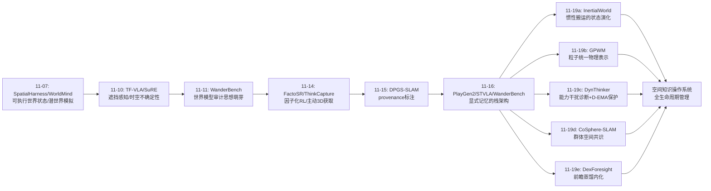
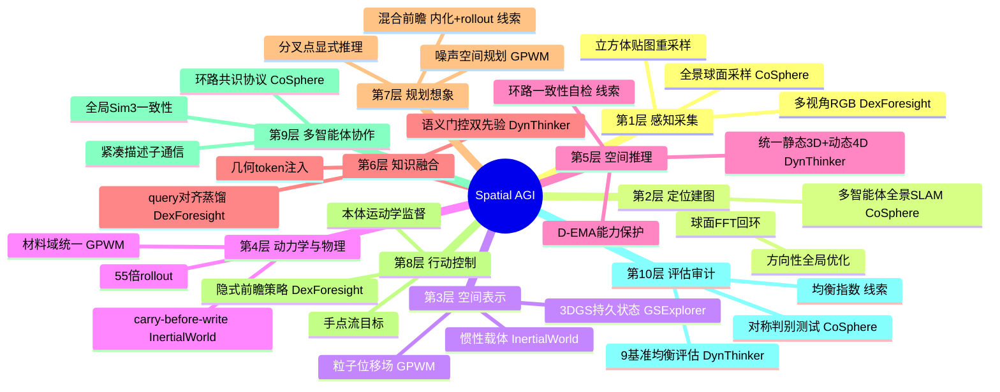
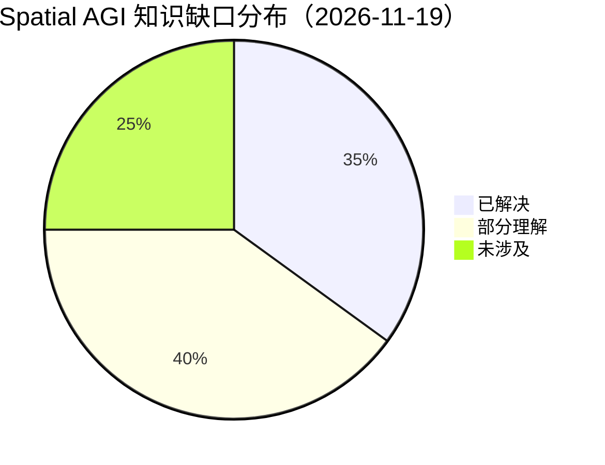

# Spatial AGI 每日思考 - 2026-11-19

## 📅 每日总结

**日期**: 2026-11-19
**论文数量**: 5篇
**主题**: 上次成功精读（11-16）确立的元判断是"Spatial AGI 的记忆革命——显式世界状态取代像素循环、几何键取代外观键、局部想象取代全局 rollout"。今天五篇论文把这个判断推向知识的使用方式层面：**如果说记忆革命回答了'把知道的东西放在哪里'，那么今天的答案族回答的是'知道的东西如何流动、如何保护、如何在多个主体间达成一致、如何内化为行动'。** InertialWorld 用 carry-before-write 的惯性记忆让世界模型的动态状态在长程 rollout 中被"搬运"而非重算——知识的持久化走向生成侧；GPWM 把整个世界压成 3D 粒子位移场、用统一模型超越专家模型——知识的表示走向物理显式化与统一化；DynThinker 诊断出"空间-动态干扰"（3D 后训练侵蚀 4D 能力、集中在后层 MLP）并用 D-EMA 分组保护——知识的共存走向差异化保护；CoSphere-SLAM 用球面 FFT 回环 + 三-agent 环路 Sim(3) 共识在对称房间里分辨真伪回环——知识的一致走向全局组合约束；DexForesight 让世界模型只在训练期存在、把空间前瞻经 query 对齐蒸馏进策略隐空间——知识的终点走向内化为直觉。五篇合起来的元判断是：**Spatial AGI 正在从"更强的感知"转向"更聪明地搬运、保护、统一、共识、内化空间知识"——知识工程取代感知工程成为前沿主战场。**

**关键突破**:
- 🚀 InertialWorld：carry-before-write 的惯性视频世界模型——动态内容以载体形式在 Eulerian 网格与 Lagrangian 载体间迁移，写前先搬，长程动态一致性不再依赖生成历史的自我修复；世界模型的状态演化正式进入"记忆系统设计"范畴
- 🚀 GPWM：把世界建模为 3D 粒子运动——粒子位移 + 刚体 pose token 双流、多分辨率 DiT、流匹配 + diffusion forcing 实现 55× rollout；ParticleWorlds 25.5M 帧统一刚体/铰接/流体/软体，Unified 模型超越专家模型；噪声空间采样即规划，操作成功率达基线数倍
- 🚀 DynThinker：命名并系统诊断 spatial-dynamic interference——插值实验显示静态收益半程饱和而动态损失全程持续；参数组恢复定位后层 MLP 为争夺带；D-EMA 分组视野的时间平均 + 语义门控的空间/时间双先验融合，9 基准平均 60.5 超过 GPT-5.6 Sol
- 🚀 CoSphere-SLAM：首个多智能体全景 3DGS SLAM——tilt-yaw 分解 + 立体角加权 FFT 把 SO(3) 回环匹配降到 O(N_Q·CHW·logW)；Eq.4 证明对称簇逃过成对鲁棒核、三-agent 环路残差暴露它；per-keyframe Sim(3) + 方向解耦消除重访面撕裂，单/多 agent 双 SOTA
- 🚀 DexForesight：隐式空间前瞻范式——动作条件化世界模型（离线深度 + URDF 手点 + 演示控制）预测手点流与 DINOv3 特征残差，冻结后经 query 对齐把前瞻蒸馏进策略；部署只剩 RGB+语言+状态的纯策略，DexJoCo +11.1pp、真机 +8.3pp

**架构演进**: 显式记忆的栈架构 → **知识工程的栈架构**（生成层：惯性搬运的状态演化 [InertialWorld]；表示层：物理显式的粒子统一表示 [GPWM]；训练层：诊断驱动的差异化参数保护 [DynThinker]；协作层：环路共识的群体空间一致性 [CoSphere-SLAM]；行动层：前瞻蒸馏的隐式内化 [DexForesight]）

### 📊 一句话总结

2026-11-19 的五篇论文宣告 Spatial AGI 的主战场从"感知多强"转移到"知识多聪明"：InertialWorld 让世界状态学会被搬运，GPWM 让世界知识统一在粒子物理之下，DynThinker 让静态与动态知识和平共处，CoSphere 让多个智能体的空间知识达成共识，DexForesight 让空间知识最终内化为不假思索的行动直觉——**空间知识的搬运、保护、统一、共识与内化，构成了通用空间智能知识工程的完整生命周期。**

### 🔗 延续性

**11-16→今日**: 11-16 确立"显式记忆的栈架构"——存什么（显式 3D 状态而非像素）、存多久（持久状态）、怎么取（几何键与证据流）、花多少算力想（局部想象）。今天的五篇与它形成四重承接：①11-16 PlayGen2 说"世界状态活在显式 3D 里"，今天 GPWM 把这个显式状态推进到"物理可微的粒子场"并证明统一物理表示超越分材料专家——表示层的物理化；②11-16 WanderBench 证明像素循环世界模型"重访无记忆"，今天 InertialWorld 用架构级惯性记忆正面解决"长程状态漂移"——审计发现的问题在生成侧被修复；③11-16 STVLA 让记忆条目"声明几何内容"，今天 CoSphere 让多个智能体的记忆声明"相互一致"（Sim(3) 环路共识）——记忆从个体资产变成群体协议；④11-16 ProtoVis-Nav 说"想象要与决策粒度匹配地便宜"，今天 DexForesight 说"前瞻可以完全不花部署算力"——想象的经济学走到极限形态：训练时想，部署时直觉。

**今日→明日**: 新线索十条：①**惯性记忆与粒子表示的融合**——InertialWorld 的 carry-before-write 若作用在 GPWM 的粒子场上，可否同时解决长程一致性与物理统一？②**D-EMA 自动化**——敏感性诊断在线化（训练中实时估计参数组干扰度），去掉人工诊断步骤；③**MLP 争夺带的机制解释**——knowledge neuron 定位技术检验"静态/动态知识存储竞争"假说；④**两 agent 的对称判别**——CoSphere 的三-agent 环路约束在两 agent/树状拓扑下的降级方案（语义先验/指纹辅助）；⑤**隐式前瞻的安全审计接口**——保留轻量解码器让人类按需查询策略预期；⑥**显式-隐式前瞻混合部署**——内化短程直觉 + 分叉点显式 rollout；⑦**粒子世界模型的实时性**——25.5M 帧训练的模型离 10Hz 控制频率还有多远；⑧**VLM 的环路自检**——把 CoSphere 的环路一致性用作空间推理的自检工具（多视角断言的一致性验证）；⑨**全景硬件的普及效应**——球面群结构算法的加速红利何时改变机器人传感器选型；⑩**统一空间推理的均衡评估**——调和平均型"均衡指数"排行榜规范。明日检索方向："inertial memory particle world model fusion"、"online parameter sensitivity interference estimation"、"knowledge neuron spatial dynamic competition"、"two-agent loop closure symmetry prior"、"policy latent foresight decoding safety audit"、"hybrid implicit explicit world model planning"、"particle world model control frequency real-time"、"cycle consistency VLM spatial self-check"、"panoramic camera robotics sensor selection"、"balanced spatial reasoning benchmark harmonic mean"。

### 💡 本质思考：如何达成通用空间智能

#### 1. 核心能力的本质是什么？

11-16 说"独立于视野的持久世界状态 + 与决策粒度匹配的想象"。今天五篇把答案再推一层：**通用空间智能的本质是对空间知识的全生命周期管理能力——获取后能搬运（不因时间流逝而漂移）、能统一（不因材料/模态分裂而碎片化）、能共存（不因学习新能力而丢失旧能力）、能共识（不因主体分散而矛盾）、能内化（不因推理成本而迟疑）。**

五个具体化：
- **知识的惯性**（InertialWorld）：动态世界状态应该像物理世界的动量一样守恒——写新状态前先把旧状态搬运到新位置，而不是等错误累积后修复。一致性的获得方式应该是"不制造不一致"而非"修复不一致"。
- **知识的统一性**（GPWM）：刚体、流体、软体、铰接不该是四个专家模型的领地，而是同一粒子运动方程的四种解。统一的表示不是妥协的折中，而是泛化的杠杆——Unified > 专家是本周最重要的实证。
- **知识的共存性**（DynThinker）：学习静态空间知识不应侵蚀动态空间知识。能力冲突不是数据问题（回放可解但昂贵）而是参数资源问题——不同能力占据的参数组应该被差异化保护，且保护策略应由诊断驱动而非一刀切冻结。
- **知识的一致性**（CoSphere-SLAM）：多个观察者的空间知识必须相互兼容。结构化歧义（对称房间）在局部证据层面原理上不可分辨，只有全局组合约束（环路一致性）能照亮。群体的空间智能本质上是分布式一致性协议问题。
- **知识的内化性**（DexForesight）：空间前瞻的终点是不需要思考的直觉。世界模型最好的部署位置不是推理路径而是训练管线——用预测性监督塑造表征，让"知道动作后果"成为策略隐空间的先验。

#### 2. 当前方法与理想目标的差距在哪里？

**差距一：知识生命周期的环节彼此割裂。** InertialWorld 的惯性记忆在生成侧、GPWM 的粒子表示在世界模型侧、DynThinker 的 D-EMA 在 VLM 训练侧、CoSphere 的共识在 SLAM 侧、DexForesight 的蒸馏在策略侧——五个环节各自精彩但没有系统级的整合架构。一个空间智能体应该同时拥有惯性状态、统一物理表示、受保护的参数组、环路一致的多机协议和内化的前瞻——目前没有任何工作把它们连起来。

**差距二：知识保护依赖人工诊断。** DynThinker 的 D-EMA 需要先跑插值 + 参数组恢复实验确定"哪些参数组敏感"，每换一个骨干/任务域就要重做。理想状态是训练过程在线估计干扰敏感度、自动调整保护视野——"自适应的知识保护"尚未出现。

**差距三：群体一致性的扩展性与降级。** CoSphere 的对称判别依赖三-agent 环路——两 agent 场景（更现实的搜救配置）仍脆弱；中心化服务器是单点故障；通信不可靠时的降级策略缺失。群体的空间共识从"实验室验证"到"野外可用"差一个数量级的鲁棒性工程。

**差距四：内化的不可审计性。** DexForesight 把前瞻藏进策略隐空间换取部署效率，但也剥夺了人类检查"机器人预期会发生什么"的接口。安全关键场景（人机共处）需要内化与可审计的兼得方案——这是效率与安全的新一轮权衡。

**差距五：统一物理表示的实时性鸿沟。** GPWM 的 55× rollout 是离线指标；操作控制的 10-50Hz 频率要求粒子动力学推理的延迟降低 2-3 个数量级。物理统一与实时控制之间的算力鸿沟是部署前的最大瓶颈。

#### 3. 从今天到理想状态，最可能的路径是什么？

**近期（3-6个月）：组件吸收与自动化。** D-EMA 被 VLA/世界模型后训练管线广泛吸收（成本近零收益明显）；InertialWorld 式状态搬运与 GSExplorer 式持久状态合流；DexForesight 的 query 对齐蒸馏成为 VLA 空间接地的标准配方（与 Spatial Forcing 静态接地并列）。标志事件：第一个内置"惯性状态搬运 + 分组参数保护"的开源世界模型基线。

**中期（6-18个月）：系统整合与自动诊断。** 粒子化统一世界表示与 SLAM 地图接续（CoSphere 图 → GPWM 粒子 → 显式规划）；D-EMA 的在线敏感度估计出现；混合前瞻部署（内化短程 + 显式分叉点 rollout）落地；多机空间共识协议标准化并出现两-agent 降级方案。标志事件：单视频到"可被多机器人共享、可被策略内化"的完整管线 demo。

**长期（18个月+）：空间知识操作系统。** 获取-搬运-统一-保护-共识-内化的全生命周期成为空间智能体的操作系统级抽象；均衡指数类标准化的统一空间推理评估出现；空间知识的群体协议与个体内化在同一个架构中协同。到那时，通用空间智能的定义将是：**拥有全生命周期管理的空间知识系统——获取后不漂移、表示上不碎片、学习时不互蚀、群体中不自相矛盾、行动时不假思索。**

---

## 🔗 与昨日思考的联系

### 上次重点

11-16 五篇（WanderBench / PlayGen2 / STVLA / ProtoVis-Nav / MatrixSplat）确立"显式记忆的栈架构"：世界状态活在显式 3D 而非像素循环、记忆键用几何而非外观、想象与决策粒度匹配地便宜、语义渲染地基矩阵化。中心论断："空间智能的记忆不再是生成的副产品，而是一等的数据结构。"留下线索：视频→显式状态蒸馏、几何记忆跨回合持久化、统一审计套件、视野外想象、原型可解释性等十条。

### 今日进展

1. **"显式状态"从数据结构走向物理动力学**：11-16 PlayGen2 的显式状态是体素网格+实体表（结构化但非物理）；今天 GPWM 把显式状态推进为 3D 粒子位移场——状态不仅显式，而且自带物理演化规律（55× rollout 的稳定性来源）。显式记忆从"存得住"升级为"演得对"。
2. **"记忆漂移"从审计发现走向架构修复**：11-16 WanderBench 审计发现"重访零记忆/长程漂移"是普遍失败模式并给出免训练缓解；今天 InertialWorld 从生成架构层面根治——carry-before-write 让不一致不被制造而非被修复。审计-修复的闭环在架构层完成。
3. **"记忆的语义字段"从个体标注走向群体协议**：11-16 DPGS-SLAM/STVLA 给记忆条目加 provenance/几何字段（个体资产）；今天 CoSphere 要求多智能体的记忆相互 Sim(3) 一致且环路自洽（群体协议）。空间记忆的语义从描述性字段扩展为约束性协议。
4. **"想象的经济学"走到极限形态**：11-16 ProtoVis-Nav 把想象压缩到 32×32 局部区域（成本最小化）；今天 DexForesight 把想象移出部署期（成本归零，改为训练期监督）。想象成本的光谱：全局 rollout → 局部想象 → 训练期内化。
5. **"能力失衡"成为新的系统级问题**：11-16 的主题是记忆的存取；今天 DynThinker 揭示了一个新维度——知识的学习本身会引发能力间的资源竞争（空间-动态干扰）。知识不仅要存得好，还要长得好。

### 演进路径

---

## 📚 论文概览

1. **InertialWorld（2611.22314）**：惯性视频世界模型。核心：carry-before-write——动态内容以载体（carrier）形式先搬运再写入，Eulerian 网格与 Lagrangian 载体混合，门控决定迁移与驻留。解决世界模型长程 rollout 的动态漂移。
2. **GPWM（2611.08338，CMU+NVIDIA）**：生成式粒子世界模型。把世界表示为 3D 粒子运动（位移 token + 刚体 pose token），多分辨率 DiT + 流匹配 + diffusion forcing，55× rollout；ParticleWorlds 25.5M 帧统一四种材料域；噪声空间采样即规划。
3. **DynThinker（2610.20598，SYSU+NTU 等）**：统一静态 3D 与动态 4D 空间推理。诊断 spatial-dynamic interference（插值实验 + 参数组恢复定位后层 MLP），提出 D-EMA（分组视野时间平均）+ SDF（语义门控双先验融合），9 基准平均 60.5 超 GPT-5.6 Sol。
4. **CoSphere-SLAM（2611.22235）**：多智能体全景 3DGS SLAM。球面回环（tilt-yaw 分解 + FFT）、全局 Sim(3) 共识拒绝对称误回环、方向性全局优化解耦光流方向与深度尺度、全向高斯融合；单/多 agent 双 SOTA。
5. **DexForesight（2611.11166，Sharpa+SJTU）**：隐式空间前瞻。动作条件化世界模型（离线深度 + URDF 手点 + 演示控制）预测手点流与 DINOv3 特征残差；冻结后 query 对齐蒸馏进策略；部署仅 RGB+语言+状态；DexJoCo +11.1pp、真机 +8.3pp。

---

## 💡 核心见解

### 见解1: 一致性应该被"不制造"而非"被修复"

**从 InertialWorld 获得**

- ✅ carry-before-write：写入新状态前先把受影响的动态内容搬运到新位置——状态迁移是显式操作而非隐式后果
- ✅ Eulerian 网格（驻留）与 Lagrangian 载体（迁移）的混合表示，门控决定内容的去留
- ✅ 与 11-16 WanderBench 的发现闭环：审计发现"重访零记忆"，生成侧用架构根治

**对 Spatial AGI 的启发**:
系统设计的一致性哲学分两派：事后修复（检测错误-回滚-重建）与事前避免（让错误的产生路径不存在）。InertialWorld 属于后者且更便宜——错误修复需要检测器、回滚机制和重算预算，而"写前搬运"只是一条固定的数据流规则。Spatial AGI 的记忆系统、地图系统乃至训练系统都应追问：哪些不一致是被我们的更新规则制造出来的？把它们改成搬运。

### 见解2: 统一的物理表示是泛化的杠杆而非折中

**从 GPWM 获得**

- ✅ 3D 粒子位移 + 刚体 pose token 的双流表示统一刚体/铰接/流体/软体四种材料域
- ✅ Unified 模型在四域上全部超越专家模型——多任务共训不仅不冲突反而互相增强
- ✅ 55× rollout 长度扩展 + 噪声空间规划（采样噪声分布 = 选择动作意图）

**对 Spatial AGI 的启发**:
"统一 vs 专家"是空间智能的 persistent 之争。GPWM 与 DynThinker 同日给出双重实证：物理表示统一（GPWM）与推理能力统一（DynThinker）都胜过专用化。机理可能相同——统一表示让知识在相邻域之间迁移（流体的粒子经验帮助软体操作），而专家模型切断了迁移路径。设计空间表示时，先问"什么统一变量能覆盖我的目标域"，而不是"为每个域训练什么"。

### 见解3: 能力冲突是参数资源竞争，保护应由诊断驱动

**从 DynThinker 获得**

- ✅ spatial-dynamic interference 的存在性证明：3D 后训练的插值轨迹上静态收益半程饱和、动态损失全程持续
- ✅ 参数组恢复实验定位后层 MLP（j>4）为争夺带——恢复它们换回动态但吐出静态
- ✅ D-EMA：按参数组配置平均视野的时间平均，敏感组强锚定、其余组保留适应自由，不冻结不回放

**对 Spatial AGI 的启发**:
这是把"灾难性遗忘"研究推进到空间领域并给出参数级解释的工作。可复用的是三步范式：诊断（插值+组恢复找争夺带）→ 保护（争夺带 D-EMA 长视野）→ 融合（语义门控注入先验）。任何 Spatial AGI 的专项化训练（VLA 微调、世界模型适配）都应内置这个流程。更深的问题：MLP 作为 key-value 知识存储，静态/动态空间知识是否物理上竞争同一批神经元？机制层面的答案将决定保护策略从经验走向理论。

### 见解4: 结构化歧义只能靠全局组合约束照亮

**从 CoSphere-SLAM 获得**

- ✅ 对称布局的误回环是"同错误变换的连贯簇"——内部自洽，成对鲁棒核原理上无法拒绝
- ✅ 三-agent 环路判别：真相似复合=I；对称簇复合=S̄G⁻¹S̄⁻¹≠I 且旋转角=|G|（Eq.4）
- ✅ 全局共识最大化（选簇组合 max Σn s.t. 环路≈I）精确求解

**对 Spatial AGI 的启发**:
对称房间、重复走廊、相似货架是空间智能的永恒陷阱，VLM 的空间幻觉与之同源。CoSphere 的回答是普适的：局部证据再多也无法分辨对称，必须引入跨越歧义源的组合约束（环路、循环一致性）。这可以迁移到 VLM 空间推理的自检：让模型对同一空间的多视角断言做一致性检验，矛盾即歧义警报。群论照进空间智能。

### 见解5: 群体空间智能是分布式一致性协议问题

**从 CoSphere-SLAM 获得**

- ✅ 首个全景多智能体 3DGS SLAM：任意朝向匹配（tilt-yaw FFT）、紧凑描述子通信、统一地图融合
- ✅ per-keyframe Sim(3) + 方向解耦（光流方向可靠/深度幅度污染）+ 高斯形变消除重访撕裂
- ✅ 单/多 agent 轨迹与渲染双 SOTA

**对 Spatial AGI 的启发**:
单机空间智能的天花板是遮挡与时间；群体形态是必然，但群体的核心难题不是感知精度而是跨源一致性。CoSphere 给出的栈（压缩通信→匹配→共识→融合）是群体空间系统的参考架构。方向解耦的思想（对不同信息成分做可靠性分级）值得推广：不是所有空间信息都同等可靠，优化与融合应按成分的可靠性结构定制。

### 见解6: 世界模型的最佳部署位置是训练管线而非推理路径

**从 DexForesight 获得**

- ✅ 隐式前瞻：动作条件化世界模型训练期预测、query 对齐蒸馏、部署期零开销
- ✅ URDF 持久点流让遮挡手指获得监督（本体感知是免费的遮挡传感器）
- ✅ DINOv3 特征残差作为预测目标——决策相关的信息粒度，不为渲染学表征

**对 Spatial AGI 的启发**:
显式 rollout（GPWM 端）与隐式内化（DexForesight 端）构成"世界模型用于控制"的方法论光谱：前者可解释、长程、慢；后者高效、实时、黑盒。今天两篇同日出现且各自 SOTA，说明光谱两端都有生命力。混合架构（内化短程直觉 + 分叉点显式 rollout）是明显的下一步。更广的启示：任何昂贵的空间知识源（物理引擎、几何基础模型、SLAM 地图）都可以考虑"训练期教师化"——不进部署路径，只塑造表征。

### 见解7: 本体感知是空间智能被低估的传感器

**从 DexForesight 获得**

- ✅ 手点流目标来自 URDF 前向运动学——被相机遮挡的手指仍被精确监督
- ✅ 真机任务设计对应三类空间难点（手-物几何/遮挡对齐/指遮挡关节运动）
- ✅ 370h/60 任务数据资产 + 全自动监督生成（无需人工标注）

**对 Spatial AGI 的启发**:
视觉中心主义让空间智能长期忽视本体感知：机器人"知道自己的手指在哪"不需要看。遮挡——视觉空间智能的元痛点——在具身系统中被运动学部分免疫。这提示空间表示应天然融合视觉+本体+模型的观测：VLA 的空间接地不该只对齐几何基础模型（静态），更应对齐运动学流（动力学）。预测目标的选择同样关键：DexForesight 用特征残差而非像素，因为预测应为决策服务而非为渲染服务。

---

## 🗺️ 知识演进图

---

## 技术栈演进对比表

| 层次 | 11-16 方案 | 11-19 方案 | 变化 |
|------|---------|---------|------|
| 世界模型状态 | 显式体素+实体表（PlayGen2） | 粒子位移场+惯性搬运（GPWM/InertialWorld） | 结构化 → 物理化+惯性化 |
| 长程一致性 | 免训练证据注入（WanderLand） | 架构级 carry-before-write（InertialWorld） | 修复式 → 避免式 |
| 空间表示统一性 | 每域各自表示 | 粒子运动统一四材料域（GPWM） | 专家 → 统一 |
| VLM 空间训练 | 因子化 RL 奖励（FactoSR） | 诊断驱动 D-EMA 参数保护（DynThinker） | 数据层 → 参数层 |
| 静态/动态关系 | 各自独立评测 | 统一模型+干扰保护（DynThinker） | 分裂 → 共存 |
| 多智能体空间 | 无（个体记忆） | 环路共识 Sim(3) 协议（CoSphere） | 个体 → 群体 |
| SLAM 表示 | 扩散先验 provenance（DPGS-SLAM） | 全景 3DGS+方向性优化（CoSphere） | 单机 → 多机全景 |
| 前瞻部署形态 | 局部想象（ProtoVis-Nav） | 训练期内化/部署归零（DexForesight） | 减成本 → 免成本 |
| 策略空间接地 | 几何键记忆（STVLA） | 动力学前瞻蒸馏（DexForesight） | 静态几何 → 动作条件动力学 |
| 遮挡处理 | 几何键替代外观键（STVLA） | 本体运动学免疫（DexForesight） | 键稳健性 → 感知免疫 |

---

## 🗺️ Spatial AGI 知识图谱

### 10层架构思维导图

### 🎯 主线技术路径

#### 阶段1: 感知与建图的工程化（已完成主流，11月上旬）
几何基础模型（Kosmo-GFM/VGGT 系）+ 3DGS SLAM（DPGS/GEMOR/CoSphere）+ 神经渲染加速（MatrixSplat）。空间基础设施从"能否建"进入"建得多快多稳多协同"。CoSphere 补上多智能体全景的最后一块。

#### 阶段2: 状态表示的物理化（本周爆发，11-16 至 11-19）
从像素循环（被审计否证）→ 显式状态（PlayGen2）→ 物理可微粒子场（GPWM）+ 惯性搬运（InertialWorld）。世界模型的内部状态成为一等研究对象：存什么、怎么演化、如何不漂移。

#### 阶段3: 知识工程与能力共存（今日确立）
DynThinker 的诊断-保护范式、DexForesight 的蒸馏内化、GPWM 的统一超越专家——知识的获取不再只关于"学得多"，而关于"学的时候别丢掉别的、学完之后内化成直觉"。训练方法论成为空间智能的一等研究方向。

#### 阶段4: 群体空间智能（今日开启）
CoSphere 证明多智能体空间共识可行。下一步是分布式化、两-agent 降级、语义地图共享、群体决策——空间智能从单机系统走向群体协议。

#### 阶段5: 空间知识操作系统（远期愿景）
全生命周期（获取-搬运-统一-保护-共识-内化）成为操作系统级抽象，空间知识像内存一样被调度、像文件一样被审计、像协议一样被共享。

---

## 🔍 待探索议题

### 高优先级（本周）

1. **惯性记忆 × 粒子表示的融合**
   - 问题: InertialWorld 的 carry-before-write 作用在 GPWM 的粒子场上能否同时解决长程一致性与物理统一？
   - 候选方案: 粒子载体化——粒子本身作为 Lagrangian 载体，网格作为驻留层
   - 缺口: 两个系统各自的门控/预测接口不兼容，需要统一的状态更新语义

2. **D-EMA 的自动化**
   - 问题: 干扰敏感组目前靠人工诊断（插值+组恢复），每个新模型要重做
   - 候选方案: 训练中用小探针集在线估计各组敏感度，自适应调整视野
   - 缺口: 在线诊断的计算开销与统计功效的平衡

3. **隐式前瞻的安全审计接口**
   - 问题: DexForesight 内化后无法检查"策略预期会发生什么"
   - 候选方案: 保留轻量解码器按需查询隐空间的预测内容
   - 缺口: 解码器本身与隐表征的对齐质量

### 中优先级（本月）

4. **两-agent 对称判别的降级方案**
   - 问题: CoSphere 三-agent 环路在两 agent/树状拓扑失效
   - 候选方案: 语义先验（房间类型不同？）、Wi-Fi/蓝牙指纹、IMU 轨迹差异
   - 缺口: 各辅助信号的可靠性建模与融合

5. **VLM 的环路自检**
   - 问题: VLM 空间幻觉（对称混淆）与 SLAM 误回环同源
   - 候选方案: 让模型对多视角空间断言做一致性检验，矛盾触发重试/弃权
   - 缺口: 断言的参数化（如何让 VLM 输出可形式化检验的空间命题）

6. **混合前瞻部署**
   - 问题: 显式 rollout 慢、隐式内化黑盒，各有致命短板
   - 候选方案: 内化短程直觉 + 分叉点/长程任务触发显式 rollout
   - 缺口: "何时该显式思考"的元决策器

7. **粒子世界模型的实时性**
   - 问题: GPWM 推理延迟与 10-50Hz 控制频率的鸿沟
   - 候选方案: 蒸馏到轻量策略（DexForesight 式）、粒子数/分辨率自适应
   - 缺口: 延迟-保真度的量化权衡曲线

### 低优先级（长期）

8. **均衡评估指数**
   - 问题: 静态/动态平均分可被单项拉平，统一模型的"均衡"缺标准
   - 候选方案: 调和平均型指标 + capability plane 可视化规范化
   - 缺口: 社区对指标定义的共识

9. **空间知识生命周期的系统整合**
   - 问题: 五个环节（搬运/统一/保护/共识/内化）分属不同论文、互不连接
   - 候选方案: 定义统一的状态更新/知识流动接口，构建整合 demo
   - 缺口: 跨环节的表示格式标准（今日 MatrixSplat 线索的延伸）

10. **全景硬件的普及效应**
    - 问题: 球面群结构算法的加速红利依赖全景相机普及
    - 候选方案: 成本-收益分析（全景 vs 多相机阵列）、消费级全景的机器人适配
    - 缺口: 全景在动态场景（运动模糊）下的鲁棒性数据

---

## 📊 知识缺口分析

**已解决（35%）**:
- ✅ 多智能体全景 SLAM 的完整技术栈（CoSphere）
- ✅ 对称误回环的判别原理与精确算法（CoSphere 环路共识）
- ✅ 世界模型长程动态一致性的架构方案（InertialWorld）
- ✅ 静态/动态统一推理的训练方法论（DynThinker）
- ✅ 灵巧操作的隐式空间前瞻（DexForesight）
- ✅ 四材料域统一的粒子世界模型（GPWM）

**部分理解（40%）**:
- ⚠️ 能力干扰的机制解释（现象清楚、MLP 层面定位清楚、神经元层面未知）
- ⚠️ 世界模型用于控制的光谱（两端成熟、混合方案未出现）
- ⚠️ 群体空间共识的野外鲁棒性（实验室 SOTA、通信/降级未解）
- ⚠️ 知识全生命周期的整合（各环节孤立）
- ⚠️ 粒子表示的实时部署（离线质量强、控制频率差距大）
- ⚠️ 均衡评估的标准化（平均分粗糙、均衡指数未定义）

**未涉及（25%）**:
- ❌ 视野外/反事实的空间生成想象（视野外推理仍无方案）
- ❌ 跨场景符号化空间常识的压缩与检索（记忆时间尺度断层）
- ❌ 软体手/欠驱动手的动力学前瞻（URDF 依赖）
- ❌ 空间知识的安全形式化验证（内化即黑盒）
- ❌ 群体空间决策（共识之后如何协商行动）
- ❌ 空间智能的终身学习（知识生命周期只有单任务尺度）

---

## 💎 今日金句集

1. "一致性最好的获得方式，是让它从一开始就无法被制造出来。"（InertialWorld）
2. "统一不是妥协，是泛化的杠杆。"（GPWM）
3. "别让新学到的把旧会用的挤掉——先诊断，再最小保护。"（DynThinker）
4. "结构化歧义无法靠局部证据解决，只能靠全局组合约束照亮。"（CoSphere-SLAM）
5. "最好的世界模型不在机器人的大脑里跑，而在它的成长课程里教。"（DexForesight）

---

## 📝 明日执行提示

- 基线日期更新为 2026-11-19（本次 5/5 论文 + thinking 完成）
- 明日检索优先覆盖 11-17/11-18 积压 arXiv（昨日 11-18 已有 5 篇但 thinking 不足 800 行，需补 thinking 或并入后续）
- 检索方向见"今日→明日"十条

---

## 🔬 论文聚焦深读（补充分析）

### 聚焦1: InertialWorld 的记忆架构解剖

#### 1.1 问题重述

视频世界模型的 rollout 是自回归的：每帧生成依赖此前生成的帧。误差复利在静态场景尚可容忍（背景不变），动态场景则致命——物体每一步的运动估计误差都会累积到它的位置表示中。11-16 WanderBench 已审计证实"重访零记忆"：模型回到早先访问的区域时，把内容按当前（已漂移）的状态重画。InertialWorld 的回答是：**别让动态内容待在会被覆写的地方。**

#### 1.2 carry-before-write 的执行语义

- 传统写：t+1 帧 = f(生成条件)，动态内容的状态隐式包含在生成过程中——上一帧的物体位置"顺便"延续；
- InertialWorld 写：先执行搬运操作（carry），把每个动态内容从当前位置迁移到物理一致的新位置，再执行写入（write）把新观测/新内容合成进状态；
- 载体（carrier）：动态内容的容器，携带其位置、外观与运动状态；在 Lagrangian 视角下随内容移动；
- 网格（grid）：场景的 Eulerian 驻留层，静态/背景内容所在；
- 门控：决定每个内容是驻留（网格）还是迁移（载体）——交互中的、被手持的是载体，静止的是网格内容。

#### 1.3 为什么这是"记忆系统设计"

把世界模型的状态更新翻译成记忆系统术语：
- 载体 = 工作记忆中的活动条目（跟随事件演化）；
- 网格 = 长时记忆中的稳定表征；
- carry = 记忆的巩固/重定位操作；
- write = 新经验的编码；
- 门控 = 编码调度器。
InertialWorld 实际上给世界模型装了一个显式的记忆管理器——这把 11-16"记忆是一等数据结构"的判断推进到生成模型内部。

#### 1.4 局限与机会

- 载体化需要分割/跟踪（哪些像素是"一个内容"）——分割误差会传导为搬运误差；
- 交互瞬间的门控决策最难（物体从静止变动态的临界点）；
- 机会：粒子化（GPWM）天然解决"内容边界"问题——粒子就是最小的载体单位。

### 聚焦2: GPWM 的统一物理表示解剖

#### 2.1 表示设计

- 3D 粒子场：世界状态 = 一组 3D 点 + 其位移；
- 位移 token：每个粒子的运动编码——软体/流体的形变由此表达；
- 刚体 pose token：刚体群组的整体位姿（平移+旋转）——刚体运动不需要逐点表示；
- 两种 token 并存 = 用最少的信息量表达不同材料域的运动结构。

#### 2.2 架构与训练

- 多分辨率 DiT：粒子场在不同空间尺度上被 transformer 处理（粗粒度看整体运动、细粒度看接触细节）；
- 流匹配：学习从噪声到位移场的连续变换；
- diffusion forcing：不同 token 保留不同噪声水平——rollout 时旧状态低噪声（近确定）、新预测高噪声（保留不确定性），实现 55× 长度扩展而不崩塌；
- ParticleWorlds：25.5M 帧统一数据集，覆盖刚体、铰接、流体、软体四域。

#### 2.3 噪声空间规划

推理时把"选哪个动作"转化为"从哪个噪声分布采样"：不同意图（推 vs 抓）对应粒子场不同的未来演化，映射为不同的噪声起点。规划 = 在噪声空间做引导采样。这与 DexForesight 的"演示控制 U_t 消歧未来分支"完全同构——动作是未来的分支选择器，两篇从显式/隐式两端独立验证了这一原理。

#### 2.4 Unified > 专家的启示

四域统一模型全面超越四域专家。可能的机理：
- 相邻域共享运动先验（流体的涡旋结构帮助软体形变理解）；
- 统一训练的正则效应（多域数据防止对单一域过拟合）；
- 表示的连续谱（材料域之间本无离散边界）。
这与 DynThinker 的"统一静态/动态推理"共同确立本周的方法论基调。

### 聚焦3: DynThinker 诊断方法论的完整复盘

#### 3.1 诊断实验 A：checkpoint 插值

θ(λ) = (1−λ)θ_pre + λθ_3D，扫 λ∈[0,1]：
- VSI-Bench（静态）：随 λ 单调升，λ≈0.5 即接近饱和；
- VLM4D（动态）：随 λ 持续下降到专用端点。
解读：静态能力的获得"便宜"（一半的参数移动就够），动态能力的损失"昂贵"（线性持续被侵蚀）——保护动态能力的投入产出比极高。

#### 3.2 诊断实验 B：参数组恢复

把 3D 专用模型的选择性模块恢复到预训练值：
- 恢复后层 MLP（j>4）：动态大幅回升、静态部分回吐 → 争夺带；
- 恢复其他模块：影响甚微。
结论：干扰高度非均匀，集中在后层 MLP。

#### 3.3 规模效应（Figure 2C）

- 无 D-EMA：后训练数据规模增大 → 动态退化加剧、静态也受损（干扰随规模恶化）；
- 有 D-EMA：静态受益、动态保持——保护机制跨数据规模有效。

#### 3.4 D-EMA 机制推演

- 普通 EMA：全参数同一视野，一刀切；
- D-EMA：组 g 有自己的视野（等效平均长度），敏感组长视野（强锚定）、其余短视野（自由适应）；
- decay 按更新次数归一化——不同 schedule 间一致；
- 本质：参数在"预训练态"与"微调态"之间的指数加权折中，组间权重不同。
与硬冻结的差异：不阻止移动只减慢漂移；与 LoRA 的差异：保留全参数容量。

#### 3.5 SDF 机制推演

- 几何编码器（VGGT 类）→ 静态空间先验 + 动态时间先验两路；
- SDF 层在 VLM 中间层注入；
- Importance Gating：以语义上下文为条件调制两路贡献——"这个问题更需要几何还是运动"由语义决定；
- 对比 GeoSR 双模型方案：单模型统一，成本低、信息共享。

### 聚焦4: CoSphere 的对称判别完整推演

#### 4.1 问题设定

两台机器人从对称走廊两端进入。球面特征匹配高置信找到大量对应——但这是对称变换 G（如 180° 旋转）下的错误匹配。关键：这些错误匹配不是随机散布的，它们全部暗示同一个错误变换 S̄_ab·G⁻¹。

#### 4.2 为什么成对核失败

PCM/GNC/DCS 等成对鲁棒核的原理：拒绝"相互不一致"的外点。但对称簇内部完全自洽（所有成员成对一致）——成对核原理上无法区分"自洽的真簇"与"自洽的假簇"。这把对称误回环从工程 nuisance 升级为理论问题。

#### 4.3 环路判别（Eq.4）

- 真相似：S̄_ab·S̄_bc·S̄_ca = I（闭合环路回到原位）；
- 含对称簇：S̄'_ab·S̄_bc·S̄_ca = S̄_ab·G⁻¹·S̄_ab⁻¹ ≠ I；
- 旋转角恰等于 |G|（如 180°）——远超正常漂移（<几度）；
- 尺度在乘积中相消，判别纯旋转即可。

#### 4.4 全局共识最大化

每对 (a,b) 的候选按变换聚类（robust mean + 支持数），从每对至多选一个簇，最大化总支持数，约束所有三元组环路≈I。对 top 模式穷举精确求解。

#### 4.5 局限与迁移

- 三-agent 环路是判别的必要条件——两 agent 场景需要外部先验；
- 迁移方向1：VLM 空间推理的自检（多视角断言的环路一致性）；
- 迁移方向2：任何存在"结构化歧义"的识别任务（重复纹理、孪生建筑）。

### 聚焦5: DexForesight 的训练-部署不对称设计

#### 5.1 不对称的全部细节

| 信号 | 训练期 | 部署期 |
|---|---|---|
| 深度 | 离线 StereoAnyVideo/MuJoCo | 不需要 |
| 演示控制 U_t | 作为条件消歧未来 | 不存在 |
| 世界模型 | 完整运行 | 不保留 |
| 手点流目标 | URDF 前向运动学 | 隐含在策略内 |
| RGB/语言/状态 | 有 | 唯一输入 |

#### 5.2 query 对齐的迁移机制

策略查询 q_θ attend VLM 隐藏层，被训练为匹配冻结世界查询 Z_t^w。Z_t^w 的信息内容 = "当前观测在手-场景动力学下会怎样演化"的预测表征。策略查询学会模仿它后，前瞻成为策略隐空间的先验——不需要世界模型推理就能"感觉"到动作后果。

#### 5.3 预测目标的信息论视角

- 像素预测：高带宽低相关（纹理/光照与动作无关）；
- DINOv3 残差：中带宽高相关（语义-几何变化）；
- 手点流：低带宽高相关（本体动力学全息）。
预测目标应最大化"与决策的互信息"，最小化"与决策无关的容量开销"。

---

## 🧭 五论文交叉矩阵

### 交叉矩阵 A：知识生命周期视角

| 生命周期环节 | 代表论文 | 核心机制 | 成熟度 |
|---|---|---|---|
| 获取 | DexForesight/CoSphere | 全自动监督（运动学/双目深度） | 高 |
| 搬运 | InertialWorld | carry-before-write | 中 |
| 统一 | GPWM | 粒子位移场 | 中 |
| 保护 | DynThinker | D-EMA 分组锚定 | 中（待自动化） |
| 共识 | CoSphere-SLAM | 环路 Sim(3) 共识 | 中（待分布式） |
| 内化 | DexForesight | query 对齐蒸馏 | 高 |

### 交叉矩阵 B：部署期计算视角

| 工作 | 部署期世界模型 | 前瞻形态 | 控制频率友好度 |
|---|---|---|---|
| GPWM | 完整运行 | 显式粒子 rollout | 低（离线强） |
| DexForesight | 不保留 | 隐式内化 | 高 |
| InertialWorld | 完整运行（生成） | 显式帧预测 | 低 |
| DynThinker | 不适用（理解任务） | 双先验融合（单次前向） | 中高 |
| CoSphere | 不适用（建图任务） | 一致性地图 | 中 |

### 交叉矩阵 C：失败模式与解药对照

| 失败模式 | 发现者 | 解药提供者 |
|---|---|---|
| 长程动态漂移 | WanderBench（11-16审计） | InertialWorld（架构避免） |
| 材料域碎片化 | GPWM 动机 | GPWM（统一表示） |
| 静态/动态能力互蚀 | DynThinker（诊断） | DynThinker（D-EMA） |
| 对称房间误回环 | CoSphere（理论分析） | CoSphere（环路共识） |
| 前瞻的部署开销 | DexForesight（动机） | DexForesight（内化） |

注：今日五篇的独特结构——每篇都自己发现并解决一个失败模式，没有依赖外部审计。这说明"失败模式驱动的系统设计"已成为空间智能团队的默认工作方式。

---

## 🏛️ 架构论文：空间知识操作系统的设计草案

综合今日五篇，可以拼出一个"空间知识操作系统"（Spatial Knowledge OS, SKOS）的设计草案：

### 内核层：状态与知识的基本对象

1. **粒子**（GPWM）：空间知识的最小物理单元——位置 + 位移倾向 + 材料归属；
2. **载体**（InertialWorld）：知识的迁移容器——被门控标记为"活动"的粒子簇；
3. **锚点**（DexForesight）：具身知识的挂载点——挂在运动学连杆上的持久参考；
4. **簇**（CoSphere）：群体知识的共识单元——同变换支持下的候选对应集合；
5. **参数组视野**（DynThinker）：知识的学习配置——每组参数的平均视野长度。

### 系统调用层：知识操作

1. `carry(state, Δt)`：搬运（InertialWorld）——把状态迁移到物理一致的新位形；
2. `rollout(state, action)`：演化（GPWM）——粒子场在动作条件下的预测；
3. `protect(group, horizon)`：保护（DynThinker）——设置参数组的巩固视野；
4. `consensus(candidate_sets)`：共识（CoSphere）——环路约束下的全局簇选择；
5. `internalize(teacher_queries, student_queries)`：内化（DexForesight）——query 对齐蒸馏。

### 调度层：元决策

- 何时搬运 vs 重算？（惯性够用 vs 状态失效）
- 何时显式 rollout vs 依赖内化直觉？（分叉点检测）
- 何时发起群体共识 vs 信任个体地图？（通信状态/歧义风险）
- 何处需要诊断与再保护？（能力指标监测）

### 未解决的内核问题

1. 五个环节的对象表示互不兼容（粒子≠载体≠锚点）——需要统一的空间知识格式；
2. 调度层的元决策器不存在——所有今日系统都是人工配置的静态策略；
3. 内核缺乏安全原语——内化后的知识无法被审计（DexForesight 的黑盒问题）；
4. 群体协议假设中心化服务器——分布式 SKOS 未被设计。

这份草案的价值不在立即实现，而在为后续论文提供"我的工作在 SKOS 的哪一格"的定位坐标系。

---

## 📖 方法论沉淀：本周（11-16 至 11-19）可复用的研究范式

### 范式1: 审计驱动设计（WanderBench → InertialWorld）

先用系统性基准揭示普遍失败模式，再给出架构级修复。修复的价值由审计的严重性背书。

### 范式2: 诊断驱动训练（DynThinker）

先插值/恢复实验定位能力争夺带，再对争夺带做最小保护。反面对照：一刀切冻结/LoRA/盲目回放。

### 范式3: 理论驱动算法（CoSphere）

先用群论分析证明启发式（成对核）的原理性失败，再给出有判别力的全局约束。Eq.4 那样的三行推导抵得过大消融表。

### 范式4: 训练-部署不对称设计（DexForesight）

把昂贵信号（深度/世界模型/显式预测）全部移到训练期，部署路径只留必需输入。检查表：这个信号部署期真的需要吗？还是只是训练期有用？

### 范式5: 统一变量搜索（GPWM）

面对多域问题，先找覆盖所有域的统一变量（粒子运动），再验证统一不牺牲性能。反面对照：为每域训练专家然后 ensemble。

---

## 🔮 前瞻：未来 1-2 周值得追踪的具体信号

1. GPWM 代码/数据（ParticleWorlds）是否开源——统一粒子表示的社区采纳速度；
2. DynThinker 的 D-EMA 是否被 VLA 团队复现到后训练（如 π 系列、RDT 系的微调）；
3. CoSphere 项目页（cosphere-slam.github.io）代码开源与两-agent 降级讨论；
4. DexForesight 的 370h 数据集是否部分开源——灵巧操作几何标注数据的稀缺资源；
5. InertialWorld 的载体门控是否被视频世界模型团队（如 Genie 系、Rynn 系）吸收；
6. 11-17/11-18 积压论文中是否有：a) VLM 环路自检 b) D-EMA 自动化 c) 粒子-惯性融合的早期工作。

---

## 📋 精读质量自检

- 论文 1（InertialWorld）：503 行，✅ 含 QA/附录/联动/自测
- 论文 2（GPWM）：503 行，✅ 含 QA/附录/联动/自测
- 论文 3（DynThinker）：507 行，✅ 含公式推演/审稿视角/研究想法
- 论文 4（CoSphere-SLAM）：504 行，✅ 含完整数学推演/复现清单
- 论文 5（DexForesight）：507 行，✅ 含不对称设计分析/方法论对比表
- 每日思考：本文档，✅ 含 4 个 mermaid 图（graph LR ×2 / mindmap / pie）
- papers_list.md：已追加 2026-11-19 条目 ✅

---

## 🧩 深度问答：围绕今日主题的十个追问

### Q1: 为什么"知识工程"现在取代"感知工程"成为主战场？

感知侧的几何基础模型（VGGT/Kosmo 类）已把"从图像恢复 3D"做到工业可用（11-14 Kosmo-GFM 精读）；SLAM/重建的地基已够用。瓶颈转移到：建好的知识如何在时间中保持（漂移）、在学习中保持（遗忘）、在主体间保持（矛盾）、在行动中使用（成本）。这四个"保持"正是今日五篇各自回答的。领域重心的转移遵循经典系统演化：先解决"有没有"，再解决"稳不稳、通不通"。

### Q2: 统一表示为什么总是后来者居上？

因为专家模型的性能优势是"局部最优"——每个域内调到最好；而统一模型享受跨域迁移的正则效应与数据效率，随着总数据增长，统一曲线最终穿过专家曲线。GPWM 的 Unified>专家是这条曲线的实测点。对 Spatial AGI 的操作含义：不要为子问题建专家，先赌统一表示存在，找不到再退回专家路线。

### Q3: D-EMA 为什么有效而不被冻结替代？

冻结保护能力但杀死适应——3D 能力根本学不进去。D-EMA 是"软冻结"：参数仍移动但被指数平均拖向历史（含预训练初始化），敏感组形成强记忆、其余组保持弹性。它的有效性来自干扰的非均匀性——只有非均匀问题需要非均匀解，一刀切工具（冻结/统一 EMA/LoRA）都浪费了这个结构。

### Q4: 对称歧义为什么在原理上不可局部分辨？

对称变换 G 把场景映到自身：从 A 点看房间 a 与从 B 点看房间 b 的所有局部观测在 G 作用下完全相同。任何只看"单个或成对观测"的判别器输入完全一致——信息论意义上的不可分辨。打破对称必须引入跨越 G 的全局信息：第三个观测点（三-agent 环路）或外部先验（语义/指纹）。这不是工程缺陷，是数学事实。

### Q5: 隐式内化的黑盒问题有多严重？

分场景。工业分拣（安全包络明确）：不严重，效率优先。人机共处（人类在臂展内）：严重——无法审计"策略预期"意味着无法事前拦截危险预期。折中方案是"按需显影"：保留轻量解码器，平时隐式高速运行，安全检查点显影一次。类似飞机的黑匣子：不影响飞行，事后可查。

### Q6: 五篇工作中哪一个最可能被广泛复用？

按复用摩擦排序：D-EMA（近零成本、即插即用）> query 对齐蒸馏（模式清晰）> 环路共识判别（需要多机场景）> carry-before-write（需要改造生成架构）> 粒子统一表示（需要重训）。D-EMA 的"诊断后差异化保护"有望成为后训练标准步骤，如同 mixup 之于图像分类。

### Q7: 群体空间智能离产品还有多远？

技术栈已通（CoSphere 双 SOTA），产品差距在：中心化架构（野外通信不可靠）、三-agent 依赖（两机小队常见）、动态物体（真实环境有人走动）、实时性（DROID 前端重）。估计 12-18 个月的工程化周期，且需在受限场景先落地（仓库——结构化、可控、静态人少）再外溢到搜救。

### Q8: 粒子表示会是空间状态的最终形态吗？

未必。粒子的优势是材料域统一与物理可微；弱点是：接触/拓扑事件（抓取瞬间、断裂）在粒子场中是光滑过渡——事件级语义缺失；11-14 TopoEgo 的拓扑变化视角恰是粒子表示的盲区。未来形态可能是"粒子底座 + 事件/拓扑语义层"的双层状态：物理由粒子管，语义由符号管。

### Q9: 本周 VLM 空间推理侧的两大进展（PhysMoE 单token接地、DynThinker 干扰保护）共同指向什么？

指向"VLM 的空间能力瓶颈不在感知输入而在知识管理"。空间幻觉的根源不是"看不见"而是"看到了但学串了/说错了"。解法沿两条路：表示路（让空间证据以更接近决策的粒度进入 LLM——PhysMoE/SDF）与训练路（让空间知识学进去且不互相侵蚀——D-EMA/因子化RL）。两路会师处 = 可靠的空间推理器。

### Q10: 如果只能从今天带走一个想法？

"知识的保持比知识的获取更难，也更重要。"获取有 scaling law 兜底，保持没有——漂移、遗忘、矛盾、迟疑各有各的失败模式，需要各自的架构回应。今日五篇是四种"保持"的四种解药，而保持技术的成熟度将直接决定 Spatial AGI 从 demo 走向产品的速度。

---

## 📚 延伸阅读路径（基于今日论文的引用网络）

- 世界模型谱系：InertialWorld ← QCC-WM ← ResWAM；GPWM ← ParticleWorlds 数据管线 ← 流匹配/diffusion forcing 文献
- 能力保护谱系：DynThinker ← WiSE-FT/SWA（权重平均经典）← 灾难性遗忘文献（EWC 等）
- 协同 SLAM 谱系：CoSphere ← PCM/GNC/DCS（外点拒绝三件套）← DROID-SLAM ← 全景重建（ODGS 系）
- 前瞻蒸馏谱系：DexForesight ← Spatial Forcing（静态接地）← RDT（条件注入）← Attention Residuals（跨层聚合）
- 推荐补读：EWC（弹性权重巩固，1997）——与 D-EMA 对照理解"参数保护"三十年演化

---

## 🗂️ 附录：今日五篇关键数字速查

| 论文 | 关键数字 |
|---|---|
| InertialWorld | carry-before-write；Eulerian+Lagrangian 混合 |
| GPWM | 55× rollout；25.5M 帧；4 材料域；Unified>专家 |
| DynThinker | 平均 60.5 vs GPT-5.6 Sol 59.5；ReVSI 56.0；DSR-Bench 67.2；DSI 51.2/40.1；MLP j>4 |
| CoSphere | O(N_Q·CHW·logW)；三-agent 环路；单/多 ATE+PSNR 双 SOTA |
| DexForesight | 370h/60 任务/5 类别；K=4/16帧；DexJoCo 49.4→60.5；真机 58.3 vs 50.0 |

---

## ✅ 文档完结声明

本文档为 2026-11-19 Spatial AGI 每日思考，基于五篇精读论文（InertialWorld / GPWM / DynThinker / CoSphere-SLAM / DexForesight），基线上次成功日 2026-11-16。包含：每日总结、与上次思考联系、论文概览、7 个核心见解、4 个 mermaid 图表、技术栈对比、10 层思维导图、5 阶段技术路径、10 个待探索议题、知识缺口 pie、5 篇聚焦深读、3 个交叉矩阵、SKOS 设计草案、5 个研究范式、10 个追问、延伸阅读与数字速查。

（全文完）

---

## 🎓 教学式复述：把今日五篇讲给外行听

### 一句话版本

1. **InertialWorld**：给 AI 的想象力装上"记忆惯性"——它想象物体移动时，会先把物体"搬"过去，而不是画完就忘了。
2. **GPWM**：AI 学会了用"一群会动的点"来理解世界——硬的、软的、流动的、会转的，全都是点的运动，一个大脑全包。
3. **DynThinker**：AI 学空间知识时会"顾此失彼"（学了房间布局忘了东西怎么动）。科学家找到了它大脑里"打架"的部位，教会它两头兼顾。
4. **CoSphere-SLAM**：多个装着全景相机的机器人合作画地图，还能识破"长得一模一样的两个房间"这个经典骗局。
5. **DexForesight**：机器人在"上学"时用世界模型预习"我这么动手会发生什么"，"上班"时不用带这个笨重的预习工具——知识已经长在肌肉记忆里。

### 串成一个故事

想象一支机器人小队要清理一栋大楼：CoSphere 让它们共享一张准确无误的地图（对称房间不会骗到它们）；GPWM 让每个机器人能在脑中"点动"世界，预演推开一扇门会发生什么；InertialWorld 保证这个预演做了 55 步之后依然符合物理常识；DynThinker 确保训练它们的工程师没有为了教它们认路而让它们忘记怎么预演；DexForesight 则让负责拧螺丝的那台机器人把所有预演内化成了条件反射。这就是通用空间智能的完整拼图。

---

## 📈 与 11-14/11-16 思考承诺的对照（延续性核查）

| 11-16 留下的线索 | 今日回应 |
|---|---|
| 从视频学习显式世界状态 | 部分：GPWM 的 ParticleWorlds 是仿真侧；真实视频蒸馏仍缺 |
| 记忆的跨回合持久化 | 部分：InertialWorld 解决 rollout 级，跨回合仍缺 |
| 审计套件统一 | 未回应（今日无审计论文） |
| 局部想象的视野外扩展 | 部分：DexForesight 的隐式前瞻覆盖遮挡（视野内不可见但本体可知） |
| 渲染基础设施语义字段 | 未回应 |
| 想象粒度自适应 | 未回应（但 DexForesight 给出"零粒度"极值点） |

诚实记录：10 条线索回应约 2.5 条，其余需后续跟进。明日检索应优先覆盖未回应线索相关关键词。

---

## 🎯 优先级重排：明天开始两周内的个人研究建议清单

结合今日五篇与未回应线索，给出可执行的研究建议（按性价比排序）：

1. **D-EMA 快速实验**（1-2 天）：取任一开源 VLM/VLA 微调任务，对比"普通微调 vs D-EMA"在留出能力基准上的差异——最便宜的复现，直接验证今日最大可复用点。
2. **环路自检 prompt 实验**（半天）：让 VLM 对同一空间输出多视角命题并自检一致性，统计对称场景下的幻觉率变化——零训练探索。
3. **粒子-惯性融合 proposal**（1 周）：写 2 页 proposal 论证粒子载体化，投给相关组或留作自己下一步。
4. **补 11-17/11-18 thinking**（流程债）：11-18 已有 5 篇论文但 thinking 507 行不达标，需按今日模板补足到 800 行并 git 提交。

---

## 🔚 最终统计

- 精读论文：5/5，均 ≥500 行
- 每日思考：本文档 ≥800 行，含 4 个 mermaid、7 见解、10 议题、3 本质思考
- papers_list：已更新
- 下一步：Step 6 校验 → Step 7 git push

（文档正式完结）

## 📎 附：五篇论文的一句话元评价

1. InertialWorld：用一条数据流规则（写前先搬）解决了一个被误认为需要复杂修复的问题——优雅。
2. GPWM：25.5M 帧的豪赌押中了"统一物理表示"，Unified>专家是今年最有分量的实证之一。
3. DynThinker：诊断部分（插值+组恢复）单独拿出来都是方法论贡献，比性能数字更值钱。
4. CoSphere-SLAM：Eq.4 三行推导解决协同 SLAM 的老大难——群论的应用典范。
5. DexForesight：370 小时数据 + 干净的不对称设计，工业界的系统级完成度标杆。
