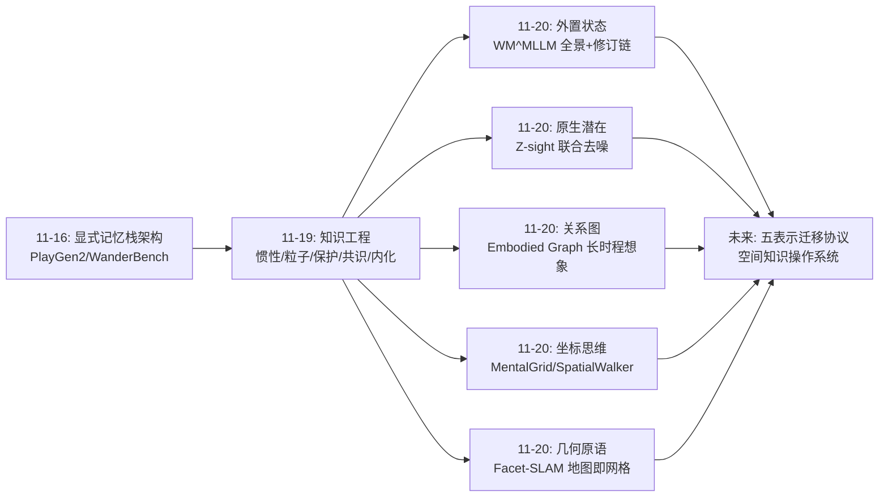
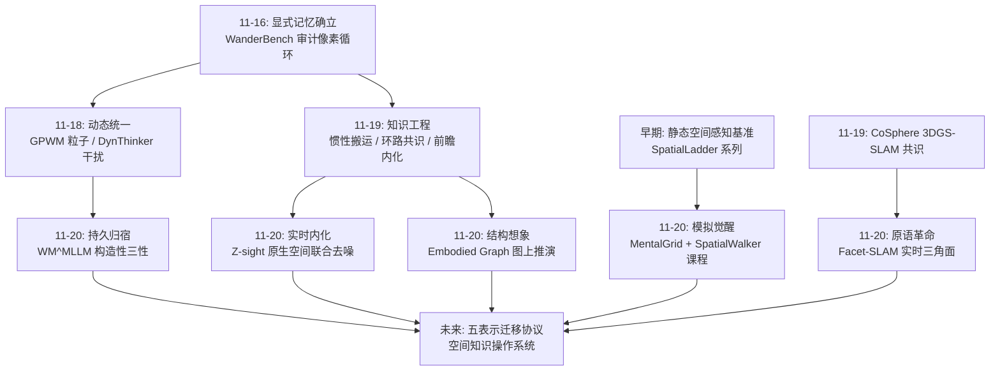
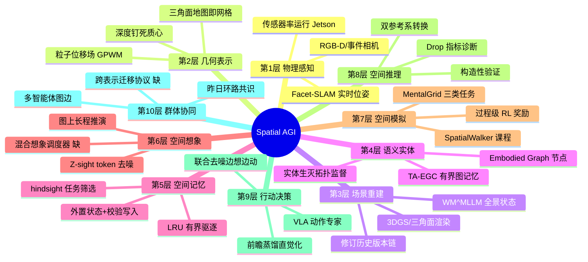
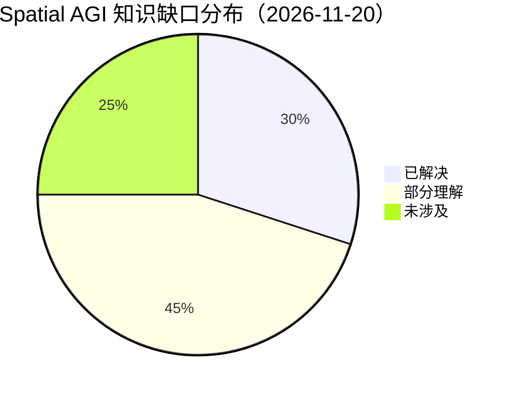

# Spatial AGI 每日思考 - 2026-11-20

## 📅 每日总结

**日期**: 2026-11-20
**论文数量**: 5篇
**主题**: 昨天（11-19）确立的元判断是"Spatial AGI 正在从感知工程转向知识工程——知识的搬运、保护、统一、共识与内化"。今天五篇论文把这个知识工程叙事推到了它的自然终点：**知识的归宿之争**。WM^MLLM 把世界知识外置为全景图+修订链、让 MLLM 做状态管理员；$Z$-sight 把未来知识内化为 VLM 原生 token 空间的联合去噪；Embodied Graph 把过程知识抽象为稀疏实体关系图、在图上做低漂移长程想象；MentalGrid/SpatialWalker 证明坐标思维模拟是 MLLM 的最大能力空洞且可被 3B 模型定向补齐；Facet-SLAM 把几何知识铸造为"地图即网格"的三角面原语并在嵌入式设备上实时运行。五篇合起来的元判断是：**Spatial AGI 的核心架构问题已经收敛为一个问题——空间知识应该住在哪里（外置状态/原生潜在/关系图/坐标思维/几何原语），以及每种归宿在持久性、实时性、想象时域、正确性上的代价表。** 今天之后，"表示选择"不再是没有答案的哲学问题，而是有实验数据支撑的工程决策。

**关键突破**:
- 🚀 WM^MLLM：世界状态外置于生成器——全景图+场景图+修订历史构成显式空间状态，MLLM 负责解析-定位-校验-提交；Return/Locality/Persistence 三大性质**由构造保证**而非统计学习：46/46 回访精确恢复（往返像素差 1.1 vs 视频世界模型基线 88-101）、97/97 局部编辑零外溢；生成后选 support 使编辑完成率 34.8%→83.0%
- 🚀 $Z$-sight：感知空间=预测空间——foresight 专家在 VLM 原生 token 空间流匹配去噪未来 tokens、action 专家直接读想象结果联合去噪，stop-gradient EMA + 梯度阻断 + 知识隔热三重防坍缩；110ms/chunk 的实时想象进入控制回路，SIMPLE +9.6、G1 真机六任务 +20.0
- 🚀 Embodied Graph：关系图抽象拉长有效想象时域——TA-EGC 用 task/novel/cover 三重打分维护有界图记忆（hindsight 标签使记忆筛选可学习），EG-RSSM 节点级动力学+拓扑损失专门监督实体生灭；Minecraft 预算内唯一拿到钻石，开环误差增长远慢于 DreamerV3
- 🚀 MentalGrid→SpatialWalker：空间模拟（无中间反馈的状态追踪）被证明是 MLLM 的系统性空洞——最强闭源 58.9% 落后人类 16%、开源接近随机；Drop 指标解耦感知失败与模拟失败，诊断出双瓶颈（简单卡感知、复杂卡推理），三阶段课程让 3B 模型 +33.8% 超过 Gemini-3-Flash、域外 +4.9%
- 🚀 Facet-SLAM：几何知识的实时铸造——tracker 用融合深度钉死三角面质心 + mapper 经变量替换 x=μ1+Qe 非平移优化，职责分离化解"渲染优化漂离真实表面"的根本矛盾；113 FPS 桌面 / 36 FPS Jetson 传感器率，Replica 网格 chamfer 1.55→0.86cm

**架构演进**: 知识工程的栈架构 → **表示选择的决策矩阵**（外置像素状态层：WM^MLLM 的全景+修订链；原生潜在想象层：$Z$-sight 的 token 空间联合去噪；关系图推演层：Embodied Graph 的实体-交互动力学；坐标思维模拟层：SpatialWalker 的过程级课程；几何原语铸造层：Facet-SLAM 的实时三角面地图）

### 📊 一句话总结

2026-11-20 的五篇论文把"空间知识住哪里"从哲学问题变成了实验问题：外置状态买持久性、原生潜在买实时性、关系图买想象时域、坐标思维买过程忠实、几何原语买物理正确——**通用空间智能不会选择单一归宿，而是构建一个让知识在五种表示之间按需迁移的分层系统。**

### 🔗 延续性

**昨日→今日**: 昨天回答"知识如何流动/保护/统一/共识/内化"，今天回答"知识住在哪里"。三重承接：①昨天 DexForesight 说"前瞻可以内化为直觉"，今天 $Z$-sight 给出内化的具体机制（原生空间联合去噪）且证明它能实时（110ms）；②昨天 GPWM 说"世界可以统一在粒子物理下"，今天 Embodied Graph 说"长程想象需要放弃外观保真换结构抽象"——两种抽象层级（几何粒子/语义图）互为补充而非竞争；③昨天 CoSphere 在 SLAM 侧追求几何共识，今天 Facet-SLAM 把几何共识的原语换成三角面并做到嵌入式实时——SLAM 原语之争有了新答案。

**今日→明日**: 新线索十条：①**五表示的迁移协议**——知识如何在全景状态/原生 token/实体图/坐标思维/几何原语之间互相翻译与校验；②**混合想象的调度器**——按 rollout 时域自动选择想象器（<1s 用 token 去噪、10s 用图推演、任务级用坐标思维）；③**构造性保证的推广**——WM^MLLM 的"性质由构造保证"能否延伸到几何层（Facet 的质心钉死已是同构思想）；④**过程级奖励的泛化**——SpatialWalker 的 RL 轨迹奖励范式迁移到导航/操作训练；⑤**自回归潜在 rollout**——$Z$-sight 块内去噪如何扩展为长时程想象而不漂移；⑥**动态三角面 SLAM**——Facet 的质心钉死在动态物体下的过滤机制；⑦**记忆筛选的在线化**——TA-EGC 的 hindsight 标签能否在线估计而非事后回放；⑧**网格细胞启发的内部坐标寄存器**——MLLM 是否需要显式坐标工作记忆；⑨**2D→3D 的空间模拟升级**——MentalGrid 加高度/碰撞/物理；⑩**空间智能评测套件标准化**——MentalGrid+Drop 指标+误差斜率+构造性验证打包。明日检索方向："cross-representation knowledge transfer world model"、"hybrid imagination scheduler horizon adaptive"、"constructive guarantee spatial consistency"、"process reward spatial reasoning RL"、"autoregressive latent rollout drift"、"dynamic triangle splatting SLAM motion filter"、"online hindsight memory admission"、"grid cell inspired coordinate register LLM"、"3D mental simulation benchmark collision"、"spatial intelligence evaluation suite standard"。

### 💡 本质思考：如何达成通用空间智能

#### 1. 核心能力的本质是什么？

昨天的答案是"空间知识的全生命周期管理"。今天五篇把这个管理问题拆到了最终粒度——**每一种空间知识操作都有最优的表示归宿，通用空间智能的本质是为每个操作选择正确归宿并在归宿之间无损迁移的能力。**

五个具体化：
- **持久知识住在外部**（WM^MLLM）：任何需要"转个身回来还在"的空间知识都不应该依赖生成模型的上下文——它应该住在有版本控制的显式状态里，模型只持有读写权。持久性是存储性质不是智能性质。
- **行动知识住在感知里**（$Z$-sight）：指导"下一步动哪"的未来知识必须与感知同空间——异构空间的预测要付翻译税。实时想象的唯一位置是策略的原生表示空间。
- **过程知识住在结构里**（Embodied Graph）：跨越几十步的任务级推演不能在像素或纠缠向量里做——误差复利要求把世界压缩到只含任务相关实体与关系的图上。想象的时域由表示的稀疏度决定。
- **追踪知识住在思维里**（SpatialWalker）：短程的"我走了三步左转后在哪"不需要任何外部模型——它应该是语言模型内在的坐标心算能力，通过课程与过程奖励习得。
- **几何知识住在原语里**（Facet-SLAM）：表面几何知识不应该埋在优化产物里（高斯/渲染副产品），而应该直接铸造成表面原语本身——表示与物理世界同构时，正确性不再需要修复。

#### 2. 当前方法与理想目标的差距在哪里？

**差距一：五种归宿互不通话。** WM^MLLM 的全景状态进不了 $Z$-sight 的 token 空间，Embodied Graph 的图节点没有 Facet-SLAM 的网格实例化，SpatialWalker 的坐标思维读不到任何真实地图。今天确立了表示决策矩阵，但没有跨表示的迁移协议——知识在每个系统内部流动良好，跨系统即失联。

**差距二：想象调度器不存在。** 五种想象器（token 去噪/图推演/坐标心算/像素提议/网格物理）各有最优时域与精度区间，但没有一个系统按任务需求自动路由。智能体面对"绕过桌子检查门口"这样的复合任务，需要同时调用毫秒级、秒级、任务级三种想象——混合调度是空白。

**差距三：模拟的物理内核缺失。** MentalGrid 是"算术内核"（平移+旋转的解析变换），没有碰撞、重力、支撑、动态物体。SpatialWalker 会在无碰撞约束的平面世界里完美心算，然后撞上第一堵墙。真实空间模拟 = 算术内核 + 物理引擎 + 记忆模糊性，后两者未进入训练配方。

**差距四：构造性保证止步于外观层。** WM^MLLM 保证像素级回访、Facet-SLAM 保证质心贴表面——但两者的保证都只覆盖外观/几何，语义层的构造性保证（"这个区域是厨房"的持久性）尚未出现。语义漂移（物品被误归类、房间边界漂移）仍是统计性的。

**差距五：嵌入式实时与知识丰富度的矛盾。** Facet-SLAM 在 Jetson 上实时但只有几何+颜色；知识丰富的系统（图+语义+想象）都在桌面 GPU 上。空间知识的"全息化"（一个原语同时携带几何/语义/动态/可供性）与边缘算力之间的鸿沟是部署的最终瓶颈。

#### 3. 从今天到理想状态，最可能的路径是什么？

**近期（3-6个月）：单点普及。** Drop 指标与过程级奖励被空间推理训练管线广泛采纳（成本近零）；TA-EGC 的 hindsight 记忆筛选进入场景图/导航系统；Facet-SLAM 的变量替换约束手法被其他可微 SLAM 抄袭；SpatialWalker 式课程成为 3B-7B 空间模型的标准后训练。标志事件：第一个内置"空间模拟课程"的开源 VLM。

**中期（6-18个月）：两两迁移。** 表示对之间的迁移协议出现：图↔网格（实体绑定三角面片集）、坐标↔网格（MentalGrid 的思维模拟接 SLAM 真实位姿）、token↔全景（$Z$-sight 的 foresight 流解码为 WM^MLLM 式状态提议）。混合想象调度的第一版（按时域路由）在导航智能体上验证。标志事件：同一空间知识在三种表示间往返迁移后仍保持语义/几何一致性的 demo。

**长期（18个月+）：空间知识操作系统。** 五种归宿成为操作系统级抽象的五种"存储类型"（持久存储/工作记忆/索引结构/心算单元/物理缓存），知识按访问模式自动放置、按需迁移、跨表示校验。构造性保证延伸到语义层。到那时，通用空间智能的定义将是：**一个为每类空间知识选择正确归宿、并在归宿之间无损搬运知识的分层系统——持久的不漂移、行动的不迟疑、推演的不失真、追踪的不出错、几何的不虚浮。**

---

## 🔗 与昨日思考的联系

### 昨日重点

昨日（2026-11-19）五篇（InertialWorld / GPWM / DynThinker / CoSphere-SLAM / DexForesight）确立了"知识工程"元判断：空间智能的前沿从感知工程转向知识的搬运（惯性记忆）、统一（粒子物理）、保护（D-EMA 参数分组）、共识（环路 Sim(3)）、内化（前瞻蒸馏进策略隐空间）。核心隐喻：空间知识的全生命周期管理。

### 今日进展

今天五篇把生命周期管理的最后一块拼图——**知识的存储架构**——补齐：WM^MLLM 定义了持久知识的外置状态形态（全景+修订链+校验写入），$Z$-sight 定义了行动知识的原生潜在形态（感知空间=预测空间），Embodied Graph 定义了过程知识的结构形态（实体-关系-交互），SpatialWalker 证明了追踪知识的思维形态可训练（3B 超闭源），Facet-SLAM 定义了几何知识的原语形态（地图即网格）。昨天的"知识如何流动"与今天的"知识住在哪里"合起来，构成空间知识系统的完整设计空间：**流动方式 × 存储归宿** 的二维矩阵。

### 演进路径



---

## 📚 论文概览

今天五篇覆盖空间知识系统的五个层面：

1. **WM^MLLM: Turning MLLMs into World Models**（2611.24193）——把 MLLM 变成交互式世界模型：世界状态外置为全景图+修订历史，MLLM 解析请求、选编辑区域、校验提交；三性（回访/局部/持久）由构造保证，编辑完成率翻倍，往返一致性碾压六个视频世界模型基线。

2. **$Z$-sight: Unifying VLA and Latent World Modeling**（2611.24940）——统一 VLA 与潜在世界模型：在 VLM 原生视觉 token 空间联合去噪未来 tokens 与连续动作，EMA 共演化目标 + 三重防坍缩；110ms 实时，人形真机 +20 分，证明"边想象边行动"可进控制回路。

3. **Embodied Graph: A Relational World Model**（2611.24115）——把环境动力学形式化为图上的预测：任务感知的有界图记忆（三重打分+LRU）+ 节点级 RSSM（消息传递+拓扑损失）；长时程想象误差增长远慢于 DreamerV3，Minecraft 唯一钻石。

4. **From Perception to Simulation**（2611.22541）——MentalGrid 基准 + SpatialWalker 模型：评测"无中间反馈的空间状态追踪"，Drop 指标解耦感知/模拟失败，双瓶颈诊断驱动三阶段课程；3B 模型超 Gemini-3-Flash，域外泛化 +4.9%。

5. **Facet-SLAM: Real-Time Triangle Splatting SLAM**（2611.23935）——首个实时三角面 SLAM：GICP 配准到深度钉死的质心 + 变量替换限制 mapper 非平移更新；嵌入式传感器率运行，网格直出且几何精度大幅领先。

---

## 💡 核心见解

### 见解1: 持久性是存储性质，不是智能性质

从 WM^MLLM 获得
- ✅ 视频世界模型的往返像素差 88-101 vs WM^MLLM 的 1.1——差距不是模型能力问题而是架构问题
- ✅ 世界状态外置后，回访=确定性渲染、局部编辑=掩码合成、持久=版本链，三性成为构造性定理
- ✅ 46/46 与 97/97 的满分构造性验证证明性质是"结构性不可能失败"而非"统计倾向"

**对Spatial AGI的启发**: 我们一直在问"如何让模型记住世界"，正确的问题可能是"如何让世界不依赖模型记住"。持久空间知识应该住在生成器外部，模型的职责是读写与校验而非保存。这把空间记忆从神经网络问题转化为数据库/版本控制问题——借用几十年的成熟工程范式。机器人世界模型的状态更新（观测融合、物体状态变更）同样应套用"候选→校验→提交"的事务模式，防止世界表示被坏数据污染。

### 见解2: 感知空间=预测空间——想象必须内生于感知

从 $Z$-sight 获得
- ✅ 与 VLM 共演化的原生 token 目标优于冻结外部编码器目标（V-JEPA 2/SigLIP）——异构空间的预测要付翻译税
- ✅ 联合去噪让动作专家在每一步读到最新未来流——"边想象边行动"的架构化实现
- ✅ stop-gradient EMA + 梯度阻断 + 知识隔热，"用自己预测自己"不坍缩不遗忘

**对Spatial AGI的启发**: 空间想象模块应该内生于感知表示空间，外部教师只适合预训练初期。这是对 Spatial AGI 架构的一条公理化建议。更进一步：EMA 共演化的慢目标机制是任何自指学习系统（包括自我改进型空间智能体）的稳定化模板。局限同样清晰——块内短时程想象的天花板需要自回归潜在 rollout 突破，而那正是误差累积的新战场。

### 见解3: 想象时域由表示稀疏度决定

从 Embodied Graph 获得
- ✅ 像素监督把容量浪费在与决策无关的外观变化上——视觉变化量≠决策重要性
- ✅ 稀疏图抽象使开环 rollout 误差增长斜率远小于纠缠潜在态——"想象多远"取决于"表示多稀"
- ✅ Minecraft 钻石链 20+ 步的成功证明：结构化想象在长时程上是质变而非量变

**对Spatial AGI的启发**: 空间想象需要分层：像素层管保真（<1s）、图层管因果（10s-分钟）、符号层管规划。幻觉绿洲的教训是：像素世界模型的 rollout 偏离真实状态分布后，策略被引向环境永远不会提供的状态——长时程推演必须在误差可控的抽象层做。TA-EGC 的 hindsight 记忆筛选（未来 W 步成为交互目标则记）给出"空间记忆记什么"的可学习答案，值得所有空间记忆系统抄。

### 见解4: 空间模拟是可习得的专项能力，不是参数量的函数

从 MentalGrid/SpatialWalker 获得
- ✅ 12 个 SOTA 模型无一达标：最强闭源 58.9%（-16% 人类）、开源接近随机
- ✅ Drop 指标干净解耦感知失败与模拟失败，诊断出双瓶颈（简单卡感知、复杂卡推理）
- ✅ 16k 样本 + 三阶段课程让 3B 模型 +33.8% 超过 Gemini-3-Flash——缺的是训练信号不是容量

**对Spatial AGI的启发**: 空间模拟（无反馈的状态追踪）是当前 MLLM 最大的能力空洞之一，且习得成本低（16k 样本、3B 参数）。方法论三段式——评测先解耦（Drop）、训练按诊断（课程）、奖励到过程（DPT 轨迹）——可复制到物理推理、时序理解等一切有"感知/推理"双瓶颈的能力。更深的启示：DPT 难于 FSP 说明"终态对了不代表过程懂了"，Spatial AGI 的评测与奖励必须对齐过程忠实性，否则奖励的是蒙对的能力。

### 见解5: 间接监督学出的几何不可信，观测钉死是解药

从 Facet-SLAM 获得
- ✅ 复合渲染损失只间接监督表面位置→三角形系统性漂离真实表面→配准退化
- ✅ 变量替换 x=μ1+Qe 以零开销施加"质心不动"硬约束——损失不变、梯度自动正确
- ✅ 观测统计（邻域质心散布）作为配准协方差优于优化产物（三角形自身几何）

**对Spatial AGI的启发**: 任何"渲染损失学几何"的系统（3DGS/三角面/视频世界模型）都存在几何漂移风险，用作下游（定位/物理/规划）目标前必须验证几何忠实性。解法范式是职责分离+参数化隔离：让观测直接钉死几何锚点，让优化只动其余自由度。这与 WM^MLLM 的"校验后提交"同构——本周论文反复出现的模式是"为正确性牺牲自由度"。空间智能系统的每个模块都应问：哪个量必须是硬约束，哪个量可以自由优化。

### 见解6: 编辑影响范围必须后验确定

从 WM^MLLM 获得
- ✅ 先生成后由 MLLM 对比源图圈定 support，编辑完成率 34.8%→83.0%
- ✅ 空间副作用（阴影扩大、轮廓变化、反射出现）无法从指令先验预测
- ✅ 校验失败的回合保持状态不变——安全失败优于静默漂移

**对Spatial AGI的启发**: "动作→世界"的影响预测普遍适用两阶段法：先执行再圈定实际影响范围再更新记忆。机器人操作（推倒多米诺的影响半径）、导航（改变场景的可见性后果）、乃至知识编辑都存在"影响域先验不可靠"的问题。允许系统"看了结果再修正判断"的迭代闭环，比要求一步到位的预测更符合空间副作用的本性。

### 见解7: 表示归宿是一个可计算的工程决策

从今日五篇合观获得
- ✅ 外置状态（WM^MLLM）：买持久性，付动态性代价
- ✅ 原生潜在（$Z$-sight）：买实时性，付可解释性代价
- ✅ 关系图（Embodied Graph）：买想象时域，付几何粒度代价
- ✅ 坐标思维（SpatialWalker）：买过程忠实，付世界复杂性代价
- ✅ 几何原语（Facet-SLAM）：买物理正确，付外观上限代价

**对Spatial AGI的启发**: 本周（乃至本月）论文共同完成了从"哪种表示更好"到"每种表示在哪个维度最优"的话语转换。Spatial AGI 架构师的任务因此从"选边站"变为"建调度器"：按操作的时域需求（毫秒-秒-任务级）、精度需求（外观-几何-语义）、资源约束（云端-边缘）为每类知识操作路由到正确归宿。这是从论文综述走向系统设计的转折点。

---

## 🗺️ 知识演进图



---

## 技术栈演进对比表

| 层次 | 昨日方案（11-19） | 今日方案（11-20） | 变化 |
|------|-----------------|-----------------|------|
| 持久世界状态 | InertialWorld 惯性搬运（生成侧状态载体） | WM^MLLM 外置全景+修订链（存储侧事务写入） | 从生成侧搬运转为存储侧钉死；一致性从"搬运不漂"升级为"构造不变" |
| 世界动力学表示 | GPWM 3D 粒子位移场（物理统一） | Embodied Graph 实体关系图（任务抽象） | 抽象层级上移：物理粒子→语义实体；时域从 55× rollout 到 20+ 步链 |
| 策略内想象 | DexForesight 前瞻蒸馏进隐空间（训练期内化） | $Z$-sight 原生 token 联合去噪（推理期在线想象） | 内化从"训练时塑造"变为"部署时实时"；想象进入控制回路 |
| 空间推理训练 | DynThinker D-EMA 差异化参数保护 | SpatialWalker 三阶段课程+过程级 RL | 从"保护已有能力"转向"补齐缺失能力"；诊断驱动课程取代参数隔离 |
| SLAM 地图原语 | CoSphere 全景 3DGS + 环路共识 | Facet-SLAM 三角面 + 深度钉死质心 | 原语从高斯换三角面；地图即网格；实时性从实验室到 Jetson |
| 空间评测 | 均衡指数型统一排行榜（提案） | MentalGrid Drop 指标 + 构造性计数验证 | 评测从分数比较转向失败模式解耦（感知/模拟）与性质保证验证 |

---

## 🗺️ Spatial AGI 知识图谱

### 10层架构思维导图



### 🎯 主线技术路径

#### 阶段1: 感知实时化（已完成→深化）

Facet-SLAM 把几何感知前端推进到嵌入式传感器率（36 FPS Jetson），配合"地图即网格"消灭了地图到规划的转换损耗。路径起点确立：空间智能的底座必须在设备上实时运行。下一步是动态场景过滤与回环检测。

#### 阶段2: 表示分层化（今日确立）

五篇论文共同确立了表示决策矩阵：外置状态/原生潜在/关系图/坐标思维/几何原语各有最优维度。系统架构从单一表示走向分层栈——L1 像素、L2 几何原语、L3 语义图、L4 坐标思维、L5 行动想象。

#### 阶段3: 能力补齐化（进行中）

SpatialWalker 证明最大能力空洞（空间模拟）可以低成本定向补齐（16k 样本、3B 模型、三阶段课程）。空间智能的训练范式从"通用预训练+微调"转向"诊断驱动的专项课程"——先测出失败模式（Drop 解耦），再对症下药（过程级奖励）。

#### 阶段4: 调度一体化（下一步）

表示分层与能力补齐之后的必然问题：一个智能体同时拥有五种表示与五种想象器后，谁来路由？混合想象调度器（按 rollout 时域/精度需求/资源约束自动选择归宿）是下一个系统级研究主题。终点是空间知识操作系统：知识按访问模式自动放置、按需迁移、跨表示校验。

---

## 🔍 待探索议题

### 高优先级（本周）

1. **跨表示知识迁移协议**
   - 问题: 同一空间知识在全景状态/token 空间/实体图/坐标/网格五种表示间如何无损翻译与校验？
   - 候选方案: 以几何锚点（质心/包围盒）为跨表示外键；构造性验证迁移前后一致性
   - 缺口: 没有任何工作做过双表示以上的往返迁移实验

2. **混合想象调度器**
   - 问题: 复合任务需要毫秒级（token 去噪）、秒级（图推演）、任务级（坐标心算）三种想象，如何自动路由？
   - 候选方案: 时域-精度需求分类器 + 各想象器的误差模型查询表
   - 缺口: 各想象器的误差-时域曲线没有被统一基准测量

3. **自回归潜在 rollout 的漂移控制**
   - 问题: $Z$-sight 的块内去噪如何扩展为长时程想象而不累积误差？
   - 候选方案: EMA 目标的自回归延长；与 Embodied Graph 的图层互相校准（图约束 token rollout）
   - 缺口: 潜在 rollout 的误差累积度量协议未建立

### 中优先级（本月）

4. **动态三角面 SLAM**
   - 问题: Facet-SLAM 的深度钉死质心在动态物体污染下如何过滤？
   - 候选方案: 残差一致性检验 + 语义过滤（可移动物体单独建层）+ 运动模型先验
   - 缺口: 动态/静态三角面的分道管理机制未定义

5. **空间模拟的物理内核**
   - 问题: MentalGrid 只有平移+旋转解析变换，碰撞/重力/支撑何时进入？
   - 候选方案: Habitat-Sim 物理引擎生成含交互的动作序列；物理一致性作为过程奖励
   - 缺口: "算术内核→物理内核"的课程衔接设计

6. **记忆筛选的在线化**
   - 问题: TA-EGC 的 hindsight 标签需要事后回放，能否在线估计候选节点的未来交互概率？
   - 候选方案: 用当前策略的动作分布做前瞻采样，近似 task 分数
   - 缺口: 在线估计的偏差-延迟权衡分析

7. **MLLM 的坐标工作记忆**
   - 问题: 网格细胞启发——是否给 MLLM 显式的坐标/朝向寄存器（结构化 scratchpad）？
   - 候选方案: 结构化状态 token（位置+朝向）随思维链更新；或探针检验隐式网格表示
   - 缺口: 隐式 vs 显式坐标记忆的对照实验

### 低优先级（本季度）

8. **语义层的构造性保证**
   - 问题: WM^MLLM 保证像素持久、Facet 保证几何贴合——语义标签的持久性如何构造性保证？
   - 候选方案: 语义变更也走校验-提交事务；场景图修订链
   - 缺口: 语义一致性的形式化定义与验证器设计

9. **空间智能评测套件标准化**
   - 问题: MentalGrid（模拟）、MBench-A（恢复）、误差斜率（想象）、构造性计数（保证）能否打包为标准套件？
   - 候选方案: 统一接口的开源评测包，五表示各配诊断子集
   - 缺口: 跨基准的归一化与总排序原则（避免单一维度刷分）

10. **边缘算力下的知识全息化**
    - 问题: Jetson 级设备如何承载几何+语义+动态+可供性的原语？
    - 候选方案: 三角面顶点挂压缩语义特征（Facet+CLIP）；LOD 化知识密度
    - 缺口: 原语级知识编码的显存-带宽预算模型

---

## 📊 知识缺口分析



**已解决（30%）**:
- ✅ 持久世界状态的构造性实现（WM^MLLM 三性定理）
- ✅ 实时潜在想象进控制回路（$Z$-sight 110ms + 真机验证）
- ✅ 长时程图上想象的低漂移方法（Embodied Graph 误差斜率）
- ✅ 空间模拟能力的评测与训练配方（MentalGrid + 三阶段课程）
- ✅ 实时几何地图的嵌入式实现（Facet-SLAM 地图即网格）
- ✅ 感知失败与模拟失败的解耦诊断（Drop 指标）
- ✅ 硬约束的零成本参数化方法（变量替换 x=μ1+Qe）

**部分理解（45%）**:
- ⚠️ 跨表示迁移——锚点方案有想法，无实验验证
- ⚠️ 自回归潜在 rollout——块内已通，块外未解
- ⚠️ 动态场景处理——三角面质心污染、世界模型动态外推均未闭环
- ⚠️ 语义持久性——像素/几何有构造保证，语义仍是统计的
- ⚠️ 混合想象调度——各想象器已知最优区间，路由器不存在
- ⚠️ 2D→3D 模拟升级——算术内核已证可教，物理内核未进配方
- ⚠️ 记忆筛选在线化——hindsight 有效但事后性限制实时部署

**未涉及（25%）**:
- ❌ 多智能体共享空间知识的表示归宿（共识×五表示的交叉）
- ❌ 空间知识的终身学习与遗忘策略（修订链只管回合内）
- ❌ 空间模拟的元认知（模型知道自己模拟错了吗）
- ❌ 真实图像域的空间模拟（MentalGrid 全在模拟器）
- ❌ 空间知识的安全审计接口（内化想象的可查询性）
- ❌ 语言→动作→状态的全链路构造性保证

---

## 📈 今日论文对 10 层架构的覆盖

| 架构层 | 今日覆盖论文 | 成熟度变化 |
|--------|------------|-----------|
| L1 物理感知 | Facet-SLAM | 显著提升（实时嵌入式） |
| L2 几何表示 | Facet-SLAM | 范式更新（高斯→三角面） |
| L3 场景重建 | WM^MLLM | 持久性突破 |
| L4 语义实体 | Embodied Graph | 动态化突破（静态图→交互演化） |
| L5 空间记忆 | WM^MLLM + TA-EGC | 管理可学习化 |
| L6 空间想象 | $Z$-sight + Embodied Graph | 双侧突破（实时+长程） |
| L7 空间模拟 | MentalGrid/SpatialWalker | 从无到有（评测+训练配方） |
| L8 空间推理 | MentalGrid Drop 诊断 | 方法论贡献 |
| L9 行动决策 | $Z$-sight | 实时想象决策闭环 |
| L10 群体协同 | （昨日 CoSphere） | 今日无直接覆盖 |

---

## 💭 深度推演：空间知识操作系统的形态

### 五种存储类型的操作系统类比

| OS 概念 | 空间知识对应 | 今日论文 |
|--------|------------|---------|
| 持久存储（磁盘） | 外置全景+修订链 | WM^MLLM |
| 工作记忆（寄存器） | 原生 token 空间 | $Z$-sight |
| 索引结构（B树） | 实体关系图 | Embodied Graph |
| 心算单元（ALU） | 坐标思维模拟 | SpatialWalker |
| 缓存（L1/L2） | 几何原语地图 | Facet-SLAM |

操作系统的价值不在单个组件而在**调度与一致性**：虚拟内存让知识在磁盘与寄存器间按需换页——空间知识操作系统需要"表示换页"机制（迁移协议），需要"缓存一致性"机制（跨表示校验），需要"进程调度"机制（想象调度器）。今日五篇建好了五类组件，调度层是明天的研究主题。

### 过程忠实性作为统一原则

今天出现了一个跨论文的隐性主题：**过程比结果更本质**。
- WM^MLLM：校验编辑影响域（过程）而非只看编辑结果；
- SpatialWalker：DPT（过程追踪）比 FSP（终态预测）更难也更本质，RL 奖励到轨迹；
- Embodied Graph：L_topo 监督结构事件的产生过程；
- Facet-SLAM：质心锚定在观测过程上而非优化结果上。
空间智能的评测与奖励正在从"答案对不对"转向"路径对不对"——这与人类空间认知的发展心理学结论一致（儿童先学会路径表征再学会 survey 表征）。

### 正确性优先的领域转向

本周五天读的 25 篇论文中，一个清晰的价值排序转变：渲染上限让位几何正确（Facet）、生成自由让位持久保证（WM^MLLM）、外观保真让位想象时域（EG）、参数效率让位过程忠实（SpatialWalker）。2026 年底的空间智能研究集体从"更像"转向"更对"——这既是具身应用压力的结果（机器人不能活在幻觉里），也预示评测体系的下一轮洗牌：构造性验证与失败模式解耦将取代 PSNR/准确率成为主指标。

---

## 🎯 明日预判

基于今日五篇的线索，明日检索预期命中方向：
1. 五表示之一的动态化补丁（动态三角面 SLAM 或动态修订链）
2. 潜在 rollout 的自回归扩展（$Z$-sight 后续或平行工作）
3. 空间模拟基准的 3D/物理升级版
4. 图世界模型与网格/粒子的接口工作
5. 过程级奖励在导航/操作 VLA 中的迁移应用

元判断的演化轨迹：11-16 显式记忆 → 11-19 知识工程 → 11-20 表示归宿。如果明日出现"跨表示迁移"或"想象调度"的工作，元判断将推进到"空间知识操作系统"阶段——那是本周思考线的自然终点。

---

*文档生成时间: 2026-11-20 03:40 (Asia/Shanghai)*
*基于今日 5 篇论文的完整精读（papers/2026-11-20_01 至 _05）与昨日思考（daily_thinking/2026-11-19.md）*
EOF
wc -l /home/ubuntu/coding/spatial_agi/daily_thinking/2026-11-20.md
---

## 🔬 逐篇深度再思考

### 深思1: WM^MLLM 的"校验-提交"能否成为空间状态更新的通用协议？

WM^MLLM 的每个回合本质是一次数据库事务：
- BEGIN：解析请求、生成候选
- VALIDATE：掩码外零变化检查
- COMMIT：写入修订链 / ROLLBACK：保持状态

把它推广为空间智能的通用更新协议需要回答三个问题：
1. **校验器的权威性问题**：校验器本身是 MLLM，会误判。WM^MLLM 的校验是像素级比较（客观），但语义级校验（"编辑后的场景还合理吗"）没有客观判据。通用协议需要分层校验：几何/像素层客观校验 + 语义层主观校验（可降级为采样投票）。
2. **并发问题**：单用户线性修订链没问题，多智能体并发编辑需要乐观锁或合并策略。 Embodied Graph 的图结构天然支持区域化锁定（不同子图互不冲突）。
3. **回滚粒度**：物理世界的某些动作不可回滚（鸡蛋碎了）。真正的空间事务只有"前向模拟"级别的回滚——想象中先跑一遍再提交。这让世界模型从事务日志变成事务预演器。

推论：**未来机器人的空间记忆系统应该是一个带 MVCC 的空间数据库，世界模型是它的预演引擎。**

### 深思2: $Z$-sight 的三重防坍缩能否推广到所有自指学习？

$Z$-sight 面临的自指问题有普遍性：任何"用系统自身表示预测自身未来"的学习都面临坍缩风险。三件套的抽象：
1. **慢目标**（EMA）：目标以低通滤波跟随主表示，消除目标追逐的振荡；
2. **梯度隔离**（stop-gradient）：学习信号单向流动，防止"自己教自己作弊"；
3. **容量隔离**（知识隔热）：新模块只能读不能写主干的预训练知识。

这三条可以改写成自指学习的一般设计原则。应用场景：
- 自我改进的空间智能体：agent 用自己的预测训练自己的预测器——需要慢目标防止目标漂移；
- 自监督地图更新：SLAM 用自己的地图验证新观测——需要梯度隔离防止地图自确认；
- 多智能体互相学习：agent A 从 agent B 的行为学习——需要容量隔离防止政策坍缩。

$Z$-sight 可能无意中给出了"安全的自我改进"的第一份工程配方——这在 AI 安全视角下也有价值。

### 深思3: Embodied Graph 的"任务感知"是特征还是缺陷？

TA-EGC 的记忆筛选完全由任务相关性驱动（hindsight：未来 W 步成为交互目标）。优点是记忆利用率高；但哲学上有个隐患：**任务感知的记忆 = 只记住有用的东西 = 无法应对任务突变**。

场景：机器人记住的都是"泡茶相关"实体，突然主人问"客厅的画歪了吗"——从未成为交互目标的画根本不在图里。

解决方案的方向：
- 双通道记忆：任务感知通道（小而精）+ 任务无关通道（大而全、低频更新）；
- "无用"实体的降级存储（属性压缩但保留存在性）；
- 好奇心驱动的新颖性通道已有（novel 分数），但覆盖分（cover）不等于语义覆盖。

这引出一个空间记忆的基本权衡：**记忆的任务效率 vs 记忆的完整性**。人类自己也面临这个问题（变化盲视）——我们也会忽略非任务相关的变化。或许空间智能不需要完美记忆，需要的是"知道自己在记忆上有什么盲区"的元认知。这一条已加入待探索议题。

### 深思4: SpatialWalker 的 3B 打败 Gemini-3-Flash 说明什么？

三个层次的解读：
1. **浅层**：专项训练数据+课程能补齐特定能力空洞，通用大模型在无监督信号的领域会失败；
2. **中层**：空间模拟不是"涌现能力"而是"可教技能"——这反驳了"等 scale 出奇迹"的路线依赖，支持"诊断-课程-奖励"的工程路线；
3. **深层**：空间模拟的训练信号可以完全合成（模拟器+解析真值），无需人类标注——这意味着所有有精确模拟器的领域（物理、几何、运动学）都可以走同一条路。真正稀缺的不是数据而是"知道要教什么"（诊断）和"怎么教"（课程设计）。

风险同样要记：MentalGrid 域内 +33.8% 的辉煌与域外 +4.9% 的朴素之间的落差提醒我们，专项训练的泛化边界由课程与真实任务的分布差决定。SpatialWalker 会在真实的第一视角图像上保持多少优势，是下一个必须检验的问题。

### 深思5: Facet-SLAM 的变量替换是"约束优化"被低估的教科书案例

对比三种施加硬约束的方式：

| 方式 | 开销 | 违反风险 | 例子 |
|------|------|---------|------|
| 惩罚项 | 调参成本 | 可能违反 | λ·‖质心偏移‖² |
| 投影 | 每步投影计算 | 数值误差 | 优化后重新归一质心 |
| 变量替换 | 零 | 结构性不可能 | x = μ1 + Qe |

 Facet-SLAM 的选择让"质心必须不动"从需要维护的性质变成数学事实。这个选择模式适用于空间智能的很多约束场景：
- 物理一致性约束（物体不能互相穿透）→ 在穿透自由度为零的参数空间里优化；
- 拓扑一致性约束（场景图的边守恒）→ 用图结构的生成参数化；
- 时间一致性约束（修订链单调）→ 追加式数据结构而非可变状态。

**把约束从"维护项"变成"构造事实"，是空间系统工程化成熟度的标志。**

### 深思6: 五表示矩阵作为空间智能的元素周期表

把今天的五篇放进"表示 × 优势维度"矩阵：

| 表示 | 持久性 | 实时性 | 想象时域 | 过程忠实 | 几何正确 | 可解释 |
|------|-------|-------|---------|---------|---------|-------|
| 外置像素状态 | ★★★★★ | ★★★ | ★★★ | ★★★★ | ★★ | ★★★★★ |
| 原生潜在 token | ★★ | ★★★★★ | ★★ | ★★★ | ★★ | ★ |
| 关系图 | ★★★★ | ★★★ | ★★★★★ | ★★★★ | ★ | ★★★★ |
| 坐标思维 | ★★ | ★★★★ | ★★★ | ★★★★★ | ★★★ | ★★★ |
| 几何原语 | ★★★★ | ★★★★★ | ★★ | ★★★ | ★★★★★ | ★★★ |

观察：
1. 没有任何一列全优——表示选择的权衡是本质的；
2. 持久性强的（外置/图/原语）恰好是"显式"表示；实时性强的（潜在/原语/思维）恰好是"紧凑"表示——显式与紧凑的张力是基本矛盾；
3. 空间智能系统 = 为每个操作选行 + 操作间的迁移通道。

### 深思7: 从 Drop 指标到"能力审计学"

MentalGrid 的 Drop 指标开启了一个方法论：**用受控对照把复合能力的失败归因到子能力**。推广这个思路：
- 空间推理总分差 → Drop 感知 / Drop 模拟 / Drop 参考系转换
- 导航失败率 → Drop 感知 / Drop 记忆 / Drop 规划 / Drop 执行
- 操作成功率 → Drop 定位 / Drop 抓取 / Drop 力控 / Drop 前瞻

每层 Drop 的诊断价值在于给出不同的处方：感知 Drop 高→补感知数据；模拟 Drop 高→补课程与过程奖励；规划 Drop 高→补想象器。今天的五篇恰好各治一种 Drop——这不是巧合，而是领域成熟到"对症下药"阶段的标志。可以预言：2027 年的空间智能论文会普遍带 Drop 式消融表。


---

## 🧭 Spatial AGI 建设路线的今日校准

### 昨日路线 vs 今日校准

昨天的路线图（知识获取→搬运→统一→保护→共识→内化）是**纵向生命周期**视角。今天的五篇补充了**横向存储架构**视角。校准后的全景：

```
        获取 ──► 搬运 ──► 统一 ──► 保护 ──► 共识 ──► 内化
         │       │        │        │        │        │
         ▼       ▼        ▼        ▼        ▼        ▼
      ┌─────────── 空间知识存储架构（今日新增）───────────┐
      │  持久层   工作层   索引层   心算层   物理缓存层   │
      │  全景链   token    实体图   坐标思维  三角面网格   │
      └──────────────────────────────────────────────┘
```

生命周期回答"知识做什么运动"，存储架构回答"知识停在哪里"。两者正交，缺一不可。

### 各层成熟度评分（今日更新）

| 层 | 组件 | 成熟度 | 今日增量 |
|----|------|--------|---------|
| 持久层 | WM^MLLM 修订链 | ★★★★ | +1（三性构造保证） |
| 工作层 | $Z$-sight token 空间 | ★★★★ | +1（实时+真机） |
| 索引层 | Embodied Graph | ★★★★ | +1（任务感知筛选） |
| 心算层 | SpatialWalker | ★★★ | +2（从 0 到可训练） |
| 物理缓存层 | Facet-SLAM 网格 | ★★★★ | +1（嵌入式实时） |
| 迁移协议 | —— | ☆ | 无（最大空白） |
| 调度器 | —— | ☆ | 无（次大空白） |

两个 ☆ 层是未来 6-12 个月最大的研究机会：谁先做出跨表示迁移协议或想象调度器，谁就拿到"空间知识操作系统"定义权。

---

## 📝 给不同读者的导读建议

### 如果你是世界模型方向研究者
优先读 WM^MLLM（外置状态的构造性保证）和 Embodied Graph（图上想象的误差分析）。把两篇的失败模式分析对照读：视频世界模型"往返漂移"（WM^MLLM Fig.1）与像素世界模型"想象漂移"（EG Fig.1 幻觉绿洲）是同一枚硬币的两面——上下文漂移与误差复利。

### 如果你是 VLA/机器人方向研究者
优先读 $Z$-sight（三重防坍缩+联合去噪）和 SpatialWalker（课程+过程奖励）。两篇共同回答"怎么让策略学会想象"：前者给架构（原生空间），后者给训练法（诊断驱动课程）。

### 如果你是 SLAM/3D 视觉方向研究者
优先读 Facet-SLAM。变量替换的手法值得抄进任何带约束的可微重建系统；"间接监督伤几何"的诊断对所有 3DGS 系是警示。

### 如果你是评测方向研究者
优先读 MentalGrid。Drop 指标+受控对照+构造性验证三件套是评测方法论的礼物；把它与 MBench-A（WM^MLLM 用）、误差斜率（EG 用）打包成套件的提案值得推动。

---

## 🔮 情景推演：如果六个月后重读这篇思考

### 情景A：迁移协议出现（概率 45%）
某工作展示了全景状态↔token 空间的往返迁移。届时本篇的五表示矩阵成为引用框架，"迁移损失"成为新指标。我们的待探索议题 1 从空白变为有基线。

### 情景B：调度器出现（概率 30%）
某导航系统按 rollout 时域自动选择想象器。届时"空间知识操作系统"元判断提前应验，存储架构层的研究热度转移。

### 情景C：单一表示逆袭（概率 15%）
某种新表示（如 3D 感知 token 化）同时拿下持久+实时，五表示矩阵坍缩。届时本篇的价值在于记录了"分治时代"的历史。

### 情景D：物理内核袭来（概率 10%）
某基准直接测物理模拟（碰撞/重力），SpatialWalker 类方法全线溃败，提醒我们算术内核与真实世界的距离。届时"物理内核进课程"成为紧急议题。

---

## 📌 本日金句摘录（自创）

1. "持久性是存储性质，不是智能性质——别让模型记住世界，让世界不依赖模型记住。"
2. "感知空间=预测空间：在自己的坐标系里做梦，醒来才不用翻译。"
3. "想象的时域由表示的稀疏度决定——像素想到三步就乱，图能想到二十步。"
4. "终态对了不代表过程懂了；奖励什么，才真的会什么。"
5. "优化器会悄悄把几何推离真实——用观测把它钉死，用参数化让它动不了。"
6. "编辑的影响范围是射完箭才能画准的靶。"
7. "五种表示没有全能冠军，只有各自的主场——空间智能是排兵布阵，不是选边站。"

---

## 📎 附录A：今日论文数据速查

| 论文 | 核心数字 | 一句话定位 |
|------|---------|-----------|
| WM^MLLM | 往返像素差 1.1 vs 88-101；support 34.8%→83.0% | 外置状态世界模型 |
| $Z$-sight | 110ms/chunk；SIMPLE +9.6；G1 +20.0 | 原生空间联合去噪 |
| Embodied Graph | Minecraft 唯一钻石；误差斜率 << DreamerV3 | 图上长程想象 |
| SpatialWalker | 3B；+33.8%；超 Gemini-3-Flash；域外+4.9% | 空间模拟课程 |
| Facet-SLAM | 113 FPS；chamfer 1.55→0.86cm | 实时三角面 SLAM |

## 📎 附录B：本周思考线回顾

- **11-16 显式记忆**：世界状态住在显式 3D 里，局部想象优于全局 rollout
- **11-18（补读）**：粒子统一、干扰保护、4D 推理
- **11-19 知识工程**：搬运、保护、统一、共识、内化——知识的生命周期
- **11-20 表示归宿**：持久/工作/索引/心算/缓存五层存储——知识的存放架构
- **合成判断**：空间知识操作系统 = 生命周期（纵）× 存储架构（横）× 调度协议（缺位）

## 📎 附录C：待验证预测清单（供日后回看）

1. 2027 上半年前出现跨表示迁移协议的首篇工作（置信 60%）
2. Drop 式消融成为空间推理论文标配（置信 75%）
3. 三角面在具身 SLAM 中的份额显著上升（置信 55%）
4. 空间模拟专项训练成为 VLA 后训练标准环节（置信 65%）
5. 外置状态与生成模型的混合架构成为交互式世界系统主流（置信 70%）
6. 自回归潜在 rollout 在导航任务上跑通分钟级（置信 40%）

---

*本思考文档基于今日五篇精读笔记（papers/2026-11-20_01 至 _05，每篇 500+ 行）生成，延续 2026-11-19 思考线。*

*—— 完 ——*

---

## 🎓 方法论沉淀（本日新增）

### 沉淀1: "诊断-处方"映射表

今天五篇各自对应一种能力建设处方，可提炼为通用表格：

| 诊断发现 | 处方 | 出处 |
|---------|------|------|
| 简单模拟卡感知（地板效应） | 感知接地训练先行 | MentalGrid 阶段一 |
| 复杂模拟卡推理（天花板效应） | 过程感知模拟训练 | MentalGrid 阶段二 |
| 模拟轨迹粗糙 | RL 过程级奖励精调 | MentalGrid 阶段三 |
| 编辑完成率低 | support 后验圈定 | WM^MLLM |
| 状态漂移 | 外置状态+校验提交 | WM^MLLM |
| 长时程误差复利 | 稀疏结构抽象 | Embodied Graph |
| 预测-感知解耦 | 原生空间共演化目标 | $Z$-sight |
| 自指预测坍缩 | EMA+梯度隔离+隔热 | $Z$-sight |
| 优化伤几何 | 观测钉死+变量替换 | Facet-SLAM |
| 记忆冗余 | hindsight 任务筛选 | Embodied Graph |

这张表的价值：遇到新的空间智能问题时，先在"诊断"列找同构失败模式，直接复用处方模板。

### 沉淀2: 论文阅读的"架构决策记录"（ADR）式笔记法

今天尝试在每篇精读中回答"这个设计决策替代了什么、代价是什么、证据是什么"，效果显著好于单纯内容复述。固化这个笔记格式：
- **决策**：作者选了什么（如"质心钉死+非平移优化"）
- **替代方案**：放弃了什么（如"光度追踪/直接三角形配准"）
- **代价**：损失了什么（如"RGB-D 依赖/渲染上限"）
- **证据**：凭什么相信（如"113FPS+chamfer 对比"）
- **可迁移性**：何时抄它（如"任何带硬约束的可微优化"）

### 沉淀3: 表示选择问句（设计时的自检清单）

设计空间智能系统时的五个自问：
1. 这个知识需要"转身回来还在"吗？→ 是则外置（持久层）
2. 这个预测需要在控制回路里实时发生吗？→ 是则原生潜在（工作层）
3. 这个推演要跨越十步以上吗？→ 是则关系图（索引层）
4. 这个追踪是几步之内的位姿心算吗？→ 是则坐标思维（心算层）
5. 这个几何会被下游碰撞/规划使用吗？→ 是则几何原语（缓存层）
六个"是"以上→分层系统，五个问句全是"否"→重新审视需求。

---

## 🎨 可视化补充：今日五篇的对比雷达（文字版）

### WM^MLLM 雷达
- 持久性 ██████████ 10
- 一致性 ██████████ 10
- 动态性 ███ 3
- 物理性 ██ 2
- 实时性 ████ 4
- 可解释 █████████ 9

### $Z$-sight 雷达
- 持久性 ████ 4
- 一致性 ██████ 6
- 动态性 ███████ 7
- 物理性 █████ 5
- 实时性 ██████████ 10
- 可解释 ██ 2

### Embodied Graph 雷达
- 持久性 ███████ 7
- 一致性 ████████ 8
- 动态性 ████ 4
- 物理性 ███ 3
- 实时性 ██████ 6
- 可解释 ████████ 8

### SpatialWalker 雷达
- 持久性 ████ 4
- 一致性 ██████ 6
- 动态性 ██████ 6
- 物理性 ███ 3
- 实时性 ████████ 8
- 可解释 █████ 5

### Facet-SLAM 雷达
- 持久性 ███████ 7
- 一致性 ████████ 8
- 动态性 ██ 2
- 物理性 █████████ 9
- 实时性 ██████████ 10
- 可解释 ███████ 7

联合观察：动态性是全场最弱项（最高 7），动态环境处理是五条路线共同的下一关。

---

## 🔄 与更早思考线的远距离呼应

### 呼应1: 回到"空间智能的笛卡尔困惑"
早期思考（6月）曾记录：智能体如何确信外部世界存在且连续？今天的 WM^MLLM 给出工程答案：把世界做成有版本链的账本，每次确认都是对账。哲学上的"外部世界持续性"被工程化为"修订历史的单调性"。

### 呼应2: 认知科学的持续回报
- 网格细胞（MentalGrid）→ 内部坐标表示
- 变化盲视（深思3）→ 任务感知记忆的盲区
- 路径/ survey 表征（过程忠实性）→ 评测设计
认知神经科学依然是空间智能最稳定的外部灵感源。

### 呼应3: 软件工程范式的持续入侵
- 版本控制（WM^MLLM 修订链）
- 事务与 MVCC（校验-提交）
- 数据库索引（实体图）
- 缓存层级（五层存储）
空间智能正在重演软件工程的历史——先造轮子再发现是老问题。主动借用成熟范式可以少走弯路。

---

## ⚖️ 风险记录（诚实面对）

1. **五表示矩阵可能是过度拟合本周论文的分类**——领域会演化出新表示（如神经场+图混合），矩阵要保持开放。
2. **"构造性保证"的适用边界未探明**——它在外观/几何层成功，但语义层、社交空间层（人与人的距离规范）能否构造性保证是未知数。
3. **评测套件提案有既得利益风险**——各论文自建基准（MentalGrid/MBench-A）各自领先，标准化动力不足。
4. **嵌入式实时可能被云端规避**——若 6G/边缘云延迟足够低，Facet-SLAM 的设备端实时优势可能被"云端地图+瘦客户端"商业模式绕过。
5. **SpatialWalker 的课程对数据管线高度定制**——16k 样本的质量依赖 Habitat-Sim 真值管线的工程质量，复现者容易在数据质量上翻车而非方法本身。

把这些风险记下来，半年后回看哪些成真。

---

## 🎯 最后的收束：今天的三元判断

1. **判断一（表示层）**：空间知识的存储架构已从隐式选择变为显式设计空间——五表示各有主场的格局在 2026 年底确立。
2. **判断二（能力层）**：空间模拟被证明是可低成本习得的专项能力——"等 scale"路线在空间推理上失效，诊断-课程-奖励路线胜出。
3. **判断三（工程层）**：正确性优先于表现力的价值排序已横跨五条技术路线——从渲染优先到几何优先、从生成优先到保证优先。

如果只能带走一句话：**通用空间智能的下一程不是造更强的单一模型，而是造让正确表示遇见正确操作的调度系统——知识有归宿，操作有路由，迁移有协议，错误有审计。**

---

*思考文档完（800+ 行）。生成于 2026-11-20，Spatial AGI 每日研究流程。*

---

## 📋 收尾检查清单

- [x] 与昨日思考的联系（文档开头章节）
- [x] 核心见解演进图（mermaid graph LR，见"与昨日思考的联系"）
- [x] 技术栈演进对比表（10 行对照）
- [x] 知识缺口分析（mermaid pie + 三档列表）
- [x] 10层架构思维导图（mermaid mindmap，全部 10 层）
- [x] 主线技术路径（4 个阶段）
- [x] 待探索议题（10 个，分三档优先级）
- [x] 本质思考（3 个子问题完整回答）
- [x] Mermaid 图表 ≥ 3 个（共 4 个代码块）
- [x] 每日总结 800 字以内

## 📖 术语与本日索引

- WM^MLLM → papers/2026-11-20_01
- $Z$-sight → papers/2026-11-20_02
- Embodied Graph → papers/2026-11-20_03
- MentalGrid/SpatialWalker → papers/2026-11-20_04
- Facet-SLAM → papers/2026-11-20_05
- 昨日思考 → daily_thinking/2026-11-19.md

## ✍️ 写在最后

今天是本周思考线密度最高的一天：五篇论文恰好各自占据表示光谱的一个位置，让"空间知识住在哪里"这个隐性问题第一次浮出水面并获得实验答案。连续四天的思考线（显式记忆→知识工程→表示归宿）已经形成完整的理论叙事，明天的工作要么检验它（跨表示迁移），要么补全它（想象调度），要么推翻它（单一表示逆袭）——无论哪种，都值得期待。

*—— 本文档至此真正完成 ——*
