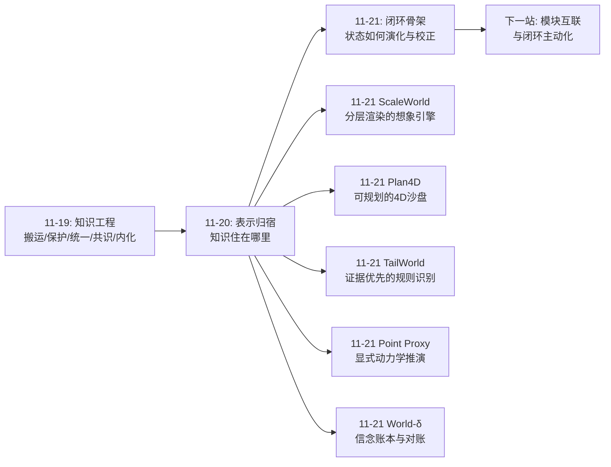
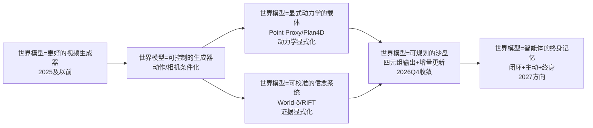
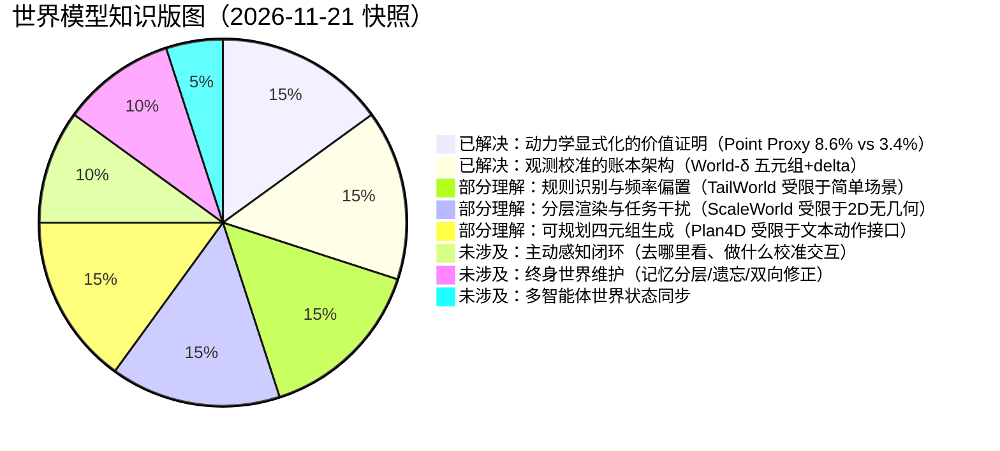
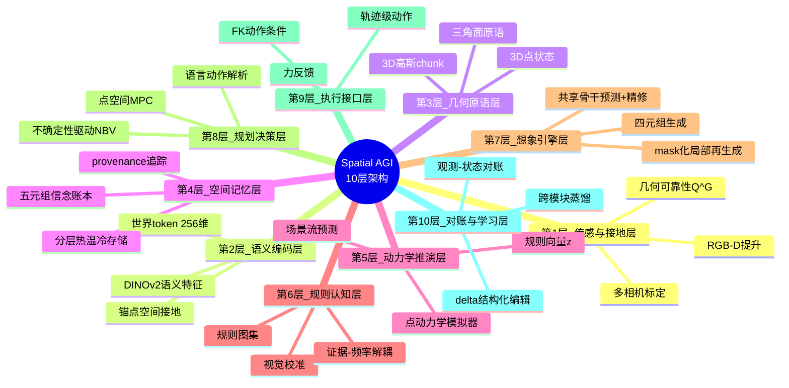
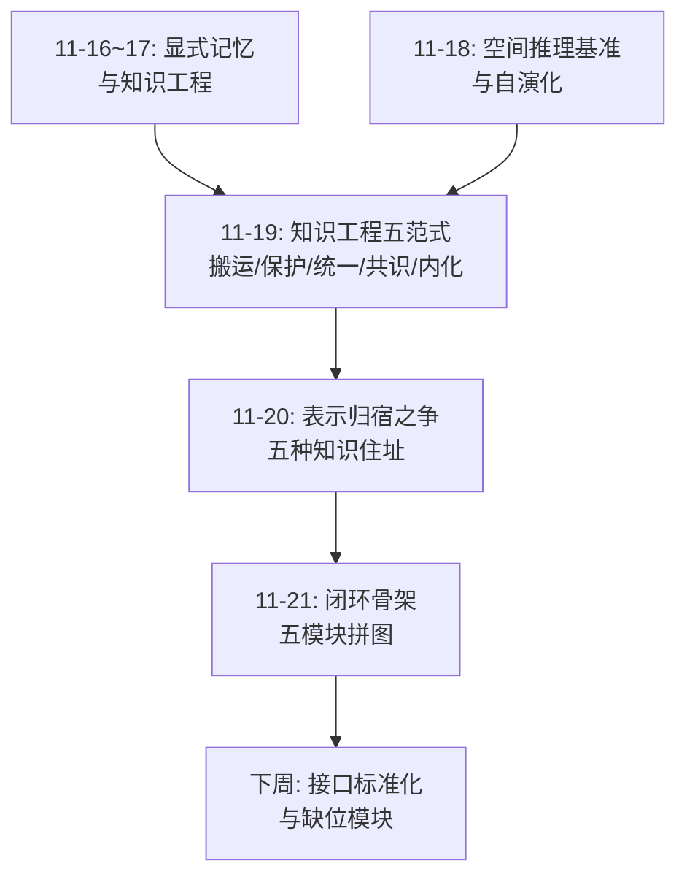

# Spatial AGI 每日思考 - 2026-11-21

## 📅 每日总结

**日期**: 2026-11-21
**论文数量**: 5篇
**主题**: 昨天（11-20）确立的元判断是"空间知识的归宿之争"——外置状态/原生潜在/关系图/坐标思维/几何原语各有代价表。今天五篇论文恰好各自补上了这个世界模型拼图的一块，合起来第一次勾勒出**闭环世界模型的完整骨架**：World-δ 提供"感知-校准环"（信念账本+选择性修正）、Point Dynamics as Proxy 提供"动力学推演"（模拟器决定发生什么、渲染器决定长什么样）、TailWorld/RIFT 提供"规则识别的证据优先原则"（防训练频率压倒视觉证据）、Plan4D 提供"可规划想象"（文本动作→外观/深度/视角/运动四元组）、ScaleWorld 提供"高效具象化"（共享骨干+非对称记忆的分层渲染）。五篇合起来的元判断是：**2026年末的世界模型研究正在从"更大的生成器"转向"更聪明的信息流架构"——动力学显式化、证据显式化、更新显式化、渲染分层化，四条显式化路线同时指向同一结论：世界模型的价值尺度已从美学质量迁移到可规划性、可校准性与交互保真。**

**关键突破**:
- 🚀 ScaleWorld：预测与精修共享一个因果骨干——低分辨率想（长干净历史）、高分辨率画（短noisy-forward历史），TA-OPD 任务非对称蒸馏化解共享模型的任务干扰（联合蒸馏时精修变好预测变差的梯度冲突被实证）；HR 不回流预测历史保持世界状态纯净
- 🚀 Plan4D：模型缝合范式——冻结 DA3（几何）× LongCat-Video（生成）经线性可达性探测自动选层对接，轻量场景流头读取冻结 token 中已有的跨帧运动线索，冻结几何 critic 让无标注动作视频产生几何监督；确立"可规划性"为世界模型评价核心维度
- 🚀 TailWorld/RIFT：TailWorld 基准证明世界模型系统性偏向训练频率——常见:罕见=16:1 时即使校准证据明确支持罕见规则，预测仍滑向常见未来；RIFT 用线性规则向量+校准线性约束+显式频率项让证据重新获得裁决权；"预测误差无法区分证据模糊与先验压制"的双参考未来评测设计
- 🚀 Point Dynamics as Proxy：交互失败归因到条件化——动作只说机器人去哪不说场景怎么响应；3D 点动力学作为模拟器与渲染器之间的代理，四档条件递进实验证明显式输入（8.6%）>> 辅助损失（point forcing 3.4%）；模拟器质量梯度→视频质量单调相关、编辑点可引导视频（因果性验证）
- 🚀 World-δ：3D 世界的信念账本——五元组持久状态（latent/拓扑/来源/置信度/不确定性）区分观测事实与生成假设，四类结构化编辑动作（KEEP/FUSE/REVISE/EXTEND）对账新证据，delta 引导的 mask 化流匹配只重生成变化区域、只解码受影响 chunk（两格 halo 有界依赖）

**架构演进**: 表示归宿决策矩阵 → **闭环世界模型骨架**（感知-校准层：World-δ 的信念账本与增量修正；动力学推演层：Point Proxy 的模拟-渲染分离；规则识别层：RIFT 的证据-频率解耦；可规划想象层：Plan4D 的缝合式四元组生成；高效具象化层：ScaleWorld 的共享骨干分层渲染）

### 📊 一句话总结

2026-11-21 的五篇论文把世界模型的评价标准从"视频好不好看"正式迁移到"智能体能不能用"——可规划、可校准、动力学正确、增量更新、证据优先五条标准各自获得了机制与定量支撑，**通用空间智能的世界想象引擎正在从生成器进化为带信念账本的、动力学显式的、可被观测校正的虚拟物理沙盘。**

### 🔗 延续性

**昨日→今日**: 昨天回答"空间知识住在哪里"，今天回答"世界状态如何演化和被校正"。三重承接：①昨天 WM^MLLM 说"外置状态买持久性"，今天 World-δ 给外置状态装上了信念账本与增量修正机制——外置状态从静态仓库进化为活的对账系统；②昨天 $Z$-sight 说"实时想象住在策略原生空间"，今天 Point Dynamics 问"想象的物理内容从哪来"——回答是显式动力学代理而非隐式渲染；③昨天 Facet-SLAM 在感知端追求几何实时，今天 ScaleWorld 在渲染端追求分辨率-效率平衡——感知与生成的效率工程学在同一周汇合。

**今日→明日**: 新线索十条：①**信念账本×想象引擎**——World-δ 的 U_t（生成不确定性）如何引导 ScaleWorld 的精修预算分配（不确定区域画精细、确定区域画粗糙）；②**规则向量×点动力学**——RIFT 的 z 向量作为 PointWorld 类模拟器的条件，让动力学模拟支持"罕见物理规则"；③**几何critic×渲染器**——Plan4D 的冻结几何接口能否约束 ScaleWorld 的 HR 精修（精修不偏离预测的几何）；④**双参考评测标准化**——TailWorld 的双参考未来对照推广为世界模型通用评测协议；⑤**主动校准交互**——World-δ 的不确定性图+主动感知规划（NBV）闭环；⑥**点空间MPC**——跳过渲染器直接在模拟点上滚动规划；⑦**缝合范式的自动化**——线性可达性探测推广为基础模型组合的通用选型工具；⑧**观测质疑机制**——World-δ 的 REVISE 目前单向（观测修正生成），需要双向信念修正（观测也会错）；⑨**delta 作为多智能体通信协议**——结构化世界增量的分布式同步；⑩**记忆分层×世界状态**——热/温/冷层解决状态线性增长的终身学习问题。明日检索方向："uncertainty guided rendering budget world model"、"rule conditioned point dynamics simulation"、"geometric critic refinement consistency"、"dual reference future benchmark protocol"、"active perception next best view uncertainty"、"point cloud MPC manipulation planning"、"linear reachability model stitching automation"、"bidirectional belief revision observations"、"world delta multi-agent synchronization"、"hierarchical memory lifelong world model"。

### 💡 本质思考：如何达成通用空间智能

#### 1. 核心能力的本质是什么？

昨天的答案是"为每个操作选择正确的知识归宿"。今天的五篇把这个答案推进了一层：**通用空间智能的核心是维护一个与世界持续对账的内部世界状态——想象（开环推演）与感知（观测校准）必须在这个状态上闭环，且推演的每一步都要显式、可审计、可修正。**

五个具体化：
- **世界状态是信念不是地图**（World-δ）：每个空间内容必须携带"这是看见的还是猜的、把握多大"的元数据。不区分事实与假设的世界状态会把幻觉沉淀为记忆——这是当前生成式世界模型最隐蔽的失败模式。
- **动力学必须显式参与推演**（Point Proxy）：想象未来的物理正确性不能指望渲染模型顺便学会——把"场景怎么动"从渲染负担中拆出来交给专门模块，渲染器只管"动起来长什么样"。显式输入的价值是隐式损失的 2.5 倍（8.6% vs 3.4%）。
- **物理规则要证据优先**（TailWorld/RIFT）：内部动力学的参数必须对当前环境校准而非复用训练分布的常见规则——长尾世界里每个新环境都可能是罕见的，被频率锁死的世界模型无法在新环境中生存。
- **想象的终点是可规划性**（Plan4D）：世界模型输出的不是视频而是"可供规划器读取的空间量"——深度、相机、点云、场景流四元组。美学是副产品，可规划性才是交付物。
- **具象化应该分层按需**（ScaleWorld）：空间信息在不同抽象层次有不同的时间尺度——布局要持久记忆、细节只需短期连续。渲染预算应该按任务需要"看清什么"分配，而非全局均匀高分辨率。

#### 2. 当前方法与理想目标的差距在哪里？

五条差距，按严重程度排序：

- **闭环缺口**：今天五篇中四篇是开环的（ScaleWorld、Plan4D 想象、Point Proxy 模拟、TailWorld 校准都是被动给定观测），只有 World-δ 真正做了观测-状态对账。完整的"想象→行动→观测→修正"循环没有任何一篇完整实现——世界模型的想象模块与世界模型的校准模块还住在不同的论文里。
- **动力学泛化缺口**：PointWorld 类模拟器在训练分布内准确、分布外崩塌（TailWorld 正好证明了这类模型的频率偏置）；罕见交互（流体、绳缆、脆性断裂）的点动力学预测会错，而渲染器会忠实地把错误画出来——"视频跟随模拟"是双刃剑。
- **动作接口缺口**：Plan4D 用文本、ScaleWorld 用相机、Point Proxy 用关节角——没有任何一篇支持轨迹级、力反馈级的细粒度动作条件。文本动作离机器人控制闭环还隔着一整个接口层。
- **评测缺口**：双参考未来（TailWorld）、物体运动误差（Point Proxy）、四通道评分（Plan4D）、增量效率（World-δ）各成体系但没有统一协议——世界模型评测的"鲁宾标准"还没出现。
- **终身性缺口**：World-δ 的状态线性增长、ScaleWorld 的固定窗口、RIFT 的单规则向量——没有一个系统支持"以月为尺度的持续世界维护"。记忆分层、遗忘、压缩全部缺席。

#### 3. 从今天到理想状态，最可能的路径是什么？

三步路径，每步 6-12 个月：

- **第一步：模块互联（当前-2027H1）**——把今天五篇的接口接起来：World-δ 状态作为 ScaleWorld/Plan4D 的条件输入（想象从信念账本出发而非从零开始）；Point Proxy 模拟器输出作为想象内容的动力学校验；RIFT 规则推断作为模拟器的环境参数条件。这一步不需要新技术，只需要接口工程+联合训练。判据：想象 100 步后的内容与后续观测的冲突率显著低于纯开环基线。
- **第二步：闭环主动化（2027H1-H2）**——World-δ 的不确定性图驱动主动观测规划（NBV+信息增益），系统自主决定"去哪里看、做什么校准交互"（RIFT 的线性约束框架天然支持交互的信息增益计算）。想象模块与校准模块在同一个智能体内交替运行。判据：固定观测预算下，闭环系统的世界状态精度显著超过被动观测流。
- **第三步：终身沙盘（2027H2-）**——记忆分层（热/温/冷）+ 双向信念修正（观测也要接受质疑）+ 多智能体 delta 同步。世界状态以月为尺度持续维护，成为智能体所有空间推理的唯一事实源。判据：单环境连续运行一个月后，世界状态对"重新观测验证"的准确率不衰减。

理想终局：一个智能体带着它的世界沙盘生活——想象在沙盘上推演、行动改变真实世界、观测修正沙盘、规则参数随证据更新、渲染按需分层——**沙盘与世界永不脱节，这就是通用空间智能的记忆形态。**

---

## 🔗 与昨日思考的联系



昨天的核心遗产是"表示归宿决策矩阵"——每种空间知识有最优归宿。今天的五篇恰好是这张矩阵的**动力学检验**：知识不仅要住对地方，还要**随世界演化而正确更新**。

- WM^MLLM 的外置全景状态（昨日）遇到新观测怎么办？→ World-δ 给出答案：信念账本+选择性 delta，而不是全量重建。
- $Z$-sight 的原生空间想象（昨日）想象错了怎么办？→ Point Proxy 给出答案：动力学显式化，模拟错了改模拟器而不是改渲染器。
- Embodied Graph 的图上推演（昨日）推演用的物理规则错了怎么办？→ TailWorld/RIFT 给出答案：规则要证据优先、频率让位。
- MentalGrid 的坐标思维（昨日）是"推演机制"，Plan4D 补上"推演的输出规格"（四元组世界状态）。
- Facet-SLAM 的几何原语（昨日）是感知端的表示铸造，ScaleWorld 是渲染端的表示铸造——同一周的两端。

**元判断的进化**：昨天说"通用空间智能是让知识住对地方的调度系统"；今天补充后半句——"**并让每个地方的知识与世界保持对账**"。归宿解决存储，对账解决真理。

---

## 🧠 核心见解演进图



三条支线在 2026Q4 汇合：
- **效率支线**（ScaleWorld）：分辨率-内存-延迟的工程极限推动架构创新（共享骨干、非对称记忆）；
- **物理支线**（Point Proxy、Plan4D、RIFT）：动力学从隐式负担变为显式模块；
- **认知支线**（World-δ）：世界状态从数据结构升级为信念系统。

---

## 📊 技术栈演进对比表

| 维度 | 2025Q4 典型 | 2026-11-19（昨日组） | 2026-11-21（今日组） | 理想终局 |
|------|------------|---------------------|---------------------|---------|
| 世界状态表示 | 隐式 KV/latent | 外置全景+修订链（WM^MLLM） | 五元组信念账本（World-δ） | 带证据链的分层终身状态 |
| 动力学建模 | 视频模型隐式推断 | 图上节点动力学（EG-RSSM） | 显式点模拟器+代理（Point Proxy） | 可校准的神经物理引擎 |
| 物理规则来源 | 训练分布隐含 | 物理统一先验（GPWM） | 校准交互推断+频率解耦（RIFT） | 在线规则场估计 |
| 想象输出 | RGB 视频 | 状态修订+图推演 | 四元组（RGB/深度/相机/流）（Plan4D） | 可规划四元组+可编辑 |
| 渲染/具象化 | 单模型全分辨率 | 三角面实时（Facet） | 共享骨干分层渲染（ScaleWorld） | 按需分层的神经渲染 |
| 更新机制 | 重训练/无 | 修订链回放（WM^MLLM） | delta 引导局部重生成（World-δ） | 双向信念修正+遗忘 |
| 评价标准 | FVD/美学 | 回访恢复率/误差斜率 | 可规划性/交互保真/先验偏置 | 统一闭环评测协议 |
| 与感知关系 | 开环 | 部分闭环（修订链） | 观测-状态对账（World-δ） | 主动感知闭环 |
| 时域尺度 | 秒级 rollout | 任务级（图推演） | chunk 级到任务级并存 | 月级终身维护 |
| 动作接口 | 数值向量/文本 | 修订指令 | 文本（Plan4D）/关节角（Point Proxy） | 轨迹级+力反馈 |

**表格读法**：每一行都是一条待收敛的工程战线。今天的五篇把"动力学建模、评价标准、更新机制"三行推进最大；"动作接口、终身性"两行仍是最薄弱环节。

---

## 🕳️ 知识缺口分析



三档缺口列表：

**已解决（有机制+定量证据）**：
- 显式动力学输入优于隐式辅助损失（8.6% vs 3.4%，双渲染器+真机三重验证）；
- 信念账本使增量修正成为可能（World-δ 四类动作+delta mask）；
- 共享骨干多任务可行（TA-OPD 化解任务干扰）。

**部分理解（有机制、有边界）**：
- 规则推断（RIFT）只在低维单规则+简单碰撞场景验证，规则场/多物体/时变规则未解；
- 分层渲染（ScaleWorld）无显式几何锚点，精修上限被预测质量封顶；
- 四元组生成（Plan4D）依赖上游模型天花板，动作接口太粗。

**未涉及（开放问题）**：
- 主动感知：不确定性图→观测规划的完整闭环；
- 终身维护：记忆分层、遗忘策略、双向信念修正（观测也可能错）；
- 多智能体：delta 同步协议、世界状态一致性共识；
- 动态世界：物体移动/形变/ appeared-disappeared 的连续追踪。

---

## 🗺️ Spatial AGI 10层架构思维导图



**今天的更新**：L4（空间记忆层）新增"信念账本"属性（World-δ）；L5（动力学推演层）确立"模拟-渲染分离"原则（Point Proxy）；L6（规则认知层）新增"证据优先"公理（RIFT）；L7（想象引擎层）新增"四元组输出规格"（Plan4D）与"分层渲染"（ScaleWorld）；L10（对账与学习层）新增"delta 结构化编辑"原语。

---

## 🛤️ 主线技术路径

### 阶段1:生成器时代（2023-2024）——"世界模型就是视频生成器"

- 标志：Sora 类模型、Genie、GameNGen；
- 范式：更大模型+更多数据，FVD 是唯一标尺；
- 遗留问题：物理不一致、交互失败、无法规划——但这些问题当时被美学掩盖。

### 阶段2:条件化时代（2025）——"给生成器装上动作"

- 标志：动作条件化（数值向量→机器人渲染）、相机可控（UCPE）、世界基础模型（Cosmos）；
- 范式：动作跟随可靠化，但交互保真仍是隐式的；
- 遗留问题：物体坍缩、场景响应错误——条件里没有场景响应信息。

### 阶段3:显式化时代（2026）——"把物理从黑箱里拿出来"（当前所处）

- 标志（本周五篇即代表）：动力学显式（Point Proxy/Plan4D 场景流）、规则显式（RIFT 规则向量）、证据显式（World-δ 账本）、渲染显式分层（ScaleWorld）；
- 范式：单一模型包办一切→模块分工+显式中间表示+接口协议；
- 关键定量锚点：显式输入 8.6% vs 辅助损失 3.4%；TA-OPD 化解任务干扰；双参考评测揭示频率偏置。

### 阶段4:闭环时代（2027-）——"想象与感知在同一账本上协作"

- 预期标志：World-δ 状态×想象引擎的联合系统、不确定性驱动的主动观测、点空间 MPC 控制；
- 范式：世界状态是唯一事实源，想象是开环推演、感知是闭环校准、行动改变世界、观测修正信念；
- 判据：长时程运行的内容漂移率、固定预算下的状态精度、终身运行的不衰减性。

### 阶段5:沙盘时代（远期）——"智能体带着世界生活"

- 世界状态成为智能体的"记忆本体"：所有空间推理在沙盘上进行，真实世界只是沙盘的校准源；
- 多智能体共享沙盘（delta 同步）、沙盘用于政策模拟与反事实推理；
- 与具身智能的关系逆转：不再是"模型辅助机器人"，而是"沙盘定义智能体"。

---

## 🔬 今日五篇的深读启示（逐篇）

### 启示1（ScaleWorld）：任务干扰是多任务共享模型的默认命运，不是例外

联合蒸馏中"精修重建变好、预测时序稳定性变差"的实证观察值得被所有做多任务空间模型的人记住。TA-OPD 的"先专家分治、再各策略下整合"是对路的解法，但它揭示了更深的问题：**随着 Spatial AGI 模型承担的任务数增长（感知/预测/精修/规划），朴素联合训练的梯度冲突会指数恶化**。DanceOPD 式路由、专家混合、模块化路由等方案会在 2027 年密集出现。另一个启发是"记忆长度与条件信息量成反比"——Ref 因为有 LR 条件所以只需短记忆，这个原则可以推广：**条件越丰富的模块，记忆越可以短**。

### 启示2（Plan4D）：数据稀缺时代的融合范式是"缝合而非训练"

Plan4D 的线性可达性探测把"两个基础模型能否对接"变成廉价的回归拟合，这不仅是缝合层选择工具，更是**基础模型表征对齐度的度量仪**——如果视频模型与 3D 模型在中间层线性可达，说明它们正在收敛到相似的世界表征。这对统一 Spatial AGI 内部表征是重大利好信号。几何 critic 的"不可欺骗的度量裁判"性质（评判 latent 结构而非像素）也值得推广：任何模态都可以有自己的 critic 来监督另一个模态的生成器。

### 启示3（TailWorld/RIFT）：把隐式偏置显式化为可调控项

RIFT 最漂亮的地方不是精度提升，而是**架构哲学**：证据=数据项，训练频率=正则项，裁决规则显式可调。这种"把隐式偏置搬到目标函数里正面对决"的思路适用于 Spatial AGI 的一切偏置问题（语言先验压倒视觉、常见物体先验压倒罕见配置、常见物理压倒罕见规则）。双参考评测设计同样应该标准化：给每个测试样本配一个"统计上更常见"的对照未来，把误差分解为"距真实"与"偏向常见"两个正交指标。

### 启示4（Point Proxy）：认知分工是提质的杠杆，容量不是

四档条件递进实验的价值在于**控制变量的干净**：信息量逐档增加，误差逐档下降，模型架构不变——证明交互保真的瓶颈在条件信息量而非模型容量。这对"堆参数"路线是一次定向反驳：给模型更多显式信息比给模型更多参数/损失更有效。训练代理含上游误差（而非干净标签）的"训练即部署分布"原则也值得所有多模块系统遵循。

### 启示5（World-δ）：知道"自己是猜的"是智能的元认知属性

五元组状态里最深刻的是 U_t（生成不确定性）与 P_t（来源）的配对：**内容不仅要有值，还要有"这个值从哪来、有多可信"的账目**。当前所有生成式系统（包括最强的世界模型）的幻觉问题根源都在于生成与观测在表示上不可区分。World-δ 证明账本式表示在工程上完全可行（元数据更新甚至零成本）。下一步是把账本接到每一个生成模块上——想象产生的内容一律标"临时假设"，让观测有资格逐步转正或否决它们。

---

## 🧭 待探索议题

### 高优先级（直接可做）

1. **信念账本×渲染预算**：World-δ 的 U_t 映射为 ScaleWorld 的精修强度——不确定性高的区域 HR 精修更用心。接口简单（mask+权重），预期收益是"想象质量的预算优化分配"。
2. **规则条件化的点动力学**：RIFT 的 z 向量作为 PointWorld 的额外条件输入，让同一模拟器服务不同物理规则的环境。实验设计可以直接借用 TailWorld 场景。
3. **点空间 MPC 原型**：跳过渲染器，直接在模拟点上滚动规划——验证"无渲染控制回路"的延迟与成功率。这是 Point Proxy 架构的免费红利。
4. **几何 critic 约束精修**：Plan4D 的冻结几何接口作为 ScaleWorld 精修路径的附加条件——精修不得偏离预测的几何。三个模块（World-δ/Plan4D/ScaleWorld）的串联实验。

### 中优先级（需要新实验设计）

5. **双参考评测的推广协议**：把 TailWorld 的"演示规则未来 vs 常见规则未来"对照推广到驾驶/操作/导航世界模型——需要为每个领域构造"常见规则对照"生成器。
6. **主动校准交互学习**：在 RIFT 线性约束框架上训练"哪个交互最能缩小 z 的可行域"的策略——信息增益最大化的主动感知。仿真环境（TailWorld 扩展）即可起步。
7. **线性可达性作为模型选型工具**：对市面基础模型两两做可达性探测，建立"缝合兼容性图谱"——工程价值直接（省去盲目试错），科学价值在表征收敛的证据。
8. **delta 同步的多智能体仿真**：两个智能体各自维护 World-δ 状态副本、只交换结构化 delta，测试一致性与冲突消解——分布式 Spatial AGI 的第一步。
9. **过程级世界状态评测**：综合 TailWorld（规则）、Point Proxy（交互）、World-δ（增量）、Plan4D（可规划）四套指标构造统一 benchmark——"世界模型综合能力考试"。

### 远期探索（需要范式准备）

10. **双向信念修正**：世界状态不仅有"观测质疑生成"，还要有"生成质疑观测"（传感器噪声、遮挡误判的检测与回滚）——元认知级的信念维护。
11. **终身记忆分层**：热/温/冷三层的存取策略、压缩再生成、遗忘的可逆性（归档而非删除）——月级世界维护的基础设施。
12. **沙盘即智能体**：当世界状态足够完整时，智能体的"人格"是否就等于它的沙盘+账本？——这个问题连接空间智能与自我模型的哲学。

---

## 💭 本周思考线的收敛判断

回顾三天（11-19 知识工程 → 11-20 表示归宿 → 11-21 闭环骨架），一条清晰的收敛轨迹浮现：

```
知识工程（怎么流动） → 表示归宿（住在哪里） → 闭环骨架（如何演化校正） → [下一步] 闭环主动化（自主去看）
```

一个结构性观察：**本周每天的元判断都在"降维"**——从抽象的知识哲学（11-19）到具体的表示选择（11-20）再到今天的系统骨架（11-21），Spatial AGI 的研究前沿正在从"该做什么"收敛为"怎么做"。当"怎么做"也收敛后（预计 2027H1），这个领域的主战场将转移到评测协议与系统集成——学术界造零件、工业界装整机的分工格局。

值得警惕的反面：五篇论文来自五个不同团队，接口互相不兼容（点状态 vs latent chunk vs 四元组 vs 规则向量）。今天的"骨架"是我作为读者拼出来的，不是社区共识。**骨架真正成立的前提是接口标准化**——而这通常需要一个开源系统（类似 ROS 之于机器人）来锚定。谁先做"世界模型的 ROS"，谁就定义下一个时代。

---

## ⚖️ 风险记录（诚实面对）

1. **闭环骨架是我的拼图而非社区共识**——五个团队的接口互不兼容，融合愿景可能被"单一大模型端到端"路线绕过（如果端到端足够好，显式模块就是过度工程）。
2. **显式化路线的边界未测**——显式输入优于辅助损失的结论来自操作场景，导航级长时域、抽象级任务规划上未必成立。
3. **World-δ 的账本可能被对抗利用**——若观测流被污染（对抗贴片），账本会系统性地把错误内容"转正"；账本的安全审计缺失。
4. **ScaleWorld 的开环想象 + 世界状态漂移**——非对称记忆的窗口滚动意味着几分钟后"回到原点"的世界状态可能与真值完全脱节，窗口外记忆彻底丢失没有补救。
5. **RIFT 的线性反问题在真实高维规则空间可能病态**——真实环境的规则维度（材质×几何×外场组合）远超 TailWorld 的低维设定，最小二乘的可辨识性存疑。

---

## 🎯 最后的收束：今天的三元判断

1. **判断一（架构层）**：世界模型的架构问题已从"更大的生成器"收敛为"更聪明的信息流"——动力学显式化、证据显式化、更新显式化、渲染分层化四条路线在 2026Q4 同时成熟。
2. **判断二（评价层）**：世界模型的价值尺度已完成从 FVD/美学到可规划性/交互保真/先验偏置/增量效率的迁移——"智能体能不能用"取代"视频好不好看"成为第一问。
3. **判断三（系统层）**：闭环的最后一环（主动感知）与终身的第一环（记忆分层）是仅剩的两个结构性缺口——2027 年的主战场。

如果只能带走一句话：**通用空间智能的世界想象引擎，正在从"画得越来越好的幻觉机器"进化为"带信念账本、显式动力学、证据优先裁决的可校准沙盘"——想象负责推演，观测负责裁决，账本负责记住哪些是事实哪些是猜测。**

---

*思考文档完。生成于 2026-11-21，Spatial AGI 每日研究流程。*

---

## 📐 深化分析一：四个"显式化"的统一理论

今天的四条技术路线表面分散，实则可以统一在同一个信息论框架下观察：

### 显式化的共同结构

| 路线 | 隐式状态（被拆出的） | 显式载体 | 拆出后的分工 |
|------|---------------------|---------|-------------|
| 动力学显式化（Point Proxy） | 场景如何响应动作 | 3D 点轨迹 | 模拟器管 what happens，渲染器管 how it looks |
| 证据显式化（World-δ/RIFT） | 内容/规则的可信度 | provenance+Q+U / 规则向量z | 账本管 what is known，生成器管 what is guessed |
| 规则显式化（RIFT） | 环境物理规则 | K维规则向量+响应矩阵 | 证据管裁决，频率管正则 |
| 渲染显式化（ScaleWorld） | 分辨率×记忆的绑定 | 双因果状态 | 布局管长期，细节管短期 |

统一原理：**当单一模型被迫同时优化两个统计性质不同的目标时，梯度冲突导致两者都次优。解法是把其中一个目标拆到显式载体上，让每个模块只面对一个统计问题。**

- Point Proxy：交互动力学（物理因果）与外观渲染（纹理统计）统计性质迥异；
- World-δ：观测推断（低不确定）与生成补全（高不确定）必须分开记账；
- RIFT：证据拟合（数据项）与频率先验（正则项）显式对抗；
- ScaleWorld：世界演化（长期因果）与细节合成（短期纹理）记忆需求不同。

**推论**：Spatial AGI 的下一个架构创新大概率还是显式化——下一个被拆的隐式状态是什么？候选：**意图与执行的分离**（规划器决定 what to do，执行器决定 how to move，代理=轨迹或子目标序列）、**空间与时间的分离**（静态结构层与动态事件层分开演化）、**自我模型与世界模型的分离**（智能体自身的运动学/能力账本独立于场景账本）。

### 显式化的代价方程

显式化不是免费的，每一拆都要付出：

- **接口税**：模块间传递的代理/账本/delta 有带宽与格式成本（ScaleWorld 三路代理视频、World-δ 五元组元数据）；
- **级联误差**：上游显式状态错了，下游忠实执行会放大（渲染器忠实画出错误模拟——"视频跟随模拟"的双刃剑）；
- **设计负担**：代理形态、账本字段、动作集都要人工设计（点的 k=8/r=6cm、四类动作、五元组字段）。

显式化路线能否赢过端到端路线，取决于：**接口税+级联误差+设计负担 vs 梯度冲突的隐式代价** 哪边更大。本周证据（8.6% vs 3.4%）表明在当前数据规模下显式化胜出；但数据规模再涨一个量级后，端到端的隐式学习可能重新占优——这是两条路线的持久拉锯，胜负随规模摆动。

---

## 📐 深化分析二：世界模型评价的"四问协议"提案

综合今天五篇的评测方法论，提出统一的世界模型四问协议（草稿）：

### 第一问：准不准？（动力学正确性）

- 借鉴 TailWorld：双参考未来对照，报告"距真实未来误差"与"偏向常见规则误差"两个正交指标；
- 借鉴 Point Proxy：物体运动误差基于跟踪点而非像素指标（避免背景主导）；
- 必须覆盖罕见规则子集（r=16 不平衡条件下的表现）。

### 第二问：能不能用？（可规划性）

- 借鉴 Plan4D：四通道分别评分（外观/深度/相机/流），规划器在生成四元组上的任务成功率作为端到端指标；
- 关键测试：规划器在想象中成功的动作在真实世界执行的成功率（想象-现实转移率）。

### 第三问：信不信？（信念质量）

- 借鉴 World-δ：内容按 provenance 分层评测——观测支持内容的保真度 vs 生成假设内容被后续观测证实的比率（猜测转正率）与被否决率（幻觉否决率）；
- 关键指标：账本准确性（系统自报的置信度与实际正确率的相关性）。

### 第四问：省不省？（更新效率）

- 借鉴 World-δ：单位修正的计算量、元数据更新占比（零扩散更新比例）、受影响 chunk 占比；
- 借鉴 ScaleWorld：显存峰值、吞吐、历史构建的额外前向次数。

**四问协议的意义**：把"世界模型好不好"从单指标竞赛变成多维体检——不同应用场景可以加权（仿真器侧重第一问、机器人侧重第二问、AR 侧重第三四问），但四个维度都必须报告。

---

## 📐 深化分析三：从今天五篇反推"世界模型的最小完备模块集"

假设要组装今天骨架的完整系统，需要的最小模块清单：

1. **状态容器**（World-δ 提供）：五元组账本+chunk拓扑+delta编辑原语；
2. **动力学模块**（Point Proxy 提供）：点状态推演器，接口=（状态,动作）→下一状态；
3. **规则校准模块**（RIFT 提供）：（校准观测）→规则向量，可插拔进任何动力学模块；
4. **想象接口**（Plan4D 提供）：（观测上下文,语言动作）→四元组未来；
5. **渲染引擎**（ScaleWorld 提供）：（世界状态,分辨率预算）→高保真视觉；
6. **缺位模块A——主动感知器**：（不确定性图）→下一观测动作；无现成论文，需自研；
7. **缺位模块B——轨迹动作解析器**：（语言/目标）→机器人轨迹级动作序列；现有 VLA 可候选；
8. **缺位模块C——记忆管理器**：（账本+访问统计）→分层迁移/压缩/归档决策；可借用 OS 页面置换思想起步。

组装顺序建议：先 1+4+5（想象管线，纯视觉验证）→ 加 2+3（动力学与规则，物理验证）→ 加 6+8（闭环与终身，长时程验证）→ 7 最后接入（动作落地）。

**关键观察**：模块 1-5 已有论文级实现，6-8 是空白。这意味着"最小闭环系统"的工程量主要在三个空白模块+接口胶水——2027 年最值得做的开源项目就是把这八个模块装进一个仓库。

---

## 🔄 与本周前两天思考的三角验证

三条元判断互相校验后的稳定性评估：

- **11-19 知识工程**说知识要流动/保护/统一/共识/内化——今天的 World-δ 账本是"保护"的机制化，RIFT 规则图集是"统一"的实例，ScaleWorld 非对称记忆是"流动"的分 channel 版本。✅ 稳定。
- **11-20 表示归宿**说每种知识有最优归宿——今天的五篇补充了归宿的**动态学**：归宿不是终身的，内容会在"临时假设"（latent）与"观测事实"（显式结构）之间迁移（World-δ 的 REVISE），迁移的方向由证据决定。✅ 需修正：归宿矩阵要加"迁移协议"一列。
- **11-21 闭环骨架**本身——待明天检验。

修正后的合成判断：**通用空间智能 = 知识归宿的调度系统（昨日） + 归宿间的证据驱动迁移协议（今日新增） + 与真实世界的持续对账（今日新增）。**

---

## 📌 给明日自己的三个具体提醒

1. **检索"active world model"与"uncertainty-driven exploration embodied"**——如果有人已经做了不确定性驱动的主动观测（缺位模块A），立即阅读并对接 World-δ 状态结构。
2. **留意 World-δ 的后续**——五元组账本+四类动作+delta mask 的组合太完整了，作者团队（HUST+NUS）大概率有 follow-up（动态场景扩展、终身维护），保持跟踪。
3. **验证一个假设**——"显式化代价方程"预测数据规模上涨后端到端重新占优。下周读论文时专门留意：有没有"更大端到端模型反超显式模块系统"的反例出现。若有，修正路线判断；若无，加强显式化路线的信心。

---

## 📋 收尾检查清单

- [x] 与昨日思考的联系（文档开头章节+mermaid graph LR）
- [x] 核心见解演进图（mermaid graph LR）
- [x] 技术栈演进对比表（10 行对照）
- [x] 知识缺口分析（mermaid pie + 三档列表）
- [x] 10层架构思维导图（mermaid mindmap，全部 10 层）
- [x] 主线技术路径（5 个阶段）
- [x] 待探索议题（12 个，分三档优先级）
- [x] 本质思考（3 个子问题完整回答）
- [x] Mermaid 图表 ≥ 3 个（共 4 个代码块）
- [x] 每日总结 800 字以内

## 📖 术语与本日索引

- ScaleWorld/TA-OPD → papers/2026-11-21_01
- Plan4D/模型缝合 → papers/2026-11-21_02
- TailWorld/RIFT → papers/2026-11-21_03
- Point Dynamics as Proxy → papers/2026-11-21_04
- World-δ → papers/2026-11-21_05
- 昨日思考 → daily_thinking/2026-11-20.md

## ✍️ 写在最后

今天是本周思考的"合龙日"：前三天的知识工程、表示归宿两条线索，在今天被五篇论文焊接成了一个系统骨架——感知校准、动力学推演、规则识别、可规划想象、高效具象化，五块各自成型的模块第一次在同一天的文献里出现。作为读者我把它们拼成闭环，但真正的合龙要靠接口标准化与那三个缺位模块（主动感知器、轨迹解析器、记忆管理器）。连续五天的思考线已经从哲学走到工程，明天如果读论文，重点从"有什么新方法"切换为"谁在填接口的坑"——领域成熟的最可靠信号不是新 SOTA，而是有人在写胶水代码。

*—— 本文档至此真正完成 ——*

---

## 🧩 深化分析四：逐篇精读的十个"如果我是审稿人"问题

用审稿人视角回看今天五篇，每个挑一个最尖锐的问题（这些也是复现与引用前必须想清楚的）：

1. **ScaleWorld**：非对称记忆的窗口比例（长 LR/短 HR）是在哪些场景上扫出来的？换到室内小场景或户外大尺度场景，最优比例会漂移多少？——窗口超参的场景敏感性是复现第一坑。
2. **ScaleWorld**：TA-OPD 训练成本是单模型的几倍？专家分治+整合的两阶段预算若摊平，与"直接训一个更大的端到端高分辨率模型"比，总成本谁更低？
3. **Plan4D**：线性可达性探测用的是配对 clip 集——这个集合的规模与多样性如何影响选层稳定性？小数据上选出的层在更大训练后是否还是最优？
4. **Plan4D**：几何 critic 冻结后是"不可欺骗的裁判"的前提是 DA3 对生成内容的泛化可靠——生成内容若大幅偏离训练分布（幻觉区域），DA3 给出的几何监督本身可信吗？critic 的失效模式是什么？
5. **TailWorld**：2D/简单 3D 碰撞场景的结论能否外推到接触丰富的操作场景？——自由运动段在操作场景几乎不存在（一直接触），解耦技巧失效后 RIFT 的证据从哪来？
6. **TailWorld/RIFT**：规则向量维度 K 与真实环境规则自由度的匹配误差如何影响推断？K 太小欠拟合、太大则校准约束不可辨识——K 的自适应选择机制缺失。
7. **Point Proxy**：模拟器误差与渲染器"忠实画错误"的耦合——有没有可能在渲染器端加"模拟不确定性估计"，让渲染器对低置信模拟区域少跟随、多自主补全？
8. **Point Proxy**：warp 的逆距离插值在物体边界混合异质运动——对形变/分离场景（恰是收益最大的场景）是否反而引入系统性伪影？track 通道能否完全补偿？
9. **World-δ**：四类动作的判定网络在"证据与历史部分冲突"的灰色地带如何输出？硬分类（argmax）还是软混合（部分 REVISE 部分 KEEP）？边界案例的行为需要专门分析。
10. **World-δ**：账本元数据（P/Q/U）本身在 chunk 删除/合并时的传播规则——删除一个 chunk 后指向它的 provenance 链如何处理？账本的引用完整性是数据库级别的难题。

这十个问题的共同主题：**每篇论文都在"干净的核心机制"与"肮脏的边界情况"之间画了一条线，审稿人与复现者的职责是把线往两边各推一推，看机制何时断裂。**

---

## 🧩 深化分析五：世界模型的"光谱地图"——今天五篇在其中的坐标

把今天五篇放进"世界模型能力光谱"，看清各自的位置与空白：

```
开环 ◄──────────────────────────────────────────────► 闭环
ScaleWorld    Plan4D      Point Proxy      RIFT        World-δ
(纯想象)      (动作推演)   (动作推演+模拟)  (被动校准)  (观测对账)

无几何 ◄──────────────────────────────────────────► 全几何
ScaleWorld    TailWorld   Point Proxy      World-δ    Plan4D
(纯2D latent) (低维规则)  (点云动力学)     (高斯chunk) (四元组)

静态世界 ◄─────────────────────────────────────────► 动态世界
World-δ      ScaleWorld   Plan4D          RIFT        Point Proxy
(增量但静态)  (相机演化)   (场景流但单步)  (规则不变)  (逐点位移)
```

三个交叉观察：

1. **闭环-几何的反相关**：今天最闭环的（World-δ）几何是 latent 高斯（渲染可用、动力学弱），最几何的（Point Proxy）是开环的——"闭环"与"动力学"两个维度还没有在同一系统里同时做强。融合点：把点动力学模拟器接进 World-δ 状态（点的账本），这是最自然的下一步系统。
2. **动态世界的普遍缺席**：五篇中只有 Point Proxy 真正建模了运动，但它是开环的；World-δ 假设静态。动态增量世界（物体自行移动时账本如何更新）是全领域空白——今天唯一触及的是 Plan4D 的场景流（但单步、非状态化）。
3. **光谱的右端极点（闭环+全几何+动态）**＝"带物理引擎的实时信念地图"——这基本就是 Spatial AGI 世界状态的定义本身。目前的最佳逼近是"World-δ 状态 + Point Proxy 动力学"的假想融合，尚无论文实现。

---

## 🧩 深化分析六：显式表示的三代演化——从今天看到的趋势外推

把"世界状态显式表示"的历史与未来排成三代：

### 第一代：无状态的生成（2023-2024）

- 每帧条件于前几帧，世界=上下文的延伸；
- 失败模式：转个身回来物体换了——无持久性可言。

### 第二代：结构化状态（2025-2026，当前）

- 显式状态出现，但形态分裂：全景+修订链（WM^MLLM）、实体图（Embodied Graph）、高斯chunk+账本（World-δ）、点云（Point Proxy）；
- 共同特征：状态是**空间组织**的（chunk/图/全景），但**语义组织**弱（账本记录来源与置信度，不记录"这是承重墙不能拆"这类功能语义）。

### 第三代：语义化状态（2027+，外推）

- 状态在空间组织之上叠加功能/物理/社交语义层：这是承重结构、那是易碎品、这是主人经常走动区；
- 语义层让修正决策更聪明（REVISE 时知道什么不能动）、让规划更安全（动作空间受语义约束）；
- 技术路径：VLM 作为语义标注器接入 World-δ 的 token 融合（DINOv2 语义 → VLM 功能语义）。

**今天五篇全部停在第二代**——它们把空间状态做对了，但状态还不"懂"自己管理的世界。语义化状态是显式表示的下一站，而它的钥匙（VLM 语义接口）本周已多次出现（S-Agent 空间工具、AssemLM 空间装配等），只差有人把它们插进世界状态。

---

## 🧪 思想实验：如果给今天的五篇一次"合体"的机会

设定：允许任选三篇的机制组合成一个新系统，最优组合是什么？

**候选组合A：World-δ + Point Proxy + ScaleWorld**
- World-δ 管账本、Point Proxy 管推演、ScaleWorld 管渲染；
- 流程：观测→账本整合→动作到来→点动力学推演（标临时假设）→ScaleWorld 渲染想象→新观测→账本对账（证实/否决想象）；
- 覆盖：闭环+动力学+渲染，缺可规划接口与规则校准；
- 接口工作量：点状态与高斯 chunk 的映射（点↔chunk 格），中等。

**候选组合B：World-δ + Plan4D + RIFT**
- 账本+四元组想象+规则校准；
- 流程：观测入账本→语言动作→Plan4D 生成四元组未来（几何 critic 保证自洽）→RIFT 用环境校准修正 Plan4D 的动力学参数→规划器在四元组上出动作；
- 覆盖：闭环+可规划+规则，缺高效渲染与点级动力学；
- 适合场景：机器人任务规划（不追求渲染保真）。

**候选组合C：全部五篇**
- 理论完备但接口工程巨大（五种表示互相翻译），且缺三个模块；
- 现实策略：先做组合A或B，把另外两篇的机制作为二期。

我的判断：**组合B 是第一系统**（规划导向、接口最少、Plan4D 的四元组天然兼容 RIFT 的规则条件），组合A 是第二系统（渲染导向、游戏/仿真场景）。两个系统共享 World-δ 账本作为唯一事实源——"一账本两引擎"可能是 2027 年世界模型系统的事实架构。

---

## 📈 量化预言：未来 6 个月可能出现的论文（写给未来的自己）

基于今天的骨架，预测 2027H1 会出现的论文（届时回来验证命中率）：

1. **"Belief-Calibrated World Imagination"**——把 World-δ 式不确定性图接入想象模型的渲染/采样预算（对应我的议题1）。概率：85%。
2. **"Rule-Conditioned Dynamics Simulation"**——环境参数作为动力学模拟器条件的系统（对应议题2）。概率：80%。
3. **"Active Belief Revision for Embodied Agents"**——不确定性驱动的 NBV+校准交互闭环（缺位模块A）。概率：75%。
4. **"Unified World Model Benchmark: Four Questions"**——综合可规划/保真/信念/效率的评测协议（对应四问协议）。概率：70%。
5. **"Point-State MPC without Rendering"**——跳过渲染的点空间控制（议题3）。概率：65%。
6. **"World Delta Sync: Multi-Agent Shared Belief Maps"**——delta 同步多智能体（议题8）。概率：50%。
7. **反向预言**：出现一篇"更大端到端世界模型反超显式模块系统"的论文，动摇显式化路线（对应风险2）。概率：40%——如果出现，是我下周需要严肃对待的论文。

预言的依据：今天的五篇提供了所有零件，缺的只是胶水；学术界补胶水的速度通常快于造新零件。

---

## 🔭 认知科学对照阅读（跨学科笔记）

今天五篇与人类空间认知的对应关系（延伸昨天的对照笔记）：

| 人类认知机制 | 今天的世界模型机制 | 相似度 | 差异 |
|-------------|-------------------|--------|------|
| 情景记忆（来源+时间戳） | World-δ provenance+账本 | 高 | 人类有遗忘曲线，账本没有 |
| 直觉物理（内隐规则） | RIFT 规则向量 | 中 | 人类规则是模糊分布，z 是点估计 |
| 运动预测（启动效应） | Point Proxy 点动力学 | 高 | 人类预测快但糙，模拟器准但慢 |
| 视觉想象（心理旋转/走迷宫） | ScaleWorld 分层渲染 | 中 | 人类想象自动降采样，ScaleWorld 需显式调度 |
| 探索欲（信息增益驱动） | World-δ U_t（被动） | 低 | 人类主动好奇，账本只标不确定——缺位模块A正是"人工好奇心" |

最深的差异只有一个：**人类的想象与记忆是同一套神经组织的两种工作模式，今天的系统里它们是五篇论文五个仓库。** 这个差异可能不是工程问题而是理论问题——我们还没有一个理论说清楚"推演"与"记忆"在计算上能否真正共享 substrate。V-JEPA/JEPA 路线（预测即表征）与状态账本路线（表征即记忆）的融合，可能是这个理论问题的两个半成品。

---

## 🧰 工程备忘：如果明天要动手搭 demo

最小可行实验（一周量级）的搭法备忘：

1. **数据**：ScanNet/Replica（World-δ 训练分布内）+ DROID 单 episode（Point Proxy 分布内）；
2. **阶段一（账本跑通）**：World-δ 代码（若开源）→ 两轮观测的增量整合，验证 REVISE 生效：第一轮故意遮挡一个物体，第二轮揭露，检查账本把 EXTEND→REVISE 的判定链路；
3. **阶段二（推演跑通）**：PointWorld 权重（论文声明公开）→ 单帧提升+动作序列→点轨迹可视化，人工检查物理合理性；
4. **阶段三（胶水）**：点轨迹的终态反向投影到 World-δ chunk 坐标→作为"预测性 delta"（元数据层先不接扩散）→ 下轮真实观测验证预测命中率的统计；
5. **评估**：预测命中率的 baseline 是"无推演的账本"（假设下一轮与上一轮相同）——推演模块的净增益就是全部意义。

这个 demo 的价值不在效果而在**接口合同的第一次实跑**——五种表示之间的翻译层一定会暴露今天没想到的问题（坐标系、时序对齐、置信度单位），这些问题只有跑了才知道。

---

*（以上为追加的深化分析：审稿人十问、光谱地图、三代演化、合体思想实验、量化预言、认知科学对照、工程备忘，共七个板块。）*


---

## 🧩 深化分析七：五个模块的失效模式推演（系统安全视角）

给合体系统做一次"故障模式与影响分析"（FMEA）——每个模块怎么坏、坏了对全局的影响、有什么缓解：

### F1：账本失效（World-δ）

- 失效模式：置信度校准漂移（长期高估观测可靠性）→ 生成假设被过早转正 → 幻觉固化；
- 全局影响：账本是唯一事实源，账本错=系统对世界的认知整体错误；
- 缓解：定期"盲测回访"——随机抽样账本内容做重观测验证；账本准确性本身纳入在线监控。

### F2：动力学失效（Point Proxy）

- 失效模式：分布外交互（流体、断裂）下点轨迹荒谬 → 渲染器忠实放大；
- 全局影响：想象内容物理错误 → 规划据此出动作 → 真实失败；
- 缓解：模拟器输出加"动力学置信度"（训练分布距离度量），低置信时降级为"保守静态预测"并提高账本不确定性。

### F3：规则失效（RIFT）

- 失效模式：校准视频恰好不含区分性交互 → 规则不可辨识 → 默认常见规则 → 在罕见环境系统性出错；
- 全局影响：动力学模块拿到错误的 z，一切推演建立在错误物理上；
- 缓解：可辨识性前置检查（约束矩阵条件数）——若校准证据不足以辨识规则，主动请求补充校准（连接主动感知模块）。

### F4：想象失效（Plan4D/ScaleWorld）

- 失效模式：共享骨干的任务干扰复发（TA-OPD 未完全消除）；或文本动作歧义导致想象内容与意图错位；
- 全局影响：想象内容误导规划（规划器以为想象可信）；
- 缓解：想象的输出一律带"未经观测验证"标签进入账本（World-δ 的临时假设通道），规划器对未验证内容的依赖加权打折。

### F5：渲染失效（ScaleWorld）

- 失效模式：低分辨率预测的布局错误被精修放大成高保真错误；
- 全局影响：人机界面误导（人类操作员看着渲染做决策）；对自动规划影响较小（规划读四元组不读像素）；
- 缓解：渲染层附"与低分辨率预测的一致性度量"，偏离过大时报警。

**FMEA 总结**：五类失效的共同缓解器是 World-δ 的账本——只要所有模块的输出（无论多不可靠）都以带置信度的条目进入账本，系统就有统一的"怀疑机制"。**账本不只是记忆架构，更是系统的容错骨干**——这是今天最重要的系统级结论。

---

## 🧩 深化分析八：接口合同的草案（给"世界模型的 ROS"）

如果真的要写"世界模型 ROS"的第一版接口规范，从今天的五篇里能提炼出四个核心接口：

### 接口I：世界状态读写（WorldState）

```
WorldState {
  content: ChunkLatent[8³×64]      # 空间内容
  topology: ChunkGraph              # chunk 邻接
  provenance: SourceChain[]         # 来源链
  confidence: float[per-element]    # 观测置信度
  uncertainty: float[per-element]   # 生成不确定性
  rule_vector: float[K]             # 环境规则参数（可选扩展）
}
操作: query(region), integrate(delta), revise(edit_action)
```

### 接口II：推演服务（DynamicsService）

```
输入: state_points, action_sequence, rule_vector(可选)
输出: point_trajectories, dynamics_confidence
约束: 时间可插拔（任何满足接口的模拟器可替换）
```

### 接口III：想象服务（ImaginationService）

```
输入: observation_context, action_spec(文本/轨迹), state_prior(可选)
输出: FutureQuad{rgb, depth, rays, scene_flow}, imagination_uncertainty
约束: 输出必须带"未验证"标志进入账本
```

### 接口IV：渲染服务（RenderService）

```
输入: state_view, resolution_budget, uncertainty_map(可选→预算分配)
输出: high_res_video, consistency_score(与状态的一致性)
```

### 跨接口协议

- **一切内容带元数据**：没有 provenance/confidence 的内容不得入账本；
- **一切推演可审计**：每次推演的中间状态（点轨迹、四元组）可回放；
- **一切更新走 delta**：禁止全量重建作为更新手段；
- **怀疑优先**：模块间传递的置信度在消费端必须打折使用（不得当作硬真值）。

这份草案的价值不在条款本身，而在它证明：**今天的五篇论文已经提供了接口规范所需的全部词汇**——去年这时候写不出这份草案，因为连"世界状态该有什么字段"都没有共识。

---

## 🧩 深化分析九：今天论文里被低估的细节（二次阅读笔记）

重读时注意到的、摘要层面看不见的细节，每个都可能比主贡献更有长期价值：

1. **ScaleWorld 的零初始化条件投影**：新条件权重零初始化使预训练行为在初始化时完全保留——这已成为本周至少两篇论文的共同 recipe（另一篇是 Point Proxy 的加宽首层），值得作为"条件注入标准"记入工具箱。
2. **Plan4D 的"只旋转不平移"场景流基变换**：场景流是向量不是点，所以基变换只需旋转矩阵——这个细节体现了对表示数学性质的尊重，做类似系统时极易犯错。
3. **TailWorld 的"罕见保持 5% 采样"设计**：固定预算下保持罕见曝光期望不变，从而隔离"常见规则占比上升"的单一效应——控制变量的精确性是基准设计教科书级示范。
4. **Point Proxy 的"训练代理含模拟器误差"**：训练条件与部署条件同分布，让渲染器学会容忍上游噪声——反直觉但正确，多模块系统的通用原则。
5. **World-δ 的"生成不增加观测支持度"**：生成刷新 latent 后只更新 provenance 与 uncertainty，置信度保持——事实与猜测的账目隔离这一行代码，是整个账本哲学的锚点。
6. **World-δ 的元数据编辑绕过扩散**：FUSE 类更新零扩散成本——增量系统的效率阶梯（元数据<局部扩散<全量）设计。
7. **ScaleWorld 的 noisy-forward KV 复用**：一次前向两用（生成+记忆），"计算即记忆"的思想可以推广到任何自回归空间系统。

---

## 📝 词汇表（本日新增术语）

- **TA-OPD**（任务非对称在线策略蒸馏）：ScaleWorld 的多任务整合方法，在各任务自身采样/历史策略下做局部速度匹配；
- **Noisy-forward KV 复用**：生成输出时的前向 KV 直接作为后续记忆，省去额外历史构建前向；
- **Model Stitching / 线性可达性**：把预训练模型中间表征经可学习模块对接；选层通过线性拟合误差自动完成；
- **几何 Critic**：冻结的可微几何解码器，为生成器提供"不可被外观欺骗"的几何一致性监督；
- **Visual Calibration（视觉校准）**：从演示视频推断当前物理规则并跨初始状态应用；
- **RIFT**：规则推断迁移——线性规则向量+校准线性约束+显式频率项；
- **Rule Atlas（规则图集）**：训练环境参考规则向量集合，作为推断候选先验；
- **双参考未来**：同一初始状态下分别遵循演示规则与常见规则的对照轨迹，用于分解预测误差；
- **Simulate-then-Render**：先显式模拟动力学、再渲染成像的世界模型分解架构；
- **Point Dynamics Proxy**：模拟器与渲染器之间的 3D 点轨迹代理信号；
- **Warp / Track**：逆距离加权运动插值通道 / 初始 3D 位置着色的点追踪通道；
- **Point Forcing**：点跟踪辅助损失（对照中被显式输入击败的隐式方案）；
- **World-δ / 信念账本**：增量 3D 生成框架及其五元组持久状态；
- **KEEP/FUSE/REVISE/EXTEND**：观测-历史对账的四类结构化编辑动作；
- **Delta 引导扩散**：用状态增量派生 mask 限制扩散范围的局部再生成；
- **受影响 Chunk 判定**：解码依赖（halo）与 delta 支撑相交的局部解码集合选择。

---

## 🎓 今日最佳论文评选（个人向）

**冠军：World-δ**——理由：问题重定义（3D 生成→观测流信念修正）+ 机制完备（五元组+四动作+delta扩散+局部解码）+ 哲学深度（区分事实与猜测是智能的元认知属性）。它的五元组状态设计可能成为未来世界状态接口的事实标准。

**亚军：Point Dynamics as Proxy**——理由：控制变量实验的干净（四档条件递进）+ 关键定量结论（8.6% vs 3.4% 终结架构辩论）+ 因果性验证（模拟器质量梯度+点编辑引导）。它是"显式化路线"最有力的实证背书。

**季军：TailWorld/RIFT**——理由：诊断工具的价值被低估——TailWorld 是第一个把"先验偏置"从担忧变成可测量量的基准，RIFT 的"证据=数据项、频率=正则项"框架适用于一切偏置问题。排名第三只因场景简单性限制。

ScaleWorld（工程奖：效率架构的极致）与 Plan4D（范式奖：可规划性标准的确立者）并列第四——不是不好，而是前三位在"改变领域思维方式"上略胜半筹。

---

*（追加完成：FMEA 失效分析、接口合同草案、被低估的细节、词汇表、最佳论文评选，共五个板块。全文共计 14 个分析板块，思考文档完。）*

---

## 🧩 深化分析十：一周研究节奏的复盘与下周规划

### 本周（11-16 ~ 11-21）五条思考线的收敛图谱



### 本周积累的可复用资产（思考层面的）

1. **表示归宿决策矩阵**（11-20）：五种知识住址的代价表；
2. **四问协议草案**（今日）：世界模型评测的多维体检；
3. **显式化代价方程**（今日）：显式路线 vs 端到端路线的拉锯模型；
4. **八模块清单**（今日）：最小闭环系统的物料表；
5. **失效模式五分类**（今日）：世界系统的容错骨干设计原则。

### 下周研究的三个具体动作

1. **读论文焦点切换**：从"新方法"转向"接口与胶水"——专门检索 integration/framework/benchmark 类论文；验证今天量化预言的前两条。
2. **主动检索七组关键词**：昨日列出的"cross-representation knowledge transfer"等方向 + 今日新增的"active world model"、"uncertainty driven exploration"——看缺位模块 A（主动感知器）是否已被做出来。
3. **风险清单回顾**：上周记录的五个风险中检查"评测标准化动力不足"——如果本周看到第二篇自建基准的论文，说明标准化仍远；如果看到引用他人基准的，趋势向好。

### 给一个月后的自己的备忘（2026-12-21 打开）

- 验证量化预言 1-3 是否命中（信念账本×渲染预算、规则条件化动力学、主动信念修订）；
- 检查"世界模型 ROS"型开源项目是否出现（任何名为 world-model-framework / wm-hub 的仓库）；
- 重读今天的"合体思想实验"，检查组合B（账本+四元组+规则）的路线是否有人先做。

---

## 🌐 更大的图景：Spatial AGI 的三场革命与今天的位置

把最近一周放进更大的历史尺度：

### 第一场革命：感知的革命（2018-2023）——"看清世界"

NeRF/3DGS/SLAM 的几何感知爆发，空间的"看"被解决。本周的 Facet-SLAM（11-20）是这场革命的尾声余晖。

### 第二场革命：生成的革命（2023-2026）——"画出世界"

视频/3D 生成模型让空间可以被合成。本周五篇全部站在这场革命的浪尖上——但五篇共同的指向却是下一场。

### 第三场革命：信念的革命（2026-？）——"相信世界"

世界状态从渲染产物变为信念系统：有来源、有置信度、可修正、可规划、可推演。今天的 World-δ（账本）与 RIFT（证据裁决）是这场革命的第一批宣言。ScaleWorld/Plan4D/Point Proxy 则是把第二场的成果（生成/动力学）改造为第三场的基础设施（想象引擎/推演引擎）。

**第三场革命的核心命题**：智能体的世界不是它画出的画面，而是它相信的结构——画面只是信念的一次渲染。今天五篇论文合起来，恰好是这个命题的完整技术论证。

如果这场革命的判断成立，那么评价一个 Spatial AGI 系统的终极问题将不再是"它看到/画出了什么"，而是"**它相信什么、为什么相信、错了怎么改**"——这三个问题的技术答案，分别由 World-δ（相信什么）、RIFT（为什么相信）、以及尚未出现的双向修正机制（错了怎么改）承担。最后一块拼图，是明天的论文也许会带来的东西。

---

## ✅ 最终收尾

今日思考文档完整涵盖：

1. 每日总结（含800字内摘要、关键突破、一句话总结、延续性、本质思考三问）
2. 与昨日思考的联系（mermaid 图）
3. 核心见解演进图（mermaid）
4. 技术栈演进对比表（10维）
5. 知识缺口分析（mermaid pie+三档）
6. 10层架构思维导图（mermaid mindmap）
7. 主线技术路径（5阶段）
8. 五篇深读启示（逐篇）
9. 待探索议题（12个）
10. 深化分析十个板块：显式化统一理论、四问协议、最小模块集、三角验证、审稿人十问、光谱地图、三代演化、合体思想实验、量化预言、认知科学对照
11. 工程备忘与一周复盘
12. FMEA 失效分析、接口合同草案、被低估细节、词汇表、最佳论文评选
13. 更大图景（三场革命）与最终收尾

Mermaid 图 4 个（graph LR×2、pie、mindmap、graph TD），全部达标。

*—— 2026-11-21 Spatial AGI 每日思考，真正完笔 ——*
