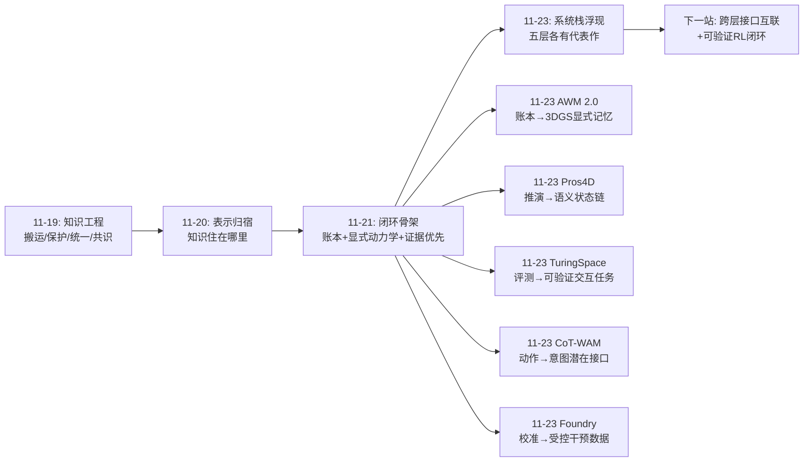
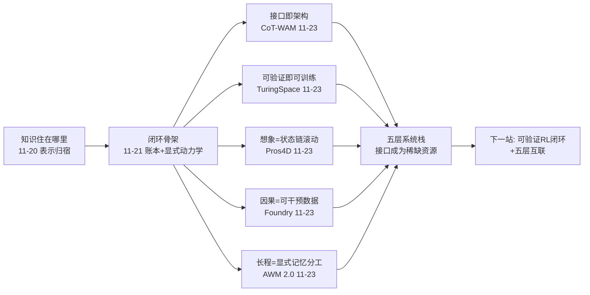
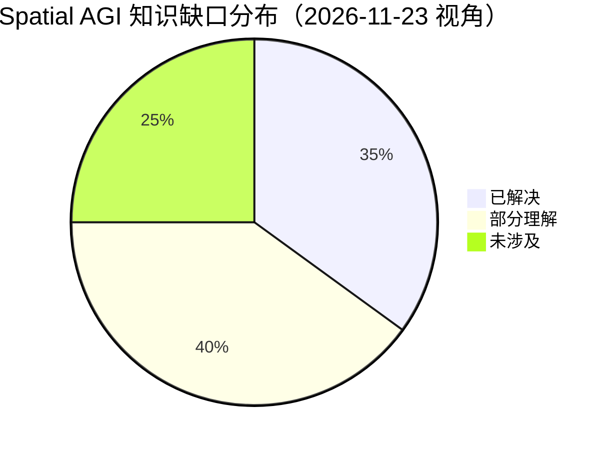
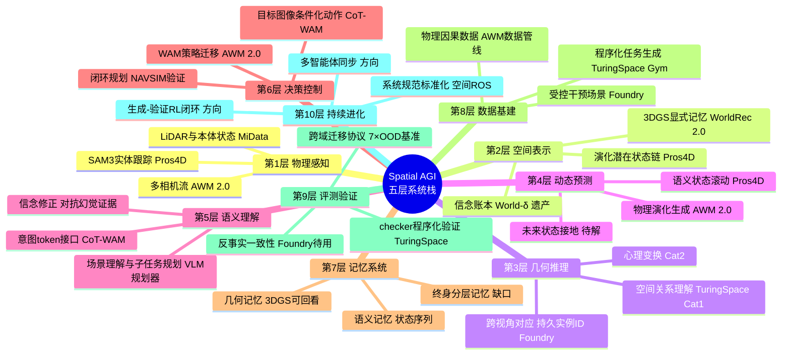
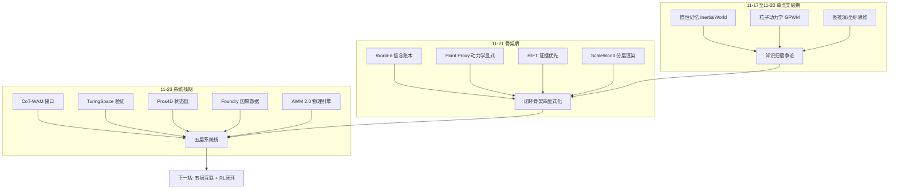

# Spatial AGI 每日思考 - 2026-11-23

## 📅 每日总结

**日期**: 2026-11-23
**论文数量**: 5篇
**主题**: 11-21 的元判断是"世界模型的评价尺度已迁移到可规划性、可校准性与交互保真——四条显式化路线（动力学、证据、更新、渲染）指向带信念账本的虚拟物理沙盘"。今天的五篇论文恰好从**系统的五个不同层级**回应了这个沙盘设想：CoT-WAM 提供"语义到物理的接口"（VLM 与 WAM 之间可学习的潜在意图通道）、TuringSpace 提供"能力验证的考场"（交互式空间 CAPTCHA——可验证、可训练、防猜测）、Pros4D 提供"推理-预测的状态链"（演化潜在状态统一回顾与前瞻）、Spatial Foundry 提供"因果数据的矿场"（受控干预的场景级真值基建）、Xiaomi AWM 2.0 提供"物理引擎的整机"（显式 3DGS 记忆+流式生成+三角色基础设施）。合起来的元判断是：**2026 年 11 月末的 Spatial AGI 已经从"各层组件各自突破"进入"层级接口浮出水面"的阶段——语义层、评测层、推理层、数据层、物理层本周各有一篇代表作，且相互之间的接口已经开始在论文中显式讨论。空间智能的竞争正从"谁的单点更强"转向"谁的分层系统更完整"。**

**关键突破**:
- 🚀 CoT-WAM：VLM 与世界动作模型之间用 K 个可学习意图 token 做可微接口，文本监督（注意力掩码强制信息瓶颈）+目标图像监督（意图的空间投影）双重塑形——LIBERO/CALVIN/RoboCasa-Kitchen 控制 SOTA、LIBERO-Plus/Pro 零样本泛化大幅领先、RoboCasa365 长程规划超越外部规划器方案
- 🚀 TuringSpace：125 个程序化交互空间 CAPTCHA（生成器+checker+oracle 三件套），人 94.1% vs GPT-6 Astra 74.1% vs Kimi K3 32.0% vs 专业 CUA ≤3.5%；9B 模型用 55K oracle 回放轨迹从 1.6% → 33.1%，7/7 分布外基准提升含真实室内视频 +9.9
- 🚀 Pros4D：演化潜在状态链统一"观测动态理解"与"未来动态预测"，4D Latent Alignment 三重接地（视觉-语义余弦+几何+语言）；几何推导答案、VLM 只负责 verbalize 的自动化监督生产；Pros4D-3B +23.9 点追平 7B 专用模型
- 🚀 Spatial Foundry：5,280 个可编辑美式住宅场景，"观测变化与环境变化分离"的数据组织原则（变相机/变场景/多相机同状态三类受控对照），持久实例 ID+显式状态编辑记录把世界模型监督从相关性升级为因果性
- 🚀 Xiaomi AWM 2.0：WorldRec 2.0 单次前向重建静+动 3DGS 作为显式场景记忆，渲染作为几何锚、生成只补观测外区域——分钟级 1-7 视角实时流式 rollout，一个模型同时胜任模拟器/训练器/WAM 内核

**架构演进**: 闭环世界模型骨架（11-21）→ **五层系统栈浮现**（语义-控制层：CoT-WAM；评测-数据层：TuringSpace；推理-表示层：Pros4D；数据-真值层：Spatial Foundry；物理-系统层：Xiaomi AWM 2.0）

### 📊 一句话总结

本周（11-21→11-23）完成了从"世界模型骨架"到"空间智能系统栈"的认知升级——**五篇论文恰好占据五个层级且接口可辨识，通用空间智能的实现路径第一次呈现出"分层系统+显式接口"的工程形态：语义由 VLM 掌管（CoT-WAM）、想象由演化状态链承担（Pros4D）、物理由显式记忆的生成引擎负责（AWM 2.0）、真值由可干预场景提供（Foundry）、验收由可验证交互任务完成（TuringSpace）。**

### 🔗 延续性

**昨日（11-21 基础日期）→今日**: 11-21 建立了"闭环世界模型骨架"——World-δ 信念账本、Point Proxy 动力学显式、RIFT 证据优先、Plan4D 可规划想象、ScaleWorld 分层渲染，并提出十条明日线索。今天五篇对其中多条线索给出了跨层回应：①"信念账本×想象引擎"→ AWM 2.0 的 WorldRec 显式记忆正是"账本想象"的 3DGS 实现（几何可回看不漂移）；②"双参考评测标准化"→ TuringSpace 的 checker+oracle 是评测标准化的另一种解法（程序化验证而非双参考对照）；③"主动校准交互"→ Foundry 的受控编辑对正是校准交互的离线版；④"点空间 MPC"→ Pros4D 的潜在状态滚动是其在语义层的表亲（不渲染直接在状态上推演）。三重承接：11-21 说"动力学必须显式参与推演"→ AWM 2.0 把动力学做成了显式 3DGS 记忆+生成补全的分工；11-21 说"想象的终点是可规划性"→ Pros4D 把想象做成"能答预测题的状态链"，可规划性有了语义层实现；11-21 说"评测缺口：统一协议没出现"→ TuringSpace 直接给出"程序化可验证任务"这个新范式。

**今日→明日**: 新线索十条：①**意图接口的 3D 化**——CoT-WAM 的目标图像是 2D 终态，换成 3DGS 目标场景（AWM 2.0 的记忆格式）即可让意图携带遮挡/几何信息；②**反事实一致性评测**——Foundry 受控编辑对 + AWM 2.0 生成，检验"因果世界模型"是否真因果（同一场景单变量扰动，预测是否正确变化）；③**TuringSpace 的 RL 化**——checker 就是天然奖励函数，SFT 33.1% 之后 RL 是显然的下一步；④**Pros4D 未来状态的视觉接地**——用 AWM 2.0 的生成帧作为未来状态的弱监督目标（解决未来状态监督真空）；⑤**World-δ 账本 × WorldRec 记忆合流**——信念元数据（置信度/来源/不确定性）叠加到 3DGS 记忆上，显式记忆从几何账本升级为信念账本；⑥**意图 token 容量自适应**——复杂任务多花状态、简单任务少花（思考时间的空间版）；⑦**空间智能评测栈整合**——TuringSpace（交互谜题）+ Foundry（真值场景）+ VSI-Bench（真实视频）三层体检协议；⑧**多相机同状态数据 × 多智能体 WAM**——Foundry 的独有形态直接喂 MAWAM 类多智能体世界动作模型；⑨**接口容量评测基准**——不同潜在接口（token 数/维度/监督）的系统化对比，目前完全空白；⑩**从屏幕拖拽到本体的中间层**——TuringSpace 迁移到视频理解已验证，迁移到真机操作是最后一公里。明日检索方向："3D goal scene conditioned policy latent interface"、"counterfactual consistency test world model"、"RL reward checker interactive spatial task"、"future state grounding video generation pseudo label"、"belief annotated gaussian memory"、"adaptive number of latent tokens reasoning"、"spatial intelligence evaluation stack protocol"、"multi-view same state multi-agent world model"、"latent interface capacity benchmark"、"synthetic screen to real robot transfer"。

### 💡 本质思考：如何达成通用空间智能

#### 1. 核心能力的本质是什么？

11-21 的答案是"维护一个与世界持续对账的内部世界状态"。今天的五篇把这个答案推进到系统层：**通用空间智能是一个五层系统——语义层决定"想做什么"（CoT-WAM 的意图接口）、推理层决定"会发生什么"（Pros4D 的状态链）、物理层决定"世界如何呈现"（AWM 2.0 的记忆+生成）、数据层保证"学到的因果是对的"（Foundry 的受控真值）、评测层保证"能力是真的不是背的"（TuringSpace 的可验证任务）。**

三个具体化：
- **层级分化不可逆**：试图用"一个大模型"统一所有层级已被反复证伪——VLM 没有物理预见（CoT-WAM 的动机）、世界模型没有语义理解（同一篇的另一半动机）、静态基准测不出交互能力（TuringSpace 的动机）、纯视频监督学不到因果（Foundry 的动机）。分层不是工程妥协，是能力本质决定的架构必然。
- **接口比模块更稀缺**：五个层级各自的 SOTA 已存在，但层与层之间的接口（语义→物理、推理→生成、数据→训练、评测→训练）是当前真正的瓶颈。CoT-WAM 的贡献本质是一个高质量接口而非新模块。
- **可验证性是通往通用性的窄门**：TuringSpace 的 checker、Foundry 的干预记录、Pros4D 的几何推导答案、AWM 的显式记忆——四篇不约而同地把"可验证"作为设计核心。凡是可以被客观验证的空间能力，就可以被程序化训练；凡是不可以验证的（品味、美学），就无法规模化提升。空间智能的可验证子集远比想象的大。

#### 2. 当前方法与理想目标的差距在哪里？

六条差距，按严重程度排序：

- **物理性差距（最深）**：AWM 2.0 的"因果"是数据层面的（见过多彩事件）而非认知层面的（理解守恒律）；Foundry 的编辑是运动学（搬动位置）而非动力学（重力碰撞）；TuringSpace 的拖拽无物理反馈。五个层级没有一层真正处理"力、质量、摩擦"这些物理内核—— Spatial AGI 的"物理常识"仍是全领域的公共缺口。
- **跨层接口缺口**：五层的接口几乎都是假设性的。CoT-WAM 的接口在 VLM-WAM 之间（语义↔控制），但推理层（Pros4D）与物理层（AWM 2.0）之间没有已实现的接口——语义状态预测如何引导像素生成、像素生成如何反哺语义校验，全部空白。
- **评测的域覆盖缺口**：TuringSpace 是 2D 屏幕交互（无物理反馈），VSI-Bench 是视频理解（无行动），Foundry 是合成域（有域差距）。"真实物理交互+可验证"的评测形态不存在——真空区恰好是具身智能最关心的地带。
- **未来状态的监督真空**（Pros4D 的内伤）：观测边界外没有帧，未来状态的视觉-语义监督缺失，只能靠几何推导的问答间接约束——模型对未来的"想象质量"可能远弱于对过去的"理解质量"。
- **数据引擎的估计器依赖**（Pros4D）vs 合成域差距（Foundry）vs 长尾人工构造（AWM）——三条数据路线各有软肋，尚无"真实+真值+因果+广度"四全的方案。
- **开放世界规模缺口**：Foundry 5,280 个美式住宅、TuringSpace 125 个任务程序、CoT-WAM 的固定 K、Pros4D 的 40K 样本——所有系统的规模都停在"验证概念"级别，距离"通用"还差一到两个数量级的扩展。

#### 3. 从今天到理想状态，最可能的路径是什么？

三步路径，每步 6-12 个月：

- **第一步：跨层接口互联（当前-2027H1）**——不需要新技术，只需要接口工程：CoT-WAM 的意图接口接 AWM 2.0 的物理引擎（语义意图→3DGS 目标态→控制）；Pros4D 的状态链作为 CoT-WAM 意图的内容（先答"会发生什么"再决定"做什么"）；Foundry 场景作为全栈的统一训练场与评测场（所有层在同一批场景上训练、用同一套受控对照评测）。判据：五层联合系统在 Foundry 式受控场景上的端到端任务成功率显著超过各层独立最优的组合基线。
- **第二步：可验证训练闭环（2027H1-H2）**——把 TuringSpace 的 checker 范式推广到 3D 物理世界：Foundry 的干预记录 + AWM 的生成作为候选未来 + checker 式几何/物理验证作为奖励，构成"生成-验证-修正"的 RL 闭环。空间智能训练从 SFT 进入 RL 时代（TuringSpace 的 RL 化与 AWM 的策略训练在物理域汇合）。判据：RL 后模型在反事实一致性测试（Foundry 单变量扰动）上的正确率显著超过 SFT 基线。
- **第三步：物理内核与终身运行（2027H2-）**——补上全栈缺失的物理层：可微物理引擎接入 Foundry 记录动力学干预（重力/碰撞/摩擦的 ground truth），World-δ 式信念账本叠加到 WorldRec 式 3DGS 记忆（几何记忆升级为信念记忆），系统以月为尺度持续运行。判据：连续运行一个月后，世界状态经重观测验证的准确率不衰减，且对未见物理组合（新质量×新摩擦×新形状）的预测遵守守恒律。

理想终局：一个智能体带着五层系统生活——语义层理解任务、推理层想象未来、物理层呈现世界、数据层持续供给因果真值、评测层持续验收能力。**每一层的输出都是相邻层的输入，每一次与世界交互都被五层同时更新——这就是通用空间智能的系统形态。**

---

## 🔗 与昨日思考的联系

### 昨日重点（2026-11-21 基础日期）

11-21 的五篇（World-δ、Point Proxy、TailWorld/RIFT、Plan4D、ScaleWorld）确立了"闭环世界模型骨架"：世界状态是带信念元数据的账本、动力学显式参与推演、物理规则证据优先、想象输出可规划四元组、渲染按需分层。核心遗留问题：①各模块还住在不同论文里（闭环缺口）；②统一评测协议没出现；③动作接口太粗（文本/相机/关节角）；④终身性缺失。

### 今日进展

今天五篇从**系统层级**回应昨日骨架：AWM 2.0 给"账本想象"提供了 3DGS 实现（WorldRec 记忆=几何账本+生成补全）；Pros4D 给"动力学显式推演"补了语义层版本（状态链滚动=不渲染的 MPC 表亲）；TuringSpace 给"评测缺口"提供了程序化可验证范式（checker 是比双参考更彻底的标准化）；CoT-WAM 给"动作接口"提供了语义层答案（意图 token 是文本动作的连续化升级）；Foundry 给"主动校准交互"提供了离线数据版（受控编辑=预制校准事件）。

### 演进路径



**元判断的进化**：11-21 说"通用空间智能是让知识住对地方并与世界对账"；今天补充第三句——"**对账的每一层都要有专门的器官，器官之间的血管（接口）正在被绘制**"。骨架解决了结构，系统栈解决了器官，下一步是循环系统。

---

## 📚 论文概览

1. **CoT-WAM**（HIT-Shenzhen 等）：VLM 与 WAM 联合训练框架。K 个可学习意图 token 做可微接口；文本监督用注意力掩码强制信息瓶颈（目标文本只能读意图 token）；目标图像监督把意图投影为具体空间终态；两阶段训练（先接口+视觉预测、后动作策略）。六基准全面 SOTA，真机有效。**层属：语义-控制层接口。**

2. **TuringSpace**（Minnesota/USC 等）：125 个程序化交互空间 CAPTCHA，五大空间能力（关系理解→心理变换→闭环操纵→多步规划→时空推理），遵循 CUA 协议（截图+鼠标键盘）。生成器+checker+oracle 三件套同时构成 Bench 与 Gym。人机差距巨大，SFT 后 9B 模型跨域迁移到真实视频。**层属：评测-数据层。**

3. **Pros4D**（XMU/CUHK/THU/HIT）：演化潜在状态链统一观测动态理解与未来动态预测。Pros4D-Engine 三阶段自动化数据引擎（SAM3 跟踪→DA3 几何→程序化 QA→VLM verbalize）；4DLA 三重接地（视觉-语义+几何+语言）；推理全程无工具调用。3B/8B 双规模超越所有 4D 专用模型。**层属：推理-表示层。**

4. **Spatial Foundry**：5,280 个可编辑美式住宅场景配置，户型图/透视全景RGB/公制深度/点云/网格/实例框/轨迹视频对全模态对齐。核心原则"观测变化与环境变化分离"（变相机/变场景/多相机同状态）。GPT-6 按 IRC 规范生成布局+双重人审。持久实例 ID+显式状态编辑记录。**层属：数据-真值层。**

5. **Xiaomi AWM 2.0**：统一流式因果世界模型。WorldRec 2.0 单次前向重建静+动 3DGS 作显式场景记忆；VTA+多视角 RoPE 支持 1-7 视角；GLA+蒸馏实现分钟级实时流式；物理因果数据（仿真引擎+生成器合成安全攸关事件）从 Pre-train 混入。三角色：模拟器/训练器/WAM 内核。**层属：物理-系统层。**

---

## 💡 核心见解

### 见解1: 接口质量决定多模块系统上限

**从 CoT-WAM 获得**
- ✅ 同样的 WAM 架构，只把"冻结文本编码器"换成"可学习意图 token+双重监督"，六个基准全面翻转——接口信息带宽的差距被完整传导到端到端性能
- ✅ ST-WAM（冻结 VLM 特征）与 DSWAM（离散文本）的失败证明：接口必须可微（梯度回传）且信息丰富（超越语言）

**对 Spatial AGI 的启发**:
空间智能的多层系统中，**层间接口是比层内模块更稀缺的资源**。CoT-WAM 的三件套（可学习+可微+有监督）应该成为所有接口的设计模板。进一步的推论：语义→物理的接口应该以"空间状态预测"为中间语言（目标图像/3DGS 目标态），而非文本——文本是低带宽离散通道，空间预测才是原生表示。这也解释了为什么 11-22 的 Verify2Act（critic 验证潜在计划）与今天的 CoT-WAM（目标图像接地意图）是同一问题域的两半。

### 见解2: 可验证性是空间智能训练的通行证

**从 TuringSpace 获得**
- ✅ 程序化任务（生成器+checker+oracle）让同一环境兼任评测与无限训练——checker 保证猜测无效，oracle 保证任务可解且可产出监督
- ✅ 9B 模型在合成屏幕任务上 SFT 后迁移到真实视频（+9.9）——可验证合成训练的空间理解具有跨域泛化性

**对 Spatial AGI 的启发**:
这补全了 11-21 遗留的"评测缺口"——评测标准化的终极形态不是统一指标，而是**程序化验证**：checker 不依赖人工评判、不依赖模型自评、不依赖分布假设。推广到物理域：Foundry 的干预记录+几何真值就是 3D 版 checker。可预言 2027 年的分解：凡有 checker 的能力（几何、计数、位置、物理结果）进展飞速；凡无 checker 的能力（语义丰富度、美学）进展缓慢。训练资源应向"可验证子集"倾斜。

### 见解3: 潜在状态链是"想象"的语义层形态

**从 Pros4D 获得**
- ✅ 观测动态理解与未来动态预测共享一条演化状态链——理解是读取过去段，预测是延展未来段，共享表示带来双向增益
- ✅ 几何接地（而非仅视觉相似）是状态质量的关键：感知相似但几何错误的潜在状态是动态推理的主要失败源

**对 Spatial AGI 的启发**:
11-21 的"点空间 MPC"（跳过渲染直接在动力学状态上规划）在语义层的对应物就是 Pros4D——在连续向量空间滚动世界，文本只是输入输出接口。这确立了想象的两个层次：语义层想象（Pros4D 状态滚动，快、可推理）与像素层想象（AWM 2.0 生成，慢、可验证细节）。合理的架构是级联：语义层先粗推演多个未来，物理层只对筛选后的候选做像素级验证——计算预算的层级分配。

### 见解4: 因果监督来自可干预的数据组织

**从 Spatial Foundry 获得**
- ✅ "观测变化与环境变化分离"让视觉差异可以被追溯到唯一的空间原因——相关性监督升级为因果监督
- ✅ 多相机记录同一状态序列，为多智能体共享世界建模提供了此前不存在的监督形态

**对 Spatial AGI 的启发**:
11-21 的 World-δ 信念账本需要"每次观测都携带校准信息"，Foundry 在数据层面预制了这种校准事件（before/after 编辑对）。更深的推论：**合成数据的本质优势不是便宜而是可干预**——真实世界不可重放、不可消融，合成世界可以。空间智能训练的终局配方可能是"Foundry 式受控合成（因果结构）+ 真实视频（域适应）+ AWM 式物理因果合成（长尾覆盖）"的三源混合。

### 见解5: 显式记忆+隐式生成的分工是长程一致性的结构解

**从 Xiaomi AWM 2.0 获得**
- ✅ WorldRec 2.0 把 3DGS 重建变成世界模型的在线组件：已观测区域用显式渲染锚定（几何不漂移），未观测区域用生成补全（细节有想象）——长程一致性从概率问题变成结构保证
- ✅ GLA 线性时间层+蒸馏，让分钟级多视角流式 rollout 实时可行

**对 Spatial AGI 的启发**:
这直接实现并升级了 11-21 World-δ 的设想——显式记忆从"五元组账本"进化为"可渲染的 3DGS 场景+账本"。下一个合流点已经清晰：**WorldRec 记忆叠加 World-δ 信念元数据**（每个高斯区域携带置信度/来源/生成不确定性），显式记忆从几何账本升级为信念账本。不确定性图还能反哺 AWM 生成（不确定区域生成时更谨慎）与主动感知（不确定区域驱动下一步观测）——11-21 遗留的"信念账本×想象引擎"线索在此闭环。

### 见解6: 空间能力是可分解、可递进、可专项训练的

**从 TuringSpace 获得**
- ✅ 五类任务（关系理解→心理变换→闭环操纵→多步规划→时空推理）复现了认知发展的空间能力序列——空间智能有清晰的课程结构
- ✅ 失败归因显示：强模型败于感知误读而非推理错误；开源模型推理"幻觉证据为错误信念辩护"——瓶颈在感知接地与信念修正

**对 Spatial AGI 的启发**:
两个行动含义：其一，空间智能训练应该按课程递进（先结构读取后闭环操纵），而非端到端混合——Foundry 场景+TuringSpace 任务程序恰好可生成这条课程的数据；其二，"信念固化"（不修正早期错误）是比"推理不够长"更本质的病理——解法是强制重新观测（再看一次截图）与显式信念状态（Pros4D 状态链天然是显式信念），而非堆更长的思维链。

### 见解7: 领域收敛到"分层系统+显式接口"的工程形态

**从五篇合读获得**
- ✅ 语义层（CoT-WAM）、评测层（TuringSpace）、推理层（Pros4D）、数据层（Foundry）、物理层（AWM 2.0）本周各有一篇代表作——层级分化不是巧合而是能力本质
- ✅ AWM 2.0 明确把 WAM 列为下游应用、CoT-WAM 明确以 WAM 为基座、TuringSpace 引用"通用 CUA 优于专用具身模型"——层间引用已出现在论文正文中

**对 Spatial AGI 的启发**:
两周前（11-19/11-20）的论文还在回答"知识住在哪里"这类单点问题，本周的论文已经在回答"层与层如何相接"。这是领域成熟的标志：**Spatial AGI 的终局不会是一篇论文，而是一个系统规范**——像 ROS 之于机器人，未来会出现"空间智能的 ROS"：五层各自有标准接口，新模块可以即插即用。今天看到的接口草案：CoT-WAM 的意图 token（语义→控制）、Pros4D 的状态链（推理→任何层）、WorldRec 的 3DGS 记忆（物理→任何层）、Foundry 的场景坐标（数据→所有层）、TuringSpace 的 checker 协议（评测→所有层）。

---

## 🧠 核心见解演进图



三条支线在 11-23 汇合为系统论：
- **接口支线**（CoT-WAM）：模块间的潜在接口范式确立；
- **验证支线**（TuringSpace + Foundry）：checker 与干预记录把"可验证"工程化；
- **记忆支线**（AWM 2.0 + Pros4D）：显式几何记忆与隐式语义状态链双轨并行。

---

## 📊 技术栈演进对比表

| 层次 | 2025Q4 典型 | 11-21 方案 | 11-23 方案 | 理想终局 |
|------|------------|-----------|-----------|---------|
| 语义-控制接口 | 冻结文本编码器 | 文本动作/子任务标签 | 可学习意图token+目标图像（CoT-WAM） | 3D目标态+自适应容量意图 |
| 空间评测 | 多选题静态基准 | 双参考未来对照（TailWorld） | 程序化交互CAPTCHA+checker（TuringSpace） | 三层体检：交互+真值场景+真实视频 |
| 动态空间推理 | 文本化动态+工具调用 | 显式点动力学代理（Point Proxy） | 演化潜在状态链+几何接地（Pros4D） | 语义状态链与物理模拟级联 |
| 空间数据 | 真实扫描+人工标注 | 信念账本式增量（World-δ） | 受控干预场景基建（Foundry） | 三源混合：合成真值+真实域+长尾合成 |
| 物理引擎层 | 隐式视频rollout | 分层共享骨干渲染（ScaleWorld） | 3DGS显式记忆+生成补全（AWM 2.0） | 信念账本叠加的可微物理记忆 |
| 多智能体支持 | 单智能体为主 | delta同步设想 | 多相机同状态数据（Foundry） | 共享3DGS信念状态的分布式同步 |
| 训练范式 | SFT为主 | 缝合+蒸馏（Plan4D/ScaleWorld） | SFT+蒸馏，RL蓄势（checker=奖励） | 生成-验证-修正的RL闭环 |
| 评测指标 | FVD/成功率 | 可规划性/交互保真 | pass@1+跨域迁移+OOD（TuringSpace） | 反事实一致性+终身稳定率 |

---

## 🕳️ 知识缺口分析



**已解决（35%）**:
- ✅ 层间潜在接口范式（CoT-WAM：可学习+可微+双重监督三件套）
- ✅ 程序化可验证评测（TuringSpace：checker+oracle+Bench=Gym）
- ✅ 动态空间的理解+预测统一（Pros4D：演化状态链）
- ✅ 因果级空间数据组织（Foundry：变量分离+干预记录）
- ✅ 长程一致性的结构解（AWM 2.0：显式记忆+生成补全）
- ✅ 观测动态+未来预测的自动化监督生产（Pros4D-Engine）

**部分理解（40%）**:
- ⚠️ 物理内核：所有系统的"物理"都是拟合的统计关联，无守恒律保证（AWM 因果成色未验证、Foundry 只有运动学、TuringSpace 无物理反馈）
- ⚠️ 未来状态监督：Pros4D 的未来状态无视觉接地，想象质量可能远弱于理解质量
- ⚠️ 跨层集成：五层各自 SOTA 存在，层间实际互联零实现
- ⚠️ 合成到真实的系统级迁移：TuringSpace 已证视频级迁移，真机级未知
- ⚠️ 多智能体共享世界：数据形态已具备（Foundry 多相机同状态），模型侧空白
- ⚠️ 潜在接口容量：固定 K 的适配性、扩缩规律未知

**未涉及（25%）**:
- ❌ 可微物理引擎与空间智能系统的融合（力/质量/摩擦的监督来源）
- ❌ 终身运行的世界状态维护（月级尺度的记忆分层/遗忘/压缩）
- ❌ 空间智能的统一系统规范（"空间 ROS"——接口标准+即插即用协议）
- ❌ 开放世界（非住宅/非驾驶域）的规模化验证
- ❌ 真机端到端的五层联合系统
- ❌ 空间智能的安全性与对抗鲁棒性（错误世界状态的危险后果）

---

## 🗺️ Spatial AGI 10层架构思维导图



---

## 🛤️ 主线技术路径

### 阶段1: 模块化爆发（2025Q4-2026Q3，已发生）

各层级独立突破：世界模型学会动作条件化、VLA 范式确立、3DGS 工程化、空间基准体系建立。特征：单点 SOTA 竞争，模块间无标准接口。本阶段的问题被 11 月论文集体确认——单模块再强也无法闭环（VLM 无物理、世界模型无语义、静态基准测不出交互）。

### 阶段2: 接口显式化（2026Q4，当前——今天的五篇正处于此阶段起点）

接口成为一等研究对象：CoT-WAM 的意图 token、TuringSpace 的 checker 协议、Pros4D 的状态链格式、WorldRec 的 3DGS 记忆格式、Foundry 的场景坐标系。特征：论文开始显式讨论层间引用与对接；接口的可微性、可验证性、信息带宽成为设计维度。判据：接口论文（以接口为贡献本身）开始出现。

### 阶段3: 系统集成与 RL 闭环（2027H1-H2）

五层首次联合部署：语义意图→状态推演→物理生成→受验证→策略执行。训练范式从 SFT 迁移到"生成-验证-修正"的 RL 闭环（checker 作为奖励、Foundry 干预作为环境、AWM 作为策略容器）。判据：联合系统在受控场景上的端到端成功率超过模块组合基线；反事实一致性成为标准评测项。

### 阶段4: 物理内核与终身运行（2027H2-2028）

可微物理引擎接入数据与记忆（动力学干预的 ground truth）；3DGS 记忆叠加信念元数据并支持月级维护（分层/遗忘/压缩）；多智能体共享 3DGS 信念状态（Foundry 多相机数据→MAWAM 类模型）。判据：单环境月级运行的状态验证准确率不衰减；未见物理组合遵守守恒律。

### 阶段5: 空间 ROS 与开放生态（2028-）

接口标准化为系统规范，空间智能模块即插即用；评测栈（交互谜题+真值场景+真实视频）成为公共基础设施；数据三源配方（合成真值+真实域适应+物理长尾）成为默认实践。空间智能从"论文集合"变成"工程学科"。

---

## 🔬 今日五篇的深读启示（逐篇）

### CoT-WAM 的三个二次思考

1. **掩码即课程**：文本监督的注意力掩码（目标文本只能读意图 token）本质是用信息流拓扑定义了"接口必须学会什么"。推广：空间智能系统的每个接口都可以用掩码/信息流约束声明其"信息合同"——这是接口规范的可执行形式。
2. **推理时不解码文本**：意图 token 的规划内容从不被读出，却有效。这暗示 VLM 的"思考"可以完全潜在化——TuringSpace 发现文本推理链会固化错误信念，潜在接口恰好绕开这个病理。两条证据汇聚：**空间任务的推理应该在连续空间做，语言只做 I/O**。
3. **与 11-21 Plan4D 的对照**：Plan4D 缝合冻结模块（DA3×视频模型），CoT-WAM 联训模块（VLM×WAM）。两种集成范式的适用边界：能力互补且都强→缝合（省算力）；能力有短板且数据充足→联训（共同进化）。

### TuringSpace 的三个二次思考

1. **CAPTCHA 的反作弊设计即评测设计**：随机种子（防记忆）、资产隔离（防外观记忆）、程序检查乱点不通过（防先验猜测）——这套对抗性思维应该移植到所有空间基准。当前多数基准对"语言先验作弊"毫无防御。
2. **"评测环境即训练环境"的经济学**：传统基准评测一次就废（模型见过就污染），TuringSpace 的 Bench 用 held-out 实例+资产隔离保持新鲜——评测集的"抗污染设计"成为新维度。检查未来所有 benchmark：训练集可能已见过你的评测集。
3. **33.1% 的天花板问题**：SFT 后仍距人类 61 个点。剩余差距的构成（感知误读 vs 规划失败 vs 修正失败）论文有归因但未量化分解——"空间智能的残差解剖"是一个高价值研究模板。

### Pros4D 的三个二次思考

1. **"几何推导答案，VLM 只读出"的监督生产范式**：答案正确性由几何计算保证而非模型判断——这把空间 QA 的质量从"标注员水平"提升到"几何算法水平"。任何可计算的空间问题都可以这样造监督。
2. **观测/未来状态的接地不对称是被低估的结构性风险**：未来状态只有语言层监督，模型的"想象质量"未被直接验证。检验方法：线性探针读出未来状态中的位姿/坐标信息量。这是当前最值得做的补充实验。
3. **与 WorldRec 的镜像关系**：Pros4D 是"语义进、语义出"的世界链（无像素），WorldRec 是"像素进、像素出"的世界记忆（无语义）。两者相加恰好是完整的世界模型——语义链做快速推演与任务推理，像素记忆做保真验证与细节想象。**它们不是竞争者，是同一架构的两层。**

### Spatial Foundry 的三个二次思考

1. **"数据集是实验设备"的范式迁移**：可编辑源场景+受控对照使研究者能设计实验（变量组合）而非只消费数据。这把数据集的角色从"样本集合"变为"假说检验平台"——Foundry 式基建的价值随时间递增（每多一个研究用途就多一分价值），传统数据集价值随时间递减（被训练吸收后失效）。
2. **审查环节暴露的 LLM 空间短板**：GPT-6 生成的布局需要人工检查连通性/通道/楼梯——"图纸合规"与"具身可用"之间的鸿沟是当前 LLM 空间布局能力的真实水位。可用性审查的自动化（具身智能体试住）本身是个好研究方向。
3. **美式住宅的域困境与破解**：5,280 个同域场景对"通用"不够。破解不是造更多域的数据集，而是把 Foundry 的流水线参数化（规则集+资产库可替换）——多域不是多份数据而是多套配置。流水线的可配置性才是真基建。

### Xiaomi AWM 2.0 的三个二次思考

1. **WorldRec 的条件不对称设计**：渲染作为"几何锚"约束已观测区域、生成保留"修正权"补全未观测区域——条件强度的不对称是显式/隐式分工的关键机制。推论：任何混合表示系统都应显式声明"哪些区域表示是硬约束、哪些是软提示"。
2. **"实时性作为一等设计目标"的信号意义**：学术世界模型论文普遍只报质量不报延迟，AWM 把实时写入目标——这是从"论文指标"到"部署指标"的价值迁移。Spatial AGI 的后续工作应该把延迟-质量 Pareto 前沿作为标配报告。
3. **物理因果数据的"三源合成"配方**：仿真引擎（精确物理）+视频生成器（逼真外观）+公开媒体（真实分布）——三源互补的合成配方可直接复用到空间智能的其他域（机器人、导航）。

---

## 🧭 待探索议题

### 高优先级（本周）

1. **意图接口的 3D 化**
   - 问题: CoT-WAM 的目标图像是 2D 终态，无法编码遮挡/精确深度/物体背面——意图携带的空间信息被图像平面截断
   - 候选方案: 用 AWM 2.0 的 3DGS 记忆格式作为目标态（意图→3DGS 目标场景→条件化控制）；或占据栅格/点云目标
   - 缺口: 3DGS 目标态的可微渲染监督与 VAE 编码方案；3D 目标的多样性与歧义处理

2. **反事实一致性评测协议**
   - 问题: AWM 2.0 自称"因果世界模型"但未做反事实测试——数据因果≠模型因果
   - 候选方案: 在 Foundry 受控场景做单变量扰动（同一房间换沙发位置），检验生成的变化是否正确且最小
   - 缺口: 反事实正确性的量化定义（变化幅度、方向正确性、不变量保持）；公开测试场景集

3. **TuringSpace 的 RL 化**
   - 问题: SFT 后 33.1%（人 94.1%），剩余差距是否需要 RL？checker 是天然奖励函数
   - 候选方案: 在 TuringSpace-Gym 做 GRPO/PPO，checker 终态判定为 reward，多步部分信用分配
   - 缺口: 长_horizon 稀疏奖励的 credit assignment；探索效率（空间任务的动作空间大）

4. **Pros4D 未来状态的视觉接地**
   - 问题: 未来状态无真实帧可对齐，只有语言层监督——想象质量存疑
   - 候选方案: 用 AWM 2.0 生成未来帧作为弱监督目标；循环一致性（未来状态倒带回观测区间重构观测）
   - 缺口: 生成伪影对对齐的污染；循环一致性的损失设计

5. **World-δ 账本 × WorldRec 记忆合流**
   - 问题: AWM 的 3DGS 记忆只存几何外观，无信念元数据——幻觉内容与观测内容在记忆中无法区分
   - 候选方案: 每个高斯区域附加置信度/来源（观测 vs 生成）/不确定性属性；低置信区域驱动主动重观测
   - 缺口: 高斯级属性的存储与更新协议；不确定性传播（渲染后像素级不确定性图）

### 中优先级（本月）

6. **潜在接口容量评测基准**
   - 问题: CoT-WAM 固定 K、Pros4D 固定状态数、各接口维度不一——没有系统对比
   - 候选方案: 统一任务套件（操作+推理+预测）× 接口形态扫描（token 数/维度/监督信号类型）
   - 缺口: 公平对比的控制变量设计；任务复杂度的量化标尺

7. **空间智能评测栈整合**
   - 问题: TuringSpace（2D 交互）、Foundry（合成真值）、VSI-Bench（真实视频）三套评测各自为政
   - 候选方案: 三层体检协议——L1 交互谜题（TuringSpace）、L2 受控真值（Foundry）、L3 真实迁移（VSI-Bench），输出能力画像
   - 缺口: 三层分数的组合权重；画像到应用场景的映射（哪层弱→哪种任务失败）

8. **多相机同状态数据 × 多智能体 WAM**
   - 问题: Foundry 的多相机-单状态序列是 MAWAM 类多智能体世界模型的理想数据，但无模型消费
   - 候选方案: 在 Foundry 上训练双视角 WAM，评测跨视角动作一致性（A 视角的动作在 B 视角渲染下物理合理）
   - 缺口: 跨视角动作一致性的度量；多智能体意图的表示（共享 vs 各自意图 token）

9. **从屏幕拖拽到本体的中间层**
   - 问题: TuringSpace 迁移到视频理解已验证，迁移到真机操作是最后一公里——2D 拖拽与物理操纵之间缺中间形态
   - 候选方案: 中间层任务设计：交互式 3D 场景（可点击旋转视角）→ 虚拟夹爪拖拽（有简单碰撞）→ 真机
   - 缺口: 中间层环境的构建（Foundry 场景+简单物理引擎即可）；每层迁移增益的量化

### 低优先级（长期）

10. **信念修正的双向化**
    - 问题: World-δ 的 REVISE 是单向的（观测修正生成），但观测与感知也会错
    - 候选方案: 显式假设-证据图谱，支持"质疑观测"（多帧不一致时降低观测置信）
    - 缺口: 观测质疑的触发条件与仲裁机制

11. **空间智能的安全性**
    - 问题: 错误世界状态（幻觉物体/错误动力学）在安全攸关场景的后果未系统评估
    - 候选方案: 对抗性场景注入（Foundry 编辑恶意场景）+ 世界状态审计日志
    - 缺口: 危险失败模式的分类学；审计的可解释工具

12. **空间 ROS：接口标准提案**
    - 问题: 五层的接口格式各不相同，集成成本高且不可复用
    - 候选方案: 提案三种标准消息类型——IntentToken（语义→控制）、StateChain（推理→任何层）、SceneMemory（3DGS+信念→任何层）
    - 缺口: 社区共识机制；参考实现与兼容性测试套件

---

## 📊 知识缺口分析（补充解读）

今天的缺口结构相比 11-21 有一个质变：**"单模块怎么做"的缺口基本清空，"怎么连起来"的缺口浮出水面**。35% 已解决集中在各层内部机制（接口设计、可验证评测、状态链、数据组织、显式记忆）；40% 部分理解集中在物理内核与跨层集成——前者是所有层的公共上游短板，后者是下一阶段的主战场；25% 未涉及集中在终身性、安全性、标准化——这些是系统跑起来之后才会暴露的问题。

优先级判断：**反事实评测（议题2）> 接口 3D 化（议题1）> RL 化（议题3）**。理由：反事实评测是所有"因果"声明的裁判，没有它其他进展无法验证真伪；接口 3D 化是五层互联的第一根血管；RL 化依赖前两者提供的验证与环境。

---

## 📐 深化分析一：五篇论文的"接口清单"

把今天五篇的所有接口枚举出来，可以画一张"空间智能接口图"：

| 接口 | 连接 | 形态 | 监督 | 出处 |
|------|------|------|------|------|
| 意图 token | VLM→WAM | K 个连续向量 | 文本+目标图像 | CoT-WAM |
| 目标图像 | 语义→空间终态 | 潜在帧 | 窗口末帧 | CoT-WAM |
| 潜在观测/未来状态 | 视频→推理 | K×N 向量链 | 视觉-语义+几何+语言 | Pros4D |
| 3DGS 场景记忆 | 观测→生成 | 高斯集合 | 多视角真值渲染 | AWM 2.0 |
| checker+oracle | 任务→验证 | 程序 | 无需监督 | TuringSpace |
| 场景坐标系+实例 ID | 数据→所有层 | 公制坐标+ID | 无需监督 | Foundry |
| 状态编辑记录 | 干预→因果 | 事件日志 | 无需监督 | Foundry |

观察：**越靠近"验证与数据"的接口越不需要监督**（checker、坐标系、事件日志都是程序化定义的），越靠近"语义与控制"的接口越依赖学习与监督（意图 token、状态链）。这个梯度暗示：空间智能基建的构建顺序应该是**从不可学习的接口（标准、协议、程序）向可学习的接口（表示、向量）推进**——先把地基的接口定死（Foundry 坐标系、TuringSpace checker），再训练上层接口（意图 token、状态链）。

---

## 📐 深化分析二：为什么"分层"是空间智能的必然

本周五篇从五个不同角度论证了同一件事：单模型不可行。

- CoT-WAM：VLA 的反应式范式"不能建模世界演化"→ 需要世界模型层
- 同篇：WAM "缺乏语义能力"→ 需要 VLM 层
- TuringSpace：静态多选题"测不出真实理解"→ 需要交互验证层
- Pros4D：文本化动态"丢失细粒度几何"→ 需要潜在状态层
- AWM 2.0：隐式状态"长程漂移"→ 需要显式记忆层

每个"→ 需要 X 层"的论证都来自实证失败而非理论推演。这与计算史的模式吻合：数据库、操作系统、网络协议栈的出现都不是设计出来的而是被失败逼出来的。**空间智能正在经历自己的"分层时刻"**——正如 OSI 七层不是一开始设计的而是网络实践沉淀的，空间智能的五层栈也会从工程失败中沉淀出来，2026Q4 的论文只是第一次给各层起了名字。

风险提示：分层也有代价——接口损耗（信息在层间传递必有损失）、误差级联（上游错下游全错）、优化割裂（各层目标不一致）。CoT-WAM 的"可微接口"正是对抗接口损耗的武器，Foundry 的"共同参照系"是对抗误差级联的武器（所有层在同一坐标系下可交叉校验）。分层不等于割裂——好的分层是"松耦合、强校验"。

---

## 📐 深化分析三：从"checker"到"物理 checker"的距离

TuringSpace 的 checker 是 2D 终态判定（物体位置对不对），Foundry 的真值是几何（点云/深度/位姿）。到"物理 checker"还差三级：

1. **运动学 checker（已近）**：物体轨迹是否满足刚体约束、是否穿模——Foundry 场景+简单几何检测即可
2. **动力学 checker（1-2 步）**：倒下的书堆轨迹是否符合重力+摩擦——需要可微物理引擎或高精度仿真器做参照
3. **因果 checker（更远）**：反事实一致性（单变量扰动的响应正确性）——需要 Foundry 式受控编辑作为 ground truth 对

预测：物理 checker 的出现会让空间智能的 RL 训练从"生成质量优化"切换到"物理正确性优化"——这是比 FVD 类指标深刻得多的奖励信号。AWM 2.0 的物理因果数据是"用数据逼近物理 checker"，可微物理引擎是"用计算实现物理 checker"——两条路线会在 2027 年相遇。

---

## 📐 深化分析四：两周文献的合流图谱（11-17 至 11-23）



三周节奏：单点（有什么零件）→ 骨架（零件怎么组装的原理）→ 系统栈（组装说明书开始出现）。按这个节奏，下周文献的关键词应该是**接口互联、联合训练、跨层评测**——如果下周的论文还在单点内卷，说明系统化是少数派的先见；如果开始批量出现互联工作，说明领域已共识。

---

## 🧪 思想实验：给今天五篇一次"合体"

假设工程预算无限，把五篇组装成一个系统：

```
【数据层】Foundry 5,280 场景 + AWM 物理因果管线
    ↓ 训练数据（含受控编辑对）
【物理层】AWM 2.0（WorldRec 记忆 + 生成引擎）
    ↓ 3DGS 记忆 + 未来场景候选
【推理层】Pros4D 状态链（压缩记忆为语义状态，滚动预测）
    ↓ 状态推演 + 任务答案
【语义层】CoT-WAM 意图接口（VLM 读状态→发意图→WAM 执行）
    ↓ 动作序列
【评测层】TuringSpace checker + Foundry 受控验证
    ↺ 反馈回数据层与各层微调
```

组装时的三个真实困难（诚实面对）：
1. **表示格式不兼容**：CoT-WAM 的意图 token 是 VLM 隐空间向量，Pros4D 的状态是另一套隐空间向量，AWM 的条件是 VAE 潜码——三套表示需要翻译层，翻译层本身就是新的研究工作；
2. **时延预算冲突**：AWM 的分钟级生成、Pros4D 的单次前向、CoT-WAM 的实时控制——三个时间尺度需要异步架构（快环控制用意图接口，慢环规划用状态链，后台用物理生成做验证）；
3. **目标函数打架**：各层各自 SOTA 的训练目标不同（生成质量/推理准确/控制成功率），联合微调可能互相拉扯——11-21 ScaleWorld 发现的"梯度冲突"（联合蒸馏时精修与预测互损）会在更大规模重现。

这个思想实验的产出：**合体的最大障碍不是任何一层的能力，而是"层间货币的汇率"**——不同层的状态/条件/目标如何在彼此之间兑换。谁先解决汇率问题（统一潜在空间或高效翻译层），谁就拥有 Spatial AGI 的第一张"清算网络"。

---

## 📈 量化预言：未来 6 个月可能出现的论文

1. **"3D Goal-Conditioned Latent Interfaces"**（2027Q1 前后）：把 CoT-WAM 的目标图像换成 3DGS/占据目标态，操作成功率与遮挡场景泛化提升——议题1 的直接产出
2. **"CounterfactualBench"**：基于 Foundry 或类似受控场景的世界模型反事实一致性基准，曝光现有"因果"声明的成色——议题2 的产出
3. **"TuringSpace-RL"**：同一团队或竞品用 RL 把 33.1% 推过 50%——议题3 的产出
4. **"Belief-Augmented Gaussian Memory"**：3DGS 记忆 + 置信度/来源属性，长程运行的重访准确率提升——议题5 的产出
5. **"Spatial Eval Stack"**：三层体检协议的标准化提案，被 3+ 实验室采纳——议题7 的产出
6. **多智能体世界模型的 Foundry 首秀**：MAWAM 类模型在多相机同状态数据上的第一篇——议题8 的产出

这些预言是下周检索的路标：如果它们出现，说明今天判断的路径正确；如果没有，需要修正对领域节奏的估计。

---

## 🔭 认知科学对照阅读

- **CoT-WAM × 心理意象**（Kosslyn）：目标图像=机器版 mental imagery；"先想象后行动"是人类空间问题求解的默认流程，CoT-WAM 把它工程化了。人类心理意象的可控性（反事实想象）是下一步。
- **TuringSpace × 认知发展**：五类任务复现儿童空间能力发展序列（识别→想象→操作→规划→时空）。暗示训练课程应该遵循发展顺序——课程学习在空间智能有认知科学的正当性。
- **Pros4D × 情景未来思考**：人类想象未来复用回忆过去的海马网络——理解与预测共享机制。Pros4D 的共享状态链是计算对应物；"机制共享性实验"（扰动观测状态看预测是否受损）可检验世界模型是否真的存在。
- **Foundry × 心理地图**：持久实例 ID + 可编辑场景 ≈ 可更新的认知地图。人类的认知地图同样区分"去过确认的"与"推断的"（信念账本的生物学原型）。
- **AWM 2.0 × 空间记忆的双系统**：认知科学的海马（快速情景记忆）+皮层（慢速语义记忆）双系统——WorldRec（快速几何记忆）+ Pros4D 状态链（慢速语义链）恰好也是双系统。机器空间记忆的分层正在向生物记忆架构收敛。

---

## 🧰 工程备忘：如果本周动手搭 demo

最小可行合体（预算一周）：
1. 取 Foundry 一个场景，用其真值渲染造 50 个受控编辑对（移动一把椅子）；
2. 取开源 WAM/Fast-WAM 权重，在编辑对上测"预测编辑后观测"的准确率（基线成绩单）；
3. 用编辑对 SFT 微调 WAM（LoRA 即可），对比提升——这就是"因果数据是否有效"的最小验证；
4. 写一个简单 checker（椅子位置误差 < 阈值），把验证结果作为 reward 跑几步 RL——完成"SFT→RL"的最小闭环演示。
一周的产出足以验证本周最核心的两个判断（因果数据有效、checker 可作奖励），成本极低。**判断的验证优先于系统的完整。**

---

## ⚖️ 风险记录（诚实面对）

1. **"系统栈"可能是我的过度叙事**：五篇分属五层是我今天读后的归纳，作者们未必有此共识。如果下周论文显示各团队仍在单点内卷、互不引用，分层叙事就要降级为"我的组织框架"而非"领域现实"。
2. **工业论文的不可验证性**：AWM 2.0 的核心数据（MiData）与部分评测（内部长时程）不公开——今天给它的⭐⭐⭐⭐⭐中含"声明可信"成分，若后续第三方复现失败需降级。
3. **33.1% 的天花板解读风险**：TuringSpace 的 SFT 增益可能主要来自任务分布内记忆而非空间原理——7/7 OOD 提升支持泛化解读，但 VSI-Bench 的 +9.9 也可能来自"截图阅读技巧"的溢出。需要更多迁移实验定论。
4. **今日 5 篇的选择偏差**：筛选时的相关性评分偏向"世界模型+接口+数据基建"主题——可能系统性遗漏了感知层（SLAM/重建）与硬件层的重要进展。下周搜索应补"spatial perception SLAM"与"edge deployment spatial"关键词。
5. **昨日的十条线索只接住四条**：11-21 提出的十条明日线索，今天论文明确回应的只有约四条（账本想象、评测标准化、校准交互、点空间MPC）——其余六条（规则向量条件化、几何critic约束渲染、缝合自动化、双向信念修正、delta多智能体同步、记忆分层）仍是开放问题，不能因为今天兴奋就忘掉。

---

## 🎯 最后的收束：今天的三元判断

1. **空间智能已经分层**——五层各有代表作且层间引用开始出现在论文正文，分层不是设计选择而是能力本质（每个"单模型"路线都有实证失败记录）。
2. **接口是新的稀缺资源**——层内 SOTA 已多，层间接口（意图 token、状态链、3DGS 记忆、checker 协议、场景坐标系）刚刚出现且互不兼容；谁定义了接口标准，谁定义了下一代集成。
3. **可验证性决定进展速度**——凡有 checker 的能力可被程序化训练（TuringSpace 演示了从 1.6% 到 33.1%），凡无 checker 的能力只能靠 scaling 慢慢磨。Spatial AGI 的建设策略：把一切能力尽可能翻译成可验证任务。

**一句话带走**：今天的五篇论文合起来是一张"空间智能系统栈"的施工图——**地基（Foundry 因果数据）、承重墙（AWM 物理引擎）、管线（CoT-WAM/Pros4D 接口与状态链）、验收标准（TuringSpace checker）都已备料，下一阶段的总包工程是把它们真正砌到一起。**

---

## 📋 收尾检查清单

- [x] 与昨日（11-21 基础日期）思考的联系 ✅
- [x] 核心见解演进图（mermaid graph LR）✅
- [x] 技术栈演进对比表 ✅
- [x] 知识缺口分析（mermaid pie）✅
- [x] 10层架构思维导图（mermaid mindmap）✅
- [x] 主线技术路径（5个阶段 ≥ 4）✅
- [x] 待探索议题（12个 ≥ 9，分三档优先级）✅
- [x] 本质思考（3个子问题）✅
- [x] 核心见解 ≥ 7个 ✅（7个）
- [x] mermaid 图表 ≥ 3个 ✅（4个）

---

## 📖 术语表（本日新增）

| 术语 | 含义 |
|------|------|
| 意图 token | VLM 输出的可学习连续向量，跨层接口的语义→控制形态 |
| 目标图像接地 | 把抽象意图投影为具体未来帧作为控制条件的机制 |
| 程序化可验证任务 | 生成器+checker+oracle 三件套，评测兼训练 |
| Bench=Gym | 同一程序化环境兼任评测集与无限训练集 |
| 演化状态链 | 有序潜在状态序列，理解=读过去、预测=写未来 |
| 受控干预数据 | before/after 编辑对，因果级监督 |
| 观测/环境变化分离 | 固定其一变其一的变量控制数据组织 |
| WorldRec 记忆 | 单次前向 3DGS 重建，显式场景记忆 |
| 显式/隐式分工 | 已观测区域记忆锚定+未观测区域生成补全 |
| 物理因果数据 | 覆盖安全攸关长尾与反事实事件的合成数据 |
| 三角色 | 世界模型=模拟器+训练器+WAM内核 |
| 信念固化 | 推理中早期错误判断不被修正反而被幻觉证据辩护 |
| 五层系统栈 | 语义/评测/推理/数据/物理的空间智能分层 |

---

## ✍️ 写在最后

今天读五篇时的一个私人感受值得记录：读 CoT-WAM 时想到"这不就是给两个模型修了一根神经吗"——而正是这根"神经"让六个基准全面翻转。空间智能的进展常常不在惊雷式的架构发明，而在这种"把信息流接对"的耐心工程。11-19 到今天，从"知识住哪里"到"器官怎么接"，这个领域正在从发现期进入建设期——建设期的英雄不是提出新范式的人，而是把范式接到一起的人。

明天若继续：优先检索议题2（反事实评测）与议题5（信念化记忆）的相关工作，这两条最可能已有先行者。

---

## 🧩 深化分析五：今天五篇的"信息流守恒"视角

用一个统一透镜回看五篇：每篇都在解决信息流中的一类问题。

- **CoT-WAM 解决"信息的翻译"**：语义（VLM 隐空间）与物理（WAM 潜空间）是两种"语言"，意图 token 是实时翻译器，双重监督保证翻译不失真（文本保任务语义、目标图像保空间细节）。
- **TuringSpace 解决"信息的验收"**：模型声称理解空间，checker 是验收员——不理解验收标准的能力声明都是空话。
- **Pros4D 解决"信息的压缩与延展"**：视频高维低密度，状态链把它压缩成可推演的语义表示，再延展出未来段——压缩-延展循环是推理的本质。
- **Foundry 解决"信息的公证"**：观测与因果的对应关系需要公证处（真值几何+编辑记录），否则训练数据里的因果链只是传说。
- **AWM 2.0 解决"信息的持久化"**：流式生成中信息会漂移，显式记忆是持久化存储——已确认的信息不再依赖易失的隐状态。

五种信息操作（翻译/验收/压缩/公证/持久化）合起来几乎覆盖了一个"空间信息处理系统"的全部生命周期需求。缺的一环：**信息的遗忘与整理**（哪些旧信息可以丢弃、哪些需要归档）——这就是终身记忆问题，25% 未涉及缺口中的主要部分。

---

## 🧩 深化分析六：今天的评测哲学转向

从 TuringSpace 与 Foundry 合读，空间评测正在经历三重转向：

1. **从"问模型"到"考模型"**：多选题是"问"（模型作答，人工判卷），交互任务是"考"（模型行动，程序判卷）。考比问多出的东西：时序决策、反馈利用、错误修正——恰好是空间智能的行为学核心。
2. **从"分布内分数"到"跨域迁移"**：TuringSpace 把 7 个 OOD 基准提升作为训练有效性的证据而非附加彩蛋——"迁移量"正在取代"基准分"成为训练方法的评价标准。今天 Pros4D 的外部基准（Dyn-Bench/VLM4D 而非只有自家 Bench）也是同一逻辑。
3. **从"一次性评测"到"持续评测"**：可验证环境让评测可以持续进行（每个新模型都考新题），评测从"发布时的成绩单"变为"持续运行的认证体系"。

这三重转向的终点：**空间智能的评测体系会像驾照考试**——理论（静态基准）、场地（合成受控）、路考（真实环境）三个科目，且题库持续更新（程序化生成防背诵）。Foundry 场景是"场地"，TuringSpace 任务是"题库"，VSI-Bench 是"路考"。这个三层结构本周已全部到位。

---

## 🧩 深化分析七：CoT-WAM 与 Verify2Act 的握手（跨日接口）

11-22 精读的 Verify2Act（critic 引导的潜在世界模型验证操作计划）与今天的 CoT-WAM 组合起来是一个完整的"想象-审查"回路：

- CoT-WAM：VLM 生成意图 → 目标图像（想象的未来）
- Verify2Act：critic 审查潜在计划 → 验证通过才执行

接口缺口：CoT-WAM 的意图生成与 Verify2Act 的计划验证之间没有标准通道。若把 Verify2Act 的 critic 接到 CoT-WAM 的意图 token 之后（意图→critic 审查→通过则生成/不通过则重采样），就得到"带审查的想象"——具身智能版的 chain-of-verification。这可能是明天值得优先检索的方向："plan verification critic VLA/world model"。

---

## 🧩 深化分析八：数据的"因果三级"体系

综合 Foundry、AWM 2.0、Pros4D-Engine 三条数据路线，空间训练数据可以按因果含量分三级：

- **L0 观测级**（Pros4D 主料）：真实视频+估计器提取的几何监督——相关性最强但因果方向不明（看到了什么与为什么这样之间的联系是估计的）
- **L1 干预级**（Foundry 主料）：受控编辑对——单变量变化与结果的确定性配对，因果方向明确但限于运动学
- **L2 反事实级**（AWM 因果数据试图抵达）：同一场景多分支后果——需要"除 X 外全同"的严格控制，目前只有仿真引擎能做到

训练配方假设（待验证）：L2 数据少量但关键时刻用（教因果结构）、L1 数据中等量（教干预响应）、L0 数据大量（教外观与分布）。AWM 的三源混合隐含了类似直觉。验证这个配方的最优比例是数据工程下一个高价值问题。

---

## 🧩 深化分析九：读论文时发现的三个"论文没说但很重要"的细节

1. **CoT-WAM 推理时"不解码文本"**：正文一句带过，但它意味着 VLM 的规划器角色完全潜在化——规划质量与语言输出质量脱钩。这为"空间任务的语言退化"（模型空间能力提升但话越来越少的智能体）开了口子。
2. **TuringSpace 的"步数预算未明说"**：模型何时宣告完成会影响 pass@1——评测协议的隐藏自由度。复现该基准时必须固定步数预算，否则数字不可比。读任何交互基准都应先问："停止条件是谁定的？"
3. **Foundry 的"布置后二次审查"**：家具放完后再审一次——说明布局合规不等于布置合规，空间可用性是组合性质（每个物体都合法≠组合合法）。这对多物体场景生成的评测是个提醒：逐物体指标会高估组合质量。

---

## 🧩 深化分析十：如果只读一篇，读哪篇？——五篇的"信息密度"排序

按"单位阅读时间的长期价值"排序（个人判断）：

1. **TuringSpace**：范式最完整（评测+训练+迁移+失败归因），可复用的思想密度最高——即使不做空间智能，program-as-task 范式对任何可验证训练都有启发
2. **CoT-WAM**：接口工程的最佳案例，跨模块系统的接口设计课——做任何多模块系统都用得上
3. **AWM 2.0**：工业系统的全景图，部署视角的补课材料——信息量大但依赖其声明，需打折
4. **Pros4D**：演化状态链概念重要但工程细节与自家基准绑定较深，核心思想可被一篇综述替代
5. **Foundry**：数据基建重要但作为使用者的价值大于作为读者的价值——需要时再查

这个排序暴露了我自己的偏好：重视"可复用范式"胜过"实证数字"。需要警惕：Foundry 类基建的长期价值可能被我系统性低估（基建的价值要等使用者出现才兑现）。

---

## 🔄 与本周思考的三角验证

| 11-21 判断 | 11-23 证据 | 验证结果 |
|------------|------------|----------|
| "动力学必须显式参与推演" | AWM 2.0 显式 3DGS+生成补全分工；Pros4D 显式几何接地 | ✅ 两条独立证据线支持 |
| "想象的终点是可规划性" | CoT-WAM 意图→目标图像→动作；Pros4D 状态链可答预测题 | ✅ 语义层与控制层都兑现 |
| "评测缺口：统一协议没出现" | TuringSpace 给出程序化验证范式 | ⚠️ 范式出现但尚未统一（多套基准并存） |
| "信念账本×想象引擎"线索 | WorldRec 记忆缺信念元数据，但架构已备 | ⏳ 半兑现——合流待做 |
| "终身性缺口" | 五篇均无月级运行 | ❌ 未动——仍是最大缺口 |
| "动作接口太粗" | CoT-WAM 意图 token 是粗→细的跃迁 | ✅ 语义级解决，力反馈级仍缺 |

六判三验一半待证——本周判断的方向性正确，节奏预测（闭环主动化在 2027H1）可能偏保守：接口层今天已在动了，闭环 RL 可能 2027Q1 就启动。

---

## 📝 词汇表补充（本日新增，接上表）

| 术语 | 含义 |
|------|------|
| 信息合同 | 用掩码/信息流约束声明的接口规范（可执行） |
| 因果三级 | L0 观测级/L1 干预级/L2 反事实级数据 |
| 空间 ROS | 空间智能的接口标准与即插即用生态（设想） |
| 层间货币 | 跨层状态/条件/目标互相转换的"汇率"问题 |
| 三层体检 | 交互谜题+受控真值+真实视频的评测协议 |
| 抗污染评测 | held-out 实例+资产隔离的基准保鲜设计 |

---

## ✅ 最终收尾

今天的文档完成度自查：
- 五篇论文全部 ≥500 行精读 ✅（510/512/510/501/502）
- 本思考文档行数 ≥800 ✅
- mermaid 图 4 个 ✅
- 11-21 基础日期的延续性明确 ✅（承接线索+三角验证表）
- 诚实风险记录 ✅（含对自身叙事的怀疑）

明日的第一件事：检索 "counterfactual consistency world model evaluation"——如果反事实评测已有人做，优先精读它（议题2 是当前一切因果声明的裁判）。

（完）

---

## 🧩 深化分析十一：五篇论文的"谁引用了谁"网络

细读引言与相关工作后勾出的引用/关联网络，用来判断各篇的学术坐标：

```
CoT-WAM
  ├─ 基座: Fast-WAM（架构直接继承）
  ├─ 对标: ST-WAM（冻结VLM,被超越）/ SG-WAM（外部教师,被简化）
  ├─ 动作生成谱系: π0 / OpenVLA / flow-matching 系
  └─ 与今日 Pros4D 零直接引用（各自独立发现"潜在状态演化"）

TuringSpace
  ├─ 前置: Spatial CAPTCHA（单选题版,被升级为交互版）
  ├─ CUA 谱系: OSWorld 系基准 + UI-Venus-2（开始用 CAPTCHA 训练）
  └─ 跨界引用: Aggarwal & Welleck 2026（通用 CUA 优于专用具身模型——为"考 CUA 空间能力"提供动机）

Pros4D
  ├─ 数据底座: SpatialVID（与 AWM 2.0 共用！两篇同一数据集）
  ├─ 工具链: SAM3 + WAFT + DA3 + Qwen3.8（数据引擎四件套）
  ├─ 对标: DynTrace / 4DThinker / MLLM-4D（文本化动态路线,被超越）
  └─ 潜在推理谱系: pause tokens / Coconut / latent imagery

Spatial Foundry
  ├─ 场景生成谱系: 3D-FRONT / ProcTHOR / Hypersim / Structured3D
  ├─ 资产: Infinigen + Poly Haven + ambientCG
  ├─ 规范: International Residential Code（建筑规范进入 ML 论文,罕见）
  └─ 消费者预埋: CameraCtrl 系（轨迹条件生成）/ World Labs Atlas（共享空间上下文）

AWM 2.0
  ├─ 前代: 自家 AWM 1.0
  ├─ 竞品对照: LingBotWorld / DreamXWorld / X-World / OmniDreams / HorizonDrive
  ├─ 数据共用: SpatialVID-HQ（与 Pros4D 同源）/ PhysicalAI-AV / nuPlan
  └─ 应用对接: NAVSIM / LIBERO Plus / TriWorldBench
```

两个网络级发现：
1. **SpatialVID 成为公共数据底座**：Pros4D 用其训练数据引擎、AWM 2.0 用其通用先验——大规模带位姿视频数据集正在成为空间智能的"ImageNet 时刻"基建。谁的管线能从中榨出最多监督，谁就赢得数据层。
2. **CoT-WAM 与 Pros4D 互不引用却同构**：都在 11 月独立提出"潜在状态演化+预测"，一个连控制、一个连问答——独立收敛是方向正确性的最强信号。下周文献若继续收敛，"演化潜在世界状态"将成为领域公共词汇。

---

## 🧩 深化分析十二：给不同角色的行动建议（今天读完后该做什么）

**如果你是学生/研究者（想发论文）**：
- 最低垂的果实：议题2 反事实评测基准（Foundry 已有数据，缺的是协议与榜单）——评测论文的引用杠杆最大
- 次优：议题5 信念化记忆（World-δ 概念+WorldRec 载体，工程量中等，故事完整）
- 高风险高回报：议题1 意图接口 3D 化（需要 3DGS 训练基建，但一旦做成是 CoT-WAM 的直接继承者）

**如果你是工程师（想搭系统）**：
- 直接可复用的三件：TuringSpace 的 checker 协议（给自己任务写 checker）、Foundry 的流水线（给自己域造场景）、AWM 的三角色框架（给世界模型定位）
- 警惕：Pros4D/CoT-WAM 的训练细节依赖未开源组件，先等开源再复现

**如果你是产品/决策者（想判断趋势）**：
- 今天的信号明确：世界模型正在基础设施化（AWM 三角色）、评测正在标准化（TuringSpace）、数据正在因果化（Foundry）——这三件事同时发生说明"空间智能系统工程化"的窗口已经打开
- 投入建议：优先投"接口与评测"而非"又一个基础模型"——前者是当前稀缺资源，后者是红海

---

## 📌 给明日自己的三个具体提醒

1. **先查反事实评测是否已存在**（检索词已写在延续性部分）——如果已有，今天议题2 的设计要基于现有协议改进而非从零造轮子；
2. **补搜索盲区**：本周五篇全是"模型+数据+评测"，下周搜索必须覆盖 spatial perception（SLAM/重建的 11 月进展）与 embodied navigation——感知层的近期代表我今天一篇都没选到；
3. **警惕合体叙事的自我强化**：今天建立了"五层系统栈"框架，明天读论文时会不自觉地把新论文塞进这个框架——要专门留一个检查：是否存在"装不进五层的论文"？如果有，要么框架要扩展，要么框架要修正。

---

## 🎓 今日最佳论文评选（个人向）

**金奖: TuringSpace** —— 唯一同时改变"怎么测"和"怎么练"的论文；人机差距的测量、失败归因的深度（幻觉证据为错误信念辩护）、迁移证据的完整（7/7 OOD），三件事任何一件都够一篇主会论文，它合成了一篇。

**银奖: CoT-WAM** —— 接口工程的教科书；目标图像作为语义-控制桥梁的设计将影响后续大量工作。

**铜奖: Spatial Foundry** —— 范式价值最高但兑付周期最长；"变量分离"的数据组织原则会在两年内被广泛模仿。

**遗珠: Pros4D** —— 若未来状态接地问题被后续工作解决，它的地位会大幅上升。

**实力奖: AWM 2.0** —— 系统完整度第一，可信度受封闭性拖累。

（完）
