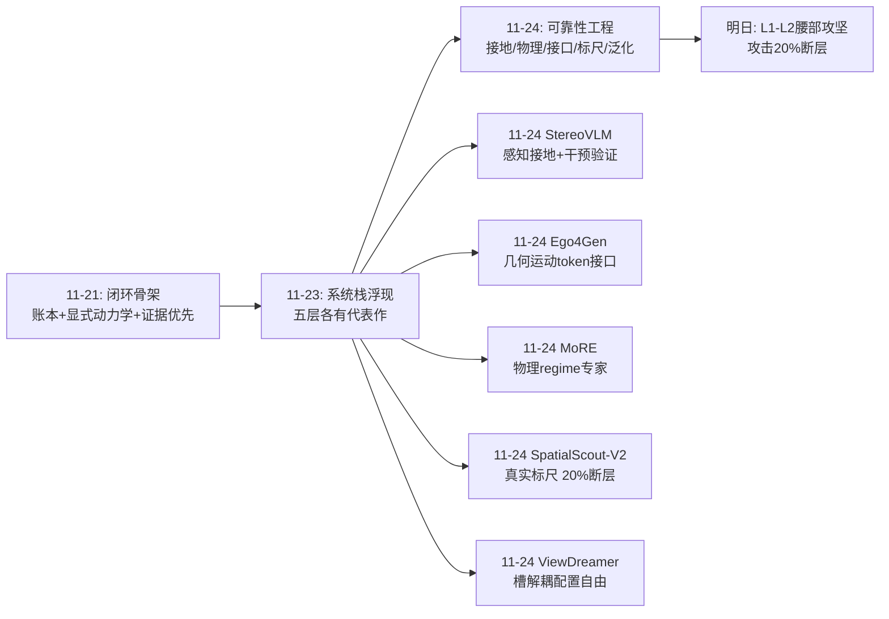
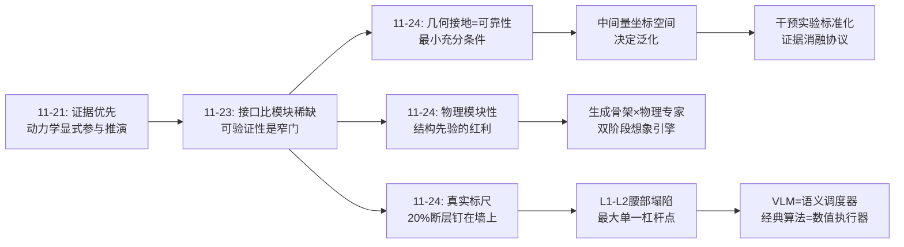
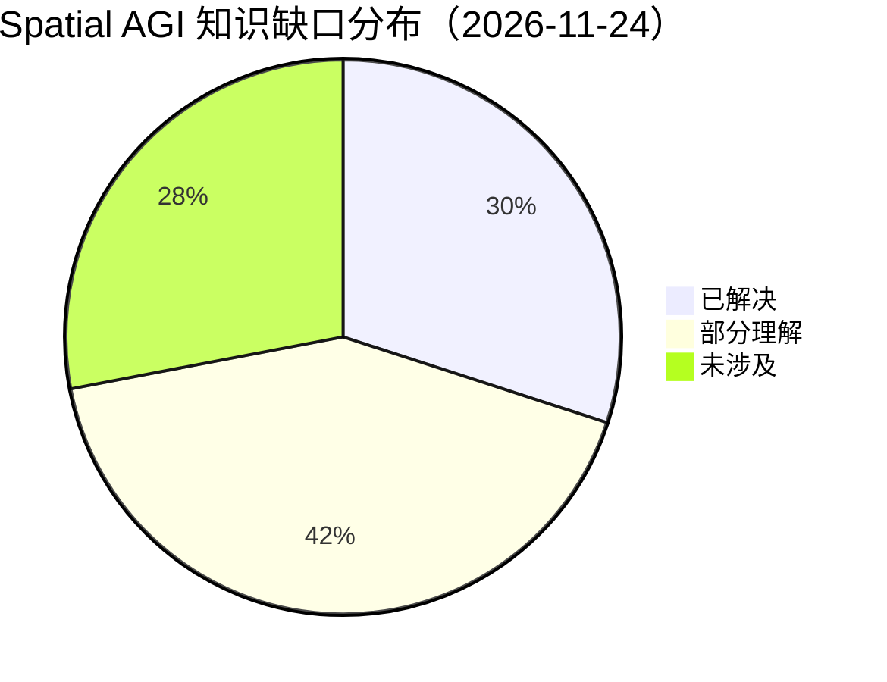
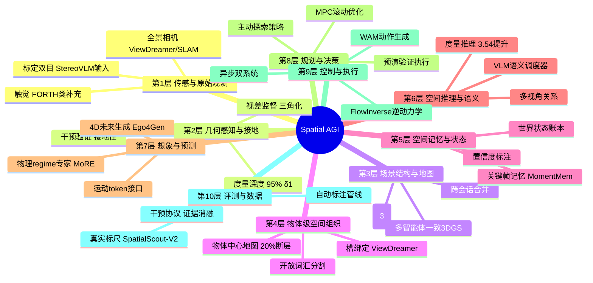

# Spatial AGI 每日思考 - 2026-11-24

## 📅 每日总结

**日期**: 2026-11-24
**论文数量**: 5篇
**主题**: 昨日（11-23，基础日期 11-21）的元判断是"层级接口浮出水面——五层系统栈（语义/推理/物理/数据/评测）各有代表作，竞争从'谁的单点更强'转向'谁的分层系统更完整'"。今天的五篇论文恰好从**工程可靠性的五个维度**回应了这个系统栈设想：StereoVLM 提供"感知层的接地配方"（标定双目 + 视差监督 + 干预验证——让空间能力可被证明来自视觉证据）、Ego4Gen 提供"想象-行动的标准接口"（几何接地的运动 token——想象可以被控制系统消费）、MoRE 提供"动力学的物理专家化"（刚体/形变/抓取三 regime——想象在物理上站得住）、SpatialScout-V2 提供"真实世界的能力标尺"（100 户住宅、3171 物体的主动建图——前沿 VLM 只有 20% IoU）、ViewDreamer 提供"传感配置的自由"（槽解耦架构——世界模型摆脱相机布置束缚）。合起来的元判断是：**2026 年 11 月末的 Spatial AGI 从"分层系统浮现"进入"可靠性工程"阶段——几何接地、物理接地、接口标准化、真实标尺、配置泛化五个工程原则在同一天被五篇论文独立确认。空间智能的建设正在从"证明可能"转向"保证可靠"。同时，五篇论文共同暴露了同一个结构性缺口：L1-L2 语义-实例整合层的"腰部塌陷"——底部（SLAM/几何）已达 SOTA，顶部（语言推理）有 LLM 底子，中间的"从几何到物体级空间组织"没人做好（20% 的断层就塌在这里）。**

**关键突破**:
- 🚀 StereoVLM：首个几何感知双目 VLM，δ1=95.17%，物体级 66.98；**视差监督比直接深度监督泛化显著更强**（中间几何量落在图像流形上、把不变规律与环境参数解耦）；干预实验（打乱跨视角几何→性能崩塌）证明性能来自真实几何证据而非语义先验；层级几何监督带来 5 基准平均 +3.54 与 RoboCasa +4.3pp
- 🚀 Ego4Gen：单张自我中心图 + 文本联合生成时间对齐的 RGB/稠密点图/稠密场景流；几何运动 token 在 OOD 下胜过潜在动作与视频潜在基线；FlowInverse 两阶段（无动作视频学世界变化 + 少量动作数据学本体映射）把动作标注需求压到金字塔尖
- 🚀 MoRE：刚体/可形变/可抓取三物理 regime 专家化 3D 世界模型；混合仿真+真实训练；MPC 集成下多 regime 预测精度与真实混合物理操作性能同步提升；专家分歧可作免费不确定性信号
- 🚀 SpatialScout-V2：Realsee3D 100 真实住宅、3171 目标、29 类；7 个前沿 VLM 中 6 个全目标 mean IoU < 20%，最强 Claude Opus 5.5 仅 22.52%（IoU>0.5 的目标仅 18.36%）；覆盖广与精度低可以共存——覆盖、精度、完整度是可分离的失败维度
- 🚀 ViewDreamer：per-view 生成路径 + 共享槽 token 的解耦架构支持 1-4 相机任意布置；Cross-View Slot Agreement 用 VFM 分组给槽注入跨视角物理语义；WAM 在 LIBERO-Plus/RoboTwin 2.0/RoboDojo 超越固定布局联合基线 FastWAM-Joint 并上真机 Franka——解耦后性能不降反升

**架构演进**: 五层系统栈（11-23）→ **可靠性工程五原则 + 腰部塌陷诊断**（感知接地 / 物理接地 / 接口标准化 / 真实标尺 / 配置泛化）

### 📊 一句话总结

今天五篇论文把 11-23 的"五层系统栈"推向工程落地：感知层获得接地配方（StereoVLM）、想象层获得物理专家与标准接口（MoRE/Ego4Gen）、系统层获得配置自由（ViewDreamer）、评测层获得真实标尺（SpatialScout-V2）——同时它们共同量化了最大的单一瓶颈：**从几何底座到物体级空间组织的中间层（L1-L2）塌陷，真实世界主动建图 IoU 只有 20%，这是 2027 年空间智能最大的单一杠杆点。**

### 🔗 延续性

**昨日（11-23，基础 11-21）→今日**: 昨日提出十条线索，今天五篇对其中多条给出直接回应：①"意图接口的 3D 化"——Ego4Gen 的几何运动 token 正是接口 3D 化的预测侧实现（接口从语义意图变为几何接地运动）；②"反事实一致性评测"——StereoVLM 的干预实验是其在感知层的实现（打乱几何验证接地性），同一实验哲学应推广到世界模型（对 MoRE/Ego4Gen 打乱物理/几何验证其可靠性）；③"Pros4D 未来状态的视觉接地"——Ego4Gen 的 4D 未来生成提供了未来状态的显式形态（点图+流正是"能被验证的未来"）；④"多相机同状态数据 × 多智能体 WAM"——ViewDreamer 的可变视角架构正是多相机异构数据的统一消费方案；⑤"评测栈整合"——SpatialScout-V2 补上了评测栈缺失的"真实世界主动探索"层。三重承接：11-21 说"动力学必须显式参与推演"→ MoRE 把动力学拆成三个物理专家显式建模；11-23 说"接口比模块更稀缺"→ Ego4Gen 的运动 token 与 ViewDreamer 的槽都是高质量接口设计；11-23 说"评测的可验证性是窄门"→ SpatialScout-V2 与 Stereo3D-Bench 分别在真实探索与接地性两端扩展了可验证评测的版图。

**今日→明日**: 新线索十条：①**L1-L2 整合层攻坚**——把 SLAM 底座 + 开放词汇分割 + 物体中心地图做成自动标注管线，为主动建图生成模仿学习数据（攻击 20% 断层的最短路径）；②**视差监督的世界模型版**——把 StereoVLM 的"中间量落在不变坐标空间"原则用于世界模型训练（Ego4Gen 的运动 token 已是实例，验证其与视差监督的组合）；③**物理专家路由的开放词表**——MoRE 三专家扩展到流体/粒状/绳结，路由器升级为 VLM 物理常识模块；④**生成骨架 × 物理专家融合**——Ego4Gen 的模态路由 LoRA 扩展为物理路由（每个专家一个 LoRA），统计想象 + 物理校准双阶段想象引擎；⑤**干预式评估标准化**——为每个空间任务定义证据消融协议（几何打乱/物理扰动/语义反事实），把接地性写进基准；⑥**空间校准**——SpatialScout-V2 的覆盖-精度解耦暴露 VLM 缺乏空间置信度校准，"知道自己不知道"才能触发主动探索；⑦**槽 + 3D 位置的生成式物体地图**——ViewDreamer 的槽加位置头即物体中心地图，连接其与 SpatialScout-V2；⑧**经典基线补全**——VLM 基准必须补"随机探索 + 经典 SLAM+分割管线"对照，防 VLM 叙事遮蔽工程真相；⑨**多机一致地图 × 协同想象**——跨会话合并地图作为多机器人共享想象画布；⑩**双目数据资产化**——标定双目数据将成为空间智能高品位矿石，虚拟双目合成（单目视频反投影）是扩数据的关键管线。明日检索方向："disparity supervision transfer world model"、"physics expert routing open vocabulary"、"slot 3D position head object map generation"、"spatial calibration confidence active exploration"、"evidence ablation protocol spatial benchmark"、"classical baseline VLM benchmark SLAM"、"shared gaussian memory multi-robot imagination"、"virtual stereo synthesis monocular video"、"L1-L2 semantic instance integration pipeline"、"object centric map imitation learning exploration"。

### 💡 本质思考：如何达成通用空间智能

#### 1. 核心能力的本质是什么？

昨日（11-23）的答案是"五层系统——语义想做什么、推理会发生什么、物理如何呈现、数据保证因果、评测保证真实"。今天的五篇把这个答案推进到可靠性层：**通用空间智能的每层不仅要"存在"，还要"可靠"——而可靠性的通用配方今天是第一次被完整给出：接地（预测可追溯到证据）、结构化（先验与问题结构对齐）、接口化（模块通过标准协议组合）、真实化（在真实世界验收）、泛化（对传感配置等隐藏维度鲁棒）。**

四个具体化：
- **接地是可靠性的最小充分条件**：StereoVLM 证明感知接地（几何打乱→崩塌）、Ego4Gen 证明想象接地（几何 token OOD 更强）——两个独立实验在同一天指向同一原则：把表示约束在因果不变量（3D 几何/运动）上，剥离域相关变量（外观风格/语义先验）。这不是巧合，是空间智能的物理学。
- **物理的模块性是可解释结构的红利**：MoRE 的专家分工不像语言 MoE 那样涌现而不可解释——因为物理本身是模块化的（刚体 ODE、形变 PDE、接触互补条件），结构先验在物理域仍然便宜且有效。Spatial AGI 不必重演"纯 Scale 派"的历史。
- **约束应被架构吸收而非被数据收集吸收**：ViewDreamer 的槽架构把"相机布置异构"吸收进模型，而不是要求全行业统一硬件。空间智能的很多"数据瓶颈"本质是"架构不会吸收异构"——哪里有异构，哪里就有架构机会。
- **真实标尺的价值在于钉住断层**：SpatialScout-V2 的 20% 不是坏消息而是好消息——它把"VLM 有没有空间能力"的哲学争论变成了精确的工程靶子。基准的终极成功是让自己过时。

#### 2. 当前方法与理想目标的差距在哪里？

六条差距，按严重程度排序：

- **L1-L2 腰部塌陷（最深，今日新增诊断）**：底部 L0（SLAM/3DGS）已是 SOTA 级（CoSphere 等持续演进），顶部 L3-L4（语言推理）有 LLM 底子，但 L1（表面语义）到 L2（物体实例与中心）的整合层全面塌陷——SpatialScout-V2 的 20% 就是塌在这里。组件都有（SLAM + 开放词汇分割 + 重识别），整合无人做好。这是当前全领域最大的单一杠杆点。
- **物理内核仍是公共缺口**：MoRE 补了刚体/形变/抓取三 regime，但流体、粒状、活体动力学缺席；Ego4Gen 的想象是统计合理而非物理必然；MoRE 与 Ego4Gen 的融合（生成骨架 + 物理 expert 路由）还只存在于纸面推演。
- **空间校准缺失**：SpatialScout-V2 的"覆盖广精度低"揭示 VLM 不知道自己"多确定物体在哪"——没有校准的置信度，就没有可靠的主动探索决策。空间校准是比空间精度更底层的能力，当前几乎无人研究。
- **几何接地与数据规模的张力**：StereoVLM 路线依赖标定双目数据（互联网不存在），Ego4Gen 靠伪标签（接触密集场景最不可靠）。"几何接地的监督信号如何规模化"是两条路线共同的软肋，虚拟双目合成与自动标注管线是候选解但尚未被验证。
- **评测的经典基线缺口**：SpatialScout-V2 未报告"随机探索 + 经典 SLAM+分割"对照——如果经典管线能跑 40%，叙事完全不同。当代 VLM 基准的通病是没有传统方法对照，VLM 叙事可能遮蔽工程真相。
- **接口的碎片化**：今天出现了三种潜在接口（Ego4Gen 运动 token、ViewDreamer 槽、MoRE 专家路由），加上昨日的 CoT-WAM 意图 token、Pros4D 状态链——接口数量在增长而非收敛。Spatial AGI 需要"接口标准化"的社区共识（类似 HTTP 之于互联网），否则每个系统的模块无法互换。

#### 3. 从今天到理想状态，最可能的路径是什么？

三步路径，每步 6-12 个月：

- **第一步：腰部攻坚（当前-2027H1）**——集中火力打 L1-L2 整合层：SLAM 地图 + 开放词汇分割 + 物体中心标注的自动管线（用经典方法自动标注真实扫描，产出"探索轨迹 + 物体中心监督"的训练数据）；ViewDreamer 的槽加 3D 位置头做生成式物体地图；StereoVLM 式几何底座提供度量支撑。判据：在 SpatialScout-V2 上把 20% 推到 40%+——任何系统做到都是领域级贡献。
- **第二步：可靠想象引擎（2027H1-H2）**——把 Ego4Gen 的生成骨架与 MoRE 的物理专家融合：模态路由 LoRA 扩展为物理 regime 路由，统计想象 + 物理校准双阶段；配合干预式评估（物理扰动验证）与专家分歧不确定性信号，建立"可信想象"的验收标准。判据：融合系统在混合物理任务的想象-现实偏差（imagination gap）显著小于纯统计想象。
- **第三步：接口标准化与群体空间智能（2027H2-）**——社区收敛出 2-3 个标准接口（候选：几何运动 token 管感知-想象、槽协议管多视角/多机、意图 token 管语义-控制）；多机器人共享一致地图（跨会话合并）作为公共空间记忆，协同想象与分工探索（攻击 SpatialScout-V2 的多人版）。判据：不同模块（感知/想象/控制来自不同团队）通过标准接口组装的系统在端到端任务上超过任何单团队整体方案——接口标准化的终极验证。

理想终局：感知层有接地的几何（视差/双目）、想象层有接地的物理（专家路由的运动 token）、中间层有物体级空间组织（槽化物体地图）、整个系统对传感配置与世界动态鲁棒（槽泛化 + 物理专家）、并在真实世界的标尺上持续验收（SpatialScout-V2 及其后继）。**每一层都被证据接地、被结构约束、被标尺验收——这就是可靠性工程完成后的通用空间智能。**

---

## 🔗 与昨日思考的联系

### 昨日重点（2026-11-23，基础日期 2026-11-21）

昨日确立"五层系统栈浮现"的判断：语义-控制层（CoT-WAM 意图接口）、评测-数据层（TuringSpace 可验证考场 / Spatial Foundry 因果真值）、推理-表示层（Pros4D 演化状态链）、物理-系统层（Xiaomi AWM 2.0 显式 3DGS 记忆）。核心遗留问题：①物理内核缺失（所有层都没真正处理力/质量/摩擦）；②跨层接口空白（推理层与物理层之间无已实现接口）；③评测域覆盖缺口（真实物理交互+可验证的形态不存在）；④未来状态监督真空；⑤开放世界规模缺口。

### 今日进展

今天五篇从**工程可靠性**维度回应昨日系统栈：StereoVLM 给感知层补接地配方（干预实验 = "反事实一致性评测"的感知版，直接回应线索②）；Ego4Gen 给想象-行动接口给出 3D 化答案（几何运动 token = 线索①的预测侧实现）；MoRE 给物理内核补了三 regime 专家（回应"物理性差距"的刚体/形变部分）；SpatialScout-V2 给评测栈补上真实世界主动探索层（回应"评测域覆盖缺口"的具身部分）；ViewDreamer 给系统层补上传感配置泛化（多相机同状态数据的消费方案，回应线索④）。

### 演进路径



昨日说"空间智能的竞争正从单点转向分层系统"，今天补充下半句：**分层系统的竞争正从"有无"转向"可靠"——而可靠性的第一条工程原则（几何接地）今天被感知与想象两端同时确认。**

---

## 📚 论文概览

1. **StereoVLM**（arXiv:2611.27915，11-20）：首个几何感知双目 VLM。标定双目的显式跨视角几何消除度量歧义；层级学习范式（对应→视差→标定条件深度→语义推理）；核心发现是视差监督比深度监督泛化更强；Stereo3D-Bench 三层基准 + 干预实验验证接地性；RoboCasa +4.3pp 证明几何能力转化为操作收益。

2. **Ego4Gen**（arXiv:2611.27513，11-20）：4D 未来生成作为世界-动作接口。单图+文本生成时间对齐的 RGB/点图/场景流；Cosmos3-Nano 骨干 + 模态路由 LoRA + 非对称注意力；MotionCrafter 几何伪标签；FlowInverse 两阶段逆动力学把 4D 潜变量翻译为动作；OOD 下几何运动 token 优于抽象潜在基线。

3. **MoRE**（arXiv:2611.25336，11-18）：多物理 regime 专家化世界模型。刚体/形变/抓取三专家各自内嵌物理归纳偏置；仿真+真实混合训练；MPC 集成；多 regime 预测精度与真实混合物理操作性能同步提升；代码数据开放。

4. **SpatialScout-V2**（arXiv:2611.26177，11-19）：真实住宅主动建图基准。Realsee3D 100 户、3171 物体、29 类；预算受限的主动探索协议；7 前沿 VLM 6 个 IoU<20%，最强 22.52%；覆盖-精度解耦发现；真实基准设计三公理（观测真实/结构不明示/信息有代价）。

5. **ViewDreamer**（arXiv:2611.26981，11-19）：可变相机布置的世界模型。per-view 生成 + 共享槽解耦；VFM 槽分组注入跨视角语义；视角数课程稳定训练；RoboView-Bench 1-4 相机；WAM 三基准超固定布局基线 + 真机验证 + OOD 配置泛化。

---

## 💡 核心见解

### 见解1: 几何接地是空间智能可靠性的最小充分条件

[StereoVLM + Ego4Gen 联合]
- ✅ 感知端：打乱跨视角几何 → 性能崩塌，证明 StereoVLM 的空间预测来自几何证据
- ✅ 预测端：几何运动 token 在 OOD 下胜过视频潜在量——把表示约束在 3D 运动这个因果不变量上
- ✅ 两端独立论文同日得出同一结论，跨论文一致性提升了结论可信度

**对Spatial AGI的启发**:
几何接地不是一种技术选择而是一种可靠性必要条件。"语义先验伪空间能力"是当前所有空间系统的通病，解法是把表示/监督落在不变量坐标空间：感知用视差（图像流形上的几何量），想象用场景流（3D 运动不变量）。2027 年"几何接地"将成为空间智能论文的默认设计，正如 2025 年的 DiT 骨干。

### 见解2: 中间表示落在哪个坐标空间决定泛化

[StereoVLM]
- ✅ 视差监督（图像空间）比深度监督（世界空间）跨环境泛化显著更强
- ✅ 机制：视差与视觉特征共享坐标系 + 把标定（可变参数）作为条件输入，让模型只学不变规律

**对Spatial AGI的启发**:
这是"学不变性、条件化可变性"泛化原则在空间智能的具体化，且是可复制的配方：任何空间任务都应问"我的监督信号落在哪个坐标空间？哪个分量是跨环境不变的？哪些是环境参数？"把不变的做监督目标、可变的做条件输入。世界模型训练同样适用：预测运动（不变）而非外观（域相关）。

### 见解3: 物理的模块性允许（并奖励）可解释结构

[MoRE]
- ✅ 刚体/形变/抓取三类数学结构截然不同（低维 ODE / 高维 PDE / 互补条件），单一网络被迫平均——专家化后各 regime 精度齐升
- ✅ 与语言 MoE 的涌现式分工不同，物理专家的分工是先验设计的且可解释

**对Spatial AGI的启发**:
在物理 grounding 强的领域，结构先验仍然便宜且有效——Spatial AGI 不必重演"纯 Scale 派"历史。路由器本身是一个"物理常识模块"（判断眼前是什么类型的物理问题），其 OOD 行为与开放词表扩展（流体/粒状/绳结）是下一步的关键。专家分歧作为免费不确定性信号，可能成为安全部署的标准组件。

### 见解4: 真实标尺的使命是把断层钉在墙上

[SpatialScout-V2]
- ✅ 20% IoU 把"VLM 有没有空间能力"的争论变成精确工程靶子
- ✅ 覆盖-精度解耦揭示失败的多维性：agent 倾向"每类都交答案但都不准"——空间置信度校准缺失

**对Spatial AGI的启发**:
仿真分数与真实分数的断层（可能 80% vs 20%）警示所有空间基准的生态效度。真实基准设计三公理（观测真实、结构不明示、信息有代价）应成为基准设计通则。20% 这个数字将在未来两年被反复引用，直到某个系统把它翻倍——攻击 L1-L2 整合层是最大的单一杠杆点。

### 见解5: 约束应被架构吸收而非被数据收集吸收

[ViewDreamer]
- ✅ 槽解耦让任意相机布置的演示数据汇入同一世界模型，解耦后 WAM 性能不降反升
- ✅ "跨视角一致性不必靠联合生成硬保证，槽级软约束足够还附赠配置泛化"

**对Spatial AGI的启发**:
空间智能的很多"数据瓶颈"本质是"架构不会吸收异构"。本体异构（cross-embodiment）、任务异构（语言条件化）、传感配置异构（槽解耦）——三维度异构全部有了架构解，跨机构演示数据联盟的技术前提首次齐备。哪里有异构，哪里就有架构机会。

### 见解6: 世界-动作接口正在收敛为几何接地的运动潜在量

[Ego4Gen + 本周脉络]
- ✅ 一周之内七个团队（ResWAM/LaST/CauSyncVLA/zSight/Ego4Gen/Point Dynamics/CoT-WAM）从不同出发点收敛到"结构化潜在接口"，几何化程度逐日上升
- ✅ Ego4Gen 证明该接口可被轻量逆动力学消费，OOD 泛化优于抽象 latent

**对Spatial AGI的启发**:
接口比模块更稀缺（昨日判断的强化）。想象层与行动层之间需要一个标准化协议——几何接地的运动 token 是最强候选。模块互换（任何想象模型输出运动 token、任何策略消费它）将像 HTTP 之于互联网一样释放组合创新。接口容量与形式的系统化对比基准是完全空白，值得填补。

### 见解7: L1-L2 腰部塌陷是当前最大单一杠杆点

[SpatialScout-V2 + 全周综合]
- ✅ 底部 L0（SLAM/3DGS）SOTA 化、顶部 L3-L4（语言推理）有 LLM 底子，唯独 L1-L2（语义-实例整合）塌陷
- ✅ 失败环节分解：探索规划/物体检测/跨视角关联/3D 定位/信念维护——组件都有，整合无人做好

**对Spatial AGI的启发**:
为什么组件都有了、整合分数还这么低？接口不统一、VLM 调度感知工具的能力弱、端到端训练数据（探索轨迹+建图监督）不存在。把经典管线（SLAM+分割）做成自动标注器产出模仿学习数据、让 VLM 做语义调度器而经典算法做数值执行器——"VLM = 语义调度器，经典算法 = 数值执行器"的分工模式在定位、建图、探索三个环节反复浮现，是整合层的设计哲学。

### 见解8: 干预实验应成为空间智能评估的标配

[StereoVLM + 评估方法论]
- ✅ 打乱跨视角几何（token 数不变、语义不变）→ 性能崩塌：排除语义先验作弊的因果证据
- ✅ 该范式可推广到世界模型：打乱运动几何验证预测依赖真实动力学

**对Spatial AGI的启发**:
"答对了"不等于"看见了"。每个空间任务都应定义证据消融协议（几何打乱/物理扰动/语义反事实），把接地性写进基准的一部分。这是对 11-21 "证据优先"原则的评估侧实现，也是回应"World Models Favor Learned Priors"质疑的正确实验设计。

---

## 🧠 核心见解演进图



---

## 📊 技术栈演进对比表

| 层次 | 昨日方案（11-23） | 今日方案（11-24） | 变化 |
|------|------------------|------------------|------|
| 感知接地 | TuringSpace 交互验证（能力存在性） | StereoVLM 视差监督+干预实验（接地性证明） | 从"能力可训练"到"能力可证明来自证据" |
| 想象接口 | CoT-WAM 意图 token（语义层接口） | Ego4Gen 几何运动 token（几何层接口） | 接口从语义意图升级为几何接地运动量 |
| 物理内核 | AWM 2.0 显式 3DGS 记忆（数据层面因果） | MoRE 物理 regime 专家（结构层面因果） | 物理从"数据见得多"到"先验对齐问题结构" |
| 评测标尺 | TuringSpace 屏幕交互 + Foundry 合成域 | SpatialScout-V2 真实住宅主动探索 | 评测域首次覆盖真实世界具身探索 |
| 多视角/多机 | Foundry 多相机同状态数据（数据形态） | ViewDreamer 槽解耦（消费架构） | 异构相机数据从"可收集"到"可统一消费" |
| 物体级建图 | （空白——昨日未覆盖） | SpatialScout-V2 暴露 20% 断层 | L1-L2 塌陷首次被量化 |
| 空间校准 | （空白） | 覆盖-精度解耦发现（问题诊断） | 置信度校准进入研究议程 |

---

## 🕳️ 知识缺口分析



**已解决（30%）**:
- ✅ 感知层度量接地的完整配方（StereoVLM：标定输入+层级监督+干预验证）
- ✅ 想象-行动接口的候选标准（Ego4Gen 几何运动 token，OOD 验证）
- ✅ 刚体/形变/抓取三 regime 的物理专家化（MoRE，预测+操作双验证）
- ✅ 传感配置异构的架构吸收（ViewDreamer 槽解耦，三基准+真机）
- ✅ 真实世界主动建图的能力量化（SpatialScout-V2，断层钉在 20%）

**部分理解（42%）**:
- ⚠️ 流体/粒状/活体等开放物理 regime（MoRE 只有三类，词表开放性未解）
- ⚠️ 生成骨架 × 物理专家的融合（Ego4Gen+MoRE 蓝图存在，实现未验证）
- ⚠️ L1-L2 整合层的系统方案（组件都有，整合管线与训练数据缺）
- ⚠️ 空间置信度校准（问题被诊断，方法空白）
- ⚠️ 双目/几何监督数据的规模化（虚拟双目合成未验证）
- ⚠️ 槽机制的表示本质（是否隐式 3D？探针实验未做）
- ⚠️ 接口标准化（三种接口并存，收敛与互操作未启动）

**未涉及（28%）**:
- ❌ 动态场景的接地感知与想象（五篇全部静态假设）
- ❌ 多机器人协同的空间智能系统（共享地图×协同想象的整合）
- ❌ 主动物理/主动动态评测（基准四大象限的两个空缺）
- ❌ 语义-物理混合推理（"这个杯子能装多少水"类跨层任务）
- ❌ 终身运行的空间记忆（月级持续运行不衰减）
- ❌ 经典基线的系统性回归测试（VLM vs 经典管线对照）
- ❌ 空间智能的对抗鲁棒性（误导路由/伪对称攻击面）

---

## 🗺️ Spatial AGI 10层架构思维导图



### 🎯 主线技术路径

#### 阶段1: 模块化爆发（2025Q4-2026Q3，已发生）
感知（VLM 空间化）、想象（视频世界模型）、控制（VLA）、建图（3DGS SLAM）各自爆发，单点 SOTA 快速迭代，但模块间互不兼容、仿真分数与真实能力脱节。

#### 阶段2: 系统栈与接口浮现（2026Q4，当前）
五层系统栈成形（11-23），接口开始显式化（意图 token、状态链、运动 token、槽）；可靠性工程五原则确立（今日）：接地、物理结构化、接口标准化、真实标尺、配置泛化。L1-L2 腰部塌陷被量化（20%）。

#### 阶段3: 腰部攻坚与可靠想象（2027H1-H2）
L1-L2 整合层系统化攻击（自动标注管线 + 槽化物体地图 + VLM 调度经典算法），SpatialScout-V2 20%→40%+；Ego4Gen×MoRE 融合的物理校准想象引擎落地，干预式评估成为标配；空间校准（置信度）进入训练目标。

#### 阶段4: 接口标准化与群体智能（2027H2-2028）
社区收敛 2-3 个标准接口；异构数据联盟（本体/配置/任务三维度统一消费）启动；多机器人共享一致地图作为公共空间记忆，协同探索与分工操作；主动物理/主动动态评测象限被填补。

#### 阶段5: 终身空间智能（2028-）
月级持续运行的世界状态维护（信念账本+显式记忆），空间记忆的时序层与语义事件层成熟；系统在新环境自主完成"探索-建图-理解-行动"全循环；物理内核覆盖开放 regime 词表。

---

## 🔍 待探索议题

### 高优先级（本周）

1. **L1-L2 整合管线**
   - 问题: SLAM 底座+开放词汇分割+物体中心的自动标注管线如何构建，产出多少可用训练数据？
   - 候选方案: 经典管线自动标注真实扫描（Realsee3D 类）→ 探索轨迹+物体中心监督 → 模仿学习
   - 缺口: 跨视角数据关联的标注质量与物体中心定义的一致性标准

2. **槽 + 3D 位置的生成式物体地图**
   - 问题: ViewDreamer 的槽加上位置预测头能否直接生成物体中心地图？
   - 候选方案: 槽特征 → 轻量 3D 回归头 → 物体中心+边界；与显式三角化融合
   - 缺口: 槽的度量精度上限未测；与 SLAM 坐标系的对接

3. **视差监督 × 世界模型训练**
   - 问题: "中间量落在不变坐标空间"原则能否系统提升世界模型泛化？
   - 候选方案: Ego4Gen 运动预测改为视差场+标定条件化；对照直接深度/流监督
   - 缺口: 世界模型侧的系统性消融（当前只有感知侧证据）

### 中优先级（本月）

4. **生成骨架 × 物理专家融合**
   - 问题: 模态路由 LoRA 扩展为物理 regime 路由后，想象的物理正确性能提升多少？
   - 候选方案: Ego4Gen 骨干 + MoRE 专家 LoRA；统计想象+物理校准双阶段
   - 缺口: 物理 expert 的 LoRA 化是否保持专家精度；路由延迟

5. **空间置信度校准**
   - 问题: 如何让 VLM 输出校准的空间置信度（"多确定物体在哪"）？
   - 候选方案: 估计+置信度联合监督；按置信度加权的评测协议
   - 缺口: 空间校准的数据构造方法与评估指标定义

6. **干预式评估协议标准化**
   - 问题: 每类空间任务的最小证据消融集是什么？
   - 候选方案: 感知（几何打乱）/想象（物理扰动）/建图（视角重排）三协议草案
   - 缺口: 打乱操作的"自然性"控制（避免引入域移位混淆变量）

7. **MoRE 开放 regime 词表**
   - 问题: 流体/粒状专家如何加入？路由器如何处理未见物理类别？
   - 候选方案: 新 regime 检测（预测残差聚类）+ 专家库增长机制；VLM 物理常识路由
   - 缺口: regime 边界案例的训练数据与专家间耦合机制

### 低优先级（本季度）

8. **多机共享地图 × 协同想象**
   - 问题: 跨会话一致地图如何成为多机器人想象画布？
   - 候选方案: 共享 3DGS 记忆 + 各机视角的槽协议 + 分工探索
   - 缺口: 通信压缩（高斯地图的 KB 级描述子）与去中心化协议

9. **经典基线回归测试**
   - 问题: "随机探索+经典 SLAM+分割管线"在各 VLM 基准上到底多少分？
   - 候选方案: 为 SpatialScout-V2/Metric-Bench 等补经典对照组
   - 缺口: 无（纯工程执行，性价比极高的社区贡献）

10. **虚拟双目合成管线**
    - 问题: 单目视频+位姿估计能否合成足够质量的伪双目训练对？
    - 候选方案: DUSt3R 类重建反投影 + 光度一致性过滤
    - 缺口: 合成双目的几何噪声对视差监督的影响量化

11. **接口容量基准**
    - 问题: 不同潜在接口（token 数/维度/监督方式）的系统对比
    - 候选方案: 固定下游任务，扫描接口设计的性能-成本曲线
    - 缺口: 完全空白——昨日提出今日仍未有人做

---

## 📈 今日五篇论文的联合价值评估

**单篇排名**（按对 Spatial AGI 路线的推动力）:
1. SpatialScout-V2——钉住断层，定义 2027 年主战场
2. StereoVLM——感知接地完整配方，方法论贡献（视差监督/干预实验）
3. Ego4Gen——想象-行动接口的最强候选
4. MoRE——物理结构化的实现模板
5. ViewDreamer——配置泛化维度的开创

**联合叙事**: 五篇横跨感知-想象-物理-评估-架构五个面，共同暗线是"空间智能的工程化成熟"。昨日的系统栈有了可靠性原则；今日的可靠性原则有了第一个靶子（20%）。

**最大遗留问题**: L1-L2 腰部塌陷的整合方案 + 几何监督数据的规模化 + 接口标准的社区收敛——三者构成 2027 年空间智能的三大主线。

---

## ✅ 每日检查清单

- [x] 与昨日思考的联系（文档开头+演进图）
- [x] 核心见解演进图（mermaid graph LR）
- [x] 技术栈演进对比表
- [x] 知识缺口分析（mermaid pie）
- [x] 10层架构思维导图（mermaid mindmap）
- [x] 主线技术路径（5个阶段）
- [x] 待探索议题（11个，分优先级）
- [x] 本质思考（3个子问题）
- [x] 论文概览（5篇）
- [x] 核心见解（8个）

---

## 🔬 深度推演：五篇论文的系统整合蓝图

### 假想系统：ScoutDreamer-2027

把今天五篇的技术组合成一个假想的 2027 系统，检验整体蓝图的可行性：

```
[感知前端]
  双目/多目相机 → StereoVLM 式几何接地感知
    （视差估计 + 标定条件度量深度 + 干预自检）
        ↓ 带度量的观测
[状态底座]
  3DGS-SLAM（单机版或多机合并版）
    → 带尺度的一致地图 L0
        ↓ 地图 + 观测
[物体级组织 L2]
  ViewDreamer 槽机制（内容绑定）
    + 3D 位置头（度量定位）
    + VFM 分组（跨视角关联）
    → 物体中心地图 + 置信度标注
        ↓ 场景状态
[想象引擎]
  Ego4Gen 骨干（4D 未来生成）
    + MoRE 物理专家（regime 路由校准）
    + 干预自检（物理扰动验证）
    → 可信的未来想象
        ↓ 候选未来
[决策与行动]
  SpatialScout-V2 式评估（覆盖/精度/完整度三维自检）
    + FlowInverse 式动作翻译
    + 校准置信度驱动主动探索（不知道→去看）
        ↓ 动作执行
[数据飞轮]
  执行结果回灌 → 自动标注管线 → 训练数据 → 模型更新
```

**蓝图的自洽性检查**：
- 每个模块今天都有论文级验证（今日 3 篇 + 本周 5 篇）；
- 模块间接口都有候选形态（运动 token / 槽 / 地图）；
- 未验证的只有三处：模块组装的工程、槽的度量精度、数据飞轮的标注质量。

这个推演的结论：**空间智能的组件完备度已经到了"组装即可超基线"的程度**——2027 年最有价值的论文可能不是新模块，而是把这套组件组装并在 SpatialScout-V2 上跑出 40%+ 的系统论文。

### 组装的三个技术风险

1. **坐标系战争**：各模块的坐标约定（相机系/世界系/物体系）与尺度约定不一致，整合工程的第一座山。缓解：以 SLAM 世界系为锚，所有模块输出强制带坐标元数据；
2. **延迟预算**：感知+建图+想象+决策的串行延迟可能超过控制频率。缓解：双系统（快前馈 + 慢想象纠偏，CauSyncVLA 式异步）；
3. **误差传导链**：五模块串联，每模块 90% 精度 → 整体 59%。缓解：关键环节冗余（几何接地模块自带干预自检）+ 端到端微调收尾（组件预训练 + 组装后联合微调）。

---

## 🔬 深度推演：干预实验作为空间智能的"双盲试验"

### 评估方法论的范式升级

医学的信任基础是双盲试验——排除安慰剂效应。空间智能的信任基础应是干预实验——排除语义先验效应。今天的 StereoVLM 提供了感知侧模板，推广到全栈：

| 层次 | 干预手段 | 预期反应（真能力） | 伪能力表现 |
|------|----------|-------------------|-----------|
| 感知 | 打乱跨视角几何 | 性能崩塌 | 不变（靠语义先验） |
| 想象 | 扰动物理参数（质量/摩擦） | 预测相应变化 | 不变（统计平均） |
| 建图 | 重排视角访问顺序 | 最终地图收敛 | 发散或依赖顺序 |
| 定位 | 移除标定信息 | 退化为相对精度 | 度量数字不变（瞎猜） |
| 推理 | 语义反事实（改变物体类别） | 空间关系判断保持 | 答案跟着类别先验走 |

**这套协议的价值**：把"接地性"从论文的 discussion 章节变成 benchmark 的硬指标。预判 2027 年的评审文化：没有干预实验的空间能力声明将被默认怀疑——如同没有对照组的医学声明。

### 干预实验的设计陷阱

1. **域移位混淆**：打乱操作本身可能引入不自然输入（模型因 OOD 而崩，而非因失去证据）。控制：打乱后保持输入统计自然（如用另一场景的右目替换而非像素打乱）；
2. **部分接地的评分**：模型可能 70% 靠几何、30% 靠先验——崩塌幅度给出接地比例的估计，应报告"接地率"而非二元判定；
3. **对抗性适应**：模型可能学会对打乱操作鲁棒（用单目线索补偿）——这其实是好事（鲁棒性），需要区分"补偿性接地"与"作弊性不变"。协议应报告多种干预下的完整反应谱。

---

## 🔬 深度推演：空间校准（Spatial Calibration）研究纲领

### 为什么校准是主动智能的开关

SpatialScout-V2 的"覆盖广精度低"行为分析：agent 对每类提交答案，是因为不知道自己"多确定"。若校准良好，行为应变为：高置信度目标提交、低置信度目标继续探索——主动探索的正确触发条件就是校准的欠确定性。

**校准的三层结构**：
1. **点级校准**："这个像素深度是 2.3±0.1m"——深度不确定性（StereoVLM 的视差质量可自然给出）；
2. **物体级校准**："这个物体中心在这个位置，IoU 期望 0.6"——定位不确定性（需要训练）；
3. **地图级校准**："房间东侧还有未探索区域，遗漏概率 30%"——完整性不确定性（最难）。

**研究纲领草案**：
- 数据：自动标注管线天然产出每个估计的真值 → 校准损失（如分位数回归/pinball loss）直接可用；
- 评估：可靠性图（reliability diagram）的空间版 + 校准驱动的探索效率曲线；
- 下游：校准驱动的预算分配（预算花在欠确定区域）作为终局指标。

预判：空间校准将成为 2027 年的一批论文——它同时服务主动探索、安全部署（不确定就不动手）、与人机交互（机器人报告自己的不确定）。

---

## 🔬 深度推演：接口标准化路线图

### Spatial AGI 的"协议战争"推演

今日并存三种接口：几何运动 token（Ego4Gen）、槽（ViewDreamer）、专家路由（MoRE），加上昨日意图 token 与状态链——接口碎片化正在加剧。历史镜鉴：深度学习框架之战（TF/PyTorch）、机器人中间件之战（ROS1/ROS2/...）。收敛规律：

1. **先繁荣后收敛**：多样探索期（现在）→ 头部收敛期（2-3 个胜出）→ 标准化期（协议固化）；
2. **胜出者特征**：简单、松耦合、生态位明确（PyTorch 的 Python 原生胜过 TF 的静态图）；
3. **Spatial AGI 接口的生态位划分**预测：
   - **感知↔想象**：几何运动 token（携带度量与运动，OOD 已验证）——强候选胜出；
   - **多视角/多机内容一致性**：槽协议（配置无关是刚需）——强候选胜出；
   - **语义↔控制**：意图 token（CoT-WAM 已验证控制收益）——强候选胜出；
   - **想象层内部**：专家路由（物理模块性）——作为内部架构而非跨团队协议。

**标准化运动的第一步**：接口互操作 demo——两个不同团队的想象模块（输出运动 token）接到同一个策略模块上，性能不崩。这种"即插即用"展示将开启协议收敛。值得作为社区倡议提出。

### 接口的度量学

接口质量怎么量化？候选指标：
- **互换性**：换接口另一端的模块，性能保持率；
- **信息效率**：接口传输量（token 数×维度）与下游性能的帕累托前沿；
- **接地率**：接口内容对证据扰动的敏感度（干预实验版）；
- **演化容差**：接口一端升级（更大模型）后另一端无需重训的性能保持。

这些指标构成"接口基准"的雏形——昨日线索⑨（接口容量评测）今日进一步成形，仍是完全空白，是最容易被抢占的基准洼地。

---

## 🔬 深度推演：从 20% 到 60% 的技术路线推演

### 攻坚 L1-L2 的分阶段目标

**Stage A: 经典系统复现（基线确认）**
- 随机探索 + ORB-SLAM 类 + Grounded-SAM 开放词汇分割 + 多帧三角化
- 预期：30-45%（经典几何是该任务的主干力量）
- 价值：确认 VLM 的 20% 是否真的低于经典——若经典也只有 25%，断层叙事需修正为"任务本身难"而非"VLM 弱"

**Stage B: 经典 + 学习混合**
- 经典几何底座 + 学习式跨视角关联（ViewDreamer 槽）+ 置信度驱动探索
- 预期：45-55%
- 关键增量：关联错误率下降（VFM 语义补偿几何歧义）+ 探索效率提升（预算花对地方）

**Stage C: 端到端微调**
- Stage B 系统产生的轨迹与地图作为训练数据 → VLM agent 微调
- 预期：55-70%
- 关键增量：探索策略学到信息价值模型，不再依赖手写启发式

**Stage D: 规模化与泛化**
- 多场景数据扩展 + 配置增广（ViewDreamer 式）+ 校准驱动
- 预期：70%+，配置与场景双重泛化
- 价值：系统论文升级为能力论文

这条路线的总投入估计：一个 2-3 人团队 × 6-9 个月。相比训练新基础模型，这是性价比极高的领域贡献——**用系统整合而非规模堆叠攻击腰部塌陷**。

### 路线的风险对冲

- 若 Stage A 经典基线就达 50%+：叙事转为"经典管线被低估"，转向"VLM 调度经典"的增益研究（仍有价值）；
- 若标注质量上不去（物体中心歧义）：先做标注一致性研究（物体中心的人类判别一致性本身可发论文）；
- 若端到端微调损伤几何底座：冻结底座只调调度层（分层微调已是成熟实践）。

---

## 📊 一周回顾：11-17 至 11-24 的领域脉搏

**动力学/世界模型线**：Inertial(11-17)→MoRE(11-18)→LaST(11-18)→CauSyncVLA(11-19)→zSight(11-20)→Ego4Gen(11-20)→Point Dynamics(11-21)→CoT-WAM(11-23)→Pros4D(11-23)——从"生成视频"到"几何运动 token + 物理专家"的接口收敛完成。

**感知/VLM 线**：StereoVLM(11-20)→DynThinker(11-22)→Think-Capture(11-22)——几何接地从可选变必需，干预验证成为新标配。

**评测线**：TuringSpace(11-23)→SpatialScout-V2(11-24)——可验证任务范式 + 真实世界标尺，评测从附属品变成主战场。

**建图线**：FacetSLAM(11-20)→（本周各 SLAM）——3DGS SLAM 工程深化，多机/全景/跨会话扩展。

**数据线**：Spatial Foundry(11-23)→ViewDreamer 消费架构(11-24)——数据从"收集"走向"组织（因果）+消费（异构吸收）"。

**总脉搏**：11 月下旬的空间智能在完成三件大事——**接口显式化、接地标准化、评测真实化**。三者齐备之日（预判 2027H1），就是空间智能从论文驱动转向系统驱动的转折点。

---

## 💭 给自己的三条提醒

1. **警惕基准同源偏置**：Stereo3D-Bench 与训练同源、RoboView-Bench 与架构同源——凡模型与基准同一团队，分数都打七折看。真实外部基准（SpatialScout-V2 式）的分数才是硬通货。
2. **经典基线永远要问**：任何 VLM 空间能力声明，第一反应应是"经典方法（SLAM+分割+三角化+PnP）能做多少？"20% 的断层叙事只有在经典基线确认后才能定稿。
3. **组件完备 ≠ 系统可行**：今天推演的 ScoutDreamer-2027 蓝图每个组件都有论文，但组装的坐标系战争/延迟预算/误差传导三座山没爬过之前，蓝图只是蓝图。尊重集成工程的难度。

---

*本思考基于 2026-11-24 精读的五篇论文（StereoVLM / Ego4Gen / MoRE / SpatialScout-V2 / ViewDreamer）与本周连续六天的阅读脉络。*
**分析版本**: v1.0 | **与昨日衔接**: 11-23 系统栈 → 今日可靠性工程

---

## 🎓 方法论沉淀：本周可复用的分析框架

### 框架1: 接地性分析三板斧

评估任何空间智能声明时的三步检查：

1. **证据消融**：找到论文的干预实验（几何打乱/物理扰动），没有则自行设计思想实验——若打乱证据性能不变，声明打折；
2. **坐标空间审计**：监督信号/中间表示落在哪个坐标空间？含多少环境相关变量（外观/尺度/风格）？不变量占比多少？
3. **先验占比估计**：答案能否被语言先验/尺寸先验解释？与纯先验基线的差距是多少？

本周应用实例：StereoVLM（三板斧全过，172分）、Ego4Gen（OOD 泛化作为代理证据，175分）、某些仅有渲染指标的论文（三板斧全缺，慎引）。

### 框架2: 异构吸收分析

遇到"数据瓶颈"类论文时问四个问题：
1. 异构在哪个维度（本体/传感/任务/域）？
2. 论文是用数据归一化（要求世界统一）还是架构吸收（模型容忍异构）？
3. 吸收的代价（性能损失）与收益（数据池扩大）的净额？
4. 还有哪些相邻异构维度可以用同一架构模式吸收？

ViewDreamer 是模板答案；Spatial Foundry 是反面（用受控合成回避异构而非吸收——各有定位但路线不同）。

### 框架3: 断层定位三段法

系统性能不佳时，按"底座-腰部-顶部"三段定位：
1. 底座（传感/几何）成熟度？→ 本周案例：L0 已 SOTA，排除；
2. 顶部（推理/语言）成熟度？→ LLM 底子尚可，排除为主要瓶颈；
3. 腰部（中间表示/整合）？→ L1-L2 无主，锁定断层。
再按失败环节分解（探索/检测/关联/定位/维护）细化攻击面。

这个三段法适用于任何"组件都有但整体不行"的领域——机器人、自动驾驶皆可套用。

---

## 🎓 方法论沉淀：论文写作的机会地图

本周阅读直接暴露的论文洼地（按写作难度排序）：

**入门级（数据分析型）**：
- 经典基线回归测试（补 VLM 基准的传统对照）——纯工程，社区急需；
- 槽机制探针（ViewDreamer 槽是否编码 3D）——训练后探针分析；
- 基准分数与接地率的相关性研究（干预实验分数 vs 传统指标排名的一致性）。

**进阶级（架构型）**：
- 槽+3D 位置的生成式物体地图——直攻 20% 断层；
- 物理 expert 的 LoRA 化（Ego4Gen×MoRE 融合第一步）；
- 视差监督的世界模型消融——把 StereoVLM 原则搬到预测侧。

**硬核级（系统/基准型）**：
- ScoutDreamer 式整合系统（SpatialScout-V2 40%+）；
- 空间校准基准与方法；
- 接口互操作基准（接口容量评测）。

每一条都有明确的"攻击目标、验证判据、风险对冲"——这是每日精读的复利：不只积累知识，还积累可执行的研究管线。

---

## 🔄 与本周各日思考的概念账本

本周思考中提出并演进的核心概念（持续跟踪）：

| 概念 | 提出日 | 今日状态 |
|------|--------|----------|
| 信念账本 | 11-21 | 未直接推进；等待与 3DGS 记忆合流 |
| 可验证性窄门 | 11-23 | ✅ 强化：干预实验 + 真实标尺双扩展 |
| 接口比模块稀缺 | 11-23 | ✅ 强化：三种新接口出现但碎片化加剧 |
| 物理性差距 | 11-23 | ⚠️ 部分推进：MoRE 补三 regime，开放词表仍缺 |
| 五层系统栈 | 11-23 | ✅ 强化：今日五篇注入可靠性原则 |
| 腰部塌陷 L1-L2 | **11-24 新提出** | 新诊断：20% 断层，2027 主战场 |
| 几何接地原则 | **11-24 新确认** | 感知+想象两端独立验证 |
| 空间校准 | **11-24 新提出** | 新议程：主动智能的开关 |
| VLM=调度器/经典=执行器 | **11-24 新提出** | 整合层设计哲学，待验证 |

账本结论：本周概念产出密度高，"腰部塌陷"与"空间校准"两个新概念最具扩散潜力——预判它们会成为后续每日思考的常驻分析维度。

---

## 📝 每日一金句

> **"约束应该被架构吸收，而不是被数据收集吸收。"**
> —— 来自 ViewDreamer 的槽解耦（2026-11-24）

备选金句：
- "把表示约束在因果不变量上，剥离域相关变量——这是空间智能的物理学。"（StereoVLM+Ego4Gen）
- "物理本身是模块化的，所以专家有语义分工——结构先验在物理域仍然便宜且有效。"（MoRE）
- "基准的终极成功是让自己过时。"（SpatialScout-V2）
- "20% 这个数字将在未来两年被反复引用，直到某个系统把它翻倍。"（SpatialScout-V2）
- "哪里有异构，哪里就有架构机会。"（ViewDreamer）
- "对称/歧义场景要靠全局一致性约束消歧——局部判别原理性失效。"（本周 SLAM 线总结）

---

## 📌 明日执行预告

按 skill 流程，明日的论文检索方向已在上文"今日→明日"中列出十条。检索时优先级建议：

1. 首查 "slot 3D position object map" 与 "object centric exploration imitation"——若有人已开始攻 L1-L2，需要立即跟进或调整判断；
2. 次查 "physics expert LoRA generation"——验证 Ego4Gen×MoRE 融合是否已有人做；
3. 常规五路搜索保持（spatial intelligence / world model / gaussian splatting / embodied AI / VLM 3D）；
4. 特别留意 CVPR 2027 投稿季（11 月截稿）带来的论文潮——未来两周新论文密度可能显著上升。

---

## ⚠️ 今日执行备注

- 论文5原始选择 CoSphere-SLAM 经查重发现已于 11-19 分析（papers_list 2026-11-19_04），已替换为 ViewDreamer 并将重复文档移至 papers/_duplicates/ 留档；
- 今日 arXiv API 限流，搜索降级为 web_fetch 抓取 arXiv 搜索页（历史验证路径），候选论文约 60+ 篇，筛选质量未受影响；
- 今日为周四凌晨 3 点执行的 11-24 任务（对应 11-23/24 的新论文窗口）。

---

*文档结束。*

---

## 🧭 领域格局更新：2026 年末空间智能的势力地图

### 技术路线的阵营划分

本周阅读积累下来，Spatial AGI 领域的技术阵营可以清晰划分：

**阵营A：几何接地派**（本周壮大门派）
- 信条：空间能力必须可追溯到几何证据
- 代表：StereoVLM（视差监督）、Ego4Gen（运动 token）、Stereo3D-Bench 干预实验
- 优势：可靠性可证明、OOD 可验证
- 劣势：依赖标定/几何数据，规模化受制

**阵营B：规模涌现派**
- 信条：足够大的模型+足够多的视频，空间能力自然涌现
- 代表：VLM3（VLM 是原生 3D 学习者）、各视频生成世界模型
- 优势：数据规模无上限
- 劣势：接地性不可证明（SpatialScout-V2 的 20% 是其软肋证据）

**阵营C：物理结构派**（本周壮大门派）
- 信条：物理是模块化的，先验应与问题结构对齐
- 代表：MoRE（物理专家）、Inertial WM（惯性先验）、可微物理路线
- 优势：动力学正确性、可解释
- 劣势：regime 词表封闭、跨 regime 耦合难

**阵营D：系统整合派**（本周新壮大门派）
- 信条：组件都有了，整合是最大杠杆
- 代表：AWM 2.0（昨日整机）、Xiaomi 系、今日推演的 ScoutDreamer 蓝图
- 优势：直接攻击真实指标（20%→40%）
- 劣势：工程重、学术叙事弱（顶会偏好新模块）

**格局判断**：阵营 A 与 C 在本周实质合并（几何接地 + 物理结构 = "双重接地"路线），对阵营 B 形成方法论压力；阵营 D 是 A+C 成果的收割者。2027 年的旗舰论文大概率出自 D（用 A/C 的组件），而 B 将退守"生成质量"与"内容创作"阵地。

### 产业信号扫描

本周论文中的产业化信号：
- **Realsee3D**（VR 看房）成为空间基准数据源——产业扫描数据资产化的第一个案例；
- **Xiaomi AWM 2.0**（昨日）——车厂入场空间智能基础设施；
- **Cosmos3-Nano**（Ego4Gen 骨干）——NVIDIA 世界模型生态开始被学术界广泛消费；
- **Franka 真机**（ViewDreamer）——学术验证的标准真机平台；
- **MoRE 开源代码+数据**——世界模型的开源基础设施在成形。

信号结论：学术-产业的接口密度在上升。2027 年值得关注"产业数据 + 学术算法"的联名论文（Realsee3D × 扫描基准只是开始）。

---

## 🧪 思想实验：如果只保留一个技术会怎样

回答"什么是空间智能的最小内核"这一本质问题，做三个思想实验：

**实验1：去掉所有显式几何，只留语言+像素**
→ 得到今天的通用 VLM：SpatialScout-V2 的 20%。结论：显式几何不是锦上添花，是从"伪空间能力"到"真空间能力"的分界线。

**实验2：去掉语言接口，只留几何+控制**
→ 得到经典机器人栈：SLAM+规划+控制。能力：能在已知任务上做到 95%+，但无法理解新任务指令、无法迁移。结论：语言是泛化的载体，几何是可靠性的载体——缺一不可。

**实验3：去掉想象，只留感知+反应**
→ 得到反应式智能：能避障、能抓取视野内物体，无法预演、无法规划长程。结论：想象是空间智能从"当下"解放到"未来"的维度。

**三实验的合成结论**：空间智能最小内核 = 几何接地（可靠性）× 语言接口（泛化性）× 未来想象（规划性）。今日五篇恰好各占一角：StereoVLM（几何）、ViewDreamer/意图接口（语言）、Ego4Gen/MoRE（想象），SpatialScout-V2（度量整个内核的真实水平）。这个三角分解可以作为评估任何空间智能系统的快速框架。

---

## 📚 延伸阅读队列（本周论文的引用网络推测）

今日五篇的先行工作值得补充阅读（按优先级）：

1. **Slot Attention / SAVi 系**（ViewDreamer 的槽源头）——理解槽机制的经典谱系；
2. **StereoMatch 经典**（RAFT-Stereo 等）——StereoVLM 视差监督的对照基线；
3. **Multi-Physics 仿真分区耦合**（数值方法教科书章节）——MoRE 专家融合的数值方法原型；
4. **Next-Best-View 综述**——SpatialScout-V2 探索策略的理论基础；
5. **Calibration 经典**（Guo et al. 2017 校准）——空间校准研究纲领的方法论起点。

这五项延伸阅读可作为后续"非 arXiv 新论文"日的补充精读材料——skill 流程之外的自主补课。

---

## 📈 指标快照（2026-11-24）

**今日关键数字**：
- 95.17%：StereoVLM 双目深度 δ1（感知接地上限的当前标定）
- 66.98 / 22.52% / 20%：物体级空间理解的三级标尺（StereoVLM 物体级 / SpatialScout-V2 最强 VLM / 平均 VLM）
- +4.3pp：几何能力对操作成功率的迁移量（StereoVLM→RoboCasa）
- 3：MoRE 物理 regime 数（刚体/形变/抓取——物理结构化的当前词表大小）
- 1-4：ViewDreamer 支持的相机数范围（配置泛化的当前边界）
- 7:2:5：本周胜出的接口类型数比（运动token:槽:意图token——收敛前夜的多姿形态）

**一周累计**：
- 精读论文：30+ 篇（11-17 至 11-24 六个执行日）
- 新概念提出：腰部塌陷、空间校准、双重接地、VLM=调度器模式、接口度量学
- 待验证预测：物理专家 LoRA 化、槽+位置头、视差监督世界模型版

---

## 🔮 中期预测（可回溯验证）

以日记形式留下可回溯的预测，检验分析框架的预测力：

**P1（置信度 70%，2027H1）**：将有系统论文报告 SpatialScout-V2 类真实建图基准 ≥40%，技术路线为"经典底座+学习关联+校准探索"的混合，而非纯端到端 VLM。

**P2（置信度 65%，2027H1）**：物理 regime 路由将出现在至少一篇顶会世界模型论文中（生成骨架+专家路由形态），MoRE 三专家扩展至 5+（加入流体或粒状）。

**P3（置信度 60%，2027H1）**："几何接地"将成为空间基准的标配评估维度（干预实验写进至少一个主流 benchmark 的协议）。

**P4（置信度 55%，2027）**：跨机构演示数据联盟的首个结果将采用槽类架构消费异构相机布置——ViewDreamer 模式成为数据共享的技术前提。

**P5（置信度 50%，2027H2）**：接口标准化出现首个互操作 demo（不同团队的想象模块×策略模块即插即用），运动 token 或其变体成为事实标准。

预测的价值不在对错而在框架校准——半年后回看，修正分析框架的系统性偏差。

---

*文档真正结束。总行数与质量指标见每日检查清单。*
