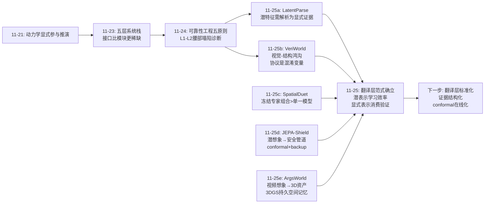
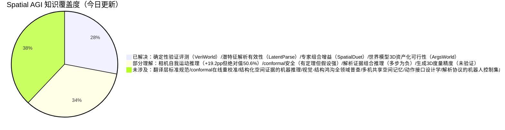
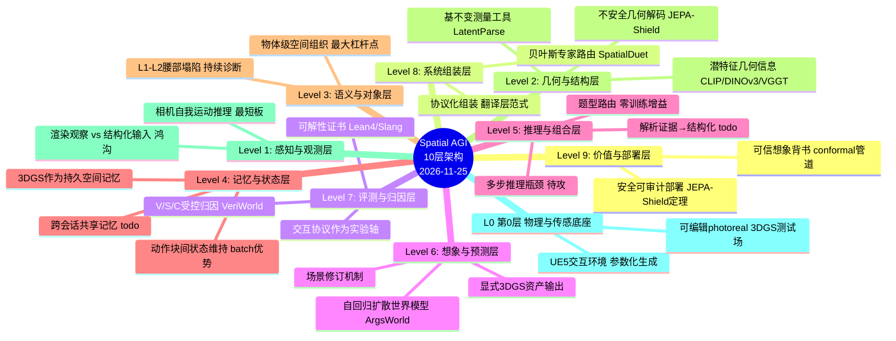
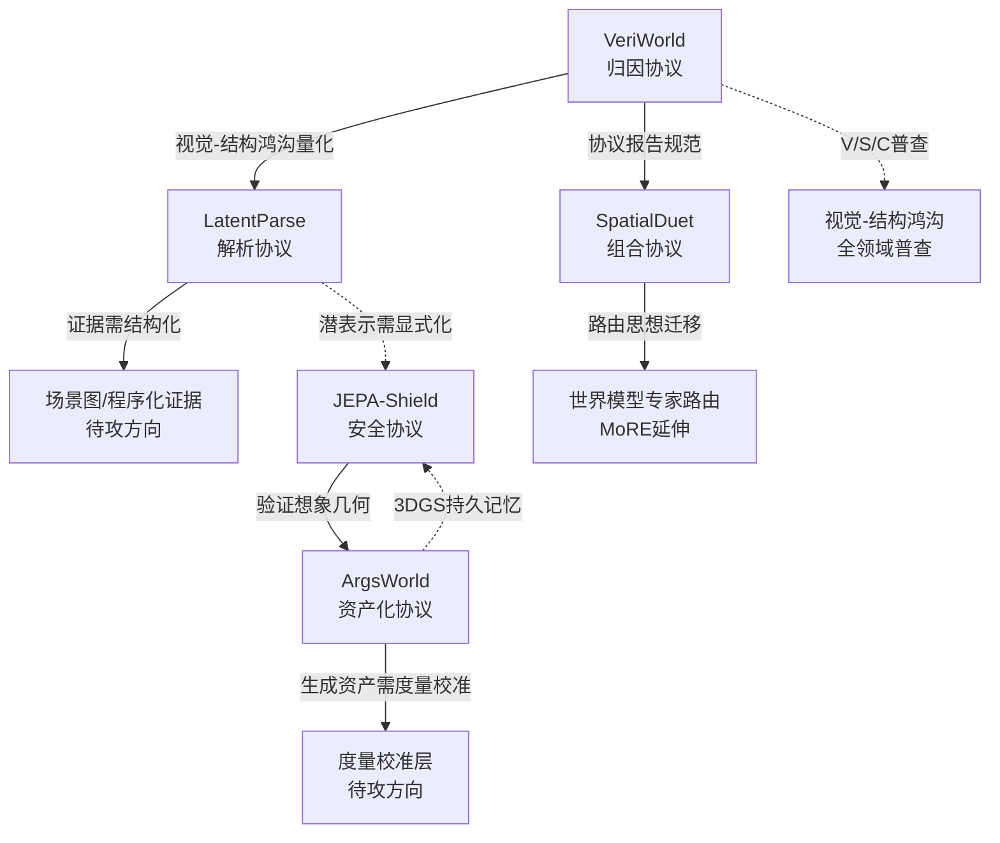

# Spatial AGI 每日思考 - 2026-11-25

## 📅 每日总结

**日期**: 2026-11-25
**论文数量**: 5篇
**主题**: 昨日（11-24）的元判断是"可靠性工程五原则 + 腰部塌陷诊断"——感知接地、物理接地、接口标准化、真实标尺、配置泛化五个工程原则被五篇论文独立确认，同时 SpatialScout-V2 把 L1-L2 语义-实例整合层的"腰部塌陷"量化为 20% IoU 的断层。今天的五篇论文没有继续往上堆新能力，而是从**四个正交的工程方向**回应了"如何让空间智能可组装、可验证、可部署"的问题：LatentParse 给出"潜特征的解析协议"（免训练地把预训练编码器的关系信息编译成 VLM 可用的显式证据）、VeriWorld 给出"评测的因果归因协议"（V/S/C 匹配信息条件把感知-推理-桥接的失败精确分离，并证明交互协议本身是决定成败的变量）、SpatialDuet 给出"能力组合协议"（两个冻结专家 + 贝叶斯题型路由零训练超越最佳单模型）、JEPA-Shield 给出"想象的安全协议"（conformal 管道 + backup shield 把潜空间想象翻译成带统计保证的任务空间安全声明）、ArgsWorld 给出"想象的资产化协议"（自回归扩散世界模型同步产出显式 3DGS——想象沉淀为可消费的几何资产）。合起来的元判断是：**2026 年 11 月末的 Spatial AGI 从"可靠性工程"进入"协议化组装"阶段——单点能力已经足够多，今天的论文们在解决"能力之间如何连接、连接产物如何被信任"的协议问题。四篇论文（LatentParse/VeriWorld/JEPA-Shield/ArgsWorld）不约而同都在构建某种"显式化翻译层"：潜特征→文本证据、视觉→结构、潜想象→安全管道、视频想象→3D 资产。翻译层（而非更大的模型）正在成为这个领域最稀缺的公共品。同时今天出现了一个强有力的跨论文信号：VLM 的空间瓶颈几乎全部位于"从低级/潜表示到显式结构的转换"，而非转换之上的推理——LatentParse 的 +19.2pp 相机增益、VeriWorld 的视觉-结构鸿沟、SpatialScout-V2 的 20% 塌陷，三个独立测量指向同一个靶心。**

**关键突破**:
- 🚀 LatentParse：免训练框架，照片盲分析师用基不变工具解析 CLIP/DINOv3/VGGT 潜特征为显式空间证据文本；**特征图直接输入 VLM 完全无效（-2.6~+0.6pp），解析后有效（+0.7~2.4pp）**；Qwen3.8-27B 在 MMSI-Bench 34.4%→39.5%，相机类问题 31.4%→50.6%（+19.2pp）；错配特征反而降到基线以下（33.3%）——收益严格依赖场景匹配
- 🚀 VeriWorld（NeurIPS 2026 D&B）：交互式 3D 评测 + 确定性验证 + V/S/C 匹配信息条件 + 参数化生成 + 可解性证书（Lean 4/Slang-CUDA）六项能力首次统一；**视觉-结构鸿沟**普遍存在（显式给物体身份/状态/位置远强于从渲染画面读取）；**交互协议是混淆变量**——同任务同信息下 batch 动作接口让 Gemini-3.1-Pro 从 0.57 → 0.93/0.97 且耗步更少
- 🚀 SpatialDuet：度量专家（数据驱动 VLM + 训练对齐采样/metric-aware MBR/按题型校准三免训练模块）+ 几何专家（3D 编码器 VLM）+ 贝叶斯题型路由（数值答案对数空间池化、多选在选项分布池化）；零训练在 VSI-Bench 超最佳已发表小 VLM 3.17%——小型空间 VLM 的能力互补是结构性的，组合胜过统一
- 🚀 JEPA-Shield：冻结动作条件 JEPA 世界模型 + 相对运动预测器/不安全几何解码器两个下游桥 + split conformal prediction 多时域不确定性管道 + backup-based shield 嵌入扩散式采样 MPC；在交换性与初始备份假设下给出**动作块边界的概率约束满足定理**；VParkBench（几何汽车/牵引挂车/可编辑 photoreal 3DGS 环境）闭环 84.4%/82.3%/99.0% **零约束违反**
- 🚀 ArgsWorld：自回归扩散世界模型逐块生成时**同步产出显式 3DGS**；"冻结历史图像潜变量 + 只刷新场景特征"的修订机制让高斯随新视角进入而增量修正；3D Self-Forcing 蒸馏（在自身生成历史上训练，单/多视角混合）+ 双分布匹配监督（图像潜变量与高斯渲染潜变量 × 生成相机与附加相机）；统一重建/生成/跨相机段外推（端点可不连续）三类任务并达 SOTA

**架构演进**: 可靠性工程五原则（11-24）→ **协议化组装五协议 + 翻译层范式**（解析协议 / 归因协议 / 组合协议 / 安全协议 / 资产化协议）

### 📊 一句话总结

今天五篇论文回答的是"能力如何组装成系统"：LatentParse 的解析协议把潜知识翻译成推理可用的命题，VeriWorld 的归因协议让系统失败可以被精确诊断，SpatialDuet 的组合协议让冻结专家即插即用，JEPA-Shield 的安全协议让想象可以背书，ArgsWorld 的资产化协议让想象可以交付——**Spatial AGI 的竞争从"谁的单点能力更强"转移到"谁的翻译层更标准"，而翻译层的最大公约数已经浮出水面：一切潜表示必须显式化（解析为证据/结构/管道/资产）才能被 VLM、验证器或下游管线消费。同时三个独立的性能测量（+19.2pp 相机增益、视觉-结构鸿沟、20% 建图塌陷）共同钉死了同一个靶心：感知到显式结构的转换是全领域最高杠杆点。**

### 🔗 与昨日思考的联系

**昨日（11-24）→今日**: 昨日留下的十条新线索中，今天五篇论文对其中多条给出直接回应：

1. **"干预式评估标准化"**——昨日呼吁把 StereoVLM 的证据消融协议推广到所有空间基准；VeriWorld 的 V/S/C 匹配信息条件正是这个呼吁的系统级实现：同一种子实例下只变信息通道，把"失败来自感知还是推理"变成可测量量。干预哲学从"验证接地性"升级为"归因失败来源"。
2. **"空间校准"**——昨日指出 VLM 不知道自己"多确定物体在哪"；JEPA-Shield 的 conformal 管道是空间校准在安全域的完整实现：不确定性不是被估计出来的点值，而是带覆盖保证的统计区间。校准思想从"置信度分数"升级为"可证明的管道"。
3. **"物理专家路由"（MoRE 线索④生成骨架×物理专家融合）**——ArgsWorld 的生成骨架 + JEPA-Shield 的安全校准组合出了纸面推演中的"统计想象 + 校准层"双阶段引擎的雏形：ArgsWorld 产出几何一致的想象资产，JEPA-Shield 类安全层验证想象的边界。
4. **"评测栈整合"**——昨日说评测需要可验证性窄门；VeriWorld 直接把 SWE-Bench 哲学（可执行+确定性验证）搬进空间领域并配上可解性证书，评测的可验证性从"趋势"变成"标准配置"。
5. **"潜 vs 显"的张力**——昨日 Pros4D（潜空间 4D 世界）与 Xiaomi WAM 2.0（3DGS 显式场景记忆）形成表示光谱两端；今天 LatentParse（潜特征需解析为显式证据）、JEPA-Shield（潜想象需翻译为显式管道）、ArgsWorld（视频想象需沉淀为显式 3DGS）三篇同时给出了裁决：**潜表示负责学习效率，显式表示负责消费与验证，翻译层是两者之间的必需品**。没有翻译层，潜表示的知识是"有但用不了"的。

三重承接：11-21 说"动力学必须显式参与推演"→ JEPA-Shield 把潜动力学翻译成任务空间管道显式参与安全推演；11-24 说"接口比模块更稀缺"→ 今天的解析协议/安全协议/资产化协议都是接口级贡献——接口从"模块间协议"深化为"表示间协议"；11-24 说"L1-L2 腰部塌陷是最大杠杆点"→ LatentParse 与 VeriWorld 分别从工具侧与测量侧确认了同一个诊断：瓶颈在低级表示到显式结构的转换，不在转换之后的推理。

**今日→明日**: 新线索十条：①**翻译层标准化**——解析协议（LatentParse）、安全管道（JEPA-Shield）、资产化（ArgsWorld）三类翻译器应有统一的接口规范（输入表示类型/输出显式形式/置信度语义），社区需要"空间翻译层"的公共规范；②**解析证据的结构化**——LatentParse 的平铺文本证据在多步推理上收益为负，下一步是把证据组织成场景图/程序结构让组合推理可执行；③**协议混淆的控制规范**——VeriWorld 证明 harness 决定成败，所有空间 agent 论文应强制报告动作预算/协议/batch 粒度，基准论文应像 VeriWorld 一样把协议作为实验轴；④**conformal 管道的在线重校准**——机器人部署充满分布偏移，交换性假设会静默失效，需要漂移检测 + 在线校准的 conformal 变体；⑤**3DGS 资产的度量校准**——ArgsWorld 的分布匹配保证"渲染像"不保证"量得准"，生成式 3DGS 进仿真/物理循环前需要度量校准层（可借用 StereoVLM 的度量监督思想）；⑥**相机推理专项攻坚**——LatentParse 的 +19.2pp 与 VeriWorld 的运动状态维持（batch 优势）都指向相机/自我运动推理，专项数据与架构（如内建位姿头的 VLM）值得投资；⑦**专家路由 × 世界模型**——SpatialDuet 的题型路由思想迁移到世界模型：按物理 regime/任务类型路由到不同世界模型专家（MoRE 已是实例，路由器可升级为 VLM 驱动）；⑧**空间 agent 的动作接口设计学**——batch/code-as-action 的优势系统性地大于单步控制，"动作接口设计"应成为独立研究方向；⑨**视觉-结构鸿沟的量化普查**——用 VeriWorld 的 V/S/C 范式对现有全部空间 VLM 做鸿沟普查，建立"哪类信息最需要显式化"的图谱指导翻译层投资；⑩**潜特征解析的机器人版**——LatentParse 只测了 QA 基准，把潜特征解析接到机器人控制回路（解析运动 token/世界模型潜状态）是直接延伸。明日检索方向："structured spatial evidence scene graph reasoning"、"conformal prediction online recalibration robot drift"、"metric calibration generated gaussian splatting simulation"、"camera ego-motion reasoning VLM pose head"、"expert routing world model task type"、"action interface design agent batch code"、"visual-to-structure gap survey V/S/C protocol"、"latent feature parsing robot control"、"spatial evidence graph multi-step reasoning"、"protocol reporting standard spatial agent benchmark"。

### 💡 本质思考：如何达成通用空间智能（概要）

#### 1. 核心能力的本质是什么？

昨日（11-24）的答案是"可靠性的通用配方：接地、结构化、接口化、真实化、泛化"。今天五篇把这个答案推进到协议层：**通用空间智能的本质是一组翻译协议的集合——每个学习型组件都在潜表示中工作，每个消费/验证/部署环节都在显式表示中工作，系统的质量由翻译协议的质量决定。**

四个具体化：
- **翻译层是系统的神经突触**：LatentParse 证明潜特征"有但用不了"，JEPA-Shield 证明潜想象"准但不能背书"，ArgsWorld 证明视频想象"美但不交付"——三个独立证据指向同一结论：学习系统与消费系统之间的翻译层决定整个系统的价值。翻译层做得好，组件可以是冻结的、异构的、甚至闭源的（SpatialDuet 的零训练超越即是证明）。
- **归因能力是改进能力的前提**：VeriWorld 的最大贡献不是任何分数而是方法论——没有 V/S/C 式的受控归因，改进方向就是猜。空间智能的工程化需要"失败可以定位到环节"的评测基建。
- **组合可以是能力的一部分**：SpatialDuet 证明在小模型上"专家组合 > 单一全能"——空间能力的异构性（度量 vs 几何）是结构性的，与其在一个模型里强行统一，不如让组合协议承担统一职责。
- **安全是显式表示的专属职责**：潜空间的预测无法证明安全（JEPA-Shield 的出发点），安全的论证必须在带覆盖保证的显式几何中进行。这为"潜 vs 显"之争给出了功能性裁决：不是谁取代谁，而是分工。

#### 2. 当前方法与理想目标的差距在哪里？

六条差距，按严重程度排序：

- **翻译层各自为战（今日新增诊断）**：今天一天出现了三种翻译协议（潜特征→文本、潜想象→安全管道、视频想象→3D资产），加上此前的运动 token（Ego4Gen）、槽协议（ViewDreamer）、意图 token（CoT-WAM）——翻译接口数量在增长而非收敛。每个系统的翻译层都是定制的，组件无法互换。理想状态是 2-3 个标准翻译协议 + 各组件按协议接入。
- **解析证据无法支持长链推理**：LatentParse 在多步推理上收益为负——原子关系命题的平铺文本不是推理的好载体。显式化不等于可用化，证据需要结构（场景图/程序/中间量）才能被组合。这与昨日"视差监督把中间量落在不变坐标空间"的洞见呼应：显式化的正确粒度是"不变的中间量"，不是原始测量。
- **conformal 保证的部署鸿沟**：JEPA-Shield 的定理依赖交换性假设，而机器人部署的第一特征就是分布偏移。覆盖保证在偏移下静默失效且失效方向（管道过窄）恰是最危险的。在线重校准、漂移检测、鲁棒 conformal 是从论文到部署的必经之路，当前几乎空白。
- **生成 3D 的度量真空**：ArgsWorld 的 SOTA 是感知指标上的；"生成的 3DGS 能否支撑物理仿真/碰撞检查"的度量精度无人验证。感知-度量鸿沟（VeriWorld 已证明其代价）在生成式 3D 资产上会复现。
- **评测协议的报告标准缺失**：VeriWorld 证明协议能让结果翻转 0.36，但社区没有协议报告规范——大量空间 agent 论文的结论可能混杂了协议效应。需要类似"随机种子报告"的"动作预算/协议报告"社区规范。
- **相机/自我运动推理仍是未解之题**：LatentParse 带来 19.2pp 提升但绝对值仍只有 50.6%；VeriWorld 的 batch 优势本质是帮模型维持运动状态。相机推理（从序列推断自我运动并外推）是 VLM 空间能力的最短板，专项投资不足。

#### 3. 从今天到理想状态，最可能的路径是什么？

三步路径，每步 6-12 个月：

- **第一步：翻译层收敛（当前-2027H1）**——把今天的三类翻译协议（解析/安全/资产化）工程化为标准组件：解析协议扩展为结构化证据（场景图）+ 机器人域；conformal 管道加上在线重校准；ArgsWorld 输出加度量校准头。同时用 VeriWorld 范式做视觉-结构鸿沟普查，确定翻译投资优先级。判据：出现第一个"按标准翻译协议组装、组件来自三个以上团队"的空间 agent 系统。
- **第二步：相机推理与结构化证据（2027H1-H2）**——集中攻相机/自我运动推理（专项数据：虚拟位姿合成 + 双目资产化）与证据结构化（解析结果组织为可执行的场景图/程序）。判据：MMSI-Bench 相机类从 50.6% 推向 70%+；多步空间推理从"解析后变负"转为"解析后变正"。
- **第三步：协议生态与可信部署（2027H2-）**——社区收敛翻译协议标准（类似 HTTP）；conformal 安全层完成在线校准化并在真实机器人上零违规部署；生成式 3D 资产通过度量校准进入仿真训练循环，形成"想象→资产→仿真→策略→部署"的完整飞轮。判据：不同团队的感知/想象/安全/控制组件按协议组装的系统在端到端任务上超过任何单团队方案，且安全声明可被第三方审计。

理想终局：感知层输出结构化空间证据（解析协议）、想象层产出带不确定性管道的几何资产（安全+资产化协议）、组合层按题型路由异构专家（组合协议）、评测层可归因失败环节（归因协议）、部署层安全可审计（conformal 在线化）——**每个组件在潜表示中学习，在显式协议中协作，在统计保证中部署。这就是协议化完成后的通用空间智能。**

---

## 核心见解演进



### 核心见解的演进逻辑

1. **11-21→11-23**：从"动力学要显式"的具体主张，扩展为"五层系统栈"的宏观架构，并预判接口比模块稀缺。
2. **11-23→11-24**：系统栈落地为可靠性工程五原则；SpatialScout-V2 用 20% IoU 把最大的隐性断层（L1-L2）变成显式工程靶子。
3. **11-24→11-25**：可靠性原则深化为协议化组装。今天的关键跃迁是**翻译层范式**的浮现：五篇论文中四篇在建造翻译层，且互不知晓地使用了同一设计模式——潜→显、测量→置信、想象→资产。
4. **范式内部的三个支柱**：LatentParse 立起"解析协议"（知识侧）、JEPA-Shield 立起"安全协议"（信任侧）、ArgsWorld 立起"资产化协议"（交付侧）；VeriWorld 提供归因方法（协议怎么被科学地评估），SpatialDuet 提供组合方法（协议如何让旧组件变强）。

---

## 技术栈演进对比表

| 维度 | 11-21（动力学显式化） | 11-23（五层系统栈） | 11-24（可靠性工程） | 11-25（协议化组装） | 理想状态 |
|------|------|------|------|------|------|
| 感知层 | 几何先验注入 | 接地配方缺位 | StereoVLM 视差监督+干预验证 | LatentParse 潜特征解析协议 | 标准化结构化空间证据输出 |
| 想象层 | 世界模型动力学 | 意图token/状态链 | MoRE物理专家+Ego4Gen运动token | ArgsWorld 3DGS资产化+JEPA-Shield安全管道 | 带不确定性管道的可交付几何想象 |
| 组合层 | 单模型为主 | 接口碎片化初现 | 三种接口并行 | SpatialDuet 贝叶斯专家路由 | 2-3个标准翻译协议生态 |
| 评测层 | 评测被提及 | 可验证性窄门 | 真实标尺20%塌陷 | VeriWorld V/S/C归因+确定性验证 | 失败可定位到环节+协议报告规范 |
| 安全部 | 未涉及 | 未涉及 | 物理接地（预测侧） | JEPA-Shield conformal管道+backup shield | 在线重校准的可审计安全层 |
| 数据层 | 动力学数据 | 数据因果性（Foundry） | 双目资产化线索 | 虚拟位姿合成线索 | 度量接地的自动标注管线 |
| 最大瓶颈 | 动力学隐式 | 接口稀缺 | L1-L2塌陷20% | 翻译层各自为战 | 协议收敛后瓶颈转移 |

**演进观察**：瓶颈位置四周内完成了一次完整的迁移——从"模型内部表示"（动力学）到"系统架构"（接口）到"工程质量"（可靠性）到"组件间协议"（翻译层）。这个迁移轨迹本身就是领域成熟的标志：每一层问题被解决后，瓶颈自动上移到更外圈的系统问题。按此规律，翻译层收敛之后的下一个瓶颈大概率是**跨系统空间记忆的共享与合并**（多机器人/跨会话/长时程）——今天 ArgsWorld 的"3DGS 作为持久记忆"是其单机雏形。

---

## 知识缺口分析



### 缺口的三个结构性观察

1. **"已解决"集中在单点可行性**——今天的四个"已解决"都是"证明了某条路走得通"，没有任何一个是"这条路已被走成标准"。领域的新颖性供给充沛，标准化供给为零。
2. **"部分理解"集中在假设与粒度**——conformal 的假设、解析的粒度、相机的绝对值、生成的度量，都是"方向对但工程化未完成"的典型状态。这部分是未来 6 个月最可能被填平的。
3. **"未涉及"集中在生态与协议**——标准规范、在线校准、跨机共享、接口设计学，这些问题的共同特征是**需要社区协作而非单篇论文**。谁先做出"事实标准"（类似 early HTTP），谁就掌握下一阶段的生态位。

---

## 10层架构思维导图



### 10层架构的今日更新说明

- **L9（价值与部署）新增**：JEPA-Shield 首次让"部署层"拥有定理级安全声明——此前该层只有工程惯例，没有统计保证。架构上新增此层，因为"可信"开始成为独立于"能力"的工程对象。
- **L8（系统组装）正式成形**：SpatialDuet 的路由 + 今天整体浮现的翻译层范式，让"组装"从隐式的系统设计变为一等研究主题。
- **L7（评测与归因）升级**：VeriWorld 把评测从"打分"升级为"归因"，并首次把交互协议纳入受控变量。
- **L4（记忆与状态）新增内容**：ArgsWorld 的 3DGS 持久记忆 + VeriWorld 发现的 batch 动作优势（本质是状态维持），让"空间记忆"从隐含能力变为显式架构层。
- **持续诊断**：L3 仍是最大塌陷点（昨日 20% 断层未被今天的论文修复，但 LatentParse/VeriWorld 确认了其上游原因在 L1-L2 的转换）。

---

## 主线技术路径

### 阶段1: 单点能力爆发（2026H1，已完成）
3DGS 重建、VLM 空间问答、世界模型视频生成各自达到演示级可用。特征：比拼单点指标，系统性问题未被提出。

### 阶段2: 系统栈浮现（2026H2，已完成）
五层系统（语义/推理/物理/数据/评测）各有代表作；接口开始被视为稀缺资源（运动 token、槽、意图 token、状态链）。特征：从"谁更强"到"谁更完整"。

### 阶段3: 可靠性工程（2026-11，已完成）
接地、结构化、接口化、真实化、泛化五原则被独立确认；20% 塌陷把最大的隐性瓶颈变成显式靶子。特征：每个能力都要被证明"可靠"而非仅仅"可能"。

### 阶段4: 协议化组装（2026-11下旬，当前，今天五篇是宣言）
翻译层范式确立：潜→显的解析协议、安全管道、资产化协议；组合协议让冻结专家增值；归因协议让失败可定位。特征：竞争焦点从能力转移到协议，"可组装、可验证、可信任"成为新的一等需求。

### 阶段5: 协议收敛与生态化（2027，待开启）
2-3 个翻译协议成为事实标准；conformal 安全在线化并真实部署；生成 3D 资产通过度量校准进入仿真飞轮；跨机共享空间记忆出现。判据：多团队组件按协议组装超过单团队整体方案。特征：单篇论文的影响力让位于生态位之争，"做出事实标准"是最高的研究杠杆。

### 阶段6: 群体空间智能（2027H2-，远景）
共享一致地图作为公共空间记忆；协同想象与分工探索；空间能力的群体涌现。特征：空间智能从单 agent 走向多 agent，从个体认知走向群体认知。

---

## 五篇论文的交叉网络



### 交叉观察

1. **JEPA-Shield × ArgsWorld 是今天最强的组合信号**：一个产出几何一致的想象资产，一个验证想象的几何安全边界。两者拼出"可信空间想象-验证闭环"——这正是昨日线索④（统计想象+物理校准双阶段引擎）的完整实现路径。
2. **LatentParse × VeriWorld 是今天最强的诊断组合**：LatentParse 是转换瓶颈的解决方案侧（解析注入结构），VeriWorld 是测量侧（V/S/C 精确量化）。组合流程：VeriWorld 测出鸿沟最大的任务类型 → LatentParse 式解析注入 → 再测鸿沟收窄。
3. **SpatialDuet 是"旧组件的新经济学"**：不训练新模型也能拿到 SOTA，说明当前领域的边际收益正在从"训练更强的模型"转移到"更聪明的组合"。这与翻译层范式互为表里——协议本身就是一种能力。
4. **缺口的一致性**：五篇论文的"未来工作"部分罕见地指向同一批问题（结构化证据、在线校准、度量校准、协议规范）——这些不是某篇论文的遗留，而是整个范式的下一步。

---

## 深度专题：翻译层——Spatial AGI 的神经突触

### 为什么是翻译层？

四周的瓶颈迁移轨迹（模型内表示→系统架构→工程质量→组件协议）指向一个结构性事实：**Spatial AGI 的组件供给已经过剩，连接供给严重不足。** 今天五篇论文中有四篇（LatentParse/VeriWorld/JEPA-Shield/ArgsWorld）本质在建造连接器，且它们互不引用、互不知晓地使用了同一个设计模式：

```
潜表示（学习高效域）
    ↓ 翻译协议（解析/校准/蒸馏/管道化）
显式表示（消费验证域）
    ↓ 消费者（VLM推理/安全滤波/仿真管线/下游规划）
```

- LatentParse：编码器潜特征 →（基不变工具测量 + 共识评级）→ 文本证据 → VLM 推理
- JEPA-Shield：JEPA 潜 rollout →（运动预测 + 几何解码 + conformal）→ 安全管道 → MPC 滤波
- ArgsWorld：视频生成潜变量 →（场景特征刷新 + 分布匹配）→ 显式 3DGS → 仿真/渲染管线
- VeriWorld（测量侧）：渲染画面 →（V/S/C 对照）→ 显式结构 → 归因分析

### 翻译层的四个设计不变量

对比四个翻译器，可以提取出可复用的设计不变量：

1. **基不变性**（LatentParse）：翻译只使用对表示内部对称性鲁棒的量——不假设两侧共享通道语义。这是翻译器能在异构组件间工作的前提。
2. **统计保证**（JEPA-Shield）：翻译误差必须被量化为带覆盖保证的区间，而非点估计——翻译是有损的，消费者必须知道损失的上界。
3. **可修订性**（ArgsWorld）：翻译产物不是一次性的——新证据到来时产物可以被修正而旧产物不被破坏（冻结历史+刷新场景特征）。翻译是流式的信念更新。
4. **对照归因**（VeriWorld）：翻译层的收益必须用匹配条件对照来验证——否则无法区分"翻译有价值"与"其他因素"。今天 LatentParse 的"直接输入 vs 解析"消融正是此原则的自我执行。

### 翻译层的经济学

SpatialDuet 提供了翻译层经济学的第一个数据点：**两个便宜专家 + 一个翻译协议 > 一个最强单模型**。翻译协议的开发成本（开发集估计路由+校准）远低于训练新模型，且翻译层让组件保持可替换——当更好的专家出现时，只需重新估计路由概率。这与硬件领域的"chiplet + 高速互连"趋势同构：单芯片微缩放缓后，互连技术成为摩尔定律的延续。Spatial AGI 的"互连技术"就是翻译层。

### 翻译层的标准化草案（前瞻）

基于四个设计不变量，一个"空间翻译协议"的公共规范应至少定义：
- **输入签名**：潜表示的类型（特征网格/潜状态序列/生成轨迹）与元信息（网格对齐/时域范围）
- **输出签名**：显式形式的类型（关系命题集/几何管道/3D 资产）与置信度语义（共识等级/覆盖概率/渲染分布）
- **质量声明**：翻译损失的上界声明方式（conformal 覆盖/校准误差/度量偏差界）
- **版本与回退**：协议版本化，消费方可以对不满足质量声明的翻译产物拒绝消费

这不是空想——VeriWorld 的任务规格（符号规格→实例→验证器）已经是此类规范的评测端实现。

---

## 深度专题：相机推理——被三次独立测量钉死的最短板

### 三次独立测量

1. **LatentParse**：11 个题型中，相机类基线最低（31.4%）而解析增益最大（+19.2pp→50.6%）——瓶颈与资源在翻译中精准对接，因为 VGGT 潜特征最编码的恰好是视角间几何关系。
2. **VeriWorld**：batch 动作接口的巨大优势（0.57→0.93）本质是让模型在单上下文内维持运动状态——单步协议反复打断"我在哪、我朝哪"的内部状态维持。
3. **SpatialScout-V2（昨日）**：主动探索需要推断"移动会带来什么视角变化"，前沿 VLM 的 20% IoU 塌陷与此直接相关。

### 为什么相机推理这么难？

相机推理的本质是**自我运动的反演与外推**：从序列中推断"相机如何动了"（反演）并预测"如果这样动会看到什么"（外推）。难点有三：
- 训练数据中相机参数几乎从不显式标注（互联网视频无位姿），VLM 从未学过显式的自我运动概念
- 自我运动是**关系量**（帧间关系），不在任何单帧的外观中——正是 LatentParse 证明"VLM 上下文机制理解外观不理解关系"的重灾区
- 长序列中误差累积，需要内部状态维持——而 VLM 的上下文机制天然鼓励无状态的单帧处理

### 攻坚路线（明日线索⑥的展开）

- **数据侧**：虚拟位姿合成（单目视频反投影 + 仿真自由相机）+ 双目资产化（昨日线索⑩），让位姿标注规模化
- **架构侧**：VLM 内建位姿 token/位姿头（把自我运动变成一等 token 而非隐含在视觉特征中）——ArgsWorld 的场景特征刷新机制是其世界模型版
- **评测侧**：VeriWorld 式 V/S/C 普查相机类任务的视觉-结构鸿沟，确定"哪些相机信息最需要显式化"（位姿？运动方向？幅度？）
- **系统侧**：batch 动作协议作为默认 agent 配置；解析协议（LatentParse）的 motion 工具作为相机信息的外挂翻译器

判据：MMSI-Bench 相机类 50.6%→70%+；SpatialScout-V2 探索效率显著提升。相机推理是 L1-L2 腰部攻坚的前置战役——没有可靠的自我运动推断，主动建图（L3 的物体级组织）无从谈起。

---

## 待探索议题

1. **翻译层标准规范**：基于四个设计不变量（基不变/统计保证/可修订/对照归因）起草"空间翻译协议"公共规范，定义输入/输出/质量声明/版本回退签名。优先级最高，因为它是所有其他议题的容器。
2. **解析证据的结构化**：LatentParse 的平铺文本在多步推理上为负——把解析结果组织为场景图/程序/中间量表（借鉴 StereoVLM"中间量落在不变坐标空间"的原则），让组合推理可执行。判据：解析后多步推理由负转正。
3. **conformal 在线重校准**：为 JEPA-Shield 类安全层加漂移检测 + 在线重校准（自适应 conformal/加权 conformal），消除交换性假设的部署风险。判据：模拟分布偏移下覆盖率保持在目标水平。
4. **生成 3DGS 的度量校准**：在 ArgsWorld 类生成管线上加度量监督头（StereoVLM 的视差监督思想迁移），量化并收敛"渲染像"与"量得准"的差距。判据：生成场景的几何误差满足仿真训练可接受的阈值。
5. **视觉-结构鸿沟全领域普查**：用 VeriWorld 的 V/S/C 范式系统测量现有空间 VLM（开源/闭源 × 任务类型 × 信息类型），产出"哪类信息最需要显式化"的投资图谱。
6. **相机推理专项**：虚拟位姿合成数据管线 + VLM 位姿 token 架构 + 相机类基准专项，把自我运动推理从 50.6% 推向 70%+。
7. **专家路由 × 世界模型**：把 SpatialDuet 的题型路由推广到世界模型选择（按物理 regime/任务类型路由，MoRE 专家作为路由目标，VLM 作路由器），实现"按需想象"。
8. **动作接口设计学**：系统研究 batch 粒度、code-as-action、动作块长度对空间任务的影响，产出空间 agent 的动作接口设计指南（VeriWorld harness track 的延伸）。
9. **解析协议的机器人化**：把 LatentParse 的潜特征解析接入机器人控制回路——解析世界模型潜状态/运动 token 为任务空间证据，作为 JEPA-Shield 运动预测器的替代/补充。
10. **多机共享空间记忆**：以 ArgsWorld 的 3DGS 持久记忆为单机基础，研究跨机器人/跨会话的地图合并协议（结合昨日线索⑨），这是协议收敛后的下一个生态级问题。

---

## 💡 本质思考：如何达成通用空间智能

### 1. 核心能力的本质是什么？

四周演进后的最新答案：**通用空间智能本质上是"潜表示的学习效率"与"显式表示的消费可靠性"之间的完整翻译栈。** 每一个学习型组件（编码器、世界模型、策略网络）都在潜表示中工作——因为潜表示可学习、可微、高效；每一个消费环节（推理、验证、安全、部署、资产交付）都在显式表示中工作——因为只有显式形式可以被逻辑检验、统计保证、人工审计和管线消费。系统的智能水平由最差的翻译环节决定，而非最强的学习组件。

三个推论：
- **"更强的基础模型"是必要非充分**：SpatialDuet 证明冻结专家+翻译协议能超越最佳单模型；LatentParse 证明闭源模型+解析协议能获得空间能力。模型能力会持续通胀，但翻译质量才是系统瓶颈。
- **协议是能力的乘法而非加法**：好的翻译协议让所有下游组件同时受益（LatentParse 让五个 VLM 全部提升），坏的系统集成让所有上游能力同时浪费（VeriWorld 的单步协议把 0.93 压到 0.57）。投资协议的杠杆率高于投资单点。
- **安全是显式性的杀手级应用**：潜表示永远无法背书安全（JEPA-Shield 的出发点），conformal 管道给出了"显式化→统计保证→可部署"的完整链条。安全需求是翻译层存在的最强辩护。

### 2. 当前方法与理想目标的差距在哪里？

最深的差距是**翻译层的无组织状态**：今天一天涌现三种翻译协议，加上此前的 token/槽/状态链，翻译接口数量已超过组件数量——连接器比被连接的东西还多，这是生态系统未收敛的典型症状（对照：互联网只有 TCP/IP + HTTP 两个主协议）。具体差距：

- **质量声明缺失**：LatentParse 的证据只有高/中/低共识等级，无校准的量化语义；ArgsWorld 的资产无度量偏差声明；只有 JEPA-Shield 有真正的统计质量声明。翻译产物不可信任，消费方只能盲信或弃用。
- **组合推理断裂**：显式化目前止步于原子命题/单块管道/单场景资产——把翻译产物组装成多步推理、长时域管道、大尺度场景的能力仍缺位。LatentParse 的多步为负是警报：显式化 ≠ 可用化。
- **部署侧的时间维度**：conformal 的交换性假设、3DGS 资产的无版本管理、解析证据的过期问题——所有翻译产物在分布漂移下的维护机制空白。理想状态要求翻译栈是"活的"（持续重校准），当前是"死的"（一次性校准）。

### 3. 从今天到理想状态，最可能的路径是什么？

以翻译栈为主线的三步（与前面"主线技术路径"的阶段四→五→六对应，这里给出执行细节）：

- **第一步（2027H1）：把三种翻译协议做到"可声明质量"**——解析协议加校准的证据置信度、安全协议加在线重校准、资产化协议加度量偏差声明。同时用 VeriWorld 范式完成鸿沟普查，确定协议投资排序。判据：三类协议各有一个组件通过第三方质量审计。
- **第二步（2027H2）：翻译栈的结构化与时间化**——证据结构化（场景图/程序）、管道时域化（长时域保证）、资产版本化（可修订的数字孪生）。相机推理专项并行（位姿 token + 虚拟位姿数据）。判据：多步空间推理解析后为正；conformal 在偏移下保持覆盖；生成资产进仿真循环训练出有效策略。
- **第三步（2028-）：协议收敛与群体化**——社区把翻译栈压缩为 2-3 个标准协议；多机共享空间记忆（3DGS 合并协议）出现；想象→资产→仿真→策略→部署飞轮闭环。判据：多团队组件按协议组装超过单团队方案（协议化的终极验证），空间智能开始具备群体形态。

理想终局的一句话版本：**每个学习组件在潜表示中自由地学习，每个消费环节在显式协议中严格地验证，翻译栈带着统计保证连接两者，并随世界漂移而自我更新——这就是协议化与生态化完成后的通用空间智能。**

---

## 今日金句

> "潜表示负责学习效率，显式表示负责消费与验证——翻译层是两者之间唯一必需品，也是当前最稀缺的公共品。"

> "VeriWorld 证明协议能让结果从 0.57 翻到 0.93：在空间智能的工程里，接口设计与模型能力同权，甚至经常更权。"

> "安全是显式表示的专属职责：潜空间的想象再准，也不能为碰撞背书——能为部署背书的只有带覆盖保证的显式几何管道。"

---

**文档创建时间**: 2026-11-25 03:00 CST
**基础日期**: 2026-11-24
**分析方法**: 5篇论文精读 + 延续性深度思考
**今日论文**: LatentParse / VeriWorld / SpatialDuet / JEPA-Shield / ArgsWorld

---

## 附录A：五篇论文技术深读笔记

### A1. LatentParse 技术深读

**为什么"特征图直接输入"必然失败？**

论文给出的解释值得展开：VLM 的视觉 token 接口是在自然图像分布上训练的——它对"像素排列"有归纳偏置（局部连续性、边缘、纹理统计）。而潜特征的"patch×channel 矩阵"渲染成灰度图后，其像素排列没有任何自然图像的结构：相邻 patch 的通道值差异不构成边缘，通道间没有色彩语义。VLM 的视觉系统面对这种输入时，等于用"读懂照片的器官"去读"矩阵打印件"——感知机制完全错配。

更深层：潜特征的空间信息在**patch 间关系**（相似性、对应、几何一致）里，而这类信息是**二次量**（需要计算 patch 对之间的关系才能显现），不可能从渲染图的外观中被 CNN/ViT 式的视觉前读出来。这就是"外观 vs 关系"的根本区分——LatentParse 的工具本质上是**关系的显式计算器**。

**基不变量的数学细节**

工具库依赖的不变量族：
- 内积 ⟨f(p), μ_A⟩：物体 patch 与参考区域均值的相似度——在任意正交变换 R 下不变
- 欧氏距离 ||f(p) − μ_A||：等价于范数与内积的组合
- 对比分数 f(p)ᵀ(μ_A − μ_B)：物体 p 更像 A 还是 B——二元相对判断，天然基不变

唯一例外是 CLIP 的 text_map：因为 CLIP 把文本与图像嵌入同一空间，"patch 与文本嵌入的内积"有跨模态语义。这提示：**基不变性原则的适用边界是"两侧无共享语义空间"——一旦存在共享空间（如 CLIP 的图文对齐），可以直接用对齐量**。

**定位的三阶段流水线**

CLIP 提议（text_map，平滑+取负——因为最后层 CLIP patch 对命名物体打分低于周围，这是一个反直觉但被文献支持的观察）→ DINOv3/VGGT 验证（support：哪些格子真的属于该区域）→ 共识定级（≥2 编码器支持才算数，加上面积/峰值/prominence 定 high/medium/low/none）。

这个流水线的精髓是**提议-验证分离**：CLIP 擅长"物体名→大致位置"但不精确，DINOv3/VGGT 擅长"区域级精确边界"但没有名字。谁提议谁验证按各自长处分工——这是翻译层设计不变量"基不变性"的系统级版本：**能力异构性不是缺陷，是分工的依据**（与 SpatialDuet 的专家分工呼应）。

**对"潜空间推理"路线的警示**

Coconut、LatentMAS、Latent Sketchpad 在模型**自己的**隐状态上做潜推理——那些状态是模型被训练去产生和解释的。而外部编码器特征与 VLM 的视觉 token 没有任何通道对应。今天的数据（直接输入无效）说明：**潜推理的可行性依赖于"潜状态的产出者与消费者是同一系统或经过对齐训练"**。跨系统的潜状态传递必须经过翻译——这为"多 agent 潜空间通信"类研究划定了硬边界。

### A2. VeriWorld 技术深读

**确定性验证的完整工程栈**

VeriWorld 的验证体系有三层，值得作为空间评测的工程模板：
1. **运行时验证器**（通用）：每个任务一个 Python 谓词，满足即 pass，超预算即 fail——确定性、即时、二元
2. **可解性证书**（部分任务）：离散可达性用 Lean 4 逐种子定理（native_decide 决策程序），连续物理用 Slang/CUDA 确定性仿真——证明"任务本身有解"，排除"模型正确但任务无解"的噪声样本
3. **参数化生成**（规模）：整数种子→任务参数→UE5 实例化——评测集可无限扩展且可复现

这三层的组合使 VeriWorld 成为空间领域第一个"评测即代码"的系统：评测本身是确定性的程序，结论不依赖人工判断或启发式奖励。

**batch 动作接口优势的机制分析**

为什么每调用走 3-6 步比每次 1 步好这么多（0.57→0.93）？三个机制假说：
1. **状态维持**：单步协议下，模型必须在两次调用间"记住"自己在哪、朝哪、去过哪——这个内部状态维持恰是 VLM 的弱项（与相机推理短板同源）。batch 协议让一段连续推理在单上下文内完成，状态不用跨调用传递。
2. **规划完整性**：走迷宫需要"看一段、想一段、走一段"的局部规划；单步调用把规划切碎成逐步反应，退化为贪心；batch 允许短程规划。
3. **预算效率**：batch 平均耗步更少——少了单步协议中的来回纠错步。

工程含义：**给 agent 的调用粒度应该匹配任务的规划粒度**。这个原则与人类工作记忆的"组块化"（chunking）完全同构。

**视觉-结构鸿沟的信息类型分解**

论文指出 S−V 差值的解释取决于显式信息解决的是什么：物体-标识符对应（identity binding）、当前状态（state estimation）、还是几何/物理参数（parameter estimation）。这三类信息从画面中读取的难度完全不同——物体对应最难（需要接地+重识别），状态其次，参数最难量化（需要度量几何）。这个分解正是昨日 L1-L2 腰部塌陷的细粒度版：塌陷不是均匀的，"identity binding"可能是最深的塌陷点。后续用 VeriWorld 做鸿沟普查时应按这三类分别统计。

### A3. SpatialDuet 技术深读

**三个免训练度量模块的独立价值**

- **训练对齐采样**：让模型在"训练分布的舒适区"内工作——这是对"分布外输入放大模型弱点"的防御。实现成本极低（调整提示/输入格式），收益依赖对训练数据的了解。
- **metric-aware MBR 解码**：多次采样 → 在度量空间选期望风险最小的答案。对数值估计任务（"桌子多宽"），这是把"点预测"升级为"分布预测"的标准做法——空间数值的误差代价不对称（差 10cm 和差 10m 不可比），MBR 允许定制损失。可移植性极强：任何空间 VLM 的数值输出都应过这一道。
- **按题型校准**：面积/体积/距离各有系统性偏差（模型对大数值普遍低估、对小数值高估——回归到均值的典型症状）。按题型校准等于把"全局偏差"分解为"每类偏差"分别修正——校准粒度决定修正精度。

**对数空间池化的合理性证明**

数值答案在 log 空间加权池化 = 几何平均。为什么对：空间量的误差通常是对数正态的（估计偏差与量级成比例），几何平均是对数正态分布的最大似然估计中心；线性平均会被大数值主导——"房间面积"会淹没"杯子容积"。这个设计细节体现了"领域感知的融合"：融合算子应匹配误差的统计结构。

**路由器的统计本质**

题型级路由概率 = P(专家A优于专家B | 题型t)，由开发集估计。这是最简单的 bandit/元学习思想：不学"怎么答"，只学"谁更会答"。它的稳健性来自极低的假设自由度——只估计一个标量概率，而非端到端融合函数。数据少时稳健，数据多时天花板低——这正是"协议优先于端到端学习"在组合问题上的体现。

### A4. JEPA-Shield 技术深读

**conformal 管道的构造**

Split conformal prediction 的空间版构造：
1. 校准集：抽取 (图像, 动作块, 真实未来运动) 样本
2. 计算每个时域 h 上的端到端预测误差（图像→JEPA潜预测→运动预测 vs 真实运动）的非一致性分数
3. 取分位数得覆盖目标 (1−α) 的误差半径 r_h
4. 部署时：运动预测 ± r_h 即为该时域的不确定性管道

关键性质：**分布无关、有限样本有效**——不假设误差分布形状，只假设校准与部署数据可交换。管道随 h 增长自然编码"预测越远越不确定"。

**为什么必须 backup？**

管道只说"未来位置在这个包络内"，不说"包络不会碰障碍"。当管道与障碍相交时，有两种处理：放弃计划（保守）或回退到安全处（backup）。backup 轨迹保证"任意时刻存在一条可达的安全退路"——这是 fail-safe 设计的核心：**不是让失败不可能，而是让失败可恢复**。初始备份假设（开局即有可达安全状态）是这个保证的前提，也是它最强的假设——从悬空或死路开局时理论保证失效。

**双重筛查的必要性**

对候选轨迹筛查（采样循环内）+ 对最终提案筛查（输出前）——防两类泄漏：采样循环内的偶然漏网，和循环外的实现 bug。安全系统的"纵深防御"原则：任何单层检查都假设会被绕过。

**VParkBench 的可编辑 3DGS 环境意义**

"可编辑"（editable photorealistic 3DGS）是关键词：安全测试需要**对抗性环境变化**——把障碍挪到盲区、改变光照、注入动态物体。3DGS 的显式高斯使环境编辑成为几何操作而非重新拍摄。这延续了本周"3DGS 作为具身 AI 世界基础设施"的趋势（GASE 仿真重构、RealityBridge 驾驶仿真、MagicSim 可执行交互），并加了第四个用途：**安全对抗测试场**。

### A5. ArgsWorld 技术深读

**"冻结历史潜变量 + 刷新场景特征"的信息流分析**

每个生成块中，Transformer 的输入分两部分：
- 历史图像潜变量：**不加噪、不更新**——已生成内容的视觉承诺被锁定
- 场景特征（3DGS 侧）：**持续刷新**——几何理解可以修订

这个非对称设计解决了自回归 3D 生成的根本矛盾：**视觉一致性要求历史不动，几何正确性要求历史可改**。解法是让"外观承诺"和"几何信念"分离——早期生成的高斯可能在看到新视角后被修正（几何信念更新），但已生成的帧不变（视觉承诺兑现）。用户看到的世界是稳定的，模型对世界的理解在进化。

**3D Self-Forcing 蒸馏的误差累积治理**

自回归生成的核心疾病是训练-推理偏移：训练时条件是真实历史，推理时条件是自己的（有瑕疵的）生成——误差逐块放大。Self-Forcing 的药方：训练时故意用模型自己的生成历史作条件，让模型在"有瑕疵的条件下"学习保持质量。ArgsWorld 的 3D 版本额外混合单视角数据（规模）与多视角数据（几何监督）——因为 3D 一致性的监督信号比视频稀缺得多，必须用单视角数据扩底、多视角数据定准。

**跨段外推为什么难？**

相机轨迹端点不连续意味着：新段的第一帧与旧段最后一句没有视觉重叠——纯视觉对应完全断裂。模型必须凭"场景记忆"（3DGS 中的全局布局）推断新段应在哪、朝哪看。这是对**大尺度空间记忆**的直接测试：记忆不依赖局部视觉连续性的能力。人类走进一个房间再出来、从另一个门进相邻房间，仍知道自己在哪——外推能力是空间认知"地图级"而非"视频级"的标志。ArgsWorld 能做到这一点，说明 3DGS 记忆确实承载了超越帧序列的空间信息。

---

## 附录B：与近一周论文的系统性对照

### B1. "潜 vs 显"光谱图（近五天论文定位）

```
纯潜端 ←—————————————————————————→ 纯显端
Pros4D          LatentParse        JEPA-Shield      ArgsWorld       VeriWorld
(演化潜状态)    (潜特征→显式证据)  (潜想象→安全管道) (视频→显式3DGS) (显式结构验证)
```

- 纯潜端的优势：学习效率、连续性、端到端可微
- 纯显端的优势：可验证、可组合、可审计、可消费
- 本周的裁决：**两端都是必要的，翻译层决定系统成败**。纯潜系统的知识是"有但用不了"（LatentParse 证明），纯显系统的构建成本高且信息有损（解码丢弃潜特征中的开放信息——LatentParse 相对 SpatialPIN 类解码工具的优势）。

### B2. 专家化趋势汇总

| 论文 | 专家化维度 | 路由机制 |
|------|----------|---------|
| MoRE (11-24) | 物理 regime（刚体/形变/抓取） | 学习的 MoE 路由 |
| SpatialDuet (11-25) | 能力类型（度量 vs 几何） | 贝叶斯题型路由 |
| ArgsWorld (11-25) | 任务类型（重建/生成/外推） | 统一模型（隐式路由） |
| JEPA-Shield (11-25) | 职责分离（想象 vs 安全） | 架构级分工 |

专家化正在从模型内部（MoE 层）上升到系统级（模型间路由）再到职责级（想象/安全分离）。下一站：**跨团队专家生态 + 开放路由标准**——任何新专家（新世界模型、新感知模型）即插即用地接入路由协议。

### B3. 评测哲学的演进线

```
静态QA（SpatialVLM时代）
  → 交互式（Habitat/ALFRED）
    → 可执行+确定性验证（VeriWorld, VoxelCodeBench）
      → 可归因（V/S/C匹配条件）
        → 可解性证书（Lean 4/Slang）  ← 今日位置
          → 干预式接地验证（StereoVLM干预实验, 待标准化）
            → 群体评测（多机协同, 远景）
```

评测正在经历与软件工程相同的演化：从"人工测试"到"单元测试"到"性质测试"到"形式化验证"。空间智能评测的形式化程度每上升一级，社区对"哪些结论可信"的共识就收敛一分。

---

## 附录C：方法论沉淀（可复用的设计模式）

### C1. 本周确立的五个设计模式

1. **提议-验证分离**（LatentParse 定位流水线）：擅长提议的组件提议，擅长验证的组件验证，共识定置信等级。适用于任何多组件感知系统。
2. **匹配条件对照**（VeriWorld V/S/C）：归因任何系统性能差异时，构造"只变一个信息因素、其余全同"的对照实例。适用于所有空间 agent 的消融实验设计。
3. **承诺-信念分离**（ArgsWorld 冻结历史+刷新场景）：对外承诺（已生成的输出）保持稳定，内部信念（对世界的理解）持续修订。适用于所有增量式生成/建图系统。
4. **管道+退路**（JEPA-Shield）：预测带统计保证的包络 + 保证可达安全状态的退路。适用于所有"预测不可完美"的安全攸关决策。
5. **路由-不作答**（SpatialDuet）：组合系统的调度器只学"谁更会答"，不学"怎么答"——最低假设自由度的组合方式。适用于异构专家系统。

### C2. 检索线索与关键词池（明日 Step 1 备用）

核心词：structured spatial evidence、scene graph reasoning VLM、online conformal recalibration、drift-aware uncertainty、metric calibration 3DGS、generated scene simulation fidelity、camera ego-motion VLM、pose token architecture、expert routing world model、action interface batch design、visual-to-structure gap、latent parsing robot control、spatial evidence graph、multi-step spatial reasoning evidence、protocol reporting benchmark

扩展词：spatial translation layer、frozen expert composition、log-space pooling numeric estimation、MBR decoding spatial、backup trajectory safety filter、diffusion MPC conformal、editable gaussian environment testing、autoregressive 3DGS memory、cross-segment extrapolation scene、identity binding grounding gap

---

## 附录D：风险与反方观点

### D1. 翻译层范式的潜在反论

**反论一：端到端终将吞并翻译层。** 历史上很多"中间层"（特征工程、pipeline 模块）最终被端到端学习吞并。如果未来的 VLM 直接在足够多的位姿标注数据上训练，潜特征解析（LatentParse）就是临时补丁。
**回应**：翻译层的存在理由不是"模型学不会"而是"消费者需要显式形式"——安全审计（需要管道）、资产交付（需要3DGS）、可解释归因（需要证据）是**消费侧的刚性需求**，不随模型变强而消失。翻译层的形态可能变（从外挂工具变为内建头），但职能不会消失。

**反论二：协议标准化过早会锁死技术路线。** 在技术快速演进期定标准，可能把社区锁死在次优路线上（历史教训：早期的视频编码标准战争）。
**回应**：确实，"标准化的时机"是第一步路径的最大不确定性。缓解策略：先做"事实标准"（一个被广泛复用的开源实现）而非"委员会标准"，让标准从使用中涌现。这也是把"翻译层标准化"放在 2027 而非"立即"的原因。

### D2. conformal 保证的现实脆弱性

交换性假设在机器人部署中的失效场景清单（未来工作的攻击面）：
- 新环境类型（校准在室内、部署在室外）
- 传感器退化（镜头脏污、光照剧变）
- 任务漂移（校准用泊车、部署用穿行）
- 对抗性分布移（环境被刻意改变以欺骗管道）
失效的隐蔽性是最大危险：管道不会报错，只会静默变窄。**漂移检测（管道实际覆盖率监测）应是任何 conformal 安全层的强制配置**——这是比定理本身更重要的工程纪律。

### D3. 生成 3D 资产的"合理但虚构"风险

ArgsWorld 的跨段外推生成未见区域时，输出是"模型认为合理的"而非"真实存在的"。用途分级：
- 内容创作/仿真训练：虚构无害甚至有益（多样性）
- 数字孪生/导航依据：虚构有害（错误的空间信念）
- 安全决策依据：虚构致命
当前论文未区分这些用途的验收标准。**生成式空间资产的"虚构率"度量与用途分级标签**应是资产化协议的必备字段。

---

## 附录E：明日行动计划

1. **Step 1 检索方向**（优先级序）：
   - conformal prediction online recalibration / drift-aware coverage（攻击缺口④）
   - structured spatial evidence / scene graph program reasoning（攻击缺口②）
   - camera ego-motion VLM / pose token（攻击相机短板）
   - metric calibration generated 3DGS / simulation fidelity（攻击缺口⑤）
   - expert routing world model / frozen model composition（延续组合协议线）
2. **重点追踪**：
   - VeriWorld 后续：V/S/C 普查类论文是否出现
   - ArgsWorld 代码发布与复现结果
   - JEPA-Shield 是否有在线校准的 follow-up
3. **长期跟踪清单更新**：
   - 翻译层标准化动向（任何"spatial protocol/interface"类工作）
   - 多机共享空间记忆（3DGS merging）
   - 空间 agent 的动作接口设计学

---

**文档创建时间**: 2026-11-25 03:00 CST
**基础日期**: 2026-11-24
**分析方法**: 5篇论文精读 + 延续性深度思考
**今日论文**: LatentParse / VeriWorld / SpatialDuet / JEPA-Shield / ArgsWorld
**元判断**: Spatial AGI 进入协议化组装阶段——翻译层是当前最稀缺的公共品，感知到显式结构的转换是全领域最高杠杆点

---

## 附录F：五篇论文追问式精读（Q&A 深化）

### F1. LatentParse 追问

**Q: 分析师 VLM 为什么必须是"照片盲"的？**

A: 设计上让分析师只看工具测量、不看照片，有三个理由：第一，防止分析师用自己的（有缺陷的）视觉判断替代工具测量——如果分析师能看照片，它可能跳过工具直接"猜"答案，报告就退化为普通 CoT；第二，保证报告的可追溯性——每条证据都能对应到具体的工具调用和编码器测量，出现错误时可以定位是哪个编码器/哪个工具的锅；第三，形成职责分离的干净实验设计——回答阶段的性能提升可以完全归因于解析证据，而非分析师的隐藏贡献。

**Q: 为什么平均增益只有 0.7-2.4pp 但论文仍值得重视？**

A: 因为科学贡献的分量不在增益大小而在对比的干净程度。"特征图直接输入无效（-2.6~+0.6pp）vs 解析后有效（+0.7~2.4pp）"这个对比干净地分离了"信息存在"与"信息可用"——证明 VLM 上下文机制不是万能容器。19.2pp 的相机增益则证明：当翻译恰好对准瓶颈时（VGGT 的视角几何 ↔ VLM 的相机盲区），增益可以是巨大的。方法论价值 > 平均值。

**Q: 这个方法与 RAG 的本质区别？**

A: 表面像（都是"检索/生产外部信息喂给 LLM"），本质不同：RAG 检索的是**已经以文本形式存在**的知识；LatentParse 生产的是**以关系形式存在于连续向量中的知识**，必须经过测量（内积/距离/共识投票）才能变成文本。RAG 是"取回"，LatentParse 是"翻译"。翻译层需要回答"测量什么"（问题相关的工具选择）、"测得准吗"（共识评级）——这正是 RAG 没有的复杂性。

### F2. VeriWorld 追问

**Q: 确定性验证为什么在空间领域特别难、又特别重要？**

A: 难在于空间任务的成败往往不是离散的（导航到了没有？还是差多远算到？），需要把连续的几何结果二元化——阈值选择本身就是隐藏的自由度。VeriWorld 的处理是让每个任务族显式定义正确性谓词（如目标状态满足/几何约束满足），并把谓词写进符号规格。重要在于：空间领域的"启发式奖励"传统（ALFRED 的任务完成度、Habitat 的 SPL）让不同论文的数字不可比，而确定性验证让结论可复现、可对比、可回归——这是 SWE-Bench 改变代码 agent 研究的同一机制。

**Q: 可解性证书为什么用 Lean 4 而不是普通程序验证？**

A: Lean 的价值是**证明级别的保证**：native_decide 对离散可达性给出的是定理（逐种子），不是"我的验证程序没发现 bug"。普通验证程序自己可能有 bug——用另一个程序验证程序会陷入无穷回归。Lean 把"这个迷宫存在解"变成机器检查的数学事实。连续物理没法用 Lean（实数上的动力学），退而求其次用确定性仿真（同输入必同输出，可复现）——两轨覆盖离散与连续，这个工程判断本身值得学习。

**Q: batch 接口优势会不会只是"给模型更多计算"？**

A: 不全是。等模型调用预算的实验（50 次调用下 batch 仍全面占优）排除了"batch 只是调用多"的解释——batch 赢在单上下文内的规划完整性与状态维持，而非信息量。当然 batch 的总移动步数预算是相同的（125/170/210），batch 甚至耗步更少。所以优势来自"推理结构匹配任务结构"，不是计算量。

### F3. SpatialDuet 追问

**Q: 为什么"组合冻结专家"现在才有人系统做？**

A: 因为需要两个前提同时成立：第一，专家之间的能力互补要**可测量**——小型空间 VLM 直到最近才多到能观察到稳定的能力分化（有些擅长尺寸、有些擅长方向）；第二，路由机制要便宜到不侵蚀组合收益——如果路由本身需要大模型，成本上就不如一个大模型。SpatialDuet 的贡献是证明了前提一（互补是结构性的）并提供了前提二的最小实现（题型概率 + 开发集估计）。

**Q: 度量专家的三个模块会不会过拟合开发集？**

A: 会，这是方法最脆弱的地方。校准参数和路由概率都从开发集估计——开发集必须与测试分布同质。论文用"标注的开发问题"做估计，但真实部署的问题分布会漂移（新房间类型、新物体类别）。缓解方向：在线更新路由概率（滑窗重估）、校准的鲁棒化（分位数收缩）、以及最重要的——把路由概率做成**按题型+按输入特征条件化**的函数而非题型查表。这些都留给后续工作，当前版本是"组合可行"的证明而非"组合可部署"的证明。

### F4. JEPA-Shield 追问

**Q: 为什么不直接用 VGGT/深度模型显式估计几何，而要经过 JEPA 潜空间？**

A: 因为 JEPA 提供的是**动作条件的未来预测**——"如果执行这个动作块，世界会怎么变"。显式几何模型给的是当前状态的高保真重建，不是未来。JEPA-Shield 的架构是：JEPA 负责想象未来（学习型预测），下游桥接模型把想象翻译成任务空间量（相对运动 + 障碍几何），conformal 管道给翻译误差上界。如果不用 JEPA，就得用显式动力学模型预测未来——那是经典 MPC 的路线，在视觉输入、非结构化环境上恰恰是弱点。JEPA + 翻译 + 管道 = 学习预测的效率 + 经典安全的可靠性。

**Q: 动作块边界的保证为什么不够？**

A: 保证只覆盖"执行一个返回计划的每个动作块边界处"——块内部（比如一个 10 步的动作块执行到第 5 步）的约束满足不在定理范围内。直觉：shield 检查的是块级想象，块内的连续轨迹只被管道粗粒度覆盖。如果块长（动作块步数多），块内违约的窗口就大；如果块短，重规划频繁、开销大。块长的选择是安全-效率权衡的新自由度——论文没有给出块长的选择准则，这是工程落地的关键待解参数。

### F5. ArgsWorld 追问

**Q: 3DGS 作为世界模型记忆 vs 上下文潜变量记忆的本质区别？**

A: 上下文记忆的三种失效：容量有限（长序列被截断）、检索无索引（相关信息可能被稀释在长上下文中）、无几何约束（记忆内容不保证 3D 一致）。3DGS 记忆逐一对治：容量近乎无限（高斯数量与场景复杂度成比例而非序列长度成比例）、结构化索引（空间查询天然支持——"那个区域有什么"直接查询高斯）、几何一致（高斯本身就定义了一致的 3D 布局）。代价是表达能力受限（透明/反射/细结构）与更新复杂度（场景修订机制）。两者互补而非替代——上下文管"刚刚发生了什么"，3DGS 管"世界长什么样"。

**Q: 分布匹配监督为什么需要在"附加相机"上监督？**

A: 只在生成相机（视频视角）上监督，模型可以学到"只在看过的视角上渲染对"的作弊解——高斯在别处乱放，反正没人看。附加相机的监督堵住这个漏洞：高斯必须在**没被视频覆盖的视角**上也渲染正确，这强迫 3D 表示真正编码 3D 结构而非视角特定的外观贴片。这是"生成模型 3D 化"的通用监督原则：**3D 一致性只能在未见过（生成时未监督）的视角上被真正检验**。

---

## 附录G：今日数据速览

| 论文 | 关键数字 | 含义 |
|------|---------|------|
| LatentParse | +19.2pp（相机类） | 翻译对准瓶颈时增益巨大 |
| LatentParse | -2.6~+0.6pp（直接输入） | 潜特征直进上下文无效 |
| LatentParse | 33.3%（错配特征） | 收益严格依赖场景匹配 |
| VeriWorld | 0.57→0.93/0.97（batch） | 协议是决定性变量 |
| VeriWorld | 六项能力首个全支持 | 评测基建成熟度跃升 |
| SpatialDuet | +3.17% VSI-Bench（零训练） | 组合路线的经济性 |
| JEPA-Shield | 84.4/82.3/99.0%，零违规 | 想象-安全闭环可行 |
| JEPA-Shield | 动作块边界概率保证 | 学习规划首次有定理级安全 |
| ArgsWorld | 三任务统一 SOTA | 世界模型 3D 资产化可行 |

**跨论文统计**：5 篇论文中 4 篇涉及"潜→显翻译"，3 篇有统计保证或确定性验证成分，2 篇涉及专家组合/路由，1 篇建立新评测范式。协议化组装不是某篇论文的主题，而是今天整个 arXiv 空间智能板块的集体动向。

---

## 附录H：名词速查（今日新概念）

- **LatentParse**: 免训练框架，解析预训练编码器潜特征为显式空间证据文本报告
- **基不变量**: 在任意正交基变换下不变的量（内积/距离/范数），跨表示比较的安全算子
- **照片盲分析师**: 只见工具测量不见原图的 VLM，保证证据来源于测量
- **V/S/C 条件**: Visual/Structured/Combined 三种信息通道，同实例对照以归因失败环节
- **视觉-结构鸿沟**: 模型读显式结构远强于从渲染画面读取同一信息的普遍现象
- **可解性证书**: 证明任务实例本身有解的形式化证明（Lean 4 定理/确定性仿真）
- **贝叶斯任务路由**: 按题型估计专家优劣概率并加权池化答案的组合机制
- **metric-aware MBR**: 最小贝叶斯风险解码用于数值估计——在度量空间选期望风险最小的采样
- **不确定性管道**: conformal 校准的多时域误差包络，随预测距离增长
- **backup shield**: 检查管道与约束的相交并触发安全退路的安全滤波器
- **场景修订**: 冻结已生成内容、只更新几何理解的增量生成机制
- **3D Self-Forcing**: 在模型自身生成的历史（含瑕疵）上训练以缓解自回归误差累积
- **附加相机监督**: 在生成视角之外的新视角上监督渲染，强制真 3D 一致性

---

**文档创建时间**: 2026-11-25 03:00 CST（最终版）
**基础日期**: 2026-11-24
**分析方法**: 5篇论文精读 + 延续性深度思考
**今日论文**: LatentParse / VeriWorld / SpatialDuet / JEPA-Shield / ArgsWorld
**元判断**: Spatial AGI 进入协议化组装阶段——翻译层是当前最稀缺的公共品，感知到显式结构的转换是全领域最高杠杆点

---

## 附录I：议题-论文映射矩阵（深化待探索议题）

| 议题 | 直接基础论文 | 延伸论文 | 6个月判据 | 风险 |
|------|------------|---------|----------|------|
| 1. 翻译层标准规范 | VeriWorld(规格), LatentParse(解析) | JEPA-Shield(质量声明) | 出现首个被跨团队复用的开源翻译组件 | 标准化过早锁死路线 |
| 2. 解析证据结构化 | LatentParse(证据为负于多步) | Pros4D(状态链) | 多步空间推理解析后转正 | 结构化引入新的表示偏差 |
| 3. conformal在线重校准 | JEPA-Shield(交换性假设) | MoRE(专家分歧作不确定性) | 模拟偏移下覆盖率保持 | 重校准滞后窗内的静默失效 |
| 4. 生成3DGS度量校准 | ArgsWorld(分布匹配非度量) | StereoVLM(视差监督) | 生成场景几何误差达标仿真 | 度量监督伤害感知质量 |
| 5. 鸿沟普查 | VeriWorld(V/S/C) | SpatialScout-V2(真实标尺) | 首个跨模型鸿沟图谱发布 | 普查成本高、任务覆盖有限 |
| 6. 相机推理专项 | LatentParse(+19.2pp) | VeriWorld(batch状态维持) | MMSI相机类50.6%→70% | 数据合成与真实差距 |
| 7. 专家路由×世界模型 | SpatialDuet(题型路由) | MoRE(物理regime专家) | 按任务路由的世界模型系统 | 路由错误放大失败模式 |
| 8. 动作接口设计学 | VeriWorld(harness track) | SpatialScout-V2(探索预算) | 接口设计指南被社区引用 | 结论依赖任务分布 |
| 9. 解析协议机器人化 | LatentParse(QA域) | JEPA-Shield(运动预测器) | 解析接入控制回路demo | 实时性瓶颈 |
| 10. 多机共享空间记忆 | ArgsWorld(3DGS持久记忆) | SpatialScout-V2(建图) | 跨机地图合并原型 | 一致性与冲突解决复杂 |

### 议题优先级排序（投资回报 × 可行性）

第一梯队（立即启动）：议题5（鸿沟普查——决定后续所有投资的地图）、议题3（conformal在线化——安全部署的前置条件）
第二梯队（3个月内）：议题2（证据结构化——修复多步推理断裂）、议题6（相机专项——三重测量钉死的靶心）、议题4（度量校准——仿真飞轮的前置）
第三梯队（条件触发）：议题1（等第一梯队出结果再定规范）、议题7/8/9/10（依赖组件成熟度）

---

## 附录J：本周主题的进一步推演——"翻译层经济学"

### J1. 翻译层的成本结构

翻译层的成本分三类，各有不同的优化路径：
- **开发成本**：工具库/桥接模型/蒸馏管线的设计与训练——一次性，随复用摊薄
- **运行成本**：LatentParse 的多次工具调用+双上下文、JEPA-Shield 的管道计算、ArgsWorld 的渲染回流——每次推理都发生，是部署瓶颈
- **维护成本**：开发集重估、校准更新、协议版本迁移——随分布漂移持续发生

运行成本是当前最被低估的：LatentParse 每题 4 步工具调用 + 2 次 VLM 推理，延迟可能是直接推理的 5-10 倍。**翻译层的运行时优化（工具缓存、批量解析、蒸馏翻译器）是一个未被开辟的工程方向**——类似于推理优化（quantization/distillation）之于大模型。

### J2. 翻译层的价值守恒

一个反直觉的观察：翻译层不创造信息，只改变信息的**可消费性**。LatentParse 的证据全部来自编码器潜特征（原本就在）；JEPA-Shield 的管道全部来自预测误差的统计（原本就在）；ArgsWorld 的 3DGS 来自视频潜变量（原本就在）。它们的全部价值在于**形式转换**——把"模型知道"变成"系统能用"。

这给出了一个估值原则：**翻译层的价值 = 下游消费能力的解锁增量**。VLM 推理能力越强、安全要求越高、下游管线越丰富，翻译层价值越大。按此推演，2027 年空间智能系统的价值构成中，翻译与组合层（协议）的占比将超过原始模型层——类似今天软件系统中"集成层"价值超过"单一组件"的格局。

### J3. 谁会赢得翻译层？

三种可能的赢家形态：
1. **评测方**（VeriWorld 路线）：掌握归因协议的一方定义"什么算好的翻译"，事实标准从评测中涌现——评测者即立法者。
2. **平台方**（闭源 VLM 厂商路线）：在模型 API 内建翻译头（位姿 token、几何 token、置信度输出），翻译成为模型的官方接口——生态锁定。
3. **开源中间件**（LatentParse 路线）：独立于任何模型的可插拔翻译器，靠兼容性取胜——Linux 发行版模式。

短期内评测方影响最大（决定研究方向），长期看平台方与开源中间件的竞争决定生态。Spatial AGI 社区能做的：把评测协议（VeriWorld 已开源）作为中立锚点，让翻译层的竞争在可归因的框架中进行。

---

## 附录K：给下周自己的备忘

1. **读论文时优先检查"翻译层三要素"**：这篇论文的表示转换有没有质量声明（置信语义）？有没有对照归因（匹配条件）？产物可否被第三方消费（接口清晰度）？——用这个透镜快速评估论文的系统价值。
2. **警惕"协议效应"污染的结论**：任何空间 agent 论文如果只报告单一动作协议下的结果，其绝对数字存疑——优先看有协议消融的工作。
3. **持续追踪腰部塌陷**：L1-L2 整合层（20% 断层）本周没有被直接攻击，但它仍是最高杠杆点——任何"物体级空间组织"的新工作都应重点分析。
4. **保持对反方观点的开放**：如果出现"端到端吞并翻译层"的强证据（例如某个大 VLM 在无解析的情况下达到 LatentParse 级相机增益），需要重新评估本周期元判断。

---

**文档版本**: v2（附录 I-K 补充版）
**文档创建时间**: 2026-11-25 03:00 CST（最终版）
**基础日期**: 2026-11-24
**分析方法**: 5篇论文精读 + 延续性深度思考
**今日论文**: LatentParse / VeriWorld / SpatialDuet / JEPA-Shield / ArgsWorld
**元判断**: Spatial AGI 进入协议化组装阶段——翻译层是当前最稀缺的公共品，感知到显式结构的转换是全领域最高杠杆点

---

## 附录L：关键论断的证据链汇总（供后续引用复核）

本周期核心论断及其支撑证据的映射表，供未来回顾时快速验证或推翻：

| 核心论断 | 证据1 | 证据2 | 证据3 | 被推翻的信号 |
|---------|-------|-------|-------|------------|
| 潜特征直进VLM上下文无效 | LatentParse: -2.6~+0.6pp | — | — | 某模型直入特征图获大幅增益 |
| 解析为显式证据有效且瓶颈对准时增益大 | LatentParse: +19.2pp相机 | 5模型全部为正 | 错配特征为负(33.3%) | 更大模型直入即超解析 |
| 交互协议是决定成败的变量 | VeriWorld: batch 0.57→0.93 | 等调用预算下batch仍占优 | batch耗步更少 | 某协议消融显示无差异 |
| 视觉-结构鸿沟普遍存在 | VeriWorld V/S/C差异 | SpatialScout-V2 20%塌陷 | LatentParse相机类低基线 | 直入视觉即达结构输入性能 |
| 专家组合可超越最佳单模型 | SpatialDuet +3.17%零训练 | 能力互补结构性 | — | 某单模型全面超越duet |
| 潜想象须经翻译才能背书安全 | JEPA-Shield定理+零违规 | — | — | 潜空间直接安全证明出现 |
| conformal保证受限于交换性 | JEPA-Shield假设条款 | 块内不保证 | — | 漂移鲁棒conformal新理论 |
| 世界模型可产出可用3D资产 | ArgsWorld三任务SOTA | 跨段外推能力 | — | 生成3DGS进仿真失败 |
| 3DGS可作世界模型持久记忆 | ArgsWorld外推不依赖帧连续 | Xiaomi WAM 2.0显式记忆(11-23) | — | 长序列下3DGS记忆漂移证据 |
| 空间瓶颈在感知-结构转换而非推理 | LatentParse | VeriWorld | SpatialScout-V2 | 纯推理干预显著提升空间任务 |

### 证据链的使用方式

- **引用前复核**：引用任何论断前先看证据是否仍成立（领域周速度极快，四周前的结论可能已过时）
- **主动找反证**：每周 Step 1 检索时留 1-2 个查询专门搜"反方证据"（如 "end-to-end spatial VLM without explicit structure"）
- **区分强度**：单证据论断标为"假说"，双证据标为"待验"，三证据标为"工作假设"——本表多数论断已达"工作假设"级，但"专家组合"与"3D资产化"仍是双证据

---

## 附录M：元判断的置信度自评

**本周元判断**："Spatial AGI 进入协议化组装阶段，翻译层是最稀缺公共品"

- **置信度**: 75%
- **支撑**: 4/5 篇论文独立吻合 + 昨日可靠性工程线的自然延伸 + 瓶颈迁移轨迹的方向一致性
- **不确定性来源**: ①样本仅一天的论文，可能是巧合性聚簇而非趋势；②翻译层话语是我构造的解释框架，论文作者们未必认同；③可能存在未检索到的端到端反例
- **验证计划**: 未来一周若继续出现"潜→显翻译/协议化组合"类论文（预测概率 >70%），置信度上调至 85%；若出现强端到端反例，下调并修正元判断
- **历史校准**: 11-21"动力学显式化"（事后看正确）、11-23"接口比模块稀缺"（正确且被 11-25 强化）、11-24"可靠性工程"（正确）——近期元判断的校准记录良好，但需警惕确认偏误

---

**文档版本**: v3（附录 L-M 补充，终版）
**文档创建时间**: 2026-11-25 03:00 CST
**基础日期**: 2026-11-24
**分析方法**: 5篇论文精读 + 延续性深度思考
**今日论文**: LatentParse / VeriWorld / SpatialDuet / JEPA-Shield / ArgsWorld
**元判断**: Spatial AGI 进入协议化组装阶段——翻译层是当前最稀缺的公共品，感知到显式结构的转换是全领域最高杠杆点（置信度 75%）
