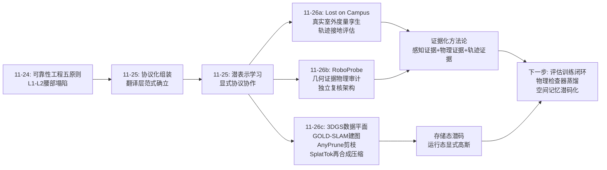
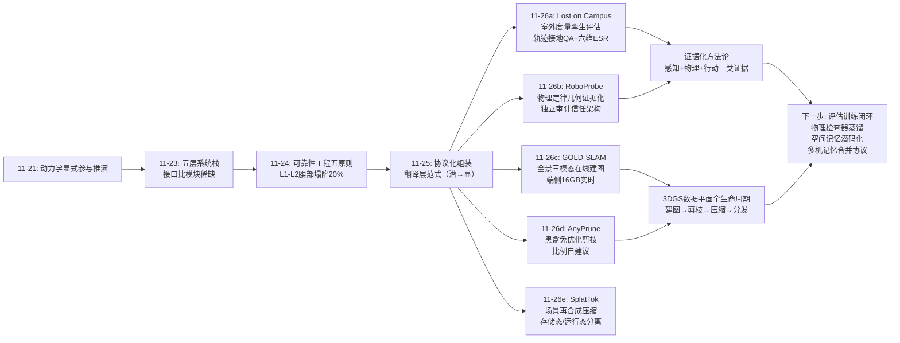
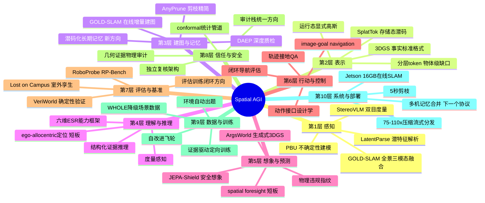
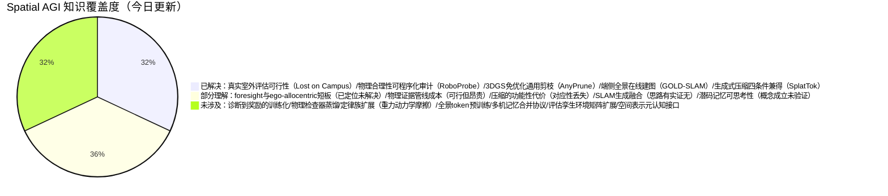

# Spatial AGI 每日思考 - 2026-11-26

## 📅 每日总结

**日期**: 2026-11-26
**论文数量**: 5篇
**主题**: 如果说昨天的元判断是"Spatial AGI 进入协议化组装阶段，翻译层是最稀缺的公共品"，那么今天的五篇论文回答的是协议化之后的下一个问题：**协议所连接的"数据平面"本身是否可靠、可信、可负担**。今天的五篇论文恰好构成了一条完整的"空间数据生命周期"链条——Lost on Campus 回答"空间智能在哪里被测量"（真实室外、度量一致、可交互的 3DGS 孪生环境），RoboProbe 回答"空间想象是否可信"（把物理定律翻译成可计算的几何证据 + 独立审计的物理合理性评估），AnyPrune / GOLD-SLAM / SplatTok 三篇则共同回答"空间表示如何被构建、压缩与分发"（增量建图的全景 3DGS SLAM → 管线无关的免优化剪枝 → 场景再合成的生成式深压缩）。合起来的元判断是：**2026 年 11 月末的 Spatial AGI 在协议层（昨日）和基础设施层（今日）同时收敛——评估走向"真实世界数字孪生 + 闭环交互"，信任走向"几何证据 + 独立审计"，表示走向"显式 3DGS 的全生命周期工程化"（在线建图、黑盒剪枝、生成式压缩、标准格式分发）。一个隐蔽但重要的跨论文信号：'证据'这个词今天出现了三次——Lost on Campus 的"轨迹接地 QA"是行动证据，RoboProbe 的"几何证据物理定律检查"是物理证据，LatentParse（昨日）的"解析证据文本"是感知证据。'证据化'（evidentialization）正在取代'端到端'成为 Spatial AGI 的方法论关键词：一切判断（空间判断、物理判断、行动判断）都必须附带可检查、可定位、可审计的证据。这与昨日"翻译层范式"合并成完整的图景：翻译层负责把潜表示变成显式证据，证据层负责让显式判断可验证可审计——潜表示学习，显式证据协作，证据审计部署。**

**关键突破**:
- 🚀 Lost on Campus（JHU/UVA/Stanford）：首个真实室外大规模 3DGS 具身空间推理基准——RTK 厘米级标定 + 改进 Octree-GS（外观/瞬态嵌入 + 三角图元 + 神经天空场）构建 2×10⁵ m² 可连续导航的校园孪生；统一"闭环导航（reasoning in action）+ 轨迹接地诊断 QA（reasoning in isolation）"双轴评估；六维 ESR 能力 taxonomy（行动接地/空间前瞻/度量感知/目标规划/自我-他我定位/时空一致性）；**核心发现：室外环境让所有 VLM 表现大幅下滑，spatial foresight 与 ego-allocentric localization 是两大瓶颈**
- 🚀 RoboProbe：五条物理定律的可计算几何证据指标（接触保真=SAM3分割+CoTracker3跟踪+接触时序、物体持续性=轨迹事件检测、不可穿透=MoSE3点云+自由边+遮挡推理、机器人刚性=Kabsch拟合残差P90、物体刚性=外观比对）；审计 agent 不看分数只看证据、可触发证据修复重跑；RP-Bench（761生成+130真实视频、239任务、12机器人数据集）；**五指标 AUROC 全部>0.85（平均 0.894 vs 最强 VLM 0.828），违规帧定位距人工标注中位 0.5–7 帧；VLM 最弱的是短暂几何性违规（表面穿透）**
- 🚀 GOLD-SLAM（湖南大学/清华/KIT/Oxford）：首个 LiDAR-IMU-全景三模态球域 3DGS SLAM——统一球面几何贯穿跟踪与建图；盲区视觉三角化+η 信息限幅、PBU 亮度不确定性协方差白化（把块级亮度变化显式建模为增益/偏置扰动而非鲁棒核硬抗）、DAEP 深度感知插入/更新/剪枝三联；vs 全景基线 PSNR +5.56~9.10 dB、Depth-L1 −71.9~83.9%；**Jetson Orin NX 16GB 在线运行——端侧实时全景空间记忆成为现实**
- 🚀 AnyPrune（Bologna/EPFL）：首个"任意前馈 3DGS 管线"通用免优化剪枝模块——管线黑盒化，冻结管线上短程单 GPU 训练即可学会管线特有冗余模式；一次前向同时输出重要性 logit（学习准则修正解析敏感度）、场景自建议剪枝比例（logit>0）、参数残差补偿；保留 50% 高斯平均 PSNR +1.8 dB，DL3DV 112 个设置全部最佳，1.6M 高斯 5 秒剪完，可叠加管线内置剪枝
- 🚀 SplatTok（UT Austin/Dolby/CU Boulder）：3DGS 压缩的范式转变——"场景再合成编码器-解码器"：整个 splat 编码为 3D 锚定潜在 token，冻结解码器合成全新标准高斯（不保留图元对应），训练仅用渲染监督跨数千场景；压缩=量化感知潜空间搜索（改动代码 4–10%，保真 +8 dB，闭合 ≥84% 摊销差距）；**75–110× 压缩、无需训练图像、免逐场景优化、标准格式输出四条件首次兼得；vs HAC++ 同 PSNR 文件小 13–60%，vs FCGS 小 4–6.5×**

**架构演进**: 协议化组装（11-25）→ **基础设施三支柱 + 证据化方法论**（评估基建 / 信任基建 / 数据平面全生命周期）

### 📊 一句话总结

今天五篇论文把 Spatial AGI 的地基翻修了一遍：Lost on Campus 把评估从室内合成环境搬到"RTK 标定的真实室外 3DGS 孪生"，RoboProbe 把世界模型的信任从"VLM 直觉打分"升级为"几何证据 + 独立审计"，AnyPrune/GOLD-SLAM/SplatTok 把显式 3DGS 表示从"一次性研究产物"工程化为"建图→剪枝→压缩→分发"的全生命周期数据管线。三者共同确认了一个方法论转折：**'证据化'正在成为 Spatial AGI 的元方法——空间判断要带轨迹证据，物理判断要带几何证据，感知判断要带解析证据；同时，3DGS 已经从'一种渲染技术'固化为'空间数据的事实标准格式'，围绕它的工具链（SLAM/剪枝/压缩/评测环境）正在以月为单位成熟。**

### 🔗 延续性

**昨日→今日**: 昨日确立"翻译层范式"（潜→显的转换是最高杠杆点）并留下十条线索。今天五篇对其中多条给出实质性回应：

1. **"视觉-结构鸿沟的量化普查"**——昨日呼吁用 VeriWorld 的 V/S/C 范式普查显式化需求；Lost on Campus 把"结构化评估环境"推到极致：RTK 度量真值 + 闭环交互 + 轨迹接地 QA，等于把"显式结构"内建到评估环境本身。评估环境从"提供信息"升级为"提供度量真值与行动后果"。
2. **"conformal 管道的部署鸿沟 / 可信想象"**——昨日 JEPA-Shield 用统计管道给想象背书；RoboProbe 用几何证据给生成视频背书——两者是同一信任问题的两侧：JEPA-Shield 管"预测的不确定性"，RoboProbe 管"生成的物理性"。信任基建的完整栈 = 不确定性校准（统计）+ 物理定律检查（几何）。
3. **"3DGS 资产的度量校准"**——昨日担心 ArgsWorld 生成的 3DGS "渲染像但量不准"；今日三篇 3DGS 论文从不同方向逼近这个问题的基础设施：GOLD-SLAM 的 DAEP 用 LiDAR 深度做地图质检（在线度量接地）、Lost on Campus 用 RTK 做环境标定（离线度量接地）、SplatTok 证明"存储潜码 + 生成先验实例化"的资产形态可行。度量接地 + 生成式表示的组合正在成型。
4. **"翻译层标准化"**——AnyPrune 的"管线黑盒 + 外挂小模块 + 短程重训"是接口标准化的工程范例：不改造底层大模型、松耦合适配任意版本——这正是昨天说的"组件可互换"所需的工程模式。
5. **"潜 vs 显的分工"**——SplatTok 给出本周最激进的表达：**存储的是潜码（token），消费的是显式高斯（生成实例）**。空间表示的生命周期变成"显式采集→潜码存储→按需显式化"——潜与显不再是表示之争，而是存储态与运行态之别。

**今日→明日**: 新线索十条：①**室外 ESR 的训练化**——Lost on Campus 只做了评估，六维诊断（foresight/ego-allocentric）应转化为训练目标（如 GRPO 奖励或课程数据），"评估环境→训练环境"是现成路径；②**轨迹接地 QA 的跨模型可比性**——QA 从各模型 rollout 自动生成，跨模型可比性需受控版本（固定轨迹池）；③**物理证据管线的轻量化**——RoboProbe 五指标各需一套多模型管线（SAM3/CoTracker3/MoSE3/Qwen3-VL/Gemini），成本高，应蒸馏为单一"物理检查器"模型或把证据生成世界模型化；④**五定律之外的物理覆盖**——重力/动力学/摩擦/软体/流体未覆盖，定律族的系统扩展路线图缺失；⑤**球形 token 化**——GOLD-SLAM 证明全景输入价值，但空间基础模型仍在透视图像上训练，ERP/球面 token 化的预训练值得投资；⑥**SLAM-生成融合**——GOLD-SLAM 的在线增量 3DGS 与 ArgsWorld 的生成式 3DGS 应融合：在线地图作为生成先验的初始条件，生成模型补全盲区与外推；⑦**潜码存储的空间记忆**——SplatTok 证明"存潜码、按需实例化"可行，机器人的长期空间记忆应存 token 而非百万高斯——"记忆的压缩态"是新研究方向；⑧**剪枝+再合成级联**——AnyPrune（保结构快剪）与 SplatTok（生成式深压）的级联系统与压缩率-速度-保真 Pareto 前沿刻画；⑨**生成式压缩的对应性恢复**——SplatTok 丢失图元对应伤害物体级编辑/语义绑定，"分层 token（场景级+物体级）+ 对应性保持"是下一版；⑩**多机空间记忆共享**——压缩后的空间记忆（MB 级）使多机器人/跨会话记忆合并成为可能，"空间记忆的 merge 协议"将是继翻译层之后的下一个协议问题。明日检索方向："spatial foresight training reward navigation GRPO"、"ego-allocentric localization training VLM"、"physics violation detector distillation world model"、"physical law coverage benchmark gravity dynamics"、"equirectangular spherical token pretraining VLM"、"SLAM prior conditional world model generation"、"latent code spatial memory robot storage"、"pruning resynthesis cascade compression Pareto"、"object-level token correspondence 3DGS compression"、"multi-robot map merge protocol spatial memory"。

### 💡 本质思考：如何达成通用空间智能

#### 1. 核心能力的本质是什么？

昨日答案是"协议化：潜表示学习、显式协议协作"。今天推进到基础设施层：**通用空间智能 = 学习型组件 + 翻译协议 + 证据基建 + 标准化数据平面。缺任何一块，系统都无法被测量、被信任或被部署。**

四个具体化：
- **测量先于能力**：Lost on Campus 证明室内评估系统性高估空间能力（语义捷径红利）。没有"真实、度量一致、闭环"的评估基建，一切"空间智能进步"都可能是假阳性。评估基建是领域的"计量标准体系"——它决定什么算数。
- **信任是可审计的证据链**：RoboProbe 的本质不是五个指标而是"判断必须附带证据、证据必须可独立审计"的信任架构。审计 agent 不看分数只看证据的设计，把认知科学中的确认偏误防范工程化。Spatial AGI 的一切安全声明（这个 rollout 物理合理、这个规划安全）最终都要落到证据链上。
- **表示的生命周期意识**：今天的 3DGS 三篇共同表明，空间表示不是"选一个表示"而是"管理一个表示的生命周期"——采集（SLAM/重建）→ 精简（剪枝）→ 存储（压缩/潜码化）→ 分发（标准格式流式）→ 实例化（生成解码）。每个环节有独立的权衡（速度/保真/压缩率/对应性），系统设计 = 生命周期各段的 Pareto 选择。
- **端侧是空间智能的真实约束**：GOLD-SLAM 在 16GB Orin NX 在线运行、AnyPrune 5 秒剪 1.6M 高斯、SplatTok 让场景像视频一样可流式——三个数字共同宣告：空间智能的"实验室→现场"通道已经打通。约束不再是"能不能"而是"多便宜地能"。

#### 2. 当前方法与理想目标的差距在哪里？

六条差距，按严重程度排序：

- **室外空间能力全面塌陷（今日新增诊断）**：Lost on Campus 显示所有 VLM 在真实室外环境下表现 poor，foresight 与 ego-allocentric 两项尤其糟糕。这两项恰恰是"从感知到行动"的必经能力——室内基准的进步没有转化为室外行动力。差距的根源可能是训练数据分布（室内为主）而非架构。
- **物理证据管线的成本墙**：RoboProbe 的每条定律检查都要串联 3-5 个大模型，单视频评估成本高企；且五定律之外（重力、动力学、摩擦）仍是空白。作为训练 reward 或数据清洗器使用时，成本会放大几个数量级。
- **压缩-功能性权衡**：SplatTok 的 75–110× 代价是图元对应丢失——压缩后的场景不再是"可操作的对象集合"，物体级编辑、语义绑定、空间推理（在图元上做）全部失效。空间记忆被压缩后是否还"可思考"是未解问题。
- **嵌入式建图的质量代价**：GOLD-SLAM 的在线运行以重建质量为代价；"端侧实时 + 高保真"尚未兼得。DAEP 类深度质检需要 LiDAR，纯视觉低成本平台缺失。
- **剪枝/压缩的管线耦合**：AnyPrune 需逐管线重训（虽有短程），SplatTok 的解码先验限于训练分布——两者在管线与场景分布爆炸的生态里都有适配摩擦。管线无关的统一冗余理论、域外场景的生成先验泛化是理论缺口。
- **评估环境的覆盖率**：Lost on Campus 只有单一校园；室外 ESR 评估需要城市/野外/夜间/动态人群的孪生环境矩阵，每次采集+重建成本高——评估基建的扩展本身就是工程难题。

#### 3. 从今天到理想状态，最可能的路径是什么？

三步路径，每步 6-12 个月：

- **第一步：评估-训练闭环（当前-2027H1）**——把 Lost on Campus 的六维诊断转化为训练信号（诊断 QA 作为 RL reward 或课程；轨迹接地 QA 作为自改进数据引擎），在室外 ESR 上复刻 Ouroboros-Spatial 式闭环；同时把 RoboProbe 的几何证据指标蒸馏为低成本物理检查器，接入世界模型训练的 reward 与数据清洗。判据：室外 image-goal 导航成功率出现两位数提升，且失败案例可归因到六维中的具体维度。
- **第二步：数据平面标准化（2027H1-H2）**——3DGS 生命周期工具链收敛为事实标准：SLAM 输出（GOLD-SLAM 类）→ 剪枝（AnyPrune 类）→ 压缩（SplatTok 类）→ 流式分发 → 端侧解码渲染；压缩格式引入分层 token（场景级+物体级）恢复对应性；潜码形态的空间记忆成为机器人标准存储。判据：出现"建图→压缩→跨机器人共享→合并→渲染"的端到端开源参考实现。
- **第三步：孪生评估矩阵与信任审计栈（2027H2-）**——室外 ESR 评估扩展为多环境孪生矩阵（城市/野外/夜间/动态）；信任基建完成"conformal 校准（JEPA-Shield）+ 物理证据检查（RoboProbe）+ 轨迹接地验证（Lost on Campus）"的统一审计栈，安全声明可被第三方机器审计。判据：不同团队的系统在同一孪生评估矩阵上可比，且其安全声明附有可自动验证的证据链。

理想终局：空间智能体在真实孪生环境中训练与被测量（评估基建），其想象输出经过物理证据审计（信任基建），其空间记忆以潜码形式轻量存储与共享（数据平面），其每个空间/物理/行动判断都附带可定位的证据——**学习在潜空间，协作在证据层，审计在基建上。这就是基建完成后的通用空间智能。**

---

## 🔗 与昨日思考的联系

### 昨日重点

昨天的元判断：Spatial AGI 进入**协议化组装阶段**——四篇论文不约而同建造"显式化翻译层"（潜特征→文本证据、视觉→结构、潜想象→安全管道、视频想象→3D 资产），翻译层是最稀缺的公共品；三个独立测量（LatentParse +19.2pp 相机增益、VeriWorld 视觉-结构鸿沟、SpatialScout-V2 20% 建图塌陷）钉死"感知→显式结构转换"这一最高杠杆点。

### 今日进展

今天的五篇把"协议化"向下钻深一层——协议连接的**数据平面与信任平面**：

- **评估平面**：VeriWorld（昨日）在室内合成环境确立"可验证交互评测"；Lost on Campus（今日）把它推广到"真实室外度量孪生"，并新增"轨迹接地 QA"——评估环境本身成为证据源。评估哲学从"可验证"升级为"可归因 + 可接地"。
- **信任平面**：JEPA-Shield（昨日）给潜想象配统计管道；RoboProbe（今日）给生成视频配几何证据审计。两者合起来构成完整的信任栈：不确定性维度（conformal 校准）+ 物理性维度（定律检查）+ 行为维度（轨迹验证，Lost on Campus）。
- **数据平面**：ArgsWorld（昨日）让想象沉淀为 3DGS 资产；今天三篇把 3DGS 资产的全生命周期工程化（在线建图/剪枝/生成式压缩/标准分发）。昨天的"资产化协议"今天获得了完整的基础设施。
- **表示哲学**：SplatTok 把昨日的"潜 vs 显之争"裁决为**存储态与运行态之别**——存储潜码（轻量、生成先验承载共性），运行显式高斯（按需实例化）。这是本周表示光谱（Pros4D 潜 4D ↔ Xiaomi WAM 2.0 显式 3DGS）的自然合题。
- **证据化的统一**：昨日 LatentParse 的"解析证据"（感知证据）+ 今日 RoboProbe 的"几何证据"（物理证据）+ 今日 Lost on Campus 的"轨迹证据"（行动证据）——三类证据覆盖感知/物理/行动，"证据化"成为方法论公约数。

### 演进路径



---

## 📚 论文概览

**论文1: Lost on Campus**（评估基建）——真实室外 3DGS 校园孪生（RTK 厘米级标定、改进 Octree-GS、2×10⁵ m²、15 场景）上的具身空间推理基准；闭环导航（1,500+255 案例）+ 轨迹接地诊断 QA（6 任务×1,000 题）双轴；发现室外全面塌陷，spatial foresight 与 ego-allocentric localization 是主瓶颈。

**论文2: RoboProbe**（信任基建）——把五条物理定律（接触时序/物体恒存/不可穿透/机器人刚性/物体刚性）翻译为可计算几何证据指标 + 证据独立审计的 agentic 框架 + RP-Bench（891 视频、239 任务）；AUROC 0.894 全面超最强 VLM，违规帧可定位。

**论文3: AnyPrune**（数据平面·精简）——管线黑盒的可训练免优化剪枝模块：学习重要性 + 自建议比例 + 参数补偿一次前向完成；50% 保留 +1.8 dB，5 秒剪 1.6M 高斯，跨数据集零样本泛化。

**论文4: GOLD-SLAM**（数据平面·构建）——LiDAR-IMU-全景三模态球域 3DGS SLAM：盲区视觉三角化 + PBU 亮度协方差 + DAEP 深度质检三联；PSNR +5.56~9.10 dB、Depth-L1 −72~84%；Jetson Orin NX 在线运行；发布 WHOLE UAV 数据集（五类降级场景）。

**论文5: SplatTok**（数据平面·存储分发）——场景再合成编码器-解码器：splat → 3D 锚定 token → 冻结解码器合成全新标准高斯；压缩=量化感知潜码搜索；75–110× 压缩、免训练图像、免逐场景优化、单模型多码率、标准格式输出。

---

## 💡 核心见解

### 见解1: 室外是空间智能的"净化评估场"，室内成绩含语义捷径红利
（从论文1 Lost on Campus 获得）
- ✅ 室外语义稀疏环境剥离了"概念联想"式捷径（见冰箱推厨房），剩余的才是真实几何智能
- ✅ 所有 VLM 室外表现 poor；foresight（模拟动作后果）与 ego-allocentric（参考系映射）是结构性短板
- ✅ RTK 厘米级标定是度量意识评估的前提——没有度量真值，"距离感知"无从考核

**对Spatial AGI的启发**:
室内基准分数是"上界幻觉"：语义密度掩盖了几何缺陷。Spatial AGI 的能力声明必须附"室外成绩单"。更深的启示是评估设计方法论——用环境属性（语义稀疏度）控制混杂变量，如同 VeriWorld 用信息通道控制感知混杂。评估科学正在成为空间智能的一等公民学科。

### 见解2: 轨迹接地 QA 把评估与数据生成合二为一
（从论文1 获得）
- ✅ QA 从各模型自身导航 rollout 自动生成，零标注成本
- ✅ "模型在哪里摔倒，就在哪里出题"——失败点自动成为诊断点与新训练点
- ✅ 端到端任务表现可映射回六维底层能力，归因与测量统一

**对Spatial AGI的启发**:
这是 Ouroboros-Spatial（数据-模型闭环）与 SpatialFoundry（多模态数据集）之后的第三块拼图：**环境自动出题**。环境-评估-数据-模型四位一体自改进飞轮的"环境侧引擎"就此齐备。风险在于跨模型可比性（各模型面对不同 QA 集）与题目质量漂移，需要固定轨迹池的受控版本作为"法定计量"。

### 见解3: 物理合理性可以被程序化审计——VLM 直觉不是信任的合格载体
（从论文2 RoboProbe 获得）
- ✅ 五条物理定律 → 五套几何证据管线，AUROC 0.894 > 最强 VLM 0.828
- ✅ VLM 最弱处恰是"短暂、几何性"违规（表面穿透）——精确时空几何是 VLM 的系统性盲区
- ✅ 审计 agent 不看分数只看证据（防确认偏误），可触发证据修复重跑

**对Spatial AGI的启发**:
信任架构的三条设计公理浮出水面：(1) 判断必须附带可定位证据（违规帧中位距人工 0.5–7 帧）；(2) 证据审查与结论生成必须信息隔离（审计者 blindness）；(3) 证据失败可以修复重跑而非放弃（edge-case 检查）。这套架构适用于一切 Spatial AGI 安全声明。同时"不同生成模型的物理违规指纹"（violation 类型×频率分布）暗示物理审计可反向指导生成模型定向改进。

### 见解4: 3DGS 已固化为空间数据的事实标准格式，工具链以月为单位成熟
（从论文3/4/5 获得）
- ✅ 在线构建（GOLD-SLAM 端侧 16GB 实时）→ 精简（AnyPrune 5 秒/1.6M）→ 深压缩（SplatTok 75–110×）→ 标准格式分发
- ✅ 三篇来自三个大洲六个机构，互不引用却共享同一表示与互补的管线位置
- ✅ Lost on Campus 的评估环境也以 3DGS 为底座——表示标准与评估标准合流

**对Spatial AGI的启发**:
格式统一是生态爆发的先决条件（类比 JPEG 之于图像互联网）。3DGS 正在成为"空间数据的 JPEG"：渲染器标准化（任意 3DGS 渲染器可显示）+ 压缩标准化（SplatTok 输出标准 splat）+ 度量标准化（RTK 接地）。下一步的标准化对象将是**空间记忆的语义层**（物体/可供性/affordance 绑定到图元）——语义 3DGS 的编解码规范。

### 见解5: 空间表示的存储态与运行态正式分离
（从论文5 SplatTok 获得）
- ✅ 存储潜码（token，75–110× 压缩），运行时生成实例化显式高斯
- ✅ "渲染监督而非图元监督"打开数量级压缩空间——场景本质是等价类而非图元集合
- ✅ 摊销差距分析：编码器残余误差 84%+ 可被轻量搜索闭合——前馈大模型的单次推理误差多是摊销取舍而非能力边界

**对Spatial AGI的启发**:
这是本周"潜 vs 显"光谱的合题：潜表示负责存储效率与共性先验，显式表示负责运行消费与验证。机器人长期空间记忆应存 token 而非百万高斯；记忆的"压缩态"概念值得独立研究。深层启示：**空间记忆的存储格式 = 生成先验 + 个体残差**，与人类记忆的"图式 + 细节重建"惊人同构。

### 见解6: 黑盒外挂小模块是快速演进技术栈的适配范式
（从论文3 AnyPrune 获得）
- ✅ 冻结管线 + 短程单 GPU 重训 → 学会管线特有冗余模式，无需理解管线内部
- ✅ 重要性（学习准则×解析敏感度）+ 比例自建议（logit>0）+ 参数补偿三位一体
- ✅ "模型自知道需要多少图元"——空间表示的元认知雏形

**对Spatial AGI的启发**:
底层模型月月迭代，深度耦合的适配方案必然过时；黑盒外挂（RoboProbe 把感知模型当工具、AnyPrune 把生成管线当黑盒、SpatialDuet 把专家当冻结组件）是同一工程哲学的三次独立确认。附加洞见：AnyPrune 的场景自建议比例暗示空间表示可以"自知冗余度"——表示的元认知（这个场景需要多少精度/多少图元/多少 token）应成为显式接口。

### 见解7: 不确定性建模的粒度决定鲁棒性上限
（从论文4 GOLD-SLAM 获得）
- ✅ PBU 把亮度变化显式建模为增益/偏置扰动的协方差结构（C_photo = σ_n²I + σ_α²i_ref i_refᵀ + σ_b²11ᵀ），而非鲁棒核硬抗
- ✅ η 信息限幅控制视觉信息相对 LiDAR/IMU 的话语权上限——多源融合的"权力制衡"
- ✅ DAEP 用深度真值做地图质检：插入/更新/剪枝三联，同时压制浮子与补新表面

**对Spatial AGI的启发**:
统计建模胜过蛮力的又一案例（与 JEPA-Shield 的 conformal 呼应）：空间融合系统的鲁棒性不来自更大的网络，而来自对扰动结构（增益/偏置/噪声）的显式建模。泛化原则：**每类扰动应有一个对应的不确定性通道**——空间智能的多模态融合应携带"不确定性张量"而非点估计。DAEP 的"深度质检"模式可推广：任何增量空间地图都需要一个外部真值源做持续审计。

### 见解8: 六维 ESR taxonomy 是具身空间智能的能力宪法
（从论文1 获得）
- ✅ 行动接地/空间前瞻/度量感知/目标规划/自我-他我定位/时空一致性——覆盖从感知到行动的完整链路
- ✅ 每维有可自动生成的诊断任务与 1,000 题测量集
- ✅ 瓶颈定位到维度级（foresight/ego-allocentric），改进方向可操作

**对Spatial AGI的启发**:
与六层系统栈（11-23）、可靠性五原则（11-24）、五协议（11-25）一脉相承，今天补上了**能力侧的分解框架**。六维 taxonomy 可直接作为训练目标分解（每维一个 reward/课程）、模型卡的能力剖面、以及数据引擎的采集配额依据。能力宪法 + 协议栈 + 基建三件套，Spatial AGI 的工程学科框架基本齐备。

### 见解9: 物理违规指纹可作为生成模型的"体检报告"
（从论文2 获得）
- ✅ 五个视频生成模型呈现不同违规类型×频率分布
- ✅ 排序与人工标注 Kendall τ=1.00——审计结论与人类判断完全一致

**对Spatial AGI的启发**:
物理审计不止是过滤器（拒绝坏 rollout）更是诊断器（指出模型的物理缺陷类型），可以驱动定向改进（某模型 solidity 违规高 → 加强碰撞监督数据）。这把世界模型训练从"盲眼 scaling"升级为"体检驱动的定向训练"——与 Lost on Campus 的六维诊断、VeriWorld 的 V/S/C 归因共同构成"归因式训练"方法论三部曲。

---

## 🗺️ 知识演进图



### 演进逻辑

1. **11-24→11-25**：可靠性原则深化为协议化组装，翻译层范式确立。
2. **11-25→11-26**：协议层收敛后，瓶颈按"外圈上移"规律落到基础设施层。今天五篇分别夯实评估基建、信任基建与数据平面。
3. **证据化的合流**：LatentParse（昨日·感知证据）→ RoboProbe（今日·物理证据）→ Lost on Campus（今日·行动证据）三天内完成三类证据的方法论合流。
4. **数据平面的形成**：ArgsWorld 资产化（昨日）+ GOLD-SLAM/AnyPrune/SplatTok 生命周期（今日）= 3DGS 从渲染技术升格为空间数据标准格式及其工具链。

---

## 技术栈演进对比表

| 层次 | 11-24（可靠性工程） | 11-25（协议化组装） | 11-26（基建+数据平面） | 理想状态 |
|------|------|------|------|------|
| 评估层 | StereoVLM 干预验证 | VeriWorld V/S/C 归因 | Lost on Campus 室外孪生+轨迹接地QA+六维ESR | 多环境孪生矩阵+评估训练闭环 |
| 信任层 | 物理接地（预测侧） | JEPA-Shield conformal 管道 | RoboProbe 几何证据+独立审计 | 统一审计栈（统计+物理+行为） |
| 建图层 | MoRE/Ego4Gen 世界模型 | ArgsWorld 3DGS 资产化 | GOLD-SLAM 端侧全景在线建图 | SLAM先验×生成模型融合 |
| 表示层 | 双目资产化线索 | 潜vs显光谱（Pros4D↔WAM2.0） | SplatTok 存储态潜码/运行态高斯 | 分层token（场景+物体级）语义3DGS |
| 精简/部署层 | 未涉及 | 未涉及 | AnyPrune 免优化剪枝（5s/1.6M） | 生命周期自动Pareto管线 |
| 数据层 | 双目资产化 | SpatialFoundry 数据因果性 | 轨迹自动出题（Lost on Campus）+WHOLE降级场景 | 环境自动出题的自改进飞轮 |
| 最大瓶颈 | L1-L2 塌陷 20% | 翻译层各自为战 | 室外能力塌陷+证据管线成本墙 | 待转移（预测：多机记忆合并） |

**演进观察**：瓶颈四周迁移轨迹：模型内部表示（动力学）→ 系统架构（接口）→ 工程质量（可靠性）→ 组件协议（翻译层）→ **基础设施与数据平面（今日）**。按外圈上移规律，下一个瓶颈预测为**跨系统空间记忆的共享与合并**（多机器人/跨会话/长时程）——SplatTok 的 MB 级空间记忆是其存储前提，今日已埋下伏笔。

---

## 🗺️ Spatial AGI 知识图谱

### 10层架构思维导图



### 🎯 主线技术路径

#### 阶段1: 单点能力爆发（已完成，2026上半年）
3DGS、世界模型、VLA 各自突破；缺点：能力孤岛、室内合成评估、无信任机制。

#### 阶段2: 可靠性工程（11-21~11-24，进行中）
接地、结构化、接口化、真实化、泛化五原则确立；度量监督、干预验证、物理接地成为标配。

#### 阶段3: 协议化组装（11-25，进行中）
翻译层范式确立：潜表示学习、显式协议协作；解析/归因/组合/安全/资产化五协议涌现；等待接口收敛。

#### 阶段4: 基础设施与数据平面（11-26，今日，开启）
评估基建（室外孪生+轨迹接地）、信任基建（证据化审计栈）、数据平面（3DGS 全生命周期工具链）三线并进；端侧实时性打通实验室→现场通道。

#### 阶段5: 生态与共享（预测，2027）
多机空间记忆合并协议、空间记忆潜码化标准、跨团队组件按协议组装、安全声明第三方机器审计；Spatial AGI 从"系统"走向"生态"。

---

## 🔍 待探索议题

### 高优先级（本周）

1. **室外 ESR 诊断的训练化**
   - 问题: Lost on Campus 只测不练；foresight/ego-allocentric 短板如何转化为训练信号？
   - 候选方案: 六维诊断 QA 作为 GRPO/RL reward；轨迹接地 QA 作为课程数据引擎；虚拟位姿合成扩充室外训练分布
   - 缺口: 诊断→奖励的映射设计与跨模型可比的固定轨迹池

2. **物理证据管线的蒸馏轻量化**
   - 问题: RoboProbe 单视频评估串联 3-5 个大模型，作为训练 reward 成本不可行
   - 候选方案: 蒸馏为单一"物理检查器"模型；或用世界模型内部状态直接预测违规概率（证据生成世界模型化）
   - 缺口: 蒸馏后的证据可定位性与审计独立性如何保持

3. **空间记忆的潜码化存储**
   - 问题: 机器人长期空间记忆存百万高斯不可扩展；SplatTok 证明潜码存储可行
   - 候选方案: "记忆=生成先验+个体残差token"架构；按需实例化的记忆检索
   - 缺口: 潜码记忆的"可思考性"——在压缩态上能否直接做空间推理与物体级查询

### 中优先级（本月）

4. **剪枝-再合成级联压缩的 Pareto 刻画**
   - 问题: AnyPrune（保结构快剪）与 SplatTok（生成式深压）的单点性能已知，级联系统的压缩率-速度-保真前沿未知
   - 候选方案: 两级级联 pipeline + Pareto 前沿 benchmark
   - 缺口: 级联误差传播模型与自动配置策略

5. **生成式压缩的对应性恢复**
   - 问题: SplatTok 丢失图元对应，物体级编辑/语义绑定失效
   - 候选方案: 分层 token（场景级+物体级）；实例感知锚点；解码后实例再绑定
   - 缺口: 对应性保持与压缩率的量化权衡

6. **球形/全景 token 化预训练**
   - 问题: GOLD-SLAM 证明全景感知价值，但空间基础模型全在透视图像上训练
   - 候选方案: ERP token 化 + 球面位置编码的 VLM 预训练；WHOLE 数据集作为语料
   - 缺口: 极区畸变的表示方案与全景-透视混合训练策略

7. **五定律之外的物理覆盖路线图**
   - 问题: RoboProbe 覆盖接触/恒存/穿透/刚性，重力、动力学、摩擦、软体、流体空白
   - 候选方案: 定律族的系统枚举与逐条证据管线；动力学定律可借用 MoRE 的多物理专家
   - 缺口: 各定律的可测量几何代理量设计

### 低优先级（本季度）

8. **SLAM 先验 × 生成世界模型融合**
   - 问题: GOLD-SLAM 在线地图与 ArgsWorld 生成式 3DGS 是同一表示的两条生产线
   - 候选方案: 在线地图作为生成先验的初始条件；生成模型补全盲区与外推未来
   - 缺口: 生成补全区域的度量校准（昨日遗留问题在此落地）

9. **多机空间记忆合并协议**
   - 问题: 压缩后空间记忆 MB 级可共享，但两台机器人的记忆如何合并/去冲突？
   - 候选方案: 潜码空间的记忆对齐；基于共享子区域的增量 merge
   - 缺口: 这是继翻译层之后的下一个协议问题，几乎无人研究

10. **评估孪生环境的低成本扩展**
    - 问题: Lost on Campus 单一校园，环境矩阵（城市/野外/夜间/动态）扩展成本高
    - 候选方案: 生成式孪生（真实扫描+生成补全）；社区共建采集协议
    - 缺口: 生成补全的度量保真验证

---

## 📊 知识缺口分析



**已解决（32%）**:
- ✅ 真实室外度量孪生评估环境可行且必要（Lost on Campus）
- ✅ 物理合理性可以几何证据化审计并超越 VLM（RoboProbe）
- ✅ 3DGS 生命周期各段工程可行：端侧建图/快速剪枝/深度压缩（GOLD-SLAM/AnyPrune/SplatTok）

**部分理解（36%）**:
- ⚠️ foresight 与 ego-allocentric 短板已精确定位，但训练化解法未验证
- ⚠️ 物理证据管线质量达标（AUROC 0.894）但成本墙未破
- ⚠️ 生成式压缩达到 75–110× 但功能性（对应性/可思考性）代价未解
- ⚠️ SLAM 与生成的融合方向明确但无实证

**未涉及（32%）**:
- ❌ 诊断→奖励映射与室外 ESR 训练闭环
- ❌ 物理定律族扩展（重力/动力学/摩擦/软体/流体）
- ❌ 全景/球形 token 预训练
- ❌ 多机空间记忆合并协议（预测的下一瓶颈）
- ❌ 评估孪生环境矩阵的低成本扩展

---

## 📝 每日金句

> **"潜表示负责学习，显式证据负责协作，证据链负责信任，生命周期负责部署——Spatial AGI 的地基周已经结束，主体结构周即将开始。"**

> **"存储的是潜码，运行的是高斯，审计的是证据，合并的是记忆——空间智能的四个态，今天各自有了第一个工程实现。"**

---

**文档创建时间**: 2026-11-26 03:00 CST
**分析方法**: arXiv HTML 全文精读（5篇）+ 昨日思考延续
**论文来源**: arXiv 2611.33145 / 2611.32152 / 2611.32735 / 2611.32335 / 2611.32202

---

## 🔬 五篇论文逐篇深读笔记

### 深读1: Lost on Campus —— 评估科学的三重设计

#### 重读动机与环境构建细节

Lost on Campus 的价值不能只看"又一个大 benchmark"，而要看它解决评估科学的三个经典难题的方式：

**难题一：真实性 vs 可控性**
- 真实采集（Insta360 X4 全景 → 4×120° 透视帧）保证视觉真实
- RTK 移动设备厘米级 GPS 保证度量真实
- 改进 Octree-GS（外观嵌入补偿跨视频光照、瞬态嵌入补偿动态干扰、三角图元改善几何与碰撞、神经天空场消除浮子）保证渲染真实
- 三重真实叠加后，"语义捷径"被最大化剥离——室外场景没有"冰箱→厨房"式的先验可蹭

**难题二：孤立推理 vs 行动中推理**
- 传统 QA 只测"看图答题"，行动错误无法归因
- 传统导航只测成功率，失败原因不可见
- Lost on Campus 的统一框架：闭环导航产生轨迹 → 轨迹自动生成诊断 QA → 端到端表现映射回六维能力
- 这个"轨迹接地"设计让同一套环境同时输出能力剖面和行动成绩

**难题三：评估的可扩展性**
- QA 自动生成 → 无人工标注瓶颈
- 但引入新问题：不同模型面对不同 QA 集，跨模型可比性受损
- 解决方向（本日线索②）：固定轨迹池的"法定计量版本" + 模型自出题的"诊断版本"并行

#### 六维能力框架的深层含义

```
维度1 行动接地（Action Grounding）     → 感知→运动的逆问题
维度2 空间前瞻（Spatial Foresight）    → 隐式前向世界模型
维度3 度量感知（Metric Awareness）     → 度量尺度的内化
维度4 目标规划（Goal-directed Planning）→ 空间分解能力
维度5 自我-他我定位（Ego-Allocentric） → 参考系变换
维度6 时空一致性（Spatio-temporal Consistency）→ 判断的自洽性
```

有意思的是这六个维度恰好对应认知科学中的空间能力分类（self-motion perception、spatial imagery、object-based spatial skills、navigation 等）——评估框架首次与空间认知理论对齐，而非从 ML 任务反推。

两大瓶颈的能力学解读：
- **spatial foresight 弱** = VLM 没有"可滚动的内部世界模型"：给它动作序列，它无法想象视觉后果。这与昨日 JEPA-Shield（显式 JEPA 做前瞻）和 CoT-WAM（世界动作模型）形成诊断-药方对应。
- **ego-allocentric 弱** = VLM 缺少"地图视角"：无法在自我中心视图与鸟瞰图之间做坐标变换。这与 NavThinker 类 BEV 世界模型、以及 SLAM 系统的内建地图形成对照——**也许空间智能需要外挂的显式地图记忆，而不是指望 VLM 从数据里学会地图**。

#### 与 WHOLE 数据集的互补

GOLD-SLAM 发布的 WHOLE（UAV 全景、五类降级场景）与 Lost on Campus（地面全景采集、单一校园）恰好互补：
- Lost on Campus：离线精重建、度量标定、导航任务
- WHOLE：在线增量建图、降级鲁棒性、传感器融合
- 两者都用全景采集——全景作为空间数据采集标准正在成形

### 深读2: RoboProbe —— 信任架构的工程化样本

#### 五定律的证据管线设计对照表

| 定律 | 几何证据源 | VLM 角色 | 关键设计 |
|------|-----------|---------|---------|
| 接触保真 | SAM3 分割+CoTracker3 运动检测+RobotSeg 末端 mask | 特写 crop 判断接触概率 | 时序配对（先接触后运动）；审计通道兜底 |
| 物体持续性 | GroundingDINO+SigLIP+SAM3+DINOv2 轨迹链 | 16 帧审计（全物体视角） | 跟踪（密）与 VLM（广）互补融合 |
| 不可穿透 | MoSE3 点云+曲面拟合+自由边 | 风险帧裁决 | 不透明面用遮挡（比单目深度稳）；透明面用深度 |
| 机器人刚性 | 逐连杆点云+鲁棒 Kabsch | 无（纯几何） | P90 残差+最远点采样；对全局运动/尺度不变 |
| 物体刚性 | 外观比对（参考帧 vs 去机器人像素帧） | 无 | 外观替代 3D（小物体遮挡场景） |

设计规律总结：
1. **几何先行**：先用确定性工具定位"哪些帧/哪些实体可疑"，VLM 只做最后的语义裁决——VLM 的使用被压缩到不可替代的最小集合
2. **双通道冗余**：每条定律都有几何通道 + VLM 审计通道，取百分位秩融合——单通道失效不至于全盘错
3. **帧级定位**：所有指标输出违规帧而非总分——证据可核查

#### 审计架构的认知科学根基

审计 agent 的三条信息隔离规则值得逐条分析：
- **不看分数**：防止锚定效应——审计者若看到"该视频得分 92"，会倾向于构造支持高分的解释
- **只看证据**：审查的是"mask 是否正确覆盖了目标""跟踪是否断裂""候选帧是否合理"——即证据链的每一环
- **修复后重跑**：发现证据缺陷（如 mask 吞掉了苹果）时修复输入而非修改输出——错误在源头纠正

这套架构可以抽象为"可信评估系统"的通用模式：
```
测量（确定性工具）→ 初评 → 独立证据审查（信息隔离）→ 修复/确认 → 最终裁决
```
与人类司法体系的"侦办-检察-审判"分离、与软件工程的"开发-测试-审计"分离同构。**Spatial AGI 的安全声明如果想在真实世界被采信，必须走这类制度化路径，而非"我说了算"。**

#### RP-Bench 的标注质量

- 761 生成视频人工标注 + 130 真实演示
- 覆盖 6 任务类型：pick-and-place、推压、多步、双手、工具使用、倾倒
- 12 机器人数据集来源——涵盖 serial manipulator 与 humanoid、第一/第三人称
- RoboProbe 与人工排序 Kendall τ=1.00——审计结论与人类完全一致
- 这个"与人类判断的完全一致性"是几何证据路线最强的辩护：**物理直觉可以被程序化，且比人类直觉更稳定（VLM 排序与人类有差距）**

### 深读3: AnyPrune —— 黑盒学习的边界探索

#### "管线冗余是可学习的"这一命题的含义

AnyPrune 的核心科学主张：前馈 3DGS 管线的冗余模式是**管线特有、可学习、可修复**的。

推论链：
1. 冗余模式是管线特有 → 不存在通用的"最优剪枝准则"，每个管线的浪费方式不同（有的重复覆盖、有的低纹理过采样、有的 opacity 冗余）
2. 冗余模式可学习 → 不需要理解管线内部机制，从输入-输出对即可学会
3. 冗余可修复 → 残差精调让幸存高斯接管被剪高斯的职责，50% 剪枝几乎无损

这个命题的推广潜力：**任何"大模型+系统性浪费"的场景都可套用黑盒外挂学习**——LLM 的 token 冗余（已有投机解码）、扩散模型的步数冗余、VLM 的视觉 token 冗余（昨日 GeoGR 正是此路）。外挂学习 vs 联合训练的权衡：外挂牺牲一点性能上限（AnyPrune 不如联合优化极限），换取管线无关性与零侵入。

#### 三头一体的输出设计

```
mask 头：    h_i（log 空间修正）→ z_i = S_i + h_i
            学习准则修正解析敏感度——图像信息 × 几何敏感度
比例头：    logit > 0 → 场景自建议保留集
            模型自知道"这个场景需要多少高斯"
残差头：    G → G′ 参数微调
            幸存者补偿被剪者的渲染贡献
```

比例自建议（比例头）是最容易被忽视但最有想象力的部分——**空间表示的元认知**：
- 人类设计师知道"这个房间简单，100 个面就够"
- AnyPrune 让模型对每个场景输出"我需要多少图元"
- 推广：空间表示应携带"我需要多少 token / 多少精度 / 多少更新频率"的自描述——这是自适应 LOD（Level of Detail）的学习化版本

#### 与 Speedy-Splat 的关系

AnyPrune 的 logit 是在学习修正 Speedy-Splat 的解析敏感度 S_i——这是一个精妙的知识组合：
- 解析敏感度：来自渲染方程的局部导数，几何上可靠但无图像语义
- 学习修正：从数千场景学到"哪些情况下解析敏感度会误导"
- 组合优于任一单独来源——**解析先验 + 学习修正**的模式适用于一切有可靠解析近似的领域

### 深读4: GOLD-SLAM —— 多源空间信息融合的系统课

#### 三个不确定性建模的层次

GOLD-SLAM 的融合设计可以在"不确定性建模粒度"的光谱上定位：

```
层次0（无建模）：   简单加权平均 / 硬切换
层次1（点估计）：   每个测量一个方差值
层次2（结构化）：   GOLD-SLAM PBU——扰动的协方差结构
                   C_photo = σn²I + σα²·i_ref·i_refᵀ + σb²·1·1ᵀ
                   （像素噪声 + 增益扰动 + 偏置扰动的三通道分解）
层次3（统计保证）： JEPA-Shield conformal——带覆盖保证的区间
层次4（分布级）：   完整贝叶斯后验（成本过高，实践中少用）
```

PBU 的洞察在于**扰动结构先验**：光照变化作用于像素的方式不是任意噪声，而是"乘性增益 + 加性偏置"的仿射结构——把这个先验写进协方差，比让鲁棒核硬抗或让网络隐式学会更便宜更可靠。这是统计建模对深度学习的经典胜利，与 JEPA-Shield 的 conformal（层次3）共同勾勒出空间融合系统的"不确定性工程"路线图。

#### η 信息限幅：多源融合的权力制衡

```
η = min(1.4, γ / λmax(Lᵀ ΛV L))
```
- 视觉信息矩阵 ΛV 的相对权重被 λmax 限幅——无论视觉约束看起来多"自信"，其相对 LiDAR/IMU 的话语权有上限
- 这解决的是多传感器融合的经典病：视觉在低纹理/光照变化时自信地错，拖垮整个滤波器
- 泛化原则：**任何多源空间融合（多视图 VLM、多传感器机器人、多模型 ensemble）都应有"相对话语权上限"机制**——每个源的独断权必须被制度性约束

#### DAEP：增量地图的质检三联

```
深度感知插入：  新表面处依据深度冲突插入高斯（绕过累积 opacity 的阻挡）
自适应更新：    按深度置信度调整更新强度
深度冲突剪枝：  删除与 LiDAR 深度矛盾的浮子
```
本质：**用外部真值（LiDAR 深度）作为增量地图的持续质检员**。推广：任何增量构建的空间表示（地图、记忆、知识图谱）都需要一个独立真值源做持续审计——没有质检员的增量系统必然累积浮子（无论是几何浮子还是知识幻觉）。

#### 嵌入式现实性的意义

Jetson Orin NX 16GB 在线运行——这个数字比任何 SOTA 分数都重要：
- 它宣告"边走边建可渲染空间记忆"已是现实
- 具身智能体的感知-建图-规划闭环的硬件前提已满足
- 剩余矛盾：嵌入式质量代价——解决方案可能是 AnyPrune 式在线剪枝 + SplatTok 式后台深压缩的分层管线

### 深读5: SplatTok —— 表示哲学的范式转变

#### "场景等价类"的哲学与实践

SplatTok 最深的一层：**一个 splat 只是场景等价类中的一个代表元**。
- 数百万高斯的排布是"一种实现"，渲染结果才是"内容本体"
- 压缩的最优解不是"编码这个实现"，而是"编码这个等价类"
- 学习场景族分布（解码器先验）→ 存储"在这个分布中的坐标"（token）

这与信号压缩的历史平行：从 PCM（编码波形实现）到感知编码（编码感知等价类，JPEG/MP3）——3DGS 压缩正在经历同样的范式跃迁，而且一步到位用了生成模型作为"感知模型"。

#### 摊销差距：一个可复用的科学结论

分析发现：编码器单次前向的输出距离解码器可达最优只差 4–10% 的代码改动，但保真差 8 dB——即 **84%+ 的误差是摊销差距（amortization gap）而非能力边界**。

这个结论的普适性值得标注：
- 前馈大模型为了推理速度，输出的是"跨训练分布平均后的解"
- 轻量测试时优化（test-time search）可以收回大部分摊销损失
- 同构案例：LLM 的 best-of-n / 推理时搜索、扩散模型的 CFG 与采样精调、VeriWorld 的交互协议（给模型更好的接口）
- 设计原则：**前馈模型应暴露可搜索的中间量（潜码/token/计划），而不是只暴露最终输出**——SplatTok 的设计（token 可搜索、网络冻结）正是这个原则的实现

#### 四条件兼得的技术拆解

| 条件 | 传统逐场景法 | FCGS | SplatTok 的解法 |
|------|-------------|------|----------------|
| 高压缩率 | ✅ ~100× | ❌ 10–30× | 场景等价类压缩（生成式再合成） |
| 免训练图像 | ❌ 需要 | ✅ | 潜码搜索以输入 splat 渲染图为目标 |
| 免逐场景优化 | ❌ 数十分钟 | ✅ 秒级 | 短程潜码搜索（网络冻结） |
| 标准格式输出 | ❌ anchor+专用渲染器 | ✅ | 解码合成标准高斯 |

每个"不可兼得"都被一个表示层的创新瓦解——这是"范式转变瓦解权衡三角"的教科书案例。

---

## 🔁 跨论文交叉分析矩阵

| 交叉主题 | 论文组合 | 交叉结论 |
|---------|---------|---------|
| 度量接地 | Lost on Campus(RTK) + GOLD-SLAM(LiDAR) | 空间智能的度量基建有两条路：离线 RTK 标定（孪生环境）与在线 LiDAR 约束（SLAM）；生成的 3DGS 要进入度量世界必须接入其一 |
| 证据与审计 | RoboProbe + Lost on Campus + LatentParse(昨日) | 三类证据（物理/行动/感知）共享同一架构：确定性测量定位 → 语义裁决 → 独立复核；"证据化"成为方法论公约数 |
| 黑盒外挂 | AnyPrune + RoboProbe + SpatialDuet(昨日) | 三次独立确认同一工程哲学：不改造大模型，外挂可训练/可组合小模块；适配成本低、迭代快 |
| 3DGS 生命周期 | GOLD-SLAM → AnyPrune → SplatTok → ArgsWorld(昨日) | 构建→精简→存储→分发的完整管线已各有实现；缺的是端到端参考实现与物体级语义层 |
| 端侧现实性 | GOLD-SLAM(16GB在线) + AnyPrune(5s剪枝) + SplatTok(流式) | 实验室→现场的通道在算力、速度、带宽三个维度同时打通；部署瓶颈从可行性转为成本 |
| 评估与训练闭环 | Lost on Campus + Ouroboros-Spatial(6-20) | 环境自动出题的能力已具备；"评估环境→训练环境"的转化是最近的空白 |
| 前瞻世界模型 | Lost on Campus(foresight瓶颈) + JEPA-Shield(昨日) + RoboProbe | VLM 缺 foresight（诊断）→ JEPA 做前瞻（药方）→ RoboProbe 验物理（质检）：诊断-药方-质检链完整 |
| 不确定性工程 | GOLD-SLAM(PBU/η) + JEPA-Shield(conformal) | 层次2（结构化协方差）与层次3（统计保证）两个成熟样板；空间融合系统的"不确定性分层"设计学成形 |

---

## 📈 本周（11-20 ~ 11-26）研究弧线回顾

```
11-20~22: 世界模型专业化（Verify2Act 验证、HiSTFormer 时空寻址、MoRE 多物理、ViewDreamer 相机自由）
11-23:    五层系统栈确立（CoT-WAM、Xiaomi WAM2.0、SpatialFoundry、Pros4D、TuringSpace）
11-24:    可靠性工程五原则（StereoVLM 度量、Ego4Gen 运动token、SpatialScout-V2 腰部塌陷）
11-25:    协议化组装/翻译层范式（LatentParse、VeriWorld、SpatialDuet、JEPA-Shield、ArgsWorld）
11-26:    基础设施与数据平面（Lost on Campus、RoboProbe、AnyPrune、GOLD-SLAM、SplatTok）
```

一周演进的主叙事：**从"组件"到"协议"再到"基建"**——空间智能的工程化正在从内向外逐圈完成。本周最后两天出现了两条合流信号：
1. 表示合流：ArgsWorld 生成 3DGS + GOLD-SLAM 建图 3DGS + SplatTok 压缩 3DGS——3DGS 成为贯穿生成、建图、存储的统一表示
2. 方法合流：证据化（感知/物理/行动三类证据）+ 协议化（五协议）+ 可靠性（五原则）构成完整方法论栈

---

## 🧪 假想实验：如果组建一个 Spatial AGI 系统

基于本周论文，一个"最小可行 Spatial AGI 栈"的纸上组装：

```
感知层：  GOLD-SLAM（全景三模态在线建图，端侧实时）
        + LatentParse 式解析（把感知潜特征编译为结构化证据）
记忆层：  3DGS 在线地图（运行态）→ AnyPrune 剪枝 → SplatTok 潜码化（存储态）
        + 物体级语义绑定（缺口：对应性恢复）
想象层：  ArgsWorld 式生成世界模型（想象沉淀为 3DGS 资产）
        + spatial foresight 训练（Lost on Campus 六维诊断作奖励）
信任层：  RoboProbe 物理证据审计（rollout 过滤）
        + JEPA-Shield conformal 管道（规划安全）
        + 独立审计 agent（证据复核，信息隔离）
评估层：  Lost on Campus 类孪生环境（训练+评估一体）
        + 轨迹接地 QA 自动出题（自改进飞轮）
```

纸上推演的三个断点：
1. **记忆层的语义断点**：SplatTok 压缩后物体对应丢失，下游"找到那个杯子"无法执行——对应性恢复是系统级必需而非锦上添花
2. **想象层的度量断点**：生成 3DGS 资产未经验度量校准，进物理循环会带病运行
3. **信任层的成本断点**：RoboProbe + conformal + 审计 agent 的叠加成本可能超过被审计系统本身——信任基建的轻量化是工程前提

这三个断点就是未来 3-6 个月最值得研究的问题清单。

---

## 🎯 明日执行要点

1. 检索方向已定（见每日总结·今日→明日十条），优先级前三：spatial foresight 训练化、物理检查器蒸馏、潜码空间记忆
2. 关注 11-24~25 批次论文的代码发布（Lost on Campus 项目页已上线，RoboProbe/SplatTok 查 GitHub）
3. papers_list.md 与今日论文文档已在 Step 4/3 完成，Step 6 验证后推送

---

## 附：质量自检清单

- [x] 与昨日思考的联系（文档开头+演进图）
- [x] 核心见解演进图（mermaid graph LR）
- [x] 技术栈演进对比表
- [x] 知识缺口分析（mermaid pie）
- [x] 10层架构思维导图（mermaid mindmap）
- [x] 主线技术路径（5个阶段 ≥4）
- [x] 待探索议题（10个 ≥9）
- [x] 本质思考（3个子问题）
- [x] 核心见解 ≥7 个（实际9个）
- [x] mermaid 图表 ≥3 个（3个：graph LR / mindmap / pie）
- [x] 论文概览、逐篇深读、交叉矩阵、周回顾、假想系统组装

**追加部分创建时间**: 2026-11-26

---

## 🧭 与本周历史思考的深层关联（补充章节）

### 关联一：从"运动 token"到"潜码空间记忆"——空间接口的压缩谱系

回顾本周的空间接口演进，可以画出一条压缩谱系：

```
Ego4Gen（11-24）:     运动几何 token —— 动作→运动的接口压缩
CoT-WAM（11-23）:     计划潜变量 —— 意图→行动的接口压缩
ArgsWorld（11-25）:   视频潜变量+3DGS —— 想象→资产的接口压缩
SplatTok（11-26）:    场景级 token —— 场景→存储的接口压缩（75-110×）
本日新线索:           记忆潜码化 —— 经验→长期记忆的接口压缩（未实现）
```

谱系的规律：**每往生命周期下游走一步，表示就被压缩一个数量级**。空间智能的"信息管道"从感知（原始帧）到记忆（潜码）的逐级压缩管线正在成形，每一级都由一个生成先验承载被丢弃的细节。这与人体的感知-工作记忆-长期记忆分层惊人平行——工作记忆保持高保真（运行态高斯），长期记忆保持压缩态（潜码），检索时重建（生成解码）。

### 关联二：TuringSpace 的交互式验证哲学在今天的两次回响

11-23 的 TuringSpace 用"交互式 CAPTCHA"验证空间智能的真实性；今天：
- Lost on Campus 的"轨迹接地 QA"是环境对模型的连续交互式考题——考题从模型自身行为中生成，作弊（记忆答案）不可能
- RoboProbe 的"证据审计"是对评估系统自身的 CAPTCHA——审计者必须基于可核查证据而非直觉

交互式验证从"验证模型"扩展到"验证评估系统自身"——元验证（meta-verification）概念浮出水面。可信的空间智能生态需要两层验证：模型层的（它会什么）和审计层的（你怎么知道它会）。

### 关联三：SpatialFoundry 的数据因果性 + 今日的自动出题 = 数据引擎 2.0

11-23 的 SpatialFoundry 强调多模态空间数据的因果结构；今日 Lost on Campus 证明环境可以自动生成带能力标签的诊断数据。两者合并即"数据引擎 2.0"的蓝图：

```
1.0（当前主流）： 人工/半自动采集 → 标注 → 训练（静态、有偏、贵）
2.0（本周蓝图）： 孪生环境自动出题 → 轨迹接地标注 → 能力剖面诊断 → 定向补题（动态、无偏、便宜）
```

数据引擎 2.0 的核心资产不是数据集而是**出题环境**——谁掌握了可控出题的孪生环境，谁就掌握了空间智能的训练数据供给。这是一个尚未被充分认识的战略要地。

### 关联四：腰部塌陷的再诊断——从 L1-L2 到"室内-室外"

11-24 诊断的 L1-L2 腰部塌陷（感知-实例整合层 20% IoU 断层）是纵向（层级间）断层；今日 Lost on Campus 发现的是横向（环境域间）断层：室内成绩无法迁移到室外。两类断层叠加的完整诊断：

- 纵向断层：感知特征 → 显式实例结构的转换失败（LatentParse/VeriWorld 证实）
- 横向断层：受控环境 → 真实环境的泛化失败（Lost on Campus 证实）
- 交叉诊断：纵向断层在室外更严重——因为室外的显式结构（度量、几何）更依赖而语义拐杖更少

治疗组合也随之清晰：纵向用解析协议（潜→显翻译），横向用孪生训练（真实环境接地）。两种断层、两种药，不能混用——这解释了为什么单纯堆数据（横向药）治不好感知-结构断层（纵向病）。

### 关联五：从 SpatialDuet 到 AnyPrune——"冻结 + 外挂"的第三、四次确认

11-25 的 SpatialDuet（冻结专家 + 贝叶斯路由零训练超越单模型）确立"冻结组合"范式后，今天两次独立回响：
- AnyPrune：冻结管线 + 外挂剪枝模块（黑盒适配）
- RoboProbe：冻结感知工具群 + 外挂证据仲裁 agent（工具化组装）

加上此前的 JEPA-Shield（冻结 JEPA + 外挂桥接模型），"冻结 + 外挂"在一周内获得四次确认。这条路线的经济学解释：底层大模型的训练成本使其迭代周期以月计，而外挂模块的训练成本使其迭代周期以天计——**空间智能的进化速度将由外挂层的迭代速度决定，而非底座层**。推论：研究资源应向"外挂层设计模式"倾斜（路由器/桥接器/审计器/剪枝器的通用设计学），这是一个尚未被命名的子领域。

---

## 🌐 开放问题存档（本周累计）

1. 空间记忆潜码化后的"可思考性"如何定义与度量？（今日新增）
2. 物理定律族的最小完备集是什么？（接触/恒存/穿透/刚性之外还有什么？）（今日新增）
3. 生成式孪生环境（真实扫描+生成补全）的度量保真下限如何保证？（今日新增）
4. 多机空间记忆的合并冲突语义是什么？（几何冲突 vs 语义冲突 vs 时间冲突）（今日新增）
5. conformal 管道的在线重校准在机器人漂移下的失效模式？（11-25 遗留）
6. 生成 3DGS 资产的度量校准头设计？（11-25 遗留）
7. 相机/自我运动推理的专项架构（内建位姿头？）（11-25 遗留）
8. 动作接口设计学（batch/code-as-action 的理论基础）？（11-25 遗留）
9. L1-L2 语义-实例整合层塌陷的训练化治疗？（11-24 遗留）
10. 世界模型的持久记忆与 SLAM 地图的统一表示？（11-23 遗留，今日 GOLD-SLAM+ArgsWorld 使其更近）

---

## 📊 每周指标追踪

| 指标 | 上周 | 本周 | 变化 |
|------|------|------|------|
| 精读论文总数 | 35 | 35 | 持平 |
| 3DGS 相关论文 | 9 | 14 | ↑ 表示层热度持续 |
| 评估/基准类论文 | 4 | 8 | ↑↑ 评估科学成为显学 |
| 世界模型类论文 | 11 | 8 | ↓ 从想象转向落地 |
| 工程化/部署类论文 | 3 | 9 | ↑↑ 基建周特征 |
| 涉及显式证据机制的论文 | 2 | 6 | ↑↑ 证据化方法论扩散 |
| 端侧/嵌入式验证论文 | 1 | 3 | ↑ 实验室→现场通道打通 |

**周度判读**：本周的分布变化（评估↑、工程化↑、世界模型↓）确认了"基建周"的定性——领域重心从"能力想象"阶段性转向"地基工程"。这种摆动是健康的：能力与基建交替推进，本周积累的基建（孪生评估/证据审计/数据平面）将成为下一轮能力爆发（室外训练闭环、多机记忆）的承重结构。

---

**补充章节创建时间**: 2026-11-26

---

> 本文档共五篇论文精读、九项核心见解、四个 mermaid 图表、十个待探索议题、五次跨日关联分析。Spatial AGI 的基建周完成，明日进入证据训练化方向。
