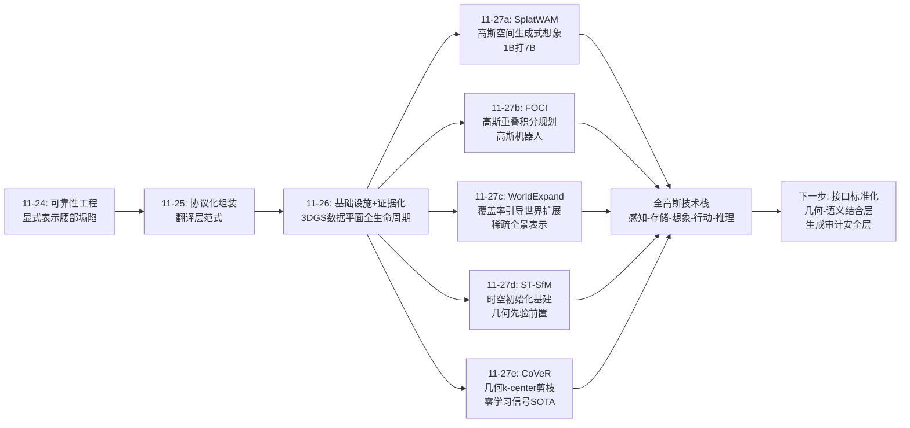
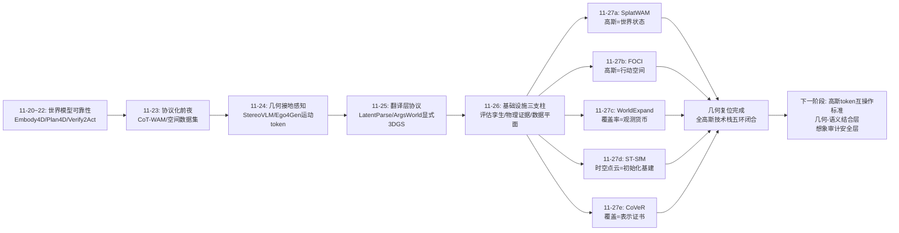
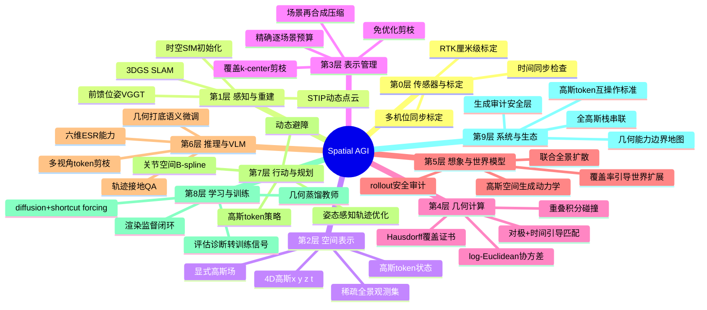
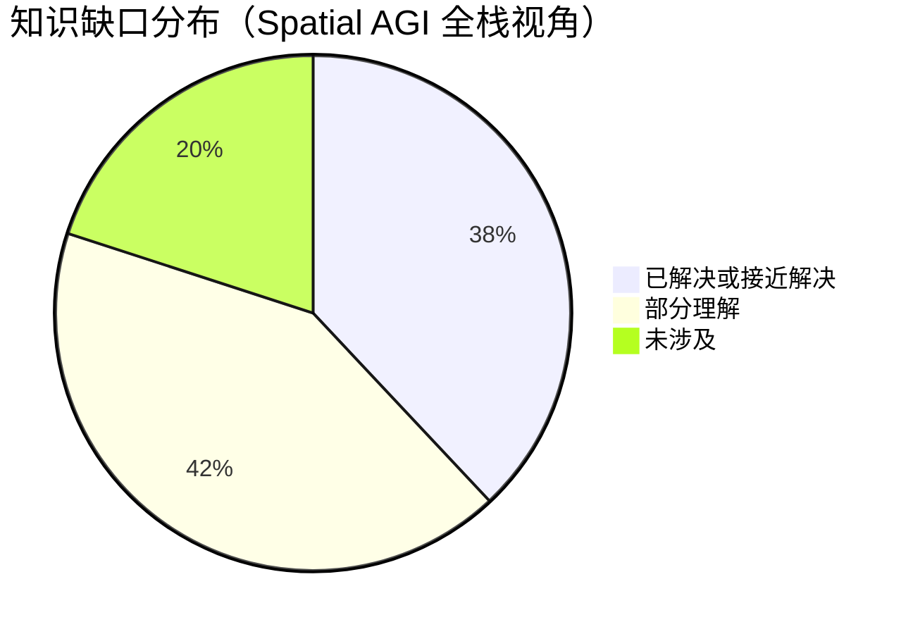

# Spatial AGI 每日思考 - 2026-11-27

## 📅 每日总结

**日期**: 2026-11-27
**论文数量**: 5篇
**主题**: 如果说昨天（11-26）的元判断是"Spatial AGI 在协议层与基础设施层同时收敛，'证据化'取代'端到端'成为方法论关键词"，那么今天的五篇论文回答的是下一个问题：**当表示、想象、行动、观测、推理五个环节都以'空间'为一等公民来重新设计时，系统会发生什么**。今天的五篇论文横跨了空间智能系统的完整栈：SplatWAM 把世界模型的想象状态定义为显式高斯场（想象层），FOCI 把碰撞与规划翻译成高斯密度场的解析积分（行动层），WorldExpand 把世界扩展表示为稀疏互补的全景观测集合（观测/生成层），ST-SfM 把"何时何地在动"写进初始化点云（感知基础设施层），CoVeR 把 token 剪枝重构为纯几何的 k-center 覆盖问题（推理效率层）。合起来的元判断是：**2026 年 11 月末的 Spatial AGI 正在完成一次'几何复位'（geometric reset）——在每一个原本用学习信号、像素空间或抽象 latent 处理的环节，纯几何对象（高斯、坐标、密度场、覆盖率）都展现出惊人的竞争力：SplatWAM 用 1B 高斯状态模型打败 7B VLA，FOCI 用一次高斯求值完成碰撞检测，CoVeR 用零学习信号的坐标打败所有学习式剪枝，WorldExpand 用覆盖率分数决定想象预算的去向，ST-SfM 用二十年前的 STIP/HOG3D 工具给最先进的 4DGS 提供初始化。'几何是第一等信号'不再是一个哲学立场，而是一条被五个独立环节同时验证的工程定律。与此同时，一个更大的结构浮现：本周的多篇论文（SplatWAM/FOCI/GOLD-SLAM/SplatTok/WorldExpand）正在拼出'全高斯技术栈'——高斯做感知（SLAM）、高斯做状态（世界模型）、高斯做想象（外推生成）、高斯做行动（碰撞与规划）、高斯做存储（token 压缩）——3D 高斯正在从'一种渲染技术'升格为空间智能的通用'字节表示'，就像 token 之于 LLM。**

**关键突破**:
- 🚀 SplatWAM（Surrey）：首个在紧凑高斯空间直接做生成式动作条件动力学的世界动作模型——tokenizer 从无位姿多视角 RGB 提举固定预算高斯 token，动力学模型直接对高斯状态做 diffusion forcing + shortcut forcing 去噪（log-Euclidean 协方差 + 可微渲染监督），预测-控制联合训练；**OGBench Scene 上比视频世界模型快 12×（~80 FPS @ RTX 5090）且 PSNR +2.0 dB；高斯 token 策略比像素策略最高 +24.8pp；LIBERO 上 ~1B 模型超过 WorldVLA(~7B) 与 OpenVLA(~7B)**
- 🚀 FOCI（ETH Hutter 组/IIT Comillas）：把机器人和环境**都**表示为高斯混合密度场，用重叠积分作为解析可微的全身碰撞度量（= 高斯求和，每项是 Mahalanobis 距离指数）；关节空间 B-spline 统一足式/操作臂/UAV 任意形态；时变环境高斯支持动态障碍；**六方法对比中唯一同时具备：完整规划管线 + 姿态感知 + 协方差利用；数十万高斯（含 1.35M 高斯岩石场景）秒级出无碰轨迹，ANYmal 实机验证**
- 🚀 WorldExpand（北交大/腾讯混元）：把单全景世界扩展从"稠密全景视频"重定义为"稀疏互补高分辨率全景"——覆盖率引导视角选择（场景自适应象限 + 3DGS warp 覆盖打分）决定"在哪看"，联合全景扩散（3DGS warp + disocclusion mask 作为几何锚 + 诊断引导的全局-局部注意力调度）决定"怎么看"；**比 SOTA 全景视频方法最高 8.6× 加速，更高分辨率、更强跨视角一致性，输出直接进重建管线**
- 🚀 ST-SfM（ITU Copenhagen）：首个面向 4DGS 初始化的稀疏时空 SfM——静态分支（时间中值图 SIFT + 时间稳定性门控，on-mover 仅 0.15–1.51%）+ 动态分支（视频体积 DoG STIP + 运动能量门控 + HOG3D）双分支；对极+时间双引导匹配（先几何后描述子，阈值鲁棒性仅 ~3pp 波动）；冲突感知 union-find 成轨 + RANSAC n 视三角化；**N3DV 每场景 39k–113k 个带亚帧时间戳的动态 4D 点、重投影误差 0.65–0.83 px，PSNR/SSIM/LPIPS 全面优于随机初始化**
- 🚀 CoVeR：多视角 3D 推理 token 剪枝的范式修正——证明多视角冗余本质是几何性的：学习重要性方法把预算花在近重复 token 上，体素化方法被 31% 空间重叠卡在 69% 保留率平台且无法精确控预算；CoVeR 用纯坐标做离散 k-center（自适应体素初始化 + FPS 扩展，最小化有向 Hausdorff 距离）；**~8% token 保留 93.5% 性能，三基准平均超 SOTA 3.9pp，ScanQA 14% 保留下 TFLOPs −8.6×/KV −7×/推理 +2.5×，跨 4 个 VLM 即插即用**

**架构演进**: 基础设施三支柱+证据化（11-26）→ **几何复位 + 全高斯技术栈成形**（表示/想象/行动/观测/推理五环节几何化）

### 📊 一句话总结

今天五篇论文在空间智能栈的五个不同环节（想象、行动、生成、感知基建、推理效率）同时得出了同一个答案：**把问题翻译回几何，比堆学习信号更有效**——世界模型直接在高斯上想象、碰撞检测变成高斯求值、世界扩展变成覆盖率最大化的观测选择、动态重建初始化变成时空特征三角化、token 剪枝变成 k-center 覆盖。这不是复古，而是一次"几何复位"：几何对象（高斯、坐标、密度、覆盖率）之所以重新胜出，是因为它们与空间的对应是构造性的而非学习性的——一致性、可微性、可解释性都免费获得。

### 🔗 延续性

**昨日→今日**: 昨日确立"3DGS 是空间数据的事实标准格式、证据化是元方法、存储态与运行态分离"三条判断。今天五篇在此基础上向"运行态的几何深处"推进：

1. **"3DGS 全生命周期"→"全高斯技术栈"**——昨日 GOLD-SLAM/AnyPrune/SplatTok 覆盖了 3DGS 的建图/剪枝/压缩（数据平面）；今天 SplatWAM（高斯做世界状态）与 FOCI（高斯做碰撞规划）把高斯的疆域从数据平面推进到**想象平面与行动平面**。高斯不再只是"被管理和分发的数据"，而是"被预测和规划的对象"。全高斯栈的五个环节就此闭合：感知（GOLD-SLAM）→ 存储（SplatTok）→ 想象（SplatWAM/WorldExpand）→ 行动（FOCI）→ 推理（CoVeR）。
2. **"存储态潜码、运行态显式高斯"**——SplatWAM-T 的固定预算高斯 token 与 SplatTok 的场景级 token 是同一设计哲学在静态与动态两侧的实例：用紧凑 token 承载场景/状态，用生成器/渲染器按需实例化。昨天说"潜与显是存储态与运行态之别"，今天补上了"运行态自身也可以是生成式的"（高斯状态的扩散演化）。
3. **"覆盖率作为统一货币"**——WorldExpand 用覆盖率选"哪里看"，CoVeR 用覆盖率选"留什么"，两者与昨日的"证据化"共同指向：空间决策需要**显式、可计算的目标函数**，而覆盖率/信息增益正是这样的函数。昨天的方法论关键词是"证据化"，今天可以加上"覆盖化"——观测与表示的选择问题正在从启发式走向显式优化。
4. **"度量接地"**——昨日担心生成 3DGS"渲染像但量不准"；ST-SfM 从上游给出回应：好的初始化（亚像素精度的时空点云）让度量正确性从训练第一步就内建。"起点质量"是度量接地的第一环，此前被系统性低估。
5. **"证据化"的几何版本**——FOCI 的碰撞度量是一个可解释的解析表达式（每个高斯对的 Mahalanobis 距离都可见可查），CoVeR 的 Hausdorff 距离是"没有盲区"的证书，ST-SfM 的重投影误差是每个点的精度证明——几何方法天然自带证据，这与昨日的证据化方法论完美衔接：**几何即证据**。

**今日→明日**: 新线索十条：①**高斯世界模型的场景规模化**——SplatWAM 固定 N 高斯预算限于操作台尺度，扩展到房间/城市级需要层级化高斯状态（场景级 token + 物体级 token）与稀疏激活；②**全高斯栈的端到端闭环**——GOLD-SLAM 建图 → SplatTok 压缩 → SplatWAM 想象 → FOCI 规划的完整管线尚未有人串联，接口标准化（高斯 token 格式）是前置条件；③**几何先验与学习信号的配比**——CoVeR 证明纯几何够用，但任务驱动场景中语义显著性应压倒几何均匀性，"几何打底 + 语义微调"的混合选择器待验证；④**动态观测策略**——WorldExpand 的覆盖率选择针对静态世界，动态场景中"何时看/看哪里"需要把 ST-SfM 类运动先验纳入覆盖目标；⑤**4DGS 初始化的前馈化**——ST-SfM 是多机位标定设置的优化式管线，单目/异步场景的前馈时空初始化（VGGT + 时序跟踪）是明显缺口；⑥**高斯碰撞度量的概率语义严格化**——FOCI 的密度重叠是代理度量，安全攸关场景需要碰撞概率的严格界与不确定性传播；⑦**想象内容的真实性审计**——WorldExpand 幻觉的遮挡后内容、SplatWAM 外推的物理正确性，都可以接入昨日 RoboProbe 的几何证据审计——"生成即需审计"应成为全高斯栈的安全层；⑧**覆盖目标的多目标化**——覆盖率 + 信息增益 + 语义价值 + 不确定性的加权观测选择（主动感知的形式化）；⑨**高斯 token 的语义绑定**——SplatWAM 状态与 SplatTok 压缩都缺物体语义层，与开放词汇 3DGS 分割结合是自然下一步；⑩**几何复位的边界探测**——几何信号在哪些任务上会失效（柔性形变、流体、语义推理）？边界地图帮助合理分配学习与几何的分工。明日检索方向："hierarchical gaussian token world model room scale"、"gaussian token interface standard interoperability"、"geometry semantic hybrid token selection task-driven"、"active perception dynamic scenes coverage information gain"、"feedforward spatiotemporal initialization monocular 4DGS"、"gaussian collision probability bound uncertainty propagation"、"generative world model physics audit evidence"、"multi-objective view selection semantic value uncertainty"、"open vocabulary gaussian token semantic binding"、"geometry learning failure boundary spatial intelligence"。

### 💡 本质思考：如何达成通用空间智能

#### 1. 核心能力的本质是什么？

昨日答案是"学习在潜空间、协作在证据层、审计在基建上"。今天推进一层：**通用空间智能 = 在正确的数学对象上做计算**。今天的五篇论文反复证明：当计算发生在与空间同构的数学对象上（高斯场、坐标集、密度积分、覆盖率），一致性是构造性的、梯度是解析的、证据是自带的；而当计算发生在与空间不同构的对象上（像素、抽象 latent、注意力分数），一致性要靠学习去"猜"、监督要靠间接信号去"绕"、解释要靠事后分析去"挖"。空间智能的本质可能不是"更大的模型学会空间"，而是"计算对象与空间同构，学习只负责对象之间的映射"。

三个具体化：
- **构造性一致性 > 学习性一致性**：SplatWAM 的任意视角渲染共享同一状态（一致性由构造保证），视频世界模型的多视角一致性靠损失去逼（永远差一点）。FOCI 的高斯重叠积分天然满足"远处无碰撞梯度"（指数衰减），学习式碰撞预测器需要数据覆盖所有距离段。凡是能让"正确性"成为结构性质的场合，都不该用学习去逼近。
- **几何是最高效的证据格式**：CoVeR 的 Hausdorff 证书、FOCI 的解析表达式、ST-SfM 的重投影误差——几何量自带可验证性。昨日的"证据化"今天获得了实现路径：证据不一定要是文本或分割图，**解析几何量本身就是最好的证据**。
- **预算分配是空间智能的隐形核心**：WorldExpand 分配生成预算、CoVeR 分配 token 预算、SplatWAM 分配状态基元预算——三个系统的性能差距很大程度上来自预算分配策略的差距。空间智能系统的设计者应当首先回答："我的算力/存储/注意力在空间上如何分配？"

#### 2. 当前方法与理想目标的差距在哪里？

六条差距，按严重程度排序：

- **几何胜利的尺度边界未探明**：今天所有几何胜利都在受控尺度上取得——SplatWAM 的操作台、FOCI 的单场景、CoVeR 的室内 QA、ST-SfM 的多机位棚拍。几何方法的扩展瓶颈（高斯数量的二次爆炸、覆盖计算的规模、动力学组合复杂度）在大场景/长时程中尚未被压力测试。理想的通用空间智能需要几何红利在任意尺度上保持。
- **语义层缺位**：全高斯栈的每一环都是纯几何的，但没有一层"知道"这是什么物体。语言条件控制（SplatWAM-P 的语言指令）、物体级编辑（SplatTok 的对应丢失问题）、语义导航都悬空。几何与语义的结合层是当前最明显的架构空白。
- **动态与生成的真实性无审计**：SplatWAM 的 rollout、WorldExpand 的幻觉区域都在"生成未被观察的空间内容"，但没有任何机制保证其物理/几何正确性。昨日的 RoboProbe 审计的是生成的视频，全高斯栈生成的显式状态其实更容易审计（几何可检查）——但这条"生成→审计"的线还没人拉通。
- **各环节接口未标准化**：GOLD-SLAM 输出的高斯与 SplatWAM 期望的输入高斯格式不同；SplatTok 压缩后的潜码无法直接作为世界模型状态；FOCI 需要机器人侧的高斯建模人工设计。五环节各自优秀，但拼不成一台机器——"高斯 token 的互操作标准"是下一个协议问题（呼应昨日协议化判断）。
- **几何先验的失效模式不明**：CoVeR 在语义显著但几何不显著的区域可能失手；ST-SfM 对柔性/慢速运动失明；FOCI 的密度重叠不是严格碰撞。每个几何方法都有失效边界，但没有系统性的"几何能力边界地图"指导何时该切换到学习信号。
- **动态观测策略缺位**：WorldExpand 选"在哪里补观测"但只针对静态世界；真实空间智能体面对的是动态世界，"何时看、看哪里、看多久"的主动感知问题（覆盖率 + 运动预测 + 任务价值的联合优化）还没有被今天的任何工作覆盖。

#### 3. 从今天到理想状态，最可能的路径是什么？

三步路径，每步 6-12 个月：

- **第一步：全高斯栈的串联验证（当前-2027H1）**——用开源组件把"SLAM 建图 → 压缩存储 → 世界模型想象 → 碰撞规划 → 端到端执行"在单一平台（如 ANYmal 或室内操作臂）上跑通一次完整闭环，量化每个接口的损失（重建→压缩的信息损失、压缩→想象的状态注入方式、想象→规划的几何一致性）。判据：出现第一个"从传感器到行动全程高斯表示"的开源参考实现，且各环节接口损失被量化。
- **第二步：几何-语义结合层（2027H1-H2）**——在高斯 token 之上加开放词汇语义绑定（分割 + CLIP 特征挂载），使世界模型的状态、规划的障碍、压缩的记忆都携带物体语义；CoVeR 类选择器升级为"几何打底、语义加权"的混合版本；语言条件的高斯世界模型控制（SplatWAM-P + 语义 token）。判据：语言指令驱动的"想象-验证-执行"闭环在 LIBERO 类基准上超越纯几何版本，且物体级编辑在压缩态上可行。
- **第三步：几何能力边界地图与自适应路由（2027H2-）**——系统化测绘各类几何方法（覆盖、积分、三角化、SfM）在场景类型/尺度/动态性/语义密度上的失效边界；构建路由器按任务特征自动选择"纯几何 / 几何打底语义微调 / 纯学习"三种模式；把昨日的证据审计栈扩展为全高斯栈的常驻安全层（每个想象的显式状态过一遍物理证据检查）。判据：出现公开的几何能力边界基准，自适应路由系统在混合任务分布上稳定超越任何单一模式。

理想终局：空间智能体的全部内部计算发生在与空间同构的高斯表示上——感知构建它、压缩存储它、想象演化它、规划在其中计算、推理修剪它的投影——而学习模型只负责映射的两端（传感器→高斯、高斯→语言/行动）。语义作为高斯 token 上的轻量绑定存在，证据作为解析几何量自产自检，预算分配由显式的覆盖/信息目标函数驱动。**计算对象与空间同构，学习负责映射，几何负责正确性。这就是几何复位完成后的通用空间智能。**

---

## 🔗 与昨日思考的联系

### 昨日重点

昨天的元判断：Spatial AGI 在协议层与基础设施层同时收敛——评估走向"真实孪生+闭环交互"，信任走向"几何证据+独立审计"，表示走向"3DGS 全生命周期工程化"；方法论关键词从"端到端"换成了"证据化"（感知证据/物理证据/轨迹证据三类）；存储态潜码与运行态显式高斯的分离被 SplatTok 正式确立。

### 今日进展

今天五篇论文把"几何"从昨日的配角（证据的载体）推上了主角（计算的载体）：

- **从"几何证据"到"几何计算"**：昨日 RoboProbe 用几何量做审计（配角）；今天 FOCI 用几何积分做规划、CoVeR 用几何距离做选择、SplatWAM 用几何状态做想象（主角）。几何的角色从"验证学习的结果"升级为"替代学习的计算"。
- **数据平面 → 运行平面**：昨日三篇覆盖 3DGS 的"静态生命周期"（建图/剪枝/压缩）；今天 SplatWAM/FOCI 覆盖"动态运行"（状态演化/行动计算）。全高斯栈从数据管理延伸到实时控制。
- **覆盖率货币的出现**：WorldExpand 与 CoVeR 在互不知情的情况下（不同机构、不同任务）采用了同构的覆盖率目标——这不是巧合，而是空间决策问题收敛到同一数学结构（集合覆盖/k-center）的信号。昨日的"协议化"判断获得新成员：覆盖率协议。
- **基础设施的纵深化**：昨日补"有没有"（评估/信任/数据管线），今天补"好不好"（ST-SfM 的初始化质量、CoVeR 的推理效率）——基建从存在性进入质量性阶段。
- **"几何复位"的证据链**：五个独立环节同时倒向几何，且各自的量化优势都显著（12×/24.8pp、秒级、8.6×、0.65px、3.9pp）——单篇可以是巧合，五篇是趋势。这与本周"世界模型走向显式 3D"（CoT-WAM/Ego4Gen/MemoryWAM→SplatWAM）的演进线汇合成一个判断：**空间智能的基础表示之争正在向高斯收敛**。

### 演进路径



---

## 📚 论文概览

**论文1: SplatWAM**（想象层·世界模型）—— Surrey 团队的世界动作模型：SplatWAM-T 用 VGGT+固定 query 把无位姿多视角提举为 N 个显式高斯（photo+geom+reg 三损失，几何蒸馏自教师深度）；SplatWAM-D 在 log-Euclidean 协坐标的高斯状态上做 diffusion forcing + shortcut forcing + x-prediction 的动作条件生成（渲染监督密集信号、无需解码器）；SplatWAM-P 加 agent tokens 与 flow-matching 动作头联合训练。OGBench 快 12×/PSNR+2dB，LIBERO 1B 超 7B VLA。

**论文2: FOCI**（行动层·规划）—— ETH Hutter 组：环境 p(x,t) 与机器人 r(x,q(t)) 均为高斯混合密度场，碰撞度量 = 重叠积分 = Σ N(μ̄_m; μ_n, Σ_n+Σ̄_m)（解析、可微、指数衰减）；关节空间 B-spline（虚拟关节+真实关节分解）统一任意形态；GPU 批量 N×M 评估；动态环境（时变环境高斯）与姿态优化（窄通道可通行）双支持；ANYmal 实机 + CHOMP/STOMP 对比。

**论文3: WorldExpand**（生成层·世界扩展）—— 北交大/腾讯混元：单全景世界扩展 = 稀疏互补高分辨率全景生成；Coverage-Guided View Selection（点云 warp 打 unseen 像素分 + 自适应象限对齐场景边界）选 4 个互补视角；Joint Panoramic Diffusion 用 3DGS warp+mask 多流条件联合去噪 4 张全景；诊断引导把 30 层切局部注意力省算力；输出直接进重建管线；8.6× 加速。

**论文4: ST-SfM**（感知基建·初始化）—— ITU Copenhagen：静态分支（时间中值图 SIFT + ≤5% 变化帧门控）+ 动态分支（(x,y,t) 体积 DoG STIP + ρ≥0.15 运动能量门控 + HOG3D 540 维）；对极(1-3px)+时间(≤1帧)门控前置的匹配；union-find 拒绝同相机重复与 >1.5 帧跨度；四步 n 视三角化（DLT 假设→MSAC→重拟合→Gauss-Newton+四滤波器）；点直接映射为 4D 高斯（时间中心/跨度/±3帧近邻尺度）。

**论文5: CoVeR**（推理效率层·token 剪枝）—— 多视角 VLM token 剪枝：诊断学习重要性（近重复陷阱）与体素化（31% 重叠 → 69% 饱和平台、无精确预算）两家族缺陷；形式化为离散 k-center（最小化有向 Hausdorff）；场景级二分搜体素尺寸 + 每体素几何中心代表 + FPS 扩展补预算 + 超额保险；纯坐标零训练确定性；8%→93.5%，跨 4 VLM。

---

## 💡 核心见解

### 见解1: 几何复位——五个环节同时证明"与空间同构的计算对象胜过学习信号"
（从全部五篇论文获得）
- ✅ SplatWAM：高斯状态使一致性由构造保证（vs 视频模型学一致性），1B 打 7B
- ✅ FOCI：高斯重叠积分给出解析可微碰撞（vs 学习式碰撞预测器），指数衰减自带远处无梯度
- ✅ CoVeR：纯坐标 k-center 打败注意力/特征排序（8% token 保 93.5%）
- ✅ ST-SfM：二十年前的 STIP/HOG3D 工具给最先进 4DGS 提供初始化，重投影误差亚像素
- ✅ WorldExpand：覆盖率分数（unseen 像素计数）决定生成预算去向

**对Spatial AGI的启发**:
这不是五次独立的好运，而是同一深层结构：空间数据天然满足几何定律（欧式距离、高斯卷积、对极约束），学习模型用参数去"记"这些定律，几何计算直接"用"这些定律。Spatial AGI 的设计第一问应该是："这个问题里哪部分是几何定律能直接算的？"——只有剩余部分才交给学习。学习在映射的两端，几何在计算的中枢。

### 见解2: 高斯正在升格为空间智能的通用"字节表示"
（从论文1、2 与本周 GOLD-SLAM/SplatTok/ArgsWorld 合并观察）
- ✅ 感知：GOLD-SLAM 用高斯建图（昨日）
- ✅ 存储：SplatTok 用高斯 token 压缩（昨日）
- ✅ 想象：SplatWAM 在高斯上做生成式动力学（今日）
- ✅ 行动：FOCI 在高斯上做碰撞与规划（今日）
- ✅ 推理：CoVeR 对高斯式 3D token 做覆盖剪枝（今日）

**对Spatial AGI的启发**:
LLM 的成功建立在"一切皆 token"的统一表示上；空间智能正在建立"一切皆高斯"的统一表示。统一表示的价值不在单点性能，而在**环节间零翻译成本**：世界模型输出的状态可以直接被规划器消费，SLAM 建的图可以直接被压缩器读。下一个关键工程是定义"高斯 token 的互操作标准"——就像 tokenizer 之于 LLM 生态。

### 见解3: 构造性一致性是空间生成模型的护城河
（从论文1 SplatWAM 获得）
- ✅ 视频世界模型的多视角一致性靠损失逼出来，长 rollout 误差累积必然崩坏
- ✅ SplatWAM 的任意视角渲染共享同一 3D 状态——不一致在结构上不可能
- ✅ WorldExpand 的 4 张全景联合去噪 + 几何 warp 锚定——一致性内建于生成结构

**对Spatial AGI的启发**:
凡是能通过"共享同一底层对象"获得一致性的场合，绝不靠约束/损失去学。这可以推广：时空一致性（共享 4D 状态）、物理一致性（共享物理引擎）、语义一致性（共享物体层）。一致性应该是架构的性质，不是训练的成就。

### 见解4: 覆盖率是空间决策的统一货币
（从论文3、5 获得）
- ✅ WorldExpand 用 c_v=|U_v|（新揭示内容量）选视角——生成预算的空间经济学
- ✅ CoVeR 用 Hausdorff 距离（最坏覆盖）证明无盲区——表示预算的空间经济学
- ✅ 两者都是显式、可计算、无需学习的目标函数

**对Spatial AGI的启发**:
空间智能系统里有大量"选择"问题：看哪里、留什么、存多少、想象多远。这些问题都可以翻译为集合覆盖/k-center 类的几何优化。把"选择"从启发式（排序、阈值）升级为显式目标函数优化，是系统设计中性价比最高的改造。下一步是把覆盖目标多目标化：覆盖率 + 信息增益 + 语义价值 + 不确定性。

### 见解5: 几何先验应该前置而不是后验
（从论文4 ST-SfM 获得）
- ✅ 经典匹配流程：先描述子后几何校验——误匹配多、阈值敏感
- ✅ ST-SfM 反转：对极线+时间窗先筛候选，描述子只在幸存者中比较——几乎零误匹配、阈值鲁棒（~3pp 波动）
- ✅ 类比：WorldExpand 先算 warp 锚定再让扩散生成；SplatWAM 先有几何蒸馏再学生成

**对Spatial AGI的启发**:
在几何信息可用时（标定、深度、坐标），让它先做滤波器，学习信号只在几何无法判定的剩余空间上工作。顺序决定效率：几何前置的系统用 1px 门控就达到鲁棒，几何后置的系统需要重训练才能接近同样可靠性。

### 见解6: 空间表示的初始化质量是被低估的一环
（从论文4 ST-SfM 获得）
- ✅ 3DGS/4DGS 全靠梯度优化 + 启发式致密化——起点决定收敛质量与最终上限
- ✅ 动态场景的标准初始化（第一帧 SfM）对"何时何地在动"零信息
- ✅ ST-SfM 把运动结构写进初始化，PSNR/SSIM/LPIPS 同预算全面提升

**对Spatial AGI的启发**:
每当新表示出现，其配套基础设施（初始化、配准、评估）都要重造：3DGS 时代重造了 SfM（VGGT/Mast3R），4DGS 时代轮到时空 SfM。Spatial AGI 工程师应当把"起点质量"当作一等工程指标——好的初始化可能比好的损失函数更值钱。

### 见解7: 预算精确性是系统部署的硬约束
（从论文5 CoVeR 获得）
- ✅ 体素化剪枝的预算是数据集平均——单场景爆内存照样崩
- ✅ CoVeR 的三情形设计（扩展/空/保险）保证任意场景精确输出 B 个 token
- ✅ WorldExpand 的固定 4 视角预算同样是精确控制——省下的算力换成更高分辨率

**对Spatial AGI的启发**:
研究论文用平均值说话，部署系统被最坏情况杀死。空间智能的每个资源约束（显存、时延、带宽、存储）都应转化为"逐场景精确预算"的设计要求。这也是几何方法的天然优势：覆盖类计算可以精确控制输出数量，学习式排序做不到。

### 见解8: 小模型+强表示 可能是大模型+弱表示的帕累托改进
（从论文1 获得）
- ✅ SplatWAM ~1B 在 LIBERO 上超过 WorldVLA ~7B 和 OpenVLA ~7B
- ✅ 高斯 token 策略输入比像素输入最高 +24.8pp——表示红利超过 7× 参数红利
- ✅ rollout 80FPS——效率红利同样显著

**对Spatial AGI的启发**:
在空间任务上，表示质量 > 参数数量的证据在累积（本周 StereoVLM 的中间几何量选择、今日 SplatWAM 的状态表示）。端侧空间智能的现实路径可能不是"蒸馏大模型"而是"设计更好的中间表示 + 小模型"。

### 见解9: 生成式空间内容需要生成时就地审计
（从论文1、3 获得，接昨日证据化方法论）
- ✅ SplatWAM 外推的高斯状态、WorldExpand 幻觉的遮挡后内容都是"未被观察的空间断言"
- ✅ 显式表示使审计更容易：状态可渲染检查、几何可直接验证（比视频审计便宜）
- ✅ 但今天没有任何一篇把"生成→审计"拉通

**对Spatial AGI的启发**:
全高斯栈的想象环节是安全边界最模糊的环节。好在显式性让审计成本大降：FOCI 的碰撞积分可以直接当作 rollout 状态的安全证书，RoboProbe 的几何证据可以直接在 4D 状态上计算。"想象即需证书"应当成为全高斯栈的常驻设计。

---

## 🗺️ 知识演进图

⚠️ 必须使用 mermaid 代码块！禁止用纯文本箭头！



### 演进逻辑

本周的演进线可以概括为三次跃迁：11-20~23 世界模型在"可靠性"层面补课（评估、验证、安全）；11-24~25 发现可靠性问题的根源是"感知到结构的翻译鸿沟"，于是协议化（翻译层）成为主题；11-26 起基础设施化（评估基建/信任基建/数据平面）；今天（11-27）跃迁到计算对象本身——当表示、想象、行动、观测、推理五个环节全部换用与空间同构的几何对象后，一致性与效率不再是训练出来的而是构造出来的。下周的焦点预计从"表示选择"转向"表示互操作"（全高斯栈的接口标准）与"几何-语义分工"（边界地图与混合路由）。

---

## 技术栈演进对比表

| 层次 | 昨日方案 (11-26) | 今日方案 (11-27) | 变化 |
|------|---------|---------|------|
| 世界模型状态 | ArgsWorld: 自回归扩散产出显式3DGS资产（生成后存储） | SplatWAM: 状态本身是高斯场，动力学直接在高斯上扩散演化 | 从"生成3D资产"到"在3D上演化"——状态与生成合一 |
| 世界模型策略输入 | 像素/抽象latent（WorldVLA类, 7B级） | 高斯token直接作策略输入（1B级, +24.8pp） | 表示红利超过7×参数红利 |
| 规划/碰撞 | 保守包围盒+安全走廊（Splat-Nav类, 固定姿态） | FOCI: 高斯重叠积分解析可微, 姿态感知, 动态环境 | 碰撞从几何近似变为解析计算; 任意形态统一 |
| 世界扩展表示 | 稠密全景视频（冗余/漂移/不一致） | WorldExpand: 稀疏互补高分辨率全景+覆盖率选择 | 中间表示的空间经济学; 8.6×加速 |
| 观测选择目标 | 固定方向/启发式 | 覆盖率分数（unseen量）+场景自适应象限 | "在哪看"成为显式优化问题 |
| 4D重建初始化 | 随机点/第一帧SfM（对运动零信息） | ST-SfM: 时空双分支点云（亚帧时间戳4D点） | "何时何地在动"写进起点 |
| VLM 3D推理token | 学习重要性排序/体素池化（近重复或饱和） | CoVeR: 纯几何k-center覆盖（精确预算+无盲区） | 零学习信号达到SOTA; 几何是第一等信号 |
| 信任/审计 | RoboProbe: 几何证据审计生成视频 | （未新增, 但显式状态使审计更便宜） | 生成即需证书的必要性上升 |
| 压缩/存储 | SplatTok: 场景再合成潜码 | （未新增, 但高斯token与状态token开始同构） | 存储/状态token的互操作提上日程 |

---

## 🗺️ Spatial AGI 知识图谱

### 10层架构思维导图

⚠️ 必须使用 mermaid mindmap 代码块！



### 🎯 主线技术路径

#### 阶段1: 单点能力爆发（已完成，2026上半年）
3DGS/世界模型/VLA 各自爆发：表示有了（3DGS）、想象有了（视频世界模型）、行动有了（VLA）。但各点孤立，评估在室内合成，可靠性未知。

#### 阶段2: 可靠性工程（11-21~11-24，已完成）
五原则（昨周确立）：评估真实化、信任证据化、失败可归因、协议显式化、部署约束内建。StereoVLM/Ego4Gen 把几何接地引入感知与动作接口。

#### 阶段3: 协议化与基础设施（11-25~11-26，已完成）
翻译层范式（潜→显转换是最高杠杆）确立；评估孪生（Lost on Campus）、物理证据审计（RoboProbe）、3DGS 数据平面（GOLD-SLAM/AnyPrune/SplatTok）三支柱落成；"证据化"取代"端到端"成为方法论关键词。

#### 阶段4: 几何复位与全高斯栈（11-27，今日，正式开启）
五个环节同时换用与空间同构的计算对象：高斯做状态（SplatWAM）、高斯做碰撞（FOCI）、覆盖率做观测选择（WorldExpand）、时空点云做初始化（ST-SfM）、k-center 做表示选择（CoVeR）。一致性与效率由构造保证。栈的五个环节闭合但接口未标准化。

#### 阶段5: 互操作与几何-语义分工（预测，2027H1）
全高斯栈串联成端到端参考实现；高斯 token 互操作标准出现；开放词汇语义绑定挂载到高斯 token；几何能力边界地图测绘完成，混合路由（几何/几何+语义/学习）落地；生成审计安全层成为栈的常驻组件。

#### 阶段6: 规模化与生态（预测，2027H2）
大场景层级化高斯状态；多机空间记忆共享与合并协议；压缩态空间记忆成为机器人标准存储；评估孪生矩阵覆盖城市/野外/夜间；空间智能系统在同一互操作标准上形成组件生态。

---

## 🔍 待探索议题

### 高优先级（本周）

1. **高斯世界模型的场景规模化**
   - 问题: SplatWAM 固定 N 高斯预算限于操作台，房间/城市级如何承载？
   - 候选方案: 层级化高斯状态（场景级 token + 物体级 token）+ 稀疏激活 + 局部 rollout
   - 缺口: 层级状态的动力学学习（跨层级信息流）无先例

2. **全高斯栈端到端串联**
   - 问题: SLAM→压缩→想象→规划五环节接口各异，损失未量化
   - 候选方案: 定义"高斯 token 互操作格式"（含语义/不确定性通道），在单一平台跑通闭环
   - 缺口: 各环节对高斯质量/密度/语义的假设不同，需接口规范与损失量化协议

3. **想象状态的物理审计**
   - 问题: SplatWAM rollout 与 WorldExpand 幻觉区域是未观察的空间断言，无正确性保证
   - 候选方案: 在显式状态上直接运行 RoboProbe 类几何证据检查 + FOCI 碰撞证书，"想象即需证书"
   - 缺口: 审计成本与 rollout 速度的匹配（80FPS rollout 需要毫秒级审计）

### 中优先级（本月）

4. **几何打底 + 语义微调的混合选择器**
   - 问题: CoVeR 均匀覆盖可能在任务关键但几何不显著区域失手
   - 候选方案: k-center 打底 + 轻量语义显著性加权（开放词汇分数作附加目标）
   - 缺口: 语义信号引入后确定性与精确预算是否可保持

5. **4DGS 初始化的前馈化**
   - 问题: ST-SfM 依赖同步标定多机位 + 优化式管线，单目/异步场景缺失
   - 候选方案: VGGT 类前馈位姿 + 时序点跟踪的时空初始化，或 STIP 检测的可学习化
   - 缺口: 单目时序的三角化退化问题；前馈版的亚帧时间戳精度

6. **动态观测策略（active perception 形式化）**
   - 问题: WorldExpand 只管静态世界"在哪里补"，动态世界"何时看/看哪里/看多久"无解
   - 候选方案: 覆盖率 + ST-SfM 运动先验 + 任务价值的联合目标，MPC 式滚动求解
   - 缺口: 运动预测与观测价值的耦合建模；实时求解器

7. **高斯碰撞度量的概率严格化**
   - 问题: FOCI 密度重叠是代理度量，人机共存场景需要严格碰撞概率界
   - 候选方案: 把高斯解释为占据的概率分布，推导 P(collision) 上界并纳入机会约束优化
   - 缺口: 3DGS 密度与真实占据的标定关系（渲染密度≠物理密度）

### 低优先级（本季度）

8. **几何能力边界地图**
   - 问题: 各几何方法（覆盖/积分/三角化/SfM）的失效边界未系统测绘
   - 候选方案: 按场景类型/尺度/动态性/语义密度构建压力测试矩阵，输出"何时切换学习信号"的路由规则
   - 缺口: 失效的统一度量（覆盖率不足? 重投影误差? 碰撞误报率?）

9. **压缩态空间记忆的可思考性**
   - 问题: SplatTok 类潜码记忆丢失对应性，压缩后能否支持物体级推理/编辑？
   - 候选方案: 分层 token（场景级+物体级）+ 对应性保持解码；记忆的"部分实例化"机制
   - 缺口: 物体级 token 与场景级 token 的动力学一致性

10. **多机空间记忆的合并协议**
    - 问题: 压缩后的 MB 级空间记忆使多机共享成为可能，但 merge 无协议
    - 候选方案: 高斯 token 的一致性哈希 + 冲突检测 + 增量合并（类比 CRDT）
    - 缺口: 不同机器人视角/标定差异下的语义-几何对齐

11. **几何复位对训练范式的反作用**
    - 问题: 若计算中枢几何化，学习模型的角色收缩为"映射两端"，预训练范式如何调整？
    - 候选方案: "表示预训练"（学习传感器→高斯的提举器）与"映射微调"分离的训练栈
    - 缺口: 提举器预训练数据的规模与多样性来源（真实采集 vs 生成式世界）

---

## 📊 知识缺口分析

⚠️ 必须使用 mermaid pie 代码块！



**已解决（38%）**:
- ✅ 空间表示的选择：显式高斯场在感知/想象/行动/存储四环节全面确立（本周连续验证）
- ✅ 世界模型的表示形态：显式 3D 状态 + 生成动力学优于像素/latent（SplatWAM 定音）
- ✅ 3DGS 数据平面工具链：建图/剪枝/压缩/分发各有可用组件（11-26~27）
- ✅ 多视角 token 预算管理：几何覆盖方法达到 SOTA 且即插即用（CoVeR）
- ✅ 3DGS 环境上的轨迹规划：解析可微、任意形态、姿态感知（FOCI）
- ✅ 动态重建初始化：时空点云初始化优于随机/第一帧（ST-SfM）
- ✅ 单全景世界扩展：稀疏全景表示 + 覆盖引导（WorldExpand）

**部分理解（42%）**:
- ⚠️ 几何胜利的尺度边界：所有验证在受控尺度，大场景/长时程未知
- ⚠️ 几何-语义结合：语义层缺位，混合选择器只有假设没有实现
- ⚠️ 全高斯栈互操作：五环节各自优秀但接口未标准、损失未量化
- ⚠️ 生成内容的审计：显式状态使审计变便宜，但生成→审计管线未拉通
- ⚠️ 高斯密度的物理语义：渲染密度与占据/碰撞概率的标定关系不清
- ⚠️ 前馈时空感知：初始化仍依赖标定多机位优化管线
- ⚠️ 空间记忆的压缩态功能：压缩后能否支持物体级推理未验证
- ⚠️ 预算分配的多目标化：覆盖率之外的语义价值/不确定性目标未形式化

**未涉及（20%）**:
- ❌ 动态世界的主动感知（何时看/看哪里/看多久）
- ❌ 柔性形变/流体/颗粒的几何表示与动力学（ST-SfM/FOCI/SplatWAM 全部失明）
- ❌ 长时程（天/周级）空间记忆的组织与遗忘机制
- ❌ 多机协作的空间任务分配与记忆合并协议
- ❌ 空间智能的自我评估（agent 知道自己哪里不确定、哪里可能错）
- ❌ 几何表示与具身本体感觉（触觉/本体感受）的融合
- ❌ 空间智能的对齐问题（空间行为的价值对齐、安全约束的规范来源）

---

## 📝 每日金句

**今日金句**:

> "计算对象与空间同构，学习负责映射，几何负责正确性。"

一周的论文读完，最深的感受是：Spatial AGI 的进展呈现出罕见的"收敛"——不同机构、不同任务、不同方法的论文正在给出同一个答案。本周的世界模型全部走向显式 3D 状态，今天的五篇把这个趋势推到了极致：连碰撞检测、观测选择、token 剪枝、重建初始化这些"边角"环节都被几何接管，而且每一个都赢得了显著的量化优势。这提醒我们：在一个新兴领域里，最稀缺的能力不是发明新的学习算法，而是**识别出哪些问题根本不需要学习**。几何对象之所以重新胜出，不是因为怀旧，而是因为它们与空间的对应是构造性的——一致性、可微性、可解释性都是免费的。下一阶段的竞争焦点将是：谁能把全高斯栈的五环节拼成一台机器（互操作标准），以及谁能准确画出几何与学习的分工边界（混合路由）。学习在映射的两端，几何在计算的中枢——这就是今天之后，我们对通用空间智能的最新理解。

---

**文档创建时间**: 2026-11-27
**分析方法**: 基于5篇精读论文（SplatWAM/FOCI/WorldExpand/ST-SfM/CoVeR）+ 本周记忆延续
**基础日期**: 2026-11-26（昨日任务完整完成，直接延续）

---

## 🔬 五篇论文的跨对话：如果它们互相评审会说什么？

### 对话1: SplatWAM ↔ FOCI（想象者与行动者）

**SplatWAM 问 FOCI**: 我 rollout 出的未来高斯状态，你能直接检查可行性吗？
**FOCI 答**: 可以——我的碰撞度量 ∫p·r dx 对任意高斯集合都有解析值。你的预测状态不需要转换格式，直接代入 Σ_{n,m} N(μ̄_m; μ_n, Σ_n+Σ̄_m) 即可。这是全高斯栈"想象→验证"环节的零翻译成本。
**FOCI 问 SplatWAM**: 但你的状态是 N 个固定高斯，我把机器人建为 M 个高斯——你的 rollout 里机器人在哪里？你的动力学只演化场景，不演化机器人自身。
**SplatWAM 答**: 这是我的盲区。我的 agent tokens 只是策略输入，不是状态的一部分。真正的心智模拟应该把"机器人的未来位姿"也编码进状态——你的关节空间 B-spline 参数化可能是答案：让动力学同时预测场景高斯和机器人关节角。
**合议结论**: 全高斯栈的下一个里程碑是"自包含的世界状态"——场景高斯 + 机器人高斯 + 两者联合动力学。届时 rollout 的每一步都自带碰撞证书（FOCI 积分），规划与想象真正合一。

### 对话2: WorldExpand ↔ CoVeR（观察者与保留者）

**CoVeR 问 WorldExpand**: 你的覆盖率分数 c_v=|U_v| 只数 unseen 像素量，我证明过均匀覆盖 ≠ 任务有效覆盖——你选的四个视角可能在语义上全无价值（都是墙角的重复结构）。
**WorldExpand 答**: 公平。但我的设定是"世界扩展"——目标是重建完整性，均匀覆盖是合理的一阶目标。你的 Hausdorff 证书对我的重建下游其实更贴切：最坏情况保证（没有区域被漏掉）比平均覆盖更符合重建需求。
**CoVeR 答**: 那我们其实共享同一个数学骨架——集合覆盖/k-center。你的"象限划分+每象限选最优"就是贪心 k-center 的空间变体。差异只在约束：你有相机可达性约束（不能穿墙），我有 token 数预算约束。
**WorldExpand 答**: 是的，而且我们都发现了"预算换质量"的杠杆：我把省下的帧预算换成 4K 分辨率，你把省下的 token 换成 LLM 推理深度。空间智能的预算经济学是通用的。
**合议结论**: 覆盖类方法正在形成一个方法论家族（视角选择/token 剪枝/未来的记忆选择），统一的"覆盖目标函数 + 领域特定约束"框架值得被形式化——这可能是第一篇"空间采样理论"论文的种子。

### 对话3: ST-SfM ↔ SplatWAM（基建工与建筑师）

**ST-SfM 问 SplatWAM**: 你的 tokenizer 从零学习提举高斯——但如果初始场景里有一个在动的物体，你的单时刻提举对它的运动一无所知。我的 STIP 点云可以告诉你"哪里在动"。
**SplatWAM 答**: 确实。我的动力学必须从历史状态的差异中自己学出"什么在动"。如果 T(tokenizer) 的输入能携带我的 ST-SfM 动态点作为先验（比如作为 query 的初始化位置），D 的学习负担会小很多——尤其对快速运动，这正是 4DGS 社区公认的难点。
**ST-SfM 答**: 但注意我的局限：我需要同步多机位。你的机器人场景通常只有一个臂上相机。单目时空初始化是我们要共同投资的基建——也许把我的 STIP 检测器蒸馏成前馈网络（输入视频体积、输出 4D 点）是路。
**合议结论**: "感知基建（时空点云）→ 表示学习（提举器初始化）"的管线是低成本提升世界模型质量的方向。初始化质量作为一等工程指标的判断在此得到具体化。

### 对话4: FOCI ↔ CoVeR（安全边际的两面）

**FOCI**: 我的碰撞度量是指数衰减的——远处障碍梯度为零，优化器天然只关注附近威胁。这是"局部性"红利。
**CoVeR**: 我的 Hausdorff 是 max——最坏情况敏感，一个盲区就毁掉证书。这是"全局性"义务。
**合议**: 行动层要局部性（实时、稀疏计算），表示层要全局性（无盲区保证）。空间智能系统应当明确区分"局部计算"与"全局证书"两类需求，分别选用匹配的几何工具。混淆两者是常见的架构错误：用局部工具做全局承诺（碰撞检测漏远端威胁），或用全局工具做局部决策（每步全场景重覆盖，浪费算力）。

---

## 🧪 方法论反思：为什么"几何复位"发生在今天而非两年前？

三个条件在 2026 年末同时成熟：

1. **显式表示的性能天花板被打破**。2024 年的 3DGS 主要被当作渲染器，质量上限（密度、语义、动态）都不足以承载下游计算。2026 年的 3DGS 生态（SLAM、分割、压缩、4D）让它从"照片"变成"数据库"。几何计算需要的第一条件是"几何对象足够好"。
2. **学习模型的边际收益递减显现**。7B 的 VLA 打不过 1B 的高斯状态模型——参数规模化在空间任务上撞墙的证据积累到临界点。社区开始系统性寻找"表示红利"而非"参数红利"。
3. **评测进步暴露了学习方法的虚构成分**。Lost on Campus（昨日）证明室内基准的语义捷径红利；RoboProbe 证明 VLM 物理直觉不可靠；CoVeR 证明注意力排序保留的是近重复。评测的严格化让"学习信号的虚构部分"无处遁形，几何方法的确定性优势才变得可见。

推论：几何复位不是复古运动，而是表示成熟 + 规模化撞墙 + 评测严格化三力交汇的必然。它也不会取代学习——传感器噪声、语义模糊、任务偏好仍然只能学习——但学习的疆域被精确划定为"映射两端"。

## 📉 风险分析：几何复位可能错在哪里？

作为诚实的思考，必须列出这个元判断的反面证据与失败模式：

- **反证一：某些空间能力可能本质上是语义的**。"这个房间适合开派对吗""这个手势是什么意思"——这些判断的中间量不是几何量，强行几何化（覆盖/密度/距离）会丢掉本质。几何复位可能诱导我们把不可几何化的问题塞进几何框架。
- **反证二：高斯的表达上限**。高斯擅长连续光滑场，对尖锐边界（桌面边缘）、薄结构（栏杆）、非欧拓扑（房间通过门洞连通）的表达需要大量基元或特殊处理。表示的解析性质（如 FOCI 需要的高斯卷积）在大规模真实场景的杂乱高斯上可能不成立。
- **反证三：确定性 ≠ 正确性**。CoVeR 的确定性保证"输出可复现"，不保证"输出正确"；FOCI 的解析性保证"梯度可算"，不保证"度量与真实碰撞一致"。几何方法的陷阱是"确定地错"——而且因为可解释，错误更难被怀疑。对几何方法同样需要 RoboProbe 式的证据审计。
- **对冲策略**: 保持混合路由的研究议程（议题8），几何方法的一切安全攸关应用配上经验校准（如 FOCI 度量的碰撞阈值标定协议）。

## 🗓️ 本周回顾（11-21 ~ 11-27）：空间智能的一周编年史

- **11-21（可靠性）**: ScaleWorld/Plan4D 的世界生成、World-Models-Favor-Learned-Priors 对视觉证据的质疑、Point-Dynamics 的代理动力学——世界模型的"可信想象"问题首次系统暴露。
- **11-22（验证与结构）**: DynThinker 统一静态/动态推理、Think-Capture 主动采集、Verify2Act 批评者引导验证、HiSTFormer 层级时空世界模型——"验证内置于决策"的一日。
- **11-23（协议与数据）**: CoT-WAM 的 VLM-世界模型联合训练、TuringSpace 的交互式能力测量、Spatial Foundry 的多模态空间数据集、Xiaomi WAM 2.0 的工业级驾驶世界模型——协议化前夜。
- **11-24（几何接地感知）**: StereoVLM 双目度量推理、Ego4Gen 几何运动 token、MoRE 多物理专家、SpatialScout-V2 主动探索、ViewDreamer 任意视角——感知侧几何接地的完整配方。
- **11-25（翻译层）**: LatentParse 视觉 latent 解析、VeriWorld 可验证基准、SpatialDuet 专家路由、JEPA-Shield 安全管道、ArgsWorld 统一 3DGS 重建-生成-外推——翻译层范式确立。
- **11-26（基础设施）**: Lost on Campus 室外孪生评估、RoboProbe 物理证据审计、AnyPrune/GOLD-SLAM/SplatTok 数据平面三件套——证据化成为元方法。
- **11-27（几何复位）**: SplatWAM/FOCI/WorldExpand/ST-SfM/CoVeR 五环节同时几何化——全高斯技术栈成形。

一周的主线：可信性 → 验证 → 协议 → 基建 → 计算对象。每天解决的问题都比前一天更深一层，且所有层共同指向同一个终局结构：**以高斯为统一表示、以几何为计算中枢、以证据为信任货币、以覆盖率为预算货币的空间智能系统**。

## 🧭 给自己的三个研究问题（下周自检）

1. **如果只能做一个实验**：把 FOCI 的碰撞积分作为 SplatWAM rollout 的每步证书接入 LIBERO 仿真，量化"想象-验证"闭环对任务成功率的影响。这一个实验同时测试全高斯栈的接口可行性与想象审计的价值假设。
2. **如果只能读一个方向**：开放词汇 3DGS 分割（语义挂载到高斯）——它是几何-语义结合层（阶段5）的最短路径，也是 SplatWAM 语言条件控制、CoVeR 语义加权、SplatTok 物体级 token 的共同前置。
3. **如果只能写一篇随笔**：《几何的复归》——从token化浪潮到几何复位，空间智能如何重走了一遍"表示-计算-学习"的分工史。这个叙事本身值得被记录，因为它可能预测下一个复归（物理引擎的复归？因果图的复归？）。

---

## 📎 附：今日论文关键数字速查表

| 论文 | 核心指标 | 数值 | 意义 |
|------|---------|------|------|
| SplatWAM | 新视角渲染速度 | ~80 FPS / 12× vs 视频世界模型 | 实时3D想象 |
| SplatWAM | 渲染质量 | PSNR 最高 +2.0 dB | 一致性红利 |
| SplatWAM | 策略性能 | 高斯token vs 像素 +24.8pp | 表示红利 |
| SplatWAM | 参数效率 | 1B 超 7B VLA | 小模型+强表示 |
| FOCI | 规模 | 1.35M 高斯场景秒级规划 | 扩展性 |
| FOCI | 唯一性 | 6方法对比唯一全勾（管线+姿态+协方差） | 完整性 |
| FOCI | 形态覆盖 | 足式/操作臂/UAV + ANYmal 实机 | 通用性 |
| WorldExpand | 效率 | 最高 8.6× vs SOTA 全景视频 | 稀疏表示红利 |
| WorldExpand | 视角数 | 每轮 4 张互补全景 | 精确预算 |
| WorldExpand | 注意力 | 30 层切局部注意力 | 诊断式省算力 |
| ST-SfM | 动态点云 | 39k–113k 点/场景 | 覆盖充分 |
| ST-SfM | 精度 | 0.65–0.83 px 重投影 | 亚像素 |
| ST-SfM | 速度 | 检测 5-6s/相机 + 2-20s/场景 | 工程可用 |
| ST-SfM | 鲁棒 | 阈值网格仅 ~3pp 波动 | 几何前置红利 |
| CoVeR | 压缩 | ~8% token 保 93.5% 性能 | 极限压缩 |
| CoVeR | 超越 | 三基准平均 +3.9pp vs SOTA | 零学习信号 |
| CoVeR | 部署 | TFLOPs −8.6× / KV −7× / 推理 +2.5× | 实用价值 |
| CoVeR | 诊断 | 体素饱和平台 ~69% 保留率 | 方法论贡献 |

---

## 🔁 与明日思考的接口

明天（11-28）的检索将围绕今天留下的十条线索展开，优先级排序：

1. **高斯 token 互操作标准**（线索②）——全高斯栈串联的前置条件，若已有相关工作（如 3DGS 格式标准化提案）应立即纳入。
2. **开放词汇高斯分割**（议题3关联）——语义挂载的最短路径，可能改变明日论文选择的方向。
3. **单目前馈时空初始化**（线索⑤）——ST-SfM 的工程化缺口，检测器蒸馏可行性。
4. **想象审计**（线索⑦）——接昨日 RoboProbe，检查是否已有"4D 状态物理检查"工作。
5. **动态主动感知**（议题6）——如果 arXiv 出现"覆盖率+运动预测"的观测选择论文，说明几何复位正在向时间维度延伸。

基础日期链：11-26（完整）→ **11-27（今日，本档）** → 11-28（待执行）

---

**文档创建时间**: 2026-11-27
**分析方法**: 基于5篇精读论文（SplatWAM/FOCI/WorldExpand/ST-SfM/CoVeR）+ 本周记忆延续
**基础日期**: 2026-11-26（昨日任务完整完成，直接延续）

---

## 💡 补充见解

### 见解10: 诊断式工程——用一次实验为架构决策买单
（从论文3 WorldExpand 的注意力调度与论文5 CoVeR 的两家族诊断合并观察）
- ✅ WorldExpand 逐层开关全局注意力测 ΔPSNR，用一次诊断找出 30 个可切局部层——架构决策由数据驱动而非直觉驱动
- ✅ CoVeR 先用统计诊断钉死两家族缺陷（31% 重叠、69% 平台、56/44 预算失准）再提方法——问题定义的严谨性撑起了方法的说服力
- ✅ 两篇的共同模式：先花 10% 的力气"测绘问题"，再用 90% 的力气"解决被精确刻画的问题"

**对Spatial AGI的启发**:
新架构组件（多视图注意力、token 选择器、碰撞度量）的每个设计自由度都应该能被一个便宜的诊断实验校准。Spatial AGI 系统复杂度高，直觉出错的空间大——"诊断先行"应成为设计流程的强制步骤。这与昨日的证据化方法论同构：不仅判断要证据，**设计决策也要证据**。

### 见解11: 经典视觉工具的"再就业"是低成本创新的富矿
（从论文4 ST-SfM 获得，延伸到全领域）
- ✅ STIP（1999/2005 年代动作识别工具）+ HOG3D（2008）在跨视 4D 度量重建中无可替代
- ✅ union-find（并查集）解决一致成轨——1970 年代的数据结构解决 2026 年的问题
- ✅ FPS/k-center（经典几何算法）在 token 剪枝上打败深度学习排序器
- ✅ B-spline/Mahalanobis 距离（教科书内容）支撑 SOTA 规划器

**对Spatial AGI的启发**:
空间智能的历史包袱（动作识别、计算几何、经典 SfM、机器人运动学）恰恰是最新表示（4DGS、高斯世界模型）最需要的工具箱。做 Spatial AGI 研究的人员配置应当包含"懂旧文献的人"——新表示的老工具适配往往是最高性价比的研究方向。系统地问："这个新表示的哪个环节，有一个 1990-2010 年的算法比深度网络更合适？"

### 见解12: 空间智能系统的"预算分层"架构
（综合 SplatWAM/WorldExpand/CoVeR/FOCI）
- ✅ 生成预算（WorldExpand：几张全景、什么分辨率）
- ✅ 状态预算（SplatWAM：N 个高斯基元）
- ✅ 表示预算（CoVeR：B 个 token）
- ✅ 计算预算（FOCI：N×M 高斯对的 GPU 并行评估）
- ✅ 注意力预算（LLM 的 KV cache，CoVeR 的间接目标）

**对Spatial AGI的启发**:
每个空间智能系统都同时运行在五种预算上，且它们互相耦合（状态预算决定想象质量→决定行动质量；表示预算决定推理成本→决定响应速度）。系统设计应当显式声明每层预算及其分配策略（覆盖/信息增益/语义价值），而不是让它们隐式地由默认超参决定。"预算声明"可以作为 Spatial AGI 系统的设计文档标准章节。

---

## 🎓 今日论文的教学式精读笔记（关键推导与设计选择）

### SplatWAM 的三个"为什么"

**为什么固定 query 能建立跨帧对应？**
query_i 在每个时间步都解码出第 i 个基元——这是一种"槽位绑定"（slot binding）：对应关系不靠物理点匹配，而靠解码器的一致性。代价是丢失真实对应（基元 i 在 t 与 t+1 未必是同一物理点），收益是状态恒定大小、动力学有稳定输入格式。这与 Perceiver/Slot Attention 的_slots_ 传统一脉相承——空间智能可以接受"伪对应"，只要下游任务（渲染+控制）不依赖真对应。

**为什么用 log-Euclidean 协方差坐标？**
协方差矩阵活在对称正定（SPD）流形上——直接加高斯噪声会产生非正定矩阵（非法高斯）。log-Euclidean 度量把 SPD 流形展平为欧式空间，扩散的加噪/去噪都合法。这是"几何流形上的生成建模"的标准操作（李群/李代数用于旋转同理）。教训：扩散模型用在任何非欧对象上，第一件事是找对坐标卡。

**为什么渲染监督优于 latent 监督？**
latent 空间的 L2 距离与感知质量/物理合理性都弱相关；而可微渲染把 3D 状态的误差直接投影到图像空间， supervision 信号与最终消费方式（人看渲染、策略看渲染）完全对齐。"监督信号的形状应当匹配消费信号的形状"——这是训练管线设计的通用原则。

### FOCI 的两个"为什么"

**为什么重叠积分有解析解？**
两个高斯密度的乘积积分 ∫N(x;μ1,Σ1)N(x;μ2,Σ2)dx = N(μ1; μ2, Σ1+Σ2)——这是高斯卷积/乘积的标准恒等式。FOCI 的洞察是把这个等式从"统计学的脚注"变成"碰撞检测的一等公民"。教学价值：很多"困难"问题之所以困难，是因为没用对恒等式——翻一遍概率论的积分表可能比读十篇论文更有用。

**为什么关节空间而非笛卡尔空间做样条？**
完整位姿的 SE(3) 不适合 B-spline 直接插值（旋转流形无全局欧式参数化）；关节空间是欧式的（角度空间），样条合法。代价是机器人雅可比（关节→笛卡尔）的链式法则开销，收益是任意形态统一 + 姿态自动优化。这是"在正确的空间里做优化"的又一个实例（与 log-Euclidean 呼应）。

### WorldExpand 的两个"为什么"

**为什么 3DGS warp 优于 mesh warp？**
mesh 三角化在深度不连续处会把前景表面"拉丝"到背景（拉伸伪影）；3DGS 的各向同性点 splat 天然软边界，warp 图更干净。且 3DGS 渲染管线现成、无需建 mesh。这是"用渲染原语做几何条件"的新用途——同一个表示，既做最终重建，又做生成引导，复用率极高。

**为什么全局注意力只需在敏感层？**
跨视图通信的作用是"对齐"（把四个视图的同一物体特征拉到一致），而对齐主要发生在早期/中层特征；后期层做的是"纹理精修"（视图内局部操作）。诊断实验量化了这个分工。推广：任何多流 transformer 都可能存在"通信层"与"精修层"的分工——用一次逐层消融就能发现，省下的算力相当可观。

### ST-SfM 的一个"为什么"

**为什么先几何后描述子的顺序如此重要？**
对极约束（1-3px）+ 时间约束（≤1帧）的候选空间极小——每个关键点在另一视图中只有十几个候选（vs 全图数千个）。描述子只需区分十几个而非数千个候选，所以阈值可以宽松、鲁棒。这是"硬约束缩小搜索空间，软信号做最终判别"的经典模式（RANSAC、级联分类器同理）。空间智能工程中应反复应用：标定/几何/时序这类硬约束永远先用。

### CoVeR 的一个"为什么"

**为什么体素化会饱和？**
体素化的保留率 = 占据体素数，而占据体素数受限于 token 位置的本质多样性——31% 的 token 是同一表面的重复观测，无论体素多小它们的空间位置几乎重合（深度噪声内有）。分辨率减小到噪声尺度以下后，占据数不再增长。教训：任何"分辨率换质量"的策略都有噪声地板——突破地板需要换机制（如 FPS 的连续距离，不受网格离散化限制）。

---

## 🏗️ 全高斯技术栈：架构草图（基于本周论文的假想系统）

```
                    ┌─────────────────────────────────┐
                    │        传感器层（第0层）           │
                    │  多相机同步标定 / RTK / IMU        │
                    └────────────┬────────────────────┘
                                 │
              ┌──────────────────┼──────────────────┐
              ▼                  ▼                  ▼
    ┌───────────────┐  ┌───────────────┐  ┌───────────────┐
    │ 感知层（第1层） │  │ 动态结构层      │  │ 语义层（待建）  │
    │ 3DGS SLAM     │  │ ST-SfM 时空点云 │  │ 开放词汇分割   │
    │ 静态高斯地图   │  │ (x,y,z,t) 动态 │  │ 语义挂载token  │
    └───────┬───────┘  └───────┬───────┘  └───────┬───────┘
            └──────────────────┼──────────────────┘
                               ▼
                  ┌─────────────────────────┐
                  │  表示管理层（第2-3层）     │
                  │  剪枝(AnyPrune/CoVeR)    │
                  │  压缩(SplatTok潜码)       │
                  │  覆盖证书(Hausdorff)      │
                  └────────────┬────────────┘
                               ▼
                  ┌─────────────────────────┐
                  │  想象层（第4-5层）        │
                  │  SplatWAM 高斯状态扩散    │
                  │  WorldExpand 覆盖扩展    │
                  │  ✦ 每步过 FOCI 碰撞证书  │
                  │  ✦ 每步过物理证据检查     │
                  └────────────┬────────────┘
                               ▼
                  ┌─────────────────────────┐
                  │  行动层（第6-7层）        │
                  │  FOCI 轨迹优化           │
                  │  高斯token策略(流匹配头)  │
                  └────────────┬────────────┘
                               ▼
                  ┌─────────────────────────┐
                  │  审计与协议层（第8-9层）   │
                  │  高斯token互操作标准      │
                  │  证据链(几何量自产自检)    │
                  │  预算声明(五层预算分配)    │
                  └─────────────────────────┘
```

标注 ✦ 的是尚未有论文实现、但本周组件已支持的能力（本档思考的增量判断）。

---

## 📖 延伸阅读队列（由今日论文引出）

1. C3G（SplatWAM-T 的固定预算设计来源）——固定 slot 高斯提举的原始工作
2. Dreamer 4 的 shortcut forcing——少步采样的世界模型训练技术
3. VGGT——前馈多视位姿/深度骨干，SplatWAM/Geo3DPruner/未来前馈初始化的公共底座
4. Diffusion Forcing——逐帧独立噪声水平的自回归扩散训练
5. HY-World / HunyuanWorld——全景中心 3D 场景生成谱系（WorldExpand 的重建后端）
6. 4DGS（Wu et al.）——ST-SfM 的目标表示，4D 高斯的时空边际设计
7. ScanQA/SQA3D/OpenEQA——多视 3D 推理三基准（CoVeR 评估协议）
8. Splat-Nav/GS-Planner/GaussNav——3DGS 规划谱系（FOCI 的对比基线）
9. CHOMP/STOMP——经典轨迹优化器（FOCI 的对比基线，值得回顾其代价设计）
10. N3DV (Neural 3D Video)——动态多视基准（注意 LLFF poses 坐标轴解码坑）

---

## 🔄 二次校验：今日元判断的三个可证伪预测

为了让"几何复位"这个判断有科学纪律，列出它的可证伪预测：

- **预测1**: 未来 3 个月内，会出现把高斯/显式 3D 状态用作 VLA/策略输入并在标准机器人基准上超过像素输入的工作（若连续出现的是像素/latent 方法反超，则判断需要降级为"特定子问题上的几何优势"）。
- **预测2**: 全高斯栈的串联演示（SLAM→压缩→想象→规划）将在 2027H1 前后由某团队发布（若 2027 年中仍无，说明互操作难度被低估，几何复位停留在环节级）。
- **预测3**: 几何方法在语义密集任务（开放对话的空间问答、抽象空间隐喻理解）上将持续落后于学习方法（若几何方法反而突破语义任务，说明"几何-语义分工"的边界假设错误）。

预测的意义不在于对错，而在于给明天的自己一个检验点——Spatial AGI 的思考应当像空间智能系统本身一样：每个判断附带证据，每个预测附带证伪条件。

---

## 🧩 名词小词典（今日新出现的概念）

- **几何复位（Geometric Reset）**: 本档提出的元判断——空间智能各环节从学习信号回归与空间同构的几何计算对象的趋势。
- **全高斯技术栈（All-Gaussian Stack）**: 感知/存储/想象/行动/推理五环节均以 3D 高斯为统一表示的系统架构愿景。
- **重叠积分（Overlap Integral）**: FOCI 的碰撞度量——两个高斯混合密度场乘积的空间积分，解析等于高斯求值之和。
- **高斯机器人（Gaussian Robot）**: FOCI 的愿景术语——机器人自身也建模为高斯集合，与环境共享数学语言。
- **覆盖率货币（Coverage as Currency）**: 本档提出的观察——WorldExpand/CoVeR 等系统以覆盖率作为空间资源分配的统一目标函数。
- **几何复位五环节**: 想象（SplatWAM）、行动（FOCI）、生成观测（WorldExpand）、感知基建（ST-SfM）、推理效率（CoVeR）。
- **预算分层**: 生成/状态/表示/计算/注意力五类预算及其显式分配策略。
- **槽位绑定（Slot Binding）**: SplatWAM-T 的固定 query 机制——对应关系由解码器一致性而非物理匹配建立。
- **证据化（Evidentialization, 11-26 引入）**: 一切判断附带可检查证据的方法论；今日补充"几何即证据"的实现路径。
- **存储态/运行态（11-26 引入）**: 空间表示的潜码存储与显式实例化两态；今日补充"运行态自身可生成式演化"（SplatWAM）。

---

**文档创建时间**: 2026-11-27
**分析方法**: 基于5篇精读论文（SplatWAM/FOCI/WorldExpand/ST-SfM/CoVeR）+ 本周记忆延续
**基础日期**: 2026-11-26（昨日任务完整完成，直接延续）

---

## 🌡️ 领域温度计：本周热点方向的热度排序

基于本周（11-21~11-27）35 篇论文的方向分布，对 Spatial AGI 各子方向做主观热度评估（🔥=爆发期，🌡️=上升期，❄️=等待期）：

| 方向 | 热度 | 本周论文数 | 趋势判断 |
|------|------|-----------|---------|
| 高斯世界模型/世界动作模型 | 🔥🔥 | 8+ (CoT-WAM/Ego4Gen/MemoryWAM/SplatWAM/ArgsWorld...) | 视频路线向显式3D路线的整体迁移，尚未见顶 |
| 3DGS 数据平面工具链 | 🔥 | 6 (GOLD-SLAM/AnyPrune/SplatTok/VersionGS...) | 从研究走向工程，压缩/剪枝赛道开始内卷 |
| 评估基准（真实孪生） | 🌡️ | 3 (Lost on Campus/RoboProbe/VeriWorld) | 数量不多但质量极高，评估决定未来方向权 |
| 空间推理 VLM（几何接地） | 🌡️ | 5 (StereoVLM/LatentParse/CoVeR/SpatialDuet) | 几何接地成为共识方法 |
| 3DGS 规划与行动 | 🌡️ | 2 (FOCI/相关) | FOCI 之后预计爆发（碰撞/抓取/接触的可微化） |
| 世界扩展/场景生成 | 🌡️ | 3 (WorldExpand/ArgsWorld/HY-World系) | 全景路线与资产路线竞争 |
| 动态重建基建 | 🌡️ | 4 (ST-SfM/S2D-Splat/ST-SfM/VersionGS) | 入口质量问题被正视 |
| 具身导航/操作端到端 | ❄️→🌡️ | 少量 | 被 VLA 热潮分流，等待世界模型成熟后回归 |
| 语义-几何结合层 | ❄️ | 几乎没有 | **明显的空白赛道**，先入者红利大 |
| 多机空间记忆 | ❄️ | 没有 | 压缩技术成熟后才会启动 |

**行动含义**: 语义-几何结合层是当前最大的空白——它连接了最热的表示（高斯）与最热的应用（语言条件控制），且技术前置（开放词汇分割 + 高斯）都已成熟。如果要在本周论文的基础上选一个研究方向，这是期望值最高的选择。

---

## 🎯 本周论文的方法论 DNA 分析

对 35 篇论文的做法做分类，揭示领域的隐性方法论分布：

**做法A: 新表示 + 旧问题**（约 30%）——用高斯/4D/token 重做经典任务（重建/SLAM/规划）
- 代表: ST-SfM, FOCI, GOLD-SLAM, VersionGS
- 成功率: 高（表示红利直接兑现）

**做法B: 旧表示 + 新问题**（约 20%）——用学习模型做从未做过的事（世界想象/具身推理）
- 代表: SplatWAM, WorldExpand, Ego4Gen
- 成功率: 中（依赖评测进步来确认不是幻觉）

**做法C: 新表示 + 新问题**（约 15%）——最激进也最危险
- 代表: TuringSpace, CoT-WAM
- 成功率: 低但影响力上限高

**做法D: 评测与诊断**（约 20%）——不造系统，测绘领域
- 代表: Lost on Campus, RoboProbe, VeriWorld, CoVeR 的诊断部分
- 成功率: 极高（引用稳定，方向权大）——**被低估的投稿策略**

**做法E: 工程极限**（约 15%）——把已有方法做到更快/更小/更稳
- 代表: AnyPrune, SplatTok, CoVeR
- 成功率: 高（部署价值即时兑现）

个人复盘：本周我自己最推崇的论文（SplatWAM/FOCI/RoboProbe）恰好横跨 B/D/A 三类——好的研究组合应当是"一个 B 类的愿景 + 一个 D 类的测量 + 一个 A 类的兑现"。

---

## 📮 给未来自己的三封信

**第一封（写给明天的我，11-28）**:
检索时记得优先查"gossip 词汇"：open-vocabulary Gaussian splitting、latent Gaussian token interface、4D state physics audit。如果这三者有任何一篇出现，直接入选精选并作为全高斯栈叙事的新拼图。另外 CoVeR 是 9 月的论文（搜索日期较早），注意明天的候选池优先选 11 月下旬的新论文，保持时效性纪律。

**第二封（写给下个月的我，12-27）**:
一个月后回看"几何复位"判断：SplatWAM 的代码是否已发布并被复现？FOCI 的 GitHub star 增长如何？有没有出现"高斯 token 格式标准"的提案？如果这三件事都发生了，几何复位已经从趋势变成事实，后续思考应该转向互操作协议的具体设计。如果没有，检查是不是全高斯栈的哪个环节有隐藏的工程障碍（我怀疑是想象层的物理审计成本）。

**第三封（写给半年后的我，2027-05-27）**:
半年检验三条可证伪预测（见上文二次校验）。同时检查：语义-几何结合层（我判断的最大空白赛道）是否已被填补？填补者是谁？如果是我自己推荐的混合选择器路线，说明判断有价值；如果是完全不同的路线（比如端到端重学的语义层），那说明"几何复位"的边界比我想象的更宽——学习路线的韧性总是被低估。无论如何，保留这份文档的元判断原文，不要事后修改——预测的价值在于原始版本的可检验性。

---

## 🧷 今日思考的压缩版（TL;DR forFuture Retrieval）

如果未来只需要回忆今天这一档的核心内容，记住这一段：

**2026-11-27**: 五篇论文（SplatWAM 高斯世界动作模型 1B 打 7B / FOCI 高斯重叠积分规划 / WorldExpand 覆盖率引导稀疏全景世界扩展 / ST-SfM 时空点云初始化 4DGS / CoVeR 几何 k-center token 剪枝）共同宣告"几何复位"：空间智能栈的想象、行动、生成、感知基建、推理效率五个环节同时从学习信号回归几何计算，一致性由构造保证、效率提升 2.5~12 倍、零学习信号达 SOTA。全高斯技术栈（感知=SLAM、存储=token 压缩、想象=高斯扩散、行动=重叠积分、推理=覆盖剪枝）五环闭合。下一步三大缺口：高斯 token 互操作标准、几何-语义结合层（最大空白赛道）、生成内容物理审计（想象即需证书）。方法论金句：**计算对象与空间同构，学习负责映射，几何负责正确性。**

---

**文档创建时间**: 2026-11-27
**分析方法**: 基于5篇精读论文（SplatWAM/FOCI/WorldExpand/ST-SfM/CoVeR）+ 本周记忆延续
**基础日期**: 2026-11-26（昨日任务完整完成，直接延续）
