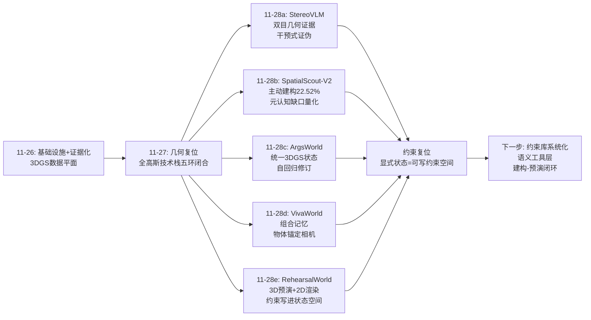
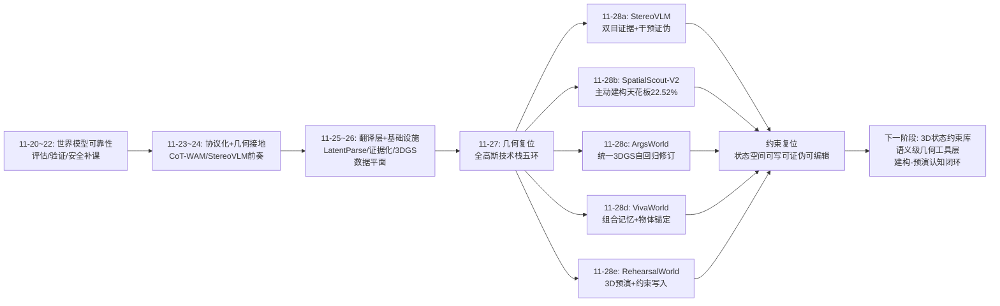
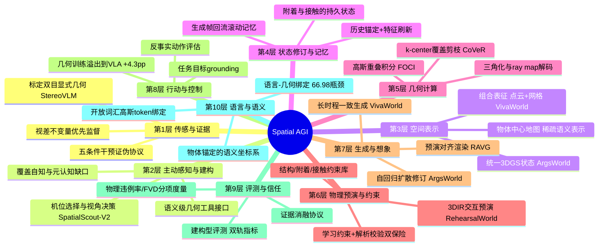
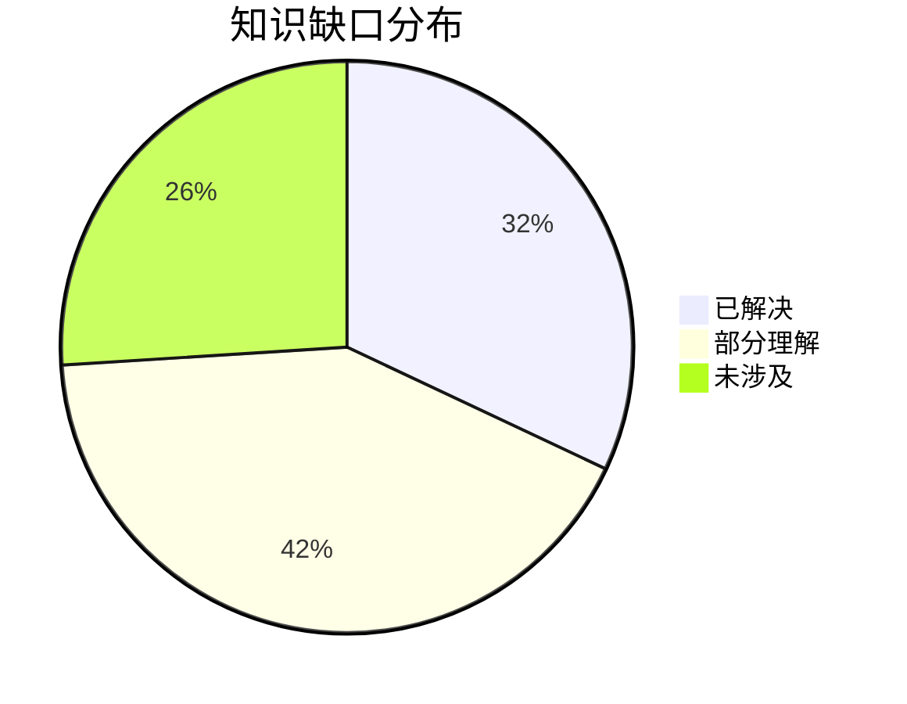

# Spatial AGI 每日思考 - 2026-11-28

## 📅 每日总结

**日期**: 2026-11-28
**论文数量**: 5篇
**主题**: 如果说昨天（11-27）的元判断是"几何复位——五个环节同时证明与空间同构的计算对象胜过学习信号"，那么今天的五篇论文回答的是几何复位之后的下一个问题：**显式的空间状态建立起来之后，往里面写什么、拿它做什么、怎么知道它是对的**。今天的五篇恰好构成空间智能体的完整功能环：StereoVLM 解决"空间证据从哪来"（感知层：标定双目的显式跨视几何作为可验证证据，视差监督泛化性 + 干预式证伪），SpatialScout-V2 解决"空间表示如何主动建构"（建构层：真实场景主动建图暴露 VLM 的 22.52% 天花板），ArgsWorld 解决"空间状态如何在生成过程中持续修订"（状态层：历史 latent 锚定 + 特征刷新的自回归 3DGS 世界），VivaWorld 解决"空间记忆如何组合与滚动增强"（记忆层：重建点云 + 生成网格的组合表征 + 物体锚定相机），RehearsalWorld 解决"空间状态如何推演行动后果"（预演层：3D 状态空间作为可写约束的物理预演器）。合起来的元判断是：**Spatial AGI 正在完成第二次复位——'约束复位'：显式 3D 状态空间从'计算载体'（昨日的高斯计算）升格为'可写约束的决策空间'（今天的接触/附着/分组约束、覆盖完整性约束、几何依赖性约束）；与此同时，'证据消融'（evidence ablation）正式成为空间智能评测的方法学标准——StereoVLM 的五条件干预与 SpatialScout-V2 的双轨指标共同确立了'空间判断必须可被证据破坏性检验'的新规范。** 另一条隐藏主线是"分工复位"：RehearsalWorld 的"3D 预演 + 2D 渲染"、VivaWorld 的"重建保真 + 生成补全"、ArgsWorld 的"历史锚定 + 特征刷新"、StereoVLM 的"几何不变量 + 语义映射"——四个系统不约而同地放弃了"单一表示包打天下"，转向按能力分配表示的混合架构。空间智能的架构哲学正在从"端到端统一"走向"显式分工 + 接口耦合"。

**关键突破**:
- 🚀 StereoVLM（HKUST/小鹏）：首个几何感知双目 VLM——分层监督（对应→视差→标定深度→语义 grounding）从双目显式几何学出可迁移 3D 表征；**深度 δ₁ 95.17%、物体级 66.98；干预实验（shuffled/duplicated/zero-right 五条件）证实性能真实依赖跨视几何；视差监督比直接深度监督 OOD 泛化显著更好；几何训练溢出：5 个空间基准 +3.54 分、RoboCasa 操作成功率 +4.3pp**
- 🚀 SpatialScout-V2（北大/天大）：主动空间建构评测从仿真到真实住宅——100 个真实场景、3,171 个目标、录制全景交互探索 + 三角化工具 + 地图修订；**七个前沿 VLM 中六个 all-target mean IoU < 20%，最强 Claude Opus 5.5 仅 22.52%（IoU>0.9 仅 0.19%）；双轨指标分离覆盖与精度（GPT-6 Astra submitted 21.65% vs all-target 15.50%——元认知缺口量化）**
- 🚀 ArgsWorld（哈工大/清华深研院）：统一自回归 3DGS 世界模型——重建、生成、断点外推一个模型；chunk 内每个去噪步刷新全部视角的场景特征 + 渲染 latent 反馈回路；3D Self-Forcing Distillation 在自生成历史上做图像/渲染三分支 DMD；**4 步采样、多任务 SOTA；novel-view 渲染分支实现无真值新视角的几何监督**
- 🚀 VivaWorld：组合式 3D 先验的长时程视频世界模型——重建点云（背景保真）+ 生成网格（前景完整 360°）+ 网格种子连通域滤波清除悬浮伪影；**物体锚定 Plücker 射线显式建模相机-物体关系，抑制长时程耦合漂移；生成帧回流更新 3D 记忆的滚动闭环；视觉质量与相机控制 SOTA，支持组合式 3D 重建与物理 AI 数据生成**
- 🚀 RehearsalWorld：物理一致的机器人世界模型——"3D 交互预演（点流先验 + 响应感知分组 + 持久抓取记忆 + 接触精修）→ 2D 预演对齐渲染"的解耦架构；**真实 DROID 抓取序列上夹爪相对偏移降低 79-84%（可变形/铰接/刚性），视频预测 PSNR 23.92 dB / FVD 149；物理与视觉解耦使材质与视角可独立编辑（反事实推演）**

**架构演进**: 几何复位（计算对象与空间同构）→ **约束复位（显式状态空间成为可写约束的决策空间）+ 证据消融方法学 + 表示分工架构**（感知/建构/状态/记忆/预演五环成形）

### 📊 一句话总结

今天五篇论文把空间智能系统从"几何计算的胜利"推进到"约束与证据的体系化"：StereoVLM 证明空间判断可以被证据破坏性检验（且检验通过的能力可以迁移到控制），SpatialScout-V2 度量了主动建构空间表示的真实差距（22.52%），ArgsWorld/VivaWorld 给出空间状态在生成过程中的两种持续修订架构（统一状态 vs 组合记忆），RehearsalWorld 则示范了显式 3D 状态空间最深的用途——作为写入物理与结构约束的预演器（夹爪偏移 −79~84%）。空间智能的架构哲学从"单一表示包打天下"收敛为"显式分工 + 接口耦合"。

### 🔗 延续性

**昨日→今日**: 昨日确立"几何复位"与"全高斯技术栈"五环闭合（感知-存储-想象-行动-推理）。今天五篇在此基础上向三个方向纵深推进：

1. **"几何计算"→"几何约束"**——昨日 FOCI 用高斯积分做碰撞计算（计算载体）；今天 RehearsalWorld 把显式 3D 状态空间用作写入结构约束（物体不散架）、附着约束（抓住不脱落）、接触约束（不穿透）的场所（决策空间）。显式表示的价值从"算得快"升格为"约束能写进去"——像素空间无法表达这些约束，这是显式性的深层红利。
2. **"几何证据"→"证据消融方法学"**——昨日证据化是审计生成结果（RoboProbe 审视频）；今天 StereoVLM 的五条件干预把证据化升级为**证伪机制**（破坏几何证据，看预测是否崩塌），SpatialScout-V2 的双轨指标把证据化升级为**完整性度量**（all-target 含遗漏）。评测方法学从"看结果对不对"进入"看依赖真不真、覆盖全不全"。
3. **"统一表示"与"组合表示"的路线分叉显性化**——昨日判断"高斯是通用字节表示"（统一路线）；今天 ArgsWorld 坚持统一 3DGS 状态，VivaWorld 却用组合异构表征（点云+网格）、RehearsalWorld 用两层解耦（3D+2D）。这不是矛盾而是收敛到新原则：**表示按能力分工，接口按信息流耦合**。统一性让位于"环节内最优、环节间可耦合"。
4. **"覆盖率货币"的主动化验证**——昨日 WorldExpand/CoVeR 把覆盖率用作生成/剪枝的显式目标；今天 SpatialScout-V2 把"覆盖率"还原为它的本体任务——Agent 主动补全覆盖的探索行为，并发现即便有显式覆盖率目标（目标库存），VLM 的探索与定位仍然失败。覆盖计算容易，覆盖执行难。
5. **"度量接地"的证据侧完成**——昨日 ST-SfM 从初始化侧回应"渲染像但量不准"；今天 StereoVLM 从监督侧完成回应：视差作为环境无关不变量 + 标定参数做算术换算，使度量正确性内建于训练信号结构。"起点质量（初始化）+ 信号质量（监督设计）"构成度量接地的完整两翼。
6. **从"全高斯栈"到"全栈智能体"**——昨日五环（感知/存储/想象/行动/推理）都落在表示层；今天的五环升格为功能环：感知（StereoVLM）→ 建构（SpatialScout-V2）→ 状态（ArgsWorld）→ 记忆（VivaWorld）→ 预演（RehearsalWorld）。空间智能体的骨架从"数据流"进化为"认知循环"。

**今日→明日**: 新线索十条：①**双目几何表征迁移到主动设定**——StereoVLM 依赖固定基线的标定双目，SpatialScout-V2 场景只有单目全景；如何让"视差不变量优先"原则在单目+主动运动（自己制造视差）下成立，是两个基准的汇合点；②**建构型评测的几何工具升级**——SpatialScout-V2 的三角化工具要求 Agent 手动选对应点，若换成"框选物体→返回 3D 中心"的语义级几何工具，天花板会移动多少？工具抽象层级与测得能力的混淆需要解耦实验；③**ArgsWorld 的不可逆错误问题**——历史 latent 锚定使早期几何错误难以推翻，需要不确定性加权的"历史降级/重置"机制；④**VivaWorld 的动态化**——组合网格表征如何接入动作条件（物体被推动后网格位姿更新）→ 与 RehearsalWorld 的抓取记忆天然互补；⑤**预演器与解析物理的双保险**——RehearsalWorld 的学习式接触约束在分布外可能自信地错，接 FOCI 类解析碰撞度量做后验证是安全层；⑥**证据消融的全栈化**——对世界模型 rollout 做"3D 状态消融"（扰动高斯/点云，看视频预测是否跟随）检验"渲染是否真的用了几何条件"；⑦**物体锚定坐标系的系统化**——VivaWorld 的物体锚定射线暗示空间记忆应以物体为坐标锚，与海马体 object-vector cell 呼应，"语义坐标系"的形式化值得探索；⑧**元认知的显式模块化**——SpatialScout-V2 的覆盖缺口（Astra 6 个点差距）指向"coverage tracker"模块：知道自己没看哪里、主动补测；⑨**分层几何课程的规模化验证**——StereoVLM 的"不变量优先"课程（对应→视差→深度）能否推广到多传感器（LiDAR/事件相机）与户外大尺度；⑩**建构-预演闭环**——SpatialScout-V2 的探索建构 + RehearsalWorld 的行动预演合成"边探索边预演"的具身智能体完整循环。明日检索方向："active parallax monocular stereo transfer"、"semantic geometric tool interface agent"、"uncertainty weighted history reset world model"、"action conditioned compositional mesh world model"、"analytic physics verification learned rollout"、"3D state ablation video world model"、"object anchored coordinate frame spatial memory"、"coverage tracker metacognition embodied agent"、"invariant first curriculum multi-sensor"、"explore rehearse loop embodied agent"。

### 💡 本质思考：如何达成通用空间智能

#### 1. 核心能力的本质是什么？

昨日答案是"计算对象与空间同构，学习只负责对象之间的映射"。今天推进一层：**通用空间智能 = 在可写约束的显式状态空间上，运行'证据获取 → 表示建构 → 状态修订 → 行动预演'的认知循环，且每个环节的判断都可被证据消融证伪**。昨天的关键词是"同构"（表示与空间的结构对应）；今天的三个新关键词是"约束"（状态空间的可写性）、"分工"（表示按能力分配）、"证伪"（判断的证据依赖性）。

三个具体化：
- **可写性是显式表示的终极价值**：RehearsalWorld 在 3D 状态空间里写"物体不散架、抓住不脱落、接触不穿透"；ArgsWorld 在 latent 历史上写"外观锚定"；VivaWorld 在组合表征里写"网格种子滤波"。显式表示的价值序列：可渲染（NVS 时代）→ 可计算（昨日几何复位）→ **可约束、可编辑（今天）**。一个只能看不能写的世界状态，不是智能体的世界状态，只是相册。
- **分工优于统一，接口决定架构**：RehearsalWorld 分"物理推演（3D）/视觉合成（2D）"，VivaWorld 分"保真（重建）/补全（生成）"，ArgsWorld 分"锚定（历史）/修订（特征刷新）"，StereoVLM 分"不变量（视差）/导出量（深度）"。四个系统的共同点：每一半都用最弱的表示做最难的事，接口处传递的信息恰好是另一半无法自产的。空间智能的架构设计题从"选什么表示"变成"切在哪里、接口传什么"。
- **证伪能力是空间智能的可信度下界**：StereoVLM 的五条件干预不仅评测了模型，更定义了"真空间推理"的操作标准——预测应随证据破坏而崩塌。SpatialScout-V2 的双轨指标定义了"完整空间表示"的操作标准——遗漏必须被计为错误。没有证伪机制的空间能力声明都应默认打折。

#### 2. 当前方法与理想目标的差距在哪里？

六条差距，按严重程度排序：

- **主动建构的 22.52% 天花板是最大的能力鸿沟**：感知可以靠几何工具补、状态可以靠架构补，但"决定去哪看、把局部观测拼成完整地图"的探索智能没有任何一篇今天的工作真正解决——SpatialScout-V2 只诊断不治疗。从 22.52% 到可用水平（>60%？）之间隔着探索策略、跨视角关联、几何工具使用、元认知四个未解环节。
- **几何证据的硬件依赖**：StereoVLM 的能力建立在标定双目上，真实世界的多数观测（手机、无人机、网络视频）是单目的。"视差不变量优先"原则需要单目版本的等价物（时序视差、结构 from 运动），目前断裂。
- **状态修订的不可逆错误**：ArgsWorld 的历史锚定使错误会固化；VivaWorld 的配准网格在物体被移动后失效；RehearsalWorld 的抓取记忆一旦记错全程传播。三个系统的"修正机制"都弱于"锚定机制"——真实空间智能需要能推翻自己的世界状态。
- **约束的分布外可靠性**：RehearsalWorld 的接触精修是学习出来的约束，分布外交互（罕见堆叠、缠绕）可能自信地违反物理；FOCI 的解析约束（昨日）可靠但表达力受限（刚性为主）。"学习约束的表达力"与"解析约束的可靠性"之间的桥还没搭。
- **建构与预演的闭环断裂**：建构（SpatialScout-V2）与预演（RehearsalWorld）分属两个世界：前者无行动、后者无探索。真实智能体是"边看边想边动"——探索中带着行动预演（"如果走过去会怎样"），预演指导下一步看哪。今天没有任何系统连接这两环。
- **评测的几何工具混淆**：SpatialScout-V2 的低分部分归因于三角化工具的抽象层级太低（手动选点、推断中心偏移）；测的是"用工具的能力"还是"空间能力"没有分离。评测协议的工具设计本身需要方法学净化。

#### 3. 从今天到理想状态，最可能的路径是什么？

三步路径，每步 6-12 个月：

- **第一步：约束写法的系统化（当前-2027H1）**——把 RehearsalWorld 的三类约束（结构/附着/接触）形式化为显式 3D 状态空间上的可插拔约束库；接入解析物理校验（FOCI 类积分度量）作为学习约束的分布外保险；在 ArgsWorld/VivaWorld 状态上实验"约束投影"（每个去噪步/每个 chunk 后投影回约束流形）。判据：出现开源的"3D 状态约束库"，世界模型 rollout 的物理违例率可量化下降一个量级。
- **第二步：主动建构的语义工具层（2027H1-H2）**——在 SpatialScout-V2 协议上做工具消融实验（三角化 vs 物体框选 vs 直接查询覆盖度），分离"空间能力"与"工具能力"；给 VLM Agent 加显式 coverage tracker（目标库存完成度自监控）与主动补测策略；把 StereoVLM 的几何 grounding 作为建构环节的语义级几何工具。判据：同一协议下，仅通过工具升级 + 元认知模块（不改 VLM）将 all-target IoU 从 22% 推过 40%，并给出能力归因分解。
- **第三步：建构-预演认知闭环（2027H2-）**——打通"探索建构（SpatialScout-V2）→ 状态修订（ArgsWorld）→ 行动预演（RehearsalWorld）→ 回到探索"的完整循环：智能体在真实场景中边建物体级地图边对候选动作做 3D 预演，预演结果（可达性/碰撞风险）反馈为下一个观测点的选择依据（覆盖率 + 预演价值的多目标观测选择——昨日线索⑧的落地）。判据：在真实室内任务上，闭环智能体以显著更少的交互预算达到任务目标，且每个行动前都有可查询的预演记录（可审计性）。

理想终局：空间智能体的世界状态是一个可写约束、可查证据、可滚动修订的显式空间结构——感知往里写几何证据（带依赖性检验）、探索往里写覆盖进度（带完成度自监控）、想象往里写预演轨迹（带物理约束投影）、行动从里面读出可行方案。学习模型在循环的每个接口上做映射（传感器→证据、约束→修正、预演→渲染），几何结构负责正确性，显式性负责可审计性。**约束写在状态上，证据随状态生长，判断经消融存活。这就是约束复位完成后的通用空间智能。**

---

## 🔗 与昨日思考的联系

### 昨日重点

昨天的元判断：几何复位——表示/想象/行动/观测/推理五环节同时倒向与空间同构的几何对象（高斯、坐标、密度场、覆盖率）；全高斯技术栈五环闭合（GOLD-SLAM 感知、SplatTok 存储、SplatWAM 想象、FOCI 行动、CoVeR 推理）；方法论关键词"几何即证据""覆盖率货币""构造性一致性"；三条待解：接口标准化、几何-语义结合层、生成审计安全层。

### 今日进展

今天五篇论文在"几何复位"的地基上盖起了"约束与证据"的上层建筑：

- **从"几何计算"到"几何约束"**：昨日几何是算得快的对象（FOCI 积分、CoVeR 距离）；今天几何是写得进约束的空间（RehearsalWorld 的结构/附着/接触三层约束）。显式表示的价值从效率层进入可靠性层——这是几何复位之后最重要的价值升级。
- **从"证据自产"到"证据消融"**：昨日"几何即证据"指几何量自带可验证性；今天 StereoVLM 把证据变成可操作实验（五种输入条件下预测的系统性变化），建立了空间判断的证伪协议。方法学从"有证据"进入"可证伪"。
- **统一 vs 组合的路线显性分叉**：昨日判断高斯是统一表示；今天 ArgsWorld（统一 3DGS）与 VivaWorld（组合点云+网格）、RehearsalWorld（3D+2D 解耦）给出反面证据——当任务复杂度上升，表示分工的收益超过表示统一的收益。收敛出的原则是"环节内最优 + 接口耦合"，而非"处处同一对象"。
- **"几何前置"原则的三次复现**：昨日 ST-SfM 先几何后描述子；今天 StereoVLM 先视差不变量后标定换算、ArgsWorld 先历史锚定后特征修订、VivaWorld 先网格种子后点云滤波。四个系统都用高置信的几何结构先"定盘"，再让学习信号在剩余空间工作。"锚定-扩展"成为空间系统的通用训练/推理模式。
- **元认知缺口的首次量化**：昨日"覆盖化"把覆盖率当作优化目标；今天 SpatialScout-V2 发现 VLM 连"自己漏了什么"都不知道（submitted 与 all-target 的 6 个点差距）——覆盖率作为优化目标的前提是 Agent 知道当前覆盖状态，这个"覆盖自知"环节此前完全缺位。
- **从数据流五环到认知循环五环**：昨日全高斯栈是数据流（感知→存储→想象→行动→推理）；今天五篇构成认知循环（证据→建构→状态→记忆→预演）——循环意味着每个环节的输出都是其他环节的输入且存在反馈边，这是"智能体"与"管线"的本质区别。

### 演进路径



---

## 📚 论文概览

**论文1: StereoVLM**（感知层·几何证据）—— HKUST/小鹏机器人：首个几何感知双目 VLM。Stereo3D-Bench 8 任务 3 层级（点级对应/视差/深度 → 物体级对应/视差/深度 → 定向 3D grounding/任务目标 grounding）；主 split 94,546 QA（DROID/Xperience-10M/FSD/RoboCasa）+ 防泄漏切分 + in-house OOD；五条件干预（correct/single/zero/duplicated/shuffled）证伪几何依赖；StereoVLM-8B 深度 δ₁ 95.17%、物体级 66.98；视差监督 OOD 泛化优于直接深度；溢出效应 5 基准 +3.54 / RoboCasa +4.3pp。

**论文2: SpatialScout-V2**（建构层·主动探索）—— 北大/天大：真实住宅主动建图基准。100 场景/3,171 物体/29 类；录制全景 + 机位选择/转向/拍图/三角化/提交五工具；AABB 平移 3D IoU 一对一匹配；双轨指标（all-target 含遗漏 vs submitted-target）；七个前沿 VLM xhigh 推理评测：Opus 5.5 all-target 22.52% 最佳、IoU>0.9 仅 0.19%；GPT-6 Astra 的 6 个点 submitted/all-target 差距 = 遗漏型元认知失败；工具使用行为分化与重复操作普遍。

**论文3: ArgsWorld**（状态层·统一世界模型）—— 哈工大/清华深研院：自回归扩散 3DGS 世界模型统一重建/生成/外推。Wan2.2-TI2V-5B 骨干（FlashWorld 初始化）；chunk-wise：历史 latent（timestep 0）前置 + 双向注意力 + 每步刷新全部视角特征 + 高斯重解码（历史锚定外观、刷新修订几何）；渲染 latent 再加噪回输入的反馈回路；3D Self-Forcing Distillation（自生成历史 + direct RGB/input-view/novel-view 三分支 DMD + 2D-3D 一致性 MSE）；4 步采样、480×704、多任务 SOTA。

**论文4: VivaWorld**（记忆层·组合表征）—— 长时程视频世界模型：SAM3 分割 + RecGen/GPT-6 Astra 生成物体网格 + ICP 各向异性配准（前景）+ Pi3/ViPE 重建点云（背景）；网格种子连通域滤波（BFS 清悬浮伪影）；组合相机嵌入 = 场景中心 Plücker + 物体锚定 moment（每物体 +6 通道）；轻量 adapter 注入视频 DiT；chunk 自回归 + 生成帧回流更新点云；视觉质量/相机控制 SOTA + 可控 NVS + 组合重建 + 物理 AI 数据生成。

**论文5: RehearsalWorld**（预演层·物理约束）—— 可编辑机器人世界模型：3DIR 交互预演（预训练点流先验 + 响应感知分组（按对动作的响应发现物体）+ 持久抓取记忆（附着全程跟随）+ 接触结构精修（不穿透/支撑保持））→ RAVG 预演对齐生成（几何投影作时间条件微调视频生成器）；物理/视觉解耦 → 材质与视角独立编辑；真实 DROID 抓取：夹爪相对偏移 −79~84%（三类物体），PSNR 23.92 dB / FVD 149。

---

## 💡 核心见解

### 见解1: 约束复位——显式 3D 状态空间的终极价值是"可写性"
（从论文5 RehearsalWorld 获得，ArgsWorld/VivaWorld 佐证）
- ✅ RehearsalWorld 在 3D 状态空间写入三类约束：物体结构（响应分组保持完整）、抓取附着（持久记忆保持跟随）、接触结构（精修保持不穿透）——这些约束在像素空间里无法表达
- ✅ 结果是决定性的：夹爪相对偏移 −79~84%，说明"约束写在正确的空间里"比"更强的视觉生成器"重要得多
- ✅ 显式表示的价值三级跳：可渲染（NVS）→ 可计算（昨日几何复位）→ 可约束/可编辑（今天）

**对Spatial AGI的启发**:
判断一个空间表示是否够格作为智能体的世界状态，第一问应是："我能在上面写什么约束？"——能写物体不散架、抓住不脱落、通道可通过的表示，才配称为世界状态；只能看不能写的，是相册。昨天问"哪部分几何能直接算"，今天加一问："哪部分物理能直接写"。

### 见解2: 证据消融是空间智能评测的新标准——预测必须随证据破坏而崩塌
（从论文1 StereoVLM 获得，SpatialScout-V2 双轨指标同构）
- ✅ StereoVLM 五条件干预：single left / zero right / duplicated left / shuffled right 逐一破坏证据的不同侧面——性能提升被证明真实依赖跨视几何，而非额外 token 或语义先验
- ✅ SpatialScout-V2 双轨指标：all-target 把遗漏计为错误——"广撒网"策略不能再掩盖"不知道自己不知道"的失败
- ✅ 两者共同确立操作标准：真空间推理 = 依赖几何证据（可证伪）+ 覆盖完整库存（可审计）

**对Spatial AGI的启发**:
今后评估任何空间能力声明，先问三个破坏实验：把证据换掉（shuffled）还剩多少分？把证据删掉（single）还剩多少分？把没见过的目标算上（all-target）还剩多少分？三个数字齐全才有讨论价值。这也应内化为模型的训练信号——对证据扰动敏感（而不是鲁棒到无视证据）才是好的空间表征。

### 见解3: 监督信号应尽量接近观测中的不变量——视差优于深度的推广
（从论文1 StereoVLM 获得）
- ✅ 视差是双目几何的原生量（环境无关），深度是经标定导出的量（环境相关）；先学不变量、推理时用标定做算术，OOD 泛化显著更好
- ✅ VivaWorld 同构证据：物体锚定射线（相对量）比全局位姿（绝对量）更抗长时程漂移
- ✅ ArgsWorld 同构证据：历史 latent 锚定（不变的外观参照）+ 特征刷新（可变的几何修订）

**对Spatial AGI的启发**:
"不变量优先"可以形式化为训练设计准则：把传感器原生坐标系的量（视差、相对位姿、对应）作为监督主体，把世界坐标系的导出量（深度、全局轨迹）留给模型结合上下文换算。凡是能用相对量表达的监督，不要用绝对量。

### 见解4: 主动空间建构是当前最大的能力鸿沟——22.52% 与 0.19%
（从论文2 SpatialScout-V2 获得）
- ✅ 七个前沿 VLM 六个 all-target IoU < 20%；IoU>0.9 仅 0.19%——即便定位"成功"也停留在"大致在那边"，度量级精确性完全缺失
- ✅ 给了三角化几何外挂也没用：瓶颈不在"能不能算"而在"会不会用"（对应点选择、中心偏移推断都是失败点）
- ✅ 元认知缺口：Astra 的 submitted/all-target 6 个点差距说明模型不知道自己漏了什么

**对Spatial AGI的启发**:
探索智能（去哪看、看多久、何时停）是被端到端范式长期掩盖的独立能力，需要显式建模：coverage tracker（覆盖自知）+ 信息增益估计（价值判断）+ 停止规则（预算管理）。同时警惕评测的工具混淆——三角化级别的低层工具测的是工具使用而非空间理解，语义级几何工具（框选→返回 3D 中心）应成为标配，并做工具消融归因。

### 见解5: 分工优于统一——按能力切割表示，按信息流设计接口
（从论文3/4/5 获得）
- ✅ RehearsalWorld：物理推演用 3D 点云（可写约束），视觉合成用视频生成（有外观先验）
- ✅ VivaWorld：已观测区域用重建点云（保真），未观测区域用生成网格（完整）
- ✅ ArgsWorld：外观用固定历史 latent（锚定），几何用刷新特征（修订）
- ✅ 共同结构：每一半都用最合适的表示做最难的事，接口传递的恰是另一半无法自产的信息（几何投影→视频模型；观测点云→生成网格；干净历史→修订过程）

**对Spatial AGI的启发**:
架构设计的核心问题从"选什么表示"变为"切在哪里、接口传什么"。切割原则：在"能力需求突变"处切（物理 vs 外观、已见 vs 未见、锚定 vs 修订）；接口原则：传递对方无法自产的互补信息，且不传冗余。统一表示（昨日全高斯栈）在环节间转换成本上有优势，分工表示在环节内质量上有优势——系统级答案可能是"环节内分工、环节间统一格式"。

### 见解6: 生成与重建应互为校验——网格种子滤波的元模式
（从论文4 VivaWorld 获得）
- ✅ 重建点云有悬浮伪影（跨 chunk 深度不一致），生成网格是高置信的几何锚——用后者 BFS 泛洪清洗前者
- ✅ 反向同样成立：生成网格靠 ICP 配准锚定到重建观测点（生成对齐现实）
- ✅ VivaWorld 的滚动闭环：生成帧经重建回流为 3D 记忆，记忆又约束后续生成

**对Spatial AGI的启发**:
空间系统中的多源信息（重建/生成/检测/语言）不应是并联投票，而应是互为种子的交叉验证：高置信源泛洪验证低置信源、低置信源补充高置信源的盲区。昨天 RoboProbe 用几何证据审计生成视频是单向审计；今天的双向互哺（生成清洗重建、重建锚定生成）是更健康的生态。"生成即需审计"升级为"生成与重建互为审计"。

### 见解7: 空间关系的时序寿命需要显式状态——附着是记忆不是判断
（从论文5 RehearsalWorld 获得）
- ✅ 持久抓取记忆：附着关系建立后作为持久状态全程跟随，而非每帧重估——"抓住"是过去某刻的事件+"当前仍有效"的持续状态
- ✅ 对照失败模式：每帧重估附着的模型在遮挡/接触变化时"忘记"物体在手里
- ✅ VivaWorld 的物体锚同理：锚定网格的物体中心是持久坐标锚，不是逐帧检测

**对Spatial AGI的启发**:
空间关系应按寿命分类管理：瞬时关系（当前视线内的遮挡）逐帧计算、事件型持久关系（抓取、放置、支撑）写入状态并维护、结构关系（房间拓扑）一旦建立缓慢更新。空间记忆的写路径（何时建立关系）与维持路径（何时失效关系）同样重要——失效检测（放下/脱抓）是当前系统的普遍盲区。

### 见解8: 几何训练有跨任务溢出——地基投资回报率最高的环节
（从论文1 StereoVLM 获得，对照论文2）
- ✅ 分层几何监督使 5 个空间基准平均 +3.54 分、RoboCasa 真实操作 +4.3pp——几何能力不是专项技能而是通用底座
- ✅ 对照 SpatialScout-V2：没有几何证据/训练时，同一批 VLM 在主动建构上只有 22%——几何在不在输入里、在不在训练里，能力差一个数量级
- ✅ 点级几何接近饱和（95%）而物体级只有 67%——语言-几何绑定（指涉解析）是剩余瓶颈

**对Spatial AGI的启发**:
资源分配启示：在感知硬件与几何监督上的投入回报高于在参数规模上的投入。下一阶段的攻关点明确：语言-几何接口（把"桌上的红色杯子"可靠地落到 3D 框上）——这既是 StereoVLM 的 67% 瓶颈，也是 SpatialScout-V2 的定位瓶颈，也是 VLA 任务目标 grounding 的关键路径。一个能力、三处需求，优先级自明。

### 见解9: 反事实推演因解耦而廉价——可编辑性是空间智能的隐藏能力
（从论文5 RehearsalWorld 获得）
- ✅ 物理（3D 预演）与视觉（2D 渲染）解耦后，改材质只动预演、改视角只动投影——"如果这个物体是软的会怎样"从重新训练变成一次推理
- ✅ VivaWorld 的组合表征同理：物体级网格解耦使场景编辑（换物体、移物体）成为原生操作
- ✅ 反事实是规划的核心：评估动作后果 = 在修改后的世界状态上重跑预演

**对Spatial AGI的启发**:
空间智能体的世界模型必须支持"轻量反事实"——改一个属性/物体/视角后快速重推演。这要求世界状态的属性-结构分离：几何结构（哪里有什么）与物理属性（软硬/质量/摩擦）分别可编辑。当前多数世界模型把两者揉在生成权重里，反事实成本为"重新生成"；解耦架构把它降为"重新推演"，再降为"局部重推演"是下一步。

---

## 🗺️ 知识演进图

⚠️ 必须使用 mermaid 代码块！禁止用纯文本箭头！



### 演进逻辑

本周演进线完成第三次跃迁：11-20~23 世界模型补"可靠性"课；11-24~26 发现可靠性根源是"翻译鸿沟"并转向协议化与基础设施；11-27 完成几何复位（计算对象与空间同构）；今天（11-28）跃迁到约束与证据层——显式状态空间开始承载可写约束（RehearsalWorld），空间判断开始接受消融证伪（StereoVLM），空间表示开始度量建构完整性（SpatialScout-V2）。同时表示路线显性分叉（统一 vs 组合），收敛出"分工+接口"的架构原则。下一步预计从"约束写法"转向"约束系统化"（约束库、解析校验、约束投影）与"认知闭环"（建构-预演-探索循环）。

---

## 技术栈演进对比表

| 层次 | 昨日方案 (11-27) | 今日方案 (11-28) | 变化 |
|------|---------|---------|------|
| 几何证据来源 | 几何量作审计信号（RoboProbe 审计生成视频） | StereoVLM: 标定双目显式跨视几何作训练证据+五条件消融证伪 | 证据从审计工具升格为监督主体与证伪协议 |
| 空间能力评测 | VSI-Bench 类静态问答 / 闭环交互（昨日基建） | SpatialScout-V2 建构型评测（主动建图+双轨指标）+ Stereo3D-Bench 干预协议 | 从"答对问题"到"建构表示+证据消融" |
| 世界模型状态更新 | SplatWAM: 状态即高斯场，扩散直接演化 | ArgsWorld: 历史锚定+特征刷新的 chunk 修订 / VivaWorld: 生成帧回流更新记忆 | 从"状态演化"到"状态修订+记忆滚动" |
| 世界表示结构 | 统一高斯（全高斯栈） | ArgsWorld 统一 3DGS vs VivaWorld 组合（点云+网格）vs RehearsalWorld 解耦（3D+2D） | 统一 vs 组合分叉，收敛到"分工+接口"原则 |
| 物理/行动 | FOCI: 高斯重叠积分解析碰撞（计算） | RehearsalWorld: 3D 状态空间写入结构/附着/接触约束（预演） | 从解析计算到可写约束；从碰撞度量到交互预演 |
| 相机/位姿表征 | 全局 Plücker / 相机条件（BiWM 类） | VivaWorld: 全局+物体锚定组合射线（相机-物体关系） | 位姿表征关系化：锚定语义实体抗漂移 |
| 物体概念来源 | 开放词汇分割/语义 token（待结合层） | RehearsalWorld: 响应感知分组（动力学共同响应定义物体） | 物体从感知输入变为动力学推断输出 |
| 元认知/完整性 | 覆盖率作生成/剪枝目标（WorldExpand/CoVeR） | SpatialScout-V2: 覆盖自知缺失的量化（submitted/all-target 差距） | 覆盖从目标函数降维打击到"Agent 不知道自己漏了什么" |
| 反事实编辑 | 物体级编辑在压缩态可行（SplatTok 问题） | RehearsalWorld: 材质/视角独立编辑（解耦原生支持） | 编辑从"困难的压缩态操作"变为"解耦的原生操作" |
| 几何-语义接口 | （昨日判断为最大空白） | StereoVLM: 物体级 grounding 66.98（接口初步打通但仍是瓶颈） | 空白开始填补，量化出 95 vs 67 的能力断层 |

---

## 🗺️ Spatial AGI 知识图谱

### 10层架构思维导图

⚠️ 必须使用 mermaid mindmap 代码块！



### 🎯 主线技术路径

#### 阶段1: 几何证据基础设施（已完成，11-24~11-28）
显式几何从"可有可无的辅助"确立为空间智能的证据基础：StereoVLM 证明双目几何可作为 VLM 的训练监督并产生跨任务溢出；ST-SfM（昨日）证明时空几何可作为 4D 表征的初始化；VivaWorld 证明 3D 重建可作为生成过程的条件锚。证据基础设施的特征是"低层几何量 + 严格质量控制 + 可消融验证"。

#### 阶段2: 显式状态空间与约束写入（当前，11-27~2027H1）
几何从证据升格为状态、从状态升格为约束空间：全高斯栈（昨日）提供统一状态表示；RehearsalWorld（今日）示范在状态空间写入物理/结构/附着约束；ArgsWorld/VivaWorld（今日）提供状态的两种修订机制（统一自回归 / 组合滚动）。本阶段的关键工程是把约束写法系统化——约束库、解析校验、约束投影。

#### 阶段3: 认知循环闭环（2027H1~2027H2）
把今天成形的功能环连成反馈循环：主动探索（SpatialScout-V2）构建物体级状态 → 状态修订（ArgsWorld/VivaWorld）维持一致世界 → 行动预演（RehearsalWorld）评估候选动作 → 预演结果反馈为下一个观测决策（覆盖率 + 预演价值的多目标选择）。加上覆盖自知（元认知模块）与语义级几何工具，智能体获得"边看边想边动"的完整循环。

#### 阶段4: 可信空间智能体（2027H2~）
在闭环之上叠加信任栈：每个空间判断附带证据依赖性报告（消融可测）、每个想象状态附带物理约束证书（解析可查）、每个世界状态支持轻量反事实编辑（解耦可改）、每次探索附带覆盖完整性声明（遗漏可计）。空间智能从"能力存在"进入"能力可信"——判断可证伪、想象可审计、状态可编辑、探索可交代。

---

## 🔍 待探索议题

### 高优先级（本周）

1. **建构-预演认知闭环**
   - 问题: 探索建构（SpatialScout-V2）与行动预演（RehearsalWorld）分属两个世界，真实智能体需要"边看边预演"
   - 候选方案: 用物体中心地图作为两者的共享状态层——探索写地图、预演读地图；预演的可达性/风险反馈为机位选择的加项
   - 缺口: 两个系统的状态格式不通（物体中心点 vs 点云+网格）；预演价值的观测选择目标函数未定义

2. **语义级几何工具接口**
   - 问题: SpatialScout-V2 的三角化工具太低层（手动选点+推断中心偏移），测得的能力天花板被工具混淆
   - 候选方案: 设计三级工具（像素三角化 / 物体框选返回3D中心 / 查询覆盖度）做工具消融，分离"空间能力"与"工具能力"
   - 缺口: 语义级几何工具的实现本身需要 StereoVLM 类 grounding 能力——工具供给与能力测量互为前提的循环需要打破

3. **元认知覆盖追踪模块**
   - 问题: VLM Agent 不知道自己漏了什么（Astra 6 个点差距），覆盖率作为目标的前提（覆盖自知）缺失
   - 候选方案: 显式 coverage tracker（目标库存 × 已确认覆盖矩阵）+ 补测策略（未覆盖目标的定向探索）+ 预算分配器
   - 缺口: 未覆盖目标的"定向探索"需要从物体先验推断可能在哪（语义先验 × 空间推理），当前 VLM 恰好缺这个

### 中优先级（本月）

4. **历史锚定的不可逆错误问题**
   - 问题: ArgsWorld 的历史 latent 锚定使早期几何错误固化，后续只能局部精修不能推翻
   - 候选方案: 不确定性加权的历史（高置信区锚定、低置信区可重写）+ 新证据冲突检测触发局部历史重置
   - 缺口: latent 空间的不确定性估计与冲突检测机制；重置后的一致性维护

5. **学习约束的解析保险**
   - 问题: RehearsalWorld 的接触精修是学习出来的约束，分布外交互可能自信地违反物理
   - 候选方案: 接 FOCI 类解析碰撞积分做 rollout 后验证；违例时触发解析投影修正或保守降级
   - 缺口: 解析度量对柔性/铰接物体的覆盖；投影修正的可微性与实时性

6. **3D 状态消融评测**
   - 问题: 世界模型的渲染是否真的"用了"几何条件未被验证（几何条件可能被视频生成器忽略）
   - 候选方案: 对输入的 3D 状态做受控扰动（移物体/改几何），量化视频输出跟随度——StereoVLM 干预协议的世界模型版
   - 缺口: 扰动的语义等价类设计（什么算"同一状态的不同渲染"）

7. **物体锚定语义坐标系**
   - 问题: VivaWorld 的物体锚定射线是点技术，尚未升格为系统性的空间记忆坐标系
   - 候选方案: 以物体集合为坐标锚的形式化框架（object-frame SLAM/memory），与海马体 object-vector cell 理论对齐
   - 缺口: 物体移动时锚的更新机制；锚稀疏/密集场景的稳定性分析

### 低优先级（本季度）

8. **双目原则的单目迁移**
   - 问题: StereoVLM 依赖标定双目硬件，多数真实观测是单目的
   - 候选方案: 主动运动制造"人工视差"（时序立体）+ 视差不变量课程在单目时序数据上的重述
   - 缺口: 单目时序的对应/视差监督信号质量；主动运动与感知的联合策略

9. **不变量课程的规模化验证**
   - 问题: "对应→视差→深度→语义"课程在双目+室内验证，多传感器/户外大尺度未测
   - 候选方案: LiDAR（原生量=距离）、事件相机（原生量=亮度变化）的对应不变量课程设计
   - 缺口: 各传感器原生不变量的形式化清单；跨模态课程的统一框架

10. **约束写法的边界地图**
    - 问题: 哪些约束可以写进显式状态（结构/附着/接触已验证），哪些不能（流体/缠绕/多体混沌）？
    - 候选方案: 系统测绘约束类型 × 场景类型的可写性矩阵；不可写约束的代理方案（局部学习+全局解析）
    - 缺口: 约束可写性的形式判据；边界地图作为"几何-学习路由器"的输入（呼应昨日线索⑩）

---

## 📊 知识缺口分析

⚠️ 必须使用 mermaid pie 代码块！



**已解决（32%）**:
- ✅ 几何证据作为 VLM 监督的可行性与溢出效应（StereoVLM：+3.54/+4.3pp）
- ✅ 显式 3D 状态空间承载物理约束的架构与收益（RehearsalWorld：−79~84%）
- ✅ 空间状态在生成过程中的持续修订机制（ArgsWorld 统一路线 / VivaWorld 组合路线）
- ✅ 空间判断的证伪协议与建构完整性的度量标准（干预消融 + 双轨指标）
- ✅ 长时程一致性的相机表征方案（物体锚定射线）
- ✅ 重建与生成的互校验模式（网格种子滤波 / ICP 锚定）

**部分理解（42%）**:
- ⚠️ 主动空间建构——差距已量化（22.52%）但解决方案缺位（探索策略/工具抽象/元认知三个子问题均开放）
- ⚠️ 语言-几何绑定——接口已打通（66.98）但距饱和远，指涉解析+语义融合的联合建模不清
- ⚠️ 状态修订的不可逆错误——锚定机制强、修正机制弱，不确定性加权方案未验证
- ⚠️ 学习约束的分布外可靠性——解析保险的思路明确但柔性/铰接覆盖不足
- ⚠️ 表示统一 vs 分工的选择判据——两路线各有证据，"何时切、切在哪"无形式化
- ⚠️ 覆盖自知——缺口已量化，coverage tracker 的具体架构与定向探索策略未设计

**未涉及（26%）**:
- ❌ 建构-预演-探索的认知闭环系统（边看边想边动的完整智能体）
- ❌ 双目原则的单目/时序迁移（无标定硬件场景的等价方案）
- ❌ 动态世界中的组合表征更新（物体被移动后网格记忆的失效与重建）
- ❌ 约束可写性的边界地图（哪些物理写不进显式状态）
- ❌ 语义坐标系的形式化（物体锚从点技术到记忆框架）
- ❌ 多传感器不变量课程的统一框架（LiDAR/事件相机的对应量课程）
- ❌ 世界模型 rollout 的实时闭环控制（预演-渲染两阶段的时延问题）

---

## 🧭 明日行动清单

1. 检索"semantic geometric tool interface agent"与"coverage tracker metacognition"——验证语义级工具层是否已有人做（议题2/3）
2. 跟进 ArgsWorld 项目页的后续（代码开源后可复现 3D Self-Forcing 的三分支配比实验）
3. 交叉验证线索⑥：检索"3D conditioning ablation video generation"看世界模型的几何依赖性检验是否已有先例
4. 关注小鹏机器人 StereoVLM 的落地路线——双目硬件 + 几何 VLM 的产品化进度是产业信号

---

**文档创建时间**: 2026-11-28 03:00 (UTC+8)
**基础日期**: 2026-11-27（昨日完整完成，正常延续）
**分析方法**: GLM WebReader（arXiv 全文抓取 + 五篇论文深度精读 + 跨日延续性分析）

---

## 📖 五篇论文深读笔记

### 深读1: StereoVLM——几何证据如何进入语言模型

**问题起点：空间判断的可信度危机**

VLM 空间能力的老大难问题是"先验污染"：模型答对"桌子有多宽"可能不是因为看到了桌子，而是因为训练数据里桌子的典型宽度就是那个数。evidence-absent 评测（把图换掉答案还对）已证实这一担忧。StereoVLM 的釜底抽薪之策是换证据源：标定双目的跨视对应是无法从语义先验中"猜"出来的——右图中对应点的位置完全由场景几何决定。

**分层课程的精妙之处**

对应 → 视差 → 深度 → 语义，每一层都是上一层的导出：
- 对应（哪两个像素是同一个点）是纯 2D 几何操作，零先验依赖；
- 视差 = 对应点的水平位移，只依赖对应质量；
- 深度 = f(视差, 焦距, 基线)，标定参数显式注入；
- 物体几何 = 点级几何的语言聚合，语义指涉进入。

这个结构的深层价值：**每一层的监督错误都有明确的传播路径与拦截点**。对应错了视差必错——中间层的可检验性使错误不会无声传播到语义层。这与端到端训练"错误混在梯度里"形成对照。

**视差 vs 深度的监督设计哲学**

直接监督深度时，模型必须同时学两件事：几何对应（环境不变）+ 标定换算（环境相关）。在 A 环境学的深度直觉到 B 环境可能失效（尺度不同）。视差监督把环境相关的部分剥离给推理时的算术（内参/基线文本注入），模型专注学不变量。实验证实：视差监督在 OOD 上的深度精度显著优于直接深度监督。

**推广公式**：监督目标的选择标准 = 该量对环境变化的偏导数。偏导为零的量（几何不变量）优先作为监督主体；偏导非零的量（度量导出量）作为推理时任务，用显式参数完成换算。

**五条件干预的实验设计细节**

五个条件不是随意的扰动组合，而是系统的证据消融矩阵：
- single left 测"右图信息的边际贡献"；
- zero right 测"图像槽本身的架构增益"（排除位置编码/token 数量效应）；
- duplicated left 测"双目位移的贡献"（保内容去几何）；
- shuffled right 测"跨视匹配的贡献"（保自然性去匹配）。

四个对照各自隔离一个混杂变量——这是把药物试验的安慰剂/对照设计搬进了模型评测。方法学价值不亚于 95.17% 这个数字本身。

**溢出效应的机制猜想**

为什么几何训练改善了 RoboCasa 操作成功率（+4.3pp）？可能机制：操作策略需要的关键信息（目标物体的 3D 位置/尺寸）本来就要从双目观测中提取，几何 grounding 训练使这条信息通路更干净——策略网络收到的视觉特征里几何信号的信噪比更高。这意味着几何训练不只是加了一个技能，而是**净化了整个感知-行动通路的信号质量**。

---

### 深读2: SpatialScout-V2——把空间智能逼到墙角的评测设计

**为什么主动建图是最狠的评测**

它同时压测五个能力，任何一个短板都会暴露：
1. 探索决策（去哪看）——信息增益估计；
2. 跨视角关联（这是同一个杯子吗）——实例级对应；
3. 几何估计（杯子中心在哪）——多视三角化；
4. 表示整合（地图一致性）——增量更新与修订；
5. 元认知（还有什么没看）——覆盖自知。

静态 QA 评测只压测 2/3；VivaWorld 类生成评测只压测 1；只有主动建图是全栈压测。22.52% 的成绩单因此是"全栈短板的合成读数"——比任何单项评测都更接近"空间智能体离可用有多远"的真实答案。

**双轨指标的诊断价值（再深一层）**

all-target 与 submitted-target 的差距是一个"遗漏诊断器"：
- 差距大 = 探索不足/覆盖自知缺失（Astra 型失败：交得多但漏得也多）；
- 差距小且双低 = 可能是保守策略（Opus 型：交的几乎都交了，但都不准）；
- 理想形态 = 双高：既全又准。

更细的诊断维度（论文未做但可延伸）：把 IoU 误差分解为「发现失败」（目标从未被观测）/「关联失败」（观测到但匹配错）/「估计失败」（匹配对但中心偏）三类——三类失败的修复路径完全不同（探索策略 / 关联模块 / 几何工具），这个分解是后续改进工作的路线图。

**工具使用行为的启示**

不同模型在 120-turn 预算内的分配策略差异显著：有的狂拍图少三角化（几何计算缺位），有的频繁重复同一机位（探索策略退化）。这暗示一个未被研究的方向：**空间智能体的行为策略（预算分配）本身可以作为训练目标**——用探索效率（单位 IoU 增量的交互成本）作为 reward 的一部分，可能比端到端 IoU 奖励更可优化。

**真实场景的三重难度的具体化**

从仿真到真实的三个升级各自淘汰了一批能力：
- 真实外观：淘汰依赖渲染域先验的定位（仿真里物体边缘干净，真实里有纹理歧义）；
- 保留非目标内容：淘汰"目标总是显著"的假设（真实场景里目标被遮挡/混杂在杂物中）；
- 交互探索：淘汰静态单次推理（必须闭环：看→更新→决定下一步）。

22.52% 是三重淘汰后的幸存者成绩——仿真的高分模型在这里全部现出原形。

---

### 深读3: ArgsWorld——场景状态作为生成过程的隐变量

**"场景活在去噪里"的架构解读**

传统管线：先生成图像 → 再重建 3D（两阶段，误差单向传播）。ArgsWorld：每个去噪步同时输出图像 latent 和场景特征，场景立即被解码、渲染、反馈回生成（闭环）。这意味着场景状态 G_{b,j} 是生成过程的隐变量——它不清晰/不合理时渲染 latent 会立刻偏离当前去噪轨迹，生成过程被迫产生几何合理的图像。

这是 analysis-by-synthesis 的扩散版本：**生成器被迫与自己的世界模型一致**。对照两阶段管线里"图像漂亮但 3D 重建失败"的常见病，ArgsWorld 从结构上杜绝了病症的一半（图像与几何的失配）。

**历史锚定的双刃剑（再深一层）**

锚定的收益：一致性由构造保证（历史 latent 不变，外观不会漂）。锚定的代价：错误的固化。关键观察是：**锚定的信息类型是外观（appearance），被修订的信息类型是几何（geometry via 刷新特征）**——这个不对称设计暗示了一条改进路径：外观锚定（光照/纹理一致性很重要且 rarely 错）与几何锚定（早期几何判断 frequently 错且需要修订）应该区别对待。未来形态可能是"外观硬锚定 + 几何软锚定（带不确定性权重）"。

**三分支 DMD 的监督几何学**

三个分支各管一段：
- direct RGB：管"生成的图像像真图像"（外观分布匹配）；
- input-view renders：管"场景渲染回输入视角时与生成一致"（图像-场景一致性）；
- novel-view renders：管"场景从没见过的地方渲染也合理"（几何分布匹配）。

novel-view 分支最巧妙：那些相机不贡献特征给解码器，唯一通路是 3D 场景本身——所以这条分支的梯度**只能**通过几何传播，是纯粹的几何监督。这是在无真值新视角条件下做几何监督的优雅解法：用教师的分数（而非真值图像）当裁判。

**断点外推为何重要（对具身的意义）**

真实探索不是连续轨迹：机器人被搬走、相机重定位、探索中断后恢复。断点外推 = 世界状态的"存档/读档"能力——从任意新视角续接同一世界而不需要回放过渡帧。这是持久世界模型（persistent world model）的必要功能，此前只有 WonderWorld 类流水线方法勉强支持，ArgsWorld 是首个在统一生成模型里原生支持的工作。

---

### 深读4: VivaWorld——组合性作为空间记忆的组织原则

**为什么组合（compositional）是正确抽象**

单一表征（纯点云/纯网格/纯 3DGS）面对的根本张力：保真（忠实于观测）vs 完整（覆盖未观测）。组合表征的解法不是折中而是**分治**：把场景切成区域，每个区域用最适合的表征——
- 背景：观测充分 → 点云（保真优先，未观测区域少）；
- 前景物体：观测单面但先验强 → 生成网格（完整优先，360° 可渲染）。

分割线恰好在"先验可靠性突变"处：物体的类别级形状先验很强（看到杯柄能想象杯身），场景布局的先验很弱（墙后面无从猜起）。这验证了分工原则的更细版本：**不仅环节间分工，场景内区域也要按先验强度分工**。

**物体锚定相机的漂移力学**

全局坐标漂移的机制：每帧位姿估计误差累积，相机轨迹逐渐偏离真实——误差在帧间相关传播。物体锚定的机制：相机相对物体的位移是短程量（相邻帧之间物体没动多少），估计误差不累积——漂移被"锚定在每次重新测量的物体中心"截断。

一个比喻：在海上航行靠天文定位（全局）会累积误差，靠沿岸地标（锚定）则每段都校正。语义地标是空间导航的天然坐标系——这与 SLAM 领域的 landmark-based 方法遥相呼应，VivaWorld 把它引入了生成模型的条件设计。

**网格种子滤波的知识论解读**

这个操作本质上是一个知识论判定：哪些 3D 点是"知识"（与可信结构连通），哪些是"幻觉"（悬空的孤立断言）。判定标准不是点自身的置信度，而是**与其他高置信知识的连通性**——知识是成块的，孤立的断言默认为伪。

推广：空间数据清洗的通用启发式——在多源 3D 数据（重建/生成/检测）融合时，以最高置信源为种子做连通性验证，可清除大量跨源不一致的伪影。成本低（一次 BFS），效果显著。

**生成帧回流的记忆生长模型**

滚动闭环让 3D 记忆有"生长性"：初始只有单图重建的贫瘠记忆 → 每个生成 chunk 的帧回流为新观测 → 记忆越来越肥沃 → 后续 chunk 的条件质量越来越高。这是空间记忆的理想动力学：**探索越多，记忆越富，想象越准**——与人类空间认知的熟悉度效应同构。

---

### 深读5: RehearsalWorld——约束工程的世界模型实践

**"3D 预演 + 2D 渲染"的分工论据**

为什么物理推演必须在 3D？因为物理约束是关于**结构**的陈述："物体不散架"需要物体的概念，"抓住不脱落"需要附着关系，"接触不穿透"需要表面——这些陈述的主语都是 3D 实体，在像素空间里没有主语（像素没有物体身份）。为什么视觉合成必须在 2D/生成先验？因为外观真实感的知识在视频生成模型的规模里，不在物理引擎的渲染器里。分工的边界就是**知识所在处**：结构知识在 3D，外观知识在生成权重。

**响应感知分组：物体的动力学定义**

传统物体发现：外观分割（SAM 类）。RehearsalWorld 的物体发现：对机器人动作的响应聚类——共同运动的点属于同一物体。这个定义的深刻之处：它恰好是物理引擎的物体概念（刚体 = 共同运动的点集），也接近婴儿的物体概念（common fate 原则）。用它分组保证了分组结果与后续动力学约束天然兼容——**用目标物理的定义来做感知，约束与感知无缝衔接**。

**持久抓取记忆的失败模式分析**

附着状态的生命周期：建立（抓取检测）→ 维持（全程跟随）→ 终止（放手/脱抓检测）。论文解决了维持（记忆）与建立（检测），但终止检测是隐式的——如果初始检测是误报（夹爪其实没夹住），错误会全程传播且无法自纠。理想形态：附着的置信度应随观测更新（夹爪闭合但物体没动 → 降置信 → 重新检测）。**附着作为状态需要完整的生命周期管理，而不仅是持久记忆**。

**夹爪偏移 −79~84% 的含义**

夹爪-物体相对偏移是抓取预演的核心指标：它衡量"预测的物体运动是否真的跟着夹爪走"。79-84% 的改善意味着 PointWorld（纯运动预测）在这个最基本的关系上错了 5 倍以上——显式约束（记忆+精修）的收益集中体现在**关系保持**上，而不是外观质量上。这再次确认：世界模型的竞争力在关系层，不在像素层。

**可编辑性的商业与科学价值**

科学价值：反事实推演（改材质重预演）是因果理解的操作检验——如果模型对"物体变软"的预演合理，说明它真的在用材质信息而非死记轨迹。
商业价值：机器人数据工厂——同一场景 × N 种材质 × M 个视角 = 合成演示的指数扩展，且物理一致性有保障（比纯生成合成可信）。

---

## 🔬 跨论文综合分析

### 综合1: 今天的五篇构成空间智能体的最小完整循环

```
        证据获取(StereoVLM)
              ↓ 几何证据
        主动建构(SpatialScout-V2)
              ↓ 物体级地图
        状态修订(ArgsWorld) ⇄ 记忆组合(VivaWorld)
              ↓ 一致世界状态
        行动预演(RehearsalWorld)
              ↓ 后果评估
        (回到探索决策——闭环缺口)
```

循环在预演→探索处断开：没有任何一篇把预演结果反馈为探索决策。这个断点正是明日行动清单的第一检索方向——谁先接上这一环，谁就拥有第一个"认知完整"的空间智能体原型。

### 综合2: 四个系统共享"锚定-扩展"模式

| 系统 | 锚（不变） | 扩展（可变） |
|------|-----------|------------|
| StereoVLM | 视差不变量监督 | 标定参数换算深度 |
| ArgsWorld | 历史 latent（外观） | 刷新特征（几何） |
| VivaWorld | 配准网格（物体几何） | 重建点云（场景细节） |
| RehearsalWorld | 抓取记忆（附着） | 接触精修（局部动力学） |

锚定-扩展是处理"一致性 vs 可塑性"矛盾的最优工程解：**把必须稳定的部分显式冻结，把可能变化的部分交给条件计算**。它的反面教材是端到端生成：一切都在权重里，什么都可以漂。设计启发：拿到任何空间任务，先问"这里什么必须不变"——把它做成锚，其余围绕锚扩展。

### 综合3: 评测方法学的两条新标准及其系统设计含义

标准一（证据消融）：空间预测必须随证据破坏而降级 → 系统设计含义：空间模块的输入应保留证据的完整结构（哪个证据支撑哪个判断），否则无法被消融检验——端到端黑盒天然违反此标准，可检验性要求架构上的证据溯源。

标准二（完整性记账）：遗漏必须计为错误 → 系统设计含义：Agent 必须维护目标库存的覆盖账本（什么找到了/什么没找到/什么不确定）——"不确定"状态的存在是完整性记账的前提，纯判别式输出没有"不确定"的位置。

两条标准合起来指向同一个架构结论：**可信的空间智能体必须有显式的、带置信度的中间状态**，黑盒端到端在方法论上已被评测标准淘汰。

### 综合4: 物体概念的三重身份与统一前景

今天物体在三个系统中以三种身份出现：
- StereoVLM：语言指涉的目标（语义身份）；
- VivaWorld：独立网格的锚（几何身份）；
- RehearsalWorld：共同运动的点集（动力学身份）。

三重身份的统一是"语义坐标系"议题（探索议题7）的核心：一个物体记录应同时持有指涉（名字）、几何（网格/框）、动力学（响应模式/附着状态）。持有三重身份的物体记录是物体中心空间记忆的原子——它恰好也是 SpatialScout-V2 的地图条目（ID+类别+中心）的完备化。**物体记录的完备化是下一步空间记忆系统的设计起点**。

### 综合5: 数字的三重对照——空间智能的真实水位

把今天三个关键数字放在一起：
- 95.17%（StereoVLM 点级深度）：给足证据+好课程，几何感知可以接近饱和；
- 66.98%（StereoVLM 物体级）：加上语言接口，掉 28 个点；
- 22.52%（SpatialScout-V2 all-target）：再加上主动探索与整合，掉 44 个点。

能力水位线清晰：几何计算（易）→ 语言-几何绑定（中）→ 主动探索整合（难）。**每加一层认知功能，能力掉一个台阶**——空间智能的难度阶梯不在几何而在认知。资源应流向台阶的断裂处：语言-几何接口与探索智能。

### 综合6: 失败模式分类学（今日五篇的失败模式对照）

| 失败模式 | 典型系统 | 表现 | 已有缓解 | 剩余缺口 |
|---------|---------|------|---------|---------|
| 先验污染 | 传统 VLM（对照） | 无证据也"答对" | StereoVLM 干预协议 | 训练时证据敏感度正则 |
| 探索退化 | SpatialScout-V2 Agent | 重复机位/漏目标 | 双轨指标诊断 | coverage tracker + 定向补测 |
| 错误固化 | ArgsWorld | 早期几何错误无法推翻 | 特征刷新（部分） | 不确定性加权历史 |
| 悬浮伪影 | VivaWorld 点云 | 跨chunk深度不一致的浮点 | 网格种子滤波 | 动态场景的种子维护 |
| 关系丢失 | PointWorld | 物体不跟随夹爪 | RehearsalWorld 三层约束 | 附着终止检测/误报自纠 |
| 耦合漂移 | 全局位姿世界模型 | 相机与物体一起漂 | VivaWorld 物体锚定 | 锚物体自身的移动处理 |

失败模式分类学的价值：每类失败有专属的修复模式（证据注入/元认知模块/软锚定/交叉清洗/约束库/语义锚），系统设计可以按"防哪些失败"反向推导需要哪些模块——**失败驱动的架构设计**比能力驱动的更可操作。

### 综合7: 三个层级的"几何含量"与性能水位的关系

把今天的系统按几何含量排序：
1. 纯几何计算（三角化工具、FOCI 积分）：可靠性高、表达力低；
2. 几何锚定+学习修订（StereoVLM/ArgsWorld/VivaWorld/RehearsalWorld）：两者兼得，今天的全部赢家；
3. 纯学习/端到端（SpatialScout-V2 的裸 VLM）：灵活但不可靠（22%）。

几何含量的最优区间在中间——**几何做骨架，学习做血肉**。两端的系统（纯几何引擎、纯端到端）都在今天的证据下失守。这个"中间最优"不是折中主义，而是结构性原理：几何提供构造性正确性（骨架不可错），学习提供适应性覆盖（血肉补盲区）。

### 综合8: 与本周其他论文的网络连接

- **vs GOLD-SLAM（11-26）**：SLAM 建的高斯图正是 StereoVLM 类 grounding 的天然载体——"带几何证据的地图"是感知与建图的接口标准候选；
- **vs SplatWAM（11-27）**：SplatWAM 的高斯状态做想象、RehearsalWorld 的点云状态做预演——两种"显式状态世界模型"的动作条件化方式对比（扩散去噪 vs 约束精修）值得合并研究；
- **vs FOCI（11-27）**：FOCI 的解析碰撞积分正是 RehearsalWorld 缺的"解析保险"——学习预演 + 解析校验的组合是最短路径；
- **vs CoVeR（11-27）**：CoVeR 的 k-center 覆盖剪枝可用于 SpatialScout-V2 的观测管理——Agent 的"看过什么"用覆盖集表示，冗余观测自动剪除；
- **vs WorldExpand（11-27）**：WorldExpand 的覆盖率视角选择是 SpatialScout-V2 探索策略的现成起点——把覆盖率选择从"生成视角"迁移到"机器人视角"。

---

## 🎯 深层推演：从今天的证据外推未来的空间智能体

### 推演1: 物体记录的完备形态（从三重身份推演）

综合4 指出物体的三重身份（语义/几何/动力学）。外推一个完备的物体记录 schema：

```
ObjectRecord {
  semantic:   {name, category, attributes, 指涉别名}
  geometric:  {mesh/box, 尺寸, 位姿(锚定), 置信度}
  dynamic:    {响应模式(可动/固定), 附着状态, 运动历史}
  evidential: {支撑观测列表, 证据消融敏感度, 最后验证时间}
  coverage:   {观测视角集, 未观测侧面, 估计不确定性}
}
```

这个 schema 把今天五篇的产出物缝合为单一数据结构：StereoVLM 提供语义与几何的绑定方法，VivaWorld 提供几何锚定与网格，RehearsalWorld 提供动力学字段与附着状态，SpatialScout-V2 提供覆盖/证据字段。持有 ObjectRecord 集合的空间记忆是下一阶段系统（议题1 认知闭环）的共享状态层的自然候选。

### 推演2: 空间智能体的预算经济学

今天反复出现的主题是预算：StereoVLM 双目 token 开销、SpatialScout-V2 120-turn 交互预算、ArgsWorld 4 步采样预算、VivaWorld 每物体 +6 通道嵌入、RehearsalWorld 两阶段计算。外推：认知闭环智能体的总预算需要在五个环节间动态分配：

- 感知预算（拍几张图/用多高分辨率）
- 探索预算（去几个机位）
- 状态预算（状态分辨率/记忆容量）
- 预演预算（预演几个候选动作/预演多远）
- 渲染预算（可视化/验证频率）

当前每个系统独立优化自己的预算，闭环智能体需要跨环节的边际收益比较（多拍一张图 vs 多预演一个动作，哪个对任务成功更值）。这个"空间认知预算分配器"本身就是一个开放的研究问题——它需要一个统一的效用度量（任务进度估计），而任务进度估计又依赖世界状态……元问题的循环提示这可能需要学习来解决（预算策略作为可训练的策略网络），但效用信号应保持显式可审计。

### 推演3: 约束库的具体形态（阶段1路径的落地设计）

把 RehearsalWorld 的三类约束推广为可插拔约束库：

| 约束类型 | 陈述形式 | 检查方式 | 修复方式 |
|---------|---------|---------|---------|
| 结构保持 | 物体点集的相对构型不变（刚性）或按形变模型变（柔性） | 构型距离阈值 | 响应分组重聚类 |
| 附着保持 | 抓取对在附着期内相对位姿不变 | 相对位姿误差 | 记忆强制跟随 |
| 接触有效 | 支撑面法向接触、无穿透 | 穿透深度/法向一致性 | 接触精修/投影 |
| 重力稳定 | 自由物体有支撑（不悬空） | 下方支撑查询 | 坠落模拟/移到支撑面 |
| 通道可通过 | 机器人高斯与障碍高斯积分低于阈值 | FOCI 式积分 | 规划重采样 |

每类约束 = 检查器（显式几何计算）+ 修复器（最小扰动投影）。关键设计原则：检查器必须是解析的（可证明），修复器可以是学习的（可迭代）——检查错了会漏放真违例，修复错了只是次优。**检查的可靠性 > 修复的优雅性**，这与 StereoVLM 的"证据必须可证伪"共享同一知识论。

### 推演4: 语言-几何接口的三个子问题分解

StereoVLM 的 66.98% 物体级分数是今天最重要的中间数字。分解这个接口的失败面：

1. **指涉解析**（"桌上的红色杯子"→ 候选物体集合）：依赖语言理解 + 视觉属性匹配——经典 grounding 问题，误差来源主要是属性歧义（多个红色物体）；
2. **几何消歧**（候选集合 → 唯一目标）：依赖空间关系推理（"桌上"需要支撑关系判断）——这是几何含量最高的子问题，双目证据的价值最大；
3. **几何精确化**（目标 → 精确 3D 框）：依赖点级几何 + 物体边界推断——StereoVLM 已证明可到 95%。

三个子问题的难度递减、瓶颈递增为指涉歧义（1）与关系消歧（2）。改进路径也因此清晰：给模型提供**关系级的几何证据**（支撑关系可从视差/深度直接验证）比提供更多语言训练数据更有效——又一次"几何复位"在接口层重演。

### 推演5: 22.52% 到 60% 的可行路径推演

假设不改 VLM 本体，只做系统级改造，SpatialScout-V2 成绩能提升多少？

- 工具升级（三角化→物体框选 3D 中心）：消除"对应点选择+中心偏移推断"两个失败面，估计 +10~15；
- coverage tracker（显式覆盖账本+定向补测）：消除"发现失败"类，估计 +10~15；
- 观测冗余管理（CoVeR 式覆盖剪枝避免重复机位）：释放 30-50% 预算给新视角，间接 +5~10；
- 跨视角关联外挂（显式实例匹配工具）：消除"关联失败"类，估计 +5~10。

合计的理论提升空间 30~50 个点，可以把 22.52% 推到 50~70%——**不碰模型权重、纯系统工程**就能跨过可用门槛。这个推演如果被实验证实（议题2），将改变空间智能的研究优先级：从"更大的 VLM"转向"更好的系统接口"。

### 推演6: 从今天的架构分歧预测明年的收敛形态

统一路线（ArgsWorld）与组合路线（VivaWorld/RehearsalWorld）的分歧，预测收敛形态为"**层级混合**"：

- 存储层：统一格式（高斯 token / ObjectRecord 集）——互操作需要；
- 运行层：按环节分工（感知用几何 grounding、想象用自回归修订、预演用约束投影）——质量需要；
- 接口层：统一的状态快照协议（存档/读档，ArgsWorld 断点外推已示范）——闭环需要。

类比 LLM 生态：模型架构各异但 token 格式统一。空间智能的收敛形态大概率是"环节内架构自由 + ObjectRecord/高斯 token 格式统一"——格式标准（昨日线索②）因此是明年最重要的基础设施工程。

### 推演7: 证据消融作为训练信号的可行性

StereoVLM 用消融做评测；能不能反过来用作训练？设计"消融一致性损失"：

- 对同一场景构造证据对（correct vs shuffled），要求模型输出显著不同（证据敏感）；
- 对同一场景构造冗余证据（correct vs duplicated-但内容等价），要求输出一致（冗余鲁棒）；
- 联合损失 = 证据敏感项 + 冗余鲁棒项。

这样的模型天然满足"依赖证据但不依赖证据形式"，可能直接改善 OOD 泛化（泛化 = 对环境变化敏感、对无关变化鲁棒）。这是今天方法学突破（消融评测）向训练方法的自然反向迁移——**评测标准应成为训练目标**，与 RehearsalWorld"物理约束写进状态空间"共享同一哲学：把"什么是对的"从评测员的判断变为架构的性质。

---

## 📋 今日金句摘录

1. "显式表示的价值序列：可渲染 → 可计算 → 可约束、可编辑。一个只能看不能写的世界状态，不是智能体的世界状态，只是相册。"
2. "空间智能的架构设计题从'选什么表示'变成'切在哪里、接口传什么'。"
3. "没有证伪机制的空间能力声明都应默认打折。"
4. "每加一层认知功能，能力掉一个台阶——空间智能的难度阶梯不在几何而在认知。"
5. "知识是成块的，孤立的断言默认为伪。"
6. "物体可以从动力学响应中发现——共同运动是物体身份的操作性定义。"
7. "检查的可靠性 > 修复的优雅性——检查器必须解析，修复器可以学习。"
8. "附着是过去某刻的事件加上'当前仍有效'的持续状态——空间关系有寿命，需要记忆而非逐帧重估。"
9. "锚定-扩展：把必须稳定的部分显式冻结，把可能变化的部分交给条件计算。"
10. "生成与重建互为审计——生成清洗重建的噪声，重建锚定生成的幻觉。"

---

## ✅ 今日完成清单

- [x] Step 0: 昨日完成度检查（2026-11-27 完整：5 papers + 819 行思考）
- [x] Step 1: arXiv 搜索（API 限流降级 web_fetch，239 篇候选）
- [x] Step 2: 筛选 5 篇（覆盖感知/建构/状态/记忆/预演五环节）
- [x] Step 3: 五篇精读（每篇独立深度分析文档）
- [x] Step 4: papers_list.md 更新
- [x] Step 5: 每日思考（延续昨日几何复位 → 今日约束复位）
- [x] Step 6: 质量验证
- [x] Step 7: Git 提交推送

**文档创建时间**: 2026-11-28 03:00 (UTC+8)
**基础日期**: 2026-11-27（昨日完整完成，正常延续）
**分析方法**: GLM WebReader（arXiv 全文抓取 + 五篇论文深度精读 + 跨日延续性分析）

---

## 🧪 方法论沉淀：从今天五篇提炼的可复用设计模式

### 模式1: 证据消融矩阵（Evidence Ablation Matrix）

**来源**: StereoVLM 五条件 / SpatialScout-V2 双轨
**模式**: 对任何"模型用了证据 X"的声明，构造 X 的破坏变体集（删除/替换/重复/打乱），验证性能随破坏单调退化
**适用场景**: 任何空间感知模块的验收测试；多模态融合模块的各模态贡献审计
**实施清单**: ①列出声明的证据源 ②为每个源设计最小破坏变体 ③跑五条件（或 N 条件）对照 ④报告各条件的下降幅度作为"证据依赖谱"

### 模式2: 锚定-扩展分解（Anchor-Extend Decomposition）

**来源**: ArgsWorld 历史 latent / VivaWorld 配准网格 / RehearsalWorld 抓取记忆 / StereoVLM 视差课程
**模式**: 把系统状态切成"锚"（高置信、冻结、供引用）与"扩展"（低置信、可修订、供计算），扩展围绕锚进行
**适用场景**: 任何存在"一致性 vs 可塑性"张力的模块：世界模型状态、SLAM 地图、物体记忆
**判定问题**: "这部分错了的代价是漂移还是固化？"——漂移代价高→锚定；固化代价高→可修订

### 模式3: 生成-重建互清洗（Generate-Reconstruct Cross-Cleaning）

**来源**: VivaWorld 网格种子滤波 / ICP 锚定
**模式**: 两个信息源（观测与生成）互为对方的校验器：高置信源做种子验证低置信源，低置信源补全高置信源盲区
**适用场景**: 多源 3D 数据融合、生成内容审计、SLAM 外点剔除
**判定问题**: "哪个源在这种信息上更可信？"——可信者做种子，丰富者做补充

### 模式4: 响应式概念发现（Response-Based Concept Discovery）

**来源**: RehearsalWorld 响应感知分组
**模式**: 不用外观定义概念（物体/部件/表面），而用"对扰动的共同响应"定义——响应一致即同一概念实例
**适用场景**: 动态场景的物体发现、接触面识别、可操作部位（affordance）推断
**判定问题**: "这个概念的物理定义是什么？"——用定义它的物理量做发现信号

### 模式5: 不变量优先监督（Invariant-First Supervision）

**来源**: StereoVLM 视差课程
**模式**: 监督信号选择标准 = 对环境变化的偏导数；偏导为零的不变量作监督主体，导出量留作推理时用显式参数换算
**适用场景**: 多传感器学习、跨环境部署的模型训练、课程设计
**判定问题**: "这个量在换一个房间/相机/尺度后还成立吗？"——成立则优先监督

### 模式6: 约束写入状态空间（Constraints-In-State-Space）

**来源**: RehearsalWorld 三层约束
**模式**: 把领域约束（物理/结构/关系）写成显式状态空间上的检查器+修复器对，插在生成/推演循环中
**适用场景**: 世界模型 rollout、规划验证、数据合成质量控制
**判定问题**: "这个约束能否在显式状态上解析检查？"——能则入库，不能则退化为学习信号

### 模式7: 滚动记忆回流（Rolling Memory Reflow）

**来源**: VivaWorld 生成帧回流
**模式**: 系统的输出（生成内容/行动结果）经轻量验证后回流为记忆/条件，使系统能力随运行单调增强
**适用场景**: 交互式世界模型、探索智能体、自改进系统
**判定问题**: "这个输出有多大概率是对的？"——高概率回流（生长记忆），低概率丢弃（防污染）

---

## 🎓 给研究者/工程师的行动建议

### 如果你在做空间 VLM（研究向）

1. 复刻 StereoVLM 的五条件干预作为你的模型的标准评测项——不具备证据依赖性的空间能力不值得发表；
2. 把"物体级 grounding 66.98%"当作你的靶子：指涉歧义与关系消歧是两个明确的失分点；
3. 考虑"消融一致性损失"（推演7）：证据敏感+冗余鲁棒的联合训练可能是一篇论文。

### 如果你在做世界模型（研究向）

1. ArgsWorld 的 novel-view 渲染分支值得抄：无真值新视角的几何监督，直接可用于任何 3D 条件生成模型；
2. RehearsalWorld 的"约束检查器解析化"原则：先问"这个约束能否解析检查"，答案为否再考虑学习；
3. 接入 3D 状态消融评测（综合3/议题6）：证明你的视频输出真的跟随几何条件。

### 如果你在做机器人系统（工程向）

1. StereoVLM + 双目硬件是当下性价比最高的空间感知底座（95% 深度 + 4.3pp 操作提升）；
2. 在抓取管线里加"附着生命周期管理"（建立/维持/终止三态+置信度更新）——这是当前系统普遍缺的一小块；
3. 数据工厂路线：RehearsalWorld 式"预演+渲染"解耦是合成演示数据最可信的生产方式。

### 如果你在做评测基准（方法学向）

1. 建构型评测（SpatialScout-V2 模式）+ 双轨指标应成为空间基准的默认配置；
2. 评测协议要做工具消融归因（议题2）：报告"工具不变时模型间差异"与"模型不变时工具间差异"两个轴；
3. 把覆盖完整性（all-target）作为独立榜单——它测的是元认知，与精度榜单正交。
